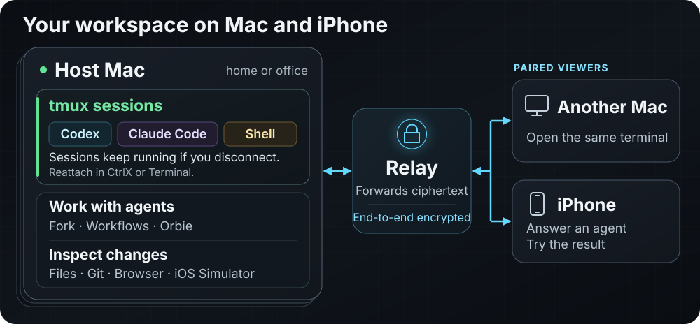

# CtrlX

[English](README.md) · [在 Mac 上试一次](#在-mac-上打开第一个项目) · [使用文档](docs/README.md)

CtrlX 也是一款 AI 编程工作台。你可以带着已有的**上下文**换设备、换工具、分头试方案，也可以把多轮开发、评审和返修串成一项**长程任务**。

## 上下文

| 特点 | 你能做什么 |
| --- | --- |
| **完整性** | • **把需求说准。** 用手机口述带英文分支名的需求时，语音纠错可对照当前终端里的拼写。 |
| | • **把证据带上。** 附上原文件，或在截图上圈出报错的那一行，连同需求发给 Agent。 |
| | • **带上验收要求。** 把「先补一个回归测试」存成快捷短语，下次提需求时一点就能用。 |
| **连贯性** | • **跨设备接着做。** Mac 上开始的对话，拿起 iPhone 或换到另一台 Mac，都能回到同一标签。 |
| | • **跨操作区给反馈。** 在文件、网页或模拟器里圈出问题，把标注带回原对话的输入框。 |
| | • **跨 Agent 分头试方案。** 在 Mac 的 Codex 或 Claude Code 标签按 ⌘F 快速 Fork，让新 Agent 带着已有对话试另一条路。要隔离改动，可从 Fork 菜单选独立的 Git worktree。[Fork 用法](docs/services-reference.md#fork-a-native-agent-conversation-macios) |
| | • **跨 App 唤起 Orbie。** 在 Mac 其他 App 里也能用全局快捷键接着聊，或从这段讨论 Fork 一个 Orbiter 去做支线。[Orbie 与 Orbiter](docs/global-agent-design.md) |
| | • **跨用户协作（规划中）。** 邀请同事的 Agent 加入同一个 Room，按你们定好的接口一起联调。 |
| **可恢复性** | • **找回工作现场。** 启用工作区恢复后，Mac 重启可找回标签、分屏和 CtrlX 编辑器中未发送的草稿。 |
| | • **接回原对话。** 受支持的 Codex 和 Claude Code 版本可自动恢复已核实的对话。需要确认时，也能在 iPhone 上点 **Resume**。[工作区恢复](docs/workspace-recovery-design.md) |

## 长程任务

| 环节 | 你能做什么 |
| --- | --- |
| **持续运行** | • **手机离线，任务照常跑。** Agent 在开发机上工作，还可开启「保持 Mac 唤醒」以防空闲睡眠。 |
| **人工介入** | • **回到需要你拍板的标签。** 在 iPhone 点提问或审批通知，就能找到正在等答复的 Agent。 |
| **Workflow** | • **等开发做完，再交给评审。** 即使讨论了好几轮，也可等 Codex 明确完成，才把结果交给同一台 Mac 上的 Claude Code。 |
| | • **并行评审，意见到齐再改。** 让两个 Agent 分别检查实现和测试，再把两份意见一起交给修复步骤。 |
| | • **重启后接着做。** 开发机重启后可查看已完成步骤的结果，点 **Continue** 恢复工作流。[工作流](docs/multi-agent-design.md) |

## 产品架构

我们设想的 **Room** 把做同一件事的 Agent 聚在一起。全局 Agent **Orbie** 和 **Workflow** 都运行在你自己的 **Host Mac** 上。你可以从 Orbie 的对话中分出 **Orbiter** 探索支线。Workflow 可以由你直接启动，也可以交给 Orbie 控制。



- **远程控制（实线）。** iOS 和 macOS **Viewer** 已支持通过 **Relay** 端到端加密接入你的 Host。Android Viewer 在规划中。
- **规划中的跨 Host 协作（虚线）。** 目前，同一工作流的 Agent 在同一台 Host 上执行任务。按规划，三位同事的 Agent 可以经同一个 Relay 加入你的 Room，仍在各自的 Mac 上工作。

## 比如，给报表加一个导出按钮

1. **在 Mac 上提需求。** 附上报表截图，口述「在筛选器旁边加一个导出 PDF 的按钮，保留列顺序」。看一眼草稿再发。[上下文语音输入](docs/terminal-quick-actions.md#context-aware-voice-input)
2. **用 iPhone 验收。** 点通知回到提问的标签，答「导出所有符合筛选条件的记录」。在 **Browser** 接手 Agent 打开的 `localhost` 页面，点导出，从下载记录进入 **Files** 查看 PDF。[浏览器下载](docs/agent-browser.md#human-downloads)
3. **把问题指给原 Agent。** 如果最右一列被截断，在 PDF 上圈出那一列。点 **Choose Agent** 选回原对话，再点 **Add to Input**，补一句「长列名也要显示完整」再发。[文件标注](docs/file-browser.md#in-place-preview-annotation) · [网页标注](docs/agent-browser.md#in-place-screenshot-annotation) · [模拟器标注](docs/agent-simulator-design.md#三端截图标注)
4. **让另一个 Agent 验收。** 在 Workflow 里让 Claude Code 按筛选条件和列顺序评审，再把发现的问题交回给 Codex 修复。

## 常用操作

- **少打几个字。** 用 **Commands** 选 `/diff` 看改动。两台设备都启用同步后，**Quick Phrases** 里的常用短语也能共用。[快捷指令](docs/terminal-quick-actions.md#curated-command-catalogs) · [短语同步](docs/terminal-quick-actions.md#optional-device-sync)
- **换模型或账号。** 每个标签可保留常用模型和推理强度按钮。**Dashboard** 可查服务商提供的额度和重置时间。用 Codex 或 Claude Code 官方账号时，**Log Out and Log In** 会登出 Host 上该 CLI 配置共用的账号，重开原对话供你手动登录。[模型快捷按钮](docs/terminal-quick-actions.md#status-bar) · [切换账号](docs/services-reference.md#exit-and-resume-an-agent-macios)

## 开始使用

### 在 Mac 上打开第一个项目

在运行 **macOS 26 或更新版本的 Apple Silicon Mac** 上安装 tmux 和 CtrlX。

```bash
brew install tmux
curl -fsSL https://ctrlx-1256844776.cos.ap-guangzhou.myqcloud.com/macos/mac.sh | bash
```

打开 CtrlX 就能看到已有的 tmux 会话，只用普通终端也可以。要使用 Agent，先在这台 Mac 上安装并登录它的 CLI，在 **Settings → Agents** 配置集成，然后选 **New Session → Start in Directory…** 打开项目。已有会话里用 **+ → New Agent…** 添加标签。

第一次可以点麦克风问「这个项目怎么在本地跑起来？」再点一下结束录音，核对草稿后发送。

CtrlX 内置 Codex、Claude Code 和 Traex 集成，另有 OpenCode、pi 和 omp 插件。提问和 Fork 等操作取决于所用 Agent。正式 Mac 安装包经过 Developer ID 签名和 Apple 公证。

### 从 iPhone 或另一台 Mac 连接

1. 在第二台设备安装 CtrlX。iPhone 需要 **iOS 18 或更新版本**，目前通过 Xcode 本地签名安装。[iPhone 安装说明](RELEASE.md#local-overwrite-installation)
2. 两端选择同一 Relay。可以使用 `wss://ctrlx.zengjice.com:7001`，也可以自建。若服务要求访问密钥，在 Host 的 **Settings → Relay → This Mac · Relay Traffic → Access Key** 填写，再点 **Save Access Key**。
3. 在 Host 生成配对码，在另一台设备输入。选择刚才的项目和标签就能继续输入。远程使用期间，Host 需要保持唤醒、联网并运行 CtrlX。

如需在锁屏时收到 iPhone 通知，Relay 的 APNs 配置要与安装的 iOS App 匹配。[推送配置](docs/self-hosting.md#apns)

## 隐私与开源

两端都主动连接 Relay，Host 无需开放入站端口。工作区内容只有配对设备能解密。自托管 Relay 的默认开放模式无需 CtrlX 账号或订阅。[架构与加密](docs/architecture.md) · [自托管指南](docs/self-hosting.md)

Agent 使用你配置的 AI 服务。若开启云端语音纠错，候选文本和当前终端的一小段上下文会直接发送到你选择的服务。[语音与快捷操作](docs/terminal-quick-actions.md)

Mac App、iOS App 和 Relay 均开源。[技术文档](docs/README.md) · [贡献指南](CONTRIBUTING.md) · [构建说明](AGENTS.md)

## 许可证与来源

CtrlX 是基于 [Gallager](https://github.com/gpambrozio/Gallager) 的独立发行版，基线为
2026-08-14 的 commit `919c7772928531d4d0bb266bdf275691d361901e`。CtrlX 由
ZengJice 维护，与 Gallager 项目不存在隶属或官方背书关系。

CtrlX 以 [GNU AGPL-3.0](LICENSE) 发布。已发布二进制和托管中继服务会标识对应的源码 commit，
中继服务通过 `/version` 和 `/source` 提供版本与源码信息。另见 [NOTICE.md](NOTICE.md)、
[MODIFICATIONS.md](MODIFICATIONS.md) 和 [THIRD_PARTY_LICENSES.md](THIRD_PARTY_LICENSES.md)。
