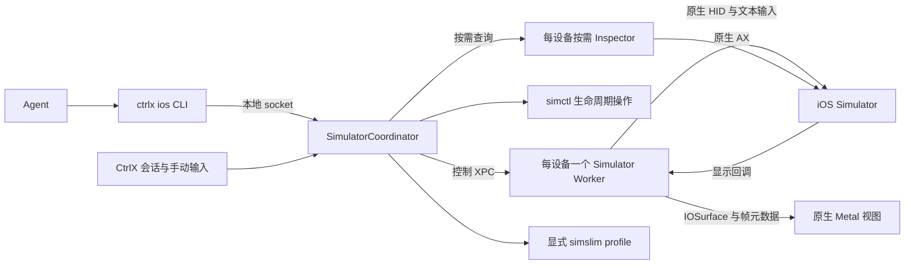

# Agent iOS 设计（当前支持 iOS Simulator）

当前源码的对外入口为 `ctrlx ios`，配套技能为 `ctrlx:agent-ios`（`plugin/ctrlx/skills/agent-ios/`）。运行与控制仍由 Host Mac 上的 iOS Simulator 提供；配对 Mac / iOS Viewer 支持画面查看，以及显式接管后的触摸和剪贴板操作，真机及 Android 支持留待后续。内部 `Simulator*` 类型、`simulator.action` 协议和设备存储目录继续沿用。旧 CLI 名称不保留别名，调用脚本与 Skill 应随新版本一同更新；下文历史证据中的 `ctrlx simulator` / `agent-simulator` 保留当时名称，不代表本次改名已经过同样的设备验收。

## Viewer 剪贴板与接管

更新后的 Host 用 `supportsWorkspaceClipboard` 为配对 Mac / iOS Viewer 开启 Take Control、
Copy、Paste；旧 Host 保持只读。触摸基于实际显示帧的设备 epoch / geometryVersion，
坐标映射到指定设备。Mac 支持拖动选区和 ⌘C / ⌘V；iOS 支持点击、长按、拖动和工具栏按钮。
控制权绑定 Viewer、标签和 surface ID，20 秒失效，前台预览续期；Host 人工输入、
Viewer 断开或离开标签会释放控制。Agent 在 Viewer 控制期间不能重新 claim。

复制先仅读取设备剪贴板 revision，再发 Cmd+C；轮询在同一次快照中确认 revision 改变后，
才提取并检查新内容的 384 KiB 限制，避免旧的大剪贴板阻断复制或被误当成选中内容返回。
若在模拟器内使用了原生 Copy 菜单（如 Safari 图片），使用复制按钮菜单中的
Get Simulator Clipboard 显式取回设备剪贴板；长按复制按钮可打开此菜单。
复制、读取剪贴板和粘贴的成功提示与浏览器共用底部浮层，不占布局高度，也不拦截点击或触控。
连续操作或后续触摸清空提示时，Viewer 画布尺寸、位置和模拟器画面比例保持不变。
粘贴将不超过 384 KiB 的文本 / PNG / JPEG 写入指定设备，在统一的 5 秒时限内确认目标内容
可见后，再在身份仍有效时发 Cmd+V。旧快照只触发重新读取，不重复写入；超时或断连明确失败。
复制和粘贴同时限制剪贴板 JSON 为 576 KiB（包括 Base64 与斜杠转义），为原生请求及加密
Relay 消息预留空间。图片超过编码预算时由发送端重新编码或缩小，原始字节满足限制并不代表可直接传输。
通过 CoreSimulator 的 SimPasteboardInterface 与临时命名 pasteboard 做一次传输，不启用
自动同步，不使用 Host 全局 pasteboard。系统粘贴许可和目标 App 的图片支持仍由 iOS 决定；
不支持此接口的 Xcode 明确报错，不退回覆盖 Host 剪贴板的路径。

## Agent 工具选择入口

`plugin/ctrlx/skills/agent-ios/SKILL.md` 是默认工具选择说明的唯一来源，首句明确本地
CtrlX Codex / Claude Code 会话的实时 iOS Simulator 界面查看、操作、截图与复现优先使用 `ctrlx ios`。
用户明确指定的工具、设备或测试框架保持优先；真机、Mac 界面、纯编译以及仅分析已提供
图片不因此启动模拟器。完整操作步骤移至同技能的 `references/workflow.md`，按需读取。

两种插件的现有 `SessionStart` hook 在 tmux 内成功转发生命周期事件后，将这个简短入口
与 `file-links` 及 `agent-browser` 的简短正文一起写入一次 `additionalContext`；覆盖 startup / resume / clear /
compact / fork，无需先隐式选中技能，也不在启动 hook 中执行 CLI 或启动设备。输出附带
已安装技能的实际路径，用于解析相对参考链接。各技能独立读取，缺失、不可读、格式损坏
或超过 5000 字节只跳过自身，不影响其余上下文及原事件。

Codex 新会话用 `ctrlx ios run -- codex`，原生 Claude Code 在 CtrlX 本地终端直接运行
`claude`；`run` 仍只接受 Codex。Host 同时识别原生 `claude` 和
`claude/versions/<数字.数字.数字>` 路径，保留最近 agent、同用户和进程实例校验；
版本目录内的 helper 不视为 Claude。来源标签解析失败的提示区分通用本地终端要求与
Codex 的专用启动方式，不引导 Claude 启动嵌套 Codex。

更新 App 后仍需更新已缓存的 agent 插件，并在启用 / 信任 hooks 的会话触发
`SessionStart`，只修改仓库文件不会更新运行中的 agent。版本以各插件 manifest 为准。
`python3 scripts/tests/test_agent_skills.py` 验证打包镜像、实际 hook 输出、五类启动来源、
独立失败和生命周期转发；这些检查不证明模型一定遵从。真实选择验收应在不点名技能的
新会话、恢复和压缩后请求模拟器截图 / UI 复现，并检查纯编译、真机及明确指定其它工具
的任务保持原工作流。

## 当前验收与交付记录

当前验收以 **2026-10-12 用户最新更新** 为准：本期仅覆盖**内置屏 120 Hz**，外置屏 60 Hz 推迟。默认同步与可选低延迟模式的源帧至对应原生呈现均要求 **p95 ≤100 ms**，帧率 ≥50 FPS；点击至可见响应 **p95 ≤150 ms**，暖恢复 ≤250 ms。用户明确要求“不用重试再验证，直接复用已有证据”，因此本次仅按新门槛复核既有结果，不再启动性能测试、补采区间或扩展设备数；新增能力另做定向功能验证。历史失败记录保持原样，新结论与当时门槛分开保存。本机 P0 / P1 与跨机兼容、公开分发分别验收。

**代码审查收尾（2026-10-12）：** 原三项 Accepted 及后续五项 P2 输入问题均已在源码修复：退出先取消并等待启动任务及其子进程，失败启动的关机清理使用未取消的任务；人工输入修订号与触摸代次分开，新的人工操作使旧 claim 失效，同时保留连续点击和键盘交错时排队的拖动、抬手；拖动合并不跨越按键或下一轮手势，各段保留自己的坐标；鼠标按下仅在从 agent 接管时请求全量取消，普通人工点击保留用户仍按住的 Shift，越界抬手通过内部 `release-touch` 命令仅释放原生端已有触点，保留按键状态；claim 等待既有人工输入队列收尾，再取消残留输入并授予控制权，两个等待点均校验是否出现新的人工操作；技能入口为 4,922 字节。此前点击回归及本轮左右 Shift 越界抬手用例均在各自修复前复现失败，修复后 66 项定向 Swift 测试全部通过，覆盖正常区域内 / 越界松开后继续输入，以及此前的连续点击、拖动、启动取消和 claim 交接回归；新增用例通过真实服务队列和视图按键事件，使用替代 HID 连接核对发出的请求，原生桥接代码编译通过。未改动的技能复用上一轮 3 项资源检查。最新日志为 `.build-local/simulator-outside-release-before.log` 与 `.build-local/simulator-outside-release-after.log`，此前输入回归日志保留，未重跑模拟器性能采样。R132 是修复前的历史签名候选，该轮尚未重建签名 App；签名交付已由下述存储能力候选补齐。既有运行证据及当时的验收结论保留。

**存储能力与候选交付（2026-10-12）：** 已实现 `uninstall`、`storage`、`erase --udid`、`delete --udid` 和精确重开的 `open --udid`；普通关闭仍保留数据。CLI、生命周期、启动取消及人工接管的定向回归通过；独立 iOS 27 临时设备实测确认卸载后 App 不存在、擦除后 App / 数据清空、删除后私有清单为空，活动设备删除被拒绝，测试设备及临时目录均已回收。新增精确重开选择、删除与启动互斥、退出等待清理及失败不重试均有回归覆盖。签名 Release 候选 **20261012-184614** 同时包含此前八项审查修复；App、CLI 和两个 helper 的严格签名，以及两套随包技能与源码一致性检查通过。索引为 `.build-local/simulator-storage-build.json`，日志为同目录 `simulator-storage-tests.log`、`simulator-storage-native-fixed.log`、`simulator-storage-workspace.log`。本轮原生效果测试直接调用 coordinator，未重跑签名窗口的真人操作、真实 Codex 会话或性能采样；未受影响的历史证据继续复用。正式 App 和用户插件未替换；SwiftLint 未安装，构建阶段跳过该检查。

**慢存储退出阻塞修复（2026-10-12）：** 已修复本轮 Accepted P2：启动和存储任务在等待前一并取消，继续等待各自命令退出；全局退出并行推进模拟器清理，优先断开终端管道及 control clients，再关闭浏览器，最后汇合模拟器收尾，保留 30 秒退出上限。新增回归在修复前复现浏览器 / 终端清理未执行及存储任务未取消，修复后通过，覆盖 120 秒存储操作、排队取消、延迟回收与全局截止只通知一次。定向 Swift 回归和三项技能资源检查通过；新 Release 签名候选 **20261012-193651** 已生成，严格签名、CLI 与随包技能核对通过，当前索引为 `.build-local/simulator-storage-shutdown-build.json`。前后测试日志为 `.build-local/simulator-storage-shutdown-before.log` / `simulator-storage-shutdown-after.log`；本轮通过虚拟时钟与替代进程 / 浏览器边界验证退出顺序，未重跑真实窗口退出或性能采样，正式 App 未替换。

**按需录屏与基础 pinch（2026-10-12）：** 已实现 `record-start` / `record-status` / `record-stop` 与基础双指 `pinch`，复用 Apple 录屏命令和现有两触点 HID / 手势队列。101 项定向 Swift 测试及 14 项技能检查通过，覆盖延迟封装、时长 / 文件大小上限、取消 / 超时回收和输出不覆盖；此前输入、存储及退出回归通过。签名候选 **20261012-210257** 在独立 iPhone 16 / iOS 27 / standard 设备上验证横竖屏双指放大、缩小，以及手动停止、自动到时、关闭设备、正常退出四种录屏收尾，四个 H.264 MP4 全量严格解码通过，并独立查看录制中的横竖屏帧。测试调用者为 native Codex 身份 fixture，不是真实 Codex / 模型会话；本轮不补采性能或多开矩阵。原生录屏在静止画面下可能仅产生一个短帧，旋转后保留原生画布方向，这些边界已写入操作手册。随后仅补充录屏文档并更新签名包，产品代码输入保持一致，当前可审阅候选为 **20261012-210934**，索引 `.build-local/simulator-record-pinch-build.json`；实际效果证据为 `.build-local/simulator-record-pinch-acceptance/verification.json`，回归日志为 `.build-local/simulator-record-pinch-tests-final.log`。严格签名和两套随包技能核对通过；测试宿主正常退出，专用设备、录制进程和临时设备目录已回收。正式 App 与用户插件未替换，SwiftLint 未安装。

**录屏退出顺序修复（2026-10-12）：** 接受“已有设备关闭任务阻塞其他录制停止”的 P2。服务退出先调用 coordinator 的 `prepareForShutdown()`，立即拒绝新增启动 / 录制、取消已登记的启动和存储任务，并行停止及回收剩余录制，再等待服务层已有关闭任务，最后完成 coordinator 的设备清理；直接调用 coordinator 退出也复用此准备步骤。保留全局 30 秒期限及既有关闭任务的等待。helper 连接创建纳入现有系统依赖边界，以测试真实服务 / coordinator 路径；分别阻塞设备 A 的封装和关机，确认设备 B 在 A 释放前已收到 SIGINT、完成文件并退出。两个用例修复前失败、修复后通过，72 项相关 Swift 回归及 14 项技能检查通过。日志为 `.build-local/simulator-record-shutdown-before.log` / `simulator-record-shutdown-after.log`；本轮不启动真实模拟器、不重复性能采样，未改动的录屏编码和 pinch 原生效果沿用上轮证据。当前签名 Release 候选 **20261012-213251** 的构建、App / CLI / helper 严格签名及两套随包技能核对通过，索引为 `.build-local/simulator-record-shutdown-build.json`。正式 App 与用户插件未替换。

**Pane 复用与 Viewer 查看（2026-10-13，本机定向验证）：** `open` 改为复用来源 pane 的默认设备，新增 `open --new` 显式多开；设备由 Host 服务持有，关闭工作区仅卸载本地视图。Mac / iOS Viewer 通过现有 E2EE 通路查看同一设备的有界 JPEG 预览，不提供远程写操作。本轮签名 Mac 候选与 iOS Simulator SDK 编译、相关回归和技能检查通过。独立 iOS 27 helper 的三档 JPEG / PNG，以及隔离 Host 窗口中的重复打开、关闭工作台后保留设备、重新挂载画面均已实测；测试资源已回收。真实配对 Mac / iOS Viewer 的端到端界面联调尚未执行，不能由编译或 helper 验证代替；未重新采样性能。具体产物与验收边界见 [实施清单](v3.0.60/STAGE1_TODO.md)。

## 当前能力与边界（开发维护视角）

本节按当前源码说明能力范围；是否已进入签名 App、完成真实效果验证，分别以文首交付状态及下方验收清单为准。面向使用 agent 的 [操作手册](../plugin/ctrlx/skills/agent-ios/references/operations.md#capability-coverage) 独立列出相同能力范围，并提供参数、操作语义和替代方法。两处均应随接口变化维护；历史实验记录中的计划命令不代表当前接口。

### 已实现并对外提供

| 领域 | 当前接口 | 行为与边界 |
|---|---|---|
| 设备生命周期 | `inventory`、`open`、`devices`、`status`、`close`、`storage`、`erase`、`delete` | `open` 复用当前 pane 的默认设备，`open --new` 显式多开；`open --udid` 精确选择私有设备。关闭仍保留数据；`storage` 列出私有设备、占用与活动状态，`erase` 重置指定闲置设备并保持关机，`delete` 删除指定闲置设备 |
| 应用生命周期 | `install`、`uninstall`、`launch`、`terminate`、`open-url` | 安装或更新预先编译的模拟器 `.app`，按 bundle 卸载；卸载不等于整机重置。启动等待原生 Scene 激活，不代表页面内容已加载。URL 可能触发 iOS 确认，需要观察实际投递 |
| 观察与定位 | `snapshot`、`wait`、`screenshot` | 原生 AX 树、观察内元素引用、标识 / 标签 / 角色定位、可见 / 消失等待、PNG 截图。元素写入前刷新 AX 并检查唯一性；仅 `--ref` 绑定此前观察的 App 进程、几何及控制代次，语义选择器查询当前界面，需确认当前 App / 页面 |
| 触摸 | `tap`、`swipe`、`long-press`、`drag`、`pinch` | 单触点点击、滑动、长按、拖动及显式起始边缘手势；`pinch` 同时发送两个触点，按中心和比例缩放。使用模拟器逻辑点，旋转后重新观察 |
| 键盘与文本 | `key`、`button`、`paste` | HID 按键及修饰键组合，Home / 锁屏 / 音量键，Unicode 剪贴板粘贴和指定目标的 iOS 菜单粘贴；人工输入采用 iOS 硬件键盘输入源 |
| 原生显示 | `show`、`show --split`、`rotate`、`display-mode` | 内嵌 Metal 画面、左右分栏、方向切换、默认同步 / 可选低延迟显示。低延迟模式可能撕裂；选择标签不保证 Mac App 自动取得前台 |
| Viewer 查看与接管 | Mac / iOS Viewer 的 Host 模拟器标签 | 共享 Host 画面，支持显式接管后的触摸及文本 / 图片剪贴板；选择独立，隐藏 / 后台 / 断线停止取帧并释放控制，无设备关闭操作 |
| 截图标注 | Mac Host / Mac Viewer / iOS Viewer 标签内的 Annotate Screenshot | 原地冻结截图，框选 / 箭头 / 画笔后添加至同会话 Agent 输入；不发送回车、不抢模拟器控制权 |
| 环境 | `location`、`appearance`、`privacy`、`push` | 固定定位及清除定位模拟、深浅色、列举权限的 grant / revoke / reset、向指定 App 注入模拟推送；关闭时不自动恢复这些配置 |
| 资源与服务配置 | `config`、`resources`、`metrics`，`open --profile` / `--requires` | 默认双开，数量可配置为 1...32；检查内存压力和内存 / 磁盘保留量。报告进程 footprint / CPU，支持 standard / balanced 和功能依赖保留；配置上限不等于实测容量 |
| 诊断 | `logs`、`crashes` | 按设备与 App 身份查询有时间、条数及字节上限的日志和崩溃记录；截断和空结果均不能证明从未出错 |
| 按需录屏 | `record-start`、`record-status`、`record-stop` | 每个自有设备同时一段，H.264 无声 MP4，最长 60 秒；首帧就绪后返回，完成封装后才发布新文件。默认关闭，关闭设备及正常退出时收尾 |
| 所有权与编排 | `identity`、`claim`、`batch`、`run -- codex` | 校验本地调用者的进程实例与设备归属；真人输入撤销 agent 写控制权，显式 claim 才交回。每批最多 16 步，失败后停止，不回滚或自动重放；`run` 供来源终端启动新 Codex 并添加 `--no-daemon`，不能修复已运行会话的身份链 |

底层运行时是 Apple CoreSimulator，当前原生传输要求版本 ≥1155.4，并依赖已安装的 Xcode / iOS runtime。CtrlX 自建显示、输入、观察、设备生命周期和所有权层；simslim 用于启动准备、服务配置校验及低频资源测量。`standard` 与 `balanced` 是同一控制实现的两种服务配置，两档都会调用内置 simslim；它们不是两套可切换的控制引擎。`--requires` / doctor 只核对服务配置，不能替代实际 App 功能测试。日常任务仅验证所选配置下的所需功能；评估 `balanced` 或用户要求对照时才比较两档，不把开发验收矩阵套入每次使用。

源码入口：外部命令集合在 `CtrlxSimulatorProtocol/SimulatorBatch.swift`，参数与调用在 `CtrlxCLI/Commands/SimulatorCommands.swift`；服务路由与输入交接在 `AgentSimulatorService.swift`，设备及服务配置在 `SimulatorCoordinator.swift` / `SimulatorSlimProfile.swift`，原生边界在 `CtrlxSimulatorBridge/`，窗口输入与呈现在 `SimulatorMetalView.swift`。

设备清理沿用同一 coordinator：`uninstall --device --bundle` 要求当前设备 owner / writer；`storage`、`erase --udid`、`delete --udid` 要求本地 agent 身份，仅访问 CtrlX 私有 device set。存储池包含关闭后保留的设备，因此其范围比当前 agent 的 `devices` 更广。擦除 / 删除必须显式指定一个 UUID，设备须为 Shutdown 且没有活动 handle、启动、关闭或失败关机保留；与启动共用串行入口，等待后再次检查调用进程。退出先取消已登记的启动和存储任务，再等待命令收尾；模拟器清理与浏览器及终端清理独立推进，保留全局 30 秒退出上限。不提供全量删除、强制关闭其他 agent 设备或自动清扫。

`storage.allocatedBytes` 使用有界、按需的 `du` 采样，未知为 null 并报告采样错误，不把目录占用等同于系统物理空间释放量。`canModify` 只是查询时状态，写入前重新检查。重置后用 `open --udid` 重开同一设备，返回新 CtrlX ID；该参数不与 runtime / device type 混用，目标缺失或忙时明确失败，不回退到其他设备。服务配置需重新传入，默认仍为 standard；写入超时不自动重试。使用示例见 [存储操作](../plugin/ctrlx/skills/agent-ios/references/storage.md)。

基础 `pinch` 复用原有两触点 HID 传输与手势循环，不引入新的输入引擎。`--x` / `--y` 是当前显示逻辑点中的中心，`--scale` 为终点 / 起点指距（0.25...4，排除 1），`--duration-ms` 为 20...5000，默认 500。初始水平指距最多 100 点，按屏幕边界缩小以容纳两端；过近边界的中心明确拒绝。两指同事件按下、移动、抬起，沿用几何版本核验和人工接管取消；不承诺 App 最终缩放比例等于指距比例。参数示例见 [手势](../plugin/ctrlx/skills/agent-ios/references/gestures.md)。

录屏使用 `SimulatorRecorder` actor 管理私有 device set 的 `simctl io recordVideo` 子进程；`SimulatorRecordingClient` 注入创建边界。开始要求 owner / writer；查询和停止仅要求 owner，人工接管后仍可停止。首帧等待最多 10 秒，录制上限由 `--seconds 1...60` 指定（默认 60）；到时或临时文件达到 128 MiB 时发送 SIGINT，最多等 15 秒封装，超时回收进程并丢弃未完成文件。最终文件大于 128 MiB 也拒绝发布。输出卷须满足配置的磁盘保留量加文件预算；这不是磁盘预留。视频在输出目录的私有临时子目录编码，完成后以同卷硬链接原子发布到新 `.mp4` 路径，防止覆盖竞态，随后清理临时目录；强杀宿主仍可能残留录制进程及临时目录。关闭设备、owner 过期及正常退出均先收尾录屏；各设备退出收尾并行。三条命令均可用于 batch，失败不回滚此前的开始。详见 [录屏操作](../plugin/ctrlx/skills/agent-ios/references/recording.md)。录屏保留原生设备画布，片中旋转可能横置显示；仅在显示更新时取得帧，静止画面的视频可能很短，时长参数是采集的墙钟上限，不保证播放时长。录屏直接取得 guest 画面，无音频、暂停或编辑，不申请 macOS 屏幕录制权限；编码期间存在额外负载，既有无录屏性能证据不扩展为录屏中的帧率保证。

### Pane 复用与远程查看的实现约定

三类 Host 标签遵守同一个边界：按来源 Pane 区分人工 / Agent 默认资源，普通打开复用、
显式多开不替换默认资源，查看 / 标注不改变归属。iOS 当前终端标题下方的 Open iOS 可打开该窗口
已有设备；没有时，通过 `OpenPaneSimulator` 在 Host 创建标准配置的默认设备。
人工打开和 Agent `open` 共用 pane 的默认设备与在途启动任务，不额外创建副本。
浏览器保留人工与 Agent 两组，Files 目前只有人工组（点击 Agent 输出路径也属于人工操作）。

`AgentSimulatorService` 在 Host 进程内以来源 pane ID 索引默认活动设备，
并登记该 pane 正在进行的默认启动任务。并发 `open` 合并；先判断复用，再检查新增
设备容量。显式 runtime / type / profile / UDID 不符或缺少声明的 required features
时明确报冲突，不更改已有设备。`--new` 跳过默认映射，额外设备不替换主设备。
关闭默认设备清理映射；Agent owner 仍按 UID / PID / start time 校验。
人工创建的设备没有 Agent owner / writer；同一持久 pane 的 Agent 显式 `open` 才可采用它，
仍需 `claim` 才能取得写权限。Viewer 打开已有 Agent 设备不改变 owner / writer。
人工设备在来源 pane 消失或身份改变时关闭，隐藏空闲回收沿用现有规则。

工作区 unregister 只 detach，register 重新采用同一个设备与稳定渲染对象；未挂载时
不订阅本地连续帧。设备可在没有本地工作区窗口时由来源 agent 打开。tmux pane 的
session / window 变动更新标签归属。明确关闭设备、agent 退出和 Host App 退出仍
沿用关机及录屏收尾规则；本地可见或持续有效的 Viewer 请求阻止隐藏空闲回收。
完整会话重命名通过前后 pane 集合识别，只更新设备路由，保留已挂载视图；
`open` 的来源解析保留同一次 tmux 查询得到的完整快照，经 owner / 退出状态校验后，
与后台刷新共用 `updateSimulatorRoutes`，不再单独迁移一个设备。即使 `open` 先于
批量刷新，也能同时保留同会话的默认与额外设备，且不增加 tmux 查询。
普通 pane 刷新发现变更时，先用已刷新的完整列表同步模拟器路由，再广播 Viewer
快照；外部 `tmux rename-session` 即使没有触发布局事件，也会在下一次周期发现
（间隔 10 秒）后更新，不依赖再次 `open`。快照读取本身保持只读，不追加 tmux 查询。
MainView 整体迁移原会话的标签集合、选择与分栏状态，避免先移走标签后覆盖新集合。
同一会话内稳定窗口 ID 不变、仅索引重排时，共用路由方法同样保留挂载与选择，
由 MainView 的窗口映射更新标签关联；后台刷新与 `open` 复用遵守同一规则。
真正的 pane 跨窗口或跨会话移动仍卸载并重新挂载到目标位置。

网络模型位于 `CtrlxNetworking/Models/RemoteSimulator.swift`：session 快照新增可选
`supportsSimulatorViewing` / `simulatorTabs`，`BrowseSimulator` 只请求单帧。
`withPairId` 保留这些字段，Viewer 状态依附原有每 Host 连接与工作区。发送前检查
能力标志；每次请求检查 session / tab / 活动 owner，完成后重查关闭及路由变化。
不把浏览器命令或 agent 的本地身份凭据暴露给 Viewer。

创建能力另以可选 `supportsPaneSimulator` 标识；旧 Host 不支持创建时入口置灰。
`OpenPaneSimulator` 绑定发送时的 Host / tmux server / 持久 pane 身份，Host 在启动前及
启动完成后重新解析来源；来源变化则回收尚未发布的设备。更新的路由快照优先于旧的
异步查询结果。启动使用独立请求队列，不占终端键盘接收循环；重复请求合并且沿用设备
容量、内存和磁盘限制。iOS 收到结果后再次校验身份，离开/取消等待不会跳回旧标签。
取消等待不撤销其他 Viewer 共用的 Host 启动。创建入口不增加远程输入或关闭权限。

`ConnectedViewer` 将模拟器请求放进既有 preview 队列，与浏览器合计每连接最多四个
并发请求；终端输出拥塞时暂停新取帧。模拟器服务全局最多四个请求，同设备同尺寸的
在途编码合并，不同尺寸等待已有编码结束。每个可见 Viewer surface 仅一个在途帧，
回复后间隔 180 ms；解码在并发执行上下文进行，过期选择 / 隐藏 surface 的返回不展示。
Mac 复用 session 标签栏与分栏；iOS 在 Tabs 中列出 iOS Simulators on Host。
远程标签提供查看和本地分栏，不提供关闭 Host 设备的按钮。

原生 helper 的 `preview` 复用已有独立截图缓冲区、方向处理和 ImageIO，直接输出
JPEG，不经 PNG 落盘或录屏。按 Viewer 实际画布缩放、不放大源图、最长边最多 2560，
质量 0.82，超出 512 KiB 时按 75% 有界缩小。未出现源帧时等待最多四秒；传输请求
标记 readOnly，预览超时不使输入连接失效。图片经过现有 E2EE / Relay，无新端口或
Relay 业务接口。此刷新策略不承诺远程达到本地 ≥50 FPS / ≤100 ms，约 5.6 FPS 仅是
忽略网络和编码时间的理论上限。无 Viewer 请求时无远程编码或磁盘写入。

### 三端截图标注

模拟器标签顶部提供 **Annotate Screenshot**，在首帧就绪、图片投递能力可用时启用。
复用 `BrowserAnnotationSurface`，在原位置覆盖一张只读截图，不另开编辑页，也不卸载
Host 的原生渲染视图。支持红色框选、箭头、画笔、撤销、清空、取消和 **Add to Input**；
笔迹使用图片归一化坐标，窗口缩放 / 分栏不改变落点。冻结的是本次截图，设备与其他
Viewer 继续运行；设备随后旋转也不会改变正在标注的画布。

Mac Host 继续复用 `BrowseSimulator` 的有界 `preview`，请求最长边 2560 的新截图；
捕获期间关闭设备、取消或来源 pane / window / session 变化时拒绝过期结果。
Mac / iOS Viewer 则在点击时固定**已成功解码并显示**的预览原始字节、路由及接收 Agent，
先固定再停止轮询，不重新向 Host 请求高清截图，也不等待已在途的预览请求。
已收到但尚未显示的新帧不能替换截图；标注中不升级分辨率或替换画面。图片质量沿用
点击时的预览尺寸，复用标注组件仅需本地解码，无额外网络往返、编码或磁盘 PNG。
首帧未显示、断线或图片无效时不可开始；已知路由变化但新画面尚未显示时明确拒绝。
Viewer 从有效预览同步当前归属，已完成的同会话窗口迁移不要求重建 Viewer。
标注期间暂停自身轮询，取消或完成后重新取帧，即使图片字节未变也恢复显示；旧在途
请求及迟到的解码结果不能覆盖冻结画面。无新端口或 Relay 消息。
Mac Host 只隔离当前视图的鼠标、按键及 Home，
释放已有人工输入与键盘焦点，不发 `claim`、不撤销 Agent 的 writer，也不暂停原生渲染。

捕获开始时固定来源 pane 中已识别的图片接收 Agent 身份；没有该目标则要求显式选择
同会话 Agent，不自动退到其他 pane。投递前沿用 `AgentImageTarget` 的完整身份 / 可输入状态
校验，通过既有图片附件链路追加图片，不覆盖已有草稿、不发送回车。失败保留当前标注；
已确认投递后仅重试打开目标，不能重复插图。iOS 复用 `AnnotationTerminalHandoff`，后台挂载
目标终端并等待所有 pane 就绪后再露出，切换标签 / 断线 / 取消使旧交接失效。

此能力只编辑截图，不增加 Viewer 对模拟器的远程写权限；不支持笔迹跨端同步、持久草稿、
视频标注或控制设备。功能代码 / SDK 编译与实际配对端到端验收分别记录在
[实施清单](v3.0.60/STAGE1_TODO.md)，不扩展既有性能结论。

### 当前未提供

| 缺口 | 与已有能力的区别 |
|---|---|
| 任意多点手势、双指旋转或平移 | 当前双指接口仅提供基础 `pinch`，不暴露任意触点轨迹 |
| Mac 输入法 marked-text 组合及候选窗 | 已验证 iOS 硬件键盘输入源中的拼音；显式粘贴可以输入 Unicode，但不验证逐字符输入或组合过程 |
| 模拟器远程设备关闭及视频流 | 已提供 Viewer JPEG 预览、显式触摸接管和剪贴板；未提供远程设备关闭、音频或高帧率视频传输 |
| 真机控制 | 当前接口面向 iOS Simulator，不控制物理 iPhone |
| 设备显式克隆 | 已提供复用、擦除和删除，尚未提供复制一台设备作为另一份并行测试环境 |
| Runtime 下载 / 安装 | `inventory` 只列举已安装资源，Xcode 和 runtime 由外部工作流准备 |
| 编译与签名 App | 接受预先构建的 simulator `.app`，不封装 `xcodebuild` 构建系统，也不接受真机包冒充模拟器包 |

这里描述 CtrlX 接口的缺口，不代表 Apple 工具没有相应能力。不要根据 `simctl` 存在某命令，就宣称 `ctrlx ios` 已提供该能力。

### 已有实现但验收有限

- 真人鼠标拖动尚未完成实测验收；agent `drag` 的结果及输入队列回归不能替代真人路径的效果证据。
- `show` 可以选择和分栏标签，但自动取得 Mac 前台未获得可靠验证，不作保证。
- 当前资格限本机、iOS 27、内置 120 Hz、两台设备；外置 60 Hz、混合 1× / 2× 显示、四台及以上联合性能、其他 Mac / Xcode / runtime 均不由现有结论保证。
- 既有原生验收覆盖 Codex；当前入口已扩展至 Claude Code，启动上下文与原生调用者识别有定向测试，真实 Claude 会话 / 设备操作仍需独立验收。跨机兼容、公开分发和公证另行验收。源码测试通过与签名包已包含修复是不同状态，当前剩余交付工作见文首及收尾清单。
- UIKit / SwiftUI / WKWebView 的常用 fixture 已验证，不扩展为任意 App、所有控件或所有系统弹层均通过。未验收不等于已确认不可用。

### 支持操作中的原生与语义限制

- AX 可能缺少自绘 Canvas / 游戏节点；用截图和新鲜坐标处理。部分树不能证明不存在或唯一，AX 可见也不证明控件可点击；截图和 AX 不是原子观察。
- iOS 27 密码框粘贴 emoji 后逐字符退格存在原生问题；使用已验证的整值替换或全选删除。AX 不返回安全字段值，需要通过应用效果或测试接口检查。
- iOS 菜单粘贴的长按可能改变光标 / 选区，粘贴确认弹窗需等待可操作节点，不重复提交仍待确认的粘贴。快捷键效果取决于响应控件和 iOS 键盘布局。
- 旋转可能被 App 锁定方向拒绝；定位仅固定坐标，停止模拟后 App 可能仍显示最后位置。权限操作限已列举服务，部分变更会终止 App；模拟 push 不验证真实 APNs、购买或其他真实服务链路。
- 批处理不是事务，可能部分成功，也可能被人工输入打断。写入超时不代表未执行，不自动重放；日志 / 崩溃查询受范围及大小限制，空结果不证明没有发生问题。

2026-10-11 用户要求先分析七天未完成的根因。复盘前的运行测试已安全收尾，随后优先复核目标依据、交付边界和实验决策。当时仍保留原 P0 / P1 门槛；随后用户明确回复“采用”及“也同意延迟目标”，以下新契约已生效。复盘重点：第 8 节早已记录多数预算缺少原生基线校准，但实际执行仍把全部数值作为阻塞；测量端点与观察开销没有先收敛；出现足以判断失败的证据后仍扩大采样；历史试验记录过多，当前缺陷、外部限制与待验收项没有形成足够清晰的交付决策。

## 已确认的验收契约（2026-10-12 更新）

用户已明确采用整套校准方案，并同意延迟目标。以下契约优先于历史预算和实验记录。确认时 R122 的 960 项产品输入仍一致；取消拟议的暖恢复诊断改动。四小时执行批次从 2026-10-11 11:15:37（Asia/Shanghai）起算，保守采用墙钟上限，最晚 15:15:37 提交结果与阻塞，等待时间不延长截止。

**交付结果：在本机已安装的 macOS / Xcode / iOS 27 上，Codex 可以通过 CtrlX 完成可靠的模拟器操作；默认双开稳定流畅，给出经实际负载验证的多开容量及 simslim 收益结论。** 保留本次原 P0 / P1 功能范围，Claude、DeviceSlims、Peekaboo iOS 引擎以及原 P2 不纳入。

| 验收项 | 已确认契约 | 依据、改变与证据要求 |
|---|---|---|
| 显示环境范围 | 本期只验证内置屏 120 Hz；外置屏 60 Hz 推迟 | 用户于 2026-10-12 明确缩小显示环境范围；保留 60 Hz 历史结果，不将推迟记为通过。以下数值门槛及功能、容量要求不变 |
| Codex 使用闭环 | 隔离安装 / 刷新技能后，用当前原生启动路径的一次真实 Codex 会话完成安装、启动、观察、操作、截图检查与关闭 | CLI 返回成功不能替代应用效果；用户已允许启动这一个有界验收会话，不额外启动研究代理 |
| 功能与隔离 | 第 7 节本次 P0 / P1 的输入、文本、观察、生命周期、通知 / URL / 环境、诊断、XCTest 共存、所有权与接管均保留 | 用当前实现及已通过范围的源码影响分析决定补测项；已知原生限制需明确标注，不宣称任意 App / 任意控件均支持 |
| 默认同步显示 | 1 / 2 台可见，稳定 60 FPS 源下呈现 ≥50 FPS；源就绪至对应原生呈现 p95 ≤100 ms | 用户最新明确将显示延迟目标改为 ≤100 ms；复用既有证据，不重新采样 |
| 可选低延迟显示 | 同样 1 / 2 台可见，≥50 FPS，源至对应原生呈现 p95 ≤100 ms | 两种模式采用同一门槛；复用已有单 / 双台显示矩阵，UI 保留撕裂提示 |
| 输入与观察 | 简单即时响应场景输入至可见响应 p95 ≤150 ms；暖 PNG ≤250 ms；常用 ≤200 节点 AX ≤500 ms，复杂树 2 秒明确截止 | 点击计时仍从 CLI 发起至首次对应可见结果，不能用 ACK 冒充响应；其余观察预算不变 |
| 暖恢复 | R124 / R1083 两档各 30 次：standard / balanced 输入就绪 p95 235.14 / 221.69 ms，最大 300.98 / 304.80 ms，均满足 250 ms 的 p95 门槛。 | 60 次新原生帧、GPU 成功及输入就绪时序独立核对通过；standard 因确认文件竞态分两段采集，原两次 300.98 / 238.48 ms 全部保留；不宣称每次均小于 250 ms。 |
| 并发容量 | 复用已有固定 App 和观察 / 操作循环，交付已验证双开与实测吞吐，最多两台可见 | 用户明确不再重试或补测；四 / 八台旧记录仅作容量探索参考，不升级为当前联合预算保证。已验证数量为两台，不等于本机理论上限 |
| simslim | standard / balanced 在同一设备、App、负载下做有界交叉对照，给出收益、无可辨收益或退化的结论 | 目标是验证是否值得启用，不要求必须测出正收益；收益不明确时默认 standard，balanced 保持显式可选且必须通过功能 / 恢复验证 |
| CPU / 内存 | 报告桥接增量、整机压力、峰值和吞吐；保留资源接纳、隐藏停止显示、退出回收与数据保留 | 原 0.15 / 0.01 核及 150 MiB 转为优化参考，不再单独阻塞；压力下拒绝新开，不终止用户任务，不靠损害功能或降速取得更高开机数 |
| 稳定性 | R124 / R1073 已完成 1800.25 秒双开混合负载，626 组实际操作、64 张独立解码 PNG；三次标签恢复、Inspector / worker 故障恢复、数据保留和普通退出均通过。 | 当前候选的一轮功能稳定性范围关闭；显示与输入性能单列，历史缺栈崩溃保留未知，不把未复现写成根因已修复。 |
| 交付边界 | 交付可审阅的签名本机候选、Codex 安装入口、使用说明和明确限制 | 跨 Mac / 多 Xcode 兼容与整包公开分发、公证另列发布验收，不再与本机 P0 / P1 完成绑定。正式 App 替换仍按已有授权边界处理；真人拖动未验收时必须显式列出 |

**固定测量与停止条件：**

1. 固定候选、runtime、显示器、分辨率和负载。本期只在内置屏 120 Hz 条件下验收；用户于 2026-10-12 将外置屏 60 Hz 推迟，取代此前两种显示条件均需通过的要求。逐帧核对显示器标识、刷新率上限、缩放与 drawable 尺寸，条件变化即拒绝该区间；不拼接不同条件的样本。刷新率上限不代表实际刷新节奏。源帧到 Metal 对应呈现、窗口采集与物理面板端点分别报告；采集器开销先验证，重型内存扫描不与交互采样混跑。默认双开是保证范围，四开及以上单列容量曲线。
2. 显示资格每种模式 3×60 秒；离散操作至少 30 个有效样本；有明确失败证据就停止扩样并定位。稳定性只运行一轮有必要的 30 分钟测试；代码未影响的已通过范围不全量重跑。
3. 每个优化方向最多两个有依据的实现实验，累计最多两小时；无改善就关闭该方向并报告取舍，不通过更换实验名称重置限额。原生 Device Hub 对照作为定位工具，入口不可用时明确缺失，不阻塞所有独立功能。
4. 用户确认后的下一执行批次累计主动工作上限四小时，届时交付通过项、未通过项及具体阻塞；超时保留未完成状态，不自动续开新一轮架构研究。整体目标只有在确认后的完整契约满足时才能标为完成。

确认记录：用户依次采用校准方案，将显示延迟调整为 50 ms、帧率调整为 ≥50 FPS，并将本期显示环境缩小为内置 120 Hz。最新又明确“显示延迟目标改成100ms，点击响应改成150ms”及“不用重试再验证，直接复用已有证据”。本次采用最新数值及证据复用要求，不通过新增采样补齐旧计划，也不把未测设备数量写成通过。其余已约定功能和原生限制不变。

2026-10-11 用户明确回复“确认续批最多 4小时”。续批从 15:20:15（Asia/Shanghai）起算，最晚 19:20:15 收尾；19:10 停止启动新的运行采样，保留清理与交付时间。继续原验收范围与各方向实验上限，先处理现有证据指向的源帧交付及点击链路，再补暖恢复和容量；不重跑实现未受影响的已通过子范围。

用户随后明确允许超过上述时间，并要求完整验证。本次原安排最多再延长一小时，20:20:15（Asia/Shanghai）收尾，20:10 停止新性能采样；原缺失运行模式已在此前结束。收尾审计发现显示条件混用，已告知用户并延长至完成 R125 验证保护修正及一次短时诊断回归，没有增加渲染实现变体或重复失败的性能矩阵。

审查前验收结论（2026-10-12 最新门槛）：按用户要求复用既有证据，本机约定范围的 P0 / P1 已完成，交付候选为 R132，R125 保留为此前基线。R1131 的 198 组双开 standard / synchronized 操作效果均正确；左右帧率 56.50 / 56.53 FPS、显示延迟 p95 67.04 / 67.06 ms、点击响应 p95 136.20 / 130.91 ms 均满足最新 50 FPS / 100 ms / 150 ms 门槛，AX / PNG 亦通过。R125 的 120 Hz 四种固定负载显示组合、standard / balanced 双开混合记录，及未受改动影响的功能、暖恢复和 30 分钟稳定性证据直接复用。容量结论为已验证两台，四台及以上不作联合性能承诺；60 Hz、跨机兼容、公开分发和既有原生限制保持原边界。新结论见 `release-132-cli-split1124/delivery/accepted-existing-evidence.json`，原始失败报告不改写；本次无新构建、无新模型会话、无新运行测试。

R132 新增 `simulator show --split`，复用已有工作台分栏逻辑，重复调用保持布局。61 项相关测试、签名 Release 构建及实际双开分栏已通过。随后 R133 的 AppKit 激活请求及 R134 的取消隐藏调用均通过 61 项测试、Release 构建和严格签名，但两次隐藏后恢复的运行检查均未建立 appActive / windowKey / windowMain。两次有界实现已结束并撤回，当前 960 项产品输入精确恢复至 R132；保留自动分栏，不承诺 CLI 能自动取得前台。两份失败候选 App 副本已清理，日志、源码快照、哈希与增量构建缓存保留。未修改渲染和触摸时序，也未新增性能资格。证据为 R132 `verified-cli-split-scope.json`、R133 `activation-smoke1128/verified-terminal-scope.json`、R134 `activation-smoke1130/verified-terminal-scope.json` 及 `withdrawal.json`。

R1125 误用旧 32 位条码 fixture，195 组操作虽有效，但不产生延迟结论。R1126 换回正确的 64 位 fixture 后未满足前台条件，用户当时不方便操作，因此未进入采样。R1130 另修复了测试 App 安装注册路径失效的问题，原准备失败保留。

恢复任务后的 R1131 已建立前台条件，使用原版 fixture 完成一次双开混合区间。GPU 绘制 p95 为 0.24 / 0.28 ms，GPU 完成至呈现 p95 为 48.54 / 48.50 ms，新增延迟主要落在呈现等待，具体原因未确定。运行后系统报告内置屏 120 Hz 模式，但这不是区间内物理刷新节奏的测量。1,024 条 CLI 原始等待、控制器和宿主均退出 0；四台原 guest 关机，960 项源码、5 项候选二进制及 260 项 browser profile 文件一致。源会话和正式 App 保留；终端身份未变，但尺寸相对前一轮从 69×52 变为 175×59，本轮缺少新的启动前尺寸快照，因此不宣称尺寸全程不变，也未擅自回滚。前台阻塞已解除，剩余工作是性能失败的定位与验收，不重复已通过的完整功能矩阵。

R1132 离线核对发现，R1131 提交新帧时通常已有两帧等待呈现，GPU 后等待增加与队列积压一致；这不是具体调度根因的证明。R1133 保持 R132 与原版 fixture 不变，单开点击六次，同一窗口采集帧内比较可见计数文字和条码：585 次解码回调、零条码拒绝，七张文字裁剪图已逐一查看，六次变化未观察到文字与条码不一致。窗口采集可能遗漏中间帧，不能证明所有场景均无偏差，但本次没有支持修正延迟读数的证据。此次不产生性能资格，也未重开已结束的渲染方向。19 条 CLI、采集器、控制器及宿主均正常退出；原四台 guest 关机，960 项源码、5 项二进制、260 项 profile 文件及本轮启动前的完整 pane 元组一致。证据为 `presentation-queue-audit1132/queue-comparison.json` 和 `counter-visibility1133/verified-counter-correspondence.json`。

本次收尾清理已退役四台专用测试模拟器，未改正式 App、全局模拟器或系统 runtime。私有测试目录从约 22.3 GiB 降至 0.22 GiB；验收目录从约 12.8 GiB 降至 10.4 GiB。保留 R132 候选、R125 回退包、测试 App、源码与增量构建缓存。1,774 份旧文本记录改为同名 `.gz`，每份均核对解压后的原始哈希；旧引用需要原文件时可用 `gzip -dk -- <路径>.gz` 恢复。清理清单及原始哈希位于 `cleanup-20261012/`。目录占用减少量与系统实际可用空间分别记录，不将前者直接当作释放的物理空间。

## 既有验收结果与历史记录

以下历史复盘保留当时的显示条件与失败结果；本期资格只采用内置 120 Hz 证据，60 Hz 不再参与本期放行判断。

**显示条件核对更正：** R1070 单开六段和 R1074 双开同步前两段，起止 `screenMaximumFPS` 均为 120；R1074 第三段左侧由 120 变为 60，右侧缺最终记录，故不能作为固定显示器的资格区间。R1075 双开同步、R1081 双开低延迟及 R1077 / R1082 点击均记录为 60。此前单开与双开队列比较混入了显示条件变化，不能据此推导多开因果。该字段表示最大支持刷新率，并非实际刷新节奏；现有记录没有连续固定物理显示器身份，也不能证明窗口实际移到了另一块实体屏。60 条件下的原始失败全部保留，但不与 120 条件拼成同一资格序列。此验证流程缺陷已确认，具体性能根因仍未确定，完整 P0 范围不变，显示延迟按上述最新 50 ms 门槛复核。证据为 R124 `delivery1084/display-condition-audit.json`。

R125 已修正验证记录：仅 E2E 原生帧生命周期新增提交时的显示器标识、刷新率上限、缩放及 drawable 尺寸，迟到的呈现回调不会改写这些字段；渲染算法不变。资格检查拒绝条件变更、往返变更、字段缺失及历史截断，并核对区间前已排队、区间内呈现的帧。48 项 Swift 测试、10 项资格检查测试、Release workspace 构建及严格签名通过。在 display ID 2 / 60 Hz 上，四秒实际回归核对 221 次提交、223 个相关帧通过；这是诊断字段验证，不是新性能资格。当时系统仅识别 Dell U2723QX，1920×1080@60 Hz，真实跨屏往返未验证。原控制器经有意中断进入清理，宿主普通退出；四台原 guest 全部 Shutdown，960 项产品输入、五份二进制、17 份控制脚本、276 份 browser profile、原生 pane 及正式 App / Codex 存活均核对。证据为 R125 `runtime1086/independent-display-condition-audit.json` 与 `verified-terminal-scope.json`。

用户随后确认使用 BetterDisplay 关闭了内置屏，再重新启用并要求两种 Hz 都验证。恢复后系统识别内置 display ID 1 / 1512×982@120 Hz 和 Dell display ID 2 / 1920×1080@60 Hz。验收工具 `experiments/agent-simulator-probe/qualify_display.py` 将逐帧显示条件、原生帧关联、GPU 时序及独特帧率合为一个入口，现按最新指示对两种模式统一使用 p95 ≤50 ms。18 项检查测试通过，包含两种模式在 49 ms 通过、51 ms 失败及低帧率拒绝；每次运行仍必须显式指定显示器 ID 和 60 / 120 条件。冻结的旧控制器及原始证据保留原门槛，后续运行必须使用仓库中的最新验收工具。

R125 / R1089 与 R1090 各取得一段有效的 120 Hz 单开 60 秒记录：同步 58.88 FPS / p95 37.54 ms，低延迟 58.62 FPS / p95 21.25 ms。两段按采集时的 30 / 20 ms 门槛失败并停止扩样；按用户最新 50 ms 门槛离线重算均通过，逐帧显示条件及原生内容关联仍须通过原检查，原始结果不改写。R1090 转到 Dell 时原生窗口菜单自动操作失败，布局就绪超时，未取得有效 60 Hz 采样；这属于测试操作失败。两轮控制器均已清理四台原 guest、恢复配置，隔离宿主随后普通退出 0。其离线复核证据为 R125 `delivery/latency-target-50ms-review.json`；后续 R1093 / R1094 的补测汇总如下。

R125 历史资格范围：固定负载显示矩阵已在较严格的 50 ms 目标下通过；双开混合记录此前因 100 ms 点击目标失败，按最新 150 ms 目标复用通过。下文保留采集当时的门槛与结论，当前放行以上述新契约及新复核文件为准。R124 的 30 分钟双开稳定性、受控故障恢复和 standard / balanced 各 30 次暖恢复，以及 R125 的两档 120 Hz 单开默认点击均直接复用。原证据 `delivery/display-matrix-through1095.json` 保留两种显示条件，此前范围复核见 `delivery/scope-built-in-120hz-20261012.json`：

| 显示条件 | 可见设备 | 模式 | 当前资格 | 有效 FPS / 源至原生呈现 p95 |
|---|---|---|---|---|
| 60 Hz（本期推迟） | 1 | 同步 | 历史首段失败，停止扩样 | 58.77 / 57.75 ms |
| 60 Hz（本期推迟） | 2 | 同步 | 历史单开失败后未扩展 | 未测 |
| 60 Hz（本期推迟） | 1 | 低延迟 | 历史 3/3 通过 | 56.37–58.27 / 26.56–40.62 ms |
| 60 Hz（本期推迟） | 2 | 低延迟 | 历史 3/3 通过，两台均满足 | 57.30–58.45 / 38.51–39.49 ms |
| 120 Hz | 1 | 同步 | 3/3 通过 | 58.82–58.95 / 32.02–37.54 ms |
| 120 Hz | 1 | 低延迟 | 3/3 通过 | 56.00–58.62 / 20.99–25.92 ms |
| 120 Hz | 2 | 同步 | 3/3 通过，两台均满足 | 57.07–58.75 / 39.80–41.86 ms |
| 120 Hz | 2 | 低延迟 | 3/3 通过，两台均满足 | 57.85–58.33 / 21.28–22.92 ms |

以上每段 60 秒，逐帧显示条件、内容关联及 GPU 时序均核对；原生呈现端点不等于物理面板扫描端点。历史失败按采集时门槛保留，新门槛的结论另存。R125 只修正 E2E 诊断，按源码影响分析复用未受影响的功能证据。默认两台配置保持，但不构成满足全部预算的容量承诺。当前候选索引为 R125 `delivery/candidate.json`，R124 的 29 份核验记录保留为上一实现基线。此前 R1093 宿主及本次 R1095 新宿主均已普通退出 0；本次 960 项产品输入、五份二进制、260 份启动前 browser profile 文件、原生 pane 与资源回收核对通过，未替换正式 App 或用户插件。

R1099 在同一 R125 / iOS 27、内置 display ID 1 / 最大 120 Hz、单台默认同步下，完成 standard / balanced 各 30 次默认点击。CLI 发起至新计数首次对应原生呈现 p95 为 91.74 / 94.51 ms，最大 167.70 / 95.54 ms；standard 有一次超过 100 ms，仍满足约定的 p95 门槛。60 次源条码、宿主提交、GPU 与呈现时序均核对，两张最终 PNG 已查看并独立解码为 Taps 30。审计初次误要求累计渲染历史覆盖计数为零；实际滚出的均是采样之前的预热记录，改为核对完整采样区间覆盖及连续提交编号，未修改或重采原始样本。控制器与共享宿主均退出 0，证据为 `input120-1099/verified-input120-scope.json` 和 `display50fps120-1095/verified-terminal-capacity-scope.json`。此项只关闭 120 Hz 简单即时响应场景的输入预算，不覆盖 60 Hz 或双开混合负载容量。

R1100 在同一 R125 / iOS 27、固定 display ID 1 / 最大 120 Hz、两个 629×829 pt 同步视口下，分别完成 standard 188 组、balanced 205 组并发操作。每组包含新的 AX 坐标观察、默认 20 ms 点击、效果观察、拖动及 PNG，393 次计数均与源条码和首次对应原生呈现核对；四张保留 PNG 已查看。输入计时从点击 CLI 发起开始，之前的 AX 查询另计观察预算，未用 ACK 替代可见响应。

| 双开混合负载 | 有效呈现 FPS（左右） | 源至呈现 p95 ms（左右） | 点击至呈现 p95 ms（左右） | 操作组 / 分钟 | 联合验收 |
|---|---|---|---|---|---|
| standard | 58.48 / 58.62 | 49.52 / 49.04 | 119.84 / 139.42 | 169.48 | 点击超过 100 ms，首段后停止 |
| balanced | 58.28 / 58.35 | 49.43 / 49.41 | 106.13 / 106.30 | 184.74 | 点击超过 100 ms，首段后停止 |

两档 AX / PNG 的 p95 与整机压力均通过，未扩展四 / 八台，不能把单段显示通过写成完整容量资格。standard 离线慢样本拆分显示，CLI 至 `UITouch` 按下时间戳 p95 为 55.77 / 73.19 ms，触摸事件间隔 p95 约 21.9 / 21.8 ms，GPU 完成至呈现 p95 约 37 ms；分位数不可相加，`UITouch.timestamp` 不代表 UIKit 处理或宿主提交时间。主要早期慢样本不能直接归因为 MainActor 或 GPU，也不能通过删除前几次操作升级验收。资源采样与交互分开，guest CPU 为 2.425 / 1.179 核；两阶段序列只报告观测，simslim 的交叉对照收益仍引用 R1078。进程 footprint 汇总不是去重物理 RAM 或同时峰值，standard 前置快照有一个已退出的宿主子进程，保留该缺失。

R1100 的 2,021 条 CLI 原始 wait 均退出 0，控制器和宿主普通退出 0。四台原 guest Shutdown、默认上限 2、960 项产品输入、五份二进制、16 份冻结控制脚本、260 份 browser profile 文件与原生 pane 均核对，可用磁盘约 24.42 GiB。证据为 `capacity120-1100/verified-capacity120-scope.json` 与 `verified-terminal-capacity-scope.json`；本轮没有产品实现改动，不重复构建或未受影响的功能测试。

R126 / R1102 仅增加 E2E 点击分段时间戳，输入与显示算法保持 R125。固定 120 Hz 双开完成 standard 200 组、balanced 202 组，2,059 条 CLI 均退出 0；点击响应 p95 分别为 107.20 / 117.84 ms 和 107.61 / 109.22 ms，仍未通过。几何 RPC p95 4.67–5.67 ms；逐样本假设去掉全部几何耗时后，四组 p95 仍大于 100 ms，因此关闭“去掉几何查询即可解决”的方向，没有实现缓存。原生按下提交约 0.1 ms，默认按住约 21.7 ms，命令进入宿主前及 GPU 完成后的呈现等待仍明显；balanced 同时出现的一次约 291 ms 慢响应包含约 76 ms MainActor 续体等待，未确定造成阻塞的调用栈。分段分位数不能相加。

R1102 四张保留 PNG 已查看，计数和拖动效果一致；宿主普通退出 0、四台原 guest Shutdown，960 项源码、五份二进制、16 份控制脚本和 260 份 browser profile 均核对。证据为 R126 `input-runtime1102/verified-input-stage-scope.json` 与 `verified-terminal-capacity-scope.json`。

R127 验证短按方向第二个、最后一个实现变体：默认按住 1 ms。48 项测试、Release 构建和签名通过，但常用控件回归失败：先完成 standard 35 项及 balanced 26 项 UIKit / WK 检查，balanced SwiftUI 的粘贴许可点击因 AX 树不完整在输入前拒绝；仅补测 SwiftUI 时，一次开关点击虽然 CLI 返回 0、原生按住 2.23 ms，15 秒后 App 状态仍未改变。保留原失败，不把未响应的根因断言为已证明；该候选未通过功能验收，未启动混合性能测试，已撤回默认时长改动并恢复 20 ms。两次控制器均保留退出 1，宿主普通退出 0、四台原 guest Shutdown；源码恢复前后的 960 项分别核对，browser profile 未变。不再试探其他更短时长。证据为 R127 `rejected-candidate-scope.json`、两轮终态审计及 `restored-source-scope.json`。

R1107 临时分段诊断显示参数解析 p95 约 2.37 ms，不据此实现专用解析器；诊断源码已恢复。R128 使用相同产品源码，以 workspace 的独立 `CtrlxCLI` scheme 构建静态依赖 CLI，装入隔离 App 后按原设置启用 hardened runtime 并重新签名。受控 Unix socket 响应测试按动态 / 静态 / 动态各 31 次，中位时间为 17.25 / 12.22 / 16.79 ms，p95 为 18.03 / 14.23 / 17.66 ms；静态版本首次 3742.98 ms 保留，不宣称冷启动收益。五项命令帮助及参数拒绝行为一致，正式打包流程未改动。

R1109 在固定内置 120 Hz、双开及原默认 20 ms 点击下验证该候选。每组仍包含 AX、点击、效果、拖动及独立解码 PNG；994 组功能效果全部正确，性能结果如下。每种模式在首个明确失败后停止后续重复，不跨模式拼接为通过：

| 档位 / 模式 / 段 | 有效 FPS（左右） | 源至呈现 p95 ms（左右） | 点击至呈现 p95 ms（左右） | 联合验收 |
|---|---|---|---|---|
| standard / 同步 / 1 | 56.83 / 57.02 | 51.64 / 49.85 | 217.29 / 222.41 | 显示、输入及左侧 PNG 超标 |
| standard / 低延迟 / 1 | 53.55 / 53.58 | 34.45 / 34.49 | 100.83 / 96.20 | 左侧输入超标 |
| balanced / 同步 / 1 | 58.52 / 58.50 | 50.23 / 50.15 | 105.71 / 97.14 | 显示及左侧输入超标 |
| balanced / 低延迟 / 1 | 54.05 / 53.90 | 33.78 / 33.83 | 95.76 / 96.75 | 本段通过 |
| balanced / 低延迟 / 2 | 56.78 / 56.72 | 29.59 / 29.63 | 90.85 / 100.50 | 右侧输入超标 |

standard 同步的严重延迟发生在后半段，CLI 发起至宿主操作函数的部分等待达数百毫秒，独立宿主采样器同期也出现 0.36–0.50 秒采样间隔；现有记录尚不能归因到动态加载、socket、MainActor 或其他系统任务。启动元数据文件时间只能界定 `Popen` 之后的上界，不能作为精确启动耗时。该候选未取得完整容量资格，未扩大到四 / 八台，也未替换 R125 交付基线。5,039 条 CLI 原始 wait 均退出 0；994 次可见响应关联、960 项源码、四张实际查看的最终 PNG 与正常退出核对完成。宿主和控制器退出 0，四台原 guest Shutdown、默认上限恢复 2、260 份 browser profile 未变。证据为 `cli-stages1107/verified-diagnostic-scope.json`、`cli-static1108/verified-cli-scope.json` 和 `cli-static1108/runtime1109/verified-runtime1109-scope.json`。

R129 / R1111 复用已有带时间戳的静态 CLI，宿主仍为 R126，源码未改；仅补 standard、120 Hz、双开同步的一段 66 秒诊断。205 组效果及点击时序全部关联，点击至可见 p95 为 101.93 / 107.25 ms；显示为 58.62 / 58.50 FPS、49.13 / 49.60 ms。CLI 发起至 `main` p95 18.26 ms、参数解析 3.32 ms、写出请求至宿主操作函数 0.33 ms；前置等待最大的两次分别有 81.37 / 74.23 ms 位于进入 `main` 之前。本段不支持重写 socket 或移除所有权核验来改善常态延迟，也没有复现 R1109 的数百毫秒前置等待。按住时间 p95 21.78 ms、抬起至新源帧 26.71 ms、GPU 完成至呈现 35.49 ms，分位数不可相加；仍不能判定具体系统调度根因。诊断 CLI 包含六次短 stderr 写入，不把这一段升级为无诊断开销的性能资格。1,056 条 CLI wait 全部退出 0，两张最终 PNG 已查看为 102 / 103 次点击和拖动；宿主、控制器普通退出 0，四台 guest Shutdown、960 项源码、五份二进制和 260 份 browser profile 核对通过。证据为 `cli-admission1110/runtime1111/verified-cli-admission-diagnosis.json` 与 `verified-terminal-capacity-scope.json`。

R1113 在 Dell display ID 2 / 最大 60 Hz 上，以不可变合成源完成 Metal 同步 / AVFoundation / Metal 同步三段各 20 秒的组件对照。源生成至窗口合成 p95 分别为 50.47 / 33.84 / 33.88 ms，可见 FPS 为 59.73 / 54.80 / 59.83；两段相同 Metal 的原生源就绪至呈现 p95 为 49.70 / 33.12 ms。返回原实现后已达到视频层的延迟且帧率更高，未证明 AVFoundation 的稳定收益；关闭该方向，不增加产品引擎。3,498 个可见帧全部匹配、零拒绝，6,496 张合成源全部释放，原 App、三个采集器和控制器均正常退出，960 项产品输入及正式 App 未变。视频层缺少对应原生呈现时间戳，且本轮没有 CoreSimulator、每帧显示条件保护或输入就绪资格，不能补齐 P0。首次 R1112 因合成帧替身缺少 `deliveryTiming` 属性在采样前退出；仅修正替身后运行 R1113，原失败保留。证据为 `video-renderer1113/verified-component-scope.json`。另对 R128 静态 CLI 的符号核对发现仍有实际 SwiftUI / Combine 引用，没有依据仅加 `dead_strip_dylibs` 就能去除它们，未启动该构建实验。

R1115 对未改动的 R129 宿主做一次定向 Time Profiler 与等待栈采样。194 组操作中，两次请求写出至宿主操作开始分别等待 48.15 / 44.39 ms，重叠的主线程运行栈集中在 SwiftUI 场景更新、菜单栏更新及窗口布局；这支持检查观察范围，但不证明它解释全部输入超标。本段带分析器的输入 p95 91.12 / 92.39 ms 不能升级为性能资格。R1114 因错误期待录制就绪日志而在混合操作前停止，原记录保留；修正解析后 R1115 的分析器、控制器和宿主均正常退出。证据为 `input-profile1115/verified-host-profile-analysis.json` 与 `verified-diagnostic-scope.json`。

R130 / R1116 将提醒计数的观察从 App 场景移到菜单栏叶视图，70 项相关测试通过。首次 Release 链接失败由先前静态 CLI 构建留下的 `IssueReporting.swiftmodule` 与动态框架冲突造成；只隔离该旧缓存后，原参数构建、严格签名和 CLI 启动通过。在固定内置 display ID 1 / 最大 120 Hz、两台 iOS 27、standard 同步模式下，使用候选自带 CLI 且不开分析器，完成 198 组操作：两侧 59.03 / 59.05 FPS，源至原生呈现 p95 28.11 / 28.25 ms，点击至对应可见响应 p95 120.02 / 113.13 ms。全部效果通过但联合预算失败，停止重复与扩台；没有证明改动能解决剩余输入预算，已撤回这两处实验修改并关闭此方向。1,021 条 CLI 原始 wait 全部退出 0，两张最终 PNG 实际查看均为 Taps / Drags 99；宿主与控制器普通退出，四台 guest Shutdown、默认配置、260 份 browser profile 和原生 pane 核对通过。隔离等待状态设置与清除有效，但 Dock 自动读取超时，未宣称徽标外观验收通过。证据为 `release-130-scene-observation1116/runtime1116/verified-scene-observation-scope.json` 和 `source-restoration.json`。本轮另将 324 份已结束 R121 的大体积原始观察记录无损压缩，逐份解压校验后释放约 717 MiB；压缩路径和原始 SHA-256 见同目录 `closed-evidence-compression.json`，当前缓存、设备、资格基线和摘要保留。

R1117 在无宿主、无模拟器运行时，以明确不存在的 socket 做旧 CLI / R130 CLI / 旧 CLI 各 30 次只读启动对照，全部如预期拒绝连接，p95 为 17.77 / 17.84 / 17.59 ms；原始极值保留。未发现 R130 重建造成单独启动回退，但这不能定位混合负载中的宿主前等待。对原 60 Hz 同步失败区间的 3,526 个独特呈现帧重算，源至呈现仍为 57.75 ms；收帧至提交 p95 7.59 ms，GPU 完成至呈现 p95 48.22 ms，分位数不可相加，也不是系统下限或 WindowServer 内部测量。helper 已使用 Interactive 进程类型和 UserInteractive 队列，无依据再以默认后台优先级为由重建。证据为 `cli-load1117/verified-cli-load-scope.json` 与 `verified-existing-60hz-stages.json`。

追加实验（2026-10-12 用户已明确回复“确认”，现已结束）：根据 R1115 的主线程布局阻塞与 R1117 的提交前等待，将完整 App 的 Metal 收帧、获取 drawable 和提交移至独立执行器；原生视图布局、输入归属和显示条件变更仍由 UI 边界控制，保留代次校验及每帧租约回收。此前 R845–R851 已包含两个相关原型，此次属于用户批准的额外最多一个实现、两小时例外，窗口为 07:33:56 至 09:33:56（Asia/Shanghai），明确失败即停止并撤回。指标仍为 50 FPS / 50 ms 显示与 100 ms 输入，没有追加参数变体。

R131 / R1121 在 iOS 27、Dell display ID 2 / 最大 60 Hz、单开 standard 同步模式完成首段 60 秒采样，原生提交全部离开主线程。新实现把布局计算宽度 764.78169 写入逐帧条件，而状态记录实际整数像素宽度 764，导致显示条件校验拒绝该区间；原始记录未修改，也未放宽校验。逐帧内容与时序关联无异常，诊断结果为 3,499 个独特呈现帧、58.32 FPS、源至呈现 p95 62.64 ms、GPU 完成至呈现 p95 48.03 ms；分位数不可相加。运行期间其他任务存在负载，正式 App 的 PID 也发生变化，因此不将它当作严格因果对照或正式性能资格。首段没有显示可放行收益，按约定停止扩样，未运行双开或 120 Hz，也未为该实现补全功能资格。49 项相关测试、Release 构建和严格签名通过的证据保留；候选与源码归档供审阅，四处既有文件恢复且新增执行器文件撤回，960 项输入与 R126 诊断基线完全匹配。宿主普通退出 0、四台原 guest Shutdown、默认配置、原生 pane 及 260 份 browser profile 核对通过；收尾记录明确保留正式 App PID 的变化。证据为 `release-131-renderer-executor1118/display60-1121/first-interval-diagnostic.json`、`verified-terminal-capacity-scope.json` 和 `experiment-withdrawal.json`。R125 仍是保留的交付基线，完整 P0 / P1 目标未完成。

收尾时仅对原 20 次点击做离线时序核对，没有新增运行采样或改动产品。fixture 的 `inputDownAt / inputUpAt` 实际取自 `UITouch.timestamp`，不是 App 执行回调的时刻；standard 最慢一次约 179.54 ms，其中触摸事件间隔 62.07 ms、抬起事件时间戳至源帧 38.20 ms。逐次宿主提交时间只保留了最后一次，因此不能把慢事件间隔归因于 `Task.sleep`、宿主调度或 guest 分发。逐样本扣除 GPU 完成后等待的假设计算中，两档十样本 p95 仍为 111.42 / 73.67 ms；这不是修复实测或三十样本预测。呈现时间读取发生在 MainActor 回调任务之前，不能把后续回调排队时间误算为该端点的延迟。证据为 `delivery1084/input-timing-audit.json`；显示等待明显，但现有数据仍未锁定具体系统组件或可验证修复。

R1096 进一步离线核对发现，上述 standard 最慢一次与呈现回调等待 MainActor 42.05 ms 重叠；两档整个区间的 `nextDrawable` 最大耗时仅 3.68 / 4.37 ms，点击期间的 command commit 均不足 0.1 ms，不能由这些已记录的单次调用解释该长等待。其余 19 次点击没有重叠的超过 10 ms 的回调排队，单个异常也不能解释全部输入预算失败。R1097 因此在同一 R125、iOS 27、standard、Dell 60 Hz 同步模式下，仅补十次逐项时间诊断：宿主按下至抬起 21.02–21.71 ms，未复现长按间隔；CLI 发起至对应首次原生呈现 p95 为 118.46 ms，GPU 完成至呈现 p95 为 48.26 ms，仍未通过 100 ms。逐帧显示身份、帧码关联及十次实际计数均核对；最终 PNG 已查看并由匹配的 64 位条码工具解码为 Taps 10。此前误用旧 32 位解码器的两次拒绝保留，未改写或重采产品数据。本轮控制器退出 0，四台原 guest Shutdown、配置及源码核对成功；十次定位样本不代替三十次资格。证据为 R125 `offline-input1096/input-main-actor-overlap.json` 与 `input-stages1097/verified-input-stage-diagnosis.json`，产品未重建。另以同一 CLI 做十二组交替只读 identity 对照，显式 `simulator action` 中位 20.26 ms、隐式 action 19.50 ms，未显示绕过默认子命令可节省启动时间，不据此修改 CLI 入口。

对已有低延迟单开 / 双开首段再核对 3529 / 3533 / 3534 次提交，三段均未重复提交同一源帧。新提交前仍有 GPU 已完成、尚未呈现或尚未被丢弃回调结束的前序 drawable，占比分别为 1.16% / 94.06% / 94.00%；已呈现但 MainActor 尚未处理回调的占比为 12.30% / 6.99% / 7.02%。这是原生生命周期记录的队列时序，不能当作合成器内部独立测量；两次运行的采样时间与视口宽度不同，不构成双开因果对照。当前区间排除了重复提交源帧这一机制，但未证明缩小 drawable 数量可同时改善延迟和帧率。证据为 `delivery1084/presentation-backlog-audit.json`，没有新增运行或实现变体。

续批当前进展（16:33）：R1063 在未修改的 R122 上完成 standard / balanced 各 10 次默认 50 ms、30 次显式 20 ms、10 次默认 50 ms 的有界对照；100 次原生点击计数全部增加。20 ms 两档的 CLI 发起至对应首次原生呈现 p95 为 88.56 / 91.43 ms，后段 balanced 默认时长对照退化为 198.99 ms，保留该波动，不声称完整稳定 ABA。此时证明的是参数效果；当前候选的默认值及常用控件回归另行补测。

R123 将默认短按改为 20 ms，并在进入 MainActor 前只保留最新未交付帧，立即释放被替换帧的租约。47 项相关测试通过。单开同步三段分别为 58.88 / 58.87 / 57.30 FPS、23.38 / 22.97 / 26.66 ms；第三段因帧率失败停止。完整帧序列显示源头接近 60 FPS，交付阶段仍有帧被合并；不能把延迟改善写成流畅度已解决。控制器失败、普通退出及隔离清理均保留原始记录。

R124 是该交付队列方向的第二个、也是本批次最后一个实现：仅提高最新帧交付任务至 userInitiated。47 项测试及 Release 构建通过。单开同步三段为 58.68–58.82 FPS / 25.85–26.22 ms，低延迟三段为 58.53–58.73 FPS / 14.70–18.21 ms，六段均满足当前单开门槛，尚不证明优先级调整有独立因果收益。R1070 在双开布局的自动化 AX 定位上超时，未进入双开采样；四台原设备 Shutdown、正常退出、960 项输入及 276 份 profile 核对通过。R1074 只补缺失的双开部分，已用实际截图完成分栏；不重跑六段单开。后续 R1067 已完成 70 项文本 / 控件回归，R1073 完成 30 分钟稳定性及故障恢复，R1078 完成有界容量交叉对照，R1083 两档 30 次暖恢复均通过。R1077 / R1082 两档默认点击未达标，双开同步仍有明确失败；R1081 随后只补双开低延迟，首段 57.92 / 58.00 FPS、p95 41.83 / 41.88 ms，按明确失败停止扩样。整体 P0 / P1 保持未完成。

R1061 在本批次采样截止 15:12:00 前得到 standard 27 次无分析器暖恢复：含 CLI 启动至输入就绪 p95 204.75 ms、最大 257.40 ms。原生新序列、GPU 成功及完整时间顺序均核对，但未凑足每档 30 次且 balanced 未开始，因此只能记部分结果，不能宣告暖恢复通过。控制器按截止退出 1，宿主经原生 Cmd+Q 退出 0；四台原 guest Shutdown、960 项产品输入、九份冻结脚本、五份二进制和 276 份 profile 均一致。退出标记误少了 .json 后缀，原 host normalQuitRequested=false 记录保留，另用退出前真实 Cmd+Q 标记及原 child / tool 退出核对；正式 App 当时 PID 已为 77648，不宣称原 PID 17068 连续存活。证据为 R122 `warm1061/partial-warm-summary.json` 与 `verified-terminal-warm-scope.json`。本批次已收尾，显示、输入、完整暖恢复与联合容量仍未关闭，不续开新一轮研究。

R1059 / R1060 观察到恢复后再次出现长尾，不能作为显示修复。相同独立 Metal 程序的一次 15.93 秒系统跟踪中，30 秒原生呈现恢复为 60 FPS、GPU 完成至呈现 p95 25.04 ms；最后十秒在跟踪结束至少约七秒后开始，仍为 60 FPS。原生程序与跟踪均退出 0，1800 帧时序独立核对通过，但不能排除跟踪的残余影响或其他环境变化。基于这个新条件，原 R122 重新预热并按原资格规则测量：单台默认同步第一段 59.47 FPS / 26.09 ms 通过，第二段 58.33 FPS / 45.33 ms 失败，随即停止，其余重复和双台未扩样。

R1060 两段源至提交 p95 为 2.77 / 16.98 ms，而 GPU 完成至呈现为 23.96 / 25.24 ms，GPU 工作为 0.147 / 0.217 ms。本次长尾增加主要发生在提交之前，与 R1047 / R1054 的约 65 ms GPU 后等待不同。源至副本就绪、消息交付与主线程接收均有波动，分位数不相加，也未据此确定单一根因。下一项有依据的定位应针对源帧拷贝和交付等待，不能继续只调整 Metal 呈现参数。原控制器按明确失败退出 1，宿主普通退出 0；四台原 guest Shutdown、960 项产品输入、17 份控制脚本、五份二进制、276 份 browser profile 与原 tmux pane 均核对通过。证据为 R122 `metal-trace1059/post-trace-native-analysis.json`、`display1060/independent-stage-analysis.json`、`source-stage-analysis.json` 及 `verified-terminal-display-scope.json`。

R1058 复用当前 R1050 双开混合负载的完整暖区间核对观察性能，没有重新启动设备或补跑矩阵。standard / balanced 的 348 / 345 次完整 11 节点 AX，含 CLI 启动的往返 p95 为 193.76 / 193.42 ms；34 / 31 次 1179×2556 PNG 为 127.69 / 124.69 ms，原生请求至文件写完 p95 为 100.90 / 94.07 ms。所有原始 CLI 退出、AX 原生计数、PNG 解码计数及文件哈希重新关联通过；较慢样本保留，AX 最大 915.20 / 616.11 ms，不把 p95 通过写成每次均达标。PNG 源时间相对请求为约 -1.04 至 +23.33 ms，均核对操作后的实际计数。此项关闭该常用 fixture 的暖截图与 AX 预算，不推广为所有 ≤200 节点页面或联合显示 / 输入 / 容量资格。证据为 R122 `endurance1050/warm-observation-audit1058.json`。

R1057 暖恢复诊断已收尾：同一候选的八次输入就绪 p95 285.96 ms，仍高于 250 ms，且带 SwiftUI / Time Profiler，不能与无分析器结果直接作优化对照。60.90 秒原生跟踪只完整覆盖前五次；请求至可见为 71.61–73.05 ms，没有复现 R1048 约 340 ms 的慢段。对应主线程 CPU 样本权重为 53.2–58.7 ms，首次有效提交前另有 64.3–69.3 ms；单次 SwiftUI 更新最长约 1.56 ms，开销分散在视图图谱和布局，未定位到值得直接修改的单一产品调用。提交至呈现仍有 60.99–73.77 ms，而这段主线程 CPU 权重仅 1.2–6.6 ms。采样未记录等待线程、未开启完整布局 tracing，各层包含时间不能相加；未证明旧慢段或稳态显示退化的根因，不据此改架构。

R1057 原生 xctrace 最终退出 0 并保存跟踪，保存期间工具包装器达到边界退出 1，两者分别保留；宿主及控制器正常退出 0，原四台 Shutdown，源码 / 候选 / profile 核对通过。两份 XML 已无损压缩并校验还原哈希，原生 trace 保留，约释放 1.1 GiB。流式解析覆盖 136,212 个 CPU 样本和 519,139 条 SwiftUI 更新；分析脚本首次在写摘要时遇到本机 Python API 差异，修正后复用已完成的更新分析，最终退出 0。证据为 R122 `warm-trace1057/trace-analysis-scope.json` 和 `verified-terminal-warm-trace-scope.json`。

R1056 补齐当前输入端点与 AX 故障隔离证据。相同 R122 / iOS 27、125 秒预热后，standard 的十次新鲜坐标点击均使原生计数增加一次，并与不可变源条码及该计数首次原生呈现关联；CLI 发起至呈现 p95 为 198.94 ms，即使补二十个零值，三十样本 p95 仍至少 185.95 ms，按明确失败停止，balanced 不扩样。按下至抬起 p95 58.05 ms，源就绪至呈现 p95 91.30 ms，各段分位数不相加；没有独立窗口像素或物理面板端点。

随后只暂停核对过 PID / 路径 / 启动身份的自有 guest App，standard / balanced 两次 AX 请求均明确返回 deadline，含 CLI 启动及传输约 2034.78 / 2040.31 ms。每次待决区间内均有旁侧设备五组点击及完整 AX 完成，计数、PNG 哈希与最终实际画面 Taps 8 / 19 一致；这些组的 AX 最大 128.32 / 127.53 ms，PNG 最大 145.33 / 82.29 ms。受暂停 App 随后恢复，原 PID 保留，新快照成功。此证据关闭“一个 AX 等待阻塞另一设备操作”的功能疑问；两秒是原生观察截止，不宣称整条 CLI 往返 ≤2000 ms，也不补齐旁侧显示 FPS 或三十样本性能资格。原控制器及普通 Cmd+Q 宿主均退出 0，四台原 guest Shutdown、资源回收、960 项产品输入与 276 份 profile 核对通过。证据为 R122 `input-ax1056/verified-input-and-ax-scope.json`。

R1054 独立 AppKit / CAMetalLayer 对照已结束：相同 764×1658 drawable、三个缓冲、默认同步，稳定提交 60 FPS 的纯 GPU 清屏在 30 秒内仅有 46.07 FPS 的有效原生呈现；提交至呈现 p95 73.10 ms，GPU 绘制 p95 0.030 ms，GPU 完成至呈现 p95 65.10 ms，呈现间隔中位数 25 ms。1382 个单调时序关联及原始退出 0 独立核对通过，结束时窗口报告 active / key / visible，20 次进程观察未见编译器。此前等待桌面观察服务退出的十分钟预检已超时，未启动原生程序；本次明确保留该服务及屏幕共享环境，不能称为无观察器基线。更简单的原生路径也出现同类 GPU 后等待，支持继续定位共同的呈现 / 环境路径，不证明特定系统组件或屏幕共享是根因。没有模拟器源、独立窗口像素或物理面板测量，不作为产品资格。证据为 R122 `metal-baseline1054/current-environment/independent-result-audit.json`。

R1053 已补真正无桌面观察进程的单台对照：同一 R122、iOS 27、内置屏，125 秒预热后采样 60 秒；22 次进程检查中均没有可观察的当前用户 Computer Use 或编译进程。源帧 57.68 FPS、原生有效呈现 39.30 FPS、源至呈现 p95 95.46 ms，2358 个源 / 副本 / 原生呈现关联通过，零时间呈现回调为零。移除桌面观察服务不足以恢复先前表现，按明确失败取消后续对照；源帧也未满足显示资格前提。root 所有的 screensharingd 不在该原生 BSD 信息清单中，空列表不能证明屏幕共享已断开；另已用 ps / 原生路径核对这个可见性限制。宿主、控制器原始退出均为 0，四台关机与资源回收、960 项产品输入及 276 份 profile 核对通过。证据为 R122 `observer1053/verified-observer-absence-scope.json`。R121 / R122 的 helper、CLI、simslim 和 Browser dylib 的 arm64 Mach-O 节内容逐项一致；这不等于整个宿主或外部运行环境相同。

R1050 当前候选已完成 1803.60 秒双开混合负载及后续故障恢复，共 698 组实际操作、70 份 PNG；三次原生标签隐藏 / 恢复、Inspector 重建、worker 故障后关闭并重开同一 UDID、数据保留和旁侧设备输入均通过。跨屏对照后，精确候选路径的 Cmd+Q 普通退出通过：宿主、控制器原始 native / tool 均退出 0；四台原 guest Shutdown，测试进程、jobs 与 endpoint 清空，配置还原，960 项产品输入、五个候选二进制、九个冻结控制器文件及 276 份 browser profile 均一致。当前契约的一轮稳定性范围关闭。2147 条命令有 2146 条退出 0，一条只读 snapshot 在受控 Inspector 故障期间拒绝 64，随后新 Inspector 恢复；没有未观察的原始退出或未知写入结果。PNG 条码计数为 8 位取模，完整计数由原生状态与 AX 验证。此轮不提供新的 FPS、显示延迟或暖恢复资格，也不把未复现历史崩溃当作根因已修复。证据为 R122 `endurance1050/verified-functional-endurance-scope.json`、`verified-terminal-endurance-scope.json` 及 `independent-effects-audit.json`。

R1052 同一候选、同一双台 App 进程与窗口尺寸的内屏 → 外屏 → 内屏对照完成。三段各 30 秒：原生有效呈现分别约 39.55、39.95、39.32 FPS，源至呈现 p95 约 93.6、90.4、95.7 ms，未见明显改善；内屏最近呈现间隔主要 25 ms，外接 60 Hz 屏主要交替 16.7 / 33.3 ms。每段两台设备的新鲜坐标点击均使原生计数增加一次，实际画面与计数一致，进程未重启；返回内屏后正常退出已并入 R1050 终态核对。两块屏的 backing scale 均为 2×，此证据不覆盖混合 1× / 2× 缩放，不提供源条码配对、物理面板时延或显示资格；不支持仅由内屏最大刷新率引起退化的解释，也未证明具体根因。未改系统显示偏好。证据为 R122 `cross-display1052/verified-bounded-cross-display-scope.json`。

R1051 已完成第 7 节本次八类功能与隔离能力的逐项审计。另核对 R737 两档 63 条原生手势 / 导航效果，以及两档 26 项环境效果、16 项隔离计数状态、12 条归属 / 旧引用拒绝、外部 XCTest 的六次点击和 94 次公开 AX 读取。R85 / R86 的原生 Device、Input、几何、触控边缘及元素实现与当前一致；宿主归属、关闭与恢复变更由后续原生接管、恢复用例及 R1050 / R1045 覆盖。R113 的 AgentSimulatorService / SimulatorCoordinator 与当前一致；R112 worker / 连接层的已核对差异仅为可选帧诊断与 PNG 图像构造。R1052 补两块实际 Retina 屏幕的迁移与坐标效果。18 份历史证据哈希重新核对，逐项证据与支持边界见 R122 `functional-audit1051/current-functional-requirements.json`。性能、病理 AX 超时期间的旁侧设备性能及整体 P0 / P1 仍未通过；真人鼠标拖动和混合 1× / 2× 屏幕未验证，不宣称任意自绘内容具有完整 AX。

R1048 普通轻量暖恢复在 standard 的前 10 次中有 7 次超过 250 ms，输入就绪 p95 535.83 ms、最大 541.43 ms；即使剩余 20 次均为 0 ms，30 样本 p95 仍至少 490.32 ms，因此按明确失败停止扩样，balanced 未开始。受控 SIGINT 只发送给核对过父进程及路径的自有控制器，原 native / tool 退出 -2 / 254；其 finally 完成关闭，宿主普通 Cmd+Q 退出 0，原四台 Shutdown、自有进程 / jobs / endpoint 清空，960 项输入及 276 份 profile 文件一致。阶段观察显示请求至视图可见及 GPU 完成至呈现均有等待；分位数不相加。关闭设备后的十次 identity CLI 完整往返中位数 19.81 ms、最大 23.58 ms，只证明该空闲路径不慢，不能从暖恢复总分位数直接扣除。系统压力为正常、可回收约 13.1 GiB，未证明 CPU / GPU 算力耗尽或屏幕共享因果。证据为 R122 `warm1048/verified-failed-warm-scope.json` 和 `failed-warm-stage-analysis.json`。当前暖恢复仍未通过，不重复原 30 次矩阵。

R1047 / R1049 当前显示补验没有通过。相同 R122、iOS 27、内置 120 Hz 屏幕能力及既有 fixture，默认单台首段原生有效呈现 39.77 FPS、源帧 57.25 FPS、源至呈现 p95 94.40 ms；按停止条件结束资格扩样。四段有界对照的单台低延迟为 44.52 FPS / 29.29 ms，双台同步为 39.27 / 39.27 FPS、98.74 / 98.54 ms，双台低延迟为 38.17 / 38.22 FPS、36.40 / 36.05 ms，返回单台同步为 38.40 FPS / 100.52 ms。低延迟含零时间呈现回调，其正值计数不替代独立窗口像素 FPS；没有对这些失败区间宣称资格。第一段 GPU 绘制 p95 约 0.22 ms，GPU 完成至呈现 p95 65.16 ms，呈现间隔主要 25 ms；相同 drawable 尺寸的旧 R1034 主要为 16.7 ms，当前差异根因尚未证明。

R1049 的轻量系统采样在 30 个记录后因 `ps` 超过 5 秒退出 1，仅保留已有覆盖，不能宣称全程无外部负载。首段失败后曾看到链接器运行；后续单台低延迟区间的已记录样本没有编译进程。WindowServer 当时约占一个 CPU 核的 90%，无低电量模式或热警告；系统报告持续的屏幕共享连接，尚无它造成此次退化的因果证据。一次 Node 内核重置未结束原生 Computer Use service，也未构成有效的观察器停止对照，不再据此扩大实验。原资格控制器退出 1，有界对照控制器及宿主正常退出 0；四台原 guest Shutdown、jobs / 测试进程 / endpoint 清空，960 项产品输入及 276 份 profile 文件一致。证据为 R122 `display1047/`、`display1049/verified-bounded-diagnostic-scope.json`。接续独立的 250 ms 暖恢复与其余收尾，不更改已确认目标。

R1045 已按新契约完成一次真实 Codex 闭环：签名 R122、原生 Codex 0.162.1，经 `simulator run` 同 PID 转为带 `--no-daemon` 的实际 agent；独立配置加载已安装的 simulator skill，内核归属返回该模型进程。14 条 CLI 命令均退出 0，一次开机 / 安装 / 启动后，根据完整快照各执行一次点击和拖动，Taps 0→1、Presses / Drags 0→1；Codex 报告用图像工具查看 PNG，父会话也独立查看并核对画面。模型自写记录脚本的字段解析及 PTY 长行问题已保留，均通过已有结果恢复，没有重复写操作。模型与宿主正常退出 0，四台原 guest Shutdown，jobs / endpoint / 测试进程清空，960 项产品输入和 276 份 browser profile 文件一致，临时认证配置已移除。此项关闭原生模型闭环，不宣称性能或全部 P0 / P1 通过；不再重复技能安装或新增模型会话。证据为 R122 `codex1045/verified-real-codex-scope.json` 及 `model-workspace/`。

R1044 有界排查：两个既有 Device Hub 进程仍在，官方 Xcode 菜单唤起后，精确路径窗口读取继续超时；单次主线程采样为 AppKit 事件等待，原因尚未证明，不重复同一启动流程，也不宣称取得原生基线。隔离 socket 的真实候选 CLI 20 次暖启动，启动至请求接收中位数 17.15 ms、p95 21.85 ms；它只测 CLI 与传输，不覆盖真实宿主、归属校验或 UI，不能从旧暖恢复分位数中直接扣除。离线检查原 26 次暖恢复，首次成功呈现前的 81 次零时间回调均在各自同一呈现代次内；每次仅一次 layout、没有记录到 drawable invalidation 或 stale callback，不支持“反复布局使首帧失效”的修改假设。当时拟分段定位暖恢复；用户随后接受 250 ms 预算，该诊断计划已取消。证据在 R122 `transport1044/`；本轮没有产品改动或模拟器启动，P0 / P1 与 20 ms 门槛保留。

下表保留 R125 阶段的状态和当时门槛，属于历史记录；当前交付状态以文首和“当前本机 P0 / P1 收尾清单”为准。

| 范围 | 已确认状态 | 下一步与停止条件 |
|---|---|---|
| Codex 日常入口 | R1041 已验证 Codex 0.162.1 的全新安装、同版本刷新，以及两个新进程的 `skills/list`：均正确加载四个技能，含启用的 `ctrlx:agent-simulator`。R122 的 Refresh 入口已通过 Release / 签名及 R1043 实际 UI 点击验证，复用现有安装路径。 | 同版本 `1.1.1` 可刷新，未发现需要修改安装器的证据。UI 点击使用 E2E 模拟安装状态，真实 CLI 更新 / 发现另有 R1041 证据。安装刷新与真实模型闭环均已收尾：R1045 原生新 Codex 完成实际操作和正常退出。当前用户配置未更新；其余 P1 功能仍按各自证据范围验收。 |
| 常用功能 | R1036 常用文本与控件 70 项检查，以及 R1051 功能隔离审计均有已通过证据。R124 默认短按由 50 ms 改为 20 ms，R1067 两档 70 项回归及四张实际截图均已核对通过。 | 只回归受影响项；真人拖动保留未验证限制，真实 Codex 会话不重跑。 |
| 显示流畅度与延迟 | R125 按 50 FPS / 50 ms：120 Hz 单开、双开的同步与低延迟模式均 3/3 通过；60 Hz 低延迟单开、双开均 3/3 通过，60 Hz 同步首段 57.75 ms 失败。 | 120 Hz 显示资格已关闭，不重复通过项；保留 60 Hz 同步问题。源帧交付方向的两个实现变体已用完，具体呈现等待根因未定。 |
| 点击响应 | R125 / R1099 的 120 Hz 默认同步下，standard / balanced 各 30 次，CLI 发起至原生可见响应 p95 91.74 / 94.51 ms，均通过。 | 保留 60 Hz 默认点击的失败；单开输入通过不代替双开混合负载容量。standard 最大 167.70 ms，不能宣称每次均小于 100 ms。 |
| 多开与 simslim | R125 / R1100 固定 120 Hz 双开混合负载共 393 组，显示约 58.3–58.6 FPS / 49.0–49.5 ms，功能及观察通过；standard / balanced 的左右点击 p95 分别为 119.84 / 139.42、106.13 / 106.30 ms。R1078 的 630 组 standard → balanced → standard 资源对照继续保留。 | 两档点击超过 100 ms，首段后停止扩样及四 / 八台，完整容量未通过。R1078 支持 balanced 节省 guest 资源，内存汇总不是去重 RAM 或组峰值；默认 standard、balanced 显式可选。 |
| 暖恢复 | R124 / R1083 两档各 30 次：standard / balanced 输入就绪 p95 235.14 / 221.69 ms，最大 300.98 / 304.80 ms，均满足 250 ms 的 p95 门槛。 | 60 次新原生帧、GPU 成功及输入就绪时序独立核对通过；standard 因确认文件竞态分两段采集，原两次 300.98 / 238.48 ms 全部保留；不宣称每次均小于 250 ms。 |
| 稳定性 | R124 / R1073 已完成 1800.25 秒双开混合负载，626 组实际操作、64 张独立解码 PNG；三次标签恢复、Inspector / worker 故障恢复、数据保留和普通退出均通过。 | 当前候选的一轮功能稳定性范围关闭；显示与输入性能单列，历史缺栈崩溃保留未知，不把未复现写成根因已修复。 |
| 完整分发与兼容 | 当前 R125 Release 构建、48 项相关 Swift 测试、10 项验收工具测试与严格签名通过；随包 simulator 操作指南与仓库核对。其他 Mac 环境和整包公开分发未完成。 | 本机候选交付与跨机 / 公证分别跟踪。[完整 App 发布仍受 Browser archive gate 约束](../RELEASE.md)。 |

真实 Codex 闭环及源码未受影响的功能隔离证据继续复用；R122 的观察预算作为历史范围保留。R124 常用控件、有界容量对照、30 分钟功能稳定性、故障恢复及两档各 30 次暖恢复已有上述范围的证据。60 Hz 两档默认点击及联合容量的失败仍未解决。R125 诊断修正不代表性能修复；上表通过项来自严格复核及最新门槛下的补测，不推导为完整 P0 通过。

## 本机候选与使用入口

当前可审阅签名候选为 **20261012-213251**，App 位于 `.build-local/DerivedData/macOS-Simulator45/Build/Products/Release/CtrlX.app`。构建、源文件与二进制哈希、签名及验证范围见 `.build-local/simulator-record-shutdown-build.json`；此路径为增量构建产物，后续构建可能更新，使用前核对索引。候选包含此前输入 / 退出审查修复、存储命令、录屏 / pinch 及录屏退出顺序修复；实际设备效果和复用证据范围见文首。R132 和 R125 保留为历史候选，未替换正式 `/Applications/CtrlX.app` 或用户 Codex 插件。

上述签名候选仍使用旧入口 `ctrlx simulator` / `ctrlx:agent-simulator`。使用下述新入口须先构建包含本次改名的 App，并同步其 CLI 与插件；本次源码改名未替换正式 App 或已安装插件。

采用包含新入口的 App 作为宿主后，在 **Settings → Agents → Codex** 选择所需配置目录，首次使用点 **Install**，已安装则点 **Refresh**。随后在该 CtrlX 本地工作台的新终端运行 `ctrlx ios run -- codex`；已验证的 Codex 0.162.1 需要原生 `--no-daemon`，该入口自动加入。旧模型会话不会自动重新发现新增技能。帮助入口为 `ctrlx ios --help` 和 `ctrlx help ios run`。

让新会话使用 [agent-ios 技能](../plugin/ctrlx/skills/agent-ios/SKILL.md)，按 `inventory → open → install → launch → snapshot → 操作 → screenshot → close` 完成闭环。`open` 返回的 `device` 是后续命令所需的 CtrlX ID；安装对象必须是 iOS Simulator `.app`。截图保存到新路径后还需实际看图，操作后核对 App 效果。完整参数、文本输入、环境命令和批处理见 [operations](../plugin/ctrlx/skills/agent-ios/references/operations.md)。

默认配置为两台、`standard` 服务配置及同步显示；`balanced` 与 `display-mode --mode low-latency` 均需显式选择，低延迟模式可能撕裂。当前已验收双开，四台及以上没有联合性能保证。`close` 关机并保留 App / 数据，显式重置或回收使用 `erase` / `delete`；真人接管后，只有再次获准的 agent 操作才能显式 `claim`。

本机已验证 iOS 27。交付限制包括真人鼠标拖动尚未验证、缺少混合 1× / 2× 显示器实测、iOS 27 密码框逐字符删除 emoji 的原生限制，以及不完整的自绘 AX 树。Mac marked-text 输入法组合未集成，现有能力为 iOS 硬件键盘输入源与显式粘贴；密码框可用已验证的整值替换。跨 Mac / 多 Xcode、公开分发与公证单列发布验收，Claude 和 P2 不在本次范围。

R1040 复盘仅做文件、已有结果与源码差异核对，未启动新性能测试或重跑单元测试。R121 的 960 项输入、五份候选二进制匹配记录，18 份证据索引、历史版本差异、暖恢复离线阶段拆分及 Codex 插件内容差异保存于 `.build-local/agent-simulator-acceptance/20261004-capacity/release-121-api-sigpipe1020/review1040/`。安装器调用 `marketplace add` 与 `plugin add`；当时尚未验证内容变更后的升级效果，结果见下方 R1041。

R1041 后续落实：隔离的本机 Codex CLI 安装、同版本刷新和新进程技能发现均通过；两个 app-server 仅接收 `initialize` / `initialized` / `skills/list`，正常退出 0，没有创建模型任务。设置页先前在已安装状态仅提供 Uninstall，R122 增加 Codex 专用 Refresh，继续使用现有 loading / error 处理。960 项产品输入相对 R121 仅 `AgentsSettingsView.swift` 改变；Release 原构建退出 0，新候选严格签名通过，其 23 份 Codex 插件资源与实际安装验证的内容逐份一致。本次不重跑未受该界面修改影响的模拟器性能矩阵，不继承旧整包验收；按钮尚未运行时点击，正式 App 和用户插件未替换。证据位于 `.build-local/agent-simulator-acceptance/20261004-capacity/release-122-codex-refresh1041/codex-delivery/verified-local-delivery-scope.json`、`candidate.json` 和构建原始退出记录。

R1042 验证与定位：Computer Use 对 R122 隔离候选返回超时 / `AXError.cannotComplete`，对正式 App 的只读对照可用；候选主线程一次采样为正常 AppKit 事件等待，不证明卡死。未完成按钮点击，原宿主受控 SIGTERM 后 native -15 / tool 143，失败保留，未启动模拟器。另发现测试 seed 多嵌套了一层 `state/`，已在宿主退出后修正；它不是已证明的 AX 错误原因。现有 `--e2e-test` 会模拟插件安装，因此 UI 调用验证与 R1041 的真实 CLI 更新 / 发现应分别报告，不伪称完整 GUI 安装链路通过。

同轮离线复核 R1034 原始源帧及 GPU 生命周期：严格使用原验证器的同一时间区间、首次出现的完整帧码和源关联，六段共 20,725 帧，数量及整体 p95 均与原结果一致。无窗口采集的双台前 / 后区间，源到提交 p95 为 2.98–3.29 ms，提交到 GPU 完成为 1.32–1.35 ms，GPU 完成到呈现为 **23.71–23.73 ms**；开启采集后最后一段增加到 31.69–31.70 ms。分位数不能相加。该证据把默认同步模式的主要等待定位到渲染完成之后，尚不能区分 compositor、同步与调度的具体原因；不支持靠提高 GPU 负载或优化截图编码来解决此显示门槛。历史 CAMetalDisplayLink / 主图层 / 刷新提示已无收益，不重复同一参数实验。已向用户澄清 20 ms 是否要求默认同步同时达标，未回答前保留现行门槛。证据为 R122 `ui1042/verified-attempt-scope.json`、`offline1042/display-stage-decomposition.json`；本轮没有产品修改或新性能采样。

R1043 补正与收尾：进程复查发现 R1042 首次 GUI 查询期间另启动了无参数的同路径候选 PID 73706；其主线程阻塞于 `AppCoordinator.init` → `E2EEService.loadFromKeychainSync` → `SecItemCopyMatching`。它没有隔离参数，未进入 AppKit 事件循环；R1042 只核对受控 PID 73702 的退出，遗漏该实例，撤回“无测试进程残留”的广义结论。对已核对路径的 73706 定向终止后确认消失，没有原始父进程 wait，不补写正常退出；正式 App 17068 仍持有原 API / ingress socket。修正 fixture 配置路径、先建立独立 tmux 会话，并等到 API 就绪、Computer Use 已列出候选且只存在一个 PID 后再读取窗口，R122 可以正常访问，且没有再生成额外实例。Settings → Agents → Codex 的隔离配置行已实际安装模拟状态并点击 Refresh，保持 Installed、无错误提示，完整 AX 与已查看截图一致；这仅是 UI 调用验证，真实安装仍按 R1041 独立范围报告。候选普通 Cmd+Q 原 native / tool 均为 0；完整路径进程扫描为空，E2E API 正常移除，自有 tmux 服务关闭，临时 fixture 删除。证据为 R122 `ui1043/verified-ui-scope.json`、启动采样与原始退出记录；本轮未修改产品源码或运行性能采样。

## 历史实验记录

R1039 轻量诊断对照在用户要求复盘后终止：相同 R121 / iOS 27 / standard / 单设备同步显示，已完成 26 次有效暖恢复，实际首帧呈现 p95 185.99 ms、输入就绪 p95 191.59 ms，其中 20 次输入就绪超过 150 ms；balanced 未开始，不算完整两档验收。`show` 响应降至约 30 KiB，当前呈现代次在首次正时间呈现前共记录 81 次零时间呈现回调，说明完整 6,000 条诊断历史不能单独解释等待。后续应定位视图挂载、订阅与首帧呈现阶段，不能根据局部对照直接重写显示架构。控制器在等待下一次原生标签操作时收到定向 SIGINT，并由原 finally 关闭自有设备；保留 native -2 / wrapper 254 的中断事实，宿主普通 Cmd+Q 退出 0，终态检查确认四台原 guest Shutdown、960 项产品输入及 276 份 browser profile 文件一致。证据为 R121 `warm_restore1039/verified-partial-lightweight-scope.json` 与 `verified-cancelled-cleanup-scope.json`。

R1038 当前候选暖恢复（2026-10-11）：未修改 R121，原 iPhone 16 / iOS 27、单个 1262×829 pt 同步视口，standard / balanced 分别预热 125 秒，再各做 30 次真实终端标签隐藏与 CLI 恢复。请求至首次原生呈现 p95 为 195.74 / 193.11 ms，至输入就绪为 196.18 / 193.64 ms，均未满足独立的 150 ms 暖恢复预算。60 次首帧均与复制前后合法帧码、稳定 seed 和当前呈现 generation 对应，隐藏时不可输入、呈现计数为零。此轮开启完整 E2E 帧追踪：重置测量仍保留 6,000 条呈现历史，`show` 在主线程整理诊断，响应为 2.44–2.47 MiB；怀疑影响恢复，尚未量化因果收益，不将带追踪的结果推广为普通使用延迟。下一步对照同一候选的轻量诊断模式，再决定产品修改。260 条原命令和宿主 / 控制器原 wait 均退出 0；首个退出审计因写入的 JSON 标记与脚本预期的无后缀文件名不一致而失败，原宿主记录未改，独立审计核对实际 Cmd+Q 前回执与退出时间后通过。四台原 guest Shutdown，960 项产品输入、五份二进制、七份原控制脚本及 276 份 browser profile 文件一致，可用磁盘约 41.82 GiB。证据为 R121 `warm_restore1038/verified-current-traced-warm-restore-scope.json` 及终态审计；完整 P0 / P1 保持未完成。

R1036 当前候选常用文本验收（2026-10-11）：未修改 R121 产品，通过当前真实 Codex 来源的控制脚本，在原 iPhone 16 / iOS 27 的 standard、balanced 两档各完成 35 项、共 70 项状态检查。覆盖 UIKit 普通字段的中文 / emoji 粘贴、整 emoji 退格、光标 / 选区、快捷键释放、多行换行，WKWebView 粘贴 / 光标 / emoji 退格，以及 SwiftUI 字段、按钮、开关和列表。密码框中文 / ASCII 编辑及已知完整值的 emoji 整体替换通过；四份完整 AX 树均省略非空安全字段的值，四张 PNG 已由模型查看。162 条原命令全部取得实际退出结果，其中六条因部分 AX 树在发送输入前明确拒绝；取得新的完整只读观察后恢复，没有重放结果不明的写入。旧 SwiftUI fixture 清单未反映后续 Scene manifest 重新签名；本轮从保留源码独立重建、签名并核对实际运行二进制，新哈希与旧已重签文件一致，不继承旧清单的哈希声明。测试脚本首版生成语法错误在启动宿主前修正，失败记录保留。原控制器、宿主普通 Cmd+Q、终态审计与原始状态 / UTF-16 核验通过；四台原 guest Shutdown，960 项产品输入、五份二进制、七份控制脚本及 276 份 browser profile 文件一致，可用磁盘约 36.06 GiB。证据为 R121 `text1036/verified-current-common-text-scope.json`。该范围不修复 iOS 27 密码 emoji 的逐字符退格限制，不代替真人拖动、新独立 Codex 模型回合或显示 / 容量验收；完整 P0 / P1 保持未完成。

R1035 采集频率对照（2026-10-11）：未修改 R121 产品，原两台 iOS 27 / standard、629×829 pt 同步视口预热 125 秒后，以同一采集器执行 120 → 60 → 120 Hz，每段 60 秒，分辨率与队列深度 3 保持一致。三段原生有效新帧 FPS（左右）分别为 49.82 / 50.28、52.83 / 52.85、55.90 / 55.93；源至原生呈现 p95 分别为 35.50 / 35.97、33.47 / 33.46、32.14 / 32.14 ms，零时间呈现回调分别为 497 / 483、386 / 385、215 / 214。全部窗口帧码与源关联有效，但各段均有窗口帧未匹配正值原生呈现。60 Hz 未消除干扰，前后两段相同 120 Hz 结果也有变化，不能将中段差异归因为降低频率的确定收益；本轮没有达到 20 ms，不据此改产品显示参数。原控制器、普通 Cmd+Q 宿主、终态审计和 37 份原始产物核验均通过；四台原 guest Shutdown、默认配额 2，960 项产品输入、五份二进制、15 份控制脚本及 276 份 browser profile 文件一致。未新增设备，清理后磁盘剩余约 36.10 GiB。证据为 R121 `display_rate1035/verified-capture-rate-scope.json`。后续时延采样与窗口内容核对分开进行，继续分别报告端点；完整 P0 / P1 仍待验收。

R1034 显示采集影响对照（2026-10-11）：保持 R121、同一普通宿主、两台原 iOS 27 / standard、629×829 pt 同步视口和 125 秒预热，依次执行不采集窗口 / 开启窗口采集 / 关闭窗口采集。每段原生计数区间均为 60 秒；没有交互请求或重型内存扫描。结果如下：

| 区间 | 原生有效新帧 FPS（左右） | 源帧至原生呈现 p95 ms（左右） | 呈现回调时间为零（左右） |
|---|---|---|---|
| 采集前 | 59.47 / 59.52 | 26.56 / 26.47 | 0 / 0 |
| 开启采集 | 53.60 / 53.67 | 34.14 / 34.10 | 351 / 347 |
| 关闭采集后 | 59.58 / 59.58 | 26.19 / 26.22 | 0 / 0 |

中段窗口帧码本身为两侧 59.31 FPS、源至窗口 p95 27.74 / 27.73 ms，全部源帧关联有效；其数值不能替代同段原生呈现。该单轮 A/B/A 支持当前采集配置（ScreenCaptureKit 最小间隔 1/120 秒、队列深度 3）影响原生呈现；不推广到所有采集配置或物理面板。无采集时本轮帧率达到预算，20 ms 延迟仍未通过。R1033 离线复核 R1021 的 1,515 个缺失正时间关联，全部都有对应提交、成功 GPU 完成和零时间呈现回调，排除这些样本因历史缓存覆盖而失配；[Apple 说明](https://developer.apple.com/documentation/metal/mtldrawable/presentedtime)零值可能表示尚未呈现或帧被丢弃。后续原生呈现与窗口采集分开报告，并先检验采集配置影响，避免用受干扰指标盲调产品。

首次 R1034 `open` 返回 64，原控制器退出 1，错误为 tmux 来源元数据无效；没有性能测量，清理后四台原 guest 均 Shutdown。后续原生只读查询的 15 条记录有效，原因未确定。第二次控制器复用同一存活宿主完成上述对照并退出 0；原宿主普通 Cmd+Q 退出 0，两次终态审计通过，960 项输入、五份二进制、15 份控制脚本及 276 份 browser profile 文件一致。未新增设备、未修改产品或替换正式 App。证据为 R121 `display_observer1034/verified-observer-scope.json`、两次原始控制器记录和终态审计，及 `analysis1033/native-zero-classification.json`。

R1033 同时拆分已完成的四开 / 八开截图区间，排除四开重型内存扫描段：启动 CLI 至其请求起点的 p95 为 49.32 / 298.95 ms，PNG 编码为 73.40 / 107.58 ms，worker 排队均约 0.07 ms。跨墙钟与 Mach 时钟的端点偏差范围分别为 0.38 / 0.40 ms，此项仅用于成本归因；各段分位数不可相加。操作期间宿主 CPU 约 0.239 / 0.233 核，不能据此推导整机或所有 guest 无竞争。证据为 `analysis1033/existing-load-attribution.json`；不把负载相关慢启动直接归因于参数解析，也不重复已无收益的 PNG 滤波试验。

R1032 standard 八开准备已结束（2026-10-11）：本机 32 GiB 内存，复用原四台并按原始 `simctl create` 成功回执临时增加四台 iPhone 16 / iOS 27；全部八台的 App 二进制、实际进程和完整 AX 准备检查通过。第八台准备结束后，系统内存压力升为 2，控制器在等待双视口布局时按保护规则停止，尚未进入 125 秒预热、八台 CPU 或并发效果区间。该结果仅证明八台完成启动准备后触发资源保护，不证明八台不可持续，也不证明八台已达标；未强行继续十二台。

balanced 随后使用独立宿主和同一八台设备，完成 125 秒预热、61 秒纯显示 CPU 采样及八台并发操作，两块 629×829 pt 同步视口可见，其余六台隐藏。286 组点击 / 拖动 / AX / 新 PNG 核对全部成功，最终 PNG 哈希和帧码独立核对通过；但共同 60 秒窗口两侧均仅 37.88 FPS，八台 PNG p95 为 418.12–821.77 ms，AX p95 为 506.59–772.58 ms，三项均未达到预算。纯显示桥接 CPU 增量为 0.16526 核、guest 合计 2.06282 核；这段 CPU 数值不代表随后操作负载。稳态 / 操作后桥接去重增量约 600.76 / 811.90 MiB，guest 仅有进程记账求和，未取得完整去重内存或峰值。八开功能通过的有限区间不等于流畅容量达标，也不能据此宣布四台为最大稳定容量。

两档原控制器、普通 Cmd+Q 宿主、终态审计及独立范围核验均退出 0。八台均先 Shutdown，默认配额恢复为 2，自有进程 / job / endpoint 清空；960 项产品输入、五份二进制、17 份控制脚本及 276 份 browser profile 文件一致。随后按成功创建回执删除仅本轮新增的四台 guest，原四台保持 Shutdown，清理后磁盘剩余约 30.42 GiB。标准档包含新 guest 首次初始化，balanced 复用已安装且重新核对哈希的 fixture，不将两档启动差异解释为 simslim 因果收益。证据为 R121 `capacity1032/{standard,balanced}/verified-eight-device-scope.json`、各自终态审计及 `capacity1032/pool-cleanup.json`。未继续十二台；完整容量、20 ms 显示时延与全部 P0 / P1 仍待验收。

R1030 balanced 四开对照已结束（2026-10-11）。与 standard 使用相同 R121、四台原 iOS 27、相同设备顺序、125 秒预热、两个 629×829 pt 同步视口和两个后台设备；CPU / 交互阶段的控制脚本相同。独立核验结果如下，均为本轮有限区间的观测值：

| 四开指标 | standard | balanced |
|---|---:|---:|
| 桥接 CPU 增量（核） | 0.15205 | 0.17078 |
| 四台 guest CPU 合计（核） | 1.70116 | 2.24327 |
| 稳态桥接去重内存增量（MiB） | 348.24 | 266.99 |
| 操作期间首份有效桥接内存增量（MiB） | 458.82 | 361.21 |
| 共同 60 秒新画面 FPS（左 / 右） | 58.52 / 58.53 | 58.82 / 58.82 |
| 四台中最慢 PNG / AX p95（ms） | 238.94 / 250.71 | 166.88 / 205.91 |
| 独立交互阶段效果数 | 312 | 334 |

balanced 随后的独立内存负载完成 433 组效果，四台共同区间 95.23 秒；本轮八张最终 PNG 已查看并核对哈希。四台 guest 的两次原生采样均在确认 SIGINT 处理就绪后正常退出 0、保存完整 JSON，就绪等待分别为 4.26 / 5.22 秒，解决了本轮提前停止导致文件缺失的问题。但两份扫描仍耗时 11.28 / 13.59 秒，期间发生进程成员变化，完整 guest 去重内存有效样本为零。不能用桥接内存减少 81.25 MiB 推导整个模拟器的 RAM 节省，也不能将单次顺序对照解释为 simslim 的因果收益；本轮 balanced 的 guest CPU 反而较高。该采样方式在四台环境中会反复付出首次扫描成本，后续容量测试先使用已有低开销进程账本补齐功能 / CPU 曲线，明确单列未去重的内存记录，完整 guest 去重内存仍待解决。

balanced 原控制器、独立核验、普通 Cmd+Q 宿主及终态审计均退出 0；四台原 guest Shutdown、配额恢复为 2、自有进程 / job / endpoint 清空，960 项产品输入、五份二进制、19 份控制脚本及 276 份 browser profile 文件一致，磁盘剩余约 37.56 GiB。配对核验首次误将允许设备列表顺序当作实际开机顺序而失败，修正为允许集合一致且两档实际顺序相同后通过；原始测量未改。证据为 R121 `resources1030/verified-paired-completed-scopes.json`、balanced 的 `verified-four-guest-resource-scope.json` 与 `verified-terminal-capacity-scope.json`。standard 原控制器退出 1 的事实保留；20 ms 显示延迟、最大稳定容量和完整 P0 / P1 仍未通过。

R1030 standard 四台分阶段测量（2026-10-11）：相同 R121、四台原 iOS 27 设备、两个 629×829 pt 同步视口及两个后台设备，按 125 秒预热、纯 CPU、独立交互、内存负载顺序运行。四个独立资源 coalition 的完整成员前后核对通过，内核累计 CPU 包含期间新建和退出的任务；桥接层增量为 0.15205 核，四台 guest 合计 1.70116 核。稳态桥接去重内存增量 348.24 MiB（约 87.06 MiB / 台），后续负载单份有效桥接增量 458.82 MiB，均不等于 guest 或整机物理内存。

无重型内存扫描的交互段完成 312 组点击 / 拖动 / AX / 新 PNG；四台严格共同区间 65.32 秒，四张最终截图已查看、哈希重算，均为 Taps / Drags 78。两侧共同 60 秒实际新帧率为 58.52 / 58.53 FPS，帧码拒绝为零。按此前控制器使用的 `(n−1)×p` 线性插值，四台 PNG p95 为 186.07 / 182.39 / 238.94 / 194.30 ms，AX p95 最大 250.71 ms。本轮单段满足这些预算；每台仅 78 个请求，另报上秩敏感性值时最慢 PNG 为 253.41 ms，不能据一次边界附近结果声明长期稳定。独立核验最初采用上秩算法，已改为核对原有插值定义，并同时保留两种数值；原控制器及原始请求数据未改。

随后四台 guest 联合内存采样在成员变化时请求 SIGINT，原生 `footprint` 在启动约 3.19 秒后退出 -2，未产生 JSON；原控制器退出 1。没有四台 guest 去重内存或峰值通过声明，已完成的 CPU / 交互子范围单独核验保留。普通 Cmd+Q 宿主、终态审计均退出 0，四台原 guest Shutdown，临时配额恢复为 2，960 项输入、五份二进制、18 份控制脚本及 276 份 browser profile 文件一致，磁盘剩余约 37.71 GiB。证据为 R121 `resources1030/standard/verified-completed-four-guest-phases.json`、`verified-terminal-capacity-scope.json` 和原采样退出记录。

R1031 用 SDK 的 `kinfo_proc.p_sigcatch / p_sigignore` 对自有 Mac 子进程作停止时机对照：默认信号状态下停止原生采样器，复现退出 -2 且无 JSON；确认 SIGINT 已进入原生处理状态后停止，两次均退出 0 并保存完整样本 JSON，后一轮使用拟接入的 `signal_stop.py`。十二个受控子进程全部正常回收。这支持增加就绪检查，尚未证明 R1030 原失败的实际信号状态，也未完成四台模拟器复验。balanced 四台控制器已准备并冻结，尚未启动；CPU / 交互协议相同，仅采样器停止增加就绪检查。证据为 `memory_signal1031/` 的原始状态、退出及 `integration-control/verified-signal-readiness-scope.json`。20 ms 显示门槛、完整容量、simslim 因果收益及全部 P0 / P1 仍待验收。

R1026–R1029 动态进程内存采样（2026-10-11）：受控 Mac 子进程测试验证 `footprint` 收到 SIGINT 后正常退出并保存 JSON；新增、退出进程后更新 PID 集合，三段有效末样本与独立完整快照相同。R1027 原控制器因首次扫描被中断后返回空样本而退出 1；R1028 在预热期间发现单位字段位于连续采样文件外层，主动停止，未进入测量。原失败、取消及所有 wait 结果保留。

修正后的 R1029 仅验证采样方法，复用 R1028 普通宿主、相同 R121 和原 standard / iOS 27 设备，预热缩为 30 秒，不作正式性能对照。65.44 秒内完成 96 组点击 / 拖动 / AX / 新 PNG 效果；最后截图已查看，Taps / Drags 均为 96，PNG 请求 p95 为 143.97 ms。30.40 秒连续采样按实际成员变化更新九段 PID 集合；每份快照核对自身时间区间内的完整进程身份和累计任务计数，取得 8 份完整快照、拒绝 11 份跨变更快照，另保留一段正常退出的空采样。有效段覆盖 172 至 183 个进程，更新列表后可以恢复有效采样；观测最大值为 1,549.19 MiB，最长有效样本空档 10.97 秒。前后独立完整快照为 1,431.28 / 1,626.21 MiB，均在操作期间。这些数值反映本轮较早启动阶段，不与 125 秒预热旧结果计算优化收益，也不作为连续峰值或完整容量资格。

R1029 原控制器、独立核验及复用宿主的普通 Cmd+Q 均退出 0；四台原 guest Shutdown，自有进程 / job / endpoint 清空，960 项输入、五份二进制、17 份控制脚本及 276 份 browser profile 文件一致。证据为 R121 `memory_refresh1026/verified-refresh-method-scope.json`、`memory_refresh1027/original-failure-analysis.json`、`memory_refresh1028/premeasurement-cancellation.json` 和 `memory_refresh1029/verified-native-refresh-memory-scope.json`、`verified-terminal-capacity-scope.json`。下一步将此方法用于固定预热的多台资源测量，保留空档和采样最大值；显示延迟、simslim 收益与完整 P0 / P1 继续待验收。

R1023–R1025 连续内存采样（2026-10-11）：原生 `footprint --sample` 输出包含独立 `samples` 数组。R1023 首个控制器按单快照解析而退出 1，原失败保留；原生工具退出 0，六份静态快照的五个 PID、身份和错误检查均通过。R1024 用五个自有进程增加并释放 64 MiB 共享内存及 32 MiB 私有内存，两种计账模式各 15 份连续样本均捕获增长和释放，平台值与独立完整快照一致；普通 / VM-object 完整快照增量为 96.08 / 96.11 MiB。原工具及八个子进程全部正常退出。仅验证变化检测，不将不同起点的 Python 相对时钟与 native Mach 时间混用为响应时延。

R1025 复用 R121、原 standard / iOS 27 单台及同步窗口，完成 65.55 秒实际操作、102 组点击 / 拖动 / AX / 新 PNG 核对，PNG p95 为 104.01 ms。操作期间首份独立完整 guest 去重快照为 2,047.00 MiB；连续模式的首份完整快照为 2,050.63 MiB，后续十份虽然仍报告全部选定 237 个 PID，却遗漏采样期间新启动的 `mlhostd`、`medialibraryd` 等进程，逐样本身份和内核计数核对将其拒绝。连续模式后续扫描缩短至 0.086–0.238 秒，但固定 PID 集合不能用于完整动态 guest 内存序列；后置独立快照也因成员变化无效。最终 PNG 已查看并核对哈希，计数为 102；原控制器、普通 Cmd+Q 宿主和终态审计均退出 0，四台原 guest Shutdown，960 项输入和 276 份 browser profile 文件一致。没有完整峰值、容量、simslim 收益或显示时延资格。下一步先验证进程集合变化时原生采样器的正常收尾和目标更新，不重复固定 PID 的长时间无效采样。证据为 R121 `memory_dynamic1024/verified-dynamic-memory-method-scope.json`、`memory_stream1025/verified-native-stream-memory-scope.json` 与终态审计。

R1022 guest CPU 统计方法（2026-10-11）：在 R121 standard 双开正式性能区间之前，只读核对两台原 iOS 27 guest 的 189 / 193 个进程。每台分别属于一个资源 coalition，两组不重叠，内核存活计数与选定进程数一致。随后 20 秒内两台各有 21 次进程启动和退出；完整进程树算法的 CPU 增量分别为 11.32056 / 11.59234 秒，均落在前后 coalition 读取构成的时间边界内。八次 guest coalition 读取为 0.18–1.25 ms，四次完整进程树读取为 48.45–52.61 ms，支持后续用此接口减少 guest CPU 采样开销。仅核对既有进程，未创建 guest 探针或发送输入；宿主 / helper 仍需独立归属统计，不把该结果扩充为 CPU 预算、balanced 或完整容量通过。[Apple 内核实现](https://github.com/apple-oss-distributions/xnu/blob/main/osfmk/kern/coalition.c)会累积已退出任务的 CPU，但 coalition 的内存字段仍为各进程 footprint 之和，不能替代共享内存去重。证据为 R121 `coalition1022/verified-guest-cpu-method-scope.json`，产品代码和内存验收口径未变。

R1021 两档双开（2026-10-11）：同一 R121 签名候选、原两台 iOS 27、629×829 pt 默认同步双视口，两档均完成预热后的 60 秒画面采样及约 65 秒连续操作。全部纯显示采集帧匹配源记录；原生正时间呈现匹配仍不完整，不将其子集作为完整端点验收。

| profile | 纯显示新帧 FPS（左右） | 源帧至窗口 p95 ms（左右） | 操作期间共同 60 秒 FPS（左右） | PNG p95 最大 ms | AX p95 最大 ms | 效果组数 |
|---|---|---|---|---|---|---|
| standard | 59.37 / 59.33 | 27.77 / 27.77 | 58.95 / 58.97 | 106.43 | 167.17 | 190 |
| balanced | 59.39 / 59.41 | 27.86 / 27.85 | 59.13 / 59.05 | 106.36 | 175.68 | 191 |

两档共 381 组点击 / 拖动 / AX / 新 PNG 核对，四张最终 PNG 已查看并重算哈希；standard 计数为 95 / 95，balanced 为 95 / 96。控制器、普通 Cmd+Q 宿主及终态审计均退出 0，四台原 guest Shutdown，960 项输入和 276 份 browser profile 文件一致。未运行重型内存扫描，R1022 CPU 方法观察在 standard 正式采样前完成。按新 20 ms 门槛，两档显示延迟仍未通过；不将该顺序对照扩充为 simslim 因果收益、完整容量或全部 P0 / P1 达标。证据为 R121 `interaction1021/verified-paired-display-interaction-scope.json` 及两档原始数据。

R1020 API 断连崩溃修复（2026-10-11）：服务端在连接建立时设置 `SO_NOSIGPIPE`，客户端取消或达到响应上限后断开，只结束该连接；响应写入循环处理短写与 `EINTR`。首次回归暴露出断开后才设置 socket 选项的时机错误，以及测试中阻塞两个协作执行线程的读取方式，均已修正并保留原失败。随后 60 项相关测试、完整 Release 构建和严格签名通过，R121 构建为 `20261011-063636`，960 项输入冻结，40 份技能资源逐份一致。真实签名宿主的 20 条连接各先完成一次 ping，再发送请求后关闭；系统日志记录同一 PID 的 20 个 `EPIPE`，宿主继续响应最终 ping，普通 Cmd+Q 原 wait 为 0。控制器最初错误地在标准输出查找 OSLog，原退出 1 保留；后续只读系统日志与健康检查补齐效果证据，没有重发 20 个请求。终态审计通过：四台原 guest 均 Shutdown，进程 / job / endpoint 清空，960 项输入、主 pane、276 份 profile 文件一致，磁盘可用约 38.1 GiB。证据为 R121 `disconnect1020/verified-disconnect-scope.json` 和终态审计。该轮不启动模拟器，不增加显示 / 容量资格；R1019 的诊断列表体积限制仍明确保留，后续控制器按已知归属 handle 逐台关闭后再读取总表。

R1019 标准双开连续交互（2026-10-11）：相同 R120、原两台 iOS 27、629×829 pt 同步双视口，未运行重型 footprint 扫描。125 秒预热后的 60.08 秒动态画面，两侧均为 59.30 个新帧/秒，各 3,563 个画面帧码与源记录全部匹配，无校验拒绝；源到窗口采集画面的 p95 为 27.59 / 27.50 ms，仍超出 20 ms。原生呈现正时间样本 p95 约 33.89 ms，但有 320 / 308 个采集帧未匹配正值呈现时间，不能把该子集作为完整原生端点资格。随后双台 65.19 秒实际操作共 190 组效果，两张最终 PNG 已查看，均为 95 次点击及拖动；严格共同 60 秒区间的新帧率为 58.98 / 59.08 FPS，PNG 请求 p95 最大 107.26 ms、完整 AX 最大 160.89 ms。这些是已完成测量区间，不能证明整轮成功退出。

R1019 收尾失败：`devices` 返回两台完整诊断帧历史，超过 CLI 响应上限；客户端断开后宿主原进程以 -13（SIGPIPE）退出，控制器原退出 1，未触发内存保护。仅清理本轮已记录的四个 helper job 和两台 guest，四台原设备最终均为 Shutdown，正式 App、主 pane 和 276 份 profile 文件保持一致，普通退出不合格。已暂停尚未启动的 balanced 测试，先修复 API 响应断连保护和短写处理，新增真实 Unix socket 回归，待新签名包验证。证据为 R120 `interaction1019/standard/verified-completed-measurement-scope.json`、`verified-forced-terminal-cleanup.json` 和 R121 `scope.json`；不与 R894 的历史 SIGSEGV 混同。

R1018 单台内存方法对照（2026-10-11）：相同 R120、原 standard / iOS 27 设备和同步窗口，完成 120.08 秒实际操作、189 组点击 / 拖动 / AX / 新 PNG 核对，PNG 请求 p95 为 105.29 ms。普通 / `forkCorpse` / 普通三次 guest 快照均因成员变化无效；中间一次还出现 227 条原生 `resource shortage` 错误，仅报告选定 232 个进程中的 5 个，不能因工具退出 0 或耗时较短认定成功。该方法未解决完整 guest 内存采样，不继续重复。最终 PNG 已查看，计数均为 189；历史 PNG 按原控制器节省空间策略仅保留解码和哈希记录，最后一张另行重算哈希。原控制器、宿主普通退出和终态审计均为 0，四台原 guest Shutdown，959 项输入及 276 份 profile 文件一致。证据为 R120 `memory1018/verified-memory-method-scope.json` 与终态审计。本轮没有显示延迟测量，20 ms 目标和完整容量仍待验收。

R1016 标准四开资源补测（2026-10-11）：相同 R120 / 原四台 iOS 27 / 同步双视口，接入已校准的 CPU 端点等待；61.23 秒区间完整，桥接增量 0.14510 核、guest 1.36683 核。先采合并内存，将操作负载延长至 180.31 秒，共 735 组效果无失败，四张最终图为 184 / 184 / 184 / 183 次点击及拖动并已查看。稳态桥接去重增量为 348.92 MiB；两次负载期有效桥接快照最大增量为 456.08 MiB。三份合并、两份 guest 快照仍全部因成员变化无效，延长负载未解决采样完整性，已准备的 balanced 未启动，避免继续重复同一失败方法。原控制器、普通 Cmd+Q 宿主及终态审计均退出 0，959 项输入、276 份 profile 文件和原四台 Shutdown 核对通过。证据为 R120 `resources1016/standard/verified-capacity-resource-scope.json` 与 `memory-membership-failures.json`；没有完整 guest 内存、最大容量或显示时延的新资格。

R1016 的四台整体 PNG p95 为 258.65 / 270.80 / 249.26 / 270.35 ms，三台超过 250 ms；AX 为 260.77–285.74 ms。依据原始每个 PNG 命令起止时间和内存扫描区间作离线分类，另保留 250 ms 边界余量：每台 52–53 个无扫描重叠样本的 p95 为 137.44–151.46 ms，每台 123–124 个扫描中样本为 256.60–296.93 ms，边界样本全部保留。这是时间关联，尚非因果对照；总体失败不改写，也不将拼接的无扫描短区间当作独立 60 秒资格。后续交互预算应在独立、连续且无重型 footprint 扫描的区间测量，内存扫描仍配相同实际工作负载，但单列观察器影响。证据为 `PNG-memory-observer-overlap.json`。

R1017 原生内存工具探索：仅在一个本次创建的 8 MiB 空闲 Python 子进程上，对照普通 / `footprint --forkCorpse` / 普通，三个原工具退出均为 0，报告 PID 一致、无错误或警告，耗时约 0.029 / 0.084 / 0.027 秒，子进程最后由原父进程回收为 0。该选项在此探针上可用；尚未用于 Simulator，不能据此取消 guest 成员完整性检查、宣布采样问题已解决或改变产品实现。证据为 R120 `memory1017/verified-probe-lifecycle.json`。

R1014 balanced 四开及配对收尾（2026-10-11）：复用同一 R120、原四台 iOS 27、fixture、两块同步视口和测量协议，完成 100.12 秒四台共同负载、421 组效果，两档合计 828 组。四张最终 PNG 已查看，点击 / 拖动计数为 105 / 105 / 105 / 106；精简档各台 PNG p95 为 224.40–240.32 ms，AX 为 243.31–276.94 ms。稳态桥接去重增量 297.97 MiB，约 74.49 MiB / 台；负载期三份有效桥接快照的最大增量为 414.58 MiB，高于标准档的 385.58 MiB，不能由稳态差值推导整个操作期间都省内存。精简档取得一份完全位于四台共同负载中的桥接＋guest 合并去重快照 6.16 GiB；两档均缺少有效的 guest 单独快照，标准档合并快照跨过负载结束，因此不计算本轮 guest 节省百分比。精简档 guest CPU 1.77928 核有效，桥接 CPU 因初始宿主子进程读取返回 EPERM 而无效；原完整资源核验退出 1，另行核验已完成范围，不将缺失计数记为零。原控制器、宿主普通 Cmd+Q、终态审计均退出 0，四台 Shutdown、自有资源清空、959 项输入和 276 份 profile 文件一致。证据为 R120 `resources1014/verified-paired-completed-scopes.json`，没有新增显示 / 最大容量资格。

R1015 采样器校准：真实未回收子进程仍能读取 CPU，不支持直接将 EPERM 归因于僵尸进程。另用本机 setuid `/bin/ps` 和受控输出管道复现相同 EPERM：原两秒等待失败，子进程退出后完整家族累计计数可读。新的诊断适配器在计时前有界等待完整端点，继续包含已退出子进程的累计 CPU，不跳过不可读进程；稳定端点、短暂不可读后恢复和错误根身份拒绝三个原生场景通过。R1014 历史 PID 7453 的实际身份未留存，不能据此宣称已证明其根因；原 CPU 区间仍无效。最初校准的预期断言及身份读取失败保留。该调整仅涉及后续诊断工具，产品源码和 61 秒采样预算未变。证据为 R120 `cpu-family1015/`。

R1014 standard 四开（2026-10-11）：相同 R120、四台原 iPhone 16 / iOS 27，两个 629×829 pt 同步视口、两个隐藏设备，完成 125 秒预热、61 秒纯 CPU 和 100.01 秒四台同时操作，共 407 组点击 / 拖动 / 完整 AX / 新 PNG 核对，无任务失败或资源保护停止。四张最终 PNG 已逐张查看，点击与拖动计数为 101 / 101 / 103 / 102。四台 PNG 请求 p95 为 228.74 / 238.55 / 235.73 / 238.07 ms，AX 为 268.31 / 258.17 / 278.36 / 298.36 ms。纯显示桥接 CPU 增量为 0.19786 核，guest 为 1.23289 核；稳态桥接去重 footprint 增量为 351.83 MiB，约 87.96 MiB / 台。操作期间两份有效桥接快照为 483.51 / 456.73 MiB，均未扣除 97.93 MiB 空载基线。guest 快照仍因成员变化而无效；一份合并快照虽然完整，但跨过四台共同负载结束，不能用作负载期峰值。原控制器、宿主普通 Cmd+Q 和终态审计均退出 0，四台原 guest Shutdown，959 项输入及 276 份 profile 文件一致。证据为 R120 `resources1014/standard/verified-capacity-resource-scope.json` 与终态审计。balanced 尚未运行；本轮没有新增像素帧率或显示延迟测量，完整容量及 P0 / P1 仍未完成。

R1012–R1013 截图方向验收（2026-10-11）：[Apple 的方向契约](https://developer.apple.com/documentation/uikit/uiviewcontroller/supportedinterfaceorientations)明确无 Home 键的 iPhone 不支持倒置竖屏，App 声明四方向不能覆盖设备限制。此前 R1011 要求 iPhone 16 倒置成功的测试前提有误，原失败仍保留。相同 R120 / 原 f07 fixture 在 standard、balanced 各完成正常竖屏、左右横屏、倒置拒绝后继续点击及恢复竖屏，共 10 次实际点击和 10 对 Agent / simctl 原生 PNG；两档计数均连续 1→5。每对固定计数 / 手势区域 501,500 像素的四通道全部相同，四张最终 / 方向图另行查看；整图仍包含系统开孔覆盖、动态条码和按钮高亮等差异，不声明整图等同。倒置请求各返回明确的 64 错误，随后输入和截图可用，未修改产品来强制旋转。R1012 对照工具的坐标翻转错误导致 ROI 包含动态条码，控制器退出 1；R1013 修正离线分析工具后，三组保存的原图通过，计数 / 手势不同的反例被检出，再完成运行矩阵，原控制器退出 0。两轮宿主均普通 Cmd+Q 退出 0，终态审计确认四台原 guest Shutdown、959 项输入及 276 份 profile 文件一致。证据为 R120 `orientations1012/`、`orientations1013/verified-comparator-calibration.json` 与 `verified-orientation-scope.json`。该方向与失败恢复子范围已完成；显示、容量及完整 P0 / P1 继续待验。

截图内存优化 R1007–R1010（2026-10-11）：R1006 的进程归因显示截图开始后每个 worker 约增加 30 MiB，两个 Inspector 合计约 19 MiB。独立组件的默认 / 关闭 Core Image 中间缓存 / 默认 / 每次清缓存共 480 次编码没有内存收益，不采用缓存参数修改。随后原路径 / 直接 BGRA–ImageIO / 原路径对照中，组件 footprint 约 46.94 / 31.20 / 46.97 MiB，编码 p95 25.44 / 23.90 / 25.36 ms，四方向输出像素完全一致。这提供了新的内存收益证据；此前 R605–R702 主要考察编码耗时，没有据此接入直接路径。

R120 将 PNG 的 CGImage 构造改为读取已完成 GPU 复制的独立截图缓冲；竖屏通过保留并锁定 IOSurface 的 data provider 读取，其他方向使用 vImage 旋转至自有内存，图像释放时回收。保留原 GPU 完成等待、截图串行保护、PNG 编码器及 6 MiB 上限。25 项方向 / 非对齐行步长 / 生命周期与空输入检查、ASan / UBSan、产品函数的真实图和彩色透明渐变图八组像素对照均通过；原生构建、完整 Release workspace、严格签名及 40 份技能资源核对通过，构建号 `20261011-050254`，959 项输入冻结。证据为 R119 `png-cache1007/`、`png-direct1008/`、`png-source1009/` 以及 `release-120-png-direct1010/`。完整 P0 / P1 继续未完成。

R1011 产品双开复核（2026-10-11）：相同 iPhone 16 / iOS 27 / standard、629×829 pt 同步视口、125 秒预热、61 秒纯 CPU 和 100 秒混合观察负载完成 265 组点击 / 完整 AX / 拖动终点 / 新截图核对，两台最终图分别为 132 / 133 次点击及拖动。PNG 请求 p95 为 158.02 / 155.59 ms。三次活跃桥接快照增量为 240.50 / 268.17 / 273.96 MiB；worker 各约 60–62 MiB，对照 R1006 后两次各约 76 MiB，支持每台约 14–16 MiB 的截图内存节省方向。角色 footprint 求和只作归因账目，不冒充去重物理内存；GUI 自身读数也变化，不将整个桥接差值都归于编码器。纯显示桥接增量 199.17 MiB / 0.16598 核；活跃 guest 两次有效去重快照、合并集合三次有效快照均保留，失败快照亦保留。这是单轮产品对照，未补回旧版反向对照或完成容量曲线。

随后第一台左 / 右横屏的 Agent 与 simctl 原生 PNG 已各自保存并查看，方向、文字及颜色外观一致；Agent 图包含屏幕开孔附近黑色胶囊覆盖，原生图未包含，因此不声明整图像素等同。倒置竖屏命令返回 64（事件已发送，但界面未旋转），控制器原退出 1，后续方向 / 第二台矩阵未执行；不把先前已完成资源区间改写成整轮通过。普通宿主 Cmd+Q 退出 0，终态审计确认原四台 guest Shutdown、自有进程 / jobs / endpoints 清空，配置、959 项输入、五份二进制、主 pane 和 276 份 profile 文件一致。证据为 R120 `resources1011/standard/verified-completed-resource-scope.json`、`rotation-visual-scope.json`、终态审计及 `resources1011/product-memory-comparison.json`。不新增显示帧率或 20 ms 延迟资格；剩余方向、balanced 与完整 P0 / P1 继续待验。

标准档回测 R1006（2026-10-11）：复用 R1005 的两台原设备、R119 二进制与 956 项输入、fixture 和视口，CPU / 稳态测量协议一致。完成约 100 秒双台并发、268 组操作，无失败；两张最终 PNG 均为 134 次点击 / 拖动并已查看。标准 → 精简 → 标准的桥接 CPU 增量为 0.1519 / 0.1665 / 0.1652 核，没有建立稳定 CPU 收益。负载中的有效 guest 去重快照为 4.19 / 3.08 / 3.80 GiB，切回标准档后回升；精简档比前后标准快照分别低 26.45% / 18.89%，支持内存节省方向，但仍非容量提升百分比。第三段增加三次短桥接快照，不据此比较因果吞吐收益；其三份 guest 稳态快照及三份合并快照均无效，原因包含进程重启 / 退出及一次工具读取错误，保留原始记录。

R1006 的纯显示桥接增量为 223.44 MiB，观察 / 操作期间三次含 Inspector 的桥接增量为 315.25 / 300.94 / 297.25 MiB；不能把纯显示读数扩展到整个 Agent 工作区间，也不将最大快照称为连续或生命周期峰值。三段共 797 组操作通过。回测控制器、宿主普通 Cmd+Q 与终态审计均为 0；四台原 guest Shutdown、配置恢复，自有进程 / job / endpoint 清空，输入、二进制、主 pane 和 276 份 profile 文件一致。初次准备因不存在的可选 zsh 目录而退出 1，未启动宿主，修正后才开始本轮。证据为 R119 `resources1006/verified-standard-return-comparison.json`、`standard/verified-dual-resource-scope.json` 及终态审计。未改变产品代码或替换正式 App；显示 20 ms、最大稳定容量和完整 P0 / P1 继续未通过。

双开资源对照 R1005（2026-10-11）：同一 R119、原 iPhone 16 / iOS 27、两块 629×829 pt 同步视口，在内存压力正常时分别完成 standard / balanced 的 61 秒独立 CPU 采样与约 100 秒双台并发工作。两档完成 256 / 273 组点击、拖动、完整 AX 与新鲜 PNG 核对，共 529 组，无操作失败；四张最终 PNG 已查看。双台桥接增量 CPU 为 0.1519 / 0.1665 核，guest 为 0.9727 / 1.2922 核，未观察到 CPU 收益。双台桥接稳态去重 footprint 增量为 219.89 / 193.25 MiB；guest 稳态为 4035.72 / 3079.53 MiB，精简档这一次对照低 23.69%。负载中的有效 guest 快照为 4.19 / 3.08 GiB；balanced 另取得桥接加 guest 的合并快照 3.49 GiB，以及含 Inspector 的桥接增量 231.00 MiB。standard 的三份负载合并快照均因进程变化或退出而无效，保留失败，不能补算。

上述 footprint 对选定进程组的共享映射去重，排除全局 CoreSimulatorService，不是整机物理 RAM；负载快照仅为离散采样峰值，测量工具也有开销。本次顺序 A/B 不能证明最大容量或可重复的因果收益，也未测新一轮像素帧率 / 显示延迟。两档原控制器与普通 Cmd+Q 宿主退出均为 0；终态四台原 guest Shutdown、自有进程 / job / endpoint 清空，956 项输入、五份二进制、默认配置、主 pane 与 276 份 browser profile 文件一致。证据为 R119 `resources1005/verified-paired-resource-comparison.json`、两档 `verified-dual-resource-scope.json` 和终态审计；P0 / P1 仍未完成。

指南打包 R119 / R1003–R1004（2026-10-11）：已把系统深链确认与过渡期 AX 指南同步至隔离签名候选的两套技能资源，40 份资源与源码一致，三项资源检查通过。复用 R117 的可执行代码和 helper，仅两份 SKILL.md、外层签名及主程序签名数据变化；签名归一化后的主程序载荷、CLI、helper 和 browser 库均一致，原包保持不变，严格签名通过。新候选实际启动后，当前 Codex 的五项只读 CLI 检查与正常 Cmd+Q 退出通过，未启动 guest；终态 956 项输入、五份二进制、四台 Shutdown、默认设置、主 pane 及 276 份 browser profile 均核对通过，可用磁盘约 40 GiB。未重编译或替换正式 App。当前候选为 `release-119-deeplink-guide1003`；本轮完成指南交付，不提供新性能资格，完整 P0 / P1 仍未完成。证据为 `verified-repack-scope.json` 与 `runtime1004/verified-terminal-capacity-scope.json`。

深链确认 R1001 / R1002（2026-10-11）：未修改的 R117 在 iOS 27 新 scheme 上复现了“accepted 但回调为零”。R1001 的四次完整 AX 与实际截图均显示目标 App 的“打开”确认框；只点击一次“打开”后，原 URL 完整回调一次，App 的 launchID 不变，单台控制器退出 0。R1002 在 standard / balanced 双台环境分别核对同样的确认框与一次原 URL 回调，后续完整 AX 和四张已查看截图均匹配；47 条命令原 wait 全为 0，无 URL 重发。原控制器因点击后立即要求完整 AX、读到 SpringBoard 过渡树而退出 1，该失败及随后成功的只读观察分别保留，不改写原结果。旁侧 App 在两档请求前及确认期间身份和状态一致，standard 回调后仍核对存活；balanced 回调后的根观察已晚于正常关闭，只证明持久状态不变，不扩展为该阶段连续存活证明。两轮共用同一个普通宿主，正常 Cmd+Q 退出 0，四台原 guest Shutdown、自有进程 / jobs / endpoints 清空，956 项输入、五份二进制、默认配置、主 pane 与 276 份 browser profile 均匹配。仓库内 Agent 指南随后补充确认框、过渡期 AX 与禁止重发说明，三项技能资源检查通过；R117 原包保留原指南，随后 R119 已完成资源同步与实际启动 / 退出检查，见上文。R999 未保留界面，因此其历史原因只能据复现结果推断；本次已验证新 scheme 深链功能，不再把它列为未知回调故障。证据为 R117 `deeplink1001/verified-deep-link-confirmation-scope.json`、`deeplink1002/verified-deep-link-effects.json` 与两轮终态审计。完整 P0 / P1 仍未完成，显示延迟继续按 20 ms 验收。

双台通知功能 R1000（2026-10-11）已补齐：复用未修改的 R117 与实际 Codex 来源，standard / balanced 两档均完成新 App 的单次授权请求、允许回调及唯一前台推送，共八项原生效果、123 次命令原 wait 为 0；四张授权 / 推送截图已由模型查看。两档使用同一目标 UDID，另一台 iOS 27 的交互 App 全程保持同一原生 PID / 启动身份及完整计数状态，分别核对六次 / 五次。授权框约在 83.41 / 67.88 秒被观察到，两档的 60 秒未出现检查点均保留；120 秒仅是基于 R982 原生对照安排的有界功能观察，没有延长 CLI / AX 单次期限、重发请求或提供新的性能资格。此前 R999 在两档新增的唯一 URL scheme 调用均返回 0，但十五秒内 App 深链回调仍为零，因此没有发出通知请求，原控制器退出 1；这项新 scheme 的路由 / 系统交互问题单独保留，不能用通知成功覆盖。R999 / R1000 复用同一个普通签名宿主，最后一次正常 Cmd+Q 的原 wait 为 0；原四台设备全部 Shutdown，进程 / jobs / endpoints 清空，主 pane、默认配置、956 项输入、五份二进制及 276 份 browser profile 保持一致。证据为 R117 `notifications1000/verified-dual-notification-effects.json`、`viewed-image-scope.json`、`shared-host-exit-scope.json` 与两轮终态审计。当前候选保持 R117，完整 P0 / P1 未完成；后续 R1001 / R1002 已复现并核对新 scheme 的系统确认流程，见上文；不重复已通过的通知矩阵。

刷新请求对照 R995–R998（2026-10-11）：R118 只在 E2E 开关下为可见视图增加 CADisplayLink 频率请求，回调不绘制，源帧驱动的 Metal 路径不变。37 项相关回归、Release 构建和严格签名通过；初次 swiftbuild 在 QNX 工具链目录探测阶段停滞，保留线程栈和终止记录后改用受支持的 native 测试后端。相同 standard / iPhone 16 / iOS 27、默认同步模式，按关 / 开 / 关各预热 125 秒并采样 30 秒，不启动屏幕采集。源帧约 59.51 / 59.57 / 59.51 Hz；原生呈现端点 p95 为 38.09 / 36.21 / 38.55 ms，GPU 绘制 p95 均约 0.20 ms。中段请求 120 Hz、实际回调 116.55 Hz，但有效原生呈现计数率仅约 22.02 / 22.10 / 20.66，仍有大量零值 presentedTime；这些计数不作为独立像素帧率。观察到约 2 ms 差异，未解决 20 ms 目标或有效呈现比例，未纳入默认实现。两处实验源码已精确恢复至 R117，956 项输入全部匹配，实验源码与签名包另行保留。三段控制器及宿主原 wait 均为 0，普通退出后原四台设备全部 Shutdown，进程 / jobs / endpoints 清空，主 pane、默认配置及 276 份 browser profile 保持一致；可用磁盘约 40 GiB。证据为 `release-118-refresh-hint995/refresh-comparison.json`、`verified-refresh-experiment-and-restoration.json` 及三段终态审计。当前产品候选仍为 R117，完整 P0 / P1 未完成；后续 R1000 已依照 R982 原生对照超过 61 秒才出现授权框的证据，完成有界的双台通知功能观察，见上文；不重复刷新提示或已否定的队列参数实验。

系统呈现诊断 R994（2026-10-11）：在未改动的 R117、单台 standard / iOS 27 同步窗口预热 125 秒后，附着 Metal System Trace，限定 12 秒并正常完成，保留约 129 MiB 原始 trace。733 个系统呈现 handler 与原生 drawable ID 全部配对，其中 232 个原生 presentedTime 为正、501 个为零。导出的 at-time 字段有 253 个缺值；正值呈现的相邻时间增量与原生增量相差约 41.6667 倍，与本机 Mach timebase 125/3 一致，不能直接拿该导出列计算显示延迟。最初分析器对缺值的假设错误已保留，修正仅处理诊断数据，没有重跑 App。

同一原生生命周期记录中，采集前 / 中 / 后三个约 12.69 秒区间的独特正值呈现计数率约为 18.05 / 18.28 / 20.81；这不是独立像素帧率，也不支持把未呈现状态全部归因于采集。完整源记录有 2,641 条、2,639 个独特帧码，约 59.28 帧/秒。592 组整屏排队 / swap 事件完全配对，排队至 swap p95 为 11.08 ms，但 compositor 与 display connection 表没有记录，无法把这些整屏事件关联到指定 App 帧，不用于替代源至呈现的 20 ms 验收。当时提出单独验证宿主的刷新频率请求，保持源帧驱动绘制，区分它与此前把绘制移到 DisplayLink 的失败候选；[Apple 的 preferredFrameRateRange 文档](https://developer.apple.com/documentation/quartzcore/cadisplaylink/preferredframeraterange)只提供请求接口，并不保证系统实际采用。该候选随后在 R995–R998 完成对照并撤回，见上文。原采集、控制器、宿主普通退出及导出均为 0，四台原 guest Shutdown，956 项输入、五份二进制、默认配置、主 pane 和 276 份 profile 保持匹配。证据为 R117 `trace994/verified-trace-diagnosis.json`、`trace-overhead-observation.json` 与终态审计；完整 P0 / P1 保持未完成。

辅助程序加固 R117 / R990–R993（2026-10-11）：构建脚本为 `CtrlxSimulatorHost` 和 `simslim` 增加 Hardened Runtime。原生构建、两份 helper 的 runtime 签名标志及整包严格签名通过；复用 R116 主程序，归一化签名后的主程序载荷一致。包内仅两份 helper、simslim 的签名后二进制哈希清单及 App 签名改变，40 份技能资源保持匹配。冻结清单补入原先遗漏的 simslim 构建 / 许可证收集脚本，共 956 项。

同一隔离宿主、原 iPhone 16 / iOS 27 设备完成 standard → balanced → standard 恢复：前两档各一次真实点击、拖动、完整 AX 和 PNG 帧码核对通过，两张图片已查看；实际窗口持续呈现，worker / Inspector 的内核签名状态均含 runtime 标志。23 项目标服务开关从全部启用变为全部禁用，再恢复全部启用，未出现额外的 managed 禁用项。前两次诊断分别因误读 launchctl 的 enabled/disabled 格式、误要求未显式覆盖的全部目录条目而停止，原退出 1 保留，均正常关闭设备；按真实输出修正采集器后完成验收。最终控制器和宿主普通退出为 0，四台原 guest Shutdown，默认配置、主 pane、276 份 profile、956 项输入及五份候选二进制终态核对通过。未替换正式 App，未启动额外模型；本轮不提供性能、公证或完整 P0 / P1 资格。证据为 `release-117-hardened-helpers990/verified-bundle-change-scope.json`、`runtime993/verified-hardened-runtime-scope.json` 与终态审计。

排队诊断 R989（2026-10-11）：只读复核 R980 的全部 3,553 个原生呈现帧，包含已丢弃 drawable 的回调重建软件 gate，末态两项未完成与原记录一致。提交时没有更早 gate 项的 234 帧，GPU 完成至原生呈现的 p95 仍为 23.90 ms；全样本源至原生呈现 p95 保持 29.66 ms。采样内 layoutCalls 为零；R978 三段 CA 的布局计数同样为零，接收帧数与 contents 提交数一致。因此这些样本不支持将反复布局或单纯缩短软件队列作为下一轮修改依据。未定位系统合成的唯一原因，未改变产品或启动新采样；当前候选仍未达到 20 ms。证据为 R116 `latency989/verified-queue-diagnosis.json` 及 R978 原始 final-status。

Codex 原生启动入口 R115–R116 / R984–R988（2026-10-11）：先将 R983 指南同步到 R115 资源包，严格签名、实际启动 / 五项只读 CLI / 普通退出通过。随后本机 Codex 0.162.1 的 `--no-daemon` 本地 shell 通道证明请求可直接归属到该终端的 Codex 本体。R116 将 `ctrlx simulator run -- codex` 简化为 `execvp` 执行原生 `--no-daemon`，去掉自建 app-server、临时 socket、前台进程组切换和配套清理；要求 Codex 支持该原生开关。保留参数字面值，开关不重复添加，`--` 后类似开关的提示词不当作选项，实际 `--remote` 请求仍拒绝。20 项 CLI 测试、三项技能资源检查、增量 Release workspace、严格签名及 40 份随包资源核对通过，候选构建为 `20261011-022934`。

R988 通过真实签名候选入口启动 Codex，内核确认启动 CLI 的原 PID 已执行 Codex；本地 shell 请求的所有者 PID / 启动时间与之相符，能启动一台原 iOS 27 guest、取得 snapshot 和 PNG。根会话访问该设备返回明确的跨所有者拒绝。原生和适配器的版本输出、错误输出与退出码一致，显式 `--no-daemon` 也可用。Codex 普通 `/quit` 的原 child wait 为 0，设备随后自动 Shutdown，没有外部 shutdown；控制器和宿主普通退出均为 0。四台原 guest、默认配置、主 pane、276 份 profile、954 项当前输入及四份签名二进制终态核对通过。PNG 已查看，启动中的 SpringBoard 部分图标仍为占位，AX 为 partial；本轮只验证原生启动、归属和回收，不提供完整系统 AX / 视觉就绪、模型回合、输入或性能资格。证据为 `release-115-secure-guide984/verified-repack-scope.json`、`native-codex986/verified-native-codex-scope.json`，以及 R116 `runtime988/verified-native-launcher-scope.json` 和终态审计。未替换正式 App；P0 / P1 继续未完成。

密码整体替换 R983（2026-10-11）：复用 R114、原 iPhone 16 / iOS 27 设备和未修改源码的最小原生 UITextField fixture，两档各 12 项、共 24 项状态检查通过。公开 CLI 先粘贴 `密Q🚀`，Command+A 后整体替换为 `密Q`，再次全选替换为 `另🔐é`，全选 Backspace 清空后再粘贴 `完🚀`；逐步核对原始 UTF-16、完整选区与光标，没有调用 fixture 的原生修改按钮。四份完整 AX 树均找到非空安全字段且无 value，两张 PNG 已查看并显示掩码。八次粘贴各只提交一次，授权框出现后从完整新快照点击一次允许，没有重放未知结果的输入。65 条原命令、控制器及宿主普通退出均为 0；临时 fixture 已卸载，四台原 guest Shutdown，954 项产品输入、四份二进制、默认设置、主 pane 和 276 份 browser profile 文件一致。证据为 R114 `secure-replace983/verified-secure-replacement-scope.json`、`independent-effect-verification.json` 及终态审计。该证据支持 Agent 使用已知完整值进行替换；R771 / R773 的原生粘贴后逐字符 emoji 删除限制仍存在，完整文本资格和 P1 未完成。验收后仅更新仓库内 Codex 操作指南，R114 签名包仍保留原指南，下一次候选打包须同步新资源；未重建或替换正式 App。

通知系统等待对照 R981 / R982（2026-10-11）：复用 R114，两台原 iPhone 16 / iOS 27 下，standard 的一次通知请求在 60 秒内未观察到授权框；balanced 约 24 秒后完成真实 Allow 与唯一前台推送。standard 的线程采集因诊断脚本误把 launchd 的 bootstrap 路径当作独立 UDID 而失败，原失败保留；按实际完整路径核对的独立观察器，在 balanced 授权完成前取得 SpringBoard、usernotificationsd、dasd 的三份有效线程栈。通知初始化等待 BGSystemTaskScheduler，而相关队列与 DAS 内部有同步调用等待；随后授权成功，不能称为永久死锁或已定位唯一根因。

R982 在 CtrlX 测试 App / helper 全部退出后，仅用原生 simctl 启动一台 standard 状态的原设备，实时核对没有禁用任何服务。新的 fixture 只增加 Scene 激活后自动调用一次原通知请求，不使用 CtrlX AX / HID；约 5 / 32 秒的实际截图均无授权框，约 61 秒截图出现授权框，三张均已查看，未点击 Allow。中途三份系统线程栈再次显示通知初始化和 DAS 的同步等待，DAS 另见 CoreDuet 网络上下文查询等待。该对照证明长等待可独立于 CtrlX helper 发生，不证明每次超时原因相同，也未修复双开通知超时。R981 原控制器退出 1、宿主正常退出 0；R982 原控制器及三项采集 wait 均为 0。临时 fixture 已卸载，四台原设备全部 Shutdown，954 项输入、四份候选二进制、默认配置、主 pane 及 276 份 profile 文件一致；未重建或替换正式 App。证据为 R114 `notifications981/verified-dual-notification-scope.json` 和 `native-notification982/verified-native-notification-scope.json`。通知功能和完整 P1 继续待验，后续依据系统等待链定位，不据此修改输入顺序或重放请求。

送达边界诊断 R114 / R980（2026-10-11）：仅增加可选帧追踪时间点，未改变渲染或队列策略；37 项相关 Swift 测试、原生帧解码探针、Release 构建及严格签名通过。单台 iOS 27 / standard、默认同步 Metal、125 秒前台预热后的 60 秒采样为 57.95 FPS，源至原生呈现反馈 / SCK 合成 p95 分别为 29.66 / 24.10 ms，均未达到新 20 ms 目标。3,797 条源记录与 3,482 个可见帧全部关联，零读码拒绝、零源历史覆盖；两个呈现端点独立保留，不解释为物理屏幕扫描。复制完成至发送、发送至客户端入口、客户端解包、解包至 MainActor 接收的 p95 分别为 0.287 / 0.131 / 0.108 / 0.084 ms；49 次超过 20 ms 的送达全部以最后一段为最大开销，该段 p99 为 33.89 ms、最大 97.73 ms。这只定位少量尾部等待的区间，未证明具体阻塞原因，亦不足以解释整体呈现 p95。采样内存压力均为 level 1；控制器、采集器与普通 Cmd+Q 后宿主原 wait 均为 0，四台原 guest Shutdown，954 项输入、四份二进制、默认配置、主 pane 和 276 份 profile 文件一致。证据为 `release-114-frame-delivery979/delivery980/verified-delivery-boundary-scope.json` 及终态核对；全部 P0 / P1 继续未完成。

完整 App 不可变 CA 复验 R978（2026-10-11）：复用 R113 签名候选、iOS 27 / standard 单台、TimedFixture 和内置 maximum 120 Hz 屏，运行时确认 CA、单次写入表面及帧追踪开关，前台预热 125 秒后完成 CA / Metal low-latency / CA / CA 四段 60 秒。三段 CA 可见 FPS 为 49.84 / 57.40 / 57.70，源至 SCK 合成 p95 为 27.72 / 25.91 / 24.98 ms；Metal 为 55.15 FPS，原生呈现 / SCK p95 为 31.76 / 31.18 ms。均未通过 58 FPS 和 20 ms，不采用该候选。14,957 条源 / 复制记录与 13,227 个可见帧全部关联、零拒绝、零历史覆盖，采样压力均为 level 1。源回调序号总体约 59.87–60.03 Hz，但 GUI 送达约 57.00–58.90 Hz；部分复制完成至 GUI 接收间隔达 80–145 ms，不能把这些空档全部归因于 iOS 生成帧。该区间仍混合 worker 尾部、XPC / 解码及 MainActor 等待，且这些尾部空档本身不足以解释约 25 ms 的 p95 呈现失败；下一步先拆分时间边界再决定修改。四个采集器、控制器及普通 Cmd+Q 后宿主原 wait 均为 0，四台原 guest Shutdown，默认配置、主 pane、954 项输入、四份二进制和 276 份 profile 文件一致。没有重建或替换正式 App。证据为 R113 `ca978/verified-current-ca-display-scope.json`、`source-delivery-gap-analysis.json` 和终态核对；全部 P0 / P1 继续未完成。

渲染版本与容器宽度对照 R976 / R977（2026-10-11）：从 R786 组件撤去实验改动，恢复出的 R88 renderer 与原始 manifest 哈希完全一致；其取帧、绘制和呈现 gate 与 R113 相同，差异为关闭保护、失效时不再同步 flush，以及诊断生命周期记录。相同 60 Hz 不可变合成源、内置 maximum 120 Hz 屏和 low-latency 模式下，按当前窄容器 / 历史窄容器 / 当前窄容器 / 当前宽容器 / 当前窄容器完成五段 30 秒采集；视图宽 626 / 1262 pt，drawable 均 829×1658。原生呈现 p95 为 16.28 / 16.74 / 16.70 / 16.33 / 16.67 ms，可见 FPS 为 59.62 / 59.70 / 59.71 / 59.33 / 59.67；对应 SCK 合成 p95 为 20.69–20.96 ms，均未通过 20 ms。8,966 个可见帧全部关联、零拒绝；10,034 个正值原生呈现、13,104 张源全部释放。原 App、五个采集器及最终控制器 wait 均为 0，四台原 guest 保持 Shutdown，954 项产品输入和诊断输入未变。首次控制器因缺采集器路径在 App 启动前退出 1，记录保留。本组件对照不支持将近期渲染修改或容器宽度视为 R957 约 29 ms 的主因，也不证明真实模拟器、同步模式或完整 P0 达标。下一步利用既有不可变 CA 候选验证新 20 ms 预算，同时保留其历史帧率不稳定结论；不回退已验证的关闭 / 布局修复。证据为 R113 `renderer976/verified-renderer-comparison.json` 与 `renderer977/verified-renderer-controls.json`。

两台资源补测 R975（2026-10-11）：同一 R113 的 standard 两台已完成准备，空载 61 秒桥接 CPU 为 0.1063 核；在布局阶段记录内存压力 level 2 后保护停止，尚未进入正式双台资源及混合负载采样。控制器原 child / 工具退出 1，普通 Cmd+Q 后宿主原 child / 工具退出 0；四台原设备均 Shutdown，默认配置恢复，954 项输入、四份二进制、主 pane 及现存 276 份 profile 文件一致。balanced 未启动，不在相同共享内存压力下重复容量测试。本轮未采集显示延迟，20 ms 资格仍未通过；下一步先只读比较历史低延迟路径，得到具体机制后再安排实测。证据为 R113 `resources975/standard/verified-resource-stop-scope.json` 与 `verified-terminal-capacity-scope.json`。

测量校准与容量边界 R973 / R974（2026-10-11）：R972 的 guest 快照缺项对应采样期间 backgroundassets、managedappdistributiond 等后台进程的启动 / 退出，不能按零内存计入。独立四并发子进程校准共 144 个样本，旧 Python 超时轮询等待的子进程工作结束至父进程观察完成 p95 为 52.67 ms，阻塞 wait 加独立截止等待为 4.58 ms；包含子进程最后的输出及解释器退出，不等于产品延迟改善。首次校准因本机 Python 3.9 的跨进程 monotonic 起点不同退出 1，原记录保留；成功校准使用统一的原生 mach_absolute_time。此前产品帧码和截图使用原生系统时钟，原始结果未改写。

R974 复用 R113，仅更新诊断等待与有界只读计数采集。两档空载 CPU / 去重内存样本完整，四台设备均准备成功，但在正式资源采样前停止：standard 在布局保护断言处退出 1，布局请求后约 115 秒完成收尾，未保存失败瞬间的压力级别；balanced 明确记录四台、内存压力 level 2，在布局阶段停止。两档正常 Cmd+Q，宿主原 child / 工具 wait 为 0，四台自动 Shutdown，默认上限二恢复，954 项输入、四份二进制、主 pane 和现存 276 份 browser profile 文件一致。R972 缺失的 22 个文件来源仍未证明。收尾后的只读观察发现约 3.2 GiB 的 Computer Use Node 进程，原生父进程链确认其属于另一 Codex 会话；重置本线程工具内核没有停止它。当前结果只描述共享负载下的容量边界，不宣称独占整机最大容量。R972 四开成功区间保留，但不足以证明四开稳定；先在两台范围补资源与 20 ms 显示验证，四开保护停止期间不继续扩大到八 / 十二台。证据为 R113 `diagnostics973/verified-diagnostic-scope.json`、`wait-calibration.json`、`tool-memory-ownership.json` 与 `resources974/` 两档终态核对。全部 P0 / P1 仍未完成。

最新四开对照 R972（2026-10-10 至 11）：同一签名 R113、原 Codex 来源、四台原 iPhone 16 / iOS 27 和同一 fixture，两档各从四台全部 Shutdown 及新宿主开始，匹配静态 Files 基线、两个 629×829 pt 同步可见视口及两个隐藏设备。预热后分别测纯 CPU 与四台并发点击 / 拖动 / AX / PNG；standard / balanced 完成 65.94 / 65.77 秒、253 / 276 组效果，共 529 组，均未触发内存保护。两个窗口各有连续 60 秒完整帧码，零拒绝：standard 为 56.57 / 56.72 FPS，balanced 为 58.25 / 58.32 FPS。最慢设备的 AX p95 为 339.51 / 259.71 ms，截图命令 p95 为 357.98 / 214.84 ms。balanced 在本次四开区间通过帧率、AX、截图预算；每分钟效果组数约 230.20 / 251.80，观察到约 9.4% 差异，但单轮顺序 A/B 不证明稳定的 simslim 因果收益或最大合格台数。

R972 资源与收尾：balanced 的桥接 CPU 稳态增量为 0.0731 核，pmap 去重桥接内存增量约 112.95 MiB/台，满足本次子范围预算；中间 CPU 读取失败保留，累计 CPU 依据完整且身份稳定的首尾计数。standard 的桥接 CPU 初始采样及 pmap 空载快照缺失，不补写通过。两档 guest CPU 为 2.180 / 2.021 核，guest 内存快照因成员变化或读取失败均不完整，不提供 RAM / 组峰值结论。两档宿主和控制器原 child / 工具 wait 均为 0，四台自动 Shutdown，进程 / jobs / endpoints 清空，默认上限二、主 pane、954 项产品输入和四份二进制保持匹配。standard 的 298 份 browser profile 文件一致；balanced 收尾时少了 22 个文件，其余 276 份哈希一致，来源未明，原严格审计退出 1 保留，不能宣称该轮 profile 隔离通过。证据为 R113 `capacity972/verified-paired-capacity-scope.json`、两档 `verified-terminal-capacity-scope.json` 及 `balanced/terminal-profile-difference.json`。未修改产品、重建 App 或重跑已通过的长测；20 ms、完整容量 / 资源、操作和分发仍待验收。

最新源码修复 R113（2026-10-10）：R966 四开探测发现失败设备失管。standard 第三台输入连接超时后，原生关机再次超时；设备仍为 Booted，却从管理记录消失，普通 Cmd+Q 后仍存活。balanced 随后实际同时运行了三台受管设备和这台残留设备，触发内存压力，因此该轮不能作为两档容量或 simslim 收益对照。原控制器退出 1，宿主退出 0；仅对这台已知私有设备执行恢复关机后，四台均 Shutdown，默认上限二恢复，进程 / job / endpoint 清空。证据为 R112 `capacity966/verified-terminal-capacity-scope.json`、`native-cleanup-error-observed.json` 和 `failure-cleanup.json`。

R113 保留关机失败设备，在下次打开或退出时先读取实际状态，再清除已关闭设备或回收仍运行的设备；未完成回收时阻止继续打开。退出先等待已有关闭任务，再做统一回收。八个新故障用例在旧代码全部失败，修复后共 55 项相关测试通过；Release 构建、严格签名、954 项源码输入和 40 份随包指南校验通过。候选构建为 `20261010-230604`。输入连接超时本身的根因尚未确认，不能以回收修复宣称解决。证据为 `release-113-failed-shutdown967/verified-tests.json`、`workspace-result.json` 和 `candidate.json`。

真实故障回收 R968–R971：同一签名 R113、iOS 27 和现有 Codex 来源，R968 验证真实关机超时后仍处于 Shutting Down 的设备会阻止新开；原控制器因要求立即重开而退出 1，恢复进程后设备完成关机。R969 / R970 的诊断工具分别存在子进程计数和实际命令路径匹配错误，未注入故障，原控制器均退出 1；原记录保留。只读校准后，R971 仅终止本次宿主针对私有 UDID 的关机命令启动器，两次公开 close 均返回 64，设备仍为 Booted。随后再次打开与普通 Cmd+Q 均观察到宿主主动发出的新 shutdown 命令；重开前旧 guest 进程消失，新 App 点击 / PNG 效果通过，退出后四台原设备全部 Shutdown，无外部补救关机。原宿主、最终控制器和观察器 wait 均为 0，进程 / job / endpoint 清空，默认配置、主 pane、954 项源码输入、七份控制器文件和 298 份 profile 文件匹配。此项验证失败关机回收，不提供四开容量、完整 CEF 联合长测或 20 ms 时延资格。证据为 R113 `recovery971/verified-runtime-recovery-scope.json`。

当前实测状态（2026-10-10，iOS 27 / Codex）：上一实测候选 R112 的 50 项相关回归、Release 构建、严格签名及随包指南核对通过。原 R947 长测失败的 guest 日志确认 App 在 CLI 超时后约 0.63 秒才激活；R112 将默认激活等待由 10 秒改为 30 秒，两档固定延迟 12 秒启动的 8 项回归及 6 次点击 / PNG 效果通过。R964 已完成 1804.54 秒双开混合运行、642 组效果、三次标签恢复、Inspector / worker 故障恢复与正常联合退出。三段双开 FPS 约为 47 / 47 / 58，未稳定通过 58 FPS；三个暖恢复样本为 257 / 174 / 317 ms，未通过 150 ms。最近逐帧配对的延迟测量仍是 R111 / R957：同步 / 低延迟 / 同步三段 Metal 呈现 p95 为 31.83 / 29.02 / 29.10 ms，均未达到 20 ms；不能把历史结果视为 R112 性能验收。双开帧率、更高并发容量、完整操作和分发仍有缺口。此前 R894 SIGSEGV 与 R923 low-swap 的完整根因及修复结论仍缺失。三项 P0 和两项 P1 均未完成验收。

| 项目 | 当前结论 | 主要剩余工作 |
|---|---|---|
| P0 容量与资源 | R1014 两档四开各 100 秒，共 828 组效果通过；R1016 标准四开另完成 180 秒 / 735 组，CPU 完整、桥接增量 0.145 核及稳态 348.92 MiB。完整 guest 内存仍缺失；本轮重型扫描期间三台 PNG p95 超预算，原时间记录支持观察器影响的后续对照 | 先验证内存采集方法，补精简 CPU；交互预算与重型扫描分别测量；结合前台交互确定容量边界；查明此前 profile 文件缺失来源 |
| P0 交互性能 | R120 / R1019 standard 同步双开纯显示均为 59.30 FPS，源到窗口采集 p95 为 27.59 / 27.50 ms；混合操作 190 组，持续新帧 58.98 / 59.08 FPS，PNG / AX 最大 p95 为 107.26 / 160.89 ms。这些测量区间通过帧率与观察预算，20 ms 延迟未通过，整轮随后 SIGPIPE 退出 | R121 修复后的两档 / 双台联合验收、有效的 Apple 原生基线、输入 / 恢复 / 超时隔离；不能以 R1019 的完成区间覆盖退出失败 |
| P0 联合稳定性 | R112 完成 30 分钟双开、642 组效果、三次标签恢复及 Inspector / worker 故障恢复；两台控制器和已使用 CEF 页保持打开时普通退出及自动清理通过 | 真实钥匙串、此前崩溃根因与完整联合性能 / 资源预算仍待验收；不将本次通过扩展为历史故障根因已解决 |
| P1 Agent 操作 | R1001 / R1002 已验证新 scheme 的系统确认与唯一原 URL 回调；R1000 两档通知授权 / 推送及静默设备隔离通过，首次授权约 68–83 秒；原生 Codex 启动 / 归属 / 回收、密码整体替换、UI XCTest 等子范围通过 | 密码框逐字符 emoji 删除的原生限制、其余操作矩阵、真人鼠标接管及当前原生启动路径的模型回合 |
| P1 分发与兼容 | R121 完整 Release 构建、严格签名、60 项相关回归和技能资源核对通过；真实 API 断连后存活及普通退出通过。R120 的双开 / 方向与 R117 helper 加固证据保留各自范围 | 声明支持的其他 Mac 环境、完整候选包运行验收和整包分发级硬化 / 公证；浏览器 archive gate 仍保留 |

启动期限 R960 / R961：原生日志显示 R947 的 App 在 simctl 启动成功后 10.88 秒、CLI 报错后 0.63 秒激活；当时 peer 正在关闭，不能推断延迟原因或排除其影响。R112 两档固定 12 秒 pre-UIKit 延迟的默认 launch 分别用时 16.66 / 17.02 秒，暖 launch 为 0.40 / 0.28 秒；显式 1 秒和 10 秒期限均在服务内约 1.001 / 10.001 秒结束并返回错误。超时后未重发 launch，独立只读观察与首次点击、计数 PNG 均通过。57 条原命令中仅四次预期超时返回 64，其余为 0；控制器原 child / 工具 wait 均为 0，四台 guest 已关闭。证据为 R111 `activation960/verified-original-failure-timeline.json` 和 R112 `readiness961/verified-readiness-regression-scope.json`；这证明默认启动宽限及显式期限语义，不代替完整长测恢复或 20 ms 显示验收。

长测采集前置 R962 / R963：R962 首个双窗口采集器未在 30 秒内报告就绪，原控制器停止它并关闭两台设备，控制器退出 1；未完成 30 分钟耐久。原始日志、失败及清理结果保留于 `endurance962/verified-failed-preflight-scope.json`。R963 增加采集阶段记录，静态窗口采集启动正常；随后双设备短预检的启动耗时约 0.36 秒，两侧帧码零拒绝，原采集器与控制器 wait 均为 0。短测不证明原先偶发失败已修复，也不提供完整 FPS 或延迟资格。R964 接续同一候选和两台设备，三段各 60 秒窗口采集均零帧码拒绝，FPS（left / right）分别为 47.43 / 47.58、46.77 / 46.98、58.05 / 58.23；第二段启动与额外 sample 工具的收尾有重叠，保留观察扰动限制，不能据此声明纯性能资格。完整混合阶段为 1804.54 秒，含 23 次横屏 / 回正、三次真实 CEF 标签隐藏 / 恢复；加上末尾受控故障，共 642 组效果和 78 张 PNG 核对。Inspector 首次只读 snapshot 返回 64，随后重建恢复；worker 被停止后另一台仍可操作，原 UDID 重开前数据字节保留，默认 launch 用时 7.96 秒并完成首次效果。两台控制器和已使用 CEF 页保持打开时普通 Cmd+Q，原宿主 / 控制器 native 与工具 wait 均为 0，CEF 完整收尾、四台 guest Shutdown、进程 / job / endpoint 自动清空通过；954 项产品输入、四份二进制、五份控制器文件、298 份真实 profile 文件及主 pane 匹配。宿主采样 footprint 峰值 334.41 MiB，仅为宿主范围。证据为 R112 `endurance964/verified-functional-endurance-scope.json`、`verified-terminal-endurance-scope.json` 和 `verified-effect-resource-summary.json`；显示、暖恢复、完整资源预算及历史 SIGSEGV / low-swap 根因继续未验收。

XCTest 共存 R965：同一 R112 候选、iOS 27 与当前真实 Codex 来源，standard / balanced 各执行一次外部 UI XCTest。每档三次点击，CtrlX 的 48 / 46 次公开 AX 观察取得同一存活 App 的完整计数 0→1→2→3，测试期间未发送 Agent 输入，显示分别新增 306 / 296 个原生呈现帧。两个测试与 companion、原控制器及普通 Cmd+Q 的宿主 native / 工具 wait 均为 0；四台原 guest Shutdown、job / endpoint 自动清空，954 项产品输入、四份控制器文件、五个复用测试二进制、298 份真实 profile 文件及主 pane 匹配。复用已签名测试包和限定设备的 SDK 会话适配，无新编译或模型。界面工具在退出前读窗口时断连，核对宿主仍存活后只重置工具连接，随后仅发送一次 Cmd+Q；没有重启 App 或重跑测试。此项验证当前公开 AX / 显示连接与该外部 XCTest 的共存，不替代所有 runner 路径、输入性能或完整 P1。证据为 R112 `p1-xctest965/overall-verified-public-coexistence.json`、`verified-terminal-xctest-scope.json`。

资源与并发 R958 / R959：R111 / iOS 27 / 原 Codex，关闭逐帧诊断。单台同一 UDID 的 standard / balanced / standard 各预热 120 秒，balanced 的 guest 去重 footprint 比两端对照低约 20%–25%；三段 guest CPU 为 0.914 / 0.898 / 0.891 核，没有稳定收益。双开在 Inspector 自然退出后独立采集 30 秒 CPU，standard / balanced 的桥接全组为 0.220 / 0.212 核，guest 合计为 1.008 / 1.014 核。两档共完成 40 个并发点击、长按、拖动、截图流程，120 项输入效果及 40 张计数截图通过，吞吐约 60.2 / 61.0 流程每分钟；操作后确认两个 Inspector 存活。

上述单台 / 双开 guest 快照分别为 23/30、10/20 有效，双开空载及操作前后的 10 份桥接快照均有效，失败样本保留。逻辑 footprint 不代替完整物理 RAM 或连续峰值；同一时刻只显示一个标签，不提供双窗口 FPS / 延迟资格，也不从不同终端视图的空载基线扣减 CPU 来宣布通过。无需继续单纯重复单台收益百分比，后续转向容量临界档位、显示与长测失败。两控制器和宿主原 wait 均为 0，设备 / helper / job / socket 已收尾，954 项产品输入及签名、browser profile 匹配。主 pane 从记录的 175×59 变为 69×52，来源未确定，未自行恢复。证据为 R111 `capacity958/verified-profile-ABA-scope.json`、`dual959/verified-dual-concurrency-scope.json` 和 `capacity958/verified-terminal-resource-scope.json`。

逐帧实测 R957：R111 / iOS 27 / standard 单台，原 Codex 来源，前台预热 125 秒后完成同步 / 低延迟 / 同步各 60 秒，10,439 个屏幕帧全部匹配源、复制内容和对应 Metal 呈现，零帧码拒绝、源历史溢出或匹配缺失。SCK 源至合成 p95 为 27.21 / 29.38 / 27.52 ms，与上表 Metal 端点分别保留；两者均未达标，低延迟段相对两端同步对照没有稳定收益。逐帧计算的 GPU 完成至呈现占总时延比例中位数为 87.9% / 89.1% / 88.8%，GPU 绘制 p95 为 0.81 / 0.79 / 0.94 ms，三段均没有 layout 重绘；不由此推断系统固定下限。采集未看到的原生正值呈现另计为 94 / 5 / 43 帧，未混用两个帧率口径。原宿主、控制器及采集器实际退出 0，四台原 guest Shutdown，进程 / job / socket 清空，954 项输入、签名、配置、主 pane 和 298 个浏览器 profile 文件核对通过。此次没有原生 Apple 窗口、双台或容量资格。后续需有效原生基线或新机制证据，避免重跑已失败的缓冲数量和 GPU 完成后直接 present 实验；同时继续补齐容量及操作验收。证据为 R111 `measure957/verified-current-paired-display-scope.json` 和 `verified-terminal-measurement-scope.json`。

诊断修正 R956 / R111：旧 `renderLifecycle.sourceSequence` 实际记录传输序号，不能与源回调序号直接关联；v2 分别输出 `sequence` 与 `sourceSequence`。专用帧追踪模式将呈现历史从 64 扩至 6000 条，使用环形缓冲并报告覆盖量，延迟回调不能覆盖复用位置的新记录；普通 E2E 仍保留 64 条，正式模式不启用。R766 六段历史数据只成功关联尾部 264 帧，确认 SCK 合成时间相对 Metal 呈现时间既有正差也有负差，不能当成相邻阶段相减，也不能由该尾部子集判定整段延迟。新增两项回归随 32 项模拟器测试通过，R111 冻结 954 项输入并完成隔离签名候选打包；后续实测见 R957。证据为 R110 `latency956/historical-paired-endpoints.json`、`tests-result.json` 及 `release-111-frame-identities956/candidate.json`；旧运行结果保留。

短测 R954（2026-10-10）：沿用 R110 同一签名执行候选，两档启动成功并实际同时显示，先使用普通 CEF 测试页，再按 R947 的顺序重启 Inspector 和 worker。Inspector 首次连接关闭的原 wait 64 保留，后续只读恢复、两档点击 / AX / PNG、worker 故障期间另一台的效果、同 UDID 重开与启动前数据字节保留均通过；重开后的 App Scene 在 2.54 秒激活，恢复分屏后两档又分别确认点击与 PNG。原宿主和控制器的工具 / native wait 均为 0，已用 CEF 与 standard 同时可见、两台控制器仍打开时普通 Cmd+Q，完整 CEF 收尾通过。退出记录脚本误读 `devices` 的外层对象而退出 1，未写入预期 quit 标记；原错误及宿主的 false 标记保留，从已完成的原始设备列表补验两台控制器当时仍打开，不补造标记。四台原 guest Shutdown，自有进程 / job 及 API / browser endpoint 清空，配置、主 pane、真实 profile 的 298 个文件、四份二进制及严格签名核对通过。启动后的 App 数据值保留，不声明缺失的退出前文件字节哈希。本轮未重跑长测或性能预算；这一故障顺序本身不足以复现 R947，根因仍未确定。另将部分 AX 树、粘贴授权按钮时序及输入不重放规则补入两份 Codex 技能指南，三项资源测试通过；952 项旧输入匹配，两份指南是明确的源码差异，R110 包内仍为旧版，待后续重新打包。证据为 `fault954/verified-terminal-short-sequential-fault-scope.json` 与原操作、失败及图片记录。

常用文本补验 R949–R953（2026-10-10）：沿用未改动的 R110 签名候选，standard / balanced 各完成 31 项不同状态检查，覆盖 UIKit / SwiftUI / WKWebView 的 Unicode 粘贴、普通字段 emoji 完整删除、光标与选区、快捷键及修饰键释放、多行输入、密码框中文 / ASCII 与控件操作。四份完整 AX 树确认密码字段没有值，原生状态文件及实际 PNG 核对通过。默认 UIKit 编辑策略会自动插入空格；另建明确关闭 smart insert/delete 的测试 fixture 后确认精确替换，没有修改产品输入逻辑。原收集器的粘贴授权按钮时序错误、部分 AX 树及四次退出 1 均保留；只读补验后最终控制器原 wait 为 0，没有重放未知结果的输入。两台设备控制器保持打开时普通 Cmd+Q，原宿主工具 / child wait 均为 0；四台原 guest Shutdown、自有进程 / job 清空、API / browser endpoint 自动移除，数据、954 项输入、四份二进制及严格签名核对通过。本轮未使用 CEF 页面，不提供 CEF 联合退出或性能资格；密码框 emoji 删除与完整 P1 继续待验收。另核对 R947 原失败 launch：CLI 总耗时 16.23 秒包含独立 Inspector 准备，Scene 默认期限实际为 10 秒，修正此前文档中的 15 秒表述，原始失败不变。证据为 R110 `text953/verified-composite-common-text-scope.json`、`verified-terminal-common-text-scope.json` 和 R949–R953 原记录。

定向复测 R948（2026-10-10）：复用未改动的 R110 签名候选，在同一普通宿主开启现有激活追踪；单开和双开带已使用 CEF 页的 worker 关闭 / 重开均成功启动 App，launch 原 wait 为 0，启动前数据字节保留检查通过。双开重开后新标签选在左侧，另一台暂时隐藏；分别选择后，两台点击计数与新 PNG 均确认增加一次。不能扩展为重开后同时可见或联合性能通过，未复现 R947 长测末尾失败，未改产品代码。两台设备控制器及已用 CEF 页保持打开，CEF 页与 balanced 画面同时可见时正常 Cmd+Q，原宿主及双开控制器 child / 工具 wait 均为 0，CEF 完整收尾及退出清理通过；原设置脚本参数错误退出 1、首个效果收集器在 peer 隐藏断言处退出 1 均保留。证据为 R110 `activation948/verified-terminal-targeted-activation-scope.json`。本次未重跑长测，20 ms 和其他联合预算继续待验收。

最新联合退出与资源 R943：沿用 R110 同一候选和同一普通签名宿主，旧浏览器授权因宿主重启被拒绝，原 controller native wait 1 保留；原工具结果因 store 包装错误未输出，不猜测其退出码。首个 UI fixture controller 的 240 秒超时与原工具 / native wait 1 保留。后续在同一宿主继续：通过普通窗口打开并观察本地 CEF 页面 Cookie / localStorage，真实根 Codex 对原 iOS 27 guest 点击一次，AX 与原 PNG（frame 75 / taps 1）一致；窗口实图确认 CEF 与模拟器同时显示。两者未先关闭，一次实际普通 Cmd+Q 完成 `cookies-flushed` → `native-stop-loop` → `native-loop-returned` → `native-shutdown-finished` → `finished`，原宿主与后续 controller 的工具 / native wait 均为 0。四台原设备 Shutdown、自有进程 / job 清空，API / browser endpoint 自动移除；容量配置、来源与主 pane、原 298 文件的 browser-profile、954 项输入及四份候选二进制匹配。当前候选三项技能资源测试及两套共八棵技能树、40 个文件核对通过，所需 Simulator 许可证存在，simslim 清单含 19 模块。该范围仅补上活跃普通 CEF 页面与 Agent 设备共同退出及资源核对，不提供新 Codex 浏览器授权、真实钥匙串、性能或 30 分钟联合资格；全部 P0 / P1 保持未完成。证据为 `release-110-browser-mock941/runtime943/verified-terminal-joint-quit-scope.json`、`verified-bundled-resource-scope.json` 及原失败记录。

最新 CEF 收尾 R941–R942：R110 相对 R109 仅修改 native browser、浏览器 service 与对应测试三项输入；新增配置需 `--e2e-test` 配合，使用独立 `browser-mock-profile`，原 298 文件的 `browser-profile` 哈希不变。70 项实际回归（六套 suite，含新状态隔离用例）、native 构建、Release workspace 与深层严格签名通过。在同一普通签名宿主中，真实根 Codex PID 97016 打开本地页面，页面观察到受控 Cookie / localStorage；随后原 iOS 27 guest 实际点击计数从 0 到 1，完整 AX 与原 PNG（frame 540 / taps 1）核对通过。两个原控制器因误读开页字段和解码参数分别退出 1，失败保留；后续仅从原已确认的开页结果和原 PNG 补验，没有重复打开页面或重放输入。失败收尾已关闭该页面与设备，因此不提供两者活跃时的联合退出资格。随后一次普通 Cmd+Q，原宿主 child / 工具 wait 均为 0；完整记录 `cookies-flushed` → `native-stop-loop` → `native-loop-returned` → `native-shutdown-finished` → `finished`。测试 Cookie 已以非空 `v10` 加密值落盘，明文列为空。四台原设备 Shutdown，自有进程 / job 清空、API / browser endpoint 自动移除，配置、来源与主 pane、954 项输入及四份候选二进制匹配。该范围通过使用测试凭据的 CEF 实际收尾，不替代真实钥匙串、真实登录持久化、性能或 30 分钟联合耐久；原预算及全部 P0 / P1 保持未完成。证据为 `release-110-browser-mock941/verified-regression-scope.json`、`runtime942/verified-terminal-mock-keychain-scope.json`、实际页面 / AX / PNG / Cookie 与原失败记录。下一步完成同候选活跃页面与设备一起退出及其余联合验收。

最新联合耐久 R944–R947（2026-10-10）：原 R944–R946 没有形成完整资格结果；连接恢复后确认旧来源与宿主内核身份、原工具句柄已消失，旧宿主原退出码未知，不补写正常退出。R947 复用未改动的 R110 普通签名候选和当前实际 Codex 0.162.1 来源，没有启动新模型；standard / balanced 同时可见，实际连续运行 1802.80 秒，共 651 组点击 / 拖动 / AX / PNG 效果，三段各 60 秒双侧像素采样均零拒绝，三次真实选择已使用 CEF 页后的隐藏 / 恢复效果均正确。请求至输入可用的三个原始样本为 606.11 / 166.46 / 228.10 ms，不能声明 150 ms 预算通过。Inspector 被停止后的首次只读 snapshot 返回连接已关闭，后续新 Inspector 恢复并完成两档输入及 PNG；worker 被停止后另一台仍有真实效果及 PNG，原设备关闭、同 UDID 重开及启动 App 前的数据保留检查成功，但 App 的 Scene 未在默认 10 秒激活期限内确认就绪，launch 原 wait 为 64，原控制器 child / 工具 wait 均为 1。此前成功的混合阶段不能扩展为最终故障恢复通过。finally 已关闭当前设备，随后已使用 CEF 页保持打开，普通 Cmd+Q 的原宿主 child / 工具 wait 均为 0，完整 CEF 收尾通过；不声称这次是两台设备仍开着的联合退出。四台原 guest Shutdown，自有进程 / job、API 和 browser endpoint 清空，默认配置、来源和主 pane、298 个真实测试 profile 文件、954 项产品输入及四份二进制匹配。采样宿主自身 footprint 峰值 401.83 MiB，不代替 guest / 桥接去重内存或峰值。完整功能、20 ms 显示延迟、资源及 P0 / P1 继续待验收。证据为 R110 `endurance947/verified-partial-functional-endurance-scope.json`、`verified-terminal-endurance-scope.json`、三份窗口原始数据、`controller-failed.json` 及原始操作 wait。下一步使用既有 activation trace 单独复现重开后的激活失败，再决定是否修改产品，保留本次 30 分钟原始结果。

最新原生显示对照 R937–R940：当前 SimulatorKit SHA 与已有原型一致，复用已验证的 Swift ABI。旧原型的 `PurpleMain` 查找不能初始化本轮 iOS 27 主屏，随后仅在独立原型中复用产品的 `deviceName=primary` 识别。原型的 NSScreen 对象身份检查也不成立；新记录确认对象不同而实际与目标 display ID 均为 1，改用 ID 校验并以真实解码像素作可见性证据。组件已在原 iOS 27 guest、内置 Retina 屏（最大 120 Hz）、400×899 pt / 2× backing 视口连接，保留原生父层级，没有主动 flush、远程 context 或 surface layer 搬移。相同组件与采集器的启动后 / 125 秒预热后两次 10 秒像素预检分别有 121 / 78 次 checksum 失败；有效独特帧仅为 26.92 / 54.87 FPS，不能将剔除失败后的时间分布作通过证据，也未进入正式 60 秒采样。四次原控制器与工具 wait 均为 1，原生 App wait 均为 0，两次采集器 wait 为 0；四台原设备 Shutdown，自有原型进程 / helper job 清空，来源与主 pane、browser profile、954 项输入、四份产品二进制及本轮原运行输入匹配。当前产品显示实现保持不变。证据为 `native-apple-display939/runtime/verified-initial-integrity-scope.json`、`native-apple-display940/runtime/verified-initial-integrity-scope.json` 和 `native-apple-display940/verified-terminal-native-scope.json`。该组件尚不能在当前范围采用，16.7 ms 及全部 P0 / P1 仍未完成。

最新恢复测试 R936 未进入负载：初始真实窗口布局观察标记未在原 180 秒期限内提供，原控制器 child 与工具 wait 均为 1；没有窗口性能结果，不重启或计入通过。已打开的测试设备通过原 close 命令关闭；随后一次 Computer Use 普通 Cmd+Q，宿主原 child 与工具 wait 均为 0。四台原设备均 Shutdown，自有进程 / job 清空、API 自动移除，默认配置、来源与主 pane、browser profile、954 项产品输入、四份二进制及四份诊断脚本匹配。宿主包装器自身的 `normalQuitRequested=false` 保留，外部普通退出操作单独记录；不补写原始记录。终态证据为 `release-109-layout-reentry929/reentry936/verified-terminal-reentry-scope936.json`。全部 P0 / P1 门槛保持未完成。

最新操作隔离 R934–R935：复用 R931 帧码与原命令时间，四档源帧号平均均以约 60 FPS 前进，standard 窗口漏掉的帧码更多；漏帧分布在多个操作阶段，时间关联不提供因果结论。原始初始状态的最近 64 条原生呈现记录中，standard 两档 GPU 完成到呈现中位数约 48.37 / 39.17 ms，balanced 约 19.80 / 20.62 ms；差异在正式混合负载前已经存在，不能把帧率差异直接解释为裁剪收益。R935 在同一 R109 普通宿主、同一 standard / iOS 27 guest、原 Codex 来源和始终可见的同步窗口中，按无操作 / 纯 AX / 坐标输入 / 混合 / 无操作完成五个连续 60 秒有效窗口区间，帧率为 59.32 / 59.45 / 59.32 / 58.90 / 59.32 FPS，零帧码拒绝。79 次 AX、79 组坐标点击与拖动、77 组原混合操作共 235 组效果通过；混合段 77 张 PNG 逐张解码。未复现 R931 的约 56.9 FPS，不能当作该问题修复；native metadata p95 约 31.46–35.05 ms，不提供 16.7 ms 实际内容延迟资格。五个原生窗口采集器及全部 642 条原命令 wait 为 0；原控制器工具句柄在收尾轮询时已不存在，原退出码未知，未重启控制器或补写退出 0。一次普通 Cmd+Q 后宿主原 child / 工具 wait 均为 0，四台原设备 Shutdown，自有 helper / job 清空，API 自动移除；默认配置、来源、主 pane、browser profile、954 项输入和四份二进制匹配。证据为 `capacity931/operation-window-gap-association934.json`、`verified-render-queue-association934.json`、`verified-initial-presentation-association934.json`，以及 `release-109-layout-reentry929/operation935/verified-operation-isolation-scope.json`、`controller-original-tool-handle-missing.json` 和 `verified-terminal-operation-scope935.json`。下一步针对呈现状态恢复补因果对照；早期 Apple 原生组件已连接并完成主动 flush 关 / 开 / 关完整性对照，保留该已有工作，不能把它写成尚未实现或当前候选已通过。全部 P0 / P1 仍未完成。

最新截图对照 R933 已正常结束：同一 R109 普通签名宿主、同一 standard / iPhone 16 / iOS 27 guest 和原 Codex 来源，按无操作 / 单独截图 / 无操作完成三段实际窗口对照，每段连续 60 秒帧码全部有效、零拒绝，分别为 59.42 / 59.40 / 59.35 FPS；中段 79 张原生 PNG 已逐张解码，帧码递增且点击计数保持零。此次单独截图未复现 R931 混合操作中的约 56.9 FPS，尚不能据此定位输入、AX 或组合负载的根因。R932 复用 R931 的 506 次截图原始阶段记录，display refresh p95 约 6.1–7.4 ms、PNG 编码约 52.2–60.8 ms，不支持直接将降帧归因于约 40 ms 的同步 refresh。三段 native metadata p95 约 31.7 / 33.2 / 32.9 ms，没有实际内容源帧到呈现的延迟资格，16.7 ms 门槛仍未通过。原控制器与宿主工具 wait 均为 0，一次普通 Cmd+Q 后四台原设备 Shutdown、自有 helper 进程 / job 清空、API 自动移除；默认上限二及预留不变，来源、主 pane、browser profile、954 项产品输入与四份二进制匹配。最初工作台未打开导致的启动前拒绝已保留，随后只补选现有工作台，未重放未知输入或新增模型。证据为 `release-109-layout-reentry929/screenshot933/verified-ABA-scope.json`、`verified-terminal-screenshot-scope933.json` 及 `capacity931/screenshot-timing-stage-audit932.json`。三项 P0、两项 P1 仍未完成，联合负载与稳定性缺口保持。

最新容量对照 R931 已结束：同一 R109 / iOS 27 / 实际 Codex 来源下，standard 与 balanced 各完成单 / 双开，共 506 组原生效果；四个窗口区间各有连续 60 秒实际帧码，零拒绝。standard 为 56.90 / 56.87 FPS，未通过 58 FPS；balanced 为 59.27 / 59.10 FPS，仅通过这些区间帧率，未提供源帧到呈现延迟资格。两档四台均完成启动，但在 125 秒预热中触发内存压力 level 2，未进入正式负载；8 / 12 未执行，不能把两台认定为稳定最大台数或据此宣布裁剪容量收益。四个区间 AX p95 为 186.92 / 199.31 / 184.93 / 191.08 ms，PNG 为 135.06 / 149.67 / 147.08 / 151.14 ms。standard 双开 guest pmap 成员变化、balanced 单开 guest VM 内核读数不可用、balanced 双开桥接 pmap 无效均保留；其余报告按各自完整身份 / 成员 / PID 集合 / 错误检查验收，不替换失败。balanced 原空载基线 0.35891 核与界面条件一致性未证明，不采用原负 CPU 增量及 CPUIdleBudgetPassed。两次已观察的静态 Git 空载基线为 0.09176 / 0.10531 核，原宿主 PID 与启动身份一致；重新比较的四段桥接增量估计为 0.081–0.111 核，只是有明确基线的观测范围，不替代联合预算。一次原生 CPU 校准确认 rusage 使用 Mach 时间单位。live launchctl 确认 balanced declared 23 个禁用项全部匹配，该只读检查与 balanced 单开 CPU 重叠，guest 纯显示 CPU 资格排除。控制器、补充基线及宿主原 wait 均为 0；一次普通 Cmd+Q 后原四台 Shutdown、helper 进程 / job 清空、API 自动移除，上限恢复 2，来源、主 pane、browser profile、954 项输入及四份二进制匹配，未新增设备。宿主诊断约 40.6 分钟，采样 footprint 峰值约 264 MiB；不提供联合耐久、整体物理 RAM / group 峰值、此前崩溃修复或使用 CEF 后退出资格。证据为 release-109-layout-reentry929/capacity931 的四档原始数据、各 verified-*-scope931.json，终态为 verified-terminal-capacity-scope931.json。

最新分栏修复 R928–R930：R108 普通签名宿主在一次「Files in split」操作后 UI / API 停止响应；原生 sample 显示 `EmbeddedSimulatorView.makeNSView` 移除旧父视图，经 visibility / invalidatePresentation 的 `CATransaction.flush()` 同步进入 AppKit / SwiftUI 布局。控制器在首档正式负载前退出 1，没有多开或性能结果；故障宿主经身份核对后 SIGTERM，自有 job / socket 人工清理，不计正常退出。R109 只移除该 flush，保留 layer 变更的 begin / commit 和实验 contents 呈现路径；[Apple 文档](https://developer.apple.com/documentation/quartzcore/catransaction/flush%28%29)说明 transaction 会在 RunLoop 末自动提交并建议避免显式 flush。69 项相关回归、Release workspace 和严格签名通过，相对 R108 仅 renderer 和对应测试两项产品输入改变。补充的无 runtime 搬移测试在旧源码中亦通过，真实故障依据为原生窗口与线程栈。普通分配器下的 R109 同一分栏操作返回，五次 status 中 presentedFrames 从 2433 增至 2684，实际 tap / drag 计数与拖动终点匹配，PNG 解码为 frame 3007 / taps 1。原控制器、native child 与宿主包装器 wait 均为 0，原四台 Shutdown、helper job 清空、API 自动移除，Codex 来源、主 pane 与 browser profile 不变，954 项输入与四份二进制匹配。诊断约 171 秒，不构成容量、性能、此前崩溃已修复或使用 CEF 后退出资格。证据为 R108 `capacity928/verified-layout-reentry-stack.json`、`verified-layout-fault-cleanup928.json`，以及 `release-109-layout-reentry929` 下的 red / green 测试、workspace / 签名记录和 `runtime930/verified-native-split-scope930.json`、`verified-terminal-native-split-scope930.json`。

最新补测 R923：原定统一预热 300 秒、每段各五组 guest 内存采样的单开 standard / balanced / standard 对照，在首段预热期间宿主连接中断，resources 原命令退出 1，完成段数与快照数均为零。LLDB 先记录目标 SIGKILL 停止及 SwiftUI 布局线程栈，诊断脚本随后执行 process kill；不能把 debugger 退出 0 当作宿主正常退出。后续同 PID 内核日志确认 macOS 因 low-swap 终止宿主，记录其占超过一半的压缩内存；Jetsam 页计数约 377 GiB，不能当作裸物理 RAM。停止栈指向 SwiftUI 布局数组扩容，具体触发原因尚未定位，不据此关联此前 SIGSEGV。失败记录、线程栈及原生系统记录保留。收尾已关闭本轮唯一已知 guest，原四台全部 Shutdown；失效的自有 worker job 和拒绝连接的 API socket 经身份核对后人工清理，不计自动退出通过，当前 Codex 来源保持存活。本轮没有新增性能或裁剪收益结论，三项 P0、两项 P1 仍未完成。证据为 `uniform-memory923/controller-failed.json`、`host-startup.log`、`kernel-termination.log`、`jetsam-target-extract.json`、`failed-run-owned-guest-shutdown.json` 和 `failed-run-manual-cleanup.json`。

R924 / R925 缩小故障范围：同一 R108 包和真实 Codex 来源下，空载宿主观察 120 秒、无 guest 工作台观察 151 秒，宿主采样 footprint 峰值约 134 MiB。原生断点确认首次启动的布局递归来自 AppKit 菜单栏状态项，未据此修改模拟器显示代码。R925 标准单开完成 300 秒预热，三项原生输入效果及 PNG 解码通过；237 个完整 guest 成员的 pmap / VM-object 两份快照独立核对有效，footprint 为 2,396,482,288 / 2,145,189,888 bytes。下一次预检查因一个短时进程退出而中止，原控制器工具 wait 为 1，balanced 和返回 standard 从未运行；本轮已知设备 close 的原 wait 为 0。未复现内存暴涨也不构成修复结论。R926 仅修正诊断采样：不完整的预检查按预定观察记为无效，继续下一次预定观察；原生快照全部有效性条件、产品错误停止规则及预算保留。每段同时核对 live launchd 的全部 managed 服务开关。R926 已完成同一 UDID 的 standard / balanced / standard 三段单开，每段请求预热 300 秒、五个预定 guest 观察；九项原生输入效果和三张 PNG 解码通过，原控制器工具 wait 为 0，488 次原生命令 wait 均为 0。36 个预定记录中 35 份启动了原生报告、一份在不完整预检查时未启动；28 份快照有效，全部失败保留。pmap 三段有效数为 3/5、5/5、4/5，中位 footprint 为 2,334,419,808 / 1,745,373,848 / 2,367,267,616 bytes；VM-object 有效数为 3/5、5/5、2/5，中位值为 2,089,435,136 / 1,589,788,672 / 2,124,922,880 bytes。两种方法均观测到 balanced 低于两段 standard，但未满足预定样本全部有效的条件；不据此宣布物理 RAM、完整容量、峰值或 simslim 因果节省率通过。live launchd 全部 170 个 managed 服务核对为 0 / 23 / 0 个被禁用，档位实际生效。R927 一次普通 Cmd+Q 后，原宿主工具、debugger wait 和 native target 退出日志均为 0；原四台 Shutdown、自有进程 / job 清空、API 自动移除，来源、主 pane、browser profile、954 项输入及四份二进制匹配。宿主诊断观察约 43 分钟，采样 footprint 峰值 279,446,872 bytes，保护未触发；未复现内存暴涨不能当作修复，亦不提供联合性能或使用 CEF 后退出资格。证据为 `cold-layout924/verified-cold-host-scope924.json`、`first-layout-recursion-stack.json`、`uniform-memory925/verified-partial-memory-scope925.json`、`uniform-memory926/verified-uniform-memory-scope926.json` 及 `verified-terminal-uniform-memory-scope927.json`。

最新内存采样 R918–R922：R918 第二台准备期间被内存压力保护拒绝，原 open 退出 64、控制器退出 1，没有取得快照；关闭本轮第一台后原四台均 Shutdown。R919 的单开三项真实输入及 PNG 校验通过，但 120 秒预热后，完整进程集合在诊断等待内未稳定，原控制器退出 1。随后 30 秒只读记录确认八个延后启动 / exec 的伴随服务及一个短时启动后退出的服务，未暂停进程或丢弃成员。R920 取得有效标准单开 pmap 快照，后续预等再次失败。R921 取消额外的十秒采样前预等，保留实际采样起止完整 PID / 启动时间 / 路径、完整根进程、原生 PID 集合及零错误 / 警告的全部有效性核对；原生 guest 采集约 2–3 秒。上述原失败全部保留，不重放未知输入。

R921 在同一 R108 宿主和同一 iPhone 16 / iOS 27 UDID 上完成 standard / balanced / standard 单开三段，原控制器退出 0，共九项输入效果和十二份快照，其中十份有效。初段输入及 pmap 复用同一存活 guest 的 R919 / R920 证据，后两段各预热 300 秒，初段已超过该最短时长，但实际预热时长不完全相同。前两段 guest 默认 pmap footprint 为 2,658,664,784 / 1,863,740,944 bytes，观测差异约 29.9%；VM-object footprint 为 2,365,538,304 / 1,642,725,376 bytes。footprint 包含逻辑压缩 / 交换，不能当作裸物理 RAM；扣除该部分的驻留脏内存也未包含物理压缩器分配和 clean memory。返回 standard 的 pmap 因同一 PID 更换可执行路径、VM-object 因新增 finhealthd 而无效，故两种 guest 方法均未完成全有效 A/B/A，不提供 simslim 因果节省率、容量 / 峰值或性能资格。证据为 `matched-memory921/verified-single-memory-scope921.json`、原始 footprint JSON 和完整成员记录。

R922 一次普通 Cmd+Q 后，LLDB 目标日志明确退出 0，原 debugger wait 为 0，四台原设备 Shutdown、自有进程 / helper job 清空、API 自动移除；真实 Codex 来源、主 pane、浏览器 profile、954 项输入及四份签名二进制保持匹配。首次收尾核对脚本使用了错误的浏览器目录，退出 1；按宿主实际 `browser-profile` 路径修正后核对通过，失败保留。原宿主包装器的工具 wait 句柄未取得，不据 debugger 状态补写包装器退出码；本轮没有 R894 根因、完整 P0/P1 或启用 CEF 后的退出资格。证据为 `matched-memory921/verified-terminal-memory-scope922.json`。独立三项技能资源测试原 wait 为 0，R108 两套共八棵内置技能树、40 个文件与源码完全一致；此当前候选技能资源范围见 `verified-bundled-skill-scope918.json`。

最新关闭修复 R108 / R912–R917：关闭后的渲染器原本仍会接受晚到帧、改变 Metal 图层并触发输入取消或错误回调。两个确定性场景在修改前失败，共 10 项问题；新增明确关闭状态后 68 项相关 Swift 回归通过，关闭不再重复执行。Release workspace、隔离候选严格签名及 954 项输入冻结通过，相对 R107 仅 renderer 与对应测试两项产品输入改变。R916 在普通分配器的 LLDB 目标中完成 standard / balanced / standard 三段双台打开、旋转、点击、长按、拖动、关闭，共 24 组原生效果、6 张 PNG 解码和 117 次原命令 wait 为 0；开机前的只读资源轮询等压力恢复后继续，没有重放未知输入。R917 一次普通 Cmd+Q，LLDB 明确目标退出 0、原 debugger / 包装器 wait 为 0，四台原设备 Shutdown、helper / job 清空、API 自动移除，来源、主 pane 与 browser profile 不变。本轮不提供原 R894 SIGSEGV 的根因或修复、性能 / 容量、完整 P1 或使用 CEF 后退出资格。R912 预定十二轮仅完成一轮，下一轮开机被压力保护拒绝 64，原控制器退出 1；该失败与正常收尾保留。首次单测工具在运行测试前因 XCTest 加载路径缺失退出 -5，修正工具环境后以同一未改 bundle 取得上述行为失败，不与 App 的 SIGSEGV 混为一事。证据为 `release-108-closed-view914/verified-regression-scope915.json`、`runtime916/verified-native-lifecycle-scope916.json`、`verified-terminal-lifecycle-scope917.json` 及 R107 `lifecycle912/verified-terminal-lifecycle-scope913.json`。

最新接管修复 R107 / R903–R911：R904 在真实 R106 窗口复现了 claim 等待取消输入期间点击 Home，界面先 Human control、随后被原 claim 恢复 Agent 的错误。修复仅改 service 和对应测试：等待期间保留写操作槽，完成后重新检查来源身份、关闭状态及 generation，避免覆盖新的控制状态。修改前六种确定性场景记录 15 项失败，修改后 67 项相关 Swift 回归、Release workspace 构建和严格签名通过。R908 普通签名 App 中，同一交错过程的原 claim 退出 64、Human 保持；第二个 claim 在 Home 前明确拒绝，证明原 claim 已进入等待。R909 另一台 balanced 的普通 claim 退出 0，原 standard 仍 Human，未自动夺回控制。R911 两台活动设备普通 Cmd+Q，原 App wait 为 0，四台原设备 Shutdown，自有进程 / job 清空、API 自动移除，来源与主 pane 布局及 browser profile 不变。954 项输入及四份签名二进制匹配；本轮不提供 P0 性能 / 容量、R894 SIGSEGV 修复、完整 P1 矩阵或使用 CEF 后退出资格。R903 循环脚本因首个点击后过早读取计数退出 1，后续只读确认点击一次生效，预定十二轮未完成；初次测试编译错误与 Sky 退出准备时连接断开均保留，后者在任何 Cmd+Q 前发生，重置连接后仅发送一次退出。证据为 `release-107-claim906/runtime907/verified-native-claim-fix-scope910.json`、`verified-terminal-claim-fix-scope911.json` 及原 red / green / 构建记录。

最新模型操作 R901–R902：复用当前真实 Codex 会话的原生主 tmux pane，没有另起模型或伪造来源；同一签名候选在 standard / balanced 两档共八组原生输入效果通过，11 张实际截图由模型查看，旋转后以新观察引用点击成功，操作第二台时第一台计数不变。GUI Home 按钮切为 Human control，随后一次 Agent 写入明确拒绝，未自动 claim；这不覆盖真人鼠标或嵌入视图原始鼠标事件。Home 画面及原生 SpringBoard 前台身份成立，但 AX 返回 partial，完整系统 AX 尚未通过。收尾只读检查时 standard 已关闭，仅 balanced 仍活动，原双台收尾审计失败保留；正常 Cmd+Q 的原 App wait 为 0，四台原设备 Shutdown，自有 helper / job 清空、API 自动移除，原 Codex 会话及主 pane 保持存活、布局不变。954 项产品输入及四份签名二进制匹配，本轮不提供性能、容量、simslim 因果收益、shared-daemon 启动或使用 CEF 后退出资格。证据为 `release-106-api-shutdown868/model901/verified-model-operation-scope901.json`、`verified-terminal-model-scope902.json` 及保留的原始操作、失败和截图。

最新调试收尾 R897–R900：同一签名 R106 在 LLDB 下完成 standard / balanced / standard 三段原负载，以及三轮双开的打开、点击 / 拖动、关闭循环，共 24 组原生计数与 PNG 解码效果经独立核对通过；原负载退出为 0，但未复现 R894 SIGSEGV，没有根因或修复结论。内存对照仍缺少三段均有效的相同口径 guest 快照，调试器数据不作性能、容量或 simslim 收益资格。默认并发二恢复、四台原设备全部 Shutdown 后，隔离 App 普通 Cmd+Q；原 LLDB 日志明确目标进程退出 0，原 debugger / Codex 来源 / 控制器 wait 均为 0，API 自动移除，自有内核进程、helper job 与来源 endpoint 清空。954 项产品输入及四份签名二进制匹配，浏览器 profile 不变。本轮只更新诊断证据与状态，没有产品修复或使用 CEF 后完整退出资格；全部 P0 / P1 仍未完成。证据为 `release-106-api-shutdown868/debug897/verified-terminal-debug-scope900.json` 及原始负载、退出、快照记录。

双开系统回调诊断 R875–R885：复用 R106 签名包、同一实际 Codex command/exec 来源和原 iPhone 16 / iOS 27 私有设备。R882 standard 与 R878 balanced 各五项原生效果通过：新 App 回调零基线、唯一深链一次、通知请求处理一次、Allow 后授权完成、唯一前台推送到达；另一台保持活动但无输入。日志保留整个观察区间，无采集上限截断。standard 的通知守护进程约 3 ms 转发请求，SpringBoard 约 27.44 秒显示授权框；balanced 本轮约 7.5 ms 显示，不据此推导两档因果性能差异。证据为 `release-106-api-shutdown868/runtime875/verified-dual-first-two-scopes.json`。

双开失败仍保留：R876 / R879 / R880 / R877 的原工作负载退出 1，早期日志采集范围过宽触及诊断上限；采集改为可选并按当前 bundle、通知子系统和类别过滤，没有放宽产品预算或重放未知结果输入。R881 在安装和输入前因静默设备 600 秒闲置回收而未满足双台前置条件；重开该设备后，不能声明原静默设备不变的 A/B/A 对照合格。R883 与 R884 在有效双台前置条件、完整日志保留下，通知请求均约 3 ms 转发，但 60 秒内未观察到 SpringBoard 授权框或完成回调；原负载退出 1，各只取得前三项效果，未发送 Allow 或推送。R884 两个原生服务的线程采样工具均实际 wait 退出 0；通知服务在同步 XPC 回复上等待，SpringBoard 主线程处于 run loop 等待，不能由此断言具体死锁、simslim 根因或已修复。采样结果原 `endedAt` 字段在 wait 前求值，修正审计不使用它推导采样持续时间。证据为 `runtime875/verified-dual-callback-diagnosis885.json`、原日志 / 状态 / PNG 和线程栈；本轮没有模型回合、物理人工输入、显示或容量资格。

R885 收尾及资源核对：最后失败测试的全新 fixture 已卸载、受控 guest 已关闭；剩余一台活动 guest 的普通 Cmd+Q 原 App wait 为 0，四台原设备均 Shutdown，自有 App / helper 和 job 清空，API socket 在任何人工清理前自动消失。随后实际 Codex 来源、包装器及控制器原 wait 均为 0，1,088 次 command/exec 全部完成，pending 为零；954 项产品输入、四份二进制和浏览器 profile 匹配。本轮单台退出不替代 R874 的双台退出或使用 CEF 后的完整收尾。三项技能资源测试退出 0，四个技能在 ctrlx / codex 两套共八棵 bundled 树全部文件匹配。证据为 `runtime875/verified-terminal-scope885.json` 和 `verified-bundled-skill-scope.json`；其他历史诊断控制器未声明已停止。

内存核对 R886–R888：已知 64 MiB 共享映射的五进程探针确认 `footprint --noCategories` 保留组内共享去重总量，仅减少分类输出；旧 R85 已使用此选项，没有新增优化收益。R888 复用同一 R106 App / Codex 来源及四台原 iOS 27 设备，standard / balanced 各完成双开与四开、125 秒预热和共 24 组点击 / 拖动 / PNG 帧码校验，原负载 wait 为 0，设备全关闭并恢复默认并发二及原资源预留。18 份快照中 10 份通过完整进程身份和原生报告核对；相对同一宿主最初空载基线，七份有效桥接快照约 69–95 MiB／台，符合 150 MiB 快照预算，但不提供连续峰值资格。仅 balanced 双开的 guest VM-object 快照有效（2,507,522,048 bytes）；standard guest 对照和两档四开 guest 仍无效，不能推导 simslim 因果节省率或多开上限。证据为 `runtime887/memory888/verified-terminal-memory-scope888.json`。

采样失败保留：R887 原诊断负载因清理脚本误读 `maxDevices` 字段退出 1；原负载终止并关闭设备后才通过原生 API 恢复配置，R888 使用实际字段 `maximumDevices`，未修改旧脚本或产品。R888 的 dyld 读取失败及后台集合变化不记作通过；其中原生 PID 60865 在启动时间不变时由 `xpcproxy_sim` 切换为实际 XPC 服务，可执行路径也须纳入身份。R889 加入全集合稳定检查及最长 180 秒诊断等待，保留所有进程；原负载 wait 为 0，12 组操作效果通过，standard 双开 pmap / VM-object guest 快照均有效（3,381,253,256 / 3,479,207,936 bytes），四开两份 guest 快照仍因扫描期间服务启动或退出而无效，没有 dyld 错误不等于集合完整。10 份快照中八份有效，不能声明四开采样已修复。证据为 `runtime887/memory888/verified-xpc-exec-transition.json`、`runtime887/return-standard889/verified-terminal-memory-scope889.json` 和原始记录。

匹配对照 R890–R892 未完成：三段 standard / balanced / standard 已准备完全相同的四份采样脚本，但 R890 首段仅 pmap guest 快照有效，VM-object 扫描期间 `proactiveeventtrackerd` 退出。首段原负载 wait 为 0、四组操作效果通过；外层对照按其预先设定的两种 guest 快照均有效检查退出 1，balanced 和回返 standard 从未启动，没有重放输入或确认节省率。后续应分别报告主要 pmap 指标及不同口径的 VM-object 诊断，不把辅助采样失败当作有效主采样也失败；两种口径不能混用计算收益。证据为 `runtime887/matched-memory890/verified-original-failure-scope.json`。

R893 收尾：三份完成的原负载共 40 组点击 / 拖动 / PNG 校验通过；桥接有效快照相对最初空宿主基线约 69–113 MiB／台，不含连续峰值或全部设备同时可见资格。当前根 Codex 的原生身份为 PID 97016；直接打开在隔离 tmux pane 路由前被拒绝，未创建 guest，不能代替真实模型正向操作验收。四台原设备 Shutdown、默认并发二及资源预留恢复后，隔离 App 普通 Cmd+Q 原 wait 为 0，API socket 自动移除、自有 helper / job 清空；随后 Codex 来源、包装器、控制器原 wait 均为 0，556 次 command/exec 全完成且 pending 为零。954 项产品输入、四份二进制和浏览器 profile 匹配；本轮没有产品改动、另起模型或使用 CEF 后退出资格，其他旧诊断控制器未声明已停止。证据为 `runtime887/verified-terminal-memory-and-routing-scope893.json`。三项 P0、两项 P1 仍未完成。

R894–R896 新失败：主要 pmap 与 VM-object 诊断分别保留，不再因辅助快照失败提前结束三段对照。第一段 standard 的 VM-object 快照有效、pmap 在扫描中新增六个服务进程；第二段 balanced 的 pmap 有效、VM-object 无效，不能混用两种口径推导收益。回返 standard 的第二次 open 期间，隔离 App 原始 wait 为 -11（SIGSEGV）；原 A2 负载与外层对照均退出 1，未知结果的 open 未重放。系统暂未提供该 App 的崩溃报告，根因未定位，不当作已修复。核对准确 parent PID / helper 参数后，仅 bootout 两项自有 job、关闭两台 Booted guest、移除确认拒绝连接的自有失效 socket；四台原设备全部 Shutdown、全部自有进程及 job 停止后，才离线恢复并发二，资源预留不变。来源、包装器、控制器原 wait 为 0；本轮清理不提供正常退出或 API 自动移除资格。证据为 `runtime894/verified-crash-and-cleanup-scope896.json` 和原始退出 / 命令 / 快照记录。R897–R899 已通过 LLDB 复测同一签名 R106 的原负载及生命周期，未复现该 SIGSEGV，根因与修复仍未取得；调试结果不作性能资格；没有生成大型 core 文件、修改产品或操作正式 App。

退出修复 R106 / R868–R874：R105 的失效 socket 来自协调器退出时未调用已有 API server 的 stop。仅在 `AppCoordinator.shutdown()` 的首行停止该服务，先停止新请求，再清理模拟器和浏览器；新增实际 Unix listener 回归。补齐测试依赖后的修改前测试实际退出 1，且只剩 socket 未删除断言失败；修复后 66 项相关 Swift 回归实际退出 0，Release workspace 构建及严格签名通过。954 项产品输入冻结；相对 R105 仅协调器和新增回归所在文件改变，未修改模拟器 / 浏览器原生代码。helper / CLI 的签名字节改变，但全部非签名代码字节及 UUID 与 R105 相同，不能写成签名二进制完全不变。证据为 `release-106-api-shutdown868/verified-regression-scope.json`、原 red2 / green 日志及签名记录。

系统回调补验 R870–R873：在原 iPhone 16 / iOS 27 私有设备集，以增加被动回调计数的独立测试 App 和真实 Codex command/exec 来源验证。R870 深链等待失败时，实际 PNG 显示系统“打开”确认，App 尚未收到 URL；失败保留。随后 standard 单开 R871、balanced 单开 R873 各核对五项原生状态：新身份的零计数、确认后的唯一深链、通知请求已进入 App、实际系统允许后的成功完成回调、唯一前台推送交付，共十项效果，原工作负载均退出 0。各次输入仅发送一次，系统确认和通知弹窗 PNG 均已打开。双开 R872 的 balanced App 已收到一次通知请求并返回，但 25 秒只读观察内未出现授权框且完成回调为零；原退出 1、101 份完整观察树和失败 PNG 保留，不能以单开通过覆盖失败，也未证明并发或精简服务是根因。四个新测试身份均已卸载。本范围没有模型回合、来源模型看图、人工输入、容量或性能资格。证据为 `verified-callback-scope.json` 及各原始状态、命令与工作负载 wait。

R874 收尾：同一完整 R106 候选、同一存活来源和两个活动 guest 下，经 Computer Use 向精确私有 App 发送一次普通 Cmd+Q。App 原 child wait 为 0，两个 guest 自动 Shutdown，宿主与两个 helper 的精确内核身份消失、jobs 为空；API socket 在任何手动清理前自动消失，关闭 R105 的该项缺陷。之后才停止来源，Codex child / 控制器原 wait 均为 0、273 条命令全部完成、pending=0、来源 endpoint 移除，原四台 guest Shutdown，954 项输入及四份候选二进制匹配，已有 browser profile 不变。本轮未启用 CEF，不能替代此前钥匙串等待及使用浏览器后的完整退出门槛；未操作正式 App。证据为 `verified-terminal-scope.json`、R874 退出前后原生 inventory、原宿主及来源 wait。全部 P0 / P1 继续未完成；优先补双开通知原因与当前候选联合资格，保留原 16.7 ms 及资源预算。

系统权限补验 R863–R867：balanced 的原生状态核对通过六项，覆盖未决定定位状态、系统通知拒绝回调、定位拒绝、重置、使用期间允许及指定坐标回调；三张实际系统弹窗 PNG 已打开核对。随后深链命令接受但未观察到 App 回调，原负载退出 1。standard 首轮在语义点击的重新观察阶段因 AX 期限不足被拒绝，未发送授权点击；另一个新身份的请求后，70 份完整树均未观察到通知弹窗，未继续发送授权点击。原请求效果未知，不重放输入；尚未证明这些失败的产品根因。初始工作区与错误 fixture 准备失败也保留，全部五份原负载均退出 1；不把六项局部效果写成完整系统权限、推送 / 深链或 P1 通过。证据为 `release-105-system-permissions863/verified-permission-partial-scope.json` 及原始命令、效果与失败日志。

本轮收尾：原宿主、Codex child / 控制器 wait 均为 0，自有内核身份已消失，原四台 guest Shutdown、helper job 为空，954 项产品输入匹配。普通退出后测试 API 的 socket 文件仍存在但连接被拒绝；首次终态审计退出 1，保存证据后仅手动删除该失效自有 socket，不宣称 App 自动清理通过。本轮未启用 CEF，不替代此前使用浏览器后的钥匙串等待和完整退出门槛；未操作正式 App。证据为 `verified-terminal-scope.json`、`initial-terminal-audit-failure.json` 和 `owned-stale-api-cleanup.json`。下一步优先定位通知请求与深链的实际回调，再补同一候选的联合资格；不重复已确认无收益的渲染参数实验。

采集工具对照 R858–R862（2026-10-10）：复用同一签名 Metal actor 原型、当前 R105 helper、冻结的 TimedFixture 及原 iPhone 16 / iOS 27 私有设备；没有产品代码修改或新编译。先以进程局部 Metal HUD 观测窗口，截图显示 Composited，GPU 工作约 0.17 ms；该单次观测不作为稳态性能或系统下限证明。随后关闭 HUD，按无本次采集 / 有本次采集 / 无本次采集各取得 60 秒原生呈现区间，source→native-present p95 为 51.53 / 53.78 / 55.62 ms，submit→native-present p95 为 48.58 / 48.75 / 48.90 ms，drawable 获取 p95 为 0.483 / 0.579 / 0.774 ms，均未达到 16.7 ms。中间轮另有 75.05 秒实际显示合成，59.63 可见 FPS、4,475 帧全部关联，source→composition p95 56.37 ms；其原生 60 秒区间完全位于实际采集跨度内。无采集轮只测原生呈现时刻，不把回调节奏当作可见 FPS。没有观察到停用本次采集工具带来主要延迟改善；外部屏幕共享及其他 App 未控制，不推导零采集效应或固定系统延迟下限。下一步仍聚焦提交后的呈现等待，不放宽原预算。证据为 `native-metal-observer858/verified-observer-decision.json` 与各轮原始 trace / snapshot / capture。

该对照四轮共 18,523 条源 / 复制记录，无源关联或时钟异常；稳态诊断区间无原生关联 / 时钟错误，初始化的 11 个零 presentedTime 事件全部保留。四轮 App、原驱动 wait 及精确 helper job bootout 均为 0，自有原型 / helper / 采集器内核身份已消失，原四台 guest Shutdown，954 项产品输入仍匹配；没有操作正式 App。Python 初次生成 runner 的缩进错误在任何进程启动前修正，失败记录保留。完整候选联合稳定性、容量 / 资源及剩余 P1 仍待验收，全部 P0 / P1 未完成。HUD 用法依据 [Apple 官方说明](https://developer.apple.com/videos/play/tech-talks/110339/)。

当前候选功能补验 R855–R857（2026-10-10）：同一完整签名 R105、954 项冻结输入和原 iPhone 16 / iOS 27 私有设备，由新建私有终端中的真实 Codex command/exec 来源执行。standard / balanced 的 SwiftUI 按钮计数、字段 / 光标 / 选区、密码 AX 脱敏、原生点击点开关、列表滚动与可见 / 缺失等待共 30 项实际效果通过；各 30 次暖 AX p95 为 254.67 / 250.77 ms，在本范围满足 500 ms。随后两档各 13 项环境效果通过，共 26 项：安装 / 完整 AX、定位权限配置撤回 / 重置 / 授予、两次定位、深浅外观、日志唯一标记、重启保留数据、真实不同二进制版本升级保留 Documents / 已落盘偏好、受控 guest 崩溃的实际 PID / 原生报告及后续恢复。四张外观 PNG 均由根观察者打开，画面中的深浅外观与原生状态一致；没有实际模型回合或来源模型看图。两份原功能工作负载均退出 0，不包含系统授权请求弹窗、人工输入、显示 / 容量预算及完整 P1。宿主普通 Cmd+Q、Codex 原 child wait 和控制器均为 0，自有内核身份已消失，原四台 guest Shutdown；未启用 CEF，不替代使用 CEF 后的退出门槛。证据为 `release-105-final-swiftui-environment855/verified-functional-scope.json`、`verified-terminal-scope.json` 及原始效果 / 树 / 图片。全部 P0 / P1 继续未完成。

显示等待定位：复查 R845–R848 的原始有效呈现记录，在帧率正常的 actor / 回切 MainActor 两轮，drawable 获取 p95 为 0.065 / 0.063 ms，提交到呈现 p95 为 42.94 / 43.54 ms；相应分段均未出现负时间。R849 的等待上限一 / 三原始记录中，提交到呈现均值仍约 32 ms；减少等待上限同时增加接收到获取之间的等待，不能解释为低延迟收益。这些统计包含初始化和预热，不是新的正式区间性能资格；回调总数也没有除以另一段 20 秒屏幕采集时长。既有代码确实在 actor 任务中接收源帧、在 nextDrawable 前捕获 pending，但正常两轮的获取等待不支持据此重写 mailbox，因此暂不实施该实验。下一步聚焦提交后的呈现等待，保留原帧码和实际可见帧关联，不放宽 16.7 ms 门槛。诊断证据为 R855 `display-freshness-audit.json` 与被引用的原始 renderer snapshots。

最新功能收口 R852 / R854（2026-10-10）：复用当前完整签名 R105、原 iPhone 16 / iOS 27 私有设备和两条真实 Codex command/exec 来源。两条来源的跨归属 status / tap / claim / close、交叉引用及同归属旧引用均被拒绝，合法新引用分别使原生点击计数变为 1；16 项实际状态核对通过，两张 PNG 由根观察者打开并核对。文本原工作负载 R853 已通过六组字段，随后在 balanced 网页粘贴弹窗的 partial AX 树处停止，原退出为 1，失败保留。R854 只补剩余网页 / 密码两组，在原有 15 秒期限内等待完整只读树，再点击一次新引用；每字段只提交一次粘贴，原退出为 0。八组字段共 96 项原生状态观察分别核对，覆盖混合中文 / emoji 粘贴、UTF-16、光标、选区与修饰键释放、普通编辑及密码 AX 脱敏；这是原已通过组与两组补验的组合证据，不是单次连续矩阵。密码 emoji 退格、人工输入、真实模型回合及完整 P1 仍未通过。证据为 `release-105-final-functional852/verified-isolation-scope.json`、`verified-text-scope.json` 与各原始效果 / 失败记录。

本轮测试收尾：两个 Codex 原 child wait 及控制器均为 0、pending 为零、endpoint 已移除；本次隔离宿主经 Computer Use 发出普通 Cmd+Q，原 child wait 为 0，当前包内核进程均已消失，原四台 guest 均 Shutdown，954 项产品输入仍匹配。本轮未启用 Chromium framework，此结果只通过 Simulator 单独使用的正常退出范围，不能替代此前使用 CEF 后的钥匙串等待及完整退出门槛。未安装或发布正式 App。三项 P0（容量 / 资源、交互性能、最终候选联合稳定性）及两项 P1（完整操作矩阵、分发 / 兼容）仍全部未完成；下一步继续当前候选剩余操作与联合稳定性验收，保留 16.7 ms 显示和原容量 / 资源预算。收尾证据为 `release-105-final-functional852/verified-terminal-scope.json`。

Metal 执行器对照 R845–R848（2026-10-10）：固定 iPhone 16 / iOS 27 portrait、833×930 pt、2× backing、外接 60 Hz 屏的隔离原型，共用同一签名二进制、着色器、同步 layer 和三个 drawable 上限，依次在 MainActor / 独立 Swift actor / MainActor 各采一次 20 秒实际显示合成。可见 FPS 为 34.65 / 59.63 / 59.36，源帧至对应合成 p95 为 112.05 / 45.69 / 46.41 ms；GPU 提交线程记录分别为 1,199 次全部主线程、1,909 次全部非主线程、1,973 次全部主线程。回切主线程后已接近 actor，不能把首轮差异归因于执行器，也不能推广为当前产品的收益；保留首轮结果，不采用到产品。证据为 `native-metal-executor845/verified-executor-decision.json` 与各轮 `verified-render-scope.json`。

Actor 等待深度对照 R849–R851（2026-10-10）：另一个同包原型保留独立 actor、同步 layer 和三个 drawable，只把同时等待呈现的上限设为三 / 一；各一次 20 秒显示合成为 59.59 / 30.06 FPS，源帧至对应合成 p95 为 46.05 / 46.04 ms。实际最大未呈现数分别为三 / 一，全部 1,990 / 1,006 次提交均在非主线程；缩小等待深度未降低延迟且降低了吞吐，不采用。以上五轮共 9,750 条源 / 复制记录、4,878 条可见帧关联全部有效，采集区间零校验拒绝、对应失配或呈现时钟异常；初始化阶段十个 `presentedTime=0` 事件均在采集前，原始记录保留，不计为有效呈现，也不宣称完整初始化资格。五轮 App、采集器、原驱动 wait 及精确 job bootout 均为 0；自有原型 / helper 内核身份已消失，原四台 guest Shutdown，954 项产品输入匹配。两种原型只验证固定显示，不覆盖旋转、CPU / 内存预算、三轮 60 秒或完整 P0 / P1；当前产品 Metal 路径不变。证据为 `native-metal-actor-limit849/verified-depth-decision.json`、`verified-owned-final-scope.json` 和原始帧记录。下一步转向当前候选的 Codex 操作矩阵与联合稳定性收口，16.7 ms 原门槛继续保留。

AppKit 位图架构对照 R838–R844（2026-10-10）：独立签名组件复用当前 R105 的实际 helper、原 iOS 27 / iPhone 16 私有设备及精确 TimedFixture 字节，833×930 pt、2× backing、外接 60 Hz 屏。普通 `NSView` / Core Graphics 路径分别以 CGDataProvider 持有共享帧 lease，以及先复制独立 Data 再释放 lease，各取得一次 20 秒合法显示合成采样：40.17 / 48.34 FPS，源帧至对应合成 p95 32.49 / 32.36 ms。两轮全部 3,421 条源 / 复制记录、1,775 条可见帧关联有效，零历史溢出、校验拒绝及对应失配；绘制返回时间不代替呈现。均未达到 58 FPS 和 16.7 ms，不采用到产品，不推导相对 Metal 或两轮之间的因果收益，CPU / 内存预算和完整三轮资格亦未采集。首次冷启动因原诊断连接期限为 10 秒而 worker 实际初始化 10.540 秒失败；随后原型的 CGDataProvider 释放闭包继承 MainActor、被 Core Animation 工作线程调用而 SIGTRAP。两项失败与匹配崩溃报告保留，修正为生产已有的 30 秒 connect 期限、首次真实图像后采集，以及非隔离的 C 释放函数后才开始新试验。两轮 App、采集器及原驱动 wait 均为 0，准确 launchd job bootout 为 0，自有内核进程均消失、原四台 guest 均 Shutdown，954 项产品输入不变。证据为 `native-quartz838/verified-architecture-decision.json` 和 `runtime/quartz843/`、`runtime/quartz844/`；产品仍使用原 Metal 路径，全部 P0 / P1 继续未完成。

当前候选 R105 / R833（2026-10-10）：仅修改原生退出入口，浏览器启动后使用已有的非模态异步清理代理。原生构建、64 项实际回归、签名 Release workspace 构建及八棵完整技能资源树核对通过，954 项输入冻结。普通 Cmd+Q 不带退出实验开关，已实测 `native-stop-loop` 和 `native-loop-returned`；随后 `CefShutdown` 仍等待系统钥匙串任务。匹配 CEF UUID 的函数解析确认 `TaskTracker::CompleteShutdown` 及 `KeychainPassword::GetPassword` → `SecItemCopyMatching`，未收到用户处理结果，不宣称完整退出或权限因果通过。等候后受控结束测试：SIGTERM 后精确自有进程仍在，最终 SIGKILL，原 App wait 为 -9；自有宿主、观察到的 helper 和浏览器 endpoint 均已结束。真实根 Codex identity、首次及补充第二次 tabs 的 CLI 退出均为 0，后两项约 0.196 / 0.033 秒。原驱动的错误状态目录拒绝和一次进程路径断言失败保留，后续路径 / 哈希与原 child handle 核对有效，不把单项效果写成整个原驱动通过。证据为 `release-105-browser-normal-quit833/verified-current-scope.json`、`runtime/full834/verified-terminal-scope.json` 和原始匹配符号采样。完整包为 `/private/tmp/ctrlx-simulator-r105-full834-20261010/CtrlX.app`，未安装或发布，全部未完成 P0 / P1 门槛继续保留。下述 R104 及更早结果均按各自历史范围理解。

本轮 agent 范围（用户于 2026-10-09 确认）：先支持并验收 Codex；本机 Claude Code 有问题，暂不考虑其 simulator 支持，不继续认证排查或把 Claude 模型回合列作本轮 P1 完成门槛。历史 Claude 工具入口与失败记录保留，不宣称 Claude 模型支持已验证。其他 P0 / P1 功能、性能、稳定性及分发要求保持原范围。

当前候选 R104 / R829（2026-10-10）：R103 的真实首次浏览器命令使隔离 App SIGTRAP，原 child wait 为 -5，CLI 为 1；官方匹配 UUID 的函数符号定位为 `MessagePumpCFRunLoopBase::EnterExitObserver`，原始 crash 和失败均保留。依据匹配 Chromium 源码推断，运行中的 AppKit loop 内初始化与另行安排 CEF loop 之间存在观察器时序问题。修复将加载、初始化及 `CefRunMessageLoop` 放入同一个 AppKit 回调，关闭时取消尚未执行的初始化；原生异步错误能被 Swift 请求报告并缓存，不重试初始化。64 项实际服务器回归、原生构建、签名 Release workspace 构建及两套共八棵完整技能资源树核对通过，954 项输入冻结。先仅替换原生库的签名对照通过，再在完整当前签名包中由实际根 Codex PID 97016 执行 identity、首次 tabs、第二次 tabs，三项实际退出均为 0；identity 后 CEF 未映射、profile / endpoint 未创建，首次请求后 CEF 才映射并创建私有 endpoint，两次 tabs 返回空数组且宿主保持运行。完整包的首次 / 第二次命令约 0.20 / 0.07 秒。普通 Cmd+Q 的原 App wait 为 0，自有进程已结束，但日志仍止于安排 native shutdown，没有 `native-loop-returned` / `native-shutdown-finished`，不声明完整 CEF 收尾通过。证据为 `release-104-native-lazy-start829/verified-current-scope.json`、`runtime/full832/verified-first-use-scope.json`；R103 失败为 `runtime/first-browser828/verified-first-use-failure.json`。当前候选为 `/private/tmp/ctrlx-simulator-r104-full832-20261010/CtrlX.app`，未安装或发布到正式 CtrlX。显示、容量、联合稳定性、剩余操作与分发门槛仍保留。[匹配 Chromium RunLoop 源码](https://raw.githubusercontent.com/chromium/chromium/152.0.7977.134/base/message_loop/message_pump_apple.mm)。

R103 显示复测 R825 / R826（2026-10-10）：同一原生 Metal / 普通输出池，在当前外接 60 Hz 显示器、832.5×930 pt 的视口上，standard iPhone 16 / iOS 27 同步 / 低延迟各一次至少 60 秒实测为 59.94 / 40.27 可见 FPS，原生 sourceReady→对应 drawable 呈现 p95 为 56.81 / 24.53 ms；SCK 对应帧合成 p95 为 57.31 / 24.98 ms。7,626 条正式区间源 / 复制记录、6,016 条对应捕获帧全部关联，无校验拒绝、历史溢出或源时间异常；10 秒预检另有 809 条源与 601 条捕获，均有效。采样前后 CEF framework 均未映射，延迟及低延迟模式帧率仍未通过。本轮显示器、视口及预热与 R88 内置 120 Hz 条件不同，不能据此计算去除 CEF 的因果收益或认定性能回退。R825 首次采样因窗口过小，2,291 条捕获全部 `marker-too-small`，原采集器 / 工作负载均退出 1，不作性能结论；在其原进程结束后用原生 Zoom 调整视口，R826 才开始新的有界预检与实测。两个实测采集器、原工作负载、宿主及 Codex 来源原 wait 均为 0，原四台 guest 均 Shutdown。证据为 R103 `runtime/lazy-display825/zoomed826/verified-render-scope.json` 及 `verified-terminal-scope.json`；没有重跑已无收益的队列 / drawable 参数或声明全部 P0 / P1 通过。

模拟器单独使用 R103 / R824（2026-10-10）：浏览器改为首次人工打开或 Codex 浏览器请求时初始化，模拟器单独使用不启动 CEF；只读 identity 不激活浏览器，首次请求经原有宿主 socket 启动，状态目录必须匹配宿主，已有授权不自动续接到另一宿主。原生构建、73 项实际 Swift 回归、签名 Release workspace 构建及完整技能资源核对通过，954 项输入冻结。冷启动实测原生 bridge 已映射、Chromium framework 未映射，未创建浏览器 endpoint；其他宿主的启动请求被拒绝。空工作台正常 Cmd+Q 的原 App wait 为 0，约 0.38 秒。两台 iPhone 16 / iOS 27 的 standard / balanced 经两个实际 Codex command/exec 来源完成 16 项原生所有者 / 引用效果核对，完整 AX 及新 PNG 均显示合法点击一次；两台运行时 CEF 仍未映射，普通 Cmd+Q 的原 App wait 为 0，约 5.66 秒，所有自有 helper / job 清空，四台原设备均 Shutdown，来源原 wait / 控制器均为 0。证据为 `release-103-lazy-browser824/verified-unit-scope.json`、`runtime/empty/verified-cold-scope.json`、`runtime/sim-only/verified-simulator-only-scope.json`。收口时正式 App 的文件和进程由外部变化，发起者未知，未据此声明整个正式环境不变；本轮未安装、启动或替换正式 App，见 `formal-transition-after-sim-only.json`。这是模拟器单独使用的启动、操作和正常退出验收，不将历史 R88 性能继承为 R103 达标。

候选资源同步 R102 / R822（2026-10-09）：以 APFS clone 复制已停机的 R94 测试 App，仅更新 simulator skill 并运行仓库实际 `sync-codex-skills.sh`，两套完整 skill 资源均逐文件匹配当前源码；三项现有技能资源检查通过。复用原开发证书只重新签名外层 App，原 / 新 App 的 deep strict 验证均退出 0，权限声明和 designated requirement 一致。整包仅两个 simulator SKILL、外层资源签名以及主程序的数字签名部分变化；规范化 LC_CODE_SIGNATURE 两个字段并排除签名 blob 后，全部其余 Mach-O 字节及长度一致，helper / framework 字节不变。954 项输入、原 R94 包和正式 App 文件保持原值。证据为 `release-102-codex-resource-package822/verified-repack-scope.json`；候选位于 `/private/tmp/ctrlx-simulator-ios27-r102-codex-resources822-20261009/CtrlX.app`。没有重建、运行、安装或发布 App，不据资源 / 开发签名通过追认新候选的运行、性能、硬化 / 公证或全部分发资格。初次证书提取参数错误的原工具 56716 退出 1，正确参数提取和实际 repack 33416 退出 0，记录保留。

用户钥匙串截图（2026-10-09）：用户实际看到了 `CtrlX Simulator Acceptance` 与 `CtrlX CEF Shutdown Probe` 请求 `Chromium Safe Storage` 的系统弹窗，与 R99 的 GetPassword / SecurityServer 调用栈及 Chromium 默认服务名相符；此前“未观察到提示”仅是历史时点。未收到授权结果，不把截图当作授权完成或完整退出因果通过。再次核对，这两项旧隔离测试进程均已结束，没有操作 SecurityAgent；这些请求来自启动时初始化的浏览器加密存储，不是 CoreSimulator / iOS 27 模拟器所需权限。用户可拒绝旧请求，无需为临时程序选择永久授权。正式 App 已由外部重新启动为 PID 96262，主程序字节与原保护基线相同，本任务没有启动或替换它。新 CEF master 文档有 keychain_service_name，但本机固定 152.0.8 SDK 的结构没有该字段；不能根据新版本文档改变当前加密配置，实际未改 keychain / profile 设置。证据为 R102 `verified-current-scope.json`。

Codex 隔离补验 R101 / R816（2026-10-09）：复用未改动的 R94 签名二进制，以两个实际安装的 Codex 0.160.0 app-server 进程作为独立 command/exec 来源，没有创建模型回合。standard / balanced 各一台原有 iPhone 16 / iOS 27，双向跨所有者 status、tap、claim、close 八项均拒绝；跨所有者引用及同所有者过期引用各两项均拒绝。16 项原生状态核对显示负例没有点击效果，新引用的合法点击各产生一次效果，完整 AX 和两张重新解码 PNG 均匹配 Taps 1。初次没有打开工作台、后续验证器使用错误 fixture AX 标识的失败保留；修正后原工作负载 9187 实际退出 0。证据为 `release-101-codex-isolation-text816/verified-isolation-scope.json`。这是后台所有者 / 引用验证，不扩充为模型、物理输入或可见呈现验收。

文本 / 光标补验 R817–R821：同一 R94 产品、两档各覆盖 UIKit 单行、多行和 WK 网页字段，独立核对六组共 60 项实际编辑效果，包括混合中文 / emoji 粘贴及 UTF-16、退格、多行 Return、全选替换、Shift 选区和修饰键释放；两张最终 PNG 中相应字段均显示 134。R818 普通单行通过，随后在多行输入前因键盘 AX 树 `remote-cycle` 停止；该已通过组未重跑。R819 在完整键盘菜单上提交一次英文选项点击后，没有观察到状态更新，未重放输入。诊断发现原 fixture 仅在编辑 / 焦点事件后保存状态，键盘模式切换可能留下旧值；仅改一行，使每 60 个诊断显示帧也保存状态，文字 trait、网页内容及产品输入代码不变。新增观测版本的其余五组实际工作负载 88863 退出 0，与 R818 的单行原生效果分别核对，不冒充相同 fixture 的单次联合运行。R817–R819 原失败均保留。证据为 R101 `verified-text-scope.json`、`fixture820/source-observation-only.diff` 和 `text-final-image-scope.json`。standard 最终 PNG 中仍有系统键盘介绍，本范围不代表该弹窗流程、完整键盘 / 画面一致性、密码 Unicode 删除、人工输入或全部 P1 已通过。

R101 收口：两个 Codex 原 child wait 与控制器均退出 0，pending RPC 为零，endpoint 已移除；隔离宿主按自有停止标记结束，原 child wait 及监控 77113 均为 0，但不据此追认完整 CEF 正常关闭。四台原有 iOS 27 guest 全部 Shutdown，自有 helper / job 为零，954 项输入及正式 App 的两份主程序文件哈希不变，根 Codex 身份保留。首次收口验证因原正式 PID 14763 已退出而拒绝，不能声称它仍在运行；独立系统日志显示它在 22:55:13 收到 Quit AppleEvent，早于本轮隔离宿主停止标记，发起者未知，没有重启正式 App。当前证据为 R101 `verified-terminal-scope.json`、`terminal-verifier-formal-transition.json` 和 `formal-quit-log.txt`。本轮没有更改产品源码、重建完整 App 或采集性能；全部 P0 / P1 总门槛仍未完成，下一步继续显示延迟 / 流畅性、容量 / 资源、人工输入、联合稳定性与最终分发收口，Claude 保持暂缓。

CEF 独立退出对照 R95–R98（2026-10-09）：复用 R94 的 CEF 152.0.8、签名 helper 和设置，移除 SwiftUI / CtrlX 服务，分别从 main 直接进入原生循环和从外层 AppKit 循环进入。R95 零页面、R97 / R98 单页面均在受控停止前完成 Cookie 写入、原生循环返回并进入 CefShutdown，最终收尾仍阻塞。R97 / R98 另有实际页面加载、DoClose 视图释放及 OnBeforeClose；R96 首版 fixture 缺失视图释放，不能作为正常页面关闭证据。四轮每组的 App 原 child wait 均为 -9，外层监控退出 0 不代表 App 正常退出；结束后观察到的 helper 均已消失，没有启动模拟器。源码 / SDK / 实际二进制身份和失败原始采样保留在 `release-95-cef-native-loop-baseline810/` 至 `release-98-cef-quit-thread-state813/`。

R98 在 Cookie 完成、调用 CefQuitMessageLoop 前，以及循环返回、调用 CefShutdown 前读取原生 Mach 线程。两种模式均有 45 个线程，Chrome_IOThread 的实际线程 ID 前后一致，所有线程查询成功；因此排除“IO 线程在 CefShutdown 前已退出”的猜测。独立对照证明复现不需要 SwiftUI、CtrlX 服务或嵌套 AppKit 循环，尚未定位最终收尾的具体阶段，也不证明特定 CEF / macOS 缺陷；不据此改动生产退出顺序。下一步仅对匹配版本的原始采样做符号解析，避免继续盲调计时参数。证据为 R98 `verified-thread-state-scope.json`。

函数符号核对 R99 / R814（2026-10-09）：官方匹配 CEF 版本的 dSYM 与实际映射主库 UUID 均为 `4C4C440F-5555-3144-A156-9CA97904BDC6`；取得完整 178,023,312 byte 的 nlist / 字符串表前缀（SHA-256 `0626e6e0506cd5f66061b40b86de9902eb7a2f469b762d6cea91898a0c9fc3c5`），解析 R98 两种模式及完整 CtrlX 的 R92 / R93 原始采样。它们的主线程均等待 `TaskTracker::CompleteShutdown`，一个仍在运行的线程池任务停在 `KeychainPassword::GetPassword` → `KeychainV2::FindGenericPassword` → `SecItemCopyMatching` → macOS SecurityServer。匹配 Chromium 152 源码说明线程池收尾会等待已运行的 SKIP_ON_SHUTDOWN 任务，钥匙串读取用于浏览器存储加密；因此等待授权是待验证假设，尚未实际观察到授权提示，不宣称已证明权限因果或 CEF 缺陷。源码：[TaskTracker](https://raw.githubusercontent.com/chromium/chromium/152.0.7977.134/base/task/thread_pool/task_tracker.cc)、[KeychainPassword](https://raw.githubusercontent.com/chromium/chromium/152.0.7977.134/components/os_crypt/common/keychain_password_mac.mm)。

R99 符号传输首轮受控停止、原工具退出 143；有界 Range 重试因后续响应长度不足而退出 1。完整压缩包 SHA-1 未核对，不能宣称完整 dSYM 下载 / 校验成功，解析仅限完整前缀的函数符号，不提供源码行号。两轮不完整解压文件均在原进程退出且内核身份消失后清理，失败记录和派生调用栈保留。R100 / R815 复用原 R98 签名二进制，无源码、签名或浏览器加密设置改动；单页面加载 / 关闭、Cookie 完成及原生循环返回后再次停在相同任务，采样工具退出 0。Computer Use 拒绝访问 `com.apple.SecurityAgent`（安全限制），已请用户手动处理本次隔离程序的浏览器钥匙串提示；尚无用户答复，不据等待时间推定授权。证据为 `release-99-cef-shutdown-symbols814/` 和 `release-100-cef-keychain815/`。

R100 终态：五分钟内没有收到用户授权答复，按预先记录的有界测试期限受控停止；App 原 child wait 为 -9、原监控 13406 退出 0，App 与五个观察到的 helper 内核身份均消失。正式 App 的实际映射主程序 SHA 及根 Codex 身份保持原值，没有启动模拟器；不宣称正常退出或权限因果通过。用户方便时须重新启动该签名对照，当前没有测试 App 等待操作。证据为 R100 `verified-control-scope.json`。用于函数解析的符号前缀已压缩至 24,944,143 byte，重新解压后的 SHA 与原前缀一致，再删除未压缩副本；后续解析可复用这一小份证据，无需重下完整符号包。证据为 R99 `prefix-compression.json`。

Codex 优先验收 R94 / R808 / R809（2026-10-09）：实际安装的 Codex 0.160.0 在私有 `%231` 中完成一个真实模型回合，所有者为实际 PID 34690，按 standard → balanced 各打开一台原有 iPhone 16 / iOS 27、安装 / 启动 f07、三次点击、一段 150 ms / 40 point 拖动、完整 AX、新 PNG 及明确关闭。59 次 shell 工具全部退出 0；两档原生状态均为 Taps 3 / Drags 1，拖动终点 (164,217)，对应阶段的 Documents 在下一次启动覆盖前即独立保存，AX 与两张新 PNG 的重新解码核对一致。模型 / 控制器原 child wait 退出 0，内核身份消失；四台原有 guest Shutdown，job 为空，验收结束时 954 项输入、正式 App 均匹配。

R808 使用 ephemeral exec，其简化 JSON 未列出 image-view 调用，不能只凭模型自述追认该回合的实际读图。R809 另开一个只读模型回合，禁止 shell / simulator 操作，仅查看 R808 的两张原 PNG；保留自身 rollout 并核对实际 thread / cwd / PID。原始 rollout 包含两个精确路径的 `ImageView` 完成事件、两个返回给模型的 `input_image` 及模型独立读出的 Taps 3 / Presses 0 / Drags 1、橙色拖动区和下方按钮，实际 child wait 退出 0。它证明 Codex 可读取这两张产品截图，但不冒充与 R808 同回合的读图证据。R808 最初独立验证器误用 endX 字段的 KeyError 保留，仅按实际 `dragCoordinates.end` 修正核对，没有重放输入。R94 隔离宿主随后真实 Cmd+Q，App 原 child wait 及原监控 11153 均退出 0；日志仍停在安排 Chromium 原生关闭、未证明 CefShutdown 完成，因此退出稳定性继续未通过。该轮为后台功能和读图范围，不代替显示 / 人工拖动 / 文本弹窗 / 容量峰值 / 连续稳定性 / 分发验收。随后仅更新 simulator skill 的 Codex 优先入口和读图说明，最终分发资源仍需打包核对。证据为 `release-94-gated-native-termination807/runtime/codex807/model808/verified-model-scope.json`、`image-read809/verified-image-view-scope.json`、保留的自身原始 rollout 与宿主日志。

退出根因诊断 R91 / R804（2026-10-09）：在独立签名副本中仅替换浏览器日志库，复用 R90 Swift 产品；953 项扩展输入及实际映射库的路径 / SHA 已核对，原 940 项清单未覆盖浏览器原生源码，不能追认完整原生输入冻结。零模拟器 handle、零页面的真实 Cmd+Q 仍复现阻塞：传输关闭及 Cookie 写入完成后，原生关闭 selector 已安排但未执行，CEF 外层循环未返回；宿主和原观察工具实际退出 0 不代表 Chromium 完整收尾通过。Apple 的 terminateLater 会进入 modal run loop；CEF 官方 macOS 示例通过自定义 terminate 入口保持正常循环，等待原生清理。证据为 `release-91-browser-shutdown-trace804/runtime/trace804/verified-shutdown-trace-scope.json`、映射库记录及原始日志。

退出实验 R92 / R805 与 R93 / R806（2026-10-09）：R92 增加可单次启动清理的非 modal 入口，六项实际 Swift shutdown 测试、原生编译及签名 Release workspace 构建通过，954 项输入在构建前冻结且构建后匹配。真实空宿主 Cmd+Q 使 CEF 循环返回，但 CefShutdown 内部仍阻塞；R93 仅把最终收尾移到另一个 AppKit 回调，实际日志确认该回调已进入，收尾仍未完成。两轮均受控停止，原宿主 child wait 实际为 -9，外层观察工具退出 0 不代表 App 正常退出。R92 初次退出前检查失败、较晚写入 quit 标记的范围缺陷保留，不能追认初始检查通过；R93 退出前的映射库 / 输入 / 标记检查实际通过。R94 撤回无效延迟回调，并要求同时显式传入 `--e2e-test --e2e-browser-native-termination` 才启用未通过的非 modal 入口；普通启动保留原退出路径。R94 原生编译与严格签名通过，复用已测试的 R92 Swift 二进制，没有替换正式 App。完整 Chromium 退出和稳定性门槛仍未通过；下一项根因对照应为上游独立 CEF 循环，避免继续盲调参数。证据为 R92 / R93 的 `runtime/empty805/`、`runtime/empty806/` 原始日志、线程采样与 child wait，以及 `release-94-gated-native-termination807/` 输入和签名记录。

真实 Claude 模型入口 R802 / R803（2026-10-09）：默认已配置模型两次均返回 HTTP 401（API key format is incorrect），没有调用任何模拟器工具，实际模型 child wait 均退出 1，模型和控制器内核身份均已消失。第二次仅在本次子进程环境中去掉 ANTHROPIC_AUTH_TOKEN、保留已有 API key，认证仍失败；没有改全局凭据 / 配置或重放模拟器操作。用户随后明确暂不考虑 Claude，先支持 Codex，因此不继续认证排查，也不等待 Claude 配置答复。这是认证失败，不是模拟器引擎失败；不能计作 Claude 实际模型流程通过。原始错误和范围记录保留在 R90 `runtime/claude-model802/` 与 `runtime/claude-model803-apikey/`。

追加空间清理（2026-10-09 19:56）：清理测试重新生成的 863 项缓存 / 临时内容（365.28 MiB）及 179 项旧壁纸快照（515.32 MiB），每组保留最新两份快照。四台 iOS 27 iPhone 16 身份、36,932 项保留文件身份及 1,013 项 Documents / Preferences 等内容哈希全部一致；设备均 Shutdown，helper job 为零。目录现为 9.24 GiB，当时可用磁盘 85.23 GiB；删除前全盘读数未持久化，不声称全盘净收益。系统资源、浏览器 profile 和指向仓库的 `.build-local` 软链接保留。首次 lsof 选项预检及删除后全 inventory 比较的失败保留；改用本机支持的占用检查，并独立核对设备身份及实际数据，未因占用大小字段变化删除设备。证据为 `.build-local/diagnostics/simulator-owned-cleanup-20261009-195354-regenerated/verified-cleanup.json`。

真实 Codex 模型回合 R801（2026-10-09）：复用 R90 宿主，在已核对路由的私有 `%224` pane 中运行实际安装的 Codex 0.160.0 `exec`，具有实际 thread / turn 开始和完成事件，不是 command/exec-only 驱动。模型自行通过 14 次 shell 工具完成 identity / inventory、iOS 27 standard 打开、f07 安装 / 启动、三次点击、一段 150 ms 拖动、完整 AX、PNG 和明确关闭；owner PID 与实际模型 PID 90798 一致。原生 Documents 为 Taps 3 / Drags 1、拖动终点 (144,217)，最后完整 AX 与重新解码 PNG 的计数一致。模型及控制器实际 child wait 退出 0、内核身份消失；四台 guest Shutdown、job 为空，940 项输入与正式 App 不变。模型事件没有 image-view 工具，不能声称模型实际看过 PNG；这仅证明 standard 后台模型操作流程，不代替全部 P1、其他字段 / 系统弹窗、物理接管或呈现资格。证据为 `release-90-parallel-shutdown788/runtime/codex-model801/verified-model-scope.json` 和原始模型 JSONL。

四台后台操作对照 R799（2026-10-09）：复用存活的 R90 签名宿主、同一真实 Codex command/exec 来源和四台原有 iPhone 16 / iOS 27，按 standard → balanced → standard 完成每档 30 组成对交替试验，以及逐条 / batch 各至少 65 秒的四台共同功能区间。3,261 次点击、拖动终点和完整 AX 计数均匹配，全部 3,261 张 PNG 的 SHA、重新解码、计数及帧号递增已独立核对；最后四台 Documents 状态与末次效果一致。四台全部完成的成对 p95 为 741.88→652.11 / 769.11→644.61 / 745.32→645.93 ms，batch 分别降低 12.10% / 16.19% / 13.34%。逐条持续负载最慢设备的 PNG p95 为 118.87 / 136.41 / 111.45 ms，AX p95 为 154.17 / 167.43 / 143.56 ms。三档 batch 的约 65 秒区间分别完成 448 / 448 / 454 组，没有明显的 balanced 吞吐收益；不能据此否定其资源裁剪价值或声称 RAM / 最大容量已通过。回程正式采样前的四台原生 launchctl 只读检查确认 23 项 balanced 服务均恢复，disabled override 为零，观察器实际退出 0。

原工作负载句柄实际退出 0、原 PID 消失；四台 guest Shutdown、自有 helper / job 为空、配置恢复二台，940 项输入及正式 App 字节不变。来源 8,653 个 RPC 全部完成、pending=0，原宿主与来源仍存活，没有因等待超时重启。全部视口仍不可见且呈现为零，因此以上只提供后台操作 / batch 对照，不替代前台 FPS、16.7 ms 呈现、物理输入、去重资源 / 峰值、完整容量、模型回合、30 分钟联合稳定性或分发验收。五项 P0/P1 总门槛继续未完成；原 R795 前台预检失败保留。证据为 `release-90-parallel-shutdown788/runtime/background799/verified-background-scope.json`、`independent-paired-quantiles.json` 和原始记录。

四台吞吐预检 R795 / 可见性诊断 R797（2026-10-09）：复用同一 R90 签名 App、同一存活来源和四台已保留 iPhone 16 / iOS 27，standard 四台完成启动、f07 安装、实际 PID / SHA 与完整 AX 准备；在逐条 / batch 对照开始前，前台视口 `attached=true`、`windowVisible=true`，但 `windowOcclusion=8192` 没有 AppKit 公开的 visible 位，`visible=false` 且呈现为零，原工作负载实际退出 1。零组效果、零段合格性能区间，不能提供四台吞吐或 simslim 收益。finally 已关闭四台、清空 jobs、恢复配置，940 项输入与正式 App 一致。随后同一宿主 / 来源上的单台显示诊断，Computer Use Raise 和激活后仍没有可见呈现，在有界观察终止后实际退出 1、设备正常关闭；控制台查询未确定锁屏状态，不能把遮挡归因于锁屏、CPU/GPU 不足或渲染器崩溃。实际宿主 PID 38648 和来源 PID 39127 继续存活，没有因观察超时重启。已请求用户核对当前桌面的窗口状态，后台功能验证与完整前台门槛分别保留。证据为 `release-90-parallel-shutdown788/runtime/capacity795/verified-visibility-preflight-stop.json` 和 `runtime/visibility797/`。

模拟器退出修复 R90（2026-10-09）：R787 的第四台准备被外部 Quit 中断，旧 App 的五秒硬期限先于清理完成，不能计作容量压测崩溃或多开结果。R90 将各设备的 worker / Inspector / guest 收尾并发执行，将 App 清理硬期限改为三十秒；27 项 AgentSimulator 与四项 AppShutdownDelegate 实际 Swift 回归通过，冻结 940 项输入，签名 Release 构建为 `20261009-165319`。R789 的测试包装改名被 CEF helper 的规范 bundle 路径检查拒绝，原进程 SIGTRAP、控制器退出 1 和 crash report 保留；恢复 `CtrlX.app` 文件夹并保留独立 acceptance bundle ID / 显示名称后正常启动，没有修改浏览器产品源码。R791 四台就绪后的原生退出区间约 9.64 秒；R793 在三台就绪、第四台 `opening=1` 的新检查点约 37 ms 后原生 Quit，退出区间约 8.29 秒，第四台请求因设备已被关机明确返回 64，原始 simslim / CoreSimulator 错误保留，没有重试或计作容量失败。两次 App 与工作负载原句柄均实际退出 0，四台 guest 全部 Shutdown、worker / Inspector job 与自有 helper 全空；各 33 个来源 RPC 全部完成后，来源、wrapper 和控制器实际 wait 退出 0，kernel / endpoint 消失，配置恢复为默认二台及原保留预算，940 项输入与正式 App 字节一致。两轮仍有 Chromium 关闭超时，完整 App 正常关闭与联合稳定性不能宣布通过；以上仅证明模拟器收尾的两个边界，不提供呈现时延、吞吐、资源容量、模型或分发资格。证据为 `release-90-parallel-shutdown788/runtime/quit791/verified-native-quit-scope.json`、`runtime/quit793/verified-native-quit-scope.json` 与各原生日志、来源终态记录。当前候选为独立 acceptance bundle 的 R90，五项 P0/P1 总门槛继续未完成。

空间清理（2026-10-09 17:13）：按用户要求清理 `/private/tmp/ctrlx-simulator-p0p1-20261004`。五台私有设备均 Shutdown、没有 helper job 或私有宿主运行，闲置 SE 3 `9B1D41C0-E0E0-4395-95E2-7D8442AA2956` 无打开文件且仅安装自有测试 App；27 份元数据及 Documents（31,569 字节）核对 SHA 后归档，指定私有 device set 的原生 `simctl delete` 实际退出 0。保留四台 iOS 27 iPhone 16（9C225E51、22CD9493、0F7C547E、5872D0DC）供后续四台并发验证。目录统计从 12.19 GiB 降至 9.53 GiB，减少 2.67 GiB；同段磁盘可用空间从 83.12 GiB 增至 83.40 GiB，实测增加约 0.28 GiB，两种统计不等同。87,364 个保留条目的文件身份一致，配置、profile、默认设备 inventory 和正式 App 字节未变，活动 tmux socket 保留，没有沿 `.build-local` 软链接清理仓库。此前三台设备池记录保留为历史，不能当作当前 inventory；默认并发上限仍为二，全部 P0/P1 尚未完成。证据为 `.build-local/diagnostics/simulator-owned-cleanup-20261009-171300-se/verified-cleanup.json`。

显示调度及主图层对照 R784 / R786（2026-10-09）：冻结 R89 的 940 项输入，在内置 120 Hz 屏、60 Hz 不可变合成源下，分别做当前源驱动 → CAMetalDisplayLink 120 Hz / latency 1 → 当前源驱动，以及子图层 → 同一 CAMetalLayer 作为主图层 → 子图层；两组均保持 drawable 池和软件上限为三。R784 原生 sourceReady→drawable.presentedTime p95 为 24.32 / 57.80 / 24.60 ms，可见 FPS 为 59.83 / 59.70 / 59.82；1406 次显示时钟提交全部赶上截止时间，但提交到接口请求的目标呈现时间 p95 已有 41.52 ms，不能归为 GPU 编码超时。R786 原生 p95 为 24.33 / 24.46 / 24.60 ms，可见 FPS 为 59.82 / 59.78 / 59.84；GPU 本身 p95 约 0.20–0.24 ms、GPU 完成至呈现约 23.72–24.01 ms，主图层没有显著收益。两组均不采用；这是当前 renderer 的组件对照，没有 CoreSimulator / worker、完整 App 或物理面板资格，也未通过 16.7 ms。全部可见帧码关联、零拒绝、完整未覆盖的原生历史、两组各 5160 张源的释放及原进程实际退出 0 已独立核对，产品源码与正式 App 未变。证据为 `native-kit-784-deadline120/verified-deadline-control.json`、`native-kit-786-rootmetal120/verified-primary-layer-control.json`。

原生基线入口已通过 Xcode 27 的实际菜单核对为 Xcode → Open Developer Tool → Device Hub；点击后 Computer Use 仍无法取得该 App 界面，两个安装版本共享 bundle identifier，重试返回歧义。原生 PID 36973 的实际主线程采样处于 NSApplication 事件等待，不能宣称忙循环、挂起或输入基线通过。证据为 R784 `devicehub-menu-check.json`。测试前 R89 / R781 的隔离宿主已原生退出，原工具句柄实际退出 0；来源 187 次请求全部完成、pending=0 后受控停止，原子进程及控制器实际 wait 退出 0、内核身份和 endpoint 消失，三台保留 guest 均 Shutdown。证据为 R89 `runtime/batch781/verified-owner-host-retirement784.json`；正式 App、用户工作区与配置未改动。

批量命令落地 R89 / R783（2026-10-09）：新增 `ctrlx simulator batch --input actions.json`，输入为 1–16 个普通 simulator 参数数组；沿用单条命令的解析、类型验证和 per-device 写入队列，只发送一次 CLI / socket 请求。每条命令重新核对内核来源与 Agent 进程身份，首个错误后停止；64 KB 请求、32 MiB 结果和 60 秒后不再开始新操作的限制显式暴露，已开始的命令沿用原期限。截图只允许作为最后一条，继续使用排他创建、不覆盖；失败结果保留已执行步骤，不回滚或重放。当前签名 Release 构建 `20261009-143402` 冻结 940 项输入，CLI 18 项、宿主 27 项实际 Swift 回归及三项技能资源检查通过，两份 App 内技能与源码一致，严格签名通过。

R783 在普通默认同步 Metal、无 CA / 单次写入 / 帧追踪开关下，以 iOS 27 两台 iPhone 16（standard、balanced 各一台）验证 129 次真实点击、67 个原生计数检查点、批次顺序、缺失目标遇错停止、旧引用失效、内核跨 Agent 归属拒绝及末条 PNG 写盘 / 原生解码；PNG 中实际显示 Live counter 3，与 native state 和 AX 对应。30 组成对、交替顺序的两台各点击一次并读取一次 AX，共四条命令，准备好请求到 command/exec 返回的总 p95 为逐条 739.36 ms、批量 661.68 ms，降低 10.51%；JSON 文件准备不计入区间，不能将整段耗时当作单次输入、AX 或呈现延迟。181 次 command/exec（其中 34 次 batch）、受控跨归属负面请求及各原始结果保留。原控制器实际 wait 退出 0、控制器和 runner 内核身份消失、所有 guest 关机、jobs 清空、940 项输入及正式 App 未变。R781 的源码根路径预检失败、R782 未选择本地工作区而拒绝 open，均实际退出 1、未开机或发送输入；两次记录保留，修正后复用同一存活宿主 / 来源，没有因观察超时重启。证据为 R89 `runtime/batch783/verified-current-scope.json`。本范围不提供模型回合、人工输入、绝对呈现、多开容量、30 分钟稳定性或公开分发资格；全部 P0/P1 继续未完成。

显示队列与 drawable 池对照 R778–R779（2026-10-09）：冻结普通 R88 renderer 的隔离组件在内置 120 Hz 屏、约 60 Hz 不可变合成源下做 3→1→3 待呈现上限和 3→2→3 drawable 池对照。R778 限制一张待呈现帧时，可见帧率从约 59.96 降到 41.24 FPS、原生 sourceReady→drawable.presentedTime p95 从约 24.68 升到 32.99 ms；恢复三张后两项恢复，不采用该限制。R779 固定软件上限二，三段原生 p95 为 22.79 / 22.92 / 23.07 ms，可见帧率约 59.92 / 59.98 / 59.98 FPS，改变实际 drawable 池没有显著原生时延收益，不采用双池参数。末段 SCK 合成 p95 15.24 ms 与原生呈现 p95 23.07 ms 分别保留，不能混用为 16.7 ms 通过。两组源生命周期、完整呈现区间、全部可见帧码关联及原进程实际退出已独立核对；这是无 CoreSimulator / worker 的组件对照，不是完整 App、双台或全部 P0/P1 资格。证据为 `native-kit-778-inflight120/verified-inflight-control.json`、`native-kit-779-pool120/verified-pool-control.json`。

文本及原生对照 R768–R776（2026-10-09）：同一普通 R88 / iOS 27 / 冻结 TextDispatchFixture 的 standard、balanced 各三组普通字段 / 多行字段 / WK 字段，共 65 条文本、UTF-16、光标、选区及修饰键效果已独立核对。balanced WK 在授权返回后显式确认焦点、用一次 Command-Right 定位末尾，再观察真实键盘事件和编辑效果；重新点击字段可以改变光标，不能把点击前保存的末尾位置当作点击后的状态。R768 / R770 / R772 控制器后续的失败继续保留，不将这三个退出 1 改写为整套通过；成功字段按各自范围使用，最后 R776 原控制器实际 wait 退出 0。R774 对 DOM ArrowRight keyup 的过强假设也保留为失败；修正只核对实际出现的 ArrowRight keydown、随后 Meta keyup 和光标，并未重放输入或修改测试 App。65 条效果、六个字段 / 档位和仍未完成的密码资格见 R88 `runtime/default-metal763/text-caret776/verified-text-matrix.json`；938 项产品输入及正式 App 保持不变，没有模型回合或人工拖动资格。

密码 emoji 原生对照 R771 / R773：最小 UIKit `UITextField` 没有字段子类或 paste delegate。`insertText` 后，原生 `deleteBackward` 和 CtrlX HID Backspace 均完整移除 emoji；直接原生 `paste:`、CtrlX 快捷键粘贴及 CtrlX 菜单粘贴后，两种退格路径共六次都只删除 UTF-16 的低代理项，留下相同的高代理项及相同光标。原生 pbcopy / pbpaste 的内容、字段原始 UTF-16、单次删除事件、实际编译源码 / 签名及原控制器退出 0 均已核对。这缩小到本机 iOS 27 原生安全字段的粘贴后编辑行为，排除了“仅 CtrlX 退格事件或原测试字段子类导致”这两种解释；未宣称通用 OS 根因、产品修复或密码 Unicode 完整资格。证据为 R88 `runtime/default-metal763/secure-native771/verified-counterfactual.json` 与 `secure-native-paste773/verified-native-paste-control.json`。

源表面生命周期对照 R777：当前产品 `CXSimulatorDevice` 和 Scene728 fixture、standard / iOS 27，原生探针连续三段各 20 秒，以最多三份 100 ms 持有对照 CFRetain → IOSurface 使用计数 → CFRetain。源帧码均约 60 Hz；第一对照有一次源读取拒绝，原值保留。完整持有的 516 / 515 / 515 份内容和 seed 全部改变；使用计数段的 515 份都真实增加了本进程计数，释放前全局 IsInUse 为真、源帧读取零拒绝，但同一源 IOSurface 仍被覆盖。外部使用计数不能为本次 CoreSimulator 源提供不可变生命周期，不能以此取消有界源帧拷贝。该试验仅检验源表面契约，不是可见 FPS、16.7 ms、内存峰值或完整 P0 资格。探针、原控制器实际 wait 均退出 0，三台 guest 关机、归属列表为空、938 项输入和正式 App 不变。首次 R775 在开机前因源码根路径错误退出 1，未启动探针，记录保留；修正仅为控制器路径。证据为 R88 `runtime/default-metal763/source-use-count777/verified-source-lifetime-control.json`。

普通 Metal 对照 R766（2026-10-09）：当前 R88 签名二进制未改变，新隔离宿主关闭 CA 和单次写入表面开关，恢复普通三槽位输出池；内置显示器的 renderer `screenMaximumFPS=120`。重新预热 125 秒后，同步与低延迟各三段 60 秒，共 22,915 条源帧 / 复制帧及全部可见帧码关联合法，零拒绝、零历史覆盖。同步三段可见 FPS 为 53.12 / 58.46 / 59.52，原生源至 `drawable.presentedTime` p95 为 31.44 / 27.91 / 27.03 ms；低延迟三段为 59.42 / 59.25 / 58.79 FPS，原生 p95 为 15.03 / 17.45 / 18.95 ms，p99 为 20.66 / 21.45 / 28.96 ms。各原生区间约 63–66 秒、3778–3928 个正呈现样本，完整区间未覆盖 6000 容量。普通低延迟只通过本组三轮可见帧率，不能继承 R762 的单次写入表面时延通过；未取得单次写入的成对因果收益。六段 SCK 合成端点 p95 均大于 16.7 ms，分别保留。六个探针与原控制器实际 wait 退出 0、内核身份已消失，设备全部关闭、938 项输入和正式 App 不变。证据为 R88 `runtime/default-metal763/visible766/verified-ordinary-metal-scope.json`；默认同步及全部 P0/P1 未通过。

显示器刷新模式对照 R762（2026-10-09）：未修改 R88 二进制，通过原生 Window 菜单仅将隔离窗口从 60 Hz 外接屏移到内置屏；当前显示模式和 renderer 的 screenMaximumFPS 均为 120。预热 125 秒后，CA synchronized 与 Metal low-latency 各三段 60 秒，22,734 条源帧 / 复制帧及全部可见帧码关联均合法，零拒绝、零历史覆盖。CA 三段可见 FPS 为 59.22 / 50.39 / 58.12，源至 SCK 合成 p95 为 18.78 / 22.58 / 18.58 ms，未通过全部帧率或 16.7 ms。Metal low-latency 三段可见 FPS 为 58.69 / 58.55 / 58.33；原生 drawable.presentedTime 的源至呈现 p95 为 16.29 / 15.41 / 15.81 ms，p99 为 30.53 / 22.61 / 20.36 ms。每段原生统计持续超过 63 秒、约 3793 个正呈现样本，小于 6000 容量，完整区间未覆盖。该原生 Metal 时延和实际可见帧率子范围通过；同段 SCK 合成端点 p95 20.61 / 20.26 / 20.32 ms 仍失败，不混用两个时间端点，不据此宣称物理面板、默认同步 Metal、60 Hz 外接屏、两档 / 双台、人工增量或完整 P0 通过。原控制器与六个探针实际退出 0，设备关闭，源码及正式 App 不变。证据为 R88 `runtime/display751/display120762/verified-display-rate-scope.json`。R761 的独立 CG 采集在 CA 和 Metal 均零合法帧，正常停止；已停止使用该未合格工具作性能裁决。

当前候选及环境补验 R88 / R759–R760（2026-10-09）：签名 Release 构建 `20261009-092030` 的 938 项输入保持匹配，23 项实际 Swift 回归和严格签名资格不变；普通启动仍默认同步 Metal，CA 与单次写入表面均需显式 E2E 开关。R760 在同一 iPhone 16 / iOS 27 上完成 standard / balanced 两档 26 条实际环境效果，均通过：安装和完整 AX、权限撤回 / 重置 / 授予、两次定位、深浅外观及四张实际 PNG 像素、日志唯一标记、重启、真实不同代码版本升级、原生崩溃报告及崩溃后恢复。升级前核对已落盘偏好；升级后核对 Documents 标记、原生偏好、实际新版 PID / 二进制及严格签名。原控制器实际 wait 退出 0，设备关机、归属设备为空，正式 App 未改动。证据为 `.build-local/agent-simulator-acceptance/20261004-capacity/release-88-single-write-surfaces745/runtime/display751/environment760/verified-runtime-terminal.json` 和 `png-appearance-verified.json`。

升级对照范围：此前 R758 的两条偏好保留失败继续保留，原测试没有确认偏好写入磁盘；不能据此声称整个数据容器被清空或缺少签名 entitlement 就是根因。R759 用相同 R757 两份真实不同代码的安装包，分别直接执行原生 simctl 与 CtrlX install，两次均保留 Documents 文件及已落盘偏好，安装后的源码 SHA / 严格签名 / 原生 PID 均核对。R760 仅补测试的磁盘持久化前提，没有修改产品安装实现或测试包身份。这一环境功能范围不代替完整文本、人工操作、模型回合、最终并发 / 稳定性或绝对呈现时延资格。

完整 App 源帧关联 R87 / R743（2026-10-09）：签名 Release 构建 `20261009-083732` 冻结 938 项输入，23 项实际 Swift 回归通过。新增帧码追踪仅在 `--e2e-test --e2e-simulator-frame-trace` 下启用；保留原始源回调时间，记录源帧、GPU 复制后内容及 GUI 接收时间，不将复制完成当作源就绪。iOS 27 / standard 单台 / 同一 Scene728 fixture 预热 125 秒后三段各 60 秒，共 11,478 条源帧及复制帧关联，零失配、零历史溢出。CA 窗口合成为 58.55 FPS、源至窗口 p95 16.786 ms，帧率仅在本段通过，16.7 ms 失败；CA 显示器合成有 196 次帧码校验拒绝，已接受子集的 54.19 FPS / p95 19.59 ms 不能作为完整链路通过证据。Metal low-latency 显示器合成为 49.76 FPS / p95 34.11 ms，两个门槛均失败。窗口与显示器端点分别保留，不交叉拼成通过结果；ScreenCaptureKit 的时间戳也不等同于物理面板测量。三个原捕获进程及原控制器均实际 wait 退出 0，三台 guest 全部关机、产品设备列表为空、job 为零、正式 App 未替换。证据为 R87 `runtime/full-frame741/source-display743/verified-current-scope.json`，该范围没有三轮同模式、双台、多开资源、人工输入、原生基线或 30 分钟联合资格，全部 P0 / P1 仍未完成。

显示内容异常排查 R744：196 个拒绝样本中保存的前 16 个原始像素条带均仅最后一位与对应合法源帧不同，且该位与上一个已接受帧一致；重读校验仍失败，不能丢弃这些帧后宣布通过。五次独立原生 Metal 复制均自行更新输出 IOSurface seed，排除“GPU 复制未通知输出内容版本”的假设，不为此增加 CPU 写锁。当前还不能确定是输出复用、合成器还是捕获端的问题。随后 R88 以 `--e2e-test --e2e-simulator-single-write-surfaces` 进行隔离对照：worker 每次复制分配新的输出表面，发布后不再写入同一存储，以检验复用假设；这不是已经验证的最终架构。普通启动仍默认 synchronized Metal，默认设备上限二、内存 / 磁盘保留 3072 / 2048 MiB 已通过实际产品 `config` 重核。证据为 R87 `output-seed744/verified.json`、`source-display743/ca-display/rejected-transition-analysis.json` 与 `checkpoint-after744.json`。

用户指定私有目录的后续清理（2026-10-09）：08:28 清理 186 项缓存及备份后移除 94 份旧系统日志，目录 8.41→7.80 GiB；09:11 再清理最近验证生成的 187 项缓存及 8 份旧日志，目录 8.07→7.81 GiB，减少 274.97 MiB，日志另存 13.74 MiB 校验压缩备份。后一轮 9,628 份保护文件 SHA 与 7,195 份系统资产身份均匹配，三台 iOS 27 guest 及测试 App 保留。两轮原始回执分别在 `.build-local/diagnostics/simulator-owned-cleanup-20261009-082817/verified-cleanup.json`、`simulator-owned-cleanup-20261009-091116/verified-cleanup.json`。这些是各自时点的目录大小，不将循环预热后再生成的缓存重复计为持续释放量；后续性能对照必须重新预热。

完整候选窗口采样 R739（2026-10-09）：同一签名 R86 / iOS 27 / standard 单台 / 原 f07 fixture，实际核对前台 active / main / key 后预热 125 秒；CA synchronized、Metal low-latency、切回 CA synchronized 三组各约 70 秒捕获，分别取得 59.83 / 57.44 / 59.89 FPS，帧码全部零拒绝，每组 30 次点击的原生 fixture 状态均与窗口画面匹配。触点抬起至匹配窗口画面的 p95 为 33.09 / 35.35 / 34.09 ms。两个同步区间在该完整 App 范围通过 58 FPS，低延迟区间未通过；不由此抹去 R734 原型窗口的 33.22 FPS 失败或确定其根因。低延迟内部仅 335 个有效 presented 时间样本、内部计数约 4.57 FPS，不能代替外部 57.44 FPS；CA 稳态 FPS / 呈现时延继续返回 null，不伪造零时延或以 bootstrap 冒充稳态。三个原捕获工具及原控制器 76947、原工具 18012 均实际 wait 退出 0，设备全关闭、job 为零、936 项生产输入及正式 App 不变，最新可用空间约 99.55 GiB。该测试没有绝对源帧至对应呈现关联、人工物理输入或匹配的 Apple 原生基线，也不是三轮同模式、双台、多开资源或 30 分钟联合资格，16.7 ms 及全部 P0 / P1 仍未完成。证据为 R86 `runtime/immutable735/foreground-display739/verified-current-scope.json`、三组 `window.json` / `effects.json` 和 `original-probe-terminal.json`。

源内容一致性修复及完整候选 R733–R737（2026-10-09）：生产 `Host.m` 在真实源回调处保存 IOSurface seed，映射前和 GPU 复制完成后检查该 seed；源在复制期间更新时丢弃该份复制，不改写 `sourceReadyAt` 或重放输入。R733 的正常及真实注入 25 ms 排队延迟两组分别取得 2270 / 1983 条复制样本，完整 64 位帧码关联零失配、零拒绝；38 次实际注入均被复制后的 seed 检查丢弃。最初未向 launchd job 传入注入环境的试验单独保留，不计为故障注入通过。worker 同时避免复用仍被合成器读取的已释放输出槽。

R734 将四方向布局和现有 NSView 输入方法接入不可变帧 CALayer 候选，先用真正的 Metal presented 回调开放输入，再提交稳态 CALayer 内容；源关联的 6357 条复制样本全部合法。窗口 / 显示器合成各约 60 秒分别为 33.22 / 59.75 FPS，源回调至合成 p95 为 16.16 / 25.86 ms，零帧码拒绝。窗口帧率失败和显示器 16.7 ms 失败均保留，不能混用两种端点的帧率和延迟宣布通过；窗口慢帧根因未确定。十次组件隐藏恢复 p95 为 96.08 ms，36 项独立坐标映射检查通过，尚不代替完整 App 的旋转、输入或隐藏恢复资格。证据为 R85 `runtime/source-seed733/verified-source-seed.json`、`runtime/immutable-view734/runtime/summary.json`。

R86 已将以上候选以 `--e2e-simulator-core-animation` 隔离开关接入完整 App，默认普通启动仍使用 synchronized Metal，low-latency 仍走 Metal。CA 诊断明确标记 `metal-bootstrap-only`，稳态 FPS / 呈现延迟返回 null，不能将 transaction flush 冒充呈现。相对 R85 仅四项生产 / 测试输入变化，936 项输入冻结；22 项实际 Swift 回归（含新增四方向坐标映射）及签名 Release workspace 构建、严格签名均通过，构建号 `20261009-074157`。旧隔离 App 4285 已通过原生 Cmd+Q 及原监控 wait 退出 0，新隔离 App 57024 与新真实 Codex command/exec 来源 56317 的内核身份已核对，正式 App 48344 未替换。完整功能驱动 R736 在未打开本地工作台时被明确拒绝，device 为 null、无启动设备；该结果保留，实际选择工作台后进入独立 R737 测试，不重放未知写入。

R737 已完成 standard / balanced 两档完整 App 功能矩阵，共 31 / 32 条实际 fixture 状态断言，包括六次模式切换后的点击效果、受支持方向坐标与语义点击、旧引用拒绝、真实 Mac 标签隐藏后的 agent 点击及新 PNG 核对、Home / 系统边缘导航返回同一原生 App PID；balanced 另完成 20 次旋转。CA 模式明确返回稳态统计 null，low-latency 切换至 Metal，两种模式均由真实首帧呈现开放输入。原控制器 59219 与原工具 90881 均实际 wait 退出 0；设备全部关闭、job 为零、默认上限 / 保留资源和原三台设备池不变。该范围不提供人工输入、完整文本、绝对源帧到呈现或完整 P0 / P1 资格。R738 在采样前的原生前台窗口确认等待处超时，原控制器实际退出 1、未开始采样、设备正常关闭，失败记录保留；独立 R739 仅放宽测试 UI 协调等待时间，不改变性能预算。证据为 `.build-local/agent-simulator-acceptance/20261004-capacity/release-86-immutable-candidate735/workspace/build-complete.json`、`runtime/immutable735/functional737/verified-current-scope.json`、`foreground-display738/original-controller-terminal.json`；全部 P0 / P1 门槛仍保留。

私有测试目录空间清理（2026-10-09）：针对用户指定的 `/private/tmp/ctrlx-simulator-p0p1-20261004`，07:11 清理 417 项普通及壁纸快照缓存，将 3185 份已结束 worker 日志校验压缩后移除原文件；目录从 10.11 降至 7.89 GiB，减少 2.22 GiB，9507 份保护文件 SHA 匹配。后续原生验证重新生成缓存，07:39 复查时三台 iOS 27 guest 均 Shutdown、无加载的 simulator job；再清理 165 项缓存（其中 88 项壁纸快照），目录从 8.19 降至 7.96 GiB，减少 235.16 MiB，9499 份当时的保护文件 SHA 匹配。两次清理保留原三台设备、测试 App / 数据 / 偏好、系统 MobileAssets、验收证据和指向仓库的 `.build-local` symlink；最新文件系统可用 100.60 GiB。不同轮次的文件数及目录大小分别记录，不把预热后重新生成的缓存或此前 R721 的释放量重复计入本轮。证据为 `.build-local/diagnostics/simulator-owned-cleanup-20261009-0711/verified-cleanup.json`、`completed-worker-logs.tar.gz` 和 `.build-local/diagnostics/simulator-owned-cleanup-20261009-0739/verified-cleanup.json`；下次性能采样重新预热，P0 / P1 资格不变。

不可变帧显示对照 R726–R731（2026-10-09）：使用当前 R85 原生桥接源码的诊断副本，在真实源回调处解码完整 64 位帧码，再与复制后内容及实际窗口帧关联；两个渲染器使用同一诊断 worker、同一 iOS 27 / iPhone 16、同一已校验安装二进制、401×930 pt 视口和同步模式。Core Animation 原型 R729 的窗口 / 显示器合成各采集 60 秒，实际新帧为 59.65 / 59.96 FPS，3581 / 3599 帧零解码拒绝；源回调至合成 p95 为 17.48 / 28.48 ms。当前生产 Metal 渲染代码的独立窗口对照 R730 为 59.01 / 59.91 FPS，3542 / 3596 帧零拒绝，p95 为 49.18 / 44.85 ms。显示器合成两组所有帧均匹配合法源回调内容，捕获大小同为 802×1924 px；该端点观察到约 16.37 ms 差异，有继续验证 Core Animation 架构的价值，但单轮顺序对照不是完整产品、三轮、双台、物理面板或原生增量资格，16.7 ms 目标仍未通过。两组各十次原型隐藏恢复完成，p95 为 61.81 / 54.23 ms；Metal 对照的内部统计和 Core Animation 原型没有稳态呈现回调，不能混用，后者内部零 FPS / 零延迟字段不作为通过证据。

R729 / R730 的全部复制样本分别为 7864 / 7833，保留六 / 八次真实源回调帧码与复制内容不一致；窗口关联内分别有二 / 五次不合法关联，没有裁掉异常后宣布时延达标。R729 初始分析还将 55 条旧 `capturedAt` 的非单调记录当成内容关联失败；源码确认该值在获取源锁之前记录，是尝试入口而非选中源帧的时刻，已保留初始分析并独立修正统计。新定时 fixture 修复长 uptime 下的 32 位浮点转换，实际机器码为先转 64 位再截取低位，并通过帧码、校验破坏、像素拒绝及五组时钟回绕检查；历史 R24 运行时 uptime 约 79,660 秒，没有据此次溢出修复改写旧结果。R726 的旧生命周期 fixture 在 iOS 27 的 UIKit NoSceneLifecycle 检查处实际退出、R728 测试脚本错误假定旧 App 文件名而停止的失败和终态均保留；新 Scene fixture 复用仓库模板，并在预热前后核对实际进程及新状态。两个有效区间的原采集工具、控制器均实际 wait 退出 0，原 launchd worker 已由内核查询确认消失，三台原 guest Shutdown，正式 App 未替换。证据为 R85 `runtime/immutable-source726/runtime-scene729/summary.json`、`runtime/metal-control730/runtime/summary.json` 及各自原始内容关联和终态。

R731 已将生产 `Host.m` 的捕获时间记录移至取得源锁并选定 source / sequence 之后，保留原 `sourceReadyAt` 边界，不修改渲染或输入。精确生产 helper 编译及严格签名校验通过；带相同帧码观察器的实际原生运行取得 911 条复制样本，源回调、解码、捕获、复制完成和 GUI 收取全部按时间排序，零计时失败。一条内容不一致仍保留，不能把计时修复当作可变源内容问题已解决，也不提供性能资格。936 项生产输入仅此文件相对 R85 冻结版本变化；当前运行的完整 App 仍为 R85，后续完整构建和最终联合验收待完成。证据为 `runtime/capture-boundary731/runtime/verified-clock-boundary.json`、`runtime/capture-boundary731/build/production-worker-build-result.json`。

截图进程时间补验 R724（2026-10-09）：同一 R85 / iOS 27 / standard 双台、125 秒预热后，20 个顺序控制与 40 个双请求 PNG 均解码成功且每台帧号递增；内核读取取得对应 60 个 CLI 起始身份与 60 个退出事件，原观察器及原控制器均实际 wait 退出 0。顺序 / 双请求的 agent 请求至完整文件 p95 为 90.39 / 96.19 ms，完整工具回传为 92.58 / 98.55 ms。48 条请求的进程关联可由时间边界唯一确定，其余 12 条并发关联保留歧义。已关联样本的请求至进程创建约 1.39 / 1.43 ms、进程创建至 CLI 请求约 19.54 / 17.75 ms、CLI 请求至完整文件约 71.76 / 79.51 ms、文件完成至工具回传约 3.71 / 3.59 ms（各阶段分别报 p95，不相加）。这些结果不证明 R720 双开抖动根因，也不扩展为八开或整体资格；没有证据支持重写诊断 wrapper。

CLI 时间字段在源码中明确是 systemUptime 秒；初始分析误按纳秒除以 1e9、得到零关联的产物保留，已使用正确单位独立重算。kqueue 退出事件的观察时刻可能晚于工具回传，因此只给实际退出时间边界，不伪造精确退出阶段。原 R723 误读不存在的 decoder accepted 字段的失败、原退出 1 与关闭证据也保留，R724 没有重放输入。设备已关闭，936 项生产输入未变。原 Codex 38464 已在 pending 为零时等待退出 0；外层诊断 wrapper 到达自定五小时截止后退出 1，原监控 61362 实际退出 0，终态分别记录。下一轮不能继续使用旧来源身份或已删除的 endpoint。证据为 R85 `runtime/cli-kernel-timing724/corrected-native-analysis.json`、`runtime/cli-kernel-timing724/requests-with-corrected-native-events.json`、`runtime/cli-kernel-timing724/cleanup.json`、`runtime/current678/command/server-exit.json`。

显示模式 / 前台对照 R722（2026-10-09）：同一 R85 / iOS 27 / standard 单台、相同原 f07 fixture，四组各取得 70 秒真实窗口采集和 30 次效果匹配的 agent 点击，共 120 次。后台 synchronized、前台 synchronized、前台 low-latency、返回前台 synchronized 的新帧率分别为 54.20 / 59.86 / 55.60 / 59.88 FPS；工具触点抬起到匹配窗口画面的 p95 分别为 78.05 / 77.87 / 37.53 / 77.03 ms。所有帧码零拒绝，四个原采集工具均实际 wait 退出 0。窗口仅 Raise 后仍非 active / main / key，实际标题栏点击后这三项均为 true，采样始末和每次效果观察均核对实际上下文。

同步模式内部源帧至呈现 p95 为 65.76 / 65.10 / 64.74 ms，GPU 完成至呈现约 48 ms，GPU 执行不足 1 ms；不能由前台恢复 60 FPS 推导 16.7 ms 时延通过。low-latency 的 4167 个 presented 回调中有 3728 个 presentedTime 非正，内部延迟只覆盖少数有效时间样本，不能作为整条链路通过依据。此范围没有真实人工输入或当前原生基线资格。原控制器在四组完成后的 finally 调错零参数 close_all，原 wait 退出 1 保留；独立收尾工具 32780 实际退出 0，无采集或输入重放，默认同步恢复、三台 guest 均 Shutdown、source-owned device 为空、936 项生产输入和正式 App 字节不变。证据为 R85 `runtime/foreground-display722/verified-current-scope.json`、四组 `summary.json` 和 `runtime/foreground-display722/cleanup-reconciled.json`。P0 / P1 仍未完成。

容量曲线 R720（2026-10-09，原控制器已结束）：同一签名 R85 / iOS 27、原 f07 fixture、原 Codex 来源 38464，standard 1 / 2 / 4 台分别完成 103 / 137 / 367 组实际点击、拖动终点、完整 AX 和新 PNG，共 607 组。各档独立 61 秒纯 CPU 采样与 65 秒持续操作分开；真实窗口采集先取得有效解码帧，再进入全部操作线程，完整覆盖其中相同的 60 秒区间，零 barcode 拒绝。窗口新帧率为 58.63 / 50.08 / 56.73 FPS；最慢设备 AX p95 为 122.29 / 577.46 / 173.53 ms，全 agent PNG p95 为 95.22 / 483.16 / 133.52 ms。双开波动失败保留，不因四开更快推导根因或整体通过。

R720 三档桥接 CPU 增量约 0.1015 / 0.1051 / 0.1067 核，完整且稳定的桥接 pmap 稳态增量为 68.11 / 80.78 / 88.70 MiB/台；各工具原句柄已等待退出，当前桥接子范围在预算内。产品原状态回执确认窗口可见但 appActive / windowMain / windowKey 为 false；这些后台可见窗口结果不扩展为前台或真实人工输入资格。单台产品内部源帧至呈现 p95 仍约 55.21 ms，16.7 ms 未通过。后续 balanced 1 / 2 / 4 / 8 台完成 106 / 206 / 371 / 438 组实际效果；全轮七档共 1728 组。balanced 八开窗口 54.45 FPS、AX p95 373.60 ms、全 agent PNG p95 309.59 ms，帧率及截图预算仍未通过。standard 八开准备到七台、balanced 十二开准备到十台时，均因本机内存压力升到 level 2 被测试保护条件停止；这不是产品拒绝，也不是七台 / 十台持续负载资格。balanced 单 / 双开 guest 去重快照有效，其他档位存在成员变化或超时，完整 RAM / 峰值资格仍未完成。原控制器 13838 对子进程 13840 的真实 wait 退出 0 已记录；该退出码不抹去档位失败。所有设备已 Shutdown、job 为零、默认上限恢复二，936 项生产输入及正式 App 不变。证据为 R85 `runtime/capacity-curve720/curve-results.json`、`runtime/capacity-curve720/profile-stops.json`、`runtime/capacity-curve720/original-controller-terminal.json`、`runtime/capacity-curve720/cleanup.json`；全 P0 / P1 仍未完成。

容量测试后空间清理 R721：仅通过显式私有 device set 删除 R720 新建且已 Shutdown 的八台临时设备，清空原三台设备重新生成的 220.69 MiB 缓存。目录由 22.93 降至 9.74 GiB，减少 13.18 GiB；后续观测磁盘可用约 96.23 GiB（清理前 85.84 GiB）。保留原三台 iOS 27 验证设备、App / 偏好 / 数据、浏览器 profile 和验收证据，6702 份保护文件 SHA 匹配，正式 App 与根目录 `.build-local` symlink 不变。目录减少量与 APFS 实际空间释放量分别记录；再次性能采样须预热。证据为 R85 `runtime/owned-capacity-cleanup721/verified-cleanup.json`、`runtime/owned-capacity-cleanup721/post-cleanup-verification.json`。

第二个 Xcode 开发者目录补验 R710–R714（2026-10-09）：同一签名 R85、iOS 27 / 24A434、真实 Codex PID 38464，在已安装的 Xcode 27.2 beta 2 上完成 iPhone 16 standard / balanced 27 / 28 条、SE 3 standard / balanced 24 / 25 条实际效果，共 104 条；两组 balanced 各连续旋转 20 次。24 张功能 PNG 与四次真实隐藏窗口观察均已实际查看，两个原监控句柄 87644 / 58993 实际退出 0，控制器与运行子进程均等待退出 0。原 R711 在导航后只读截图报告 display-not-ready 的失败保留；独立 R713 只扩展诊断观察器在原八秒窗口内等待该明确就绪错误，没有重放操作或修改产品。helper 实际启动参数确认 Beta 开发者目录，但 VM 映射仍使用本机共享 CoreSimulator，因此这是两个开发者目录的功能兼容验证，不是两个独立 CoreSimulator 版本的验收。证据为 R85 `runtime/xcode-beta-iphone713/verified-current-scope.json`、`runtime/xcode-beta-se714/verified-current-scope.json`。

空宿主基线 R716–R718：Beta 隔离宿主经原生 Quit 正常退出，原监控句柄 28594 和子进程均实际退出 0；随后同一签名 App 恢复主 Xcode 开发者目录，当前宿主 PID 4285，原 Codex 来源不变。R717 三轮原生忙循环用 getrusage 和进程 CPU 时钟对照，确认本机 rusage CPU 字段为 Mach ticks，现有 timebase 换算正确。R718 在实际双终端布局、零 guest / helper 下测得独立 60.079 秒区间桥接 CPU 0.04084 核；13 份原生内存账本读取完成，桥接集合完整且成员稳定的 pmap / VM-object dirty 去重快照分别为 274.80 / 269.86 MiB，两个原工具均等待退出 0，原控制器监控句柄 73739 实际退出 0。这是当前空宿主基线，尚未形成每台 150 MiB、连续集合峰值或最大容量资格。证据为 R85 `runtime/cpu-unit-calibration717/verified-calibration.json`、`runtime/fresh-host-baseline718/verified-current-baseline.json`、`runtime/fresh-host-baseline718/verified-original-terminal.json`。

功能补验 R685–R691（2026-10-09）：同一签名 R85 / iOS 27、未修改的 f07 fixture 上，SE 3 的 standard / balanced 功能矩阵完成 23 / 24 条实际效果，balanced 另执行 20 次连续旋转；六张终态、隐藏及 Home PNG 已实际查看，原控制器 51068 实际退出 0。独立 R687 又完成 SE 两档通知中心返回、同一 App PID 的首次点击从 1 变 2，四张通知中心 / 返回 PNG 已查看，原控制器 63537 实际退出 0。两轮均关闭所有设备、job 为零、936 个生产输入及正式 App 字节匹配；不据此推导人工输入或性能通过。证据为 R85 `runtime/se3-functional685/verified-current-scope.json`、`runtime/se3-notification-return687/verified-current-scope.json`。

WKWebView 文本尚未完整通过。R686 的原生 responder 实际为 `zh-Hans`，Shift 释放后的 `a` 事件没有 Shift 标志，新增 U+2006 前出现 compositionupdate；不能归为修饰键未释放。R691 通过原生菜单选择 English (US)，每条实际编辑均报告 `en-US`，standard 九项混合 Unicode、整 emoji 退格、Shift 释放、全选替换及光标移动效果匹配。随后中间粘贴严格期望 `替中🚀` / 光标 2，实际为 `替中 🚀` / 光标 3，失败与原控制器 84161 实际退出 1 保留，balanced 未执行。三轮输入法 / 菜单诊断 R688–R690 的失败也保留。后续原生对照已完成，见下段；当前没有修改产品文本、输入法或空白字符。证据为 R85 `runtime/wk-input-mode686/verified-current-scope.json`、`runtime/wk-native-english691/verified-current-scope.json`。

WK 原生粘贴对照 R700 / R703：同一只加日志和原生粘贴按钮的 fixture、相同 `en-US` responder、`替🚀` / 光标 1 状态下，公开 `UIApplication sendAction:paste:` 与 CtrlX Cmd+V 在 standard / balanced 均得到完全相同的 `替中 🚀`、UTF-16 和光标 3。四张成对 PNG 已实际查看，原生分支未发送 Cmd+V。standard 成对比较完成于原 R700 的后续 balanced 准备失败之前，R700 实际退出 1 保留；balanced 独立 R703 实际退出 0。原生按钮可能导致 blur，因此此范围只证明文本 / 光标一致，不证明操作后焦点相同；成功轮次没有覆盖许可后再聚焦恢复分支。它支持把额外空格与原生编辑行为对照，未直接证明 smart insertion 的因果，也未将原严格文本失败或完整 P1 改为通过。证据为 R85 `runtime/wk-native-paste-control703/verified-current-scope.json`。

截图编码离线实验 R697 / R699 / R701 / R702：使用实际截图建立 BGRA IOSurface，对方向、PNG 过滤器、直接 CGImage、zlib 及 Apple Compression 比较；四个原控制器均实际退出 0。最新五图四方向 720 份样本的解码像素均匹配，去掉冷轮后 CI/ImageIO 平均约 57.54 ms、直接 BGRA/ImageIO 56.02 ms、向量转换加 zlib level 1 / Up 53.88 ms，Apple Compression 两档约 135.62 / 201.80 ms。该实验与独立 guest 功能测试同时进行，只支持排除没有足够收益的替代编码路径，不构成干净性能验收。约 3.7 ms 的均值收益不足以引入自有 PNG 格式写入器，生产继续复用 CI/ImageIO；全 agent 250 ms 截图门槛未通过。证据为 R85 `runtime/png-compression-benchmark702/verified-analysis.json` 及三个前置实验。

容量账本补审 R704：R84 八开 CPU 采样中的 `rusage_info_v0` 已记录 guest footprint；R650 同一八台 UDID、先 balanced 后 standard 的完整终点读取分别汇总为 11.06 / 15.26 GiB，观察差为 4.20 GiB（27.5%）。这是非原子进程枚举后的账本汇总，不能作为去重物理 RAM、连续峰值、因果裁剪收益或最大容量资格；旧 R648 的缺失读取与原 guest pmap 超时保留。后续容量测量可复用便宜的内核账本连续采样，重型 VM-object 去重单列，不能把各进程生命周期最大值相加冒充同时峰值。证据为 R84 `runtime/profile-resource-paired650/guest-ledger-endpoint-audit704.json`。

当前 R85 内存方法验证 R705 / R706 / R708：使用本机 SDK 的 `rusage_info_v4`，64 MiB 分配 / 释放校准通过，当前账本回落后历史峰值仍保留；R705 缺少诊断 wrapper 路径的准备失败发生于开机前，原退出 1 保留。独立 R706 的 standard / balanced 各预热 125 秒、取得 23 份完整 guest 账本采样，均值约 2.125 / 1.479 GiB，每次原生读取平均约 0.574 / 0.465 ms。两档桥接集合 pmap 快照均有效，但复用宿主、没有全新空基线，不能作每台 150 MiB 预算资格。R708 对当时唯一 balanced guest 的全部 183 个进程分别取得 pmap / VM-object 去重快照，约 1.449 / 1.495 GiB、耗时 1.60 / 1.31 秒；选中与报告 PID 集合完全一致、身份和成员稳定、无错误或缺失。采用 `--noCategories` 只保留工具汇总与辅助数据；未全局搜索 unmapped、未计共享 CoreSimulatorService，也没有连续去重集合峰值或容量资格。R706 原控制器 46459 实际退出 0，R708 两个原工具均 `wait` 退出 0，设备与 job 已清空。证据为 R85 `runtime/native-rusage706/verified-current-scope.json`、`runtime/guest-memory708/verified-current-scope.json`。

本地开发包 R707：已签名 R85 App 原样创建 `CtrlX-Release85-iOS27-Development.dmg`，207,212,681 bytes，SHA-256 `25c2d3496127fffda00069f331e441d3247b15c94da80bd168c3644dd45d6750`。原控制器 56493 实际退出 0，CRC、只读挂载、542 项文件 / 模式 / symlink 对照、挂载 App 深层严格签名、两个 helper 独立签名、固定 simslim 的 19 模块许可证和两份 bundled skill 均通过；挂载与临时复制已回收，936 项生产输入不变。没有重编译、重签名、正式安装或发布。此项只完成当前包的组成与完整性验证；另一已安装 Xcode 开发者目录的功能补验已完成于 R713 / R714，其他 Mac 环境及整体 P0 / P1 资格仍未完成。证据为 R85 `runtime/distribution707/verified-current-scope.json`，当时收尾状态见 `runtime/checkpoint709.json`。

空间清理 R692：三台 guest 均 Shutdown 时，仅清空 `data/Library/Caches` 并删除旧 `image-analysis-46` 环境，目录减少 448.2 MiB、剩余 9.93 GiB，文件系统当时可用约 100.2 GiB。3180 份设备元数据、偏好与 App 文档 / 元数据的 SHA 完全一致，正式 App、浏览器 profile 与已有证据保留。后续功能测试生成的缓存再次清理 98.7 MiB，目录为 10.00 GiB、当时磁盘可用约 99.5 GiB；3158 份当前保护文件清理前后匹配，936 份生产输入和正式 App 字节未变，三台设备保持 Shutdown、job 为零、默认上限二。性能采样须重新预热缓存。证据为 R85 `runtime/cache-cleanup692/verified-cleanup.json` 和 `runtime/cache-cleanup692/followup-20261009.json`。

2026-10-09 按用户要求再次清理同一临时目录：三台设备全部 Shutdown、无活动 simulator job 或 helper，清空重新生成的约 111 MiB 缓存，删除 507 份较早的系统 trace 日志，保留各日志流最新文件及当前测试日志（共 12 份）。目录占用从 10.29 降至 9.30 GiB，减少 1014.3 MiB；文件系统当时可用约 99.72 GiB。6112 份设备元数据、偏好、已安装 App 及其数据文件清理前后 SHA 一致，正式 App、浏览器 profile 与验收证据保留。三台 iOS 27 设备及其系统资源继续用于后续验证；再次性能采样须预热。证据为 R85 `runtime/tmp-cleanup-20261008T200400Z/verified-cleanup.json`，目录占用减少不等同于 APFS 实际释放量。

第二开发者目录功能验证结束后，又仅清空三台 Shutdown guest 新生成的 188.25 MiB 缓存，6188 份设备元数据、偏好、App 及数据文件 SHA 匹配，日志和系统资源保留。两次清理累计减少约 1.17 GiB；该轮清理后目录 9.356 GiB，磁盘当时可用约 99.55 GiB。三台设备均 Shutdown、job 为零、936 项生产输入和正式 App 不变；后续 guest 性能采样仍须预热。证据为 R85 `runtime/xcode-main-restore716/cache-cleanup-verified.json`、`runtime/checkpoint719.json`。

最新功能收口 R670–R681（2026-10-09）：R670 在 standard / balanced 的暖 URL 和终止后冷 URL 中，先通过有界公开只读等待确认完整 AX 的目标 App / 唯一 URL，再取得新 PNG；四张画面均已检查，原 R667 balanced 白屏失败保留。R674 两档各完成一次通知授权与唯一模拟 push，R677 另用未有授权记录的新 bundle 完成 balanced 首次原生 Allow 对话框、请求计数 1 和精确 payload 投递 1；原控制器均实际退出 0。原 R664 / R671 的 25 秒通知窗口失败仍保留；独立原生启动对照 R673 在同一原窗口也未获得设置回复，不能据此宣布原因或延迟指标通过。本范围只验证模拟 push，不包含真实 APNs。

R85 将 launch 的动态 Scene 就绪窗口由内部经验值三秒改为默认十秒，已有 `--timeout-ms` 可显式指定 1–60000 ms；校验在启动写入之前，已就绪立即返回，超时仍明确失败且不重放 launch。内部激活查询标为只读。58 项相关 Swift 回归、3 项技能资源检查、完整签名 Release workspace 构建通过，936 个输入冻结；构建号 `20261009-010704`。R681 在签名隔离 App / iOS 27 上，两档各完成默认延迟冷启动、已激活启动及显式短超时三种行为。诊断 App 仅在进入 UIKit 前延迟五秒：原生 Scene 观察分别在 6.883 / 6.849 秒从未激活变为激活，整条 launch 为 7.981 / 8.093 秒；已启动 App 为 0.192 / 0.177 秒。显式一秒超时均失败，独立只读观察后首次点击各由 0 变 1，未自动重启。四张新 PNG 已实际查看，原控制器 88555 实际退出 0，三台保留 guest 均 Shutdown、job 为零，正式 App 与冻结输入一致。这是启动行为验证，不是显示、容量或完整 P0 / P1 资格。证据为 R84 `runtime/url-visible-ready670/`、`runtime/notification-ready-effects674/`、`runtime/notification-first-consent677/` 与 R85 `runtime/launch-regression681/verified-current-scope.json`。

R683 在同一签名 R85 / iOS 27 上，换回未改造的 f07 InteractionFixture，standard / balanced 分别完成 27 / 28 条实际效果记录：引用与语义点击、陈旧 / 歧义 / 消失目标拒绝、移动目标、长按与拖动终点、延迟状态与有界等待、旋转坐标及引用失效、终止重启、隐藏点击 / 新 PNG、Home 与竖屏 / 左右横屏底边导航、通知中心返回后的唯一点击。balanced 另执行 20 次连续原生旋转。隐藏状态由 Computer Use 实际切换原生终端标签确认，公开状态不可见、实际计数为 2、呈现帧为零；系统导航核对真实 SpringBoard PID，返回保持原 App PID，最后一次点击使 2 变 3。共 14 张 PNG 已实际查看，两档启动及隐藏截图的四次条码检查也独立匹配 App 计数。原控制器 71554、原 child 实际退出 0，三台 guest Shutdown、job 为零、默认配额恢复，936 个输入和正式 App 字节一致。此前 R682 的测试脚本读取旧来源记录路径失败发生于首次功能点击之前，原退出 1 与清理证据保留；仅修正新脚本的来源路径和隐藏视图几何读取，产品未追加修改。此范围只完成 iPhone 16 两档功能矩阵，不扩充为 SE、文本、人工输入、性能或全部 P0 / P1。证据为 R85 `runtime/functional683/verified-current-scope.json`。

当前隔离宿主为主 Xcode 开发者目录下的 R85 PID 4285，其原监控 79408 仍存活；原 command/exec Codex 来源 38464 在 R724 结束后已等待退出，kernel PID 和 endpoint 均已缺席，下一轮需要新的真实来源身份。此前隔离宿主 37774 / 63242 均正常退出，第二开发者目录功能补验结束后恢复当前宿主。R84 旧来源 / 宿主在确认 idle 后正常停止，两个原监控句柄均实际退出 0。正式 App SHA `247f81b434954c369a19386580be99b9f6217654c5c29e26824f2ab43585761f` 保持不变。当前设备池为三台原始设备，全部 Shutdown、job 为零，默认并发上限二。显示 16.7 ms、八开 agent PNG 250 ms、完整容量 / guest RAM / 峰值、部分文本与人工输入矩阵、其他 Mac 环境 / 分发及连续稳定性门槛尚未完成；不因放宽内部启动等待改动原性能预算。R731 之后生产源码仅 Host.m 捕获计时位置变化，完整 App 仍为 R85；实际原型采样及计时验证已退出，三台 guest 仍 Shutdown，正式 App 保留。当前状态见 `runtime/checkpoint-after731.json`，以下“当前”历史记录均指各自采样时点。

空间清理 R675（2026-10-09）：用户再次要求清理私有测试目录。九台 guest 均 Shutdown、公开设备与 job 为零后，通过指定私有 device set 的 `simctl delete` 删除六台闲置容量测试 iPhone（1E8809E7、C3800BC4、1E1A358D、4CCCC391、474018B3、2FF00BFC），六次原生删除均实际退出 0。保留最近使用的 9C225E51、22CD9493 和 SE 9B1D41C0，当前 inventory 为三台。目录占用从 29.94 GiB 降至 10.06 GiB，减少 19.88 GiB；这是目录统计变化，不等同于 APFS 实际释放量。删除前核对无打开文件且仅安装自有 fixture，设备 / App / 容器元数据及小型 Documents 已按原路径归档并核对 SHA。已有性能测量结果、最近问题现场、浏览器 profile、活动 socket、正式 App 和宿主 / 来源进程保留，默认并发上限仍为二。后续多开容量测试按需创建新设备，须重新记录生命周期并建立同组两档基线，不能将历史八台或十三台记录当作当前设备池。证据为 `runtime/space-cleanup675/verified-cleanup.json`。

空间清理 R669（2026-10-08）：按用户要求，通过指定私有 device set 的 `simctl delete` 删除八开对照之外的四台临时容量测试 iPhone（D4FE6734、810A3A9B、E0227118、D4326587），删除前均 Shutdown、无打开文件且只安装自有 fixture；保留八台原有对照设备、SE 兼容设备及 9C225E51 的未完成问题现场。四台的设备 / App 元数据与 13 份小型 fixture 文档已保存到 `runtime/space-cleanup669/`，历史原始性能证据保留。目录统计从 41.76 GiB 降至 29.94 GiB，减少 11.82 GiB；全盘可用空间在同期持续变化，不将其全部归因于本次清理。当前九台均 Shutdown、活动设备零、默认上限二，原宿主及来源监控实际轮询仍运行，正式 App 字节未变。后续超过八台的测试须按需创建新设备并记录新的生命周期；旧“十三台”记录仅指历史验收时点，不能作为当前 inventory。证据为 `runtime/space-cleanup669/verified-cleanup.json`。

当前收口 R661–R668（2026-10-08）：R667 的 standard / balanced 暖 URL 与终止后冷 URL 都实际进入预期 App，四次唯一 URL 与 `recordURL` 回调 / launchID 精确匹配，冷启动 ID 更新；原控制器 61772 实际退出 0。先前 URL 判断纠正：原私有设备同时安装了 `com.jicezeng.ctrlx.simulator-xctest-host436` 与 EnvironmentFixture，两者注册相同 scheme，截图及旧测试宿主的数据文件都证明 URL 实际进入了前者。诊断 App 改用独占 scheme 后，两档正确接收；只改变 fixture 元数据 / 签名，代码和数据段一致，未改产品或重放原失败写入。标准档冷 URL PNG 显示完整对应内容；精简档首张 PNG 为白屏，因此可见画面就绪 / 截图资格仍未通过。证据为 `runtime/url-role-control663/owned-scheme-handler-audit.json`、`runtime/url-external-baseline667/verified-current-scope.json`。R664 仍在原 25 秒通知窗口失败：真实两次触点、请求计数 1，但授权与初始设置回调未到达，不能解释为按钮未触发；完整两档通知 / push 及历史完整流程仍待验。

R643 私有宿主原 child 实际退出 0、无主动停止标记，原监控 15683 实际退出 1，退出原因未定。R661 在确认终态及设备 / job 清空后恢复同一签名 R84，当前宿主 33679 / 原监控 6004；签名 clone 与规范路径均核对相同字节，未因路径别名重启。正式 App 随后发生外部更新：原 18678 已退出，当前为 48344，新 SHA `247f81b434954c369a19386580be99b9f6217654c5c29e26824f2ab43585761f`，严格签名及运行路径已核对；本任务未更新或重启正式 App。真实来源 10230 / 原监控 67942 保持运行。当前十三台原 guest Shutdown、job 零、并发上限二，936 项冻结输入及 R84 App / helper / CLI 字节匹配；统一范围为 `runtime/checkpoint668/verified-current-scope.json`。原显示、性能、容量、兼容及完整 P0 / P1 门槛保留；首启通知与冷 URL 可见就绪是下一步独立缺口。

当前 P1 补验 R653–R659（2026-10-08）：同一签名 R84 / iOS 27 的 standard / balanced 各完成 16 项位置、外观、权限、安装 / 重装保留数据、实际有界日志、受控崩溃和显式重启效果，共 32 项。两次原 App 报告的结构化 bundle / PID / SIGABRT 与当前受控事件精确匹配；六次位置清除后的观察无新增 provider 更新，两张最终 PNG 已查看为相同 App、浅色且位置权限 2。原控制器 22564 实际退出 0，十三台 guest Shutdown、job 零、上限二，936 项生产输入及正式 App 一致。仅诊断 fixture 增加触点和通知日志，产品未修改。本范围不包含通知 / push 或 URL，不追认为完整 P1；证据为 `runtime/environment-remainder657/verified-current-scope.json`。

R653 通知观察失败保留。独立 R655 中，按钮收到两次真实 UIKit 触点，单次授权请求获得允许、单次模拟 push 的唯一 payload 到达；该轮原生通知设置首次回复等待较久，不能直接解释前轮。随后只发送一次 URL 和一次系统“打开”点击，20 秒内 App 没有收到 URL；原控制器 24716 实际退出 1，七个已完成效果与失败均保留。R659 最短独立 URL 诊断仅给既有 Scene / recordURL 回调增加日志；首次转换期间 snapshot 返回原始 64，失败后只读观察也失败，未重放 URL 或点击。原控制器 76698 实际退出 1；日志只有 Scene 创建，没有 URL 回调，本轮不能判定完整 URL 功能已通过。两轮均完成设备 / job / 配置清理。下一步将只读观察的准确暂时无值纳入原有有界等待，写入仍只提交一次。

R609 真实来源在预设五小时期限退出，原 child wait 0、待处理命令零、endpoint 已移除；原监控 19974 实际退出 1。确认终态及 dormant pane 后，R654 在同一 pane 建立当前真实来源 10230 / 原监控 67942；私有宿主 16227 / 原监控 15683 保持同一 R84。原性能预算及显示目标待回复选择保留，P0 / P1 均未完成。

当前补验 R648–R651（2026-10-08）：同一签名 R84 / iOS 27 的 standard 八开一台可见、七台隐藏完成 388 组实际点击、拖动、完整 AX 与新 PNG，376.95 组/分钟。完整且稳定的 native root-family 起止计数得到桥接 CPU 增量 0.09768 核，低于该布局 0.22 核组合预算；guest 单列为 2.26833 核。中途五次 CPU 观察失败保留，不宣称连续系列完整。默认 pmap 的完整 bridge 稳态组增量为 91.78 MiB/台，低于 150 MiB；不扩充为真实窗口帧率、因果显示延迟或完整 guest RAM / 生命周期峰值。当前轮最慢设备 AX / agent PNG p95 为 552.35 / 586.47 ms，原 500 / 250 ms 门槛均未通过，重复性问题继续保留。独立证据为 `runtime/profile-resource-aba648/verified-standard-eight-scope.json`。

R648 两次完整组内存扫描各耗时约 83 秒，期间八个空闲 Inspector 自动退出、guest 成员变化且有 dyld 采集错误，不能提供完整 RAM 资格。控制器在 guard 处明确要求停止，原句柄 6499 已实际退出 1，十三台 guest Shutdown、job 零且配置恢复；此为诊断主动停止，已完成的 standard 范围与原失败均保留。R649 单台默认 / `--noCategories` / 默认对照为 3.73 / 3.62 / 2.49 秒：首个完整组快照有效，后两次有 guest 成员退出。`--noCategories` 没有稳定提速，仍有逐进程条目，但省略共享分类明细，候选不采用；原控制器 16816 实际退出 0、所有采集子进程均原始 wait、guest / job 清空。未修改产品或 Apple 工具。

R650 同组八台 balanced / standard 对照已结束，原控制器 47785 实际退出 0，十三台 guest Shutdown、job 零且上限恢复二。两档完成 376 / 408 组实际点击、拖动、完整 AX 与新 PNG，365.82 / 396.77 组/分钟；最慢设备 AX p95 为 415.47 / 494.16 ms，本区间通过 500 ms，standard 前轮超限仍保留。agent PNG p95 为 375.48 / 428.87 ms，均未通过 250 ms。完整 bridge 稳态组增量均摊为 81.97 / 88.58 MiB/台；两次 guest 组 pmap 均到 40 秒截止，由原 producer 退出并实际 wait，完整 guest RAM / 峰值缺失。R656 用已退出真实来源的全部 RPC 核对四个 CPU 区间：balanced 八开重叠四个只读请求，不用于纯显示 CPU 或 simslim 收益；standard 八开没有请求重叠，但最终 host root-family 内核计数不可取得，桥接 CPU 资格缺失，guest 独立计数 2.30382 核有效。原计数、失败及首次审核保留，不删样本。证据为 `runtime/profile-resource-paired650/verified-paired-scope656.json` 与 `cpu-request-overlap-audit656.json`，不扩充为完整显示、容量或稳定 simslim 收益。

当前补验收口 R639–R647（2026-10-08）：同一签名 R84 的 standard / balanced 均通过真实外部 UI XCTest 共存：每档三次实际点击、49 次公开 AX 观察，完整同一 App 树取得计数 0→1→2→3；测试期间显示分别新增 300 / 299 个呈现帧，agent 没有发送输入。两次原测试进程及原控制器 71410 均实际退出 0；此范围不扩充为帧率、源帧延迟、其他 runner 或全部 P0/P1 资格。R642 原控制器 46088 在公开冷启动确认超时后退出 1，没有重放 launch；失败保留。R644 / R645 的 runner 失败属于复用诊断 shim 时漏查的旧设备路径限定；相同测试 bundle 在新原设备上被该限定拒绝，不能归因于 CtrlX。仅修正自有诊断 shim，以本轮实际已核对设备的完整路径及测试 bundle 的规范目标严格限定 SDK 会话，未修改产品、Apple 工具或测试断言，也没有采用 runner 预热。十三台原 guest 均实际 Shutdown、job 零、936 项生产输入及 App / helper / CLI 字节一致。原私有宿主 86236 通过原生 Quit 退出，原监控 74700 已实际确认退出 0，随后同一 R84 仅开启既有激活日志，以宿主 16227 / 原监控 15683 继续；真实来源 86905 / 原监控 19974 未替换，二者均实际轮询仍存活。统一当前范围为 `runtime/checkpoint647/verified-current-scope.json`，共存证据为 `runtime/public-xctest-scoped646/overall-verified-public-coexistence.json`。

R639–R641 截图诊断收口：按唯一 PNG 路径及完全一致 geometry 关联已有 421 个事件，16 组相邻 wall / Mach 时钟对的观测偏移范围为 0.479 ms；按起止偏移插值得到 CLI 请求前 / 写盘后 / 观察器残余的近似均值 71.70 / 16.62 / 2.02 ms，原 CLI 内部均值 107.74 ms。前后边界未进行时钟夹测，不扩充为新的性能资格，分段分位数不相加，也不将启动前全部等待归为某一组件。无 guest 的 CLI 进程 / transport 对照 608 个结果完整匹配；真实 agent 八路身份查询 p95 为 30.69 ms，帮助命令 agent / 直接启动 / agent 的 p95 为 37.34 / 40.94 / 42.38 ms，未支持为此更换命令桥。Apple 的 [Core Image 直接 PNG 导出](https://developer.apple.com/documentation/coreimage/cicontext/pngrepresentation(of:format:colorspace:options:))组件 A/B/A 各八路、80 次，调用线程 CPU 单独记录：当前路径 PNG 阶段均值约 24 ms CPU；总耗时 p95 为 47.09 / 68.09 / 69.96 ms，240 次解码像素一致、24 张留存 PNG 为完整 RGBA8，未得到稳定收益，候选不采用。两组组件均不替代真实八开 workload、颜色 / GPU 缓存契约或原 agent PNG 250 ms 门槛。原显示、资源、容量及兼容门槛保留，显示门槛的用户选择仍待回复。

当前补验收口 R636–R638（2026-10-08）：两档 UIKit 普通单行的 11 项实际编辑结果已通过；密码字段日志误判与原生逐 UTF-16 删除行为已核对，多行额外换行已通过原生菜单、剪贴板原文和仅诊断 App 的智能插入 trait 对照定位。WK 在原 iPhone 16 上经完整 App / 字段 AX、DOM 焦点及光标就绪后，普通混合粘贴、整颗 emoji 删除、末端插入、Shift 大写四项通过；随后无修饰键的小写 `a` 的 DOM keydown / keyup 均明确 `shift=false`，但实际文本多出 U+2006，精确文本 / 光标与完整 WK 矩阵未通过，balanced 尚未执行。原控制器 35309 实际退出 1，原失败不重放，继续确认输入法 / App 内容转换及剩余独立编辑效果，不据此修改键序列。命令桥的原始 FileIO 逐行读取与分块解析仅做已有八个真实截图响应的管道 A/B/A：各 60 组，480 响应逐组完整匹配；八响应批次 p95 为 6.23 / 0.26 / 5.90 ms。该组件只有几毫秒收益，没有真实 agent / screenshot 端到端资格，不为此重启来源或追认 250 ms。十三台原设备均实际 Shutdown、job 零、936 项生产输入及 App / helper / CLI 字节匹配，正式 App 与 root agent 未变；私有宿主 / 来源原监控 74700 / 19974 均实际轮询仍存活。原显示、资源、容量及全部 P0 / P1 门槛保留，仍未完成。统一当前范围与后续缺口为 `runtime/checkpoint638/verified-current-scope.json`。

R627 / R630 / R632 多行粘贴机制（2026-10-08）：同一公开 R84、iOS 27、原 SE3 的 UIKit 默认配置中，硬件和屏幕 Return 各只插入一个 `\n`；随后快捷键粘贴和原生菜单粘贴均在 delegate 中收到 `\n第二行🚀`。只读 `simctl pbpaste` 核对剪贴板实际原文仅为 `第二行🚀`，没有额外换行。仅在诊断 App 中将 `UITextView.smartInsertDeleteType` 从默认改为 `.no`，同一原生 Return / 菜单粘贴路径收到原样 `第二行🚀`，完整内容和光标恢复为期望的两行 / UTF-16 9，实际 PNG 已核对。这支持 UIKit 智能插入导致额外换行，而非 Return 重复投递；[Apple 的属性说明](https://developer.apple.com/documentation/uikit/uitextinputtraits/smartinsertdeletetype)文档化其可在粘贴后增添空白。三个诊断控制器原句柄 44550 / 31488 / 87288 均实际退出 0，产品与默认设备配置未修改；trait 对照 App 不算默认 App 精确插入或完整多行 P1 通过。证据为 `runtime/smart-insert-control632/verified-mechanism.json`。

R629 / R633 / R634 输入补验（2026-10-08）：同一公开 R84 的 standard SE3 WKWebView 在 DOM 焦点、UTF-16 光标、完整原生 AX 与授权弹窗关闭就绪后，原生屏幕 Delete / 硬件 Backspace 均将 `网页中文🚀` 变为 `网页中文`，光标 6→4；JS 捕获到硬件 keydown / keyup，修饰键均已释放。两张 PNG 的 Web 字段有部分被小屏键盘 accessory 遮挡，不扩充为完整可见文字或全部 WK 矩阵资格。R629 原控制器 62146 实际退出 1：软件组通过，后续硬件组的粘贴观察器仍检查错误的 multiline 字段，遇到部分 AX 后停止，失败保留；R633 只补硬件组，原句柄 17705 实际退出 0。普通 UIKit 单行 standard / balanced 的 11 项编辑序列现均通过实际文本、UTF-16 光标、完整 AX 和新 PNG；standard 复用 R623 已完整完成的单行子范围，后续多行失败不追认为全轮通过，balanced 补测 R634 原句柄 99145 实际退出 0。不同 fixture 只增加诊断日志，不比较其性能；936 项生产输入未变，设备 / job 均清空。证据为 `runtime/wk-hardware-control633/verified-current-scope.json` 和 `runtime/plain-balanced-matrix634/verified-current-scope.json`。R635 改用原有 iPhone 16 提供完整 Web 视口，首个粘贴实际内容 / DOM 光标通过，但观察器额外要求软件 Delete 可见；此硬件键盘模式的 AX 完整返回该键不可见，因此原控制器 4787 实际退出 1。该诊断失败保留，不能算操作效果失败或验收通过；下一轮依真实 DOM、完整 App / 字段 AX 和弹窗状态验证后续 HID 操作。

R619–R622 文本诊断纠正（2026-10-08）：R616 / R617 密码字段退格的“内容完全没有变化”判断撤回。原诊断 fixture 静默忽略 JSON 序列化错误；本例 iOS 密码字段退格删除 `密🚀码` 中 emoji 的低代理项后，字符串含孤立高代理项，Foundation 返回 3852，旧 `state.json` 因而留在原处。仅增加原始 UTF-16 / 序列化错误日志的小型 fixture 编译与严格签名通过，输入逻辑未变；同一公开签名 R84、iOS 27、原 SE3，在 standard / balanced 分别比较硬件 Backspace 和原生屏幕 Delete。四次第一次删除均实际变为 `[23494,55357,30721]`、光标 2 且记录 3852；四次第二次删除均变为 `[23494,30721]`、光标 1，恢复有效 Unicode 与正常日志。两档硬件 / 软件结果一致，三张后置 PNG 的密码掩码已目视核对；这证明日志误判及原生一致性，不把密码字段单次完整 emoji 删除判为通过。R621 控制器原句柄 3984 退出 1：已完成两次标准档硬件删除，后续额外粘贴未处理第二次授权而失败，原输入未重放；R622 仅完成其余三组对照，原句柄 21127 实际退出 0。设备 / job 清空、936 项生产输入未变；本轮没有性能或全部 P1 资格。证据为 `runtime/secure-json619/actual-result.json`、`runtime/text-utf16-fixture620/build-complete.json`、`runtime/secure-utf16-controls622/verified-current-scope.json`。

R623 / R624 / R626 文本矩阵未完成：R623 同一 R84 / 诊断 fixture 下标准档单行 11 项再次验证文本、UTF-16 光标、整颗 emoji 删除、全选替换和 Shift 释放；多行初始混合文本、全选、替换、Return 四项通过，但 Return 后粘贴第二行出现额外换行，原控制器 58159 实际退出 1，balanced 未执行，失败没有重放。R624 在未记录 Web 控件明确可见就绪时尝试按 label 选择，目标缺失被拒绝，原控制器 31670 退出 1；R626 增加 Web 控件的明确可见等待后，标准档 WK 普通中文 / emoji 粘贴已看到 JavaScript 状态更新，但随后 Backspace 未看到值变化，原控制器 5205 退出 1，没有完整 Web 编辑或 balanced 资格。三轮均已清空设备 / job 并核对生产输入；保留未通过结果，继续比较原生操作与实际 UIKit / WK 状态，而非据此改键序列或延长写入重试。

R84 截图分段（2026-10-08）：仅增加 E2E 时间戳，35 项相关 Swift 回归、Release workspace 构建与严格签名通过，构建为 `20261008-170513`；936 项冻结生产输入及实际 App / helper / CLI 字节一致。R610 balanced 八开、一台可见七台隐藏，复用 iOS 27 / 原有设备 / f07，独立至少 61 秒完成 421 组点击、拖动、完整 AX 与新 PNG，409.30 组/分钟，421 条分段链完整且逐事件求和一致。最慢设备 AX / agent 截图 p95 为 385.70 / 333.79 ms；CLI 请求至写盘的整体 p95 为 164.88 ms，实际 agent command/exec 至回复为 328.57 ms，后者包含 CLI 区间外的工作。原 250 ms 验收口径未缩小为较短的 CLI 区间，仍未通过。内部最大区间是 CGImage 就绪至 PNG finalize，p95 为 101.91 ms；第一段拷贝等待为 7.84 ms，第二段 GPU 拷贝为 4.32 ms，不能直接相加这些分位数。原控制器 38674 实际退出 0，原十三台 guest Shutdown、job 零、配置恢复、936 项输入匹配；本轮不提供 CPU / RAM / 真窗口 FPS / 完整显示时延资格。R609 首轮因诊断 PNG 校验工具复制时丢失执行权限而停止；原失败保留，八张已生成截图随后只读解码通过，不追认为合格持续轮次。证据为 `release-84-screenshot-stages608/runtime/screenshot-stages610/verified-current-scope.json` 与 `stage-analysis.json`。P0 / P1 仍未完成。

R611–R613 无损 PNG 滤波组件对照：使用八张实际全分辨率 PNG 重建的不可变 IOSurface，保留原 Core Image、颜色和图像生成路径，分别做默认 / SUB / 默认及默认 / UP / 默认的八路 A/B/A，各 240 次编码。PNG 专属参数需放入 PNG dictionary；首次顶层参数未生效，其实际滤波行检查失败保留。正确参数下，SUB 总 p95 为 101.16 ms、两侧默认为 46.86 / 67.36 ms；UP 为 57.85 ms、两侧默认为 44.32 / 56.80 ms，均没有稳定收益。两组共 480 次解码像素一致，48 张保留 PNG 的滤波行类型已核对，但没有完整 simulator / CLI 性能资格；两项候选均未进入产品，当前滤波参数分支封存。下一步需要区分 finalize 区间内的处理与等待，以及实际命令在 CLI 请求区间之外的成本，避免重测已排除的滤波参数。证据为 `runtime/png-filter612/inspected-comparison.json`、`runtime/png-filter613/inspected-comparison.json`。

R604 最新补测（2026-10-08）：复用签名 R83、原有 iOS 27 / iPhone 16 及 f07，balanced 八开一台可见、七台隐藏，三轮各至少 61 秒，没有 footprint、窗口捕获、编译或仓库扫描与功能负载重叠。三轮完成 398 / 401 / 449 组实际点击、拖动、完整 AX 和新 PNG，吞吐为 387.13 / 389.51 / 437.33 组每分钟；最慢设备 AX p95 为 407.22 / 361.33 / 306.93 ms，这一范围通过 500 ms，PNG 为 364.46 / 356.38 / 293.03 ms，仍超过 250 ms。独立 61 秒完整 native root-family 起止计数复核：无设备 GUI 为 0.05032 核，八开桥接为 0.18873 核，增量 0.13841 核，通过一台可见、七台隐藏的 0.22 核组合预算；guest CPU 另计 2.51051 核。三次中途计数观察失败保留，完整区间平均可用，连续系列不宣称通过。八次原始 launch 本轮均确认成功，不追认历史启动超时。原控制器 88203 实际退出 0，原十三台 guest Shutdown、job 零、默认配置恢复、936 项冻结输入匹配；没有完整 RAM / 峰值、实际窗口 FPS、源帧到像素时延或 simslim 收益对照资格。证据为 `release-83-viewport581/runtime/clean-capacity604/verified-current-scope.json`。P0 / P1 仍未完成。

R605 / R607 仅补截图耗时诊断，没有产品修改或完整 App 构建。八张 R604 实际 1179×2556 PNG 重建为不可变 IOSurface，现有 Core Image → 直接 CGImage → Core Image 的八路 A/B/A 各 80 次；编码总 p95 为 48.31 / 36.33 / 45.83 ms，240 次解码后全部像素与原 CI 参考一致。直接路径约十毫秒的组件收益不足以单独解决整条截图超标，真实源色彩 / GPU 缓存及生命周期契约尚未验证，未进入产品。新实际 Codex 来源的三轮 CLI 本地参数校验与只读 identity 对照，单路 p95 约 17–18 ms，八路分别约 27–33 / 28–40 ms；没有 guest、编码或显示同步阶段，不能直接从不同实验的分位数相减或相加。另复核 R604 既有 1,248 次截图元数据，第一段 GPU 拷贝总 p95 为 10.53 / 11.21 / 10.05 ms，全部四段求和一致；第二段截图拷贝、同步显示查询和端到端回复仍缺分段记录。下一步按这些缺口定位，暂不采用编码或拷贝改写。证据为 `runtime/png-encoding605/inspected-comparison.json`、`runtime/command-cost607/rounds.json` 与 `runtime/clean-capacity604/existing-copy-stage-analysis.json`。

诊断 R606 的空命令对照违反旧测试桥的 simulator 命令白名单，在 command/exec 发送前被拒绝并结束旧来源包装进程；旧 Codex 子进程正常退出 0、pending 为零，但原监控 77067 因 pane 退出状态为 1 而退出 1。失败原件保留。确认旧 PID / endpoint 消失及原句柄终态后，仅在同一自有 pane 恢复来源 R607，当前实际 Codex PID 67889、原监控 63405；没有模型任务委派。R607 对照控制器原句柄 63378 实际退出 0，来源与隔离宿主继续保留供后续工作，正式 App 和 root agent 未替换。

推进规则：先分析已保存的证据；未改动的组件复用已通过结果；单项诊断优先使用小型 fixture，产品改动集中做一次完整签名构建。每个问题最多两个有区分目标的候选；没有新机制证据就封存并推进其他未完成项。锁屏时推进不依赖显示的功能，构建与性能采样分时执行。原 P0 / P1 门槛保留。

收口顺序：先按用户确认的优先级补当前 R83 的多开资源与 simslim 对照；复用同一设备生命周期采集冷启动和跨设备隔离，纯 CPU 区间与 AX / PNG / 吞吐负载分开。随后补输入 / 弹窗的实际效果、真实显示与原生基线、人工交互 / 旋转 / XCTest 并存，最后执行一次完整兼容与分发验收。每轮只报告新增的合格范围与未解决项；诊断控制器退出成功不等于产品验收通过。原门槛不降低，外部引擎调研不扩大为本轮实现范围。

当前收口（2026-10-08）：最新签名候选为 R83（`20261008-103845`），手机视口 drawable 分配已落地，39 项相关回归通过。R589 standard 单 / 双 / 四 / 八开各至少 61 秒的点击、拖动、完整 AX 与新 PNG 负载通过；八开 417 组、402.51 组每分钟，默认 pmap 稳态组增量平均 86.45 MiB/台，完整 root-family 起止内核计数复核的桥接 CPU 增量为 0.09944 核。中途五次观察失败保留，连续 CPU / 峰值资格不扩充；旧单 / 双 / 四开 CPU 只覆盖已选进程。八开最慢设备 AX / PNG p95 为 342.55 / 333.74 ms，PNG 超过 250 ms。standard 九台预热后仍为黄色内存压力，申请第十台被拒绝，保护停止后原控制器退出 1，没有九 / 十二台持续负载资格。

R589 balanced 全新宿主的单 / 双 / 四 / 八开功能负载均通过，八开 340 组、330.27 组每分钟，pmap 稳态组增量平均 96.77 MiB/台。单 / 双 / 四开完整桥接 CPU 区间增量为 0.11869 / 0.12177 / 0.10983 核；八开末端成员计数失败，CPU 值留空，不宣称通过。八开最慢设备 AX / PNG p95 为 532.38 / 452.61 ms，超过 500 / 250 ms；该负载与本仓库清理的只读扫描重叠，并含内存观察工具开销，不提供无干扰的档位收益对照。十一台预热后内存压力仍为黄色，申请第十二台被拒绝，保护停止后原控制器退出 1，没有十一 / 十二台持续负载资格。两档八开的完整 guest RAM 和桥接峰值仍未合格；负载峰值采样漏掉已退出的 Inspector。内部源帧到 Metal p95 约 58–60 ms，16.7 ms 目标未通过；内部约 60 FPS 不替代当前 R83 实际窗口资格。十三台专用 guest 均 Shutdown、job 为零、默认配置已恢复；balanced 原宿主 / source 为后续验收保持运行。证据为 `release-83-viewport581/runtime/capacity589/` 下两档 `inspected-current-scope.json`、原控制器终态与污染记录。

R590 在同一签名 R83 上通过两档各三种普通公开 Unicode 粘贴：单行、secure、多行；各一次粘贴后处理实际 Allow Paste 提示，Documents 状态、完整 AX 与六张实际 PNG 均核对，secure 在 AX 和画面中未暴露明文。原控制器退出 0、设备与 job 清空；此项仅覆盖 UIKit fixture，不能扩充为无授权弹窗或全部 P1 文本通过。

R594 / R596 / R598 首次取得 Apple Device Hub 的实际 iOS 27 原生窗口对照：相同 iPhone 16 / f07 fixture，Zoom to Fit，三轮各至少 61 秒的像素帧率为 59.93 / 59.98 / 59.92 FPS，帧码零拒绝。另三轮各 30 次普通 Computer Use 窗口点击经过实际 UIKit 触摸，状态与对应窗口像素逐次核对；UIKit 抬起事件到窗口像素的 p95 为 32.06 / 32.31 / 31.42 ms。首次输入收集因程序准备晚于捕获启动而缺少后续画面，原控制器退出 1、原数据保留；改为 GUI 程序触发采集后，三个新轮次各完整通过，原控制器退出 0。此边界不含原生 Mac 收到鼠标之前及之后的完整前段，也不是源帧就绪到物理扫描输出。Device Hub 经原句柄退出 0；唯一新建临时设备已删除，其他默认设备及状态保持，原始证据保留于 `release-83-viewport581/runtime/devicehub594/`。

R600 / R602 复用签名 R83、原专用设备及同哈希 f07，没有产品修改或完整构建。公开 launch 原始返回 64，应用已运行但激活确认超时；只读 AX、实际内核路径及签名 fixture 字节核对确认同一 PID 14256，没有重放启动，不能通过冷启动资格。Computer Use 将隔离窗口的手机画面高度调为 784 pt，帧码宽度与原生相差至多 0.175%，保留原始一像素检查的 false 值，按预先记录的 1% 视口匹配范围复核。随后标准档单台三轮各至少 61 秒、各 30 次普通窗口鼠标点击，实际像素 FPS 为 58.63 / 58.47 / 58.56，零帧码拒绝；90 次 UIKit 状态与窗口像素一致，180 条按下 / 抬起输入分段链完整且单调。Mac NSView 收到按下到对应窗口像素的 p95 为 67.12 / 53.29 / 67.47 ms，抬起为 65.70 / 49.56 / 66.08 ms；接收至入队的按下 p95 为 0.56 / 0.63 / 0.61 ms，抬起为 0.96 / 0.83 / 0.88 ms，三轮分别满足该边界的 100 / 10 ms 预算。UIKit 抬起到窗口像素 p95 为 65.14 / 48.92 / 65.55 ms。未记录两窗口所在的相同物理 display ID，窗口捕获面积也不同，不推导逐事件的原生增量；不含更早 OS 派发、物理扫描、完整源帧时延、纯 CPU / RAM、balanced 或多开显示资格。两个合格原控制器均实际退出 0；十三台专用 guest Shutdown、job 零、936 项冻结生产输入匹配，宿主及 source 留作后续验收。证据为 `release-83-viewport581/runtime/window600/input602/verified-current-scope.json` 与 `cleanup603.json`。P0 / P1 仍未完成；完整显示时延、资源与可持续容量 / 精简收益、冷启动、剩余人工操作及最终兼容 / 分发继续待验。

R579 外部引擎调研核对上游 README、许可证、构建脚本与关键控制源码；本次调研未安装引擎、修改产品代码或采样性能。建议保留 CtrlX 的原生显示、设备生命周期、simslim 及来源权限；先把 [sim-use](https://github.com/lycorp-jp/sim-use) 作为 agent 操作引擎候选，[AXe](https://github.com/cameroncooke/AXe) 为第二候选。sim-use 的每设备 daemon、结构化 UI / JSON、触摸与粘贴适合当前 CLI 接入；其静态框架和 unsafeFlags 不能视为可直接添加的普通远程 SwiftPM 依赖，首轮走固定版本私有可执行文件。AXe 当前明确文档化 Xcode 26 / 27 支持，但 `type` 只覆盖 US HID 字符，不能据此解决中文 / emoji。两者都沿用 idb / Apple HID / AX，当前 CtrlX 桥接已经参考 idb；更换包装层不证明显示 16.7 ms、多开 RAM 或现有普通粘贴失败会解决。sim-use 的默认粘贴仍是 pbcopy + Cmd-V，菜单路径也已在现有诊断中区分过，需同条件实际效果对照。调研固定 sim-use `3cd5070`、AXe `30f4bfa`，证据为 `engine-research579/conclusions.json` 与缓存源码哈希。

[MobileBuildMCP](https://github.com/getsentry/MobileBuildMCP)（原 XcodeBuildMCP）构建脚本内置 AXe，主要是开发工作流层。Mobile MCP 当前模拟器路径使用 mobilecli，不能把仓库残留 WDA 文件误当作现行实现；Mobilewright 也依赖 mobilecli。当前 [mobilecli](https://github.com/mobile-next/mobilecli/blob/main/LICENSE) 与 [devicekit-ios](https://github.com/mobile-next/devicekit-ios/blob/main/LICENSE) 均为含竞争用途限制的 FSL 1.1，不能仅因上层 Apache 许可证就列为可直接内置的宽松开源引擎。WebDriverAgent / Appium 的 XCTest runner 与 Maestro 的测试工作流可参考，但不先作为实时显示或低开销多开替代。后续只对首个候选验证冷 / 暖 UI、实际点击 / 拖动 / 中英文输入、单台和双台资源、重启后的 HID 恢复与来源隔离；通过后才扩到四 / 八台，不先实现大而全的多引擎抽象。

R578 同一小型签名原型以真实 IOSurface / GPU 比较整窗 drawable 与手机视口子层，默认同步、源分辨率与原输入坐标保持一致；两个实际窗口的红蓝上下方向、居中画面、点击坐标与空白区过滤均通过。默认 footprint 从 57.59 降到 36.50 MiB，组件节省 21.09 MiB；两个合格原控制器及 App 均退出 0。首次基线控制器观察超时退出 1、随后空白区操作未发送的错误记录已明确撤销资格，原失败保留。该结果支持视口分配候选，不提供完整桥接 150 MiB 或显示延迟资格；研究结束时工作树的 renderer 与对应测试已出现后续改动，不能继续把当前源码视为 R82 的 936 项冻结输入，另行验证后才扩充构建资格。证据为 `release-82-source-routing576/runtime/viewport578/comparison.json`。

R574 复用未修改的签名 R81、iPhone 16 / iOS 27 和原 fixture，标准档单台默认同步，预热 125 秒后取得 61.03 秒真实窗口样本：59.87 FPS，校验码拒绝为零；内部源帧到 Metal 呈现 p95 / p99 为 63.08 / 63.22 ms，16.7 ms 未通过。GPU 执行 p95 约 0.207 ms、GPU 完成到呈现 p95 约 48.08 ms，当前证据指向呈现等待阶段，不能归为 GPU 算力不足。采样包含窗口捕获与控制器校验开销，不提供纯 CPU / RAM 预算、物理像素延迟或完整显示资格。未扩大失败的显示矩阵，也未为此次采样重新构建 App。证据为 `release-81-activation-actor564/runtime/visible574/result.json` 和 `final-status.json`。

R575 原生 tmux 对照确定多行描述会把旧的完整 UI 元数据拆成无效记录；实际服务回归在修改前取得同一解析错误。R82 的实时来源查询只读取 11 个必要路由字段，保留严格解析、祖先身份检查和链接会话歧义拒绝；未放宽权限或改用 UI 缓存。38 项相关测试、一次完整签名 Release workspace 构建及严格签名通过。真实 Codex 在确有多行描述的窗口中成功公开 open / status / close，窗口原设置恢复。缺少 R81 原失败请求的字节，不能据此声称该历史偶发错误的根因也已证明。此前完整签名构建为 R82（`20261008-092928`），936 项输入匹配，较 R81 仅三项路由 / 测试输入变化。所有原宿主、来源、探针与构建进程退出，13 台自有 guest Shutdown、job 为零、默认配置恢复，正式 App 和 root agent 未变。证据为 `release-82-source-routing576/runtime/route-result.json` 和 `turn-final-audit.json`。

R577 复用签名 R82，没有产品修改或完整 App 构建。新宿主的无设备窗口基线为 0.03002 核；标准档单台预热 125 秒后，三轮各至少 61 秒的桥接 CPU 增量为 0.12457 / 0.12313 / 0.12157 核，同期内部 Metal 计数为 59.94 / 59.94 / 59.93 FPS。隐藏三轮增量为 0.001425 / 0.000457 / 0.001114 核，呈现帧数均为零。进程身份和桥接成员集合稳定，模拟 iOS App 与 coding agent 单列；区间内没有窗口捕获、agent 请求、编译或周期源码 / 二进制哈希。该范围的可见 / 隐藏 CPU 门槛通过，内部计数不替代实际窗口显示资格；关闭捕获后源帧到 Metal p95 仍为 60.38–60.81 ms，16.7 ms 未通过。证据为 `release-82-source-routing576/runtime/resource577/visible-summary.json`、`hidden-summary.json` 和逐轮原始计数。

R577 原内存控制器在设备启动前因不支持的统计组合退出 1：`--unmapped` 的跨所有进程查找需要 root，`--vmObjectDirty` 则明确忽略该选项。原失败保留，已有 CPU 基线不重测。支持的 VM-object 单台增量为 101.59 MiB，未据此通过完整内存预算。当前系统手册与实际默认 pmap 命令确认，默认模式已经报告 ledger 计费的 owned-unmapped 总量；只针对自有进程的去重集合快照无需 root，正常退出且无错误 / 警告。先前“完整内存预算需要管理员权限”的判断撤回；下一组使用新宿主、设备前默认 pmap / VM-object 基线，补两档稳态及逐进程峰值，不将跨进程映射归因搜索误作预算测量前提。

随后 R577 新宿主的设备前 pmap / VM-object 去重基线为 213.41 / 209.41 MiB。两档单台预热 125 秒，再执行公开 AX / 新 PNG，实际 worker 与活跃 Inspector 均计入；standard 增量为 155.95 / 146.44 MiB，balanced 为 152.80 / 145.59 MiB，默认 pmap 的 owned-unmapped 总量包含在内，两档均未通过 150 MiB。balanced 沿用设备前新宿主基线，保留此前 standard 的 GUI 分配，不据此证明精简收益。SDK v4 内核计数记录了逐进程当前与生命周期最大 footprint，不将各进程峰值之和当作去重后的同时峰值。两个公开 launch 均确认通过，不覆盖此前高容量启动失败。CPU 补测控制器、内存控制器、两个原宿主和同一真实 Codex 来源均经原句柄确认退出；13 台 guest Shutdown、job 为零、936 项输入匹配，正式 App / root agent 未变。证据为 `runtime/resource577/memory-fresh/complete.json`、各 profile 的 `steady-memory/summary.json` 与 `runtime/resource577/verified-scope.json`。下一候选只验证 drawable 覆盖手机视口、减少两侧空白纹理。

R578 组件对照已完成：同一签名二进制、1200×800 pt / 2× 窗口、320×640 原生源帧，完整窗口 drawable 为 2400×1600，裁剪为手机区域的 800×1600。默认 pmap footprint 从 57.59 降至 36.50 MiB，减少 21.09 MiB；真实红蓝像素方向、居中、手机点击坐标和空白区点击过滤均通过。两个合格原控制器及原探针退出 0；首轮观察预算耗尽的失败保留并排除，测试预算修正未改产品超时。此为组件内存收益，不提供实际 guest 内存、显示延迟或多开资格。 R83 构建前正式 App 已由外部任务更新；记录新保护基线，不替换正式 App。原 xcodebuild 退出 0、签名通过，控制器的最后单一路径校验退出 1；已独立核对同一正式 PID 的 installed / code_sign_clone 路径均对应同一已验证二进制，保留失败并记录后置核对，没有第二次完整构建。R83 源码仅修改 renderer 和原生旋转 / 缩放回归，39 项相关测试通过；一次完整 Release workspace 构建与严格签名通过，构建戳为 `20261008-103845`，936 项输入一致。实际 iOS 27 资源回归正在进行。证据为 `release-82-source-routing576/runtime/viewport578/verified-prototype-scope.json`。

为后续构建清理 8 份已结束的 R70 / R74–R80 隔离 App，APFS 共享使实际只释放约 10.38 MiB；另清理本工作树已停止构建的 SPM 模块缓存和 Simulator45 编译缓存，实际再释放约 1.35 GiB，可用空间约 5.23 GiB。当前 R82 与回滚 R81、两份历史 DMG、增量对象、SDK 模块、依赖、fixture、源码和原始证据保留。正式 App 未替换。证据为 `ended-app-cleanup579/` 与 `ended-cache-cleanup580/`。

R582 同一签名 R83 / iOS 27 / f07 fixture 的新宿主无设备 CPU 基线为 0.02922 核。两档各预热 125 秒、纯采样 61 秒，可见 CPU 增量为 standard 0.11514 / balanced 0.12024 核；内部 Metal 为 59.90 / 59.94 FPS，源帧到 Metal p95 为 56.65 / 56.05 ms，16.7 ms 未通过。随后公开 AX / 新 PNG 保持 worker 与活跃 Inspector，默认 pmap 增量为 96.74 / 117.74 MiB，VM-object 为 92.59 / 112.59 MiB；身份和成员稳定，统计无错误 / 警告。此两档单开当前 CPU / 内存范围通过；balanced 保留此前 standard 的 GUI 分配，不比较 simslim 收益，也不提供多开、完整峰值或 R83 实际窗口帧率资格。标准档真实窗口鼠标点击使 Taps 0→1、writer 变为 human；实际 Codex 公开 claim 后恢复 agent，新 PNG 像素和 AX 均确认 Taps 1，不冒充真实用户鼠标拖动或输入延迟分布。原控制器、真实 Codex 和隔离宿主经原句柄确认退出 0，13 台原 guest Shutdown、job 为零、默认配置恢复、936 项输入匹配，正式 App 与 root agent 未改动。可用空间约 4.11 GiB。证据为 `release-83-viewport581/runtime/verification582/verified-current-scope.json` 与逐档原始结果。

R583–R585 只编译小型 UIKit 诊断 fixture，复用与当前 Device.m 字节对应的原生探针，没有产品改动或完整 App 构建。普通聚焦、无 marked text 的粘贴已经进入 UIKit；默认 item provider 声明支持 UTF-8，但原五秒内没有文本效果。R584 的目标 App 请求 UUID 与关机后的 Manifest 一致；剪贴板服务成功保存 23 字节，随后明确记录 `AuthenticationMessageMissing` 和需要用户授权。采样中 App 主线程与 pasted 在运行循环，UIAX 的字符串读取队列正在等待；这不证明全部请求链的根因。R585 用新进程观察到真实“允许粘贴”弹窗，点击一次后原来的 `ASCII-Control中文🚀` 在五秒内完整写入，普通 `paste:` 仅调用一次，没有重发、菜单路径或授权设置修改，两张原生 PNG 均已实际查看。该样本确认先前单看文本的诊断遗漏了系统授权；不把历史旧 UUID 失败或全部文本范围追认通过。三项诊断的准备 / 编译失败原件保留，两个合格诊断及授权观察的原控制器 / 探针均正常退出，13 台 guest Shutdown、job 为零。证据为 `runtime/text-paste-provider583/`、`text-paste-wait-chain584/verified-mechanism-scope.json`、`text-paste-authorization585/verified-mechanism-scope.json`。

R586 首次公开入口因未打开来源的本地工作台返回 64，未创建设备或发送粘贴，控制器退出 1；原失败保留。通过 Computer Use 打开隔离来源工作台后，R587 复用同一签名 R83 与真实 Codex 的 `command/exec`，标准档 SE 3 / iOS 27 首个普通框在一次粘贴、一次新鲜语义授权点击后写入 `Public中文🚀`，UIKit replacement、光标及 App 状态一致。效果后的新 PNG 仍见授权弹窗退场且尚未显示该文字；随后完整 AX 观察取得非 fixture 的 PID（状态栏节点提示为系统界面），并以 `device-response` 明确返回不完整，控制器原退出 1。因此仅取得公开 API 的实际文本写入证据，未通过完整文字 / AX / 可见效果验收，密码框、多行和 balanced 未执行。下一次输入验收应观察授权退场及目标 App 就绪，保留原期限；不靠重发粘贴或调整 HID 修复这个观察阶段。原 Codex / 隔离宿主均经原句柄确认退出 0，13 台 guest Shutdown、job 为零、936 项输入一致，正式 App 与 root agent 未变。证据为 `runtime/public-paste586/original-controller-terminal.json` 与 `runtime/public-paste587/verified-effect-scope.json`。

R588 在确认构建停止、四个限定目录没有打开文件、13 台 guest Shutdown 后，清理本任务 SPM / Simulator45 的编译中间文件及两个编译缓存，实际释放约 2.25 GiB，可用空间约 5.13 GiB。保留严格签名通过的当前 R83、回滚 R82、源码、依赖、产品及原始验收证据；下一次修改代码后的构建需要重新编译这些中间文件。此清理不提供容量或性能资格。证据为 `ended-intermediates-cleanup588/cleanup-result.json`。

R569–R572 通知对照没有修改产品或重建完整 App。两档 fixture 均在 App / Scene active 时实际发起一次授权，最初五秒无弹窗；后续标准档只读观察取得 SpringBoard 的允许按钮和真实 PNG 弹窗。当前 runtime 的通知服务由 SpringBoard 提供，其初始化采样正在等待 BGSystemTaskScheduler / DAS 的同步 XPC 回复；DAS 存活且没有被 balanced 禁用，具体根因未证明。R572 仅用原生 simctl 开机、安装和启动，由 fixture 自行发起一次请求，不启动 CtrlX、helper、AX、display 或 HID，也不调用 simslim；30 秒 PNG 无弹窗，60 秒 PNG 已有弹窗，通知设置回调约在请求后 42.51 秒返回。因此 CtrlX / helper 不是该延迟出现的必要条件，封存其作为通知启动延迟主因的候选，不据此声明通知功能或原五秒 / 二十秒失败通过。四个原控制器和四个探针正常退出，13 台自有 guest Shutdown、job 为零、默认配置恢复、936 项产品输入和正式 App 身份匹配。证据为 `release-81-activation-actor564/runtime/notification573-verified-scope.json`；07:34 Computer Use 再次确认密码锁屏。

R566–R568 输入诊断复用 R81 的 936 项产品输入，没有完整 App 构建或产品代码修改。实际 UIKit 回调中的 `abc\u2006de` 是 `zh-Hans` 模式的 marked text；首次一秒状态读取早于实际字符回调，不以当时空值断言键丢失。设置 ASCIICapable 后立即读取仍为中文，R567 在发送字符前退出 1；后续独立空白字段对照的 `paste:` 调用时已是 `en-US`、无 marked text，五秒后字段仍为空。普通 Command-V 已进入 UIKit 粘贴方法，当前失败不能单独归因于拼音提交或快捷键未到达。系统日志记录了目标实际 PID 的剪贴板数据请求；该次请求 UUID 与关机后 Manifest UUID 相同，未证明此次也存在历史 UUID 失效。根因和普通粘贴仍未通过，停止调整按键或固定等待，后续需要粘贴处理 / 数据返回的机制证据。两个诊断编译、签名通过；三个原控制器退出 0 / 1 / 0，原探针均退出 0，13 台 guest Shutdown、job 为零、正式 App 未变。证据为 `release-81-activation-actor564/runtime/text-dispatch568-verified-scope.json`。07:08 的 Computer Use 仍观察到密码锁屏，显示未验收。

保留的前序范围：R81 激活观察循环迁至 I/O actor，三秒 / 单查询两秒期限保留，25 项相关回归通过；默认八台冷启动的三次超时仍未解决。R80 移除 simslim 重复 readback 保留。R79 的 API 队列修复通过 97 项相关回归和真实 Codex 三轮 32 请求共 96 请求；两档八开各至少 61 秒功能负载通过。R78 标签创建、R77 手势调度，以及 R75 / R76 的 UIKit、WebKit、SwiftUI 效果按未修改组件的明确范围复用。它们不扩充为 R82 的全部显示、资源、容量或 P0 / P1 资格。

R81 第一轮在两台实际启动确认通过后，第三台创建前返回 `Invalid pane metadata while locating Agent Browser source`，原控制器退出 1。当前原生 18 行均有效，缺少该失败请求的原始字节，未将暂时未复现当作已修复。随后新序列保留同一真实 Codex 来源、同一签名 App，创建前后保存原生元数据；完整八台启动确认通过，未重放失败的 launch。最后关闭激活计时、复用相同签名 App 的默认模式，八台仅五次确认通过，第五 / 六 / 七次超出原期限；后续只读 wait 不覆盖失败。八台各一次点击 / 拖动 / 完整 AX / 新 PNG 检查通过，AX PID 匹配实际 guest 进程，八张 PNG 的校验码与点击计数匹配。该短 smoke 不替代八开稳态吞吐、真实显示或资源预算。逐次计时的写入阶段最长约 139.4 ms、actor 恢复约 295.4 ms，未排除诊断与系统调度干扰；不能称为冷启动修复收益。复核已有默认模式记录后，三次失败的实际 Scene 均在原命令超时返回后才激活（分别晚约 3649.88 / 484.38 / 1487.10 ms）。宿主回调调度不能单独解释这三次失败，guest 启动根因仍未知。封存当前冷启动候选，不为新增计时重建完整 App，先推进普通 Unicode 粘贴。分析证据为 `runtime/activation-default/scene-after-reply-analysis.json`。两个原 Codex 来源及两个隔离宿主均经原句柄确认退出 0，三个序列清理完成，十三台 guest Shutdown、job 为零、默认配额恢复、正式 App 未替换。06:39 的 Computer Use 仍读到密码锁屏，真实显示未验收。证据为 `release-81-activation-actor564/verified-current-scope.json` 与 `runtime/activation-default/verified-png-effects.json`。

R80 顺序打开八台自有 iPhone 16 / iOS 27，实际公开 launch 六次确认通过、两次失败，没有重放 launch 或发送输入。135 次查询的 helper / transport 时钟顺序均有效。首台实际 Scene 在服务计时起点后 2041.11 ms 激活，helper 返回 active 为 2086.30 ms、transport 回调为 2115.40 ms，服务最终检查为 3327.87 ms；回调到检查间隔约 1212.47 ms。第八台实际 Scene 激活为 3006.60 ms，本身已经超过原三秒期限，不能归为同一种故障。计时日志的开销尚未排除，这轮只定位链路，不提供根因、显示性能、稳定容量或 simslim 节省时间的资格。下一候选优先验证低开销计时及在 I/O actor 内完成激活观察，保留三秒 / 单查询两秒期限；不重测未改动的八开吞吐。原控制器、真实 Codex 来源和隔离宿主均经原句柄确认退出 0，十三台 guest Shutdown、job 为零，默认配额已恢复，正式 App 未替换。证据为 `release-80-activation-trace563/verified-current-scope.json` 和 `runtime/activation/activation-analysis.json`。

R79 两档八开隐藏持续负载各至少 61 秒通过：balanced 535 组、约 518 组/分钟，standard 518 组、约 503 组/分钟，共 1,053 组实际点击、拖动、AX 计数及新 PNG 效果。内存压力采样均正常，负载中没有连接拒绝；各设备 AX p95 上界约 261 ms、新 PNG 约 205 ms。标准档准备期间两次冷启动激活确认超时，后续仅通过只读 PID / AX 观察核对后开始负载，没有重放 launch，冷启动仍未通过。两档十二开均在开第九台之前被测试磁盘预算限制，不能据此判定产品准入上限；八开吞吐接近，仍无稳定 simslim 收益证明。原控制器处理磁盘拒绝时重复创建 `tier-8` 而退出 1，八开已完成数据和清理保留；修正后的标准档控制器退出 0，拒绝扩容后不重复测量旧区间。仅保留每设备最后一张 PNG，全部历史逐帧解码记录及最终 PNG SHA 核对通过。证据为 `release-79-api-burst548/verified-current-scope.json`。结束后九台自有 guest Shutdown、job 为零，默认两台及 3072 / 2048 MiB 保留值恢复，原真实 Codex 来源和隔离宿主经原句柄确认退出 0，正式 App 未替换。

R79 结束时重新读取的可用磁盘约 16.09 GiB，可按新的资源快照继续补十二开，不需要再次构建；空间增加的原因未查明，不归因于本轮清理。独立自有进程在负载结束后以三段 `getrusage` CPU 时间校准 `proc_pid_rusage`，Mach 换算比值约 1.00004–1.00012，现有采集器的时间单位正确；该校准不提供 CPU / RAM 预算资格。

R79 补十二开复用了相同签名 App，没有重新构建。balanced 开到 11 台后，第十二台被产品内存压力保护拒绝（pressure 2、可回收约 6.73 GB、可用磁盘约 11.88 GB）；已有 11 台仅运行约 4.02 秒、11 组效果后同样因压力停止，不算稳定容量。standard 开到 9 台时准备阶段原 launch 进程执行超时，未进入持续区间。另有四次冷激活确认失败通过只读 PID / AX 核对，失败保留、不重放 launch。原控制器退出 1，最终关闭全部句柄并恢复默认配置；私有池由原九台增加为十三台，全部为本任务创建。最高已证明的稳定功能容量仍为八台，最大容量和稳定 simslim 收益未证明。测试侧重叠 fixture 准备没有形成可采用的提速结果，恢复顺序准备；不将生命周期竞争写成已证明根因。证据为 `runtime/capacity12/verified-failed-scope.json`。

R79 后的历史外部条件：Computer Use 曾确认密码锁屏，因此当时无法完成真实桌面显示验收；该阻塞已在 R574 前解除，不覆盖此前窗口或帧率失败。普通 Unicode 的新候选也已排除：原生专用剪贴板保持 host generation 不变后，SimPasteboardPlus push 仍改变 guest 根 collection UUID。带清空写入的第三次对照实际读回成功，初始对照失败同时保留；没有向目标 App 发送 HID、没有普通粘贴资格、没有修改产品代码。原探针初始化 ARC 崩溃及测试脚本误用只允许 simulator 子命令的命令桥分别保留；修正后的原生 UUID 对照退出 0、十三台 Shutdown、job 为零。证据为 `runtime/clipboard-generation-control/verified-uuid-scope.json`，锁屏记录为 `runtime/locked-display/observed-AX.txt`。 本轮结束后隔离宿主经原句柄确认退出 0，原 Codex 子进程退出 0、测试命令桥退出 1 的失败保留；十三台 Shutdown、job 为零，936 项产品输入仍匹配，正式 App 未替换。清理核对为 `runtime/capacity12-and-clipboard-cleanup.json`。

R79 多进程权限与生命周期实际验证通过：两个真实 Codex 来源双向跨设备操作、跨设备引用和旧引用共 16 项被拒绝；来源 A 退出后只关闭 A 的 guest，B 继续操作。新 Codex 来源 C 在原 pane 中没有继承 A 的句柄，复用同一 guest 后仍获得新句柄，另有 7 项越权 / 旧引用被拒绝。总计 23 项拒绝及 5 次有效点击均与实际 AX 计数和新 PNG 核对，B / C 的成功 tap RPC 起止区间实际重叠。原工作区未打开、冷 AX 不可读的两次测试失败保留；后续只读观察不重放输入，也不提供产品冷启动资格。原三个来源监控与隔离宿主均经原句柄确认退出 0，仅删除本轮创建的私有窗口 19，十三台 Shutdown、job 为零，936 项产品输入及正式 App 未变。证据为 `runtime/ownership555/effect-and-source-audit.json`、`phase1-result.json`、`phase2-result.json` 和 `final-cleanup.json`。真实人机接管与显示性能仍未验收。

UIKit 原生动作查询中，plain / secure / multiline 字段均只返回 `AXPress`、`AXScrollToVisible` 和 `AXCancel`，未声明 Paste 动作；聚焦后的完整查询因 AX 响应期限失败，保留已取得的节点。未发送未声明的 AXPaste，也不能据此排除全部私有动作映射。该候选不进入产品修改，证据为 `runtime/ax-actions-ready/verified-selected-actions.json`。代码检查确认现有 `wait` 已在自身期限内重试观察错误；冷启动后单次 snapshot 暂时不可读不需要再叠加重试层，Scene 激活确认失败仍独立待解决。

R556 冷启动组件对照复用现有 Scene 生命周期诊断 fixture，在原三秒期限内按剩余预算裁剪每次查询；首次观察错误会结束原区间，之后的诊断另列。单台 iOS 27 iPhone 16 的真实 Scene 在 launch 回复后约 2367.92 ms 激活，查询在实际回调后约 3.89 ms 确认；76 次查询无错误，原三秒区间通过，没有之后的补充查询或输入。起始原生 error 3 / nil Scene 与尚未激活状态一致。该对照没有复现高容量失败，不证明其根因或公开 launch 资格，也不据此修改确认链路或延长期限。原生程序与控制器退出 0、实际 App 和探针均已退出，十三台 Shutdown、job 为零，936 项产品输入与正式 App 未变。证据为 `runtime/cold-scene556/summary.json`、`scene-trace.json`、`fixture-trace.jsonl` 和 `cleanup.json`。后续在有区分力的实际负载中同时观察 Scene 与确认起止，避免再次重复这个正常单台条件。

R557 对当前 Xcode 的实际 SimulatorKit 键盘工厂做限定只读核对：`IndigoHIDMessageForKeyboardNSEvent` 完整函数只读取 `keyCode` / `type`，另一 arbitrary 工厂写入两个整数参数；104 条限定指令均与实际 Mach-O 字节一致。这排除了“给现有 NSEvent/HID 工厂附 Unicode 字符串即可插入”的候选，不排除所有原生 Unicode 路径，未发送 guest 请求或整值 AX 写入，也没有粘贴修复。初始 Mach-O 输出的文本解码失败保留，改用限定地址区间、先保存字节后核对，原生工具退出 0。证据为 `runtime/native-text-contract557/verified-factory-contract.json`。下一项粘贴候选仍须证明目标 App 缓存更新与 provider 获取的顺序，不重试已排除的普通 AXPaste、固定等待或单独 idle。

R558–R560 文本组件对照没有修改产品。实际 iOS 27 的 plain / secure / multiline 均报告 `AXSelectedText` 不可写，排除直接写所选文本的候选；选区可写声明不等于效果验收。R559 一次选区写入实际将光标移到 2，但文本为 `abc\u2006de`，原生程序与控制器退出 1，保留失败。R560 不发送任何 AX 写入，五个 ASCII HID 键之后、聚焦后的新 AX 查询之前就出现同一 U+2006；因此选区写入和这次新查询都不是出现空格的必要条件，具体键盘 / 系统文本处理原因仍未知。R559 仅发送五键和一次选区写入，后续 x / z 和第二次写入没有发送。两轮终态均为十三台 Shutdown、job 为零、936 项产品输入匹配、正式 App 未变。证据为 `runtime/selected-text558/verified-scope.json`、`runtime/selection-range559/verified-failed-scope.json` 和 `runtime/selection-read-control560/verified-failed-scope.json`。封存选区替代输入候选，不将这些对照算作普通 Unicode 粘贴修复。

当前推进顺序：显示呈现机制与独立资源预算 → 普通 Unicode 输入及冷启动缺口 → 人工接管、剩余回归与分发。签名 R82 可复用；没有产品源码变化，不再构建完整 App。每个问题最多两个有明确区分目标的候选，没有修复收益就封存该分支并推进下一项；只有新的机制证据才能重开。已通过且未改动的组件不重复跑，集中补未通过的验收项。锁屏期间不启动显示采样，性能采样与构建分时执行。每轮报告实际改动、关闭的待办及剩余阻塞，不用实验数量代替进度。各项状态继续区分代码完成、实际效果通过和性能达标，保留原定 P0 / P1 标准。

R561 八开背景负载组件对照复用原探针、原安装 fixture 和现有八台自有 iPhone 16，没有构建或发送输入。七个背景 App 的两秒 CPU 样本合计约 0.285 核；第八台实际 Scene 在 launch 回复后约 2702.65 ms 激活，原生查询在回调后约 22.00 ms 确认，29 次原三秒查询无错误，无之后的补充查询。这个负载没有复现产品失败，不证明完整产品确认链路通过，后续定位应包含产品 / helper 起止时间。原程序和控制器退出 0，十三台 Shutdown、job 为零、936 项输入与正式 App 未变。证据为 `runtime/cold-loaded561/verified-scope.json`；封存该正常原生条件，不重复同样八开组件对照。

R562 当前源码去掉 `SimulatorCoordinator.prepare` 在 `simslim on` 后的独立 `verify`：固定版本的 `on` 自身在开机后读取真实 managed overrides，并检查缺失和多余禁用项；上游三个相关源文件与已核对 SHA 的原归档逐字节相同，9 项既有契约自测通过。R561 八次独立 verify 用时 4.09–12.02 秒、合计 52.44 秒，提供移除重复开销的依据，尚不作为新版完整 App 的实测节省。声明能力的 doctor、资源门槛、失败关闭与三秒 Scene 期限保留。受影响测试目标增量编译退出 0，3 个相关 suite、22 项测试通过，包含 profile 读回失败 / 内存压力 / 磁盘不足三种关闭且不启动 worker 的分支。相对签名 R79 仅 Coordinator 与容量测试两个输入改变，其余 934 项一致；新源码仍待完整签名 App 验证，P0 / P1 未完成。证据为 `preparation-readback562/verified-source-scope.json`。结束时十三台 Shutdown、job 为零、两个原测试控制器与子进程均退出，正式 App 未变。

下一轮从下表继续，不重新执行历史上已排除的诊断。每次实验须先说明它将区分哪两个可能性；相同源码、输入和观察方法不因一次通过而覆盖原失败。完整 App 构建与全矩阵集中执行，单项修改先检查受影响模块。

| 工作项 | 当前结论 | 下一步及避免重复的范围 |
| --- | --- | --- |
| 设备准备开销 | R561 八次开机后独立 verify 合计 52.44 秒；固定版本 on 已自行读回并检查全部 managed 状态。R562 已去掉独立重复 verify，9 项上游契约自测、增量编译和 22 项相关回归通过。 | 新源码待完整签名 App 验证；不把删去的旧步骤时间直接当作新版启动节省，也不宣称它解决了 Scene 激活失败。保留声明能力 doctor 和资源 / 失败关闭保护。 |
| API 并发连接 | R78 八开两档均发生连接拒绝；零设备内核实验确认旧队列 5 时，32 个待连接只有 5 个成功、27 个 ECONNREFUSED。队列改为 64 后全部 32 个成功，97 项相关回归通过。R79 完整签名 App 的真实 Codex 三轮 32 请求共 96 请求成功，实际峰值 32 在途请求，未启动设备；两档八开各至少 61 秒负载共 1,053 组效果没有连接拒绝。 | 当前连接修复已实际通过。R78 标准档原内存压力停止仍保留；R79 一次两档正常不证明全部资源预算或稳定 simslim 收益。证据为 `release-79-api-burst548/runtime/api-burst/result.json` 与 `verified-current-scope.json`。 |
| 标签创建与设备归属 | R541 发现 UI pane 缓存缺失时会同步关闭刚启动的设备，open 仍返回成功。R78 已在启动后重新确认实时路由、按该元数据创建 / 选择标签，并拒绝已关闭句柄；28 项回归、三台 smoke 和后续 R79 两档八开实际负载通过。 | 当前标签修复复用已通过范围；R79 权限与生命周期验证共 23 项越权 / 旧引用拒绝、5 次实际点击通过。补真实人机接管，避免重复已通过的来源隔离用例。 |
| 冷启动激活 | R81 的 I/O actor 迁移与 25 项相关回归通过；带计时的新完整八台确认通过，默认模式八台仅五次确认、三次超时，后续实际动作与 PNG 点击计数通过。另有创建前的来源元数据解析失败原样保留。 | 默认模式三次失败的 Scene 均在超时返回后才激活，不能单独归因于回调调度。保持原期限，封存当前候选；无新机制证据不重建或重测，先推进输入缺口。 |
| 新系统权限弹窗 | R76 的标准档通知允许与定位拒绝、精简档定位拒绝保留。R569 两档一次请求后的五秒观察失败；R570 / R571 后续只读观察取得通知弹窗。R572 无 CtrlX / helper / 原生观察器的原生对照，30 秒无弹窗、60 秒有弹窗，设置回调约 42.51 秒。 | 当前条件中 CtrlX / helper 不是延迟的必要条件。具体系统初始化根因未证明，封存同条件启动诊断；恢复真实窗口后补原失败序列和权限操作效果，不重放原请求，不以晚到弹窗覆盖原失败。 |
| 手势时间与并发吞吐 | R77 签名 App 的两档 1 / 2 / 4 开共 1,079 组效果通过，标准档吞吐约 78 / 137 / 317，精简档约 71 / 137 / 314 组/分钟。全部触点、writer 校验和端点释放保留。 | 调度修改的实际收益已有证据；guest 触点持续时间 p95 仍约 335–486 ms，不冒充精确的 150 ms 手势或完整输入延迟达标。冻结此候选，补更高容量，不反复重建已验证部分。 |
| 精简档通知返回 | R74 原窗口矩阵失败；R515 / R516 两次仅设备诊断分别在约 1.10 / 1.17 秒确认激活，未复现。 | 等原窗口条件恢复后验证原失败序列；停止追加仅隐藏设备的等待变量，不以两次通过覆盖原失败。 |
| 普通 Unicode 粘贴 | 原 provider 失效 UUID、普通粘贴无文字效果仍未解决。不清空 host 剪贴板可以保持 generation，但 push 仍替换 guest collection UUID；初始传输失败和后续读回成功分别保留。原生查询的三个 UIKit 字段没有声明 Paste 动作，完整聚焦查询失败保留。R558 的 SelectedText 不可写；R560 在没有 AX 写入和新聚焦查询时已出现 U+2006，排除它们作为这次空格的必要原因。 | 封存 SelectedText / 选区替代输入分支。下一候选必须有新的键盘 / provider 机制证据；不重复固定延时、idle、菜单模式或已排除的通路。普通 focused paste、光标和 secure 字段效果仍独立待验收。 |
| 实时来源路由 | R575 的原生多行描述与实际服务回归复现解析失败；R82 改为必要路由字段，38 项相关回归与签名 App 的真实 Codex open / status / close 通过。 | 此确定缺陷已修复；严格身份与歧义拒绝保留。原 R81 偶发请求缺少字节，历史根因未证明。 |
| 独立桥接 CPU | R577 的 R82 标准单台三轮可见 / 隐藏范围通过。R582 当前 R83 两档单台各 61 秒可见增量为 0.11514 / 0.12024 核；成员与内核身份稳定，无捕获、agent 请求或周期哈希。 | R83 两档单开本区间通过。约 59.90 / 59.94 FPS 是内部 Metal 计数；双台、混合负载及完整显示 / 资源矩阵仍待补，不替代 16.7 ms。 |
| 独立桥接内存 | R577 的 R82 两档单台 155.95 / 152.80 MiB 超标。R578 小原型同条件节省 21.09 MiB；R83 只给手机画面分配 drawable。R582 当前两档单台默认 pmap 增量为 96.74 / 117.74 MiB，包括 worker、活跃 Inspector 与 owned-unmapped 计费。 | 当前两档单开稳态范围通过 150 MiB。精简档保留此前标准档 GUI 分配，不比较 simslim 收益。完整去重峰值、多开预算、旋转与长稳态仍待补；冻结当前内存候选。 |
| 显示及多开性能 | R79 两档八开各至少 61 秒、共 1,053 组效果通过，最高稳定功能证据仍为八台。解锁后 R574 单台真实窗口 61.03 秒为 59.87 FPS，内部源帧到 Metal p95 为 63.08 ms；GPU 执行 p95 为 0.207 ms、完成到呈现 p95 为 48.08 ms。 | 单段帧率通过，16.7 ms、完整显示及资源预算未通过；捕获 / 控制器开销包含在条件中。补十二开的原压力拒绝与启动失败保留。继续处理呈现机制及独立资源预算，不重复已关闭的渲染参数候选；不再探索 DeviceSlims / Peekaboo。 |
| 功能与分发收尾 | 环境操作、日志、XCTest 等有明确历史效果证据；当前最终候选的全部范围仍未通过。 | 复用未修改组件的明确证据，批量完成剩余能力回归、长测与最终本地包检查。 |

R77 完整 Release workspace 构建戳为 `20261008-011016`，严格签名与 935 项输入一致。两档 1 / 2 / 4 开的六个至少 61 秒区间共 1,079 组实际效果通过，各设备 AX p95 上界约 137 ms、新 PNG 约 113 ms。原控制器在标准档第二台 launch 后激活观察超时退出 1，保留原失败；后续控制器退出 0，八次 launch 均确认激活，未使用补充只读恢复分支、未重放写入。标准档四开吞吐约 317、精简档约 314 组/分钟；与 R76 的约 181 / 200 相比改善，但单次对照不证明稳定 simslim 收益。去重 RAM、实际窗口、8 / 12 开和完整容量资格仍独立待验收。结束后全部 managed guest 关闭、默认两台和 3072 / 2048 MiB 保留值恢复。证据为 `release-77-gesture-deadline533/verified-gesture-capacity-scope.json`，逐组计数、端点与 PNG 解码 / SHA 核验保留。

R539 高容量准备耗时超过十分钟，旧设备按原产品规则回收，后续 open 复用了旧 UDID；八次启动句柄只有七个不同 UDID，没有八开资格。R540 在准备期间增加只读 status，八个唯一 UDID 的当前状态全部核对通过；随后资源采集因控制器遗漏 `server-ready.json` 失败，负载未开始。两个原退出 1 与清理记录保留；R541 已在开机前实际运行资源采集器并验证全部依赖，再继续原 8 / 12 开测试。没有更改回收规则、降低资源保留值或重放输入。

R541 的采集器开机前校验通过，但第三台新开设备的立即安装被归属检查拒绝。原 open 响应已是 writer=human、视图未挂载；MainActor 在注册状态到返回之间没有 await，创建标签的回调会在 UI pane 缓存缺失时同步关闭状态。这是不同于闲置回收的产品路径。R542 候选在启动完成后重新读取实时路由，标签创建 / 选择使用该元数据，open 拒绝返回已关闭句柄；只修改服务、MainView 与现有原生视图测试的状态构造。相关五个 suite、28 项回归通过，R78 的 935 项输入已冻结；完整 App 收益未验收。R77 原宿主和真实来源均经原句柄确认退出 0，九台自有 guest Shutdown、job 为零，正式 App 未改动。

R76 完整 Release workspace 构建、严格签名及 935 项输入核对通过。两档 SwiftUI 原冷启动失败序列通过，35 个后续效果后精简档通知弹窗观察失败；各 30 次简单 SwiftUI 热 AX p95 为 214.72 / 218.63 ms。R530 同一签名 App、真实 Codex 来源及原 f07 fixture 的两档 1 / 2 / 4 开隐藏并发，各持续至少 61 秒，共 709 组点击、拖动、完整 AX 和新 PNG 核对通过。standard 吞吐约 58 / 122 / 181 组/分钟，balanced 约 39 / 86 / 200；AX p95 上界约 142 ms、PNG 约 119 ms。只有一组对照，收益方向不一致，不证明稳定 simslim 吞吐增益，也不覆盖可见显示、去重 RAM、8 / 12 开或完整容量资格。数据来自实际任务线程起止，默认配额恢复为两台、内存 / 磁盘保留 3072 / 2048 MiB。

R531 只在独立 fixture 增加通知请求计数，两档均实际执行一次 `requestAuthorization`，均未在有界观察内得到系统弹窗或授权回调。因此该诊断排除了“按钮动作未执行”，但没有定位通知服务根因，也不能把标准档历史成功改成失败。两个原失败均保留，没有重放输入；结束后五台自有 guest Shutdown、job 为零，原真实 Codex 来源及隔离宿主经原句柄确认退出 0，正式 App 未改动。R532 手势源码候选在上述结束之后才写入，完整 App 复验待进行。证据为 `release-76-scene-budget527/runtime/device-capacity530/verified-functional-scope.json`、`permission-input531/results.json` 与 `native-cleanup-and-candidate532.json`。

2026-10-08 冷启动候选已写入 `AgentSimulatorService` / `SimulatorCoordinator`：在发送 launch 之前准备 Inspector，准备后再次核对 writer；原启动后 Scene 三秒期限不变。受影响的 `CtrlxServerFeatureTests` 目标增量编译通过，五个相关 suite 的 28 项回归通过。没有新增固定等待、重放 launch 或粘贴回退。本轮未重新构建完整 App，生产路径的实际冷启动与通知返回仍须下一次签名候选验收。

后续完整 R75 的 Release workspace 构建与严格签名通过，构建戳 `20261008-000255`，935 项输入核对一致。R521 公开冷启动两档共六个效果通过，没有提前 AX 快照；R522 在 65.06 秒无 AX 读取期间核对 Inspector job 实际消失，随后约 1.50 秒返回同一存活 App PID，输入 `1`→`12`。R523 标准 / 精简档的 WebKit 语义聚焦、输入、选区 / 修饰键释放、UIKit 光标替换及非空密码快照过滤共 34 个效果通过；各 30 次简单页面热 AX p95 为约 155.71 / 163.16 ms。以上没有原生窗口或完整性能矩阵资格。

R524 标准档 SwiftUI 首次 launch 约 3.26 秒后报告 AX 未在观察期限内回复，零个后续效果，设备已关闭，失败保留。R525 使用未修改的原生 Device 及原 SwiftUI fixture、无根快照和无输入重放：启动后约 2.12 秒的一次请求等待约 310 ms 超时，继续诊断性只读观察到约 2.48 秒确认激活，实际 PID / 二进制与后续 AX 树匹配。R526 仅将最小程序的单次预算改为两秒，67 次观察无错误，约 2.40 秒确认激活，没有使用三秒之后的补充观察。此对照支持单次请求预算候选，不抹除原产品失败。源码仅调整 `applicationActive` 的单次预算，仍由既有外层 deadline 裁剪；下一次完整产品验收待进行。证据均在 `release-75-inspector-preparation520/` 下。

R527 该参数候选的受影响模块增量编译及五个相关 suite 的 28 项回归通过，未再次构建完整 App。检查后五台自有 guest 均 Shutdown、job 为零，正式 App 哈希保持不变。下一轮先用当前源码生成一次签名候选，验证原 SwiftUI 冷启动及后续系统弹窗；已有 R75 WebKit / UIKit 效果按明确范围保留，不重复固定延时或菜单粘贴诊断。证据为 `scene-request-budget527-result.json`。

R75 第一版测试桥接残留 R74 CLI 路径，首个只读 config 在开机前被校验拒绝；原包装器退出 1、原 Codex 子进程退出 0，未执行模拟器写入。修正后的桥接从已验证构建记录取得 CLI 路径，使用独立新来源和记录；最终原来源与隔离宿主均经原句柄确认退出 0，五台自有 guest 均关闭，job 为零。正式 App 未替换。Computer Use 对精确隔离 App 路径仍返回 `cgWindowNotFound`，CLI 工作区选择没有恢复窗口观察条件；没有据此认定锁屏，也没有采集显示性能。

本轮证据：`warm-scene-headless515/`、`warm-scene-idle-control516/`、`release-74-focused-unicode517/`、`release-74-prepared-unicode518/`、`release-74-keyboard-control519/`、`inspector-preparation520-result.json`。R515 / R516 各观察到 28 个设备效果，均无原生窗口资格；R518 普通粘贴失败，R519 仅诊断完成。全部测试结束后五台自有 guest Shutdown、job 为零。原 R74 Codex 来源正常退出 0，隔离宿主经原控制器请求停止并 wait 到退出 0；没有替换正式 App。本轮未进行性能采样。

2026-10-07 R469 在同一完整签名 R70 / iOS 27 / f07 fixture 上顺序运行单台窗口采集及显示器区域采集，两次首个真实解码帧就绪后再开始负载，各自核对完整 60 秒重叠区间。201 组实际点击 / 滑动 / 完整 AX / 新 PNG 均通过，原探针及控制器退出 0；实际新帧为 55.85 / 55.70 FPS，均未达到 58 FPS。这说明显示器区域采集单独运行可成功，不证明此前并行失败的根因。metadata 源帧到呈现 p95 为 52.57 / 64.04 ms，实际像素因果边界仍未合格，16.7 ms 目标未通过。证据为 `release-70-sequential-endpoints469/verified-sequential-endpoint-audit.json`。

R471 当前 R70 的 iPhone 16 standard 功能复验完成 20 个原矩阵效果；额外隐藏点击 1→2、新 PNG 内容及哈希通过，隐藏呈现为零。Home 按钮后实际前台进程变为 SpringBoard，再启动被测 App 时原 PID 和计数保留。随后普通底部 swipe 已接受，但 8 秒只读观察始终停留在原 App，整组原控制器退出 1；balanced 和 SE 3 尚未执行，失败未重放，设备与配置清理通过。原生触摸消息始终使用 `edge=0`，缺少显式系统手势标记。R71 候选给现有 `swipe` 增加 `--edge top|left|bottom|right`，按当前方向转换边缘，并在各触点及取消释放时保留它；正在验证，尚不声明修复通过或全部 P0/P1 完成。原 R70 宿主及真实 Codex 来源均已通过原始句柄确认正常退出 0 后才修改源码。

2026-10-07 R464–R466 重新启动已明确结束的自有 App / Codex 来源，保持当前完整签名 R70、933 项输入、iOS 27（24A434）、原 f07 fixture、827.5×930 pt / 2× 视口及默认同步。新探针读到首个真实窗口条码帧后才开始操作，用 Mach absolute time 独立核对采集覆盖所有工作线程的完整 60 秒。standard / balanced 各自 1、2、4 开共核对 1,186 组点击、滑动、完整 AX 和新 PNG，六个功能区间均通过，六个原窗口探针均正常退出 0 并 wait。窗口采集的新帧 FPS 分别为 standard 57.48 / 48.22 / 57.82、balanced 57.62 / 57.28 / 56.68，条码拒绝均为零，六轮均未达到 58 FPS。窗口观测与 Metal metadata 计数不同，差异尚未证明来自呈现还是采集，不直接推导物理屏幕漏帧的原因。

R466 的 standard 双开 AX / PNG p95 为 615–673 / 637–746 ms，均超预算；balanced 双开约为 125 / 96–100 ms，标准四开约为 163–180 / 124–131 ms。标准双开的异常需继续排查，不把它简单归因于 CPU、内存或 simslim。原控制器的吞吐分母包含结束后的监控等待；保留原字段作参考，另按实际任务线程的 Mach 起止计算：standard 1 / 2 / 4 开约为 96.1 / 100.5 / 334.6 组/分钟，balanced 为 98.4 / 191.2 / 335.4。单开和四开接近，尚未证明稳定容量收益。原控制器正常退出 0，五台原 guest Shutdown、job 为零、默认配额恢复，933 项输入与正式 App / root agent 身份匹配；完整去重内存仍为未合格，16.7 ms、原定 8 / 12 开及全部 P0/P1 继续未完成。证据为 `release-70-capture-ready-capacity466/verified-current-exact-curve.json` 及各档原始结果。

新旧探针的实际 ARM64 二进制均核对到 `CMTimeMake(1,120)` 和队列深度 3，采样频率配置一致。R467 仅允许现有显示器区域采集模式也输出首个真实解码帧的就绪通知，解码器及采样参数不变；独立编译、严格签名和原解码检查通过，未修改生产代码。R468 同时启动窗口 / 显示器区域采集时，显示器探针在首个就绪帧前因“流播放期间，应用程序连接中断”退出 1，工作负载未开始，原控制器退出 1。两个原探针均已 wait，窗口探针在收尾时退出 -15；设备关闭、配额恢复，原 PID 均已不存在。同步采集失败的原因尚未证明，本轮没有新性能样本或优化结论。

2026-10-07 15:53 追加清理 22 个 R20–R41 旧实验 DMG 和 simslim Go 编译缓存，安装包原 manifest / SHA 记录保留。目标均未挂载、无文件占用，未停止当前隔离 App / Codex 来源，也未改动五台已 Shutdown 的 iOS 27 guest。实际可用空间从 21.87 增至 26.19 GiB，本轮增加 4.33 GiB；933 项输入、保留产物哈希与 Git 状态一致，两份当前 R70 App 的严格签名通过。当前 App、两份较新的回滚包、测试二进制、下载依赖与原始证据保留；未重建或重新运行单元测试。证据为 `disk-cleanup-20261007-155207/cleanup-intent.json`、`cleanup-result.json` 与 `verification.json`。

2026-10-07 用户再次要求清理磁盘。确认本机无编译进程、目标目录无打开文件或运行中的二进制，且保留产物没有指向待删缓存的符号链接后，删除六组已结束构建缓存、19 份早期隔离 CtrlX App 和八个 R11–R19 实验 DMG。实际可用空间增加 7.48 GiB，从 4.56 增至 12.04 GiB；App 副本存在 APFS 共享块，未把目录占用相加当作释放量。当前完整 R70 App、R69 / R68 对照 App、两份已校验的回滚包、fixture、测试二进制、依赖、原始证据、iOS 27 runtime 与五台 guest 数据保留。清理后 933 项构建输入及保留产物哈希一致，两份当前 R70 App 的严格签名通过；没有重建或重新运行单元测试。证据为 `disk-cleanup-20261007-1510/cleanup-intent.json`、`cleanup-result.json` 与 `verification.json`。

R458–R460 用当前完整、签名且匹配 933 项输入的 R70 App，完成 standard / balanced 各自 1、2、4 开的六个功能负载区间，共核对 1,219 组真实点击、滑动、完整 AX 和新写盘 PNG，原控制器退出 0。每分钟核对组数分别为 standard 94.1 / 129.3 / 331.6、balanced 94.1 / 180.9 / 317.5，未获得一致的吞吐提升证据。standard 双开的 PNG p95 为 323–420 ms，超出 250 ms 预算；四开为 112–117 ms，需复测波动。原窗口探针排除启动前三秒，采集区间部分超出并发负载，整体 FPS 仅作参考，不能证明完整 60 秒并发窗口门槛通过。去重内存采集仍受 root / unmapped 口径限制，保留 null；这六轮不提供最大合格容量、16.7 ms 延迟或 simslim 收益资格。证据为 `release-70-visible-capacity460/verified-functional-curve-audit.json`。

R461 已编译、签名并通过条码解码检查的新诊断探针，增加首个实际窗口帧解码成功的就绪通知；R462 控制器据此准备在采集就绪后开始负载，并用 Mach absolute time 限定完整 60 秒重叠区间。用户清理请求到达时，R462 仍等待原生分屏准备，性能采样尚未开始；写入停止标记后原控制器退出 1，并完成设备关闭及配额恢复。这是主动收尾，未形成新性能失败或通过样本。原 Codex 命令来源和隔离 App 均正常退出 0，所有原 guest Shutdown、job 为零，正式 App 与 root agent 未变。新采集协议的运行验证、原定 8 / 12 开及全部 P0/P1 仍待完成；清理后需重新启动已明确结束的自有测试进程，不复用旧句柄。证据为 `release-70-window-capture-readiness461/`、`release-70-visible-capture-ready462/user-cleanup-stop-request.json` 与本次清理记录。

2026-10-07 R454–R457 用完整、签名且匹配当前 933 项输入的 R70 App 验证容量。首次因未打开独立工作区明确失败，未开机；修正准备后，standard 单开完成 98 组点击 / 滑动 / 完整 AX / 新 PNG 的实际效果，61 秒真实窗口条码采集为 59.91 FPS，无条码拒绝，原探针正常退出 0。准备双开时，控制器在 `show` 后立即断言输入就绪；当时第一台窗口可见、已挂载，但 `inputReady=false` 且当前帧正在恢复，因此退出 1，双开测量未开始。恢复耗时和根因尚未验证，不作多开性能失败或通过结论。两种 footprint 采集分别返回需要 root 和不支持 unmapped 对象的明确限制，去重内存值保留 null；这轮不提供完整容量、16.7 ms 延迟、内存或 simslim 收益资格。原 App / Codex 正常退出 0、无未完成请求，五台原 guest Shutdown、job 为零、配额已恢复，正式 App 和 root agent 未变。证据为 `release-70-visible-capacity457/standard/tier-1/summary.json` 与 `original-terminal-audit.json`。全部 P0/P1 仍未完成。

2026-10-07 R446–R448 的当前完整 R69 容量测试未形成有效曲线。独立设备集内的一台 iOS 27 设备完成 125 秒预热，但窗口在正式区间开始前失去活动状态；它仍可见、挂载且输入就绪。控制器因此停止负载，一组点击 / 滑动 / 完整 AX / 新 PNG 的实际效果通过。随后对原定 61 秒的窗口探针只等待 30 秒，发生等待超时；探针被自有控制器终止并 wait，原始退出 -15，控制器退出 1。零个完整档位，不作为容量或帧率资格。原设备已 Shutdown、job 为零、默认配额恢复；原 App 和 Codex 来源正常退出 0，933 项生产输入及正式 App 保持匹配。原失败保留于 `release-69-visible-capacity448/failed-controller-audit.json`。后续采集应等待原探针的剩余时长，并单列活动与失焦窗口条件。

R449 从当前产品源码提取真实 `SimulatorPresentationGate`，复现三帧 GPU 全部完成时无法触发恢复的问题：呈现准入允许三帧，但两个恢复谓词仍要求恰好两帧。原回归正常退出 1，未制造进程崩溃。R70 将这两个判断改为至少两帧，保留等待所有 GPU 完成、250 ms 宽限期及旧代次隔离，并加入三帧回归。同一提取式回归修复后退出 0。R450 当前测试目标构建退出 0，新链接二进制包含新增回归；官方 toolchain runner 执行五个相关 suite 的 26 项测试，全部通过，933 项输入匹配。R451 完整 Release workspace 构建、严格签名及原始句柄退出均为 0，实际运行另行验证。这项修复不提供 16.7 ms、实际窗口帧率或全部 P0/P1 的通过证据。证据为 `release-69-presentation-recovery449/original-regression-result.json`、`fixed-regression-result.json`、`release-70-presentation-unit450/verified-current-tests.json` 和 `release-70-workspace451/build-complete.json`。

用户随后明确要求清理磁盘。R453 在确认原编译及安装进程均已结束、产物没有指向待删缓存的符号链接后，删除本工作树的两组已结束编译中间文件 / 模块 / SDK 缓存及四个不再使用的旧隔离 App；没有执行会移除当前产物的整目录 deep 清理。实际可用空间增加 2.73 GiB，从 2.91 增至 5.64 GiB。当前 R70 App、R69 / R68 对照 App、两份已核对 SHA 的回滚 DMG、测试二进制、下载依赖、CEF、编译 CAS、原始证据及 iOS 27 数据保留。清理后签名、当前二进制哈希和 26 项相关测试再次通过；后续编译需重建部分中间文件。证据为 `release-70-ended-cache-cleanup453/cleanup-result.json` 和 `retained-artifact-verification.json`。

2026-10-07 R440–R445 验证当前完整 R69 Release App 公开路径与真实 UI XCTest 共存。保持相同完整构建、933 项源码、独立 iPhone 16 / iOS 27（24A434），真实 Codex `command/exec` 来源在 standard / balanced 两档分别取得 47 / 48 次公开 AX 观察，同一存活被测 App 的完整树包含计数 0、1、2、3；两次 XCTest 三次点击均生效，原始客户端正常退出 0。AX / 显示 / HID 连接在测试前建立，测试执行期间同步显示新增 310 / 307 个呈现帧，agent 没有发送输入。该结果验证当前测试方法执行期间的公开共存，不提供帧率、16.7 ms 延迟、容量或其他 runner 路由资格。

R442 的启动切换读取命中已退出的旧进程；R443 在测试就绪前返回明确的原生快照不可用错误。两轮原测试客户端均被诊断控制器主动停止，没有测试通过资格。R444 已读到真实计数 0、1、2、3，但完成标记后继续读取已退出的被测进程，控制器再次主动停止客户端，未收齐原测试结果。三轮失败及实际效果原样保留。R445 仅修正诊断读取阶段：新 stage 绑定新的存活 runner，测试实际 ready 后开始公开读取，complete 后停止读取并 wait 原客户端；完成后不把旧树作为新观察。当前方法执行期间共存通过，启动 / 退出期间的显式 AX 读取失败仍保留，不宣称这些过渡读取或全部 P0/P1 已通过。所有原始控制器及子进程已 wait，五台原 guest Shutdown、job 为零，正式 App、默认设备状态与 root agent 未变。证据为 `release-69-public-xctest-coexist445/overall-verified-public-coexistence.json`、前述三轮失败及 `turn-final-audit.json`。

2026-10-07 R437–R439 跑通独立 iOS 27 UI XCTest 并验证当前原生组件共存。仅在自有、逐字匹配官方分发的 idb clone 中替换一处测试会话初始化请求，使用 SDK capability 接口及原测试配置；未修改 Apple 工具、系统保护或生产代码。R437 的加载原型及首次路径校验失败保留，R438 修正自有 guest 内测试包符号链接的范围校验后，相同 UIKit 测试宿主、test bundle 与 SwiftUI fixture 完成三次 XCTest 点击，实际计数 0→1→2→3，测试进程退出 0。该对照仅提供 runner 控制资格。

R439 同时开启与当前生产 `Device.m` 逐字一致的原生 AX、display 和 HID 只读连接，真实 XCTest 再次完成三次点击并退出 0；65 次 AX 观察取得同一实际被测 App 的完整计数 0、1、2、3，收到 327 个源显示回调，原生观察器没有发送输入且正常断开。旧 stage 文件原样保留，新 stage 只在绑定新 runner 的存活 PID、内核路径和二进制后计入。诊断准备时的字段匹配次数错误在启动 guest 前停止，失败保留。全部原始子进程已 wait，五台原 guest Shutdown、job 为零，933 项生产输入、默认设备状态、正式 App 和 root agent 未变。证据为 `release-69-xctest-modern-session438/verified-runner-control.json` 与 `release-69-xctest-native-modern439/verified-native-coexistence.json`。当前原生组件共存通过；完整 CtrlX App 公开路径的 XCTest 共存、16.7 ms 显示延迟、多开容量及全部 P0/P1 仍待完成。

2026-10-07 R432–R436 继续定位 P1 XCTest 初始化失败。当前源码、iOS 27（24A434）、独立设备集、UI-test bundle 和 SwiftUI 被测 App 保持一致，未启动原生 AX / display / HID 观察器。R432–R434 对 Xcode 生成的 runner 去掉 idb 额外启动库，实际 launch 日志确认空 DYLD 注入，仍在 60 秒预算内超时；存活 PID 的内核路径和二进制逐一验证后取得调用栈，显示等待 `XCTestDriver._prepareTestConfigurationAndIDESession`。R432 对无序环境日志错误要求空值后必须有逗号，诊断校验失败另存；重新核验实际空值和真实测试退出 1，随后脚本修正，无失败输入重放。R433 同时取得启动器只读调用栈；客户端返回 Connection lost，不作为 OS 崩溃证明。R434 开启客户端 INFO 后保留此前被默认日志级别过滤的 RPC 消息：DTX socket 已连接，会话初始化请求得到回调，runner proxy channel 未建立；guest 要求 serialized transport。该观察定位失败阶段，尚不证明具体协议缺陷。

R435 改用自有普通 UIKit 诊断宿主及 idb 原始启动库，在测试方法执行前明确报测试包缺少 `libXCTestSwiftSupport.dylib`。R436 从相同 Xcode 的 iPhoneSimulator Developer/usr/lib 复制所需库，只对独立诊断 App 签名；主程序及库的 arm64 `__TEXT` 各节与原始输入逐一匹配，严格签名通过。首次准备错误地比较重新签名后的整文件哈希，失败保留，未启动 guest；改用代码节核验后运行。测试包成功加载，宿主存活调用栈和两端会话日志仍表明 IDE 会话准备 / runner 回连未完成，60 秒测试超时，零断言、无 stage 文件，SwiftUI 启动 ID、计数与状态逐字未变。当前生产代码、Package 依赖及正式 App 未修改，不能将诊断库补齐当作 XCTest 共存通过。相同固定 idb revision 的 runner / control session capability 接口源码已保留，后续验证当前 SDK 的实际握手接口；不根据声明假定可运行。

五次原始控制器和子进程均已 wait，五台原 guest Shutdown、job 和专用 socket 为零，933 项生产输入、默认设备状态、正式 App 和 root agent 身份未变。证据为 `release-69-xctest-runner-startup432/verified-startup-failure-scope.json`、`release-69-xctest-rpc-log434/ui-test.log`、`release-69-xctest-uikit-runtime436/host-fixture-provenance.json` 和 `turn-final-audit.json`。此前当前 R69 的公开操作回归资格保留；XCTest 共存、16.7 ms 显示延迟、多开容量及全部 P0/P1 继续未完成。

2026-10-07 R428–R431 完成当前完整 R69 Release App 的公开 SwiftUI / 系统弹窗回归。实际 Codex `command/exec` 在同一独立 iPhone 16 / iOS 27（24A434）上顺序执行 standard / balanced，共核对 36 个结果：动态按钮、普通输入、数字光标选区替换、修饰键释放、非空密码快照过滤、原生点击点开关、滚动列表，以及新定位拒绝 / 通知授权弹窗。两档均取得 frame 与屏幕相交但原生 `visible=false` 的列表行，公开 `wait visible` 和 `wait absent` 都超时，等待前后完整树及 fixture 状态一致；完整树中不存在的目标可成功等待 absent。R430 因诊断脚本错误预期退出码 1，在实际超时退出 64 后停止；R431 仅校正脚本，并保留该失败记录，没有修改生产源码或重放未知结果的写操作。两档各 30 次简单 SwiftUI 热 AX 公开调用 p95 为 249.51 / 220.67 ms，不能据此提供完整 AX 性能矩阵资格。933 项输入与完整构建冻结一致，240 个提交 RPC 全部完成，pending 为零；原始 App、Codex 与防休眠子进程均已 wait，五台原 guest Shutdown、job 为零，正式 App 和 root agent 身份未变。证据为 `release-69-public-visibility431/complete.json` 和 `turn-final-audit.json`。当前公开可见性等待及上述效果通过，16.7 ms 显示延迟、多开容量、通用 Unicode 光标输入、XCTest 共存及全部 P0/P1 继续未完成。

2026-10-07 R420–R427 完成当前 R69 的完整 Release workspace 构建。磁盘空闲恢复到现有 3 GiB 启动门槛以上后，沿用两个 jobs 与 2 GiB 运行保护，原始构建子进程退出 0，933 项输入匹配当前冻结，主 App 与 helper 严格签名通过。隔离 APFS clone 的两个二进制逐一匹配该构建；正式 App 未替换。当前完整构建和隔离副本仍不提供公开命令、显示、资源或容量资格。构建与二进制身份见 `release-69-workspace422/build-complete.json` 和 `release-69-current-app427/verified-current-app.json`。

P1 XCTest 路由新增原生 runner 候选：官方 idb v1.6.5 分发包与 client 的发布 digest 校验通过，预编译工具的实际签名有效，准确列出独立设备集内五台 iOS 27 设备。相同发布 revision 的源码确认普通 test-bundle descriptor 使用原生 TestManager，不经过 xcodebuild；微型 Objective-C UI-test runner 对 Xcode 27 的 iPhoneSimulator SDK 构建、签名通过。R424 的诊断观察器因 NSString 规范化后的 `/tmp` 与 `/private/tmp` 字面值比较错误，在 UI 测试开始前退出；同一工具链的只读路径对照确认原因。R425 修正后，当前原生桥接建立只读 AX / display 与 HID 连接，XCTest runner 60 秒启动超时，未到首条断言。R426 移除原生观察连接，保持相同设备、fixture、runner 和 test bundle，仍在同一阶段超时；两次均无 stage 文件，fixture 启动 ID、计数及状态逐字未变。不能据此归因为已经证明的共存干扰，也不能作 XCTest 共存成功证据。idb 的 crashed 标记不代表已找到 OS crash report；宿主日志与该 runner 崩溃报告检索无记录，随后 guest 日志查询因设备已 Shutdown 而失败，不用作根因证据。

全部原始控制器及子进程均已 wait，五台原 guest Shutdown，job 与专用 socket 为零，默认设备状态、正式 App 和 root agent 身份未变。证据为 `release-69-xctest-native-coexist425/coexistence-process-result.json`、`release-69-xctest-control426/control-process-result.json` 和 `release-69-current-app427/turn-final-audit.json`。当前完整 App 的公开回归、XCTest runner 初始化及全部 P0/P1 继续未完成。

2026-10-07 R416–R419 继续验证 P1 XCTest 共存的设备路由。在独立、微型 Objective-C UI-test workspace 中，仅执行 Xcode 27 的目标设备枚举：未设置环境变量、仅设置 `SIM_DEVICE_SET_PATH`、以及使用普通入口和实际 Xcode 工具入口的进程内路由诊断，均未在可用 destination 中发现五台自有设备内的指定 iPhone 16。命令退出 0 及参数回显中的 UDID 不作发现成功。固定 idb 上游源码证实其自定义设备集路径依赖 macOS shim 对 `SimServiceContext deviceSetWithPath:error:` 的处理；自有诊断 dylib 已严格编译、签名核验，但两次实际运行均没有加载标记。当前 xcodebuild 带 library-validation 标志，未将这一标志单独当作未加载原因的因果证明，也未修改 Apple 工具签名或系统保护。没有启动、安装、构建或运行 UI 测试，XCTest 共存继续未合格。全部原始控制器和子进程均已 wait，默认设备状态不变，五台原 guest Shutdown、job 为零，933 项当前生产输入与正式 App / root agent 身份未变。证据为 `release-69-xctest-preflight416/destination-results.json`、`release-69-xctest-device-route418/destination-results.json` 和 `release-69-xctest-direct-route419/verified-route-preflight.json`。全部 P0/P1 继续未完成。

2026-10-07 R409–R415 修正 R69 候选的可见等待：iOS 27 原生属性 32 在滚动后为两行返回 false，虽然它们的 frame 仍与屏幕相交；先前仅用矩形的 `wait visible` 会误判。当前桥接在既有批量属性读取中加入原生可见性，以布尔 `visible` 公开；等待要求原生可见且矩形与当前屏幕相交，缺失可见性不能作肯定判断，可见标签不要求可点击点。`absent` 继续要求完整树中没有目标，语义不变。当前 simulator 测试 target 重新构建、链接后，用同一 Xcode 工具链的官方 runner 执行 21 项回归，含新增的裁剪行、非交互标签、缺失元数据和非法几何案例，全部通过。SwiftPM 统一入口因枚举已无损归档的不相关测试包而在执行前失败；直接 runner 的两次运行时库路径错误也在执行前停止，失败日志保留。当前完整原生 helper 严格编译和签名通过；使用逐字匹配当前生产 `Device.m` 的原生探针复测三棵完整树，实际布尔可见性及两行裁剪结果正确。该结果提供原生方法及 protocol 测试资格，不提供当前完整 App 的公开 `wait`、XCTest 共存或全性能资格。当前 933 项输入冻结，所有原始子进程均已 wait 并退出，五台原 guest Shutdown、job 为零，正式 App 未变。完整 App 构建预检因可用磁盘低于现有 3 GiB 启动条件而未启动；R406 / R408 的完整 App 和公开效果仍仅对应前一版本。证据为 `release-68-visible-attribute410/verified-native-visibility-scope.json`、`release-69-visible-tests414/verified-current-tests.json`、`release-69-native-visible415/verified-native-visible-contract.json` 和 `turn-final-audit.json`。全部 P0/P1 继续未完成。

2026-10-07 R399–R408 完成当前 R68 源码的完整 Release workspace 构建及公开效果验证：R406 原始构建与严格签名检查均退出 0，前后 933 项生产输入一致，测试 App 的主程序和 helper 均来自本次完整构建。实际 Codex `command/exec` 在 iPhone 16 / iOS 27（24A434）的 standard / balanced 配置中共验证 30 个实际状态效果，覆盖 SwiftUI 动态按钮、原生点击点开关、普通输入、光标选区替换、修饰键释放、非空密码过滤、列表及新系统定位拒绝 / 通知授权弹窗；两棵 limit=2 的树返回布尔 partial 和 `node-limit`。各 30 次常见 SwiftUI 热 AX 调用 p95 为 182.36 / 204.29 ms，此单设备简单 fixture 结果不提供完整 AX、显示、容量或 XCTest 共存资格。R403 在列表仍移动时点击未生效，R407 在系统弹窗关闭过程中读取到 SpringBoard，失败记录保留；R408 先只读确认列表稳定，并有界等待返回应用后再验证，没有重放失败输入。原始控制器、隔离宿主及 Codex 命令进程均退出 0，355 个 RPC 全部完成，pending 为零，自有防休眠断言释放，五台原 guest Shutdown、job 为零，正式 App 未变。证据为 `release-68-workspace406/build-complete.json`、`release-68-broad-ax-return408/verified-public-effect-scope.json` 和 `turn-final-audit.json`。本轮无损压缩 20 个已结束的自有构建产物并清理可重建缓存，释放约 1.40 GiB；另清理五台自有 guest 中早于当天的 531 个轮转系统日志，释放约 1.23 GiB，当天日志、应用、设置、runtime 和默认设备集保留。16.7 ms 显示延迟、多开容量及其余 P0/P1 仍未完成。

2026-10-07 R392–R397 定位 SwiftUI 开关点击未生效的原因：原生外层 frame 包含标签，中心 x=196.5；设备原生可点击点为 x=339.5。当前候选将原生 visiblePoint 传给语义操作，缺失或越界时拒绝输入，并把 AX 的 partial 明确编码、校验为布尔值。当前 helper 通过严格编译和签名；iOS 27 三棵完整树取得正确点击点，一棵限额树返回布尔 partial。核对当前源码和已链接测试包后执行 56 项相关回归，全部通过，包括新增的点击点和越界测试。两次整体 SwiftPM 构建及随后完整 Release workspace 构建均因可用磁盘跌破 2 GiB 被保护机制中止；整体构建和新 App 的实际输入效果仍未合格。原始构建句柄已结束、编译进程退出、五台原 guest Shutdown，正式 App 未变；全部 P0/P1 未完成。证据为 `release-68-native-point395/verified-native-contract.json`、`release-68-unit396/built-tests-result.json` 和 `release-68-workspace397/turn-final-audit.json`。此前只清理已结束的自有测试 App、副本包及编译缓存，大型旧原始证据经逐文件解压 SHA 校验后无损压缩，当前输入、签名基线和较新的回滚包保留。

2026-10-07 R387–R391 新增独立 SwiftUI fixture，并在同一隔离签名组合包、iPhone 16 / iOS 27、standard profile 验证七个实际状态效果：新启动、两次动态计数、普通输入、光标选区替换、Shift 释放及非空密码输入；AX 快照没有密码 value。唯一标识 `swiftui.toggle` 的语义点击返回 accepted，但开关状态未改变，完整矩阵在这里停止，没有重放或改用坐标点击记成功；balanced、列表、热 AX 和新权限弹窗均未执行。R390 的控制器布尔判断错误及 R391 的启动前磁盘保护拒绝保留。清理约 49 MiB 已结束的自有模块缓存后执行本次验证，签名 fixture 和编译证据保留；原始宿主与命令服务正常结束、pending 为零、五台原 guest Shutdown、job 为零、933 项生产输入和正式 App 未变。证据为 `release-67-broad-ax-effects391/`；此结果不提供完整 P1 或 P0 资格。

2026-10-07 R376–R381 完成 R67 helper 的公开 App 调用验证：隔离签名组合包复用 R66 主程序，可执行代码段分别核对原主程序构建和当前原生 helper 构建；本候选 workspace 构建仍未完成。实际 Codex `command/exec` 在原生 tmux pane 发起请求，standard / balanced 顺序复用同一原 guest，共核对 34 个实际效果：WK 语义点击、输入、Command 全选替换、Shift 选择及修饰键释放，UIKit 光标和选择替换，以及非空密码的快照过滤。两档各 30 次热快照的公开调用 p95 为 90.13 / 95.36 ms；两棵 limit=2 的树正确标记 `node-limit`。该简单诊断 fixture 的结果不提供完整显示、容量、资源或 AX 性能矩阵资格，SwiftUI / 系统弹窗和 XCTest 共存仍待验证。

冷网页 AX 的限制保留：R378 首次完整树缺少网页文本框并停止输入；R379 同一运行设备的连续只读观测中，首棵树仍缺少网页节点，约 0.41 秒后的下一棵树取得正确节点，之后 29 棵保持完整。网页节点在独立原生对照启动前出现，没有 guest AX 初始化。R381 standard 初始树仍缺少网页目标，公开 `wait` 约 130 ms 后确认目标再输入；balanced 初始树已包含目标，wait 约 84 ms。R376 工作区未打开的明确拒绝和 R380 测试脚本 HID 数字映射错误均保留，后者修正后重新验证。控制器、原始隔离宿主与命令服务均正常结束，pending 为零，自有防休眠断言释放，五台原 guest Shutdown、job 为零，933 项输入及正式 App 核对一致。证据为 `release-67-public-gap379/summary.json`、`release-67-public-effects381/verified-public-effect-scope.json` 与 `turn-final-audit.json`。全部 P0/P1 尚未完成。

2026-10-07 R67 原生 AX 候选已接入现有 Mac Inspector：只读 `status` 在既有启动预算内观察前台 AX 服务就绪，snapshot 继续受两秒上限约束；原生完整子树按实际 owner PID 续读网页，忽略的容器仍遍历子节点，设备 frame 从原生属性读取。Mac 角色转换只复用当前节点刚读取的属性，并在正常、截断或异常退出时清除；密码节点及其子树在取值前过滤。公开 Swift 接口、显示同步与输入路径未改变，原生属性协议的新参考 revision 已记入许可证说明。

R372 / R373 / R374 原生方法与完整 helper 均通过严格编译、签名检查。最终 R374 两个独立宿主共读取 62 棵完整树、两棵正确标记 `node-limit` 的截断树，并拒绝八个非法参数；每棵完整树的唯一网页文本框、设备坐标、UIKit 标识、空密码框无 value 与按钮标签唯一性正确。64 次读取后临时属性均清除，动态帧标签持续变化。两组各 30 次热读取的 p95 为 534.39 / 59.59 ms，首组仍超过 500 ms；保留此前 R373 的 547.90 / 58.07 ms，不以较快一组替代完整性能资格。只记录请求种类、属性编号与耗时的 R375 诊断确认每组命中 291 次属性复用；诊断时序不作性能验收。本轮原生证据没有验证完整 App 的公开调度或非空密码；后续公开验证见文首 R376–R381。SwiftUI / 系统弹窗、XCTest 共存及本候选 workspace 构建与分发仍未完成。当前冻结 933 项输入，没有替换正式 App。已结束、无文件占用的 18 个测试 runner 缓存已清理，释放约 620 MB；编译库 / 模块、日志、签名 App 与回滚包保留。证据为 `release-67-native-ax-cache374/verified-native-production-scope.json`、`release-67-native-ax-audit375/verified-request-audit-scope.json` 及 R372 的清理记录。全部 P0/P1 继续未完成。

2026-10-07 原生 AX 路径取得新进展：R367 的 guest 原生批量属性为网页输入框返回文本框角色 15、设备 frame 和可点击点，密码框返回独立 subrole 5；原 snapshot 的首次网页 frame 仍是局部坐标。R368 的宿主原生完整 snapshot 停在远程节点；R369 按真实 owner PID 续读后，宿主也取得完整网页节点与正确原生属性。R370 去掉前置 guest / Mac 树读取后，首次读取没有前台应用，失败保留。R371 仅使用宿主有界只读就绪观察，首次 2.01 秒超时后继续观察，约 3.38 秒取得 30 个完整节点；随后新宿主约 192 ms 返回完整树。两棵树的唯一“Web text”角色、设备 frame 中心、可点击点均与 native WebView frame 加 DOM 局部坐标对上，密码 subrole 正确；没有启动 guest AX 初始化 / snapshot 进程或修改自动化开关。此结果支持沿用现有 Mac Inspector 做原生子树续读，避免增加 guest 常驻读取进程；尚未接入产品，也没有多开资源收益、性能或 XCTest 共存资格。单次冷启动、诊断 fixture 和额外属性读取的局限保留，首次超时不改记成功。五个原 guest 均 Shutdown、job 为零、932 项当前诊断输入及正式 App 核对一致；没有修改产品代码或替换正式 App。证据为 `release-66-ax-native367/verified-native-role-frame-scope.json`、`release-66-ax-host-boundary369/verified-host-boundary-role-frame-scope.json`、`release-66-ax-host-cold370/verified-cold-init-scope.json` 和 `release-66-ax-host-init371/verified-host-readiness-role-frame-scope.json`。全部 P0/P1 继续未完成。

2026-10-07 WK AX 排查取得限定进展：R363 在相同签名 R66 App、增加 DOM / 触点日志的诊断 fixture 上完成 standard / balanced 四组、20 次冷启动输入效果观察；公开 AX 的四棵树仍缺少网页节点。原失败点击点仍在实际 DOM 输入框内，日志可能改变就绪时序，因此不把这轮成功作为冷输入根治或坐标修复。原控制器退出 0；隔离宿主原子进程正常退出 0，命令服务 / 包装器 / native pane 退出 0、pending 为零，临时电源断言释放。

R364–R366 使用当前 `Device.m` 与 iOS 27 原生 guest 子树读取作诊断对照。[idb 的跨进程续读实现](https://github.com/facebook/idb/blob/c11e82abcca6301b21ac024890e09571835f1a7f/SimulatorFrameworkBridge/Swift/AccessibilityService.swift#L945)按节点真实 AX owner PID 继续读取另一进程的子树。R364 不续读时只到 WK 的远程节点；R365 / R366 续读后六棵 guest 树均取得唯一“Web text”标签，owner 是 WebContent，宿主转换与原始批量属性路径均只返回八个 UIKit 节点。两次冷启动的首次网页 frame 仍为局部坐标（8, 8），中心不在实际设备 DOM 输入框内；后续 frame 才落在设备坐标内，XCTest automation type 仍为 0。故仅证明网页标签可从跨进程 AX 读到，节点角色、冷坐标准确性、公共接口与 XCTest 共存尚未合格，guest 路径未进入产品。R365 / R366 首次宿主 AX 读超时并退出 1，原始失败保留；三个诊断控制器退出 0、自动化模式恢复、五台原 guest Shutdown、job 为零、932 项当前输入核对一致。没有性能资格结论。证据为 `release-66-web-focus363/verified-dom-focus-scope.json`、`release-66-ax-source364/`、`release-66-ax-boundary365/verified-boundary-label-scope.json` 与 `release-66-ax-raw366/`。已结束构建的编译缓存清理、93 个大文本记录的无损压缩与逐文件解压 SHA 核对完成，签名 App 与测试证据保留。全部 P0/P1 继续未完成。

2026-10-07 R66 已新增有界组合键：`key --usage … --modifiers command,shift` 在一次操作内按下修饰键和主键、先释放主键再逆序释放修饰键，复用现有人工接管 / 错误取消路径。CLI 与宿主共同校验 usage、修饰键名称及重复项。54 项相关 Swift 回归、14 项 skill 检查、7 项签名 CLI 无请求拒绝及组合键 JSON 对照通过；Release workspace 构建、严格签名和 932 项源码 / 测试 / 资源 / fixture 输入核对通过。iOS 27 / 24A434 上，standard / balanced 的 UIKit 普通输入、密码框与多行输入共 72 项限定效果检查通过：全选、Shift 方向键选择、插入、退格和双修饰键释放后的输入符合记录中的实际状态，密码 AX 值缺失。两档还实际观察到原生拼音 `nihao` 经空格提交为“你好”，随后逐字移动、插入数字和退格正确；balanced 的待提交拼音可能含 U+2006 分音节间隔，最终中文仍要求完全一致。此能力使用 iOS 原生硬件键盘输入法，不扩大为 Mac marked text 支持。

R66 的输入范围仍有限制：R355 把待提交的拼音当作普通文字，光标断言失败；R356 的回车后截图仍有组合输入下划线，相关“已提交”记录名称不能证明提交，勘误已保留。R357 balanced 在菜单粘贴后显式重新点击 WK 输入框，插入、Command 全选替换及 Shift 选择成功；R356 未重新聚焦的 WK 按键未观察到效果，R358 standard 首次直接进入 WK 的 Paste 菜单未出现、未发送 Paste 点击。冷启动 WK 就绪 / 焦点、通用粘贴、人工接管期间修饰键取消、完整 AX / XCTest 共存和全部性能容量门槛仍待完成。所有原始失败保留，两个配置顺序复用原 guest；没有多开或性能采样，未替换正式 App。证据为 `release-66-keyboard353/`、`release-66-keyboard-effects355/verified-key-input-scope.json` 与 R356–R360 输入记录。全部 P0/P1 未完成。

2026-10-07 R65 已完成日志与崩溃诊断的两档实际效果验证：50 项相关 Swift 回归、14 项 skill 检查、签名 Release workspace 构建及隔离副本严格签名通过，928 项输入核对一致。R64 的 R349 已能读取正确 App 的日志，但有界输出保留窗口开头的启动消息，新增 token 位于截断之外，原控制器退出 1；不把 `truncated=true` 的旧消息当作最新日志成功。R65 仅将新 `runBounded` 改为持续排空并保留各流最后的有界字节，普通不限长执行保持原行为，实际大 stdout / stderr 和并发执行回归通过。

R352 在 iOS 27 / 24A434、iPhone 16 的 standard / balanced 上共完成 38 个 App 状态检查和两次受控崩溃。两档默认 64 KiB 查询均读到各自新生成的唯一 token 与中文 / emoji，结果均如实标记截断；128 字节查询省略无法完整解码的记录，返回空消息及 `truncated=true`。两次公开 `crashes` 返回经逐字段确认的当前 App PID、bundle、完整设备 coalition 和 SIGABRT；崩溃后公开 URL 操作重启 App 并收到新 URL。持续路线被一次公开 clear 停止、清除后只返回旧或无坐标、新坐标恢复更新、权限、外观、前台模拟推送和重装数据保留两档均通过。每档一次显式推送观察到一次实际回调，仅证明本轮效果。原控制器退出 0，五台原 guest Shutdown、job 为零，输入与正式 App 核对一致。两档顺序复用同一 guest，不当作双开容量或多设备隔离实测；此前拒绝与单位回归另有记录。未做性能采样或替换正式 App，全部 P0/P1 仍未完成。证据为 `release-65-recent-diagnostics350/` 与 `release-65-diagnostic-effects352/verified-diagnostic-effect-scope.json`，原始 R63 / R64 失败保留。

2026-10-07 R64 日志修复候选已通过 50 项相关 Swift 回归和 14 项 skill 检查，签名构建正在进行。R63 的 50 项回归及签名构建虽通过，完整 App 的 R345 仍在 standard 第 17 个效果后因日志只有表头而退出 1。R346 在同一签名副本上验证：真实 App 记录的 `/private/tmp` 前缀匹配，`/tmp` 前缀不匹配；UUID 字符串原生谓词返回零条，`CAST` 变体子进程实际退出 137，原始失败保留，不用于产品。Foundation 的[路径解析说明](https://developer.apple.com/documentation/foundation/nsurl/resolvingsymlinksinpath)明确包含 `/private` 前缀规范化行为。R64 保留 simctl 返回路径的原始拼写，按设备前缀和 App 后缀限定查询，在有界 NDJSON 返回中逐条检查已安装二进制的 UUID；不返回无法完整解码的记录。新增真实临时目录的两种路径用例，且其他二进制记录不返回。原生工具比较的失败不以 mock 测试通过代替。

R346 的一次受控崩溃已通过 R63 公开 `crashes` 实际取回，逐字段核对 bundle、PID、完整设备 coalition 及 SIGABRT；仅证明一个 standard App 的诊断效果，balanced 和完整矩阵仍待验证。R63 原始宿主正常退出 0，Codex 命令服务和包装器退出 0、pending 为零，防休眠断言已释放。已完成 R63 构建的 SDK 缓存及本任务专用 DerivedData 的编译中间文件已清理，签名 App、依赖与证据保留；清理后空闲约 2.74 GB，下一次构建更慢，未降低 2 GiB 准入门槛。证据为 `release-63-diagnostic-scope343/`、`release-63-diagnostic-effects345/`、`release-63-diagnostic-predicate346/` 与 `release-64-diagnostic-records347/`。全部 P0/P1 继续未完成。

2026-10-07 R62 新增有界应用日志与崩溃报告接口：指定 bundle 和时间范围，限制返回字节数及报告数量，沿用设备 owner 检查，读取不取得 writer。48 项相关测试、3 项 skill 资源检查、签名 Release workspace 构建及隔离副本严格签名核对通过；当前输入 manifest 为 928 项。原构建及测试失败保留。接口代码通过测试不等于真实诊断能力通过。

完整 App 的 R341 在 standard 档观察到 17 个实际效果。定位清除通过持续路线对照验证：先观察至少三次更新，再发送一次公开 `location --clear`，六个间隔一秒的观测中更新次数和坐标时间戳保持不变；重启 App 只收到清除前的旧坐标或无坐标，随后设置新坐标恢复新时间戳的更新。不要求清除动作抹掉 App 保存的最后已知坐标。权限、模拟推送、外观、URL 及重装数据保留也已观察到效果；本轮一次显式推送收到一次实际回调，不能据此推广为所有推送可靠性。测试 App 生成唯一日志 token 后，公开 `logs` 只返回表头，原控制器退出 1；balanced 档和崩溃报告验证尚未执行。全部五台 guest 已 Shutdown、job 为零、928 项输入和正式 App 核对一致。隔离宿主及原 Codex 命令服务保留用于有界诊断，未采集性能、替换正式 App 或发布。全部 P0/P1 仍未完成。证据为 `release-62-diagnostics338/`、`release-62-diagnostic-effects340/` 与 `release-62-diagnostic-effects341/`；R340 要求清除后产生新错误回调的失败原样保留。

R342 单台有界诊断取得真实日志和一次主动 SIGABRT 报告，控制器退出 0、清理通过；产品诊断能力仍未通过。按唯一 token 查询 guest 历史日志能找到 App 记录，其 `processImagePath` 使用重装前的 Application 目录，而 `get_app_container` 已返回新的目录，解释了当前严格路径过滤的漏查。Mac 日志查询中的 token 仅来自查询命令自身，不当作 App 日志。报告实际位于 Mac 的 `~/Library/Logs/DiagnosticReports`；首行 bundleID 与 App 相符，PID 为本次 App，`coalitionName` 含本次完整 simulator UDID，`procPath` 被系统脱敏为含 `*` 的路径。公开 `crashes` 返回零条；修复需保留 bundle 及设备归属约束，不能直接读取并返回宿主全部报告。证据为 `release-62-diagnostic-discovery342/log-record-classification.json`、`crash-discovery.json` 和 `original-controller-terminal.json`。本轮未修改签名生产输入或采集性能。

2026-10-07 环境能力正在落地：新增有类型及边界校验的 `location`、`appearance`、`privacy` 和 `push` 接口，沿用设备 owner / writer 校验和写操作串行规则。位置支持固定坐标及清除，外观支持查询和设置 light / dark；权限必须指定应用 bundle，提供 grant / revoke / reset，明确可能终止应用。推送接收最多 4096 字节的 UTF-8 JSON / `aps` 对象，临时文件受保护并在成功或失败后移除，不自动重放写操作。R60 的 43 项相关回归、3 项 skill 资源检查及签名 Release 构建通过；共享协议改为框架后，旧静态模块缓存遮蔽新类型导致首次构建退出 65，移走本 worktree 冲突缓存后通过，原失败保留。当前输入 manifest 共 926 项，包含源码、测试、skill 和独立环境 fixture。

R328 首次完整 App 验证遇到负数选项解析错误，位置写入没有到达宿主，原失败保留。R61 修正该解析并补充回归，44 项相关测试、签名 Release workspace 构建及严格签名通过。iOS 27 / 24A434 的完整 App 已观察到两组实际坐标、light → dark → light、通知授权完成及带中文 / emoji 的前台模拟推送载荷。自定义 URL 首次调用停留在 iOS「在 EnvironmentFixture 中打开？」弹窗；独立 AX / PNG 确认后，通过唯一目标点击「打开」，App 实际收到 URL。位置权限 grant / revoke / reset 及原生拒绝弹窗也已验证。R335 重装检查因脚本继续使用旧数据目录而退出 1，原失败保留。R337 在重装后重新解析数据目录，standard / balanced 各 12 项、共 24 个 App 状态检查通过；两档均收到推送载荷和 URL 回调，权限撤销 / 重置及原生拒绝弹窗生效，重装后唯一数据标记保留。原控制器退出 0，全部设备 Shutdown、job 为零、926 项输入和正式 App 核对一致。独立 R336 在位置清除后重启 App，仍观察到一次旧坐标以及定位不可用错误，原控制器退出 1，完整范围未通过；需进一步区分最后已知坐标与持续模拟定位，不把旧值直接判为清除无效。清理、原生宿主退出和命令服务 / 包装器退出通过，防休眠断言已释放。推送 fixture 按唯一 token 计数，现有结果不证明回调次数。全部 P0/P1 仍未完成，未替换正式 App 或发布。

环境 fixture 通过前台通知、Core Location 授权 / 坐标及 Scene URL 回调记录 App 实际状态，依据 Apple 的[通知权限说明](https://developer.apple.com/documentation/usernotifications/asking-permission-to-use-notifications?language=objc)与[位置授权回调说明](https://developer.apple.com/documentation/corelocation/cllocationmanagerdelegate/locationmanagerdidchangeauthorization(_:))；模拟 push 不证明真实 APNs。证据为 `release-61-negative-coordinates329/`、`release-61-environment-effects333/`、`release-61-url-observation334/` 、`release-61-environment-effects335/` 、`release-61-environment-effects337/` 与 `release-61-location-clear336/`。接口不因 simctl 回执而视为能力验收通过。

2026-10-07 R59 的统计修复：保留 R58 的呈现准入改动和默认垂直同步，修正诊断 FPS 的统计窗口。R322 原始 61 秒 CPU 区间只有 385 个呈现帧，旧算法仍报告 59.38 FPS；按完整区间约为 6.30 FPS。R59 将停止出帧后的时间计入分母，并提供采样时刻和经过时间。新增两项回归，36 项相关测试、Release workspace 构建及严格签名通过；与 R58 相比，921 项源码及测试输入中变化两项生产文件和一项测试文件。

R325 在完整签名 App 和真实 Codex 命令入口上验证统计效果：活动时约 58.54 FPS；切换到终端隐藏后，5.05 秒内呈现帧数及最后呈现时刻不变，统计 FPS 降至 51.65。逐项核对帧数 / 经过时间公式、相同签名字节、源码及测试输入、正式 App 和设备清理通过，原始控制器退出 0。该结果仅证明统计修复，不证明实际窗口帧率或 16.7 ms 延迟达标。R322 因区间结束时窗口失去活动状态而退出 1，仅保留一段原始记录、零段合格样本，清理通过；没有完成 balanced 六段验收。全部 P0/P1 仍未完成，未替换正式 App 或发布。证据为 `release-59-display-fps-window323/`、`release-59-runtime-metrics325/verified-metric-scope.json` 与 `release-58-balanced-cpu322/measurement-window-audit.json`。

2026-10-07 后续候选为签名 R58：仅将 GUI 的呈现准入上限从固定 2 帧改为已有 `CAMetalLayer.maximumDrawableCount`，当前池大小为 3，保持默认垂直同步。34 项相关回归、Release workspace 构建与严格签名通过；与 R57 相比，921 项生产输入只变化 `SimulatorMetalView.swift`。native helper 与 simslim 的完整 CodeDirectory 哈希一致，签名文件 SHA 的差异不当作执行代码变化。未替换正式 App 或发布。

完整 App 的 R317 旧版 / 候选 / 旧版对照已结束：相同 iOS 27 / 24A434、balanced、原 f07 fixture、827.5 × 930 point 视口、2 倍比例和真实 Codex 命令入口。首组旧版三段窗口为 59.95 / 59.95 / 59.92 FPS，源帧到 Metal 呈现 p95 为 36.55 / 36.49 / 36.59 ms；候选为 59.96 / 59.98 / 59.94 FPS、52.85 / 52.92 / 52.64 ms；返回旧版为 46.34 / 46.00 / 44.93 FPS、66.99 / 67.56 / 67.12 ms。九段各至少 61 秒，帧码零拒绝，三组最终点击效果、设备清理、原始控制器及宿主 App / 包装器退出均为 0；旧版低帧率结果保留，控制器正常退出不改记性能通过。候选三段窗口满足 58 FPS，不能推广为全部状态稳定性资格。

为检查观察工具影响，在候选和返回旧版阶段另加入采集前、后各一段 61 秒无采集区间：候选 Metal 新帧为 59.90 / 59.95 FPS，p95 为 53.04 / 52.69 ms；返回旧版为 43.37 / 59.39 FPS、67.14 / 36.55 ms。旧版采集前替换了 1,018 个待呈现帧，候选为 8 个。首组旧版只有采集前最后 62 条完成记录，提交约 43.06 Hz、GPU 完成至呈现尾部 p95 48.86 ms，不能冒充完整无采集区间。旧版具有明显状态依赖，采集也未始终使其达到 60 FPS，不宣称已证明 WindowServer 或采集是根因。保留 R58 一行改动作为稳定帧率候选：它避免此次低帧率状态，但约 53 ms 延迟高于旧版约 36 ms 的快状态。16.7 ms、150 ms、CPU / 内存 / 容量及完整 P0/P1 继续待验；无采集 Metal 计数不代替实际窗口或物理扫描输出，记录的源帧至 Metal 时间不扩充为源内容到窗口因果资格。证据为 `release-58-full-app-present-aba317/verified-aba-scope.json`，各原始范围与失败数据保留。

R58 构建后的空间清理仅涉及已结束的旧 R56 诊断 App 副本与本 worktree 已完成构建的 `macOS-Simulator45/ModuleCache.noindex`。旧 App 与其他副本共享 APFS 数据，删除后几乎没有即时空间收益；模块缓存清理前后全盘空闲读数约为 1.77 / 2.11 GiB，不把全盘变化全部归因于该操作。当前签名候选、R57 与 R53 回滚 DMG、依赖下载和测试证据保留，两个 DMG 均重新核对 SHA-256。下一次构建需重建模块缓存，没有降低 2 GiB 磁盘准入门槛或清理用户 runtime / 其他 worktree。

2026-10-07 当前状态：签名 R57 的四组操作矩阵共 82 个实际效果、两组各 20 次连续旋转和四张最终 PNG 通过；R304 的实际 Inspector 重建、worker 关闭重开、数据保留及另一设备隔离通过。R307 在同一真实 Claude MCP 服务上独立冷启动复验通过，核对四次点击、拖动、新 PNG、中文及 emoji 菜单粘贴和跨 owner 拒绝；原始输入控制器、MCP 子进程、父包装器及原生终端退出均为 0，清理通过。R303 的终端退出观察失败和 R306 的诊断解码器权限失败完整保留，不将其改记为通过。R302 的本地 DMG、挂载后文件树与严格签名校验通过，未发布或替换正式 App。R308 的恢复复验已结束，standard 超出 150 ms；R310 十二段 CPU 数值在门槛内，但可见帧率不稳定，完整流畅度与 CPU 联合条件未通过。R301 被磁盘预检拒绝后，独立 R311 的双台隐藏混合负载完成 1,803.37 秒、6,575 组效果核验，连续功能范围通过；控制器与清理退出 0，宿主 App 退出 0，退出标记路径错误使包装器退出 1，原失败保留。独立 R312 的正确标记及原生退出观察通过，App 与包装器均为 0，不回填 R311。完整 P0/P1 尚未通过。

R308 两档各 30 次恢复均验证了新呈现、匹配几何及恢复后的实际点击和 PNG；请求至输入就绪 p95 为 standard 151.52 ms、balanced 147.72 ms，只有 balanced 的该次样本分布在 150 ms 内。每档仅第一次真实隐藏 125 秒，其余 29 次为快速切换；两次长隐藏后的首次恢复分别为 193.11 / 189.53 ms，不证明长时间隐藏恢复已经达标，也不替代物理屏幕帧率或源帧延迟验收。原始控制器、清理和宿主退出 0，五台 guest Shutdown、job 为零、921 项生产输入与正式 App 核对一致。证据为 `release-57-ios27-warm-restores308/verified-restore-scope.json`。

R310 纯 CPU 复验十二段均已完成：standard 三段可见增量为 0.1358 / 0.1375 / 0.1383 核，balanced 为 0.1209 / 0.1179 / 0.1205 核；两档各三段隐藏的最高增量为 0.00277 / -0.000595 核，呈现帧数均为零。全部 CPU 数值在 0.15 / 0.01 核内，负差值保留，不解释为负 CPU 消耗。三段全新空载基线均有效、均值 0.03434 核。两种状态各预热 125 秒，区间内没有 AX、截图、CLI、窗口捕获或 profiler；CPU 只覆盖宿主、宿主子进程、worker 和 Inspector，不包括 guest、共享 CoreSimulatorService 或命令 agent。可见区间由产品回执核对实际 active / main / key、新呈现与输入就绪。但 standard 的 Metal 新帧计数为 59.04 / 57.92 / 58.65 FPS，balanced 为 46.96 / 43.32 / 48.18 FPS，不能将较低 CPU 当作满足 60 FPS 条件的收益。对应源帧到 Metal 呈现 p95 为 standard 43.86 / 56.84 / 44.49 ms、balanced 59.30 / 59.09 / 58.86 ms；实际窗口 FPS 和 16.7 ms 均未取得本次通过证据。原始控制器、清理和宿主退出 0，源码、正式 App 与默认配置核对通过。R300 的缺失计数归属不明、R309 的非活跃窗口预检失败保留；诊断脚本补齐角色记录和原生激活握手，生产代码未改。证据为 `release-57-ios27-pure-cpu310/verified-cpu-scope.json` 与 `visible-cpu-fps-scope.json`。

R310 原始六段可见区间的离线复核显示，源帧接收均为 60.15–60.19 Hz，balanced 的提交频率为 47.10 / 43.43 / 48.30 Hz，分别替换了 803 / 1,028 / 726 个待呈现帧；所有区间 drawableUnavailable 均为零。每段保存的最后 64 条 lifecycle 记录中有 62 条已完成，balanced 前两段的 GPU 完成至呈现 p95 约 48.64 / 48.68 ms，呈现回调至 MainActor p95 约 0.161 / 0.099 ms。尾部记录不能替代整段延迟分布，也不单独证明两帧准入门控或 simslim 导致掉帧；后续优先对照呈现调度。此复核未重新观察设备或修改生产代码，证据为 `release-57-ios27-pure-cpu310/visible-render-cadence-analysis.json`。

R301 已实际启动两台 iOS 27 / balanced 设备，隐藏预热后空闲磁盘约 3.1168 GiB，未满足 3.3295 GiB 的完整 30 分钟证据量及 2 GiB 保留门槛；原始控制器退出 1，负载未开始，清理与宿主退出 0。已结束的五组旧日志逐文件无损归档并核对 SHA-256，原始失败状态保留；仅移除过时 R50 / R52 本地 DMG，当前 R57 与 R53 回滚包重新核对哈希后保留。R311 在全新宿主上实际双开并隐藏预热 125 秒后，可用空间约 3.6172 GiB，通过未降低的 3.3295 GiB 门槛；2026-10-07 03:02:12 CST 开始原计划 1,800 秒混合负载。最终持续 1,803.37 秒，两台各核验 3,288 / 3,287 组，全部 6,575 张 PNG 的原始字节哈希、计数与新帧检查通过。AX 请求 p95 为 81.99 / 82.33 ms，PNG 写入为 107.52 / 107.03 ms；343 次生命周期采样保持隐藏及同步，压力均为绿色、swap 不变，最低可用磁盘约 2.80 GiB。控制器、子进程等待与清理为 0，五台 Shutdown、job 为零、默认配置和 921 项输入及正式 App 核对一致。宿主 App 原生退出 0，但退出标记误写入 `host/`，观察包装器退出 1；不把整组自动验收改记为通过。R312 在全新空宿主上验证正确根目录标记及原生退出，App 和原始包装器均为 0，原 R311 失败不覆盖。证据为 `release-57-ios27-dual-stability311/verified-dual-stability-scope.json` 与 `release-57-native-quit-observer312/verified-native-quit-scope.json`。本轮没有前台 FPS 或 16.7 ms 资格；资源记录有 11 次 host-child、24 次 guest 计数缺失，逐进程峰值不是连续去重集合峰值。

文本后续接口核对：本机 `AXPMacPlatformElement` 提供 `accessibilityAttributeValue:`（对象参数及对象返回）和 `accessibilityPerformShowMenu`（BOOL 返回），未实现直接的 focused-element 属性 getter。R314 在未修改的 iOS 27 文本 fixture 上通过旧式属性取得实际 `fixture.plain` / `AXTextField` 焦点；Objective-C 将 focusedPresent 序列化为数字 1，诊断脚本的 Python `is True` 判断误判并提前结束，原始输出及更正审计保留，当时没有剪贴板或菜单写入。独立 R315 修正诊断判断后，只写入一次剪贴板、调用一次原生 ShowMenu；该调用返回 true，但五秒内的完整 AX 树没有唯一 Paste 控件，没有发送 Paste 点击，保留状态中的四个文本框仍为空，原始控制器退出 1。没有重放菜单动作、剪贴板预读或 App 修改。设备清理与宿主 App / 包装器退出均为 0，921 项生产输入与正式 App 保持一致。此路径未证明原生菜单效果或 caret 保留，不采用产品改动，不作性能资格。证据为 `release-57-ios27-native-menu314/focus-result-audit.json` 与 `release-57-ios27-native-menu315/verified-native-menu-scope.json`；此前接口元数据记录保留。

R311 已结束的 6,575 张 PNG 逐文件无损归档，所有归档成员字节数和 SHA-256 经独立解压核对后才移除原 PNG 文件：原始 863,921,205 bytes，归档 226,851,983 bytes，可恢复原路径。原始控制器和宿主包装器的通过、失败记录保持不变，没有删除 runtime、用户模拟器数据或其他 worktree 缓存。证据为 `release-57-ios27-dual-stability311/completed-screenshots-archive-verified.json`。

当前性能采样状态：2026-10-06 用户确认编译任务结束，已授权恢复性能采样并继续完成全部 P0/P1。先前暂停期间的诊断仅作为功能证据；后续在新记录的系统环境下重新采样，优先容量及 simslim 配对收益。P0/P1 尚未完成。

当前候选为签名 R57：保留 R55 的自动手势末端重复 moved 与 16 ms 停留、R56 显式目标的 `paste --via-menu`，新增语义目标可编辑角色预检，以及菜单观察失败时“未发送 Paste 点击”的明确错误。34 项相关 Swift 回归、Release workspace 构建、严格签名及 921 项最终生产输入核对通过；显式菜单文本模式的 R305 范围通过，普通 focused Cmd+V 与 caret 保留仍未通过。原 R55 / f07 的 standard 四台短测通过 388 组操作；R271 六轮 profile 共通过 4,386 组实际效果，只有前两组完成 1 / 2 / 4 台完整配对，第三组 standard 第四台被磁盘准入拒绝，实际完成三台。一次 standard 单台 AX / PNG p95 超预算的失败保留。全部原始控制器、清理和宿主退出 0，五台 guest Shutdown、job 为零、默认配置恢复。16.7 ms 显示、150 ms 恢复、纯 CPU、无干扰长测和全部 P0/P1 仍待完成。证据为 `release-57-editable-menu294/` 与 `release-55-ios27-paired-capacity271/all-attempted-pairs-summary.json`。

R56 的文本 CLI 矩阵通过 32 个输入效果后，在第八次冷启动的缺失菜单负例出现 helper 未知结果超时，整组退出 1，不能作为完整可靠性通过。R57 首次复验通过两次冷启动的 8 个输入效果及拒绝操作，第三次冷启动的错误角色负例因不完整 AX 树被更早拒绝；测试脚本仅接受角色报错而退出 1，原失败保留，guest 全部 Shutdown、job 为零、源码与正式 App 核对一致。同一 R57 构建的后续诊断明确区分角色预检和更早的不完整树拒绝，均要求文本及按钮状态无变化；后者不算角色预检覆盖。证据为 `release-56-ios27-menu-matrix290/`、`release-57-ios27-menu-matrix296/` 与已完成的 `release-57-ios27-menu-matrix305/`。

同一签名 R57 的 R305 复验现已通过：standard、balanced、保留全部可选功能的 balanced 各三次冷启动，共 36 个精确输入效果及 36 个负例。九次错误控件均走可编辑角色预检、未触发按钮或改变文本；九次缺失菜单均明确未发送 Paste 点击。没有失败重放、预读、readback 或键盘回退。原始控制器退出 0、清理通过，生产输入与正式 App 保持匹配。该结果只证明此 fixture 的显式原生菜单模式，不证明普通 focused Cmd+V 的首次粘贴问题或 caret 保留已经解决。操作、真实 Claude 工具入口与本地分发的后续范围见首段，性能专项继续待验。证据为 `release-57-ios27-menu-matrix305/verified-product-menu-matrix.json`。

R57 的 iPhone 16 standard / balanced 操作矩阵已完成，41 个实际状态效果、balanced 20 次连续旋转、两张最终 PNG 的内容与几何均通过；原始控制器及清理退出 0，源码、正式 App 与默认配置保持匹配。热 AX p95 为 90.22 / 149.87 ms，仅属该 fixture 的读取结果，不扩充为显示或全部性能资格。证据为 `release-57-ios27-functional297-iphone/`。

R57 的 SE 3 standard / balanced 两组随后完成；iPhone 16 与 SE 3 共核对 82 个实际状态效果、两组 balanced 各 20 次连续旋转和四张最终 PNG。两份原始控制器及清理均退出 0，五台 guest Shutdown、job 为零、默认配置恢复，921 项源码与正式 App 保持匹配。当前 R57 的整套 P0/P1 仍未完成。证据为 `release-57-ios27-functional297-iphone/` 与 `release-57-ios27-functional298-se3/`。

日期：2026-10-06。以下为 R55 手势改动之前的诊断记录：源码已撤回 R54 的固定 100 ms 粘贴等待，当时全部 921 项生产输入与 R53 manifest 核对一致；该撤回只消除未获可靠性证明的固定等待，不表示粘贴失败已经修复。源码撤回后语法、差异检查和 34 项相关 Swift 回归通过；没有重新构建 workspace，后续使用哈希、签名及全部输入均核对一致的保留 R53 副本进行设备功能诊断。R246 使用原 fixture 与完整产品 paste 路径，第一轮首次粘贴失败；写入前后的 guest Manifest 和实际 App 请求证明该样本读取了写入前的旧条目 UUID，新条目已写入并保持稳定。旧条目绑定在该样本中确认，但为何未更新仍待定位，尚无产品修复或完整文本可靠性资格。 R247–R248 未取得通知元数据，均在产品粘贴前停止；接口成功回执伴随空文件，不能作为就绪或授权结论。 R249 从实际运行时解析出内部通知路径；R250 一次冷启动成功后，R251 再次捕获首次粘贴失败：目标 App 的内部通知在首次旧 UUID 请求之前 66.58 ms 已到达。R252 离线核对确认 UIKit 将该通知的处理安排在主队列，再异步清理缓存；发出线程的通知记录不能证明 UIKit 已完成刷新。R253 的诊断签名预检在粘贴前失败，准确类型修正后的 R254 再次捕获首次粘贴失败：两次旧条目读取和两次 provider 获取均先于 UIKit 的主队列通知处理。匹配通知发布至 UIKit 处理相隔约 78.72 ms，最后一次 provider 获取完成至处理开始相隔约 20.80 ms。这只确认该诊断样本的顺序，未证明所有失败原因或产品修复。自有宿主与无模型命令服务已正常退出 0，防休眠断言释放，五台 guest Shutdown、job 为零，正式 App 未由本任务替换。R254 期间用户报告并行编译，因此当时暂停性能验收，最近文本对照只验证功能；现已按首行的确认恢复采样。此前 R239 六个区间已结束，其中三个通过内容与终点校验，p95 约 49 ms，未满足 16.7 ms；另外三个存在终点校验失败，完整对照不合格，候选未采用，自有进程均已退出。全部 P0 / P1 未完成，16.7 ms 显示和 150 ms 恢复预算仍未通过。最近诊断范围和结果见下文，源码撤回证据为 `release-55-remove-unproven-paste-wait232/`。

R271 反向配对首次 standard 尝试在单台 113 组通过后停止：第二台申请时实际磁盘可用 4,236,218,368 bytes，低于测试 4 GiB reserve，产品明确准入拒绝；压力为 1、swap 未增，不记为 helper 或手势故障。原始控制器、包装器、清理及宿主退出 0，较高档和完整反向曲线未通过。确认本工作树编译 / 签名 / 安装已停止后，只清理本任务 macOS-Simulator45 的 Build/Intermediates.noindex、ModuleCache.noindex、SDKStatCaches.noindex；Build/Products、签名测试 App、回滚包、依赖与原始证据保留。可用空间观测从 3.9644 回升至 5.0913 GiB，不将全局差额全部归因于删除；921 项生产输入、正式 App 和 R55 main/helper SHA 再核对一致。新宿主重建空载基线并保留 4 GiB reserve，standard 重测的 1 / 2 / 4 台完成 78 / 223 / 433 组，共 734 组全部效果通过；原控制器、清理和宿主退出 0。三档吞吐约 72.97 / 211.52 / 395.35 组每分钟，不掩盖单台波动。 逐设备时延复核显示，单台 AX / PNG p95 约 368.92 / 402.55 ms，未满足原始 200 / 250 ms 预算；双台和四台逐设备均在预算内。功能通过不等于时延通过，该轮单台性能失败保留，尚未定位原因。1 / 2 台完整 runtime pmap 快照有效，四台快照有 guest 服务出生和 Inspector 到期，排除其字节值；不作三组配对或生命周期内存资格结论。后续 balanced 使用新宿主。证据为 `02-standard/original-terminal-and-admission-summary.json`、`task-cache-cleanup-after-disk-refusal.json` 与 `02-standard-disk-retry/`（均在 R271 根目录）。

R271 第三组 balanced 已完整结束：1 / 2 / 4 台完成 111 / 226 / 432 组，共 769 组效果通过；最后 standard 完成 1 / 2 / 实际 3 台的 110 / 227 / 338 组，共 675 组效果通过。第四台申请被产品磁盘 reserve 拒绝，申请前后可用空间接近 4 GiB，未记录准入瞬间的字节值，不用前后快照推算该瞬间。所有控制器、清理与原宿主退出 0。三组单台、双台及两组四台 worker 吞吐 balanced / standard 比值中位数分别为 1.0643 / 0.9980 / 1.0116；没有稳定多开吞吐收益证据。有效单台 owned runtime pmap 快照下降约 19%–27%，但不含共享 CoreSimulator 服务、未映射物理页或生命周期连续峰值，不扩充为总内存或可开数量提升。部分多台快照因成员变化排除。profile 之间的缓存清理及撤回 R54 副本清理是保留的环境变化；R54 目录显示约 450 MiB，实际仅回收约 24 KiB。证据为 R271 的 `all-attempted-pairs-summary.json`、各轮 `verified-profile-summary.json` 与 `obsolete-r54-cleanup-complete.json`。

R277 使用未修改的原文本 fixture，一次冷启动的普通、密码、多行、Web 四项原生菜单粘贴均产生了精确 App 文本效果，其他字段不变、密码 AX 值缺席。每项仅一次 clipboard 写入、一次 fresh Paste 菜单点击，没有 readback、预读、失败重放或键盘回退。该诊断只有一次 cold round，不能证明一般粘贴可靠性；长按可能改变插入点或选择范围。R56 将同一路径作为需显式目标的可选 CLI 模式，保持整段操作的 writer 归属及 App / 几何校验。原 focused Cmd+V 路径的首次粘贴问题没有据此宣称修复，实际 CLI 多轮矩阵仍待验证。证据为 `release-55-ios27-native-menu277/` 与 `release-56-native-menu280/`。

R271 前两组配对已完整结束，共 2,942 组效果通过；第二组 standard 734 / balanced 766 组，六档功能与清理通过、两个原宿主正常退出 0。第二组按控制器跨度，1 / 2 / 4 台 balanced / standard 吞吐比为 1.4427 / 0.9982 / 1.0029；按 worker 跨度另计 1.3974 / 0.9972 / 1.0010。单台 standard 时延失败仍保留，单台波动不作稳定因果收益。第二组 1 / 2 台两种有效 owned runtime 快照约低 19% / 18%，四台两侧集合均有变化，排除字节结果；不是连续峰值或三组最终结论。第三组使用新宿主继续。证据为 R271 的 `second-pair-summary.json`、`second-pair-partial-memory.json` 与逐轮原始终点记录。

R271 反向 balanced 的首个空载基线在端点进程一致性 / 缺失读数检查处失败，原脚本尚未保存两端原始样本，不能定位或作为有效基线；未启动 guest 或容量负载，原包装器退出 1、空载宿主正常退出 0。仅增加区间结束后、验证前保存原始端点，保留全部有效性规则与采样调用；另一个新宿主重测通过，空载 CPU 约 0.03289 核、两端 host 集合稳定且无缺失，随后开始 balanced 容量曲线。证据为 R271 的 `03-balanced/` 与 `03-balanced-baseline-retry/`。

R271 第一组新宿主配对完整结束：balanced 732 组、standard 710 组，六档全部效果核对与清理通过，两个宿主原始退出 0。按控制器跨度，balanced / standard 的 1 / 2 / 4 台吞吐比分别为 1.0903 / 1.0617 / 1.0481；按实际 worker 起止跨度另计为 1.0643 / 1.0347 / 1.0222，不混合口径，不作三组因果收益结论。14 个逐设备分布中，最大热 AX / PNG p95 约 180.22 / 180.92 ms，满足这次隐藏混合 fixture 的 200 / 250 ms 目标，不替代可见响应或显示资格。单台两侧 owned runtime pmap 有效；双台与四台的完整内存对照仍有无效成员变化样本，不能计算完整内存收益。反向配对已启动另一个新宿主，后续采集器只增加保存原有 start/end 成员记录，不改有效性规则或采样调用。证据为 `release-55-ios27-paired-capacity271/first-pair-summary.json`、`first-pair-operation-timings.json`。

R271 首轮 balanced 新宿主曲线已完成：1 / 2 / 4 台分别 111 / 218 / 403 组原 f07 效果，全通过，原始控制器与清理退出 0。吞吐为约 106.91 / 206.60 / 392.38 组每分钟，尚无三组配对收益结论。桥接 pmap 快照均有效；完整 owned runtime 的 1 / 2 台快照有效，四台两种快照因集合成员变化无效，字节值排除。R265 独立原生 AX 整值设置探针随后完成普通框 / 密码框实际效果；多行框 AX value 与请求相符，但原 fixture 保存的输入变化状态未更新，整组失败、原始进程退出 1。未重发写入，清理通过；不将 AXValue 设置作为通用粘贴或 caret 插入替代。首轮隔离宿主正常退出 0，后续 standard 使用另一个新宿主；生产输入与正式 App 核对一致。证据为 `release-55-ios27-paired-capacity271/00-balanced/verified-profile-summary.json` 与 `ax-whole-value265/summary.json`、`readonly-failure-audit.json`。

R54 阶段记录：隔离测试候选为签名 R54 / iOS 27，在 R53 的 agent 显式粘贴复制完成后增加 100 ms 可取消等待；34 项相关 Swift 回归和签名 Release workspace 构建通过。使用正式 Xcode 27.0 编译、Xcode 27.2 beta 2 developer context 运行的原 fixture 三档文本矩阵通过 12 个文本效果和 3 次退格，原始驱动与清理退出 0。追加三次冷启动复验仅前两次通过（8 个文本效果、2 次退格），第三次首次普通框粘贴再次失败，原始驱动退出 1；五台 guest 均 Shutdown、job 为零、生产输入核对一致。因此 100 ms 等待尚未解决粘贴可靠性，不能把单次矩阵通过当成完整修复。当前无纯性能采样；外部编译期间继续功能与日志排查，其数据不用于性能验收。全部 P0 / P1 未完成，16.7 ms 显示及 150 ms 恢复预算仍未通过。证据为 `release-54-pasteboard-propagation213/`、`release-54-ios27-beta-text215/` 与 `release-54-ios27-cold-text216/`。

R53 阶段记录：隔离候选为签名 R53 / iOS 27，仅在 R52 基础上增加自动 swipe/drag 最后移动与抬起之间的 16 ms 停留，34 项相关回归、签名 Release 构建和隔离副本核对通过；R53 双台隐藏混合长测已完成 1,803.59 秒 / 6,773 组核验，功能耐久性通过；用户报告外部编译，正式 App 在区间内变成另一个 revision / 构建，整环境不变条件失败，纯性能与因果收益仍未通过。R53 iPhone 16 / SE 3 的 standard / balanced 四组完整矩阵及清理均已退出 0，共 82 个实际效果；R53 实际 Inspector 重建、worker 明确失败后的关闭重开、数据保留和另一台设备隔离复验亦通过，原始驱动与清理退出 0。此前 R52 的 helper launchd 分类修复已通过六轮独立开机对照，standard / balanced 同池八台分别完成 1,305 / 1,318 组核验，四组功能、文本及服务保留、真实 Claude MCP 工具入口、helper 故障恢复和本地 DMG 均通过各自范围，但双台长测在 1,472.08 秒 / 5,480 组后因一次拖动终点偏差停止，耐久性失败。R52 的通过项不自动作为新 R53 的完整资格。当前 R53 的真实 Claude MCP 工具入口和跨 owner 拒绝复验通过，原始驱动、MCP 子进程和包装器退出 0；本轮功能验证结束后，隔离宿主与无模型命令服务均正常退出，五台原有 guest Shutdown、job 为零，防休眠断言已释放。并行编译期间不进行纯性能验收。新增四台临时 guest 已删除，原有五台保留；本任务仅操作隔离副本，正式 App 的实际外部变化另行保留记录。全部 P0 / P1 尚未完成，16.7 ms 显示预算仍未通过。第 8 节为目标预算，当前结果与资格边界见“P0 / P1 进度（2026-10-06）”。

目标是在 CtrlX 的 Mac 会话中显示并操作真实的 iOS Simulator，让用户和 Codex、Claude 等受支持 agent 完成编译、安装、运行、观察和操作的开发闭环。按用户给定的优先级，并发容量与输入响应、显示流畅同等重要；正确性与功能验收是发布前提。

推荐采用 **原生 Metal 显示、长期存活的设备 worker、直接设备输入、按需界面检查**。本地交互的图像与输入不经过视频编解码、CLI 子进程或 Relay。性能同时覆盖前台交互与可持续并发容量；simslim 的服务裁剪及其容量验证属于当前 P0 核心工作。profile 显式选择，默认保留系统功能。2026-10-05 用户明确不再考虑 DeviceSlims，后续研究与验收排除该项目。

2026-10-05 用户将最终验收运行时改为 **iOS 27**。后续功能、交互 / 显示、CPU / 内存、多开容量及 simslim 收益在 iOS 27 上重新验证；已有 iOS 18.5 数据仅为历史证据，不能替代新运行时通过结果。优先使用正式 Xcode 27.0 对应的 iOS 27.0 arm64 runtime，记录实际 runtime build、设备型号和工具链，原性能预算与 standard / balanced 对照要求保持不变。

2026-10-06 后续兼容验证：新隔离 R53 宿主在 Xcode 27.2 beta 2 developer context 下完成 iPhone 16 / SE 3 的 standard / balanced 四组基本操作，共 82 个实际效果；没有编译 Beta SDK。该诊断宿主已于 R54 构建前正常退出。原始文本 fixture 的三档矩阵退出 1：前两档通过 8 个文本效果和 2 次退格，保留全部可选功能的第三档首次普通框粘贴未生效，未重发失败输入；设备及 job 清理通过。独立诊断 fixture 记录到失败时文本框的 `paste:` 已被调用，事后剪贴板内容正确；等键盘 did-show 后再首次粘贴的对照成功，未预输入字符。这是时序诊断，不是产品修复或原 fixture 文本验收通过。证据为 `release-53-ios27-beta-text206/`、`release-53-ios27-text-diagnostic208/` 和 `release-53-ios27-text-ready209/`。

文本诊断补充：反向恢复立即粘贴后也出现成功，且同样在键盘 did-show 前调用 `paste:`，因此不能将动画完成通知作为已证明的唯一根因或只凭一次等待对照采用产品延时。进一步在 `paste:` 调用处只读取公开剪贴板类型元数据，再次复现失败；当时 `hasStrings=true`、一个条目、类型含 UTF-8 文本，仍没有权限按钮或文本效果。两次失败中的回调约在 keyboard will-show 后 21 ms，反向成功约 76 ms，属于少量诊断样本，不是时序边界或永久修复证据。所有诊断各自清理成功、原始工具退出 0 仅表示诊断完成；R53 原 fixture 的三档文本资格失败，P0 / P1 清单继续全部未勾选。证据为 `release-53-ios27-text-reverse210/` 与 `release-53-ios27-text-metadata211/`。

guest 内日志已复现首次粘贴失败的直接原因：App 的 `NSItemProvider` 请求剪贴板条目时返回 `PBErrorDomain Code=10`，所引用 UUID 已失效；这不等于已经证明缓存失效的全部原因。R212 原始控制器退出 0、首次粘贴效果失败，五台 guest Shutdown、job 为零、921 项生产输入和正式 App 基线匹配。日志收集子进程被控制器显式终止，原退出为 143，不声称自然退出 0。旧 Beta 宿主、Codex 命令服务均随后正常退出，防休眠断言释放。基于该错误的 R54 源码候选仅在 agent 显式粘贴复制完成与 Command+V 之间增加 100 ms 可取消等待，仍检查 writer；随后原三档文本矩阵通过，但追加冷启动复验第三次再次失败；等待候选尚未取得可靠性或新性能资格。证据为 `release-53-ios27-text-guestlog212/` 与 `release-54-pasteboard-propagation213/`。

持久剪贴板原型补充（未采用）：本机 CoreSimulator 1174.15 的实际类 / 协议元数据确认现代连接、push / pull 和快照接收回调可用，与固定 idb revision 的声明核对一致。R218 原型在就绪前因动态初始化调用的对象释放崩溃，原始 native 退出 -11，零文本效果；R221 完整栈和反汇编定位到初始化后额外释放 receiver。[Clang 的 ARC 规则](https://clang.llvm.org/docs/AutomaticReferenceCounting.html#semantics-of-init)要求初始化方法的 receiver / 返回值采用对应所有权语义。R222 仅在原型中改成有类型的初始化调用并增加阶段日志后，就绪与快照回读成功、native 最终退出 0；普通文本和退格生效，但密码框在内容回读正确后仍未生效，原始测试驱动退出 1、清理成功。因此设备回读不足以保证 App 的粘贴效果，原型没有进入产品。原生产 R54 / 原 fixture 的带 guest 日志冷启动诊断 R223 已完成三轮，12 个文本效果和 3 次退格通过，原始控制器退出 0；三条日志进程由控制器主动停止并等待，实际退出 143。日志可能影响时序，这三轮通过不推翻无日志 R216 的失败，也不证明可靠性已修复；数据不用于性能验收。生产输入未因这些原型修改，全部 P0 / P1 继续未完成。证据为 `release-54-pasteboard-api217/`、`release-54-persistent-clipboard218/`、`release-54-clipboard-live-stack221/`、`release-54-clipboard-typed-init222/` 和 `release-54-ios27-text-guestlog223/`。

R225 在持久剪贴板原型的 Command 按下到 V 按下、V 按下到抬起之间各增加 16 ms 停留；前两轮通过，第三轮密码框仍未生效，共 9 个文本效果、3 次退格。三个 native helper 均退出 0，原始控制器退出 1，清理通过；该候选未采用。R226 的独立 guest UIKit 剪贴板原型已编译、签名并在单台 iOS 27 中启动，实际 UDID 核对与就绪成功；一次 Unicode 写入 / 回读等待超时，原始控制器退出 1，helper 由控制器主动停止并等待，实际退出 143。没有执行 HID 输入或验证 App 文本效果，具体阻塞位置尚未定位；全部五台 guest 已关机、job 为零、清理通过，候选未采用。并行编译期间继续暂停纯性能验收，生产代码未因这两项原型修改。证据为 `release-54-clipboard-chord-hold225/` 和 `release-54-guest-clipboard226/`。

R227 的逐步日志与自有进程栈定位到 R226 的同步自读：取得剪贴板和写入均返回，随后 `UIPasteboard.string` 的 `_coerceItemToClass` 等待信号量，通知线程等待主队列操作；helper 主动停止后实际退出 143，控制器退出 1、清理通过。R228 去掉同步自读，通过原 fixture 检查实际效果；普通文本和退格生效，密码框仍失败，guest 写入程序与独立 HID 程序均正常退出 0，控制器退出 1、清理通过。R229 只将 guest 写入表示改为显式 UTF-8 `NSData`，保留相同 HID 二进制和原 fixture / 效果期限，仍在密码框失败；普通文本和退格生效，两个 helper 正常退出 0、控制器退出 1、清理通过。因此这些改动没有获得完整粘贴可靠性，也不能把绕过主机剪贴板同步当成充分修复。以上原型均未进入产品，不作性能资格。证据为 `release-54-guest-clipboard-stages227/`、`release-54-guest-clipboard-effects228/` 和 `release-54-guest-clipboard-data229/`。

R230 回到原生产 R54 / 原 fixture，三次无 guest 日志的冷启动复验均通过，共 12 个文本效果和 3 次退格，原始控制器与清理退出 0。预设的失败后独立字符诊断未执行，因为本轮没有复现失败；不能据此判断粘贴失败时的按键状态，也不能推翻 R216 失败或宣称根治。五台 guest 均 Shutdown、job 为零。随后 R54 宿主与命令服务正常退出，自有电源断言释放，生产输入及正式 App 核对一致。证据为 `release-54-ios27-postfailure-key230/` 与 `release-54-ios27-runtime214/shutdown-complete.json`。

显示组件的后续对照代码已准备（native-kit-231）：将原 native 组件的 drawable blit 改为 render pass，使 `framebufferOnly` 两档都能使用同一路径；保留相同不可变源与 producer GPU 完成起点、默认同步、逐帧源读回，去掉两档中的 drawable GPU 读回，并始终把目标读回资格标为未验证。切换配置前排空 source、GPU 与呈现回调，实际 `framebufferOnly` 写入就绪 / 配置确认结果。独立组件编译、签名及解码器正反向量检查通过；R233 仅运行初始 readable 档，共 5,353 条源记录，其中 5,348 条完成 consumer 与源读回核对，5 条待处理帧被新帧替换、未进入 consumer。90 秒观察期限到达后请求正常停止，原 App 与包装器均退出 0、回调排空。未取得窗口捕获，也未切换到 framebuffer-only，因此完整画面正确性预检未通过；原始时序只保留作诊断，不计算性能验收结果。尚未实现全屏或证明直接显示，后续仍须核对实际显示帧，不改变 16.7 ms 目标或嵌入式工作台验收范围。证据为 `native-kit-231-render-pass-framebuffer/` 与其 `functional-preflight233/`。

R234 在核对 R233 已正常退出后，新建短功能运行，依次捕获 readable / framebuffer-only / readable 三张实际窗口 PNG；三张完整帧码均唯一对应同阶段已完成 source / consumer 的记录，源 GPU 读回一致，配置确认中的 `framebufferOnly` 与同步开关符合预期。完整预检通过，原 App 与包装器退出 0、回调排空、正式 App 字节未变、没有启动模拟器。该证据只覆盖三张窗口内容及配置切换，不证明连续显示、物理屏幕延迟、drawable GPU 读回或性能收益；全部原始时序仍只作诊断，不计算性能验收结果。证据为 `native-kit-231-render-pass-framebuffer/functional-preflight234/functional-preflight-summary.json`。R233 的不完整结果保持原样。

R235 核对保留 R53 的签名、主程序 / helper 哈希及全部 921 项当前生产输入后启动新的隔离宿主，没有重新编译或更换正式 App。R236 在同一 iOS 27 / Beta developer context 和原文本 fixture 上做最多三轮冷诊断：第一轮 4 个文本效果及 1 次退格通过；第二轮首次普通框粘贴在原 15 秒效果期限内失败，第三轮未尝试。失败后单独发送一次 USB HID usage 4，同一普通框收到 `a`；没有重发粘贴、预输入字符或把诊断字符计为验收成功。该结果证明失败之后键盘通路可用，不证明最初粘贴时已经就绪，也不能单凭此确定全部根因。原驱动与工具退出 1，设备 / job 清理通过；随后自有宿主与命令服务正常退出 0、电源断言释放，全部输入及正式 App 核对一致。证据为 `release-53-ios27-retained-runtime235/shutdown-complete.json` 与 `release-53-ios27-postfailure-key236/cold-diagnostic-summary.json`。

R237 进一步核对输入回执范围：生产 paste 逐次等待四个 Swift request，但 `Connection.m` 将 key 直接转给 `CXSimulatorInput`；`Input.m` 发送非 barrier 消息后立即回执，确认的是本地校验和入队。此前 R229 原型用额外的 `CXSimulatorDevice` 连接连续发四个消息，再做一次 drain，两条调用路径仍有差异。增加四次远端 barrier 不能称为等价的生产路径对照，因此在构建或运行前撤下该实验；不能用其预期结果解释剪贴板因果收益。证据为 `release-53-input-ack-scope237/source-review.json`。

R238 连续 34 秒检查编译驱动、编译子进程与先前已知驱动身份，均未发现运行中的编译；该检查只提供恢复小范围采样的环境依据，不是产品性能通过。R239 复用相同已签名 native-kit-231 二进制，在同一 render-pass 路径上按 A1 / B1 / B2 / A2 / A3 / B3 顺序比较 readable 与 framebuffer-only；默认同步保留，两档均无 drawable GPU 读回，仍逐帧核对独立 producer 的源 GPU 读回。六个区间各至少 61 秒，实际窗口内容约 59.85–59.96 FPS，帧码零解码拒绝，逐秒记录均未发现编译驱动或子进程。前三个区间分别有 8 / 1 / 2 个终点校验失败，原始记录保留，不能算完整对照通过。后三个区间通过本组件的内容与终点核验，源 GPU 完成到 drawable 呈现 p95 为 49.01 / 49.36 / 48.99 ms，均不满足 16.7 ms；其中 consumer GPU 执行 p95 约 0.16–0.24 ms，GPU 完成到呈现 p95 约 32.25–32.47 ms。各阶段分位数不相加，也不据此确定全部调度根因。该结果未证明配置收益，不作为嵌入式产品、物理屏幕延迟或 drawable GPU 读回资格。原 producer、捕获与分析工具均退出 0，自有进程不存在，全部 921 项生产输入及正式 App 核对一致；没有启动 guest、重新编译或采用产品改动。证据为 `host-load-readiness238/` 与 `native-kit-239-render-pass-paired/summary.json`、`cleanup.json`。

R240 只读对齐 R212 的原始 guest 日志与实际命令：SimPasteboardPlus 收到的三种文本表示各有完整 20 字节即时数据，guest 写入在原 paste 命令返回前完成；第一次 App 条目读取在 guest 写入完成后约 176.62 ms，仍返回 UUID 已失效。捕获日志中没有第二次远端快照写入，但没有记录该 UUID 的创建时间，也不能将远端 host UUID 当成 guest 剪贴板 UUID，因此尚未证明失效条目来自聚焦前的缓存。R208 / R209 / R210 / R211 均注册了公开剪贴板变更通知观察，其中两次首次粘贴成功、两次失败，四份实际 trace 都没有收到该通知，不能以此区分就绪。分析初次因错误假定 R209 保存独立 fixture 源码而退出 1，失败源码与工具结果保留；修正为从原始安装回执追溯实际 fixture 后，完整分析退出 0。全部 921 项生产输入及正式 App 核对一致，没有开机、构建、性能采样或产品改动。下一项有区分力的对照是保持相同剪贴板与 HID 路径，比较复制发生在聚焦之前或之后；不凭当前日志增加固定等待或重新采用持久剪贴板原型。证据为 `clipboard-generation-audit240/summary.json` 与 `analysis-original-terminal.json`。

R241–R243 复用保留 R53 和原文本 fixture，继续复制 / 聚焦顺序诊断。R241 两轮的 UIKit 三框与退格通过，但 Web 文本进入多行框；第三轮在发送粘贴之前被主动停止，就绪检查失败，原控制器退出 1、三次 native wait 均为 0，不能算六轮完成。R242 根据实际 PNG 和 scale=3 核对 Web 输入框中心，单次产品 `paste` 正确写入 Web、其余字段不变，原控制器退出 0。R243 增加 UIKit resign 焦点门槛，第一轮四框通过，第二轮 Web 聚焦检查失败，未发 Web 粘贴，原控制器退出 1、两次 native wait 均为 0。实际 PNG 显示已经生效的多行文本上方仍有正在退场的权限弹窗；一次 AX 树中按钮消失早于画面退场。因此不能把此前失败主要归于旧坐标，亦不能从该单次截图证明全部焦点根因。各轮设备与 job 清理完成，生产代码未变。证据为 `clipboard-focus-order241/aborted-summary.json`、`web-focus-locator242/events.jsonl`、`clipboard-focus-order243/original-terminal.json` 与 `before-web-order-trial1.png`。

R244 在原 15 秒效果期限内，获批粘贴生效后要求连续三次完整 AX 树不再出现权限按钮，再切换字段；这是测试完成条件，不是产品固定等待或剪贴板修复。按 A / B / B / A / A / B 完成六次冷启动，A 为复制后聚焦、B 为聚焦后复制；两档均使用同一 `simctl pbcopy` 和额外 `CXSimulatorDevice` HID 连接。A 三次通过，B 两次通过、一次首次普通框粘贴失败，共 20 个文本效果和 5 次退格；没有预输入字符、重发失败粘贴或延长效果期限。样本不足以证明 A 的收益，且额外 HID 路径不同于生产路径，因此完整文本可靠性、根因及产品输入资格均未通过。原控制器退出 0 仅表示预定诊断完成，六次 native 原始 wait 均为 0；共享自有宿主随后正常退出 0、命令服务退出 0，临时防休眠断言显式释放。五台 guest 均 Shutdown、job 为零、全部 921 项输入及正式 App 核对一致。没有重新编译、采用产品改动或性能采样；用户报告并行编译，性能验收继续暂停。证据为 `clipboard-focus-order244/verified-comparison.json`、`original-terminal.json` 和 `clipboard-focus-order241/shutdown-complete.json`。

R245 继续只读核对 R212 原日志，确认 guest 新条目序列化使用 `68F09FBC-…`，两次失败的 App 读取均使用另一 UUID `25F17962-…`；稍后的 Bridge 用相同 guest pasteboard / 条目 / 类型读取格式请求 `68F09FBC-…`，原效果记录证明读回文本匹配。这里比较的是同域 guest 条目 UUID，没有拿 host snapshot Host ID 代替它。App 在写入前取得 pasteboard 的记录存在，写入完成至首次失败读取之间没有捕获到新的取得记录；但日志没有记录 App 何时获得 `25F17962-…`，不能据此证明完整缓存 / 通知根因。该差异将下一项诊断收敛到在原生产 paste 前后留存专用 guest Manifest UUID，再与实际 App 请求 UUID 对齐，避免在 App 中额外读取 `UIPasteboard` 改变被测路径。原分析退出 0、全部 921 项生产输入及正式 App 核对一致，原自有进程仍不存在；没有开机、编译、产品改动或性能采样，粘贴可靠性与全部 P0 / P1 仍未通过。证据为 `clipboard-item-collection-audit245/summary.json`、`selected-events.json` 和 `analysis-original-terminal.json`。

R246 保留原 fixture 129 和完整 R53 产品 paste 路径，仅从外部留存专用 guest 的四份 Manifest，没有在 App 中额外读取剪贴板、使用额外 HID 连接、预输入字符或重发粘贴。准备阶段将退出后遗留的 socket 文件误视为运行阻塞，确认 ECONNREFUSED / 无持有进程后沿用现有 App 启动处理；随后发现历史隔离 shim 漏复制，未输入任何命令即关闭该自有空窗口，补齐原 `.zshenv` / `.zshrc` 后重新创建。首个控制器因尚未选择本地 workbench，在 open 前收到明确 exit 64 并退出 1，没有 guest 开机；记录保留，选中已核对的自有 workbench、再次确认干净基线后才开始新的控制器。实际第一轮首次普通框粘贴在原 15 秒期限内失败，按预定策略停止余下轮次。聚焦前 / paste 前 Manifest UUID 均为 `4FE170CC-…`，paste 回执后 / 效果期限结束后均为新 UUID `4B1363A3-…`；guest 已完成新条目写入，App 随后两次请求均使用旧 UUID，均报 PBErrorDomain Code=10。该样本的旧条目绑定已确认，缓存 / 通知更新为何失败仍未知，未采用产品修复。原实际控制器及分析退出 0 仅表示诊断完成，文本效果失败；guest log 子进程显式终止并 wait，原退出 143。自有宿主、命令服务正常退出 0，电源断言释放、五台 guest Shutdown、launchd job / helper 为零，全部 921 项输入与正式 App 核对一致。没有重新编译、新增 guest 或性能采样，完整 P0 / P1 仍未通过。证据为 `clipboard-manifest-diagnostic246/verified-generation-binding.json`、四份 `trial0-*-Manifest.plist`、`selected-guest-events.json`、`first-controller-terminal.json`、`original-terminal.json` 和 `shutdown-complete.json`。

R247–R248 尝试从 guest 外部只读取得通知注册 / 状态元数据，均未取得可用内容，在产品粘贴前停止。R247 首次使用逻辑 `/usr/bin/notifyutil`，`simctl spawn` 返回 111 / ProgramArguments 错误；按实际路径规则改用 iOS 27 runtime 内的物理二进制后，程序明确拒绝 `--dump`，两个原始控制器均退出 1。R248 单独编译约 26 行、无额外 entitlement 的 iOS 27 Simulator C 诊断程序，原始编译工具退出 0、耗时 0.099 秒；实际 guest 调用 `notify_dump_status` 返回 0，目标文件在五秒期限内仍为零字节，原控制器退出 1。接口回执不能证明通知元数据已返回。Apple [固定版本的通知服务源码](https://github.com/apple-oss-distributions/Libnotify/blob/715d461778f6b93c821d99390a0078bd6f6d8c04/notifyd/notify_proc.c#L1667)在 UID、sandbox 或 entitlement 检查失败时也返回成功；尚未证明当前 iOS 27 二进制与该源码版本相同，不能据空文件认定实际拒绝原因。未添加诊断特权、发送通知或修改产品，没有 workspace 重编译、新增 guest 或性能采样。共享隔离宿主、命令服务和包装器正常退出 0，防休眠断言释放；最终再次核对五台 guest Shutdown、job / helper 为零、全部 921 项输入和正式 App 不变。粘贴根因与修复继续待验，用户并行编译期间性能验收保持暂停。证据为 `clipboard-notify-observation247/` 的两份原始失败回执、固定源码与 `shutdown-complete.json`，及 `clipboard-notify-client248/original-terminal.json`、`events.jsonl` 和空状态文件。

R249 使用本机 Xcode 的 `dyld_info`，只读分析 iOS 27 / 24A434 cache 中的 Pasteboard 框架，没有提取整个 cache 或启动 guest。导出符号、实际指针、CFString 与 ASCII 字节共同确认 Darwin 通知名为 `com.apple.pasteboard.notify.changed`，内部 Foundation 通知名为 `com.apple.pasteboard.changed`，载荷键为 `state`；后者不是公开的 `UIPasteboardChangedNotification`，状态值也不能直接当作 `changeCount`。实际框架的监听路径调用 `notify_register_dispatch` / `notify_get_state`，随后广播内部 Foundation 通知；这使下一步可直接观察目标 App 收到的内部通知，无须状态导出特权。首次输出分析因 C-string 输出含非 UTF-8 字节退出 1，原生读取工具已退出 0；原始失败和字节保留，仅修正离线解析，没有重放原生命令。证据为 `clipboard-notification-symbols249/verified-notification-channel.json`、原始导出 / 字节 / 反汇编与 `first-analysis-original-terminal.json`。

R250 在原 fixture 129 的诊断副本中增加内部通知观察，回调沿用发出通知的线程，记录到独立文件；不额外读取剪贴板、不发送通知，不改变产品 paste 路径。单文件诊断编译约 0.67 秒、签名核对通过，没有 workspace 构建。一次冷启动首次普通框粘贴成功，App 记录到一次非主线程内部通知，两次 App 表示请求均使用新条目 UUID，没有旧 UUID 错误。原 fixture 二进制与全部 921 项生产输入未变；本轮没有捕获失败，不能认定通知是成功的充分或必要条件。既有 UIApplication 记录器在本轮没有捕获到 press 事件，也未证明通知与 Cmd-V 的精确先后关系；下一步应将通知回调和表示请求记录到同一 guest 日志，再取得失败样本。原控制器、隔离宿主、命令服务及包装器退出 0，guest log 显式终止并 wait（143），防休眠断言释放；五台 guest Shutdown、job / helper 为零、正式 App 未变。该轮只验证诊断可观测性和一个功能效果，不构成文本可靠性修复或性能资格，全部 P0 / P1 仍未完成。证据为 `clipboard-target-notification250/fixture-observer-only.diff`、`verified-target-notification.json`、`original-terminal.json` 与 `shutdown-complete.json`。

R251 在 R250 诊断副本上仅增加同一 guest 日志中的通知记录与按目标 PID 命名的独立文件，不读取剪贴板、不发送通知、不增加 HID 连接、不重发粘贴。单文件编译约 0.48 秒、签名及目标二进制身份核对通过；预定最多三轮，第一轮首次普通框粘贴失败后停止。实际 App PID 20814 的一条内部通知，与两次请求旧 UUID 的 `PBErrorDomain Code=10` 记录使用同一日志时钟；通知比首次旧请求早 66.5777 ms，墙钟交叉核对为 66.578 ms。新条目在复制完成至原 15 秒效果期限内保持不变。因此该样本不能用“目标进程完全没收到内部通知”解释，但没有测到 UIKit 自己的主队列观察器或缓存刷新，不能据此确定全部根因。原控制器退出 0 只表示诊断完成，粘贴效果失败；隔离宿主、命令服务及包装器正常退出 0，guest log 明确停止并 wait（143），防休眠断言释放。五台 guest Shutdown、job / helper 为零、全部 921 项生产输入、原 fixture 二进制及正式 App 核对一致。证据为 `clipboard-notification-log251/verified-notification-before-stale-read.json`、原始日志、`original-terminal.json` 与 `shutdown-complete.json`。

R252 不启动 guest，只读分析同一 iOS 27 / 24A434 cache 中的 UIKitCore。通过实际类名、方法列表、原生符号化和 6,836 字节的限定代码窗口，确认 `UIPasteboard.generalPasteboard` 使用 `_UIConcretePasteboard`；后者用 `NSOperationQueue.mainQueue` 观察实际 `com.apple.pasteboard.changed` 通知，在状态变化后异步向缓存队列提交清理。取得 item providers 时同步访问该缓存队列，再从集合中的 PBItem 构造 provider。这解释了为何发出线程的通知回执不足以证明 UIKit 刷新已完成，但不证明 R251 中具体哪步晚于 provider 的取得。首次限定反汇编对象漏写代码载荷，原生工具明确退出 1；失败对象、脚本及回执保留，修正对象生成后原生反汇编退出 0，每条指令的实际地址及字节均与选取的 cache 字节核对一致。没有提取整个 cache、workspace 构建、产品改动或性能采样，新增诊断文件约 1.75 MB。全部自有原生工具已结束，五台 guest 仍 Shutdown，921 项输入与正式 App 字节再次核对一致。下一步需观察目标主队列投递 / 实际缓存失效与 provider 取得的顺序，不将额外读取或重发粘贴作为通过。证据为 `clipboard-uikit-cache252/verified-uikit-notification-cache-path.json`、限定反汇编 / 符号结果、原始失败回执及 `offline-summary.json`；解析参考 Apple [Objective-C runtime 的列表布局](https://github.com/apple-oss-distributions/objc4/blob/main/runtime/objc-runtime-new.h)，实际运行时内容另行核对。

R253 在独立 fixture 中包装实际通知注册和 `itemProvidersWithRetryBehavior:`，保留原方法、原回调的一次调用，不额外读取剪贴板或注入输入。实际运行时报告参数为 `BOOL`（`@20@0:8B16`），与预设整数类型不同；签名保护检查触发诊断 App 退出，控制器等待界面超时、原始退出 1，零粘贴命令与零效果。该失败和原始二进制 / 回执保留，没有当作产品可靠性失败或通过。设备 / job 清理成功。R254 仅修正诊断调用为实际 `BOOL` 签名，重新单文件编译、签名，并复用已核对的 R53 宿主 / 无模型命令服务；没有 workspace 构建或生产输入改动。

R254 第一轮首次普通框粘贴失败后停止；新的 guest 条目已经写入，在原 15 秒效果期限内保持稳定。实际 App PID 26519 的同一 guest 日志证明：通知发布后先发生第一次旧 UUID 读取失败，随后两次 provider 获取完成，再发生第二次旧 UUID 读取失败，最后才进入匹配状态的 UIKit 主队列通知回调。该回调原 block 的实际 UIKitCore 偏移与 R252 反汇编核对一致，两个获取方法各只调用原方法一次。通知发布至 UIKit 处理开始为 78.7245 ms，最后一次 provider 获取完成至处理开始为 20.7995 ms，均经同日志 Mach 时钟及墙钟交叉核对。该结果确认诊断样本中通知处理晚于旧条目使用；没有直接测到完整缓存清理完成时刻，日志 / 诊断包装可能改变时序，也不证明未修改 App 的全部失败原因。没有产品修复或文本可靠性资格，不用于性能验收。原控制器退出 0 只表示诊断完成，guest log 明确终止并 wait（143）。共享宿主、命令服务和包装器正常退出 0，防休眠断言释放；五台 guest Shutdown、job / helper 为零、921 项输入、原 fixture 二进制及正式 App 再次核对一致。当前 AX 请求只提供有界观察回执，没有承诺 UIKit 通知已经处理，不能把它或固定等待当作已证明的缓存屏障；下一步核对原生 AX 文本插入能力或明确就绪回执，再决定产品方案。证据为 `clipboard-uikit-callback253/diagnostic-signature-preflight.json`、原始失败回执与 `shutdown-complete.json`，及 `clipboard-uikit-callback-bool254/verified-callback-provider-order.json`、原始目标日志、`readiness-contract-review.json` 和 `shared-shutdown-complete.json`。

显示对照准备：产品已设置 `framebufferOnly=true`，R189 独立呈现对照因源 / drawable GPU 回读而使用 `false`，且不是全屏。[Apple 的呈现说明](https://github.com/apple/game-porting-toolkit/blob/main/game-porting-skills/skills/presenting-metal-drawables/SKILL.md)列出全屏、不透明 RGB 内容等 direct-to-display 条件，并要求实际核对呈现模式。后续全屏控制须分别处理回读 / 渲染路径差异及采集干扰，不能把现有窗口对照当作已证明的最低延迟，也不能只凭全屏结果通过嵌入工作区预算。本轮仅完成源码核对，没有构建、启动或收集新性能样本。证据为 `native-kit-224-direct-display-preflight/source-review.json`。

R255 只读核对文本替代路径：早期原生探针明确报告 `AXSelectedText` 不可写、`AXValue` 可写，随后读回整值修改成功；这不是当前 iOS 27 的光标 / 选区插入验收，也不能修复必需的 `paste`。本机加载实际 AccessibilityPlatformTranslation runtime image 后取得 10 个类、435 个实例方法，确认通用属性设置和 action 入口的真实签名；没有向 translator 或 guest 发送请求，方法存在不证明 guest 支持所需语义，未发现专用 selector 也不能排除通用 action 映射。原生 `dyld_info` 虽退出 0，但明确不能输出 cache 内 live ObjC 信息，零匹配不作为不支持证据；首次 runtime 查询使用框架软链路径退出 1，改用实际加载 image 身份后退出 0。契约核对及全部 921 项生产输入校验通过，正式 App 身份未变，五台 guest 均 Shutdown，没有编译产品或采样性能。整值写入未被用作粘贴替代；下一步仍须验证保留粘贴语义的原生 action 或明确就绪回执。证据为 `ax-text-capability255/`，粘贴修复、文本可靠性与完整 P0/P1 均未通过；外部编译结束尚未得到确认。

R256 在不启动 guest 的条件下读取当前 Mac runtime 五个限定代码窗口，共 10,752 字节，原生反汇编均退出 0；逐指令字节、PC、实际 CFString 和 selector stub 核对通过。`AXPMacPlatformElement.accessibilityPerformAction:` 的完整 756 字节函数按 11 个 action 名称分派，逐个比较的成功 / 失败分支已核对，没有 `AXPaste`，因此排除直接给此宿主入口传 `AXPaste` 的替代方案。这个结论不扩充为所有 guest AX 路径均不支持粘贴；Mac image 的 iOS action stub 返回 NO 也不代表 guest 的实际实现。首次 selector stub 解码将 ADD 布局误设为 LDR，保护检查退出 1，改为核对实际 ADRP / ADD / B 后退出 0；无符号的原生 symbolication 输出没有被当作方法名证据。没有向 guest 发送请求、修改产品或采样性能；921 项生产输入和正式 App 字节保持一致，五台 guest 均 Shutdown。粘贴可靠性、剪贴板就绪回执及完整 P0/P1 继续未通过；后续回到通知发布与目标主队列处理之间的就绪契约。证据为 `ax-action-mapping256/verified-action-contract.json`。

R257 只读核对当前 CoreSimulator 剪贴板元数据及 Xcode 的主循环空闲机制：7 个类、2 个协议的实际元数据中，剪贴板 delegate 的 6 个回调只报告连接、快照 / 代次和 autosync 状态，没有目标 App 主队列处理完成身份；这不证明其他私有接口不存在。Xcode 的 Mac / iOS Simulator XCTAutomationSupport 确有目标进程空闲通知，5 个限定方法的 native 退出均为 0，338 条指令与对应 arm64 Mach-O 原始字节一致。模拟器版用一次性 `kCFRunLoopBeforeWaiting` observer、order 0、目标进程主循环的 `kCFRunLoopDefaultMode`；Mac 版是 common modes，不能直接照搬。远端入口属于 XCT UIAutomation 协议并返回 DTX receipt，目标通道尚未建立，通知发布到 idle 回执的顺序和 UIKit 缓存刷新完成均未获得资格；现有 AX 返回和宿主 idle 不替代该回执。没有改产品、编译 fixture、启动 guest 或采样性能，921 项生产输入和正式 App 字节保持一致，五台 guest Shutdown。首次 Mach-O 反汇编忽略地址边界生成约 2.88 MB 的自有中间文件；限定方法输出核对一致后已删除该已结束中间文件。父分析最初因其中无关非 UTF-8 字节退出 1，改为只比较限定指令字节后核对通过，原失败单列保留。下一步核对目标 XCT 通道的建立条件及是否无需修改任意被测 App；仅在 fixture 增加 idle observer 不能算产品粘贴修复。证据为 `clipboard-readiness257/verified-readiness-contract.json`；完整 P0/P1 仍未完成。

R258 继续只读核对目标 idle 通道：当前 Xcode guest 框架的 5 个限定方法、586 条指令与 arm64 Mach-O 字节一致。`allowsRemoteAccess` 属于快照数据源协议，其 NO 返回不能当作连接被拒绝；实际 NSXPC 接入在 `acceptNewConnection:` 检查 automation mode / 内部授权，DTX transport 是另一条路径，不能扩充为同一门禁。核对固定 idb revision 的 10 个源码文件后找到更直接的候选：[guest AX idle monitor](https://github.com/facebook/idb/blob/7dea09354953eb2ad7e90723ceb29fa16b410b50/SimulatorFrameworkBridge/Runtime/AccessibilityRuntime.m)注册 user-testing 通知，再对目标 App 请求 idle action，并按实际 PID 匹配回调；无需先建立独立 DTX session。已安装 iOS 27 cache 中确认六个所需 AX 函数和 AXSettings 类的导出，automation getter 位于 AXRuntime 的 libAccessibility 依赖，而非 AXSettings 类所在 image。数字 action / 通知标识仍来自上游声明，尚未核对本机 guest handler 或收到真实目标 idle 回执；idle 与剪贴板代次、通知发布、缓存完成的顺序均未通过，不能算粘贴修复。首次采集器的 512 KiB 输出保护拒绝较大的 settings 导出清单，两个 native 命令实际均退出 0；限定大小改为 1 MiB 后采集与契约核对退出 0，原失败单独保留。没有编译或改产品、启动 guest、读写 guest 设置或采样性能，921 项生产输入和正式 App 字节保持一致，五台 guest Shutdown。后续优先验证直接 AX 路径，功能验证结束时恢复原 guest automation 设置；外部编译结束尚未确认，全部 P0/P1 仍未完成。证据为 `xct-idle-channel258/verified-channel-contract.json`。

R259–R260 已在单台私有 iOS 27 guest 上验证直接 AX idle 路径，使用未修改的 R129 原 fixture，没有启动 CtrlX 测试宿主、写剪贴板或发送 HID。两个独立小型 guest 探针均由正式 iOS 27 SDK 编译、ad-hoc 签名及严格校验通过，没有重建 workspace。R259 首次控制脚本误填 fixture bundle ID，在目标请求前退出 1；改为读取原 App 的 Info.plist 后，真实目标 PID / 内核路径 / 安装字节核对成功，但首次 AX 读取报告 server-not-found，探针退出 1，仍未发送 idle action。R260 仅对明确的 `kAXErrorServerNotFound` 在十秒期限内继续只读查询；35 次尚未就绪后，第 36 次取得实际应用属性响应，才发送一次 action 2042。请求返回 AX success，随后收到 notification 4002、event `RunLoopIsIdle`，实际 PID 与原 fixture 一致；探针及原始控制器退出 0。6 个 ObjC 方法签名在当前 guest 中核对通过，observer callback 的调用也已由真实通知验证。automation mode 的 false 原值在探针内恢复，并由另一进程再次读回 false；三次诊断各自关机和 job 清理通过，最新目标 / 探针实际 PID 均已消失，五台 guest Shutdown、921 项生产输入与正式 App 保持一致。这里只证明该原 fixture 的 idle 接口可用，未建立剪贴板代次 / 通知发布 / 缓存完成的因果顺序，粘贴和文本可靠性仍未通过；外部高 CPU 任务期间没有性能采样。后续用持久 guest observer 验证显式粘贴屏障及原键盘路径的实际效果，再决定产品实现。证据为 `guest-ax-idle259/`、`guest-ax-ready260/verified-direct-idle.json`，全部 P0/P1 继续未完成。

R261 的持久 guest idle observer 与原产品输入组件原型未通过粘贴可靠性。guest / Mac 两个小型探针由正式 SDK 编译，警告作为错误、ad-hoc 签名及严格校验通过；Mac 原型编译未改动的 `Connection.m` / `Input.m`，通过真实父进程身份启动保留 R53 签名 worker，发送原 Command+V 四键序列。最终冷启动对照第一轮普通框 / 密码框粘贴及退格均通过，第二轮普通框通过、密码框十五秒内无效果；四次请求均收到原 fixture 的真实 PID idle 回执，失败密码框的四键均取得 direct-hid 入队回执，guest Manifest 的新 UUID 在失败后保持稳定。失败输入未重发，原驱动退出 1，第三轮未开始。这说明单独收到 idle 回执不足以作为剪贴板就绪条件，未证明本次失败读取旧 UUID 或全部原因，不采用此产品候选。两轮的两个原型 helper 均正常退出 0，automation false 原值分别恢复并读回，四个自有 launchd label 及六个记录的父进程 / guest 探针 / App PID 已消失；五台 guest Shutdown、921 项生产输入和正式 App 字节匹配。完整 agent API、文本 / 兼容矩阵及 P0/P1 仍未通过。

R261 的先前控制脚本在 boot 前创建 guest tmp 控制目录，目录随后被启动过程清理，初次清理又因缺目录中断；已明确恢复原设置并关机。另两次在预期 SpringBoard 粘贴弹窗及关闭后的空过渡树处停止，后续只操作核对本 fixture / CoreSimulatorBridge 的准确弹窗，并对空树有界只读等待，原失败保留。首次事后核验误读已被下一轮安装替换的旧 data container，退出 1；改为核对保留效果记录及末轮实际容器后，核验退出 0，不改变原驱动失败。性能暂停期间本轮只验证功能，没有 workspace 重构建或正式安装。证据为 `persistent-idle-paste261/verified-persistent-idle.json` 及各次原始控制器记录。用户随后确认无编译任务，已恢复性能采样，优先复用现有 iOS 27 设备验证容量与 simslim 配对收益。

R262 已按用户确认恢复性能采样，复用保留 R53 签名 App、正式 Xcode 27.0 context、原 f07 交互 fixture 和既有四台 iPhone 16，不重新构建或新增设备。首个命令 app-server 不在隔离 tmux pane 内，产品正确拒绝 open，零设备分配，控制器及包装器退出 1；配置 / 设备清理通过，该命令服务正常退出 0。随后在自有 `%133` pane 内启动真实 Codex app-server，实际内核进程及 TTY / 父进程核对通过；故意不存在的 runtime 被明确拒绝且未分配设备，没有改变产品授权规则。相同双终端布局下三轮 61 秒空设备 CPU 为 0.03124 / 0.03090 / 0.03113 核，两个有效桥接去重基线为 303,011,240 / 298,254,336 bytes。单台冷 Inspector 的 500 ms absent wait 在约 0.521 秒内明确超时，未进行输入。

R262 最终同宿主 standard / balanced 的 1 / 2 / 4 台六个隐藏同步区间均通过，共 2,854 组真实点击、完整 AX、拖动终点及新 PNG 核验。standard 三档分别完成 230 / 462 / 575 组，控制区间吞吐为 110.96 / 229.04 / 273.68 组/分钟；balanced 为 232 / 472 / 883 组，111.99 / 234.47 / 421.62 组/分钟。balanced / standard 的控制区间比为 1.0093 / 1.0237 / 1.5406；用实际工作线程起止区间排除观察器末尾轮询的对应比为 1.0070 / 1.0187 / 1.5353，两种口径单列，不更改原记录。全部资源区间压力 normal，swap 保持 1,455,554,560 bytes。standard 四台的 tap / snapshot / screenshot p95 分别约 449 / 359 / 424 ms，尚不满足四台交互预算。各档结束桥接去重快照有效，但同一宿主由 standard 四台恢复到 balanced 单台时，宿主自身 footprint 已增加约 47.3 MB；不是新进程独立基线，不能将桥接快照差异归因于裁剪。持续进程 CPU 样本提示 balanced 的 guest 系统进程开销较低，短生命进程和共享 CoreSimulatorService 未完整计入，命令包装器最初亦未包含在采样集合；追加五秒只读诊断不替代完整区间 CPU。没有取得完整 guest 去重 RAM、生命周期峰值或最大容量。

R262 原控制器、包装器均退出 0，五台 guest Shutdown、活动 job 为零、默认配置恢复，921 项生产输入和正式 App 核对匹配；隔离宿主随后通过实际原生 Quit 正常退出 0。命令服务暂留供下轮使用，不将它误报为本轮已退出。完整证据为 `release-53-ios27-capacity262/pane-entry-retry/paired-summary.json`、`cleanup.json` 与父目录 `host/host-exit.json`。首轮四开收益尚需反向独立复验，16.7 ms 显示、150 ms 暖恢复和全部 P0/P1 仍未通过。

R263 已准备三组独立配对，profile 顺序为 balanced / standard、standard / balanced、balanced / standard；每个 profile 都启用新的同签名 R53 宿主、相同双终端空载基线，复用现有四台 iPhone 16，覆盖 1 / 2 / 4 台。每档预热 125 秒、正式混合负载至少 61 秒，另补包含 guest / 命令服务的去重快照，按 PID 与启动时间同时检查完整集合稳定性，包装器纳入 CPU 采样；这些快照不冒充连续内存峰值。第一档 balanced 新宿主的 61 秒空载 CPU 为 0.03312 核，两个有效桥接基线为 265,623,096 / 261,586,944 bytes；单台 / 双台分别完成 116 / 232 组，约 112.04 / 220.69 组/分钟，效果核验均通过。对应包含自有 guest / 桥接 / 命令进程的去重快照两种口径均有效，分别为 2,035,017,040 / 2,102,312,960 bytes 与 3,759,739,936 / 3,878,518,784 bytes；单台覆盖 192 个进程，采样前后完整集合与启动身份稳定，共享 CoreSimulatorService 不在集合内。这是结束快照而非 guest 独立 RAM 或生命周期峰值；standard 对照尚未开始，不能先计算裁剪收益。第一档四台随后完成 454 组 / 65.53 秒，约 415.71 组/分钟，功能区间通过；本 profile 合计 802 组。四台主 pmap 去重集合为 7,586,486,496 bytes，完整成员稳定；补充 VM 对象快照因成员变化未通过身份校验，未提供合格数值。原控制器、包装器、隔离宿主均正常退出 0，五台 guest Shutdown、job 为零、配置恢复，采样跟踪的 11 个 helper 进程实例均已消失，921 项生产输入与正式 App 匹配。下一个全新 standard 宿主已启动相同原生双终端布局的空载基线；三组配对尚未完成。此轮 61 秒负载协议内部配对，不能直接混同 R262 的 120 秒区间作为重复收益。没有改产品、重新编译或新增设备。证据根为 `release-53-ios27-capacity263/plan.json`。

R263 首个 standard 新宿主空载 CPU 为 0.03307 核，单台完成 119 组，约 114.97 组/分钟；完整自有运行时 pmap 去重快照为 2,713,118,432 bytes，成员身份稳定。双台原始驱动在负载前等待原生窗口交接 120 秒超时，实际交接证据晚于截止写入，控制器 / 包装器退出 1；双台和四台没有吞吐结果。这是测试协调失败，不是模拟器容量失败。设备全关、job 为零、默认配置恢复、921 项输入和正式 App 匹配；单台结果及失败证据保留。准备全新宿主的 `01-standard-retry`，仅将未计入采样的窗口交接期限改为 600 秒，基线 / 预热 / 负载协议保持 61 / 125 / 61 秒。

`01-standard-retry` 的单台 / 双台分别完成 117 / 221 组，约 112.94 / 206.76 组/分钟，原生窗口交接全部及时完成。四台正式负载在合计 50 组后因两台几乎同时拖动终点短缺约 4.33 pt 而停止，完整区间未通过，截短速率不用于容量收益。R53 的末点后 16 ms 停留仍不足以保证本次多开效果，不能宣称此前终点问题根治。未知输入未重放；原始控制器 / 包装器退出 0 只证明有界执行及清理完成，五台 Shutdown、job 为零、默认配置恢复、921 项生产输入与正式 App 匹配。后续配对暂不启动，先诊断并修正输入链路。连续 pmap 的七进程格式诊断已获六个有效样本，但不冒充 guest 完整 RAM、未映射对象或生命周期峰值；另一个独立四台混合内存区间只已准备，尚未运行。

R267 使用不同 bundle 的 UIKit 事件诊断 App，四台完成 362 组，累计 7,272 个触点 / 识别器记录，362 个已结束 pan 的原始 ended 与识别器 ended 坐标均一致；最后 moved 到 ended 的触点时间差约 16.28–21.45 ms。这轮没有复现原 f07 的终点失败，日志改变时序，不能撤回原失败或作为性能 / 根因通过。原始驱动与包装器退出 0，四份日志保存、五台关机、job 为零、配置恢复，921 项输入和正式 App 匹配；旧宿主随后原生退出 0。基于失败形态与固定 idb swipe 的额外终点样本，R55 候选只在同一次自动 swipe / drag 中增加一个计划末点移动样本，再等待原有 16 ms 后抬起，总尾部增加约 16 ms；不重放失败操作，也不改手动输入、tap、long-press 或显示源码。当前已落下候选代码并开始相关 Swift 回归，尚未完成新签名构建、原 f07 效果与四台 / 长测验证，不宣称修复成功。证据为 `gesture-uikit-trace267/verified-diagnostic-summary.json`、`gesture-barrier-research266/provenance.json` 与 `release-55-endpoint-repeat268/source-change.json`。

R55 新候选已完成 34 项相关 Swift 回归、签名 Release workspace 构建和隔离 App 字节核对，只有自动手势末尾的源码改变。正式 App 未替换；新候选已在实际新命令进程和新面板中通过只读身份 / 设备 / 配置查询，新的无设备双终端 CPU 基线为 0.03079 核，原 f07 四台已完成准备和原生隐藏交接，正在预热，尚无负载通过结果。helper 源码未改变，但本次重建的签名字节与 R53 不同，按新实际 SHA 单独验证，不能继承旧 helper 的全部资格。首次基线预检因测试桥的旧 CLI 路径校验被拒绝，模拟器命令没有执行；旧命令进程实际退出 0、包装器失败证据保留，已用只允许新 CLI 的独立入口恢复。此项是测试配置修正，不是模拟器故障或性能结果。证据为 `release-55-endpoint-repeat268/`、`release-55-ios27-four-validation269/` 和 `release-55-command-entry270/`。

内存口径更正（2026-10-06）：核对本机 `footprint` 原始 stderr 后确认，`--vmObjectDirty` 模式不支持 `--unmapped`，工具会忽略后者并打印警告；退出 0 且 JSON warnings 为空，不足以证明全部请求参数生效。此前文件名及文字中的“VM-object + unmapped”应按已映射 dirty VM 对象快照解读，不能用于 unmapped owned VM 对象或完整 RAM 覆盖声明；原始命令、数字和警告均保留，pmap 主快照及正式吞吐区间不受该参数错误影响。R263 单台 / 双台的第二口径数值亦属于该受限范围。当前正在运行的 frozen driver 没有修改；尚未启动的 standard 采集器已移除无效组合、按实际范围命名，并将 stderr 警告纳入有效性判断。后续需另行验证支持 `--unmapped` 的模式与连续采样，当前不声明完整 guest RAM 或生命周期峰值通过。证据为 `release-53-ios27-capacity263/footprint-measurement-caveat.json` 和 `01-standard/measurement-correction.json`。

## 当前实现与实测

2026-10-06 用户恢复任务后，iOS 27.0（24A434、arm64）的官方导出内四个 manifest 成员 SHA-384 核对通过，使用 Apple `simctl runtime add` 导入同一 DMG，实际选中路径位于 `/Library/Developer/CoreSimulator/Volumes/iOS_24A434/`，image 为 Ready / Verified。之后产品与独立空 device set 均复现 `runtime path not found`；精确删除自有旧失效注册返回 30，注册已移除但 MobileAsset 未回收。确认各设备均 Shutdown 后，只刷新当前用户的 CoreSimulatorService，保留 root 服务与正式 App，随后专用 iPhone 16 成功创建和开机。上述顺序不能证明旧注册删除的独立因果收益；原始失败均保留，未知结果的操作未重放。证据为 `release-44-ios27-staged82/`、`release-44-ios27-registration83/` 与 `release-44-ios27-refreshed84/`。

iOS 27 主屏识别修复已进入签名 R45：R44 冷 helper 初始化超时；独立初始化约 0.150 秒，后续产品 helper 初始化约 20.878 秒并完成输入连接，但显示因找不到 `PurpleMain` 而失败。原生检查确认 iOS 27 主屏 `uniqueId` 为 UUID，`deviceName` 为 `primary`，screenID 1、1179×2556；其他三个显示端口尺寸为零。修复保留旧 `PurpleMain` 识别并接受实际主屏名称，编译同一修改后的生产 `Device.m` 的原生测试收到 109 个有效 IOSurface 帧，方向、尺寸与 screenID 核对通过；30 项选定 Swift 回归通过。独立 DerivedData 的 Release workspace 构建退出 0，App 严格签名通过，919 个构建输入的哈希在前后均匹配，测试副本保留相同主程序和 helper 字节。这不是窗口帧率、显示延迟或整包功能验收。额外热初始化对照中 launchd 默认 / Interactive 为 0.227 / 0.105 秒，仅单个顺序诊断对照，不能解释此前约 21 秒或作为调度优化收益。原有隔离 R44 与正式 App 保留；standard / balanced 操作、多开、16.7 ms 显示、150 ms 恢复及完整 P0 / P1 仍待验。证据为 `native-kit-89-ios27-screen-properties/`、`release-45-ios27-primary90/`、`release-44-ios27-process-type92/` 与 `release-45-ios27-build93/`。

R45 的 iOS 27 首轮操作等待超时来自旧 fixture 启动失败：桌面实际像素与完整 AX 树正常，原 fixture 没有留下运行进程或状态文件；设备日志明确报告 `UIScene life cycle is required for apps built with this SDK`。[Apple 的迁移要求](https://developer.apple.com/documentation/uikit/transitioning-to-the-uikit-scene-based-life-cycle)与该实际错误一致。验证 fixture 改用 `UIWindowSceneDelegate`、scene manifest 和窗口所属 scene 的方向，在独立路径编译签名，原 fixture 二进制保留；R45 的 919 个产品构建输入未变。迁移后实际窗口显示 fixture，完整树含 11 节点，等待成功；20 秒预热后的首个引用点击重新观察超过两秒并返回不完整树拒绝，未注入输入。后续沿用既定 125 秒预热，不能将延长预热声明为产品性能优化。各失败后的 close 均获原始确认。证据为 `release-45-ios27-functional94/`、`release-45-ios27-observe95/` 与 `release-45-ios27-scenes96/`。

125 秒预热后，同一签名 R45 的 iPhone 16 standard 完成 20 项实际效果检查，包括引用与语义点击、过期 / 歧义 / 缺失拒绝、移动目标重新定位、长按、拖动、等待、旋转及重启后引用失效、最终 PNG 内容核对。balanced 在最后恢复 portrait 时约 59 ms 返回显示未就绪，未完成整组验收；随后独立 20 次连续旋转诊断在第 8 次约 64 ms 复现，紧接着只读状态和完整 AX 树已报告正确方向，输入随后恢复，显示错误为空。30 次读取的首项包含 inspector 冷启动，不是 30 次热读取资格。证据为 `release-45-ios27-warm98/` 与 `release-45-ios27-rotation101/`。

R46 在既有三秒旋转等待内，仅对明确的临时显示未就绪响应继续等待，并将单次几何读取期限限定为剩余时间；旋转事件仍只发送一次，其他错误直接失败，750 ms 稳定期和写入者检查保留。919 个产品构建输入仅 `AgentSimulatorService.swift` 一项改变，30 项选定 Swift 回归通过；复用自有编译缓存的 Release workspace 构建退出 0，严格签名及隔离副本字节核对通过，balanced 实际连续旋转 20 次全部获确认，原始控制器退出 0。旧测试宿主、命令服务与防休眠进程正常退出，正式 App 保留。证据为 `release-46-ios27-readiness102/` 与 `release-46-ios27-validation103/`。

R46 standard 的 20 项状态效果正确，首次 AX 含 inspector 初始化约 384 ms，随后独立 30 次完整热树 p95 为 93.39 ms，满足该 fixture 的 200 ms 预算。完整操作组仍失败：重启后首张 PNG 的可见文字已为 Taps 1，但条码解码为 0（frame 23），不能声明截图内容验收通过。fixture 的 tap 只改条码属性，没有请求重绘；已增加与文字更新同次的重绘请求，在独立路径构建签名，旧二进制保留，生产构建输入未变。CLI 保存 PNG 后原先丢弃服务端已有捕获时间和几何版本，R47 保留这些元数据并只移除内联图像数据，待新签名候选重新验证。证据为 `release-46-ios27-functional104/`、`release-46-ios27-fixture107/` 与 `release-47-ios27-screenshot108/`。

签名 R47 已通过 iOS 27.0 / 24A434、Xcode 27.0 下 iPhone 16 和 SE 3 的 standard / balanced 四组完整操作，共 82 个实际状态效果；两组 balanced 各额外连续旋转 20 次，四组最终 PNG 点击计数、尺寸、方向和捕获元数据均核对成功。首次 AX 单列，其后各 30 次完整热树 p95 分别为 110.85 / 98.33 / 98.88 / 98.94 ms，满足该 fixture 的 200 ms 预算；不替代复杂页面、实际可见延迟或完整性能资格。iPhone 16 的一次预期 180° 拒绝在三秒期限返回只读几何请求超时，原测试只匹配另一条错误文案而停止；失败保留，后续测试核对有界拒绝、方向未变、输入恢复和实际后续触摸效果，未重发原始未知操作。SE 3 的 180° 旋转实际成功。30 项 Swift 回归及 Release workspace 构建退出 0，严格签名通过，919 个生产构建输入保持匹配。证据为 `release-47-ios27-functional110/`、`release-47-ios27-functional114/` 与 `release-47-ios27-se3115/`。文本 / WebKit、另一工具链、分发和剩余 P0 / P1 继续待验。

四组完成后，用 Apple CLI 精确删除专用测试区五台已停机且 runtime unavailable 的 iOS 18.5 设备，各原始进程退出 0。确认已安装 iOS 27 的 DMG 位于独立 `/Library/Developer/CoreSimulator/Images/` 且 Ready / Verified 后，删除自有临时导出，保留四成员 SHA-384 检查及小型导出元数据；其名义大小约 7.51 GiB，不能作为实际释放量。清理前后采样可用空间约 12.13 / 19.11 GiB，导出删除的即时空间变化接近零，包含异步回收或其他后台变化，不按各目录大小累加收益。生产输入与正式 App 核对不变。证据为 `release-47-ios27-cleanup116/`。

R47 的首轮 iOS 27 容量曲线在 standard 单台完成 227 组实际点击、拖动和新 PNG 核对，约 110.39 组/分钟；61 秒窗口采集为 59.85 个不同画面/秒，零条码拒绝。产品同区间记录的源时间到呈现 p95 / p99 为 41.92 / 42.37 ms，16.7 ms 未通过。第二台打开约 88 秒后报 helper 超时；内存压力为 1，没有把它作为资源准入拒绝或重放 open。该 worker 初始化用了 17.555 秒、输入连接 8.647 秒，之后的显示连接和直接输入交接缺少阶段日志，不能确定最终超时阶段。原始控制器退出 1，balanced 与更高档未尝试；finally 关闭设备并恢复最大设备数 2，专用设备全部 Shutdown、job 为空、正式 App 核对保留。桥接集合与包含专用 guest / 命令 agent 的去重内存仅为结束快照，没有新进程基线或生命周期峰值。尚无新的最大容量或 simslim 收益结论，原始失败保留在 `release-47-ios27-capacity112/`。

R48 在连接前增加有独立三十秒期限的只读 status，确认冷 helper 初始化完成后才开始输入 / 显示连接的三十秒期限；没有重试写入。补充显示连接阶段日志，保留原输入、显示和资源准入逻辑。919 个构建输入仅 coordinator 和 worker 两项改变，30 项选定 Swift 回归、签名 workspace 构建和隔离 App / helper 字节核对通过。首台实际 worker 初始化 21.787 秒、输入连接 2.104 秒、显示连接 0.839 秒，均获确认；仍不能以单台证明第二台启动问题已解决。首个宿主因 macOS 临时签名副本路径触发测试路径校验失败，实际副本的主程序 / helper 字节与严格签名均一致、原始宿主退出 0；新的启动记录实际路径并核验同一签名包。R119 完成 218 组正确状态 / PNG 效果后，扩展内存采集参数缺失使原始控制器退出 1，没有第二台结果；设备关闭和配置恢复通过，原始数据保留。修正的是采集器接口，生产输入未变。R122 standard 单台完整区间为 227 组、110.10 组/分钟，所有效果通过；第二台打开 37.03 秒，初始化 / 输入 / 显示阶段为 9.115 / 0.706 / 0.011 秒，均获确认。但两台首个并发语义点击分别超时，检查 helper 的日志只有初始化开始、未在请求期限内完成；双台完成任务数均为零，不能称为容量成功或内存边界。压力仍为 1，默认同步与资源准入未变；该轮 balanced 结果见下一段；仍没有容量增益资格。证据为 `release-48-ios27-startup117/`、`release-48-ios27-validation118/`、`release-48-ios27-validation121/`、`release-48-ios27-capacity119/` 与 `release-48-ios27-capacity122/`。

R122 最终原始控制器退出 0，记录到 standard 单台 227 组 / 110.10 组每分钟，balanced 单台 231 组 / 112.38 组每分钟，balanced 双台 412 组 / 197.16 组每分钟，三个区间功能核对均通过。三组 61 秒窗口分别为 59.85 / 59.72 / 59.31 个不同画面每秒，零条码拒绝；产品记录的源时间到呈现 p95 为 40.09 / 39.34 / 39.45 ms，16.7 ms 未通过。balanced 四台均启动，但只完成 86 组便因两台 AX partial 拒绝语义点击，功能区间失败；8 / 12 台未尝试。standard 双台仍是检查 helper 冷初始化失败，两台均零完整任务组，不是内存准入拒绝。单台结束去重集合快照（含专用 guest / 命令 agent，不含共享 CoreSimulatorService）为 standard 2571 / 2642 MiB、balanced 1874 / 1926 MiB；这是两种快照方法的一轮顺序对照，不能代替新进程增量、集合峰值、三轮配对或容量因果收益资格。finally 与独立只读检查确认设备全部 Shutdown、job 为空、最大设备数恢复 2，919 个输入和正式 App 核对不变。首轮诊断显示成功完成持续任务的最高档为 balanced 双台，仍没有满足全部预算的并发上限或 simslim 容量增益结论。文本 / WebKit / 键盘验证继续使用同一 R48，旧运行时结果不作最终资格。


2026-10-06 按用户要求暂停：本机另有任务大量占用 CPU，此时不继续设备回归或性能优化。iOS 27.0（24A434、arm64）已由 Apple `xcodebuild` 下载并安装，原始进程退出 0，runtime 列为 available / Ready；独立 `simctl runtime verify` 返回 1（`-67054 a sealed resource is missing or invalid`），image 的 signatureState 为 Unknown，原因未定位，不能声明签名核验通过。导出格式实际为 `.exportedBundle`，未执行预备的 DMG 导入控制器，导出文件暂留用于处理核验问题。8 个可变验证脚本的目标已改为 iOS 27.0，语法核对及 diff 检查通过；历史冻结工具未改。隔离 R44 窗口和真实本地 Codex 无模型命令连接曾准备完成，但没有新建 iOS 27 设备、没有开始功能矩阵或性能采集；自有命令服务、宿主和防休眠进程均已停止，原始退出记录保留。用户通知恢复后，先处理 runtime 核验，再开始 iOS 27 实测。证据为 `release-44-ios27-runtime81/pause-summary.json`，大型导出文件未在暂停期间额外计算冻结哈希。

R44 已完成签名 Release 构建、DMG 校验和隔离安装（dual-startup80，2026-10-05），正式 App 未替换。新宿主的实际内核路径与隔离 App 一致；worker 源码未变，重建签名 helper 字节与 R43 不同。standard 第一台原始打开 / App 启动分别获确认约 51.13 / 75.62 秒；其后状态为 agent writer、有效 orientation 1、inputReady，无显示错误，首次无效几何字段为 null，因此未证明真实 `0→1` 恢复路径被触发。第二台原始 open 因内存压力升高被拒绝，退出 64，没有重放或强开；失败后的只读压力样本已为 1，不能用晚采样否定原始拒绝。控制器退出 1，没有双台 CPU / 内存 / FPS / 延迟或容量通过结果，也没有证明此前启动超时已解决。关闭第一台获原始确认，五台专用设备 Shutdown、job / worker 为空，命令服务及宿主原始退出 0、防休眠断言释放。

设备分配前已在同一 R44 新进程和实际双终端布局采集三轮各至少 61 秒的空 GUI CPU 基线，分别为 0.03134 / 0.03247 / 0.03190 核；去重内存快照为约 264.80 / 261.39 MiB，均非设备增量或生命周期峰值。内存工具原始结果的通用 scope 文本未描述 fresh-process 情况，实际启动记录、空设备记录及布局证据另行保留。按用户磁盘清理请求，在基线结束后、设备分配前删除 macOS 编译缓存及 31 个旧测试 App 副本，实际可用空间增加约 8.13 GB；APFS 副本的名义大小不能累加为释放量。保留当前包、回滚包、被证据引用的副本、iOS 18.5 runtime 与模拟器数据，源码 / 正式进程和冻结 R79 文件核对不变；下一次构建需重新编译。只读 simslim 固定目录清单为 170 个服务标签，当前 balanced 裁剪 23 个，本轮没有改 profile 或证明上游完整裁剪的容量收益。证据为 `release-44-dual-startup80/`；16.7 ms、150 ms、最终功能 / 兼容和完整 P0/P1 仍待验。

R44 源码候选阶段已处理首次未知方向（initial-orientation79，2026-10-05）：仅在尚未建立几何、其他表面字段有效且 orientation 为 0 时释放帧并等待后续有效几何，不设置坐标或开放输入，也不触发撤销 writer；无效尺寸 / scale / version / epoch，以及已经建立几何之后的 orientation 0，继续走原错误路径。新增实际消费端 `0→1` 恢复和异常几何拒绝测试，与坐标、引用、资源、路由、CLI、ProcessRunner 相关回归共 30 项通过；两个原始测试进程退出 0。此阶段尚未构建或安装候选签名包，也未证明真实双开修复或启动超时解决；后续签名构建与启动尝试见 dual-startup80。正式 App 不变；R43 故障证据 81 文件冻结哈希核对一致。证据为 `release-44-initial-orientation79/`。

签名 R43 消费端诊断已复现 standard 双开的首次显示错误（first-invalid78，2026-10-05）：第二台首次被拒绝的几何为 1179×2556、scale 3、geometryVersion 3，但 orientation 为 0；消费端仍无有效几何，输入未就绪，现有错误回调撤销 writer，实际窗口显示 Human control 和几何错误，没有观察到用户鼠标接管。第一台原始 App 启动确认约 72.87 秒，第二台原始请求在产品 120 秒期限后退出 64，没有重放。失败后压力为 1，不能仅据压力 2 解释之前的失败；orientation 为零的上游原因及 App 启动超时的因果关系仍未确定。新增诊断仅在 E2E 下保留首次无效字段，不是功能修复。36 项 Swift 回归、签名 Release / DMG / 隔离安装验证通过；worker 源码未改，重建签名 helper 字节不同，不宣称二进制相同。未采新的空设备基线或 CPU / FPS / 延迟 / 容量资格。两个原始 close 均确认，五台专用设备 Shutdown、自有 worker / job 为空，原始宿主和命令服务退出 0、防休眠断言释放，正式 App 和 root agent 不变。证据为 `release-43-first-invalid78/`。下一步处理首次方向尚不可用时的显示就绪流程，并单独验证启动超时；16.7 ms、150 ms、更多台数及完整 P0/P1 仍待验。

native-kit-77 随后按 standard-dual75 的同一双开顺序记录两个原始 worker（2026-10-05）。签名 R42 worker 和记录器二进制均未改，唯一观察者与父进程 PID / 启动时间认证保持一致；启动前后保留压力为 1、可回收至少 3072 MiB、磁盘至少 2048 MiB 的准入条件。两个原始 App 启动均获得确认，分别耗时 36.14 / 99.67 秒，没有重放；两个原始帧文件共 10,934 条，序号连续，零无效几何、零表面尺寸失配，字段均为 1179×2556、scale 3、orientation 1、geometryVersion 3。第二台启动后的后半段压力样本升到 2，仍未复现无效几何，不能将该压力水平直接当作错误的充分条件。组件没有 GUI，也没有解决实际产品的首次显示错误或提供性能 / 容量资格。原始控制器和两个观察者退出 0，两个 peer helper 的 job 记录退出 0，自有 job 撤销、五台专用设备 Shutdown、自有防休眠断言释放，源码 / worker 和正式进程不变。证据为 `native-kit-77-dual-startup-geometry/`。产品消费端仅在 `--e2e-test` 下保留首次被拒绝的已解码几何，并经既有 `status.renderState` 返回，跨测量重置保留；严格拒绝、渲染、默认同步、输入及 worker 行为不变。此观测改动已在后续签名 R43 隔离 App 中复现 orientation 0，详见 first-invalid78；不宣称修复。

针对 standard-dual75 的初始化失败，native-kit-76 在此前失败的同一台设备上完成单台原始帧诊断（2026-10-05）。使用未修改的签名 R42 worker，以及按字节相同的 Connection / Input；唯一经过 PID 与启动时间认证的观察者记录全部收到的元数据，及时释放表面。standard 保留全部服务，启动约 24.68 秒；原始 fixture 启动一次获得确认，耗时 50.99 秒，没有重放。完整 1,348 条原始帧记录的序号连续，零无效几何、零元数据 / 实际表面尺寸失配，字段为 1179×2556、scale 3、orientation 1；后续压力样本均为 1。本轮未复现无效几何，也未解决双开失败；仅用双开后压力升高解释启动超时缺乏证据。记录器没有 GUI、输入、实际显示或 CPU / 容量资格，不能替代产品验收。原始控制器 / 观察者退出 0、peer helper 退出并撤销自有 job，五台专用设备 Shutdown、自有防休眠断言释放，源码与签名 worker、正式 App 和 root agent 不变。只读 kernel 记录的原始标题误称仍在启动中，时间戳实际晚于启动结束；更正单独保留，原数据未改。证据为 `native-kit-76-startup-geometry/`；继续按双开顺序采集无效字段。

同一签名 R42 的 standard 双开续测未进入性能采集（standard-dual75，2026-10-05）。新进程无设备双栏的三轮至少 61 秒 CPU 基线为 0.03046 / 0.03017 / 0.03006 核。两台原有专用设备均打开成功，第一台原始 App 启动获得确认；第二台显示 `Invalid simulator display geometry`、输入未就绪，原始启动请求在产品 120 秒期限后超时退出 64。随后只读应用容器查询也在 30 秒超时；启动期限后观察到第二台 fixture 的实际进程及状态文件更新，不能把迟到状态当作启动确认，也没有重放启动或输入。现有 `onError` 会撤销 writer，因此界面的 Human control 不证明用户进行了接管。开机前压力为 1，失败后为 2、可回收约 6.04 GB、swap 约 2.95 GB；尚未确定无效几何字段或超时根因，不把压力变化作因果结论。标准双台 CPU / AX / PNG 采集器未启动，不能声明该档通过。关闭两个原始句柄均获得确认，五台专用设备 Shutdown、实际 worker 与 job 为空；原始宿主和命令服务退出 0、自有防休眠断言释放，产品源码及签名主程序 / helper、正式 App 与 root agent 核对不变。下一步先定位初始化错误与迟到启动，再续测 standard 双台及剩余矩阵；恢复 150 ms、显示 16.7 ms 和全部 P0/P1 门槛保持待验。证据为 `release-42-standard-dual75/`。

同一签名 R42 已完成 balanced 双开资源专项（balanced-dual74，2026-10-05）。新宿主先打开无设备双栏工作区，三轮至少 61 秒 CPU 基线为 0.02866 / 0.02962 / 0.03029 核，再打开两台相同原始 fixture 的设备；前一档的设备分配不进入本轮基线。左右均为 826.5×930 pt、默认同步。可见三轮每台均摊 CPU 增量为 0.07828 / 0.07856 / 0.07894 核，采用最低基线为 0.07871 / 0.07899 / 0.07937 核，均通过 0.15 核；两台内部新呈现每轮均超过 58 FPS（约 58.09–58.43 FPS）。前后各十秒的双侧窗口内容为 58.94 / 59.04 FPS、59.75 / 59.75 FPS，帧码零拒绝；短窗口探针不代替三轮完整实际显示或源帧因果验收。

两台实际隐藏回匹配终端双栏、预热至少 125 秒后，三轮保守 CPU 均摊为 0.00167 / 0.00110 / 0.00109 核/台，全部通过 0.01 核，零新呈现且进程身份 / 视图稳定。所有 CPU 区间没有 UI 操作、AX、PNG、屏幕采集、footprint、profiling 或编译。随后两台仍保持隐藏，同时接受各一次真实 Agent 语义点击，两个 App 的计数均 0→1，两个源 PNG 帧码与保存 SHA 核对通过；该效果不作为实际输入到可见响应延迟资格。共享 GUI 开销和去重集合内存除以二均为均摊，不是单台归因。

原始顺序观察各 30 次的 AX p95 为 260.05 / 117.09 ms、PNG 为 150.23 / 102.01 ms，完整树、App 计数和 PNG 帧码全部核对；首个 AX 分别为 557.74 / 282.85 ms，此原始分布完整保留。恢复同一双侧视口后另采每台首个请求及 30 次暖请求，记录首请求前后的实际 Inspector 身份；此组首个 AX 为 97.26 / 554.17 ms，第一台当时已有 Inspector，第二台首请求前已无 Inspector，不混作同一冷启动条件。新增各 30 次暖 AX p95 为 191.20 / 150.78 ms，PNG 为 115.89 / 120.84 ms，均通过原始 200 / 250 ms 预算；全部完整的 11 节点、应用 PID / 计数和 62 张新 PNG 的帧码 / SHA 核对通过。两组数据不同，不用新增暖分布抹去原始慢请求或冷 partial 树。

相对本轮新进程无设备双栏，去重内存增量均摊快照约为纯显示 57 / 62 MiB、首次观察后 87 / 87 MiB、补充观察后 101 / 105 MiB（pmap / VM-object-unmapped）。所有快照有效，仍无连续或生命周期去重集合峰值。整机压力在开机前为 1、观察结束为 2，结束时可回收约 6.99 GB、swap 约 2.23 GB；没有持续压力曲线或新的更高台数资格，不能因 CPU 较低就扩大并发数量。缺失可选 zsh 目录、提前启动采集器、冷 AX partial、同名设备标签的 Computer Use 定位失败和未建立双可见状态的失败均保留；只补读状态 / AX 及依据新界面设置分栏，没有重放 open、launch、show 或未知结果的输入。原始宿主与命令服务退出 0，所有本次 helper / job 为空、五台专用设备 Shutdown，自有防休眠断言释放，产品源码、签名包、正式 App 与 root agent 不变。证据为 `release-42-balanced-dual74/`；standard 双台、balanced 单台新版矩阵、内存峰值、150 ms 恢复、16.7 ms 显示、最终输入隔离 / 操作兼容继续待验，全部 P0/P1 未完成。

隐藏空闲时暂停显示连接已进入隔离签名构建（Release-42 idle73，2026-10-05）。只修改 worker 的显示活动记录与私有 `suspend-display` 请求，以及宿主既有五秒 owner monitor；设备隐藏、没有写操作且空闲超过 60 秒时暂停显示连接。显示、观察或输入按原有路径恢复，暂停会失效旧坐标缓存；恢复须等待新表面、有效几何和实际新呈现后才开放输入。worker 在处理暂停请求时再次检查订阅、截图与最近显示活动，宿主的新活动取消待执行暂停任务。默认垂直同步和 Metal 呈现代码未改。

前置 native-kit-72 使用单观察者与原始 direct HID / geometry 实现，按完整显示连接启用 / 停止 / 恢复各预热至少 125 秒、采 CPU 至少 61 秒。组件 CPU 为 0.01744 / 0.00496 / 0.01436 核，发布次数为 3,668 / 0 / 3,667；三个阶段前后的源 PNG 帧码均推进，设备和 App 继续运行。暂停时及恢复后均拒绝旧坐标；新表面与几何恢复回调为 6.73 ms，随后原生点击的 App 计数 0→1。此数是组件回调耗时，不是完整产品暖恢复或 16.7 ms 显示资格。原始控制器和组件均退出 0，证据为 `native-kit-72-display-idle/`。

R42 使用新宿主进程、已打开本地工作区的无设备基线，三轮至少 61 秒 CPU 为 0.03012 / 0.02997 / 0.02974 核。standard 单台在 1657×930 pt 视口实际隐藏、预热至少 125 秒后，三轮桥接 CPU 扣除基线均值为 0.00106 / 0.00062 / 0.00045 核；采用最低基线保守计算为 0.00126 / 0.00083 / 0.00066 核，全部低于 0.01 核。worker 自身约 0.0000144 / 0.0000130 / 0.0000159 核，三轮均零新呈现、进程身份和隐藏视图稳定。纯 CPU 区间没有 UI 操作、AX、PNG、屏幕采集、footprint、profiling 或编译。该结果确认新版 standard 单台隐藏预算，不扩展为 balanced、双台或完整性能通过。

恢复功能通过，恢复耗时未通过：实际终端标签隐藏后，由真实无模型轮次 Codex app-server 发出 show。可见但非活动窗口 30 次请求到输入就绪 p95 为 379.22 ms、最大 580.95 ms；全部得到正值的新 Metal 呈现、推进的 source sequence 和有效坐标。首个样本发生在上述长时间隐藏后，为 162.95 ms，其余 29 次不宣称经过 60 秒暂停。另用实际窗口点击确认 active / key / main，再做 30 次暖切换，p95 为 544.06 ms，仍超过 150 ms；这组不宣称经过空闲暂停。两组恢复后的语义点击均以同一 App 状态及 PNG 帧码核对，计数先后为 1 / 2。非活动组按同帧生命周期分析，可见到首次提交 p95 为 280.45 ms、提交到 GPU 完成为 1.33 ms、GPU 完成到呈现为 47.89 ms、呈现到输入就绪为 0.83 ms；各阶段分位数不相加，亦不据此认定调度根因或新改动导致回归。输入就绪终点不代替物理显示、完整源内容因果或 16.7 ms 显示验收。

观察结束后的去重集合内存快照，相对同一新进程空工作区增加约 125.74 MiB（pmap）/ 128.63 MiB（VM-object / unmapped）；这是单个观察后快照，尚无连续或生命周期去重集合峰值。36 项 Simulator / ProcessRunner Swift 回归、签名 Release 打包、DMG CRC 和隔离 App / helper 严格签名通过；`swiftformat` 本机未安装，未宣称 lint 通过。首次宿主启动路径断言失败、随后非测试参数的自动启动与关闭、清理采集器误判 `{devices: []}` 非空的失败均保留；后者只补读实际状态，没有重放 close。最终五台专用设备 Shutdown、worker / job 为空，原始宿主和命令服务退出 0，自有防休眠断言释放；正式 App 与 root agent 未替换。新版可见 CPU、balanced / 双台资源矩阵、恢复抖动、去重内存峰值、最终输入 / 显示 / 隔离及分发兼容仍待验；全部 P0/P1 未完成。证据为 `release-42-idle73/`。

此前构建已完成 standard 单台及 balanced 单台 / 双台资源专项（Release-41 resources70，2026-10-05），完整资源矩阵尚未完成。同一签名 App 新宿主进程取得已打开本地工作区、无设备的三轮 61 秒基线：0.03649 / 0.03557 / 0.03799 核。standard 单台充分预热后，可见两轮桥接 CPU 扣除基线均值为 0.14390 / 0.15192 核；内部新呈现计数为 59.80 / 59.49 FPS，第二轮超过 0.15 核，第三轮未继续。区间前后各 10 秒窗口内容探针为 59.75 / 59.87 FPS、零帧码拒绝，不能代替三轮完整实际显示验收。本轮单台视口为 1665×930 pt，与 capacity67 的 391.5×930 不同，不作严格同几何性能对照。

真实切到终端标签并核对设备隐藏后，再预热至少 125 秒，三轮隐藏 CPU 增量为 0.01634 / 0.01497 / 0.01513 核；采用基线最小值则为 0.01745 / 0.01609 / 0.01625 核，全部超过 0.01 核。每轮至少 61 秒，无 UI 操作、AX、PNG、屏幕采集、footprint、profiling 或编译，身份和视图稳定、零新呈现。worker 本身为 0.01623 / 0.01529 / 0.01569 核，支持优先排查其隐藏开销，未确认具体根因。首次 CLI select-window 虽成功返回但实际未隐藏的记录保留，不计入隐藏测量。

standard 单台 30 次暖 AX / PNG p95 为 125.99 / 107.36 ms，完整树、实际 App 计数、全部 PNG 帧码和保存 SHA 核对通过，满足原始 200 / 250 ms 预算。相同空工作区基线下，去重内存增量快照为纯显示约 102 MiB、观察后最高约 137 MiB，尚未取得连续或生命周期去重集合峰值，不能声明内存完整验收。

balanced 单台可见三轮 CPU 增量为 0.14552 / 0.14306 / 0.14322 核，采用基线最小值亦全部低于 0.15 核，内部新呈现为 59.71 / 59.85 / 59.69 FPS；区间前后各 10 秒窗口内容为 59.77 / 59.95 FPS，零帧码拒绝。隐藏三轮为 0.01607 / 0.01680 / 0.01537 核，全部超过 0.01 核、零新呈现。30 次暖 AX / PNG p95 为 132.50 / 95.11 ms，效果和完整性核对通过。隐藏 worker 的独立五秒栈采样在全部纯 CPU 区间结束后执行，观察到 ROCKit / XPC 调用和 `startDisplay` 的逐帧发布路径；这支持排查显示订阅，但未证明全部开销来自该路径。

balanced 双台分别在 830.5×930 pt 视口可见，三轮均至少 61 秒。关闭设备后，同一宿主、相同终端分栏取得三轮空工作区 CPU：0.04020 / 0.03741 / 0.03236 核。用此布局匹配基线均值重算，可见每台平均增量为 0.10734 / 0.10193 / 0.10313 核；采用基线最小值也全部通过 0.15 核，内部新呈现每台均超过 58 FPS。隐藏每台平均为 0.00773 / 0.00875 / 0.00919 核，但最小基线下后两轮为 0.01090 / 0.01134 核，不宣称隐藏预算稳定通过。共享宿主开销除以二仅为均摊，不是每台归因。前后窗口探针每台均超过 59 FPS，零帧码拒绝；两台各 30 次暖 AX p95 为 108.79 / 159.35 ms，PNG 为 120.82 / 103.72 ms，全部完整树、实际效果、帧码与保存 SHA 核对通过。

balanced 的内存仍不能验收：相对最初空工作区，单台 pmap 增量快照为约 175 / 214 MiB，双台均摊约 124 / 154 MiB（纯显示 / 观察后）。宿主连续使用过前一档；关闭全部设备后的空分栏 pmap 比最初工作区高约 118 MiB，布局和保留分配混在其中，不能据此认定 profile 固有成本或内存泄漏。去重集合峰值仍未取得。原始资源采样全部正常结束，预算失败和布局校正记录保留；standard 双台、30 次暖恢复、最终输入 / 显示 / 故障隔离预算与分发兼容仍待验。测试宿主和命令服务均由原始持有者退出，自有防休眠断言释放，五台专用设备 Shutdown、job 为空，正式 App 与产品源码未变。证据为 `release-41-pure-resources70/` 的各阶段结果、`balanced-two/matched-split-CPU-comparison.json`、`summary.json` 与 `cleanup.json`；全部 P0/P1 未完成。

暂停逐帧 / damage 回调的独立原型未通过（native-kit-71，2026-10-05）。产品源码保持不变，复制的 Device 桥接代码在暂停时保留 surface / property 回调，另建同设备观察者与 R41 可见见证窗口。启用阶段完成 61 秒，观察者 CPU 为 0.00696 核、发布 3,675 次，前后窗口为 58.13 / 59.76 FPS。暂停请求被接受后，窗口十秒仅出现一个独特帧码，零校验拒绝；控制器退出 1，没有取得暂停 CPU、恢复阶段或旋转验收。原型随后响应停止并退出 0；产品关闭返回 64，报告设备已处于 Shutdown，五台专用设备与 helper 已清理。未发现对应的新崩溃报告，不能确定冻结或关机的根因，也不能证明该 API 在单观察者隐藏模式无效。该候选不采用；下一步须在冻结发生时同时记录设备状态、源 PNG 和产品渲染生命周期，区分源停更与呈现停滞。证据为 `native-kit-71-display-subscription/summary.json`、原始失败、请求、窗口捕获和退出记录。

原生 drawable 池减少没有降低延迟（native-kit-69，2026-10-05）：沿用独立不可变 Metal 源、原始生成起点、纯 producer `gpuEndTime` 就绪边界及完整源 / drawable GPU 回读。默认同步、四个 source slot、呈现回调释放提交名额、软件在途上限 2 与 GPU 上限 2 固定；只将 `maximumDrawableCount` 从 3 改为 2 再恢复 3。切换先排空旧命令 / drawable，确认配置，每次提交读取实际池大小；三段充分预热后各采集至少 61 秒物理显示窗口 ROI。

三段独特帧码 FPS 为 60.002 / 59.975 / 59.991，源就绪到对应呈现 p95 为 36.362 / 36.575 / 36.774 ms，GPU 完成到呈现 p95 为 32.215 / 31.799 / 32.206 ms。获取 drawable 的 p95 为 0.044 / 0.562 / 0.056 ms；两池没有带来总体延迟收益，获取等待略增。10,982 个捕获帧全部匹配源 / 目标回读，零校验拒绝、失配和时钟错误，同帧显示元数据减 drawable 呈现约 0.500 ms。23,786 个源记录全部有效；一个冷启动零呈现记录早于全部捕获源，完整保留。全部回调排空，原始 App、控制器与三个采集进程退出 0，自有防休眠断言主动释放。

此候选不采用，16.7 ms 仍未通过。结合前一轮提前释放名额反而增加约一帧排队，两项对照均未解决默认同步的呈现等待；低 CPU / GPU 总占用不能据此认定计算资源不足，也没有证明等待的具体根因。本轮未改产品代码、R41 或正式 App，不代替完整产品、CPU / 内存、多开或最终兼容验收。后续重点是默认同步的呈现调度与 Apple 原生对照。证据为 `native-kit-69-drawable-pool/summary.json`、三份完整同帧分析、冷启动分类、原始退出记录和 cleanup；全部 P0/P1 仍未完成。

GPU 完成即放行的候选增加排队，无帧率收益（native-kit-68，2026-10-05）：同一独立不可变 Metal 源、原始生成起点、纯 producer `gpuEndTime` 就绪边界、完整源 / drawable GPU 回读和物理显示窗口 ROI 校准。默认同步、四个 source slot、原生最大三个 drawable、最多两个 GPU 命令固定；比较呈现回调释放提交名额 → GPU 完成后释放 → 恢复呈现回调释放，切换先排空旧命令 / drawable 并确认实际配置，各段预热后采集至少 61 秒。

三段帧码 FPS 为 59.975 / 59.977 / 59.978，源就绪到对应呈现 p95 为 34.528 / 51.427 / 34.941 ms，GPU 完成到呈现 p95 为 32.433 / 48.507 / 32.466 ms。实际待呈现 drawable 最大数量为 2 / 3 / 2；每次提交和放行事件均记录并核对。10,980 个捕获帧全部与源 / 目标回读匹配，零校验拒绝、失配和时钟顺序错误，同帧显示元数据减 drawable 呈现约 0.500 ms。27,463 个源记录全部有效；一个冷启动的零呈现记录早于全部捕获源，完整保留。全部回调排空，原始 App、控制器和三个采集进程退出 0，自有防休眠断言主动释放，没有改系统偏好。产品源码 / R41、原有设备、正式 App 和 root agent 核对不变。

此候选不采用，16.7 ms 仍未通过；缩短 GPU 侧等待会让更多帧进入呈现队列，不能保证缩短画面延迟。这与 [Apple 的缓冲说明](https://developer.apple.com/library/archive/documentation/3DDrawing/Conceptual/MTLBestPracticesGuide/TripleBuffering.html)中队列增加可能提高延迟的取舍一致。本轮只完成显示组件对照，不代替完整产品、CPU / 内存、多开或最终矩阵资格。下一步单独验证原生 drawable 池大小，保持呈现放行与源起点不变。证据为 `native-kit-68-gpu-admission/summary.json`、三份完整同帧分析、冷启动分类、退出记录和 cleanup；全部 P0/P1 仍未完成。

当前构建完成两档单台 / 双台容量负载，并触及继续加台的内存准入边界（Release-41 capacity67，2026-10-05）。同一隔离签名 App、原始 fixture、专用 device set、391.5×930 pt 视口、默认垂直同步；每档仅一台可见，全部设备同时执行语义点击、完整 AX、150 ms 拖动结束效果和新 PNG。每档预热至少 125 秒，任务循环 120 秒、实际记录区间约 123–125 秒；同样加入 61 秒窗口内容采集及每 5 秒资源 / 状态采样。四档共完成 1,223 组任务，状态、帧码和保存 PNG 的 SHA 全部复核通过，四个原始采集进程均退出 0。

| 配置 | 同时参与任务的设备 | 任务组 / 分钟 | 窗口帧码 FPS | 24 次压力采样 |
| --- | ---: | ---: | ---: | --- |
| standard | 1 | 101.23 | 59.82 | 全部正常 |
| standard | 2 | 182.19 | 57.93 | 全部升高 |
| balanced | 1 | 104.84 | 59.58 | 全部正常 |
| balanced | 2 | 201.75 | 59.44 | 全部正常 |

全部窗口帧码零拒绝、零顺序错误；这里只计窗口捕获中的独特帧序号，不作为物理面板或源帧因果延迟资格。balanced 双台较 standard 双台本轮吞吐量高 10.74%，窗口内容采集也改善；这是同构建、同负载的一次顺序对照，不能代替三轮或随机顺序验收。standard 在尝试下一台前已是压力升高，立即拒绝；balanced 请求前压力正常，但约 29.01 秒后被资源复核拒绝，前后 swap 从约 1.39 增至 2.47 GiB，启动中的连续压力及峰值没有采集。两个 profile 成功打开并参与负载的最大数量都是 2；没有证明 simslim 增加当前环境的可持续多开数量，4 / 8 / 12 台按准入边界停止，未继续强开。

首次临时命令服务启动失败、第一次资源采样身份断言失败，以及 standard 两档完成后 balanced 冷启动 AX 仅包含 Application 节点的失败全部保留。前一次采样没有记录实际失败路径，不能确认其根因；后续采样记录实际 helper 路径，已经退出的进程单列不可用，仍拒绝错误的活进程身份。冷 AX 后只给测试脚本增加显式 bounded `wait fixture.counter`，继续剩余 balanced，已完成的 standard 档没有重跑。第一次资源采样失败前的 227 组任务及约 59.78 FPS 窗口记录另列，其原始采集进程退出码未观察到，不纳入四档完整通过数。此前 capacity66 预热结束时窗口不可见的失败也保留；本轮加自有、最长两小时的防休眠断言，四个正式负载档的全部 96 次前台状态采样可见且 inputReady，不能因此确认此前不可见的根因。

产品代码和呈现调度均未修改。测试结束五台原有专用设备 Shutdown，没有新设备；job plist 与实际 helper 为空，最大两台 / 内存 3072 MiB / 磁盘 2048 MiB 配置恢复。原始命令服务退出 0、请求排空；防休眠进程由原句柄主动释放，退出 -15 单列，系统偏好没有修改。fixture、产品源码、签名主程序 / helper、正式 App 和 root agent 核对一致。证据为 `release-41-capacity67/summary.json`、两份容量分析、全部原始任务 / 窗口记录、失败及 cleanup。当前完成的是短时混合功能 / 资源曲线；16.7 ms、物理显示校准、三轮完整性能、纯桥接 CPU、空 GUI 基线 / 去重内存峰值及最终分发兼容继续待验，全部 P0/P1 尚未完成。

当前产品已增加有界呈现生命周期诊断（Release-41 lifecycle65，2026-10-05）：仅在 `--e2e-test` 下记录最近 64 个 drawable 的提交、实际 GPU 完成、呈现回调和两个回到 MainActor 的时刻；累计计数不随显示区间重置。正常模式不创建记录器，软件在途门限仍为 2、Metal 层最大 drawable 仍为 3，默认垂直同步、shader 和帧租约逻辑不变。Release workspace 编译、开发签名与 DMG 校验通过，只替换隔离 App，旧隔离版本和安装包保留。

standard 单台预热至少 125 秒后，121.118 秒混合负载完成 203 组点击、AX、拖动结束效果及新 PNG，状态、帧码和保存文件 SHA 全部核对通过。窗口为 391.5×930 pt，与此前 400×930 的宽度略有差异，不作严格同几何对照。区间收到 7,684 帧，完成 6,895 次新提交及呈现回调，没有 GPU 错误，没有复现此前长期提交停滞，也不宣布该问题已修复。24 次状态采样共保留 1,603 条独特生命周期记录，其中 64 条在区间开始前、1,489 条 GPU 与呈现时序完整配对、50 条在各自最后一次采样时尚未完整观察到呈现；后者保留，不能据此认定丢回调。完整配对样本的 GPU 执行 p95 为 0.367 ms，GPU 完成到呈现 p95 为 48.857 ms，呈现回调回到 MainActor p95 为 0.059 ms。这是有界抽样的内部时序，继续支持优先检查呈现等待，不代替全量分布、实际可见独特 FPS、源就绪边界、输入、CPU、内存或多开资格。原始测试与命令服务均退出 0，203 张 PNG 和首次工作区未打开的拒绝记录保留于 `release-41-gpu-lifecycle65/`；全部 P0/P1 仍未完成。

当前产品的混合负载暴露呈现门限停滞（Release-40 capacity64，2026-10-05）：在同一签名 R40、原始 InteractionFixture 和专用 device set 中，用真实本地 Codex app-server 的无模型 `command/exec` 建立有界并发请求通路；四个只读请求同时在途，实际 owner 的 PID / 路径及内核身份均已核验。没有模型 thread / turn，也不作为新增 TUI 能力资格。standard 单台预热至少 125 秒后，122.191 秒内完成 234 组语义点击、完整 AX、150 ms 拖动结束效果和新 PNG，全部状态、相邻计数 / 帧码及保存 PNG 的 SHA 核对通过，吞吐量为 114.902 组/分钟。AX / PNG p95 为 97.108 / 100.472 ms；语义点击总请求 p95 为 153.547 ms，不是 NSView 到 HID 的输入预算结果。24 次资源采样压力均正常，最低可回收内存约 10.618 GiB，最低磁盘约 26.728 GiB。桥接集合的去重 pmap / VM-object 快照为 315.460 / 322.859 MiB，身份稳定、无工具错误或警告；它是当前暖 GUI 的总集合，不是每设备增量或生命周期峰值。

功能任务通过不能证明 Mac 画面正常更新。采集开始时窗口可见、active、key / main，已有两个在途 drawable；全区间收到 8,198 个帧通知，pending 替换和门限阻挡也各 8,198，新的提交与呈现回调均为零，在途数一直为 2。结束时窗口仍可见但 inactive，未发生可见性代次切换；这些内部计数证明提交停滞，不确认 GPU 命令是否完成、缺失回调的根因或物理显示终点。此轮没有实际屏幕采集，不能计算有效可见 FPS。下一步优先记录每次实际 GPU 完成与 drawable 生命周期，区分 GPU 停滞和没有呈现回调，再验证恢复及双台负载。

第二台 standard 设备启动与安装完成，但测试 App 的 launch 请求在外层 60 秒期限处返回 124，未进入双台工作区间。产品本身给 launch 的期限是 120 秒（`AgentSimulatorService.swift`），所以该外层期限不覆盖产品期限；它既不证明启动最终会成功，也不构成容量上限。没有重放该输入，原始控制器明确退出 1，两台关闭、原最大两台配置恢复。后续冷 launch 外层使用原有 250 秒命令上限，保留冷启动耗时及真实失败。预检首次即刻读取拖动状态过早，仅补读后确认效果；缺失探针源码路径、QuartzCore 链接遗漏、Python 启动器 exec 前后路径变化及 Shutdown 下容器查询拒绝均保留，不计为成功资格。PNG 采用原始 32 位帧码探针，未使用 64 位独立源探针。

最终五台原有专用设备 Shutdown、job plist 为空，没有新增设备需要删除；原始 fixture 二进制一致，显式 reinstall 后容器路径可能变化，保留其安装前 / 后位置。命令服务原始子进程退出 0、全部请求排空、临时 socket 和自建 tmux 窗口消失。R40、产品源码、正式 App、root agent 和工具链未变。证据为 `release-40-capacity64/summary.json`、全部 234 张 PNG、任务与资源原始记录、`display-stall-evidence.json`、冷启动期限解释、原始退出及两份 cleanup。此次只完成 standard 单台短时混合功能 / 资源档，2/4/8/12 与 balanced 曲线尚未完成，不调整此前双台推荐，也不宣布当前构建的容量或交互资格通过。

显示时钟候选增加呈现等待并使吞吐量减半（native-kit-63，2026-10-05）：保持 native-kit-62 的独立不可变 GPU 源、原始生成起点、纯 producer `gpuEndTime` 就绪边界、源 / 目标完整帧码回读与物理显示窗口 ROI 采集；shader 和采集器二进制不变。四个源 slot、三个最大 drawable、实际提交门限 2 和默认垂直同步固定。比较源就绪驱动的命令缓冲提交 / `CAMetalDisplayLink` 提供 drawable、请求 `preferredFrameLatency=1` 并在 commit 后直接 present / 恢复源驱动。每次提交记录实际调度器、请求值、提交截止时间、估计目标及实际呈现时间；估计目标不作为实际终点。

初始 10 秒为 59.947 FPS、601 个完整回调，零拒绝。随后预热至少 125 秒，同一进程三段各至少 61 秒，切换后等待至少 20 秒。FPS 为 59.983 / 29.987 / 59.998；全部 3,660 / 1,830 / 3,661 个捕获帧码对应正确源 / 目标回读、实际调度器、门限与正值呈现，零拒绝、失配或捕获时间顺序错误。三段几何与采集方式相同，同帧显示元数据减 drawable 呈现均约 0.500 ms，满足 1 ms 校准。独立源就绪到呈现 p95 为 41.277 / 58.165 / 41.692 ms，p99 为 41.307 / 58.196 / 41.718 ms；原始生成到呈现 p95 为 41.625 / 58.505 / 42.039 ms。consumer GPU 执行 p95 约 0.167 / 0.171 / 0.170 ms，GPU 完成到呈现 p95 为 32.160 / 49.396 / 32.177 ms。不能把阶段分位数相加当作总延迟。

候选全程 5,074 次显示时钟回调，零提交截止时间超时；捕获帧的 present 调用比截止时间提前约 16.4 ms，而系统估计呈现目标比截止时间晚约 33.333 ms，估计目标与实际呈现相差不足 0.131 ms。该结果不支持把此候选的延迟归因于 GPU 算得慢或错过提交截止时间。请求值 1 不能保证一帧延迟：[Apple 文档](https://developer.apple.com/documentation/quartzcore/cametaldisplaylink/preferredframelatency)明确窗口模式最终延迟可能更大。24,915 条源记录全部有效，22,348 条 consumer 的完整回读全部一致；最初两个呈现零值保留为无效冷启动记录，早于首个捕获源生成，未从捕获区间删除任何失败。全部回调排空，原始进程句柄观察到退出 0，五台专用设备 Shutdown、job plist 为空。原始 fixture、Release-40、产品源码、正式 App、root agent 和工具链未变。

此候选不采用，仍未达到 16.7 ms；本轮只验证显示组件，没有新增完整产品、CPU / 内存、多开容量或最终三轮矩阵资格。低平均占用与短 GPU 执行支持优先检查呈现等待，不能完全排除短暂主线程阻塞，也不能推导可开设备数量。证据为 `native-kit-63-metal-display-link/summary.json`、三份完整同帧分析、源 / consumer 全记录、实际调度和截止时间、冷启动分类与 `cleanup.json`。后续优先补齐多开资源曲线与跨设备隔离实测，同时保留未解决的同步显示延迟门槛；全部 P0/P1 仍未完成。

减少待呈现数量使吞吐量减半，没有缩短呈现等待（native-kit-62，2026-10-05）：保持 native-kit-61 的独立不可变源、原始生成及纯 producer GPU 就绪边界、源 / 目标完整帧码回读、严格物理显示窗口 ROI 采集；源及 consumer 的 Metal shader、采集器二进制和源码按字节相同。固定命令缓冲提交、四个源 slot、三个最大 drawable、默认垂直同步，只把实际提交门限做 1 / 2 / 1 对照，每次提交记录实际门限和在途数。初始 10 秒单帧门限为 29.912 FPS，300 个完整回调全部有效；随后预热至少 125 秒，同一进程三段各至少 61 秒，切换后等待至少 20 秒。

三段 FPS 为 30.006 / 60.000 / 29.989，完整回调为 1,831 / 3,661 / 1,830，全部帧码有效。独立源 GPU 就绪到呈现 p95 为 38.608 / 38.939 / 39.198 ms，consumer GPU 完成到呈现 p95 为 32.209 / 32.198 / 32.188 ms；单帧门限没有展示延迟收益，且不满足 58 FPS。全部 7,322 个捕获帧与正确源 / 目标回读、实际 1 / 2 / 1 提交门限和正值呈现时间对应，同帧终点校准均约 0.500 ms、满足 1 ms；三段图像、帧码及采集几何完全相同。源记录 27,572 条全部有效，20,571 条 consumer 回读全部一致，零时间顺序错误及零丢弃呈现；7,000 次 pending 替换、零源池不足、零空 drawable 完整保留。原始生成起点未改变，不能以其他阶段 p95 之和替代总分布。

这一结果仅说明此组件把软件门限降到一仍保留约 32 ms 的 GPU 后呈现等待，不证明 Core Animation 或 WindowServer 的具体根因，也没有完整产品、模拟器源边界、CPU / 内存、输入或多开资格。不采用单帧门限。下一步检查 `CAMetalDisplayLink` 的显示调度和目标呈现时间，保持同一个独立源及同帧校准，继续以 16.7 ms 和至少 58 FPS 同时放行为条件。对照 App 原始进程句柄观察到退出 0，五台专用设备保持 Shutdown、job plist 为空；原始 fixture、Release-40、产品源码、正式 App、原 root agent 与工具链未变。证据为 `native-kit-62-flight-count/summary.json`、三份完整同帧分析、完整源 / consumer 记录、实际门限记录、几何对照、退出及 `cleanup.json`。全部 P0/P1 仍未完成。

GPU 完成后直接提交没有降低组件延迟（native-kit-61，2026-10-05）：新增隔离 Swift 6 组件，以独立 Metal 队列生成源图像；源纹理在 consumer GPU 完成前保持不可变，四个固定 slot、最多两个待呈现 drawable、默认垂直同步。源就绪边界是纯 producer 渲染命令的 `gpuEndTime`，该命令不含回读或 consumer 操作；原始画面生成起点也单独保留。consumer 读取相同源纹理，另回读源与目标的完整 64 位帧码。比较命令缓冲 `present` / consumer 确实完成后在 MainActor 调用 drawable `present` / 恢复命令缓冲提交，其余路径不变。这一候选没有复用此前 GPU 完成前提前提交的错误做法。

初始 10 秒物理显示窗口 ROI 采集取得 601 个完整帧码，零拒绝；随后预热至少 125 秒，同一进程执行三段各至少 61 秒，切换后等待至少 20 秒。FPS 为 59.992 / 59.975 / 59.955，完整采集回调为 3,661 / 3,660 / 3,659，零帧码拒绝或失配。全部 10,980 个捕获帧码对应正值 drawable 呈现及正确源 / 目标 GPU 回读；同帧显示元数据减呈现时间均约 0.500 ms，在 1 ms 校准范围内。源记录 25,924 条全部状态及时间顺序有效，25,863 条 consumer 的两个 GPU 回读全部一致。全程最初两个 drawable 呈现时间为零，保留为无效原始记录，均早于首个捕获源生成；没有从捕获区间删除失败样本。

独立源 GPU 就绪到对应 drawable 呈现 p95 为 36.366 / 36.609 / 36.866 ms，p99 为 36.444 / 36.719 / 36.941 ms；原始生成到呈现 p95 为 36.930 / 37.153 / 37.374 ms。三段都超过 16.7 ms，GPU 完成后直接提交没有收益。源 / consumer GPU 执行 p95 分别约 0.147 / 0.226–0.236 ms，consumer GPU 完成到呈现 p95 仍约 32.185–32.202 ms。这是有独立源边界和同帧终点校准的组件证据；没有验证 iOS Simulator 源就绪边界、完整产品、首次光学扫描、CPU / 内存、输入、多开容量或最终三轮矩阵，不采用产品改动。下一步用相同源与校准检查缓冲数量及帧调度，而不是继续调整这项提交调用时机。

初次编译的 async / Sendable / drawable ID 类型错误、重试目录已存在以及窗口可选类型错误均保留。首次实际启动因已知帧码向量包含点击计数 71、生成函数当时固定为零而失败；该原始子进程经 `NSApp.terminate` 退出 0，外层控制器退出 1，两个实际结果均保留，不将零退出当作启动成功。修正后由诊断程序显式返回保存的退出状态，严格已知向量 / 坏校验码探针通过，成功运行进程原始句柄观察到退出 0。五台专用设备保持 Shutdown，job plist 为空；原始 fixture、Release-40、产品源码、正式 App、原 root agent 与工具链未变。证据为 `native-kit-61-gpu-completed-present/summary.json`、三份完整同帧分析、完整源 / consumer 记录、冷启动分类、失败源码和退出记录及 `cleanup.json`。全部 P0/P1 仍未完成。

当前产品诊断支持优先检查呈现等待（Release-40 profile60，2026-10-05）：复用当前隔离签名 App、worker 与原始 fixture，不修改产品。窗口已确认前台、key / main、可见，400 × 930，standard 与默认垂直同步。实际预热 145.225 秒后，61.040 秒纯内部计数区间收到 58.716 个 lease / 秒，Metal lease 呈现计数为 40.864 FPS；GPU 复制 / 渲染执行 p95 分别为 0.614 / 0.485 ms，渲染 GPU 完成到 drawable 呈现 p95 为 48.676 ms，presented 回调进入 MainActor p95 为 0.201 ms。1,089 个 pending 替换、3,536 次提交门限阻挡，in-flight 上限 2；计数守恒，无 discard、空 drawable、布局、失效或过期回调。这里的 lease 计数不证明实际屏幕独特内容，也不能把各阶段 p95 相加当作总延迟。

另一个独立 61.007 秒区间采集进程及线程 CPU，CtrlX 主进程 / worker / fixture 的平均 CPU 时间分别为 0.1278 / 0.0704 / 0.0777 个核心，没有观察到持续占满单核。主进程存在约 0.602 个核心的一秒区间峰值；线程地址不是唯一生命周期 ID，一次计数下降及所有线程变化完整保留，不能排除更短的执行或阻塞峰值。先用本机单线程约 2 秒负载对照 `getrusage`，进程计数按 Mach 时基、线程计数按纳秒换算均约 1.993 秒，历史进程计数换算没有单位错误。可选 inspector 在正式线程区间前已退出，首次探针因此在记录第一条数据前失败；保留空记录及退出 1，后续只测实际长期 worker、主进程与 fixture，没有为采样重启 inspector。

随后在另一个区间同时对主进程 / worker 做 10 秒调用栈采样，原始采样子进程均退出 0。主线程的最大 Mach 消息等待路径分别占 3,039 / 3,106 与 6,770 / 6,770 个样本。它支持“采样时多数在等待”，不证明 WindowServer、CEF 或某个队列就是根因。CPU 与调用栈采样均不在纯计数区间内；这轮没有全机 GPU 占用剖析、空 App CPU 基线、双开 / 多开容量或三轮产品资格，不能凭 worker 的低 CPU 数字宣布完整预算通过。下一步优先验证呈现调度和排队深度的收益，增加线程或提高 GPU 占用没有已证实的收益。

[Apple 的 GPU 时间文档](https://developer.apple.com/documentation/metal/mtlcommandbuffer/gpustarttime)定义执行起止时间；[drawable 呈现时间](https://developer.apple.com/documentation/metal/mtldrawable/presentedtime)与执行完成是不同边界。[垂直同步](https://developer.apple.com/documentation/quartzcore/cametallayer/displaysyncenabled)跟随屏幕刷新。这些定义及本轮内部时序不能替代完整源内容到同帧实际屏幕的验证，16.7 ms 门槛保持不变，不采用产品改动。

本轮由真实本地 Codex app-server 的独立 `command/exec` 保留进程归属，不创建模型 thread / turn，不是新的 TUI 功能资格。首次 Unix 握手失败发生在打开产品设备前，确认原始服务退出 0 后保留失败记录，再用标准 stdio 连接完成诊断。最终设备由实际 owner 关闭，五台专用设备 Shutdown、job plist 为空、worker / inspector / fixture 原始 PID 消失；stdio 服务原始句柄观察到退出 0，临时 socket 与两个自建测试窗口消失。原始 fixture、Release-40、产品源码、正式 App、原有 root agent 与全局工具链不变。证据为 `release-40-profile60/summary.json`、独立原始计数与线程记录、调用栈、单位校准、握手失败归档及两份 cleanup。全部 P0/P1 仍未完成。

连续采集与单次截图入口的短对照没有重现帧码混合（native-kit-58，2026-10-05）：完整复用上一轮的原生 App、参考 App、fixture 与连续采集器签名二进制，新的单次请求探针逐字复用严格解码函数，未修码。预热至少 125 秒，同一组进程按默认／延后主动提交／默认，各先连续采集 10 秒，再单独执行 30 秒 `SCScreenshotManager.captureSampleBuffer` 请求，切换后等待至少 20 秒；两个入口没有同时运行。连续回调各 600 次，单次请求各 1,096 / 1,074 / 1,073 次，全部原生及参考帧码解码成功、无请求错误；所有原生码对应源记录，所有参考码对应正值 drawable 呈现。源端 48,574 次实际读取全部有效，无记录丢弃。另一次初始 10 秒可用性检查完成 356 次请求，两个帧码全部有效，单独保留。

连续采集的全部 1,800 个参考配对仍满足 1 ms 时间校准。单次截图探针没有记录到显示时间元数据，不能以返回时间替代呈现时间；可选 typed attachment 转换也不能证明 API 本身缺少该字段。两个入口使用同一框架，且请求节奏和负载不同，不能把这轮零错误解释成已解决混合或已定位到连续流。native-kit-57 的 1 / 53 / 0 失败完整保留；本轮仅提供短时内容对照，没有三轮产品性能、CPU / GPU、输入或多开资格。前后时钟检查分别为 1.452 / 1.821 ms，均通过 2 ms 检查，原始生成起点不变。

旧 `CGDisplayStream` 在本机 SDK 标记 macOS 15 起废止，按项目最低目标编译的探针被明确拒绝；未运行该接口，也不绕过可用性限制。单次截图入口已验证可用，但不能充当独立物理呈现终点。下一步检查真实产品的源／复制／呈现等待；若验证 GPU 完成后才直接提交的新组件候选，必须保持独立不可变源、原始起点、完整帧码和同帧校准，不能沿用此前 GPU 完成前提前提交的错误内容证据。

首次控制器在 fixture 准备尚未结束时启动，因缺少身份文件退出，没有启动显示 App；第二次因漏建参考输出目录失败，两个原始显示 PID 均已确认消失，原生窗口正常关闭，但控制器 finally 未收集到它们的退出码，不伪造为零。失败数据保留后补齐目录，最终两个 App 的原始进程句柄均观察到退出 0。独立 fixture 退出卸载，原始 fixture 不变，五台专用设备 Shutdown，job 为空；Release-40、产品源码、正式 App 与全局工具链未变。证据为 `native-kit-58-screenshot-content/summary.json`、六份原始采集及同码分析、完整源／参考／任务记录、失败启动归档、时钟握手与 `cleanup.json`。全部 P0/P1 仍未完成。

延后主动提交没有解决内容一致性，也未取得延迟收益（native-kit-57，2026-10-05）：直接原生窗口内移除 setter 中的即时 flush，改为最多一个待执行的 Swift MainActor 任务；保留源读取、原始生成起点、垂直同步和相同 fixture / 参考 / 采集器二进制。同一组进程按默认／延后主动提交／默认完成三段各 61 秒组件对照，首次预热至少 125 秒，切换后至少 20 秒。每段 3,660 个完整回调，原生帧码拒绝分别为 1 / 53 / 0，参考拒绝全部为零，所有可解码原生画面都对应有效源记录；源端 91,880 次实际读取全部有效、无记录丢弃。全部 54 个失败的最后尝试仍具有帧号加一、其他字段对应前一有效源帧的形式，没有修码或剔除失败进行验收。之前短默认区间的零错误不能推广为持续完整性保证。

运行时确认中段安排并完成 5,092 次延后 flush，合并一次更新，无过期、危险或残留任务；每次均在主线程、setter 深度为零且晚于 setter 退出记录。预热期间保存的调用栈显示 flush 在 Swift 任务中执行，证明已离开 setter 栈，但不证明整个私有源更新、GPU 工作或帧就绪边界已完成。三段参考的全部 10,980 个配对均满足显示元数据与同帧 drawable 呈现差值不超过 1 ms；前后宿主—guest 时钟区间分别为 1.170 / 1.097 ms，均通过 2 ms 检查，纯采集期间关闭请求轮询，没有 UI、AX、PNG、profiling、CPU 采样、原始像素写盘或编译。

已解码独特 FPS 为 59.895 / 59.076 / 59.947，前两段存在拒绝，不能用于完整 FPS 通过声明。生成到显示元数据的保守上界诊断 p95 为 27.007 / 27.133 / 27.250 ms，读取完成到同帧参考呈现的诊断 p95 为 21.705 / 21.656 / 21.928 ms；这两种诊断都没有显示出延后提交收益。原始生成时间仍在请求绘制之前，读取完成也不是已证明的源帧就绪起点；没有把起点后移以满足 16.7 ms，未证明首次物理呈现、完整产品性能或当前路径的 CPU / GPU 瓶颈。该候选不采用。下一步先用独立采集路径核查模拟器捕获内容，再单独检查当前源／复制／呈现链路及每线程等待，避免继续仅调整提交参数。

两个显示 App 正常退出，独立测试 App 退出卸载，五台专用设备 Shutdown，job 为空；原始 fixture、Release-40、产品源码、正式 App 与全局工具链未变。停止前的外层脚本两次读取错误字段而退出 1，未发出 stop；按实际 `reports` 结构核对后正常停止，原始三段结果完整保留。证据为 `native-kit-57-deferred-flush-aba/summary.json`、三份原始采集和同帧分析、任务及完整源记录、时钟握手、外层失败、进程退出与 `cleanup.json`。三段组件对照已完成，全部 P0/P1 与原性能预算仍未完成。

同进程关／开／关对照支持移除诊断内的即时主动 flush（native-kit-56，2026-10-05）：保留直接原生窗口、源像素读取和垂直同步，复用 native-kit-55 相同的采集器、参考渲染器和测试 App 二进制；本轮采集不保存条码像素，不夹入 UI、AX、PNG、profiling 或编译。预热至少 125 秒后，三个区间分别采集至少 20 秒，开关后等待至少 20 秒。关闭区间的 1,201 / 1,200 个完整回调均无校验失败，开启区间的 1,201 个回调有 5 次原生校验失败，参考三段均无失败；五个失败尝试仍是帧号超前一帧、其余字段与前一有效源帧相同。所有可解码原生画面均对应源记录，源端 34,158 次实际读取全部有效、无记录丢弃。运行时图层记录确认关闭区间没有实际 flush，开启 epoch 的 2,616 次图层更新执行了 flush，始终为相同两个显示进程和同一设备。

三段全部 3,602 个参考配对的显示元数据减同帧 drawable 呈现时间在 0.499792–0.500125 ms 内，满足预设的 1 ms 校准范围。关闭区间已解码独特 FPS 为 59.995 / 59.780，开启区间为 59.694，但存在失败样本；这是组件的 20 秒完整性对照，不代替三轮 61 秒、双台、两档 profile 或正式产品资格。有效条码读取完成到同帧参考呈现的观察区间 p95 为 19.782 / 19.523 / 19.613 ms，读取完成不是已证明的源帧就绪起点，观察到的屏幕帧也不自动证明首次物理呈现，不能用这些值宣布 16.7 ms 通过。本轮只关闭 guest 请求轮询，未建立新的宿主—guest 精确时钟界限，也未做新的 CPU / GPU、输入或内存验收。

结果支持即时 `setContentsChanged` 内主动 flush 在该诊断路径中干扰完整性；尚未证明底层混合机制或所有系统上的因果关系。下一步评估原生更新栈完成之后再提交，先同时验证内容完整性和同帧时间校准，再测量是否减少等待。原始生成起点及全部性能预算保留，不用后移观察起点满足门槛。首次关闭轮询的外层断言把 JSON 数字 0 与 Python `False` 按身份比较而退出 1，原请求实际已获关闭确认；复核原确认后继续，没有重发请求。原生编译成功，复用的对象有 macOS 27 高于链接目标 15 的警告，记录保留；该实验仅在当前系统运行，不作最低系统兼容声明。

两份显示 App 正常退出，独立测试 App 退出卸载，原始 fixture 哈希不变，五台专用设备 Shutdown，专用 job 为空；Release-40、产品源码、正式 App 与全局工具链均未改变。证据为 `native-kit-56-flush-integrity-aba/summary.json`、三份原始窗口采集、同帧分析、实际模式及源 / 图层 / 参考记录、首次断言失败和 `cleanup.json`。全部 P0/P1 仍未完成。

原始像素诊断确认了采集内容的具体混合形式（native-kit-55，2026-10-05）：原生窗口、Metal 参考和测试 App 的完整签名二进制沿用上一轮；采集器保留原解码判定，只增加失败尝试和有界 BGRA 原始帧码保存。充分预热后完成约 10 秒诊断，600 个完整回调中原生校验失败 44 次、参考失败为零，保存最先 32 张失败条码和 5 张有效对照。37 份原始像素均重现采集日志，每份条码 97 行相同；独立固定取样位置向左右偏移 0 / 1 / 2 像素、在三个内部行取样，结果仍完全一致，白色 RGB 总和均为 765、黑色均为零，没有灰色边缘样本。32 张失败原始条码及全部 44 次失败的最后解码尝试均显示：帧号为某个已观察到的有效源帧号加一，而其余 48 位（点击、生成时间、校验码）仍与该源帧完全相同。没有用修改帧号、放宽校验或丢弃失败来恢复测量。源端 19,512 次实际读取全部有效、无记录丢弃。结果确认的是捕获像素中的混合，不证明物理屏幕撕裂，也尚未定位到源更新、原生显示、主动提交或采集中的某个环节。

本轮原始像素写盘会扰动时序，不能用于性能资格；600 个参考配对的显示元数据减 drawable 呈现时间均约 −16.167 ms，全部超出预设的 1 ms 校准范围，不能沿用此前约 0.5 ms 的参考偏移。前置时钟区间 2.191 ms 也未通过 2 ms gate，已关闭请求轮询，没有延迟通过声明。首次构建因修改标识后重新签名改变二进制而在一致性检查失败，失败完整 App 保留，改为完整复用原签名 App 后核对一致；首次离线分析因 Python 3.9 不支持 `int.bit_count` 退出 1，改用兼容计数后完成，原始数据未修改。

下一步在同一个直接原生窗口进程中做主动事务 flush 关闭 / 开启 / 关闭的完整性对照，保持源读取与垂直同步，检查诊断干预是否造成混合，再继续显示优化。诊断及参考 App 正常退出，测试 App 退出卸载，五台专用设备 Shutdown；原始 fixture、Release-40、产品源码、正式 App 与全局工具链均未变。证据为 `native-kit-55-barcode-pixel-diagnostic/summary.json`、37 份原始 `pixel-crops/*.bgra`、完整短采集、逐行及固定偏移分析、全部失败分类、源 / 参考记录和 `cleanup.json`。全部 P0/P1 与原性能预算仍未完成。

直接原生窗口对照未通过测量完整性检查（native-kit-54，2026-10-05）：将原生 SimDisplayView 保留在实际 NSWindow 及原父视图中，运行时核对 root / renderable 的窗口归属和 surface 的原生父层；没有自定义远程 context 或重挂 surface。测试 App、源读取与 flush、Metal 参考和同屏采集二进制均沿用上一轮。初始及至少 125 秒预热后的约 10 秒采集中，原生帧码分别有 83 / 53 次校验失败，完整回调各 600 次；参考帧码全部有效。已解码独特 FPS 为 49.721 / 50.998，参考为 59.805 / 59.880；前者缺失失败样本，不能作为实际可见 FPS 或性能资格结论。源端 22,908 次读取全部帧码有效，错误原因仍未确认，不能认定为画面撕裂或解码错误。

预热后所有参考配对的显示元数据与同帧 drawable 呈现差值在 1 ms 内；初始采集中有一个差值为 17.167 ms，其余约 0.5 ms，异常完整保留。前置宿主—模拟器时钟区间宽度为 1.114 ms，后置及单独复查为 2.123 / 2.310 ms，未通过预设的 2 ms 门槛。因此没有启动三轮正式采集，没有使用部分已解码画面宣布延迟或 FPS 通过。初始采集工具正常退出，但外层脚本在读取不存在的 `statistics` 字段时退出 1；原始平铺 JSON 保留，单独纠正读取后确认内容 gate 仍失败。后置两次时钟 gate 均退出 1，失败记录保留。

直接窗口路径仍出现原生校验失败，尚不能把跨进程传递定为根因，也未证明该候选更快。下一步保存被拒绝的专属窗口帧码原始像素，核查实际非整数缩放下的解码与同帧参考时间，先解释测量完整性失败，再决定显示架构。原生及参考 App 正常退出，独立测试 App 退出卸载，原始 fixture 未变，五台专用设备 Shutdown；Release-40、产品源码、正式 App 与全局工具链均未变。证据为 `native-kit-54-direct-native-window/summary.json`、两份原始短采集、窗口归属、全部源 / 参考记录、时钟失败、外层脚本失败及 `cleanup.json`。全部 P0/P1 与原性能预算仍未完成。

CPU / GPU 总占用低不等于资源未充分使用，也不能排除单线程或调度问题。此前独立 Metal 校准的 GPU 执行 p95 为 0.145 ms，生成到实际呈现 p95 却为 33–49 ms，支持优先排查队列和同步等待，而不是增加 GPU 工作量；这不是当前原生模拟器路径的 GPU profile。并发容量仍需独立验证每设备的 CPU、去重内存、隐藏成本、内存压力和持续任务吞吐，不能从单台总占用推导最大可开数量。

同屏原生校准在内容完整性检查中未通过（native-kit-53，2026-10-05）：保持此前原生 producer / 跨进程图层 consumer、源像素读取和主动 flush，将 consumer 窗口与独立 Metal 参考窗口并排放在同一显示器；专属物理采集覆盖两窗，解码严格限定在两个已核对 PID / 标题的窗口像素区域。每个回调保留两个完整帧码、Mach / 媒体时钟、显示元数据和 PTS，按该回调本身匹配参考 drawable，没有按邻近时间或后续相同参考帧替换配对。独立测试 App 二进制与原始 fixture 均保持不变，IOSurface / PNG 固定向量、损坏码拒绝及参考窗口 GPU 回读检查通过。

正式三轮之前的两段短检查均完成约 10 秒，充分预热后仍有原生帧码错误：

| 检查 | 原生已解码独特 FPS | Metal 参考 FPS | 原生校验失败 / 完整回调 | 参考校验失败 |
|---|---:|---:|---:|---:|
| 初始短采集 | 46.395 | 59.964 | 3 / 601 | 0 |
| 预热至少 125 秒后的短采集 | 57.774 | 59.969 | 9 / 601 | 0 |

两段共 1,202 个参考帧码全部对应正值 Metal 呈现时间，显示元数据减去同帧呈现时间为 0.499750–0.500125 ms，全部在预设的 1 ms 校准范围内；各回调主机时钟也在 1 μs 内一致。前后宿主—模拟器时钟均兼容零偏移，合并区间宽度为 1.349 ms。源端共 52,766 次读取全部帧码有效，只有被拒绝的 3 / 9 个采集回调不能对应原生内容。此结果支持同一屏幕帧中的时间校准，但原生内容完整性不满足验收；错误发生在哪一环节尚未确认，不能将其直接认定为实际撕裂、源画面损坏或解码器问题。

初始短采集进程正常退出，但完整性 gate 退出 1；预热后复查进程正常完成，仍记录全部 9 次失败。没有启动计划中的三轮 61 秒采集，也没有用已解码的部分画面宣布延迟或 FPS 通过。原始失败回调、部分匹配的诊断时序及所有 source / 参考呈现记录保留。下一步在实际 NSWindow 中保留原生 SimDisplayView 的父视图与窗口生命周期，比较直接原生窗口路径，再决定如何集成；完整 P0/P1 与原性能预算不变。

producer、consumer、参考窗口和控制器均正常退出，context 已 invalidate；独立测试 App 退出卸载，原始 fixture 哈希不变，五台专用设备 Shutdown。Release-40、产品源码、正式 App 与全局工具链未变，不采用此显示候选。证据为 `native-kit-53-paired-screen-calibration/summary.json`、两份原始 `*-pilot-window.json`、`pilot-aligned-*.json`、完整源和参考记录、时钟握手、失败 gate 与 `cleanup.json`；全部 P0/P1 仍未完成。

独立 Metal 呈现校准确认采集边界差异（native-kit-52，2026-10-05）：未启动模拟器。独立 App 以每条 GPU command 独立的常量生成完整 64 位帧码，固定向量先经实际 GPU 渲染与像素回读核对。逐帧保留生成、提交、GPU 执行、drawable 呈现以及呈现回调入口，并复用 native-kit-51 未修改的采集二进制。按窗口 / 专属显示区域 / 实际显示器窗口区域 / 窗口完成四段各至少 61 秒；14,640 个采集完整帧码全部对应绘制、GPU 完成及正值呈现记录，无解码拒绝、未匹配或内容错误。四段独特可见 FPS 为 59.980 / 59.985 / 59.977 / 59.978，匹配区间的 Metal 呈现约 59.984–60.000 Hz，没有呈现但未被采集的中间帧。

[Apple 的 `presentedTime` 文档](https://developer.apple.com/documentation/metal/mtldrawable/presentedtime)将其定义为 drawable 显示到屏幕的主机时间，未呈现或丢弃帧返回零。本轮全部 Metal 与采集回调的 Mach / 媒体时钟在 1 μs 内一致。屏幕区域 B / C 的采集显示时间戳减去同帧 drawable 呈现时间分别为 0.499833–0.500125 / 0.499708–0.500167 ms，全部样本在 1 ms 内；其中 3,651 / 3,659 个采集回调在对应 drawable 呈现前到达。这直接证明，在本窗口中，未来显示元数据可以与实际呈现相符，不能仅因其晚于回调就判定终点无效。

窗口采集 A / D 的显示元数据则比对应 drawable 呈现提前：差值中位数为 −11.147 / −8.552 ms，范围为 −12.357 至 −5.957 / −12.470 至 −0.893 ms。**窗口采集时间不能直接作为本窗口的实际屏幕呈现终点**；native-kit-51 的窗口元数据域内 11.542 / 9.869 ms 保守上界不能升级为实际屏幕延迟通过。独立校准也不能直接证明原生模拟器具有相同偏差或资格，不能按一个固定偏移修正此前帧数据。

全部 21,181 个提交与 GPU / 呈现回调完整，零 command 错误，GPU 执行 p95 / p99 为 0.145 / 0.202 ms。启动后约 43.734 ms 的第一帧呈现时间为零，发生在所有采集帧生成之前，原始零值和完整记录保留；其余时间顺序有效。生成到 drawable 呈现 p95 为 33.046 / 49.085 / 49.173 / 49.025 ms，说明此校准窗口的 60 FPS 不代表低延迟，也不能将队列 / 呈现等待归为 GPU 运算不足。第一版分析把启动零值列入全局时间顺序异常，结果保留；分离冷启动后一次重复读取使复核变慢，原分析进程明确中断退出 130，缓存读取后正常完成，纯采集区间未受影响。

下一步将独立 Metal 参考画面与原生模拟器画面放入同一实际显示器采集帧，分别对应完整帧码，直接校准原生显示终点，再比较更简单的原生窗口路径。本轮没有资源利用率或完整产品验收，未采用产品改动。校准 App 正常退出，五台专用设备保持 Shutdown，专用 job 为空，Release-40、产品源码、正式 App 与全局工具链未变。证据为 `native-kit-52-metal-capture-calibration/summary.json`、四份 `aligned-*.json`、原始采集、`metal-frames.json`、固定 GPU 回读、冷启动及分析中断记录和 `cleanup.json`；全部 P0/P1 仍未完成。

逐回调时钟与实际屏幕区域对照（native-kit-51，2026-10-05）：复用 native-kit-50 完全相同的独立测试 App 二进制，保持源像素读取、主动 flush、同一显示进程及窗口位置，按窗口 / 专属窗口显示区域 / 实际显示器窗口区域 / 窗口完成四段各至少 61 秒采集。启动前后的宿主—模拟器时钟握手均通过 2 ms 精度检查，合并偏移区间宽度为 1.248 ms；纯采集期间关闭请求轮询，没有插入 UI、输入、AX、PNG、profiling、CPU 采样或编译。

14,634 次完整回调均在入口用 Mach 时间夹住 `CACurrentMediaTime`，两者在 1 μs 内一致；浮点运算的最大边界偏差仅 0.058 ns，Mach 入口至解码结束顺序全部有效。13,131 个独特可见完整帧码全部对应源端，没有校验失败、未匹配或生成时间晚于显示时间的样本。两种屏幕区域模式的 **全部** 完整回调中，`displayTime` 均晚于回调入口及像素解码完成：专属窗口区域晚于入口 5.817–13.484 ms，实际显示器区域为 1.583–12.121 ms；两段窗口模式均早于回调。样本 PTS 与显示元数据相同到纳秒以内，因此改用 PTS 不能独立校准终点。这排除了本轮两种主机时钟存在明显偏移的解释，但尚未确认未来显示元数据是否代表计划呈现时间。

| 采集区间 | 独特可见 FPS | 生成到显示元数据保守上界 p95 / p99 | 时间边界状态 |
|---|---:|---:|---|
| 窗口 A | 55.966 | 11.542 / 22.476 ms | 本轮窗口元数据域内上界有效 |
| 专属窗口显示区域 B | 57.519 | 35.412 / 35.444 ms | 未来显示时间，实际呈现终点未校准 |
| 实际显示器窗口区域 C | 47.978 | 35.507 / 35.539 ms | 未来显示时间，实际呈现终点未校准 |
| 窗口 D | 53.720 | 9.869 / 23.239 ms | 本轮窗口元数据域内上界有效 |

两段窗口域内的保守上界 p95 小于 16.7 ms，但不能替代实际屏幕终点、三轮、双台与两档 profile 的完整产品验收；四段 FPS 均未到 58。源端每个持续注册的独特画面约 59.984–60.001 Hz，两个注册不能相加当作 120 Hz。提交返回到 post-commit p95 为 0.357 / 0.120 / 0.140 / 0.156 ms，仍不是可见呈现。本轮没有新的 CPU / GPU 利用率测量，不能用帧率差异证明计算资源未充分使用。

下一步用同一画面帧码独立对照 Metal drawable 的呈现时间与采集元数据，验证显示终点；保留原始生成起点、负的源读取下界和全部异常。控制器与两个显示进程正常退出，context invalidate、独立测试 App 退出并卸载、原始 fixture 哈希不变，五台专用设备 Shutdown。Release-40、产品源码、正式 App 与全局工具链未变。证据为 `native-kit-51-capture-clock/summary.json`、四份 `callback-clock-summary-*.json`、全部原始回调 / 源记录、时钟握手与 `cleanup.json`；没有采用产品改动，全部 P0/P1 仍未完成。

生成时间与完整源帧对应已建立（native-kit-50，2026-10-05）：独立 bundle 的测试 App 保留原始交互布局，在请求绘制之前采样 Mach 时钟，将帧编号、点击数、向下量化到 0.1 ms 的生成时间及校验码组成完整 64 位画面帧码。原始 fixture 未修改。实际 IOSurface 与 PNG 两条解码路径均通过固定向量和损坏校验码拒绝；真实窗口截图也解码成功。宿主发布唯一请求、App 回答、宿主收到回答构成时钟偏移区间。首次 2.278 ms 精度不满足本次预设的 2 ms 检查，保留失败；增加到 100 次不同相位的握手后，采集前 / 后区间为 1.251 / 1.470 ms，均兼容零偏移。纯采集期间关闭 App 的请求文件轮询。

同一显示原型保持源读取和主动 flush，预热 125 秒、切换后预热至少 20 秒，完成三段各至少 61 秒窗口 / 专属屏幕区域 / 窗口采集：

| 采集区间 | 独特可见 FPS | 生成到报告显示时间的保守上界 p95 | 延迟时间边界核对 |
|---|---:|---:|---|
| 窗口 A | 53.672 | 23.630 ms | 时间顺序有效；不能证明 16.7 ms 通过 |
| 屏幕区域 B | 50.674 | 33.679 ms | 报告显示时间晚于回调到达，暂不用于延迟验收 |
| 窗口 C | 51.280 | 22.535 ms | 时间顺序有效；不能证明 16.7 ms 通过 |

三段共 9,496 个可见完整帧码全部在原始 source surface 读取中对应，52,868 次源读取全部解码成功，源内容变化约 60 Hz，零校验拒绝、无生成时间晚于源读取或报告显示时间的样本。保守上界采用生成时间及宿主 / App 偏移下界；不将回调入口、读取完成或 post-commit 当作 source 起点。首次匹配读取完成只能给出实际源可用时刻的上界，因此显示减去该时刻是延迟下界，不能用来宣布通过。窗口 A / C 的下界 p95 为 16.202 / 15.897 ms，上下界跨过 16.7 ms，仍未确定预算通过；全部负下界也保留，它们表示首次观察较晚，不是负生成延迟。

屏幕区域 B 的全部 3,092 个回调早于其 `displayTime`，差值为 4.334–12.840 ms；该段完整帧码匹配，但显示时间边界尚未确认，不能用于实际源到显示验收或据此确认系统根因。随后独立完成 10,000 次 `CACurrentMediaTime` / Mach 时钟区间核对，最大浮点区间偏差仅 0.058 ns，当前 epoch 在微秒内一致；该单独探针不能追溯证明此前采集回调的时钟。下一步在每个真实采集回调内同时记录两种时钟与 sample-buffer 时间戳，核对屏幕区域 filter 的时间含义，再继续验证实际显示路径。三段 FPS 均未达到 58，16.7 ms 与全部 P0/P1 仍未完成。

两个显示进程正常退出、context invalidate、独立 fixture 退出并卸载、原始 fixture 哈希保持一致、五台专用设备 Shutdown；Release-40、产品源码、正式 App 与全局工具链未变。本轮没有完整产品或资源资格，不采用产品改动。证据为 `native-kit-50-generation-time/summary.json`、`generation-aligned-*.json`、原始窗口 / 源回调、前后时钟握手、`media-clock-preflight-rows.json` 和 `cleanup.json`。

窗口与专属屏幕区域采集对照已完成（native-kit-49，2026-10-05）：同一 producer / consumer / standard 原始 fixture 保持原生 source 像素读取及主动 flush 开启，按窗口 / 专属显示区域 / 恢复窗口顺序采集。只改变 ScreenCaptureKit filter；显示区域 filter 只包含本次 consumer 的唯一窗口，窗口完全位于同一显示器内，不保存桌面图像。源读取及图层 hook 与 native-kit-48 按哈希一致；实际 IOSurface 探针再次通过。首段预热至少 125 秒，切换后至少 20 秒，三段各完成至少 61 秒纯采集。

不同可见帧为 3,328 / 3,475 / 3,322，FPS 为 54.536 / 56.947 / 54.438；完整回调为 3,654 / 3,652 / 3,654，零帧码拒绝，图像及帧码几何一致，三段均未达到 58 FPS。两个活跃 source 注册每段分别约 59.966–60.002 个不同画面 / 秒，计数推进约 60 Hz，不能相加；整个运行的 45,862 次 source 读取全部解码成功，只有一次缓存首次扫描，零记录丢弃。通知到 post-commit p95 为 0.39538 / 0.42100 / 0.45033 ms，阶段完整且顺序有效。

各 source 注册有 332 / 184 / 337–338 个不同帧码没有在对应采集中观察到；每段还有 1–2 个可见帧码未在同区间 source 读取中对应，包含边界及区间内部样本，全部保留。切回窗口后 FPS 回到首段附近，支持本轮观察数量受采集方式影响；显示区域仍不足，不能只靠换 filter 宣布解决。原生呈现 / 合成与采集时序的具体责任仍未确定，也不把未观察数量直接解释为物理屏幕丢帧。

[Apple 的 displayTime 文档](https://developer.apple.com/documentation/screencapturekit/scstreamframeinfo/displaytime)及本机 SDK 说明此值是 WindowServer 显示帧事件的 Mach absolute time。本轮没有建立因果 source 起点，不能把最近回调或 post-commit 当成对应画面的源到显示延迟。下一步在不同 bundle 的隔离 fixture 中，用画面生成前编码的完整时间戳验证更保守的生成到对应显示上界；先后核对宿主与模拟器时钟及误差、完整内容对应和全部异常。原始 fixture 保持不变，16.7 ms 门槛保持不变。

两个显示进程正常退出、context invalidate、fixture 退出、五台专用设备 Shutdown；Release-40、产品源码、正式 App 与全局工具链未变。证据为 `native-kit-49-capture-boundary/summary.json`、`content-interpretation.json`、六份 `coverage-*-registration-*.json`、三段原始采集和 `cleanup.json`。本轮没有 CPU / GPU 占用或完整产品资格，不采用产品改动，全部 P0/P1 仍未完成。

原生源端独特帧已核对（native-kit-48，2026-10-05）：在同一 producer / consumer / standard 原始 fixture 中保持主动 flush 开启，按源像素读取关闭 / 开启 / 恢复关闭对照。包装原有 surface-change 与帧回调，不新增 source 订阅；读取原始 IOSurface 的完整 32 位帧码、头标记和校验码，记录读取起止区间。实际 IOSurface 独立探针验证校验码拒绝、缓存重新校验及位置变化恢复。首段预热至少 125 秒，切换后至少 20 秒，三段各完成至少 61 秒窗口采集，设备、显示进程和窗口不重启。

三段独特窗口 FPS 为 53.413 / 54.424 / 51.818，完整回调为 3,655 / 3,653 / 3,654，零帧码拒绝，几何一致，均低于 58 门槛。开启读取的区间中，两个原有 source 注册各收到 3,662 次回调，成功读取 3,659 个不同帧码，内容变化约 59.982 Hz，计数推进约 59.998 Hz；两个注册观察同一条流，不能相加。读取 p95 / p99 分别为 0.05758 / 0.11025 ms 和 0.03958 / 0.07317 ms；整个读取阶段 10,146 次全部成功，只有一次缓存首次扫描，零丢弃记录。

窗口区间内有 3,321 个不同帧码，其中 3,319 个与源端对应；340 个源端帧码没有在窗口采集中观察到，全部位于窗口首末计数范围内。两个未在源端对应的可见帧码完整保留：一个位于首边界，另一个在区间内部。这支持源 surface 此区间确实提供了约 60 个不同画面 / 秒，观察数量不足发生在后续原生显示、合成或采集环节；尚不能确认具体根因，也不能把未观察数量直接当作物理屏幕丢帧数量。恢复关闭后帧率仍不足，不能单凭跨段变化归因于像素读取。

三段通知返回到 post-commit p95 为 0.41408 / 0.41717 / 0.35746 ms，提交前后完整且顺序有效，但事务回调不等于可见呈现。原始 surface 可被更新，回调入口不自动成为读取到的对应画面的 source 起点；本轮只建立部分内容对应关系，没有 source 到实际显示的延迟资格。下一步区分窗口采集与专属显示区域采集的时序影响，再验证完整内容对应的实际显示边界，16.7 ms 目标保持不变。

两个显示进程正常退出、context invalidate、fixture 退出、五台专用设备 Shutdown；Release-40、产品源码、正式 App 与全局工具链未变。本轮没有 CPU / GPU 占用测量，不采用产品改动。证据为 `native-kit-48-source-content/summary.json`、`content-interpretation.json`、两份 `coverage-registration-*.json`、三段原始窗口、完整源回调及 `cleanup.json`；全部 P0/P1 仍未完成。

原生主动提交对照只改善内部等待（native-kit-47，2026-10-05）：在同一 producer / consumer / standard 原始 fixture 中按默认 / 主动 flush / 恢复默认顺序对照，保持 400 × 930 pt、原生 surface、源订阅和事务阶段观察不变。只有主动段在原始 `setContentsChanged` 完成、观察 handler 注册后调用 `CATransaction.flush`；控制文件在三个区间均存在，设备、显示进程和窗口不重启。独立图层探针验证主动 flush 以及关闭后的恢复。首段预热至少 125 秒，切换后至少 20 秒，三段各完成至少 61 秒实际窗口采集，无 UI / AX / PNG、profiling 或编译混入。

三段实际独特可见 FPS 为 56.145 / 56.782 / 55.705，均低于 58 门槛；不同帧码为 3,426 / 3,465 / 3,399，完整回调为 3,660 / 3,658 / 3,658，零帧码拒绝，图像及帧码几何一致。原生通知各约 60.032–60.036 Hz，通知数为 3,662 / 3,661 / 3,662，均在主线程，提交前后回调完整且时间顺序有效。通知返回到 post-commit p95 为 15.13917 / 0.39508 / 14.86525 ms，p99 为 16.55029 / 0.91150 / 16.27096 ms；主动 flush 本身 p95 / p99 为 0.41346 / 0.96900 ms，全部 3,661 个主动段的 post-commit 回调早于 flush 返回。恢复默认后内部等待回升，支持本组件的主动 flush 确实压缩提交等待；可见帧率没有通过，不采用产品改动。

[Apple 文档](https://developer.apple.com/documentation/quartzcore/catransaction/flush%28%29)说明 flush 处理隐式事务，并可能等待嵌套显式事务结束；其调用完成与事务观察都不证明用户可见呈现。本轮未读取原始源像素，约 60 Hz 的 source / 通知不能证明每秒提供约 60 个不同画面。下一步先核对原始源帧码的独特数量与窗口帧码，再决定后续显示候选；当前窗口 probe 已请求 120 Hz、实际完整回调约 60 Hz，不能凭假设把不足直接归因于采集频率。另一个后续方向是用画面生成前编码的时间戳，验证生成到实际显示的保守上界，不能将 source 起点移到较晚的复制或提交时刻来宣布预算通过。

三段原始窗口、模式确认、源及图层通知、逐段时序分析全部保留。控制器与两个显示进程正常退出，context invalidate、fixture 退出、五台专用设备 Shutdown；Release-40、产品源码、正式 App 与全局工具链未变。证据为 `native-kit-47-remote-flush-aba/summary.json`、`phase-plan-result.json`、三个 `timing-summary-*.json`、`measurement-integrity.json`、`controller-result.json` 和 `cleanup.json`。16.7 ms 与全部 P0/P1 仍未完成。

原生逐帧通知与提交等待已观察（native-kit-46，2026-10-05）：在 native-kit-45 隔离原型中补充观察实际 surface 对象的 `setContentsChanged`，按本机 `v16@0:8` ABI 调用原实现，再注册事务提交前后观察。三个 selector 的独立图层探针均通过，随后使用同一 standard 原始 fixture、400 × 930 pt，预热 125 秒后采集 61.023 秒：3,579 个不同帧码、58.650 FPS、3,658 个完整窗口回调，零帧码拒绝。两个 source 注册各约 60.031 Hz；原生通知 3,662 次、约 60.031 Hz，全部在主线程，全部提交前后回调完整且时间顺序有效，公开 `setContents:` / `setNeedsDisplay` 在此区间仍为零。

通知调用本身 p95 / p99 为 0.03208 / 0.06150 ms；返回到事务 pre-commit 回调 p95 / p99 为 15.15850 / 16.46738 ms，pre 到 post-commit p95 为 1.25396 ms，返回到 post-commit p95 / p99 为 15.45504 / 16.91829 ms。这定位了原生组件中一个可量化的提交阶段等待，不能把事务回调当成用户可见呈现，也不把最近 source 回调的时间距离当成已建立帧内容对应关系。下一步在同一架构按默认 / 主动 `CATransaction.flush` / 默认顺序对照，验证提交等待及实际可见帧率；本轮没有主动 flush，也不证明它必然改善完整链路。

原始通知、事务阶段与 source 样本及分析完整保留，未采用产品改动、未声称 16.7 ms 或完整三轮 / 双台 / 两档 profile 通过。显示进程与控制器正常退出，context invalidate、fixture 退出、五台专用设备 Shutdown；Release-40、产品源码、正式 App 与全局工具链未变。证据为 `native-kit-46-remote-content-notify/summary.json`、`native-layer-updates.json`、`aligned-timing-rows.json`、`measurement-integrity.json`、`controller-result.json` 和 `cleanup.json`；全部 P0/P1 仍未完成。

原生图层公开 setter 边界不适用（native-kit-45，2026-10-05）：隔离 producer 仅对实际 native surface 对象记录 `setContents:` / `setNeedsDisplay`，在调用原实现后注册事务 pre/post commit 观察。本机 `addCommitHandler:forPhase:` ABI 为返回 BOOL、接受 int 的 `B28@0:8@?16i24`，不同于 [WebKit SPI 声明](https://github.com/WebKit/WebKit/blob/main/Source/WebCore/PAL/pal/spi/cocoa/QuartzCoreSPI.h)的 void / enum；按本机 encoding 核对后调用。独立图层探针保留真实 setter 行为，两个提交阶段均触发且顺序正确。

保持 standard 原始 fixture、400 × 930 pt，预热 125 秒后完成 61.030 秒实际窗口采集：3,477 个不同帧码、56.972 FPS、3,658 个完整回调，零帧码拒绝；两个持续 source 注册各约 60.031 Hz，同步 handler p95 为 0.01442 / 0.08867 ms。图层 hook 只观察到两个启动阶段 `setContents:` 调用，测量区间内两个被观察 selector 均为零，图像仍持续更新。这说明公开 setter 不覆盖逐帧更新入口，不能把零记录当作零更新耗时、提交延迟或呈现延迟，也不能把本轮帧率变化单独归因于观察开销。

本机 CALayer 方法中发现 `setContentsChanged`（`v16@0:8`），SimulatorKit 二进制中也有该 selector 名称，下一步验证此入口的实际调用。未读取像素或建立 source 与呈现内容对应关系，未采用产品改动或声称 16.7 ms 通过。显示进程与控制器正常退出，context invalidate、fixture 退出、五台专用设备 Shutdown；Release-40、产品源码、正式 App 与全局工具链未变。证据为 `native-kit-45-remote-layer-commit/summary.json`、`native-layer-updates.json`、`hook-preflight.json`、`transaction-abi.txt`、`layer-runtime-abi.txt`、`controller-result.json` 和 `cleanup.json`；全部 P0/P1 仍未完成。

原生跨进程显示的低占用诊断（native-kit-44，2026-10-05）：在 native-kit-43 的隔离原型中，于 Apple 原生屏幕对象初始化前包装原有 source 回调，仅记录入口、同步 handler 返回、线程和注册 ID，不新增帧订阅，也不读取像素。保持 standard 原始 fixture 和 400 × 930 pt，预热 125 秒后完成 61.020 秒实际窗口采集：3,544 个不同帧码、58.079 FPS、3,659 个完整回调，零帧码拒绝。同期两个持续活跃的原生注册各约 60.033 Hz，同步 handler p95 分别为 0.01475 / 0.08792 ms，回调均在非主线程；这两个注册不能相加解释为 120 个不同源帧，也不包含异步工作、CA 提交或对应画面延迟。

另一个 61.006 秒的纯 CPU 区间没有窗口采集、UI、编译或 profiling：producer / consumer / fixture 分别约占 0.02598 / 0.00349 / 0.05651 个 CPU 核，两个显示进程合计约 0.02946 核；这是隔离组件的原始进程 CPU，不包括 WindowServer、模拟器系统服务或完整产品的空载增量。随后单独完成两个显示进程各 10 秒的线程采样，producer 主线程 735 个样本中 722 个处于 Mach 消息等待，consumer 主线程 889 个样本全部处于该等待，未观察到主线程持续占满核心。CPU 计数采用此前本机校准的 Mach timebase；Python monotonic 的 epoch 与 source 时钟不同，仅用同进程差值计算 CPU 区间长度，没有声称 source / CPU 区间逐帧对齐。

本轮支持优先检查提交、合成及显示等待，不能据此确认某一同步环节是根因，也未采集 GPU 利用率或实际内容匹配的源到呈现延迟。一次 58.079 FPS 不能代替完整产品三轮、双台和两种 profile 验收，不采用产品改动。两个显示进程与控制器正常退出，context 已 invalidate，fixture 已退出，五台专用设备 Shutdown；当前 Release-40、产品源码、正式 App 和全局工具链未变。证据为 `native-kit-44-remote-callbacks/summary.json`、`native-callbacks.json`、`cpu-summary.json`、两个 `*-sample.txt`、`controller-result.json` 和 `cleanup.json`。下一步在实际 native surface 上补充图层更新 / 提交时间边界，再验证与呈现内容的对应关系；16.7 ms 与全部 P0/P1 仍未完成。

跨进程原生 surface 图层原型（native-kit-41–43，2026-10-05）：独立 producer 链接固定 Xcode 的 SimulatorKit，连接 CtrlX 专用设备集中的原始 iOS fixture；GUI consumer 只链接 AppKit / QuartzCore，通过限制到 consumer PID 的 `CAContext` 与 `CALayerHost` 托管图层，没有在窗口进程加载 SimulatorKit。初版离屏 NSView backing layer 没有包含原生子图层，实际窗口黑屏；直接取得原生 surface 图层后已显示 iOS 像素，但根图层仅设置 bounds 导致裁切。改为设置完整 frame 后，实际窗口显示完整页面和帧码，三个独立尝试的源码、签名二进制、握手、图层状态和图像均保留。

native-kit-43 从 producer ready 起预热至少 125 秒，固定 400 × 930 pt 后完成 61.018 秒实际窗口采集：3,516 个不同帧码、57.622 FPS、3,660 个完整回调，零帧码拒绝；采集图像为 800 × 1924，帧码宽度约 651.086 pixel。尚低于 58 FPS 门槛，没有测量源到对应呈现、输入、CPU / 内存或完整产品，不采用产品改动。采集在四分钟控制截止之前完整结束；末尾截图未及时保存，控制器到期退出码为 1，两个显示进程均正常退出码 0，context 已 invalidate，该控制超时单独保留。三次尝试共用的原始 fixture 随后退出，五台专用设备 Shutdown，产品源码、当前 Release-40 候选、正式 App 和全局工具链未变。证据分别为 `native-kit-41-remote-native/summary.json`、`native-kit-42-remote-surface/summary.json`、`native-kit-43-remote-geometry/window-summary.json`、`controller-result.json` 和 `cleanup.json`；下一步补充原生 source 更新与图层提交的时间边界，验证等待与实际内容匹配，不把此组件当作完整 P0/P1 通过。

用户在启动期间观察到 CPU / GPU 利用率很低，当前原生图层实验没有采集利用率 trace，不能据此确认它与低帧率具有同一根因。此前 Metal 链路的五段 native-kit-39 专项中，GPU 实际执行 p95 为 0.526–0.627 ms，而 GPU 完成到呈现 p95 为 32.114–48.639 ms，源码中的阶段边界已核对；这些独立证据更支持优先减少呈现等待与排队，不能把整体低利用率解释为必然存在可通过更多并行 GPU 工作消除的瓶颈，也不证明单核 CPU 没有瓶颈。

原生图层托管基础探针（native-kit-40，2026-10-05）：本机运行时核对了 `CAContext` / `CALayerHost` 的方法及 ABI，并在独立、无窗口进程中实际创建离屏 context，设置自有根图层、将 context ID 写入自有 host 后回读核对，最后清空根图层并 invalidate；探针正常退出。没有启动模拟器、展示窗口或修改产品。首次链接缺少 CoreGraphics，保留失败日志后补充链接，失败构建未运行。这仅证明同进程对象创建和生命周期的基础接口可用，不证明实际跨进程画面、iOS fixture、帧率或延迟；下一步验证独立 producer / GUI consumer 的真实可见图层，再接入原生 SimulatorKit 图层。[WebKit 的原生实现](https://github.com/WebKit/WebKit/blob/main/Source/WebKit/Platform/cocoa/LayerHostingContext.mm)提供接口使用依据，不是本项目效果证据。本机结果为 `native-kit-40-remote-context/runtime-abi.txt` 与 `creation-result.json`；16.7 ms 和全部 P0/P1 仍未完成。

Metal 层不透明标记对照未采用（native-kit-39，2026-10-05）：恢复 Release-40 原始继承的 NSView 声明，隔离原型仅增加 `CAMetalLayer.isOpaque` 设置方法，不触发 `needsDisplay`。保持 standard 原始 fixture、400 × 930 pt、同步、两张在途 / 三张池，预热 125 秒后完成五段至少 61 秒的纯测量；层标记依次为 true / true / false / true / false，第二段前执行读取—标题栏点击—读取，后三段每次切换后预热 20 秒。Metal 呈现计数为 59.81 / 52.83 / 59.82 / 44.52 / 46.54 FPS，GPU 完成到呈现 p95 为 32.11 / 47.98 / 32.15 / 48.64 / 48.37 ms，源到呈现元数据 p95 为 48.74 / 64.19 / 48.33 / 64.56 / 64.35 ms；源接收为 59.95–60.04 Hz，待绘帧替换为 9 / 434 / 7 / 950 / 825 次。

组合操作后再次出现慢状态；首次关闭层标记恢复，但第二次没有重复恢复，不能作为稳定修复或确认层属性是根因。五段计数余额正确，NSView 始终为非不透明声明，窗口始终不透明；几何、同步、视口、活动 / key / main 保持一致，无布局、nil drawable、丢弃或旧代次回调。原型 / worker / Mach job 和 fixture 已退出，五台专用设备 Shutdown，产品源码、当前 Release-40 候选、正式 App 和全局工具链未变。证据为 `native-kit-39-layer-opacity/summary.json`、`renderer-diff.txt`、`intervention.json` 和 `cleanup.json`。下一步评估不同呈现架构的可行性，包括 worker 持有原生显示层、GUI 只托管图层的路径；仍需保持进程 / 设备隔离并验证实际内容匹配的显示效果，未把该设想当作已经实现。实际独特可见帧、源因果、16.7 ms 与全部 P0/P1 仍未完成。

NSView 不透明声明对照已否决（native-kit-38，2026-10-05）：隔离优化签名 AppKit 原型仅增加线程安全的 `isOpaque` 可切换声明及切换时的 `needsDisplay`，其余 renderer 和原生依赖沿用 Release-40。固定 standard 原始 fixture、400 × 930 pt、同步、两张在途 / 三张池，预热 125 秒后完成五段至少 61 秒的纯测量。声明依次为 false / false / true / false / true；第二段前执行读取—标题栏点击—读取，后三段每次切换后预热 20 秒。Metal 呈现计数依次为 59.79 / 59.91 / 46.33 / 59.55 / 55.20 FPS，GPU 结束到呈现 p95 为 32.18 / 32.20 / 48.64 / 32.30 / 48.11 ms，源到呈现元数据 p95 为 49.28 / 49.27 / 65.85 / 49.18 / 63.87 ms；源接收为 59.50–60.03 Hz，待绘帧替换为 12 / 4 / 845 / 26 / 260 次。

两次声明不透明均增加呈现等待，中间切回 false 后恢复，未采用该候选；本轮组合操作没有复现此前慢状态。五段计数余额正确，几何、同步及窗口 / 层配置保持一致，窗口和层始终不透明，活动 / key / main 均为 true，无布局、nil drawable、丢弃或旧代次回调。这是顺序诊断，基线的显式 false getter 与产品继承的默认 getter不同，切换也触发 `needsDisplay`，不能据此认定显式 false 是修复或确认系统根因。原型 / worker / Mach job 和 fixture 已退出，五台专用设备 Shutdown，产品源码、当前候选、正式 App 和全局工具链未变。证据为 `native-kit-38-view-opacity/summary.json`、`renderer-diff.txt`、`intervention.json` 和 `cleanup.json`；下一步恢复原始 NSView 声明，单独验证 Metal 层不透明标记。实际独特可见帧、源因果、16.7 ms 与全部 P0/P1 仍未完成。

同进程操作序列对照（native-kit-37，2026-10-05）：优化签名 AppKit 原型沿用当前 Release-40 的逐字相同 renderer 与原生依赖，固定 standard 原始 fixture、400 × 930 pt、同步、两张在途 / 三张池。预热 125 秒后，基线、连续两次 Sky 状态读取、读取—标题栏点击—读取、无操作后续四段均持续至少 61 秒。Metal 呈现计数依次为 59.82 / 59.83 / 50.66 / 50.92 FPS，GPU 结束到呈现 p95 为 32.31 / 32.28 / 48.21 / 48.17 ms，源到呈现元数据 p95 为 49.61 / 49.57 / 65.08 / 64.97 ms；接收均约 60 Hz，待绘帧替换为 10 / 5 / 571 / 558 次。四段计数余额及几何、窗口 / 层端点属性一致，活动 / key / main 状态均为 true，无布局、nil drawable、丢弃或旧代次回调。

组合序列在本轮复现了持续的慢状态，连续读取本身未复现；顺序对照不证明每个操作、时序、先前状态或 WindowServer 是根因。原型、worker、Mach job 和 fixture 已退出，五台专用设备 Shutdown，当前产品源码 / 候选和正式 App / 全局工具链未变。证据为 `native-kit-37-action-sequence/summary.json`、`interventions.json` 和 `cleanup.json`；下一步在隔离原型单独验证当前仍为 false 的 NSView 不透明声明，[Apple 文档](https://developer.apple.com/library/archive/documentation/Cocoa/Conceptual/CocoaViewsGuide/Optimizing/Optimizing.html)只提供绘制优化依据，不证明它能改善这里的呈现等待。实际独特可见帧、源因果、16.7 ms 与全部 P0/P1 仍未完成。

AppKit 标题栏单击专项对照（native-kit-36，2026-10-05）：显示 renderer 和原生依赖保持与当前 Release-40 一致，优化签名原型仅修改窗口标题及采样结束后的等待，并使用独立 bundle ID。预热期间保存界面状态，两段至少 61 秒采样之间仅执行一次 Sky 标题栏坐标单击；后续 AX / 图像读取延后到第二段结束。点击前 / 后 Metal 呈现计数为 59.73 / 59.86 FPS，GPU 结束到呈现 p95 为 32.34 / 32.36 ms，源到呈现元数据 p95 为 49.92 / 49.87 ms，接收约 60 Hz，待绘帧替换为 15 / 4 次。计数余额、几何和窗口 / 层端点属性一致，无布局、nil drawable、丢弃或旧代次回调。本轮单击也未复现下降；与 native-kit-35 一起缩小排查范围，但不排除其他状态下的点击 / 读取影响，也不证明组合操作就是根因。下一步在同一进程内检查连续读取与点击后立即读取的序列。原型、worker、Mach job 和 fixture 已退出，五台专用设备 Shutdown，当前产品源码 / 候选和正式 App / 全局工具链未变。证据为 `native-kit-36-click-only/summary.json`、`intervention.json`、`harness-diff.txt` 和 `cleanup.json`；实际独特可见帧、源因果、16.7 ms 与全部 P0/P1 仍未完成。

同签名 AppKit 单次状态读取对照（native-kit-35，2026-10-05）：复用 native-kit-34 的完整签名二进制和当前 Release-40 renderer，保持原始 standard fixture、400 × 930 pt、同步、两张在途 / 三张池。预热 125 秒后，在两段各至少 61 秒采样之间仅调用一次 Sky 状态读取（AX 加图像），无点击或其他 UI 操作。读取前 / 后的 Metal 呈现计数为 59.73 / 59.66 FPS，GPU 结束到呈现 p95 为 32.31 / 32.32 ms，源到呈现元数据 p95 为 49.98 / 49.96 ms，接收约 60 Hz，待绘帧替换为 13 / 17 次。两段计数余额、几何及窗口 / 层属性一致，无布局、nil drawable、丢弃或旧代次回调。本轮未复现单次读取后的下降；不能据此排除其他状态下的读取影响，下一步单独验证标题栏操作。此对照不代替真实独特可见帧、源因果或 16.7 ms 验收。原型、worker、Mach job 和 fixture 已退出，五台专用设备 Shutdown，产品源码、Release-40 候选、正式 App 和全局工具链未变。证据为 `native-kit-35-state-read/summary.json`、`intervention.json` 和 `cleanup.json`；全部 P0/P1 仍未完成。

同 renderer 的独立 AppKit 标题栏对照（native-kit-34，2026-10-05）：从当前 Release-40 逐字复制 renderer，编译为独立、优化、签名 AppKit App，保持 standard 原始 fixture、400 × 930 pt、同步、两张在途 / 三张池。预热 125 秒后，点击前和标题栏点击及 Sky 状态读取后的两段分别持续 61.10 / 61.62 秒，Metal 呈现计数为 59.77 / 53.65 FPS，接收均约 60.01 Hz，待绘帧替换为 12 / 390 次，GPU 结束到呈现 p95 为 32.25 / 47.98 ms，源到呈现元数据 p95 为 49.35 / 64.48 ms。计数余额正确，两段无布局、nil drawable、丢弃回调或旧代次事件；窗口 / 层端点属性及几何版本保持一致。

该现象可在没有 SwiftUI / CEF 的原型进程中出现，因此完整 App 嵌入不是出现额外等待的必要前提，但不证明它们在产品中没有其他开销。标题点击和状态读取仍是组合干预，下一步先分开检查截图读取与点击，未确认 WindowServer 或其他系统根因，也不代替真实独特可见内容 / 源因果、16.7 ms 或发布矩阵。首次编译缺少 protocol 导入，修正前的源码 / 日志已保留，未启动失败构建。原型 / worker / Mach job 退出、五台专用设备 Shutdown，Release-40 产品源码、候选和正式 App / 全局工具链未变。证据为 `native-kit-34-title-event/summary.json`、`build-identity.json` 和 `cleanup.json`；全部 P0/P1 仍未完成。

Release-40 补充仅在 `--e2e-test` 启用的绘制观测（59，2026-10-05）：记录源帧接收、待绘帧替换、额度阻塞、提交 / 呈现 / 丢弃回调、隐藏失效和当前在途数；reset 保留实际在途数作为计数初值。status 同时读取窗口、Metal 层与布局状态，未修改两张在途上限、三张 drawable 池或同步默认。14 项相关 Swift 测试、Release 构建、DMG 校验及严格签名通过。安装前的 helper 全文件哈希校验曾停止准备；按 universal Mach-O 的实际 arm64 段核对后，可执行代码及全部 load commands 一致，差异仅在签名数据中。首次把 universal 容器当 thin Mach-O 的无效分析已保留并标记撤销。

同一真实 Codex、原始 fixture、standard 单台及固定 400 × 930 pt 同步视口，预热 125 秒后完成点击前、标题栏点击及状态读取后、隐藏恢复后三个至少 61 秒区间。Metal 呈现计数为 59.82 / 45.89 / 44.95 FPS，接收帧约 60 Hz，待绘帧替换为 13 / 860 / 918 次，GPU 结束到呈现 p95 为 32.29 / 48.92 / 48.92 ms。三段没有布局、丢弃回调、nil drawable、隐藏失效或旧代次回调，计数余额均正确；观测到的两张在途上限、三张池、不透明窗口 / 层、`presentsWithTransaction=false`、800 × 1860 drawable、2× scale、60 Hz 屏幕及采样前后活动 / key 状态一致。本轮隐藏恢复未恢复帧率，不能将它当作修复；标题栏操作和状态读取也不是单变量干预。现象集中在呈现等待及其造成的待绘帧替换，底层原因仍未确认。

两个采样后的功能烟测分别验证 agent 点击计数 0 → 1，以及 NSView 鼠标点击 1 → 2 / human 接管，完整 AX 核对通过；错误的 `snapshot --mode full` 在参数校验阶段被拒绝，后续只重读观察，没有重放点击。该序列不代替独特可见帧、源内容因果、16.7 ms、输入到可见或三轮发布矩阵，原始桥接 CPU 也没有新宿主空基线，不能据此验收增量预算。五台专用设备 Shutdown，fixture / helper / job 退出；隔离 App 保留签名 Release-40 诊断构建及 Release-39 回退包，正式 App / 全局工具链未变。证据为 `release-40-render-state59/summary.json`、`helper-executable-verification.json` 和 `cleanup.json`。下一步继续查完整 App 的呈现调度及等待，全部 P0/P1 仍未完成。

Release-39 完整 App 的显示状态诊断补充（58，2026-10-05）：同一签名候选与宿主、真实 Codex、原始 fixture、standard 单台及固定 400 × 930 pt 同步视口，完成五个独立至少 61 秒区间。初始区间、标题栏点击及状态读取之后、独立静止窗口取得焦点、隐藏恢复之后、再单次 Computer Use 状态读取之后，Metal 呈现计数分别为 59.89 / 45.63 / 45.90 / 59.44 / 59.34 FPS。慢区间的 GPU 完成到呈现 p95 约 49 ms；焦点移开未恢复，隐藏 / show 则恢复约 60 FPS，此后一次仅状态读取（AX 加图像）没有单独复现下降。该序列仍不能确认焦点、状态截图、显示租约或 WindowServer 是根因，不把首次点击前后关联当作单变量因果结论。

五个区间内进程身份稳定，几何 epoch / version、视口、同步模式和 agent 写权限保持一致，未发生模拟器手动输入。另列一次暖隐藏恢复：show 请求至输入就绪约 138.10 ms，首张正时间呈现约 137.55 ms；单样本不代替 p95 资格。完整 App 可达约 60 FPS 的区间有助于限定失败条件，但这五项诊断不是三轮发布矩阵，Metal 计数仍不代替实际独特可见帧、源内容因果或 16.7 ms 验收。产品源码和候选未修改；测试 Codex / driver、静止焦点窗口、helper 与 job 已退出，五台专用设备 Shutdown，正式 App / 全局工具链未变。原始状态、CPU 样本、焦点事件和恢复记录保留在 `release-39-foreground58/`；下一步在完整 App 中补充层属性和绘制状态观测，继续定位额外等待，全部 P0/P1 未完成。

绘制额度组件对照未采用产品改动（native-kit-33，2026-10-05）：同一签名二进制、原始 fixture、400 × 930 pt 同步窗口，按两张 / 三张 / 两张额度各预热 20 秒、采样至少 61 秒。Metal 呈现计数为 59.70 / 59.87 / 59.72 FPS，源到呈现元数据 p95 为 48.59 / 51.29 / 49.64 ms；三张的 drawable 获取 p95 增至 0.94 ms，两张为约 0.10 / 0.11 ms。两张控制组未复现完整 App 中约 49 ms 的 GPU 结束到呈现等待，因此不能认定限流是低帧率根因，也没有足够收益依据调整产品上限。首个组件在 fixture 准备进程尚未结束时被过早启动，连接超时且无性能样本；保留失败后，增加实际 fixture 进程 / 哈希的启动前检查，再完成有效对照。该组件没有窗口采集，不代替真实独特可见 FPS、源内容因果或完整产品验收。原型 / helper / job 均退出、五台专用设备 Shutdown、当前 Release-39 候选及产品源码未变，证据为 `native-kit-33-present-limit/summary.json` 与 `cleanup.json`。

Release-39 的资源验收遇到显示门槛（57，2026-10-05）：先用独立进程 CPU 时钟校准 kernel CPU counter 的 Mach timebase 换算，三次空宿主区间各 61 秒，桥接 CPU 为 0.03378–0.03429 核。standard 单台、固定 400 × 930 pt、同步显示的首个纯 CPU 区间持续 61 秒，Metal 呈现计数为 45.37 FPS；通过窗口的 Raise 动作后，另一个独立 61 秒诊断区间仍为 42.39 FPS。两次源回调约 60 Hz，进程身份稳定，测量期间没有 UI / AX / PNG、窗口采集、footprint、profiling 或编译。原始桥接 CPU 分别为 0.15322 / 0.15363 核；扣除三次最低空宿主基线的观测增量约 0.11944 / 0.11985 核，但因呈现计数不足，不作为满足前台帧率条件的 CPU 资格通过。

这些 Metal 计数不代替独特可见帧或源内容因果验收，也未确认窗口遮挡、App Nap 或 drawable 占用是根因。产品源码及签名候选未变，资源矩阵尚未继续，去重内存尚未开始。下一步先诊断源帧推进与呈现之间的等待和丢帧，再完成最终构建的显示与资源矩阵。两次原始数据和窗口前后状态保留在 `release-39-resources57/`；五台专用设备均已 Shutdown，本轮真实 Codex、driver、helper 和 job 均退出，测量作为未通过帧率条件的区间收尾并冻结，全部 P0/P1 仍未完成。

Release-39 的双台暖输入专项已通过（56，2026-10-05）：同一签名构建、原始 fixture 与同步显示，standard / balanced 各三轮，每轮每台 30 次实际鼠标点击，固定视口为 400 / 1261 × 930 pt。360 次暖点击全部经原始 CLI 回包和完整 AX 树核对，人工接管、九个实际时间戳顺序、八段求和及按下 / 抬起顺序均通过；四次首次点击另列。六轮各台按下 / 抬起 p95 为 1.88–2.33 ms，均通过完整 NSView 收到事件到直接 HID 入队的 10 ms 门槛。720 个暖阶段汇总 p95 / p99 / 最大为 1.98 / 2.19 / 3.68 ms，零阶段超过 10 ms；原生 HID 发送段 p95 为 0.096 ms。每次点击后读取 Sky 状态、status 和完整 AX，每个双台循环后暂停一秒，全部原始观察保留；此方法及输入专项不代替同时滑动、真实可见变化、显示帧内容、CPU / 内存或兼容验收，也不声明跨构建加速比例。

本轮产品源码和签名候选未改变，实际 worker 启动参数、包内 helper 与两台设备内原始 fixture 哈希均已核对。两档设备关闭，真实测试 Codex / driver、helper 与 job 已退出；隔离 App 继续保留 Release-39，正式 App 和全局工具链未变。证据为 `release-39-input56/analysis.json`、`warm-events.json`、`first-events.json`、`slow-events.json` 与各轮完整观察。下一项验证新构建的前台 / 隐藏 CPU、去重桥接内存和其余性能预算；显示 16.7 ms 与全部 P0/P1 仍未完成。

Release-39 已将直接 HID 输入接入隔离产品构建（55，2026-10-05）：宿主通过经过身份校验的原生端点发送触摸、按键与按钮，发送前读取 worker 发布的只读共享几何版本和连接状态；旋转立即使旧版本失效。人工接管、agent 写租约代次及输入顺序沿用现有服务；取消先释放记住的输入并等待直接通道 barrier，再取消 worker 的旋转。隐藏窗口继续监听几何元数据，按显示需求避免复制隐藏帧，实际隐藏 CPU 预算尚未验证。原生编译、26 项相关 Swift 测试、签名 Release / DMG 通过；真实 Codex 集成下，standard 与 balanced 各完成 62 条 CLI 命令、20 项真实效果检查，包含点击、长按、拖动、四次旋转和旧引用拒绝。当前隔离 App 保留 Release-39 候选，Release-27 回退包保留，正式 App 未替换。

针对突然失去宿主的触摸生命周期验证，在独立持久化 UIKit 事件的 fixture 上确认：原生客户端实际 SIGKILL 前只有按下事件，之后 guest 收到真实 phase-3 结束事件。第三次采集用校准到 Foundation uptime 的 kernel 时钟核对先后，结束事件观察时间在 kill 返回后约 49.44 ms；第二次采集使用不同原点时钟比较的错误已单独记录并撤销该判定。此项只证明当前工具链的一次触摸宿主丢失处理，尚不覆盖全部按键 / 修饰键、完整 App 退出和性能资格。

原始性能 fixture 的一次首次人工点击，经完整前后 AX 确认计数 0 → 1、写权限转为 human；九个实际输入时间戳有序，八段求和与 NSView 收到事件到 HID 入队的总时长一致，移除的 worker 阶段没有伪造记录。首次按下 / 抬起总时长为 20.37 / 24.37 ms，其中原生发送段约 0.047 / 0.025 ms；这是一项冷样本，不是暖输入 p95，也不能据此认定双台 10 ms 门槛达标。下一步在此签名构建上完成两档双台三轮暖输入采样，再验证显示、资源、故障隔离和兼容性预算。证据位于 `release-39-direct-hid55/`；显示 16.7 ms、双台输入 10 ms 与全部 P0/P1 仍未完成。

直连输入的同步几何原型已通过（native-kit-32，2026-10-05）：worker 用一页 XPC shared memory 发布可输入的 geometry version 与 HID 连接状态，独立宿主将映射设为只读，发送前读取 lock-free 原子状态并核对 worker 的实际 PID / UID / 启动身份。原始 fixture 的 13 次点击均经完整 AX 树及 guest 计数确认；横屏及返回竖屏后，在请求新 geometry 前就拒绝旧版本，返回相同尺寸也拒绝最初的竖屏版本。相同几何的只读刷新不改变版本；iPhone 16 未完成的倒置旋转期间拒绝输入，取消旋转后取得新版本并恢复真实点击。不同 PID 的实际 peer 被拒绝，worker 退出后拒绝新触摸，提交记住的 phase-2 释放并取得 barrier 回复。宿主未加载 CoreSimulator，五台专用设备已 Shutdown，原型进程 / job 退出，产品源码与 Release-27 隔离 App、正式 App、全局工具链未改动。

这补上了组件层的旋转版本验证；尚未接入 CtrlX 的 NSView、人工接管和 agent 写租约，也没有双台输入或隐藏 CPU 资格结论。取消仍只证明释放提交及 barrier 回复，原始 fixture 不持久化 UIKit 取消结束事件。原生编译首次因缺少 `sys/proc.h` 的 `SZOMB` 声明停止，补齐头文件后编译 / 本地签名通过，真实设备执行只运行一次。证据为 `native-kit-32-input-geometry/summary.json`、`rotations.json`、`rotation-cancellation.json`、`result.json`、`cleanup.json` 与冻结源码 / 二进制。下一步接入隔离产品构建，验证写权限代次、输入顺序与取消、元数据监听成本，再从真实 NSView 入口测量完整 HID 入队时长；显示 16.7 ms、双台输入 10 ms 与全部 P0/P1 仍未完成。

输入端点转交原型已通过（native-kit-31，2026-10-05）：仅在隔离组件中保留 worker 建立的 DTUHID endpoint，经已校验父进程 PID / UID / 启动身份的 XPC peer 转交给独立宿主；宿主未加载 CoreSimulator，直接连接及 liveness 回复通过。原始 fixture 的十次点击均经完整 AX 树确认，另一个实际 PID 的 peer 被拒绝；worker 退出后客户端拒绝新触摸，为记住的按下触点提交一次 phase-2 释放并取得 barrier 回复。原始 guest 状态文件不在取消结束事件时写入，未用它证明 UIKit 层的释放效果。第一次尝试因读取到启动返回前后的旧 guest 状态而在原生 client 启动前停止，保留失败记录；第二次等待新 App 写出的初始化状态后完成。五台专用设备均 Shutdown，原型进程和 Mach job 退出，产品源码、Release-27 隔离 App、正式 App 与全局工具链未变。

这证明输入端点跨进程直连可行，不代替完整人工入队性能或产品正确性验收。接入前需解决旋转时的同步几何失效：当前 worker 发送前校验的 geometry version 不能仅由 GUI 最后收到的画面代替；还需保留写租约代次、人工接管、按下 / 抬起与取消顺序、worker 实际身份和生命周期检查。隐藏时的元数据监听也须满足 CPU 预算。新路径测量继续从 NSView 收到事件到真实 HID 入队，不为已移除的 worker 阶段制造时间戳。证据为 `native-kit-31-direct-hid-endpoint/summary.json`、`attempt-2/handoff.json`、`actual-worker.json`、`effects.json`、`result.json` 与 `cleanup.json`；16.7 ms 显示、双台 10 ms 输入与全部 P0/P1 仍未完成。

Release-38 接收侧诊断已完成并撤除（54，2026-10-05）：输入记录增加有限正数时间戳检查，原生编译、26 项 Swift 检查、签名 Release / DMG 与 standard 的 20 个真实操作效果通过。双台采样前，实际帧释放及状态请求连续检查均未产生触摸记录；随后三轮约 151.96 / 141.42 / 137.69 秒，共 180 次暖鼠标点击和另列两次首次点击。完整 AX 效果、human 写权限、原有 10 个时间戳及九段求和、输入与接收历史关联和有界事件序号覆盖均通过。左台按下 / 抬起 p95 为 3.68 / 11.40、3.78 / 4.08、4.79 / 6.67 ms，右台为 6.05 / 11.34、12.78 / 13.28、42.19 / 42.58 ms；三轮整体 10 ms 门槛均失败。

360 个暖阶段均记录接收回调 QoS 25、非主线程，回复准备前的执行 QoS 为 33。采样窗口内去重的 12,064 个完整本地 peer 回调体 p95 约 0.079 ms、最长约 9.359 ms；接收入口至收到输入记录 p95 约 0.024 ms。八个发送至接收超过 10 ms 的事件最长约 57.807 ms，均未与已记录的先前 peer 回调体重叠；19 个完整输入超过 10 ms，最大区间分别为传递（8）、worker 排队（6）、前序输入与路由（5）。这些记录缩小了本地处理体的排查范围，不证明 runtime 排队、内核调度或 XPC 优先级传播根因。诊断、点击后的 Sky / AX 与 status 请求可能扰动调度，不能用于跨构建收益或最终性能资格。

实际 worker 日志未出现本轮诊断异常，失败启动参数和观察绑定错误均保留，没有重放未知操作。源码、隔离 App 和 DMG 已按哈希恢复 Release-27；新设备的一次独立鼠标点击从等待接口观察到的 0 增至点击后完整 AX 的 1，human 写权限、原始时间顺序与诊断字段撤除均核对。点击前等待树为 partial，未声称完整前置 AX 或唯一性 / 缺席证明。五台专用设备 Shutdown，helper、job 与本轮 Codex 退出，正式 App 与全局工具链未改动。证据为 `release-38-peer54/analysis.json`、`send-slow-events.json`、`non-input-history-preflight.json`、`worker-log-audit.json`、`app-rollback.json`、`baseline-recovery/result.json` 和 `cleanup.json`。下一步评估输入传递架构中可减少的跨进程等待，前置验证端点转交、输入所有权、触点取消和工具链隔离；16.7 ms 显示、双台 10 ms 输入及完整 P0/P1 仍未完成。

Release-37 接收侧诊断在启动采集时失败并撤除（53，2026-10-05）：临时记录 worker XPC peer 回调体、实际 QoS 与输入关联的有界历史，原输入队列、请求依赖、几何、帧租约和同步显示保持原样。原生编译、26 项 Swift 检查、签名 Release / DMG 及 standard 的 20 个真实操作效果通过。双台诊断仅执行一次左侧鼠标点击，App 自身状态文件确认计数为 1；随后读取诊断历史失败，未取得点击后完整 AX 或有效冷 / 暖输入轮次，不能用于性能、历史覆盖或优先级传播结论。

helper stderr 明确记录 `NSInvalidArgumentException: Invalid number value (NaN) in JSON write`。独立 XPC 小程序确认缺失及错误类型的 double 返回 NaN；诊断代码以 `sentAt <= 0` 过滤输入，NaN 未被排除，导致无该字段的帧释放消息被误记为输入。失败源码、完整 App / DMG、worker 日志和首次点击状态保留；源码 / App / DMG 已恢复 Release-27，新设备一次独立鼠标点击经完整 AX 核对从 0 增至 1，诊断字段撤除。五台专用设备 Shutdown，helper、job 与本轮 Codex 退出，正式 App 与全局工具链未改动。限定 DiagnosticReports 目录未取得对应崩溃文件，但不能据此否认已记录的 helper 异常退出。下一轮先加入有限正数时间戳检查，验证只有触摸消息进入输入历史，再继续原接收侧诊断。证据为 `release-37-peer53/diagnostic-startup-failure.json`、`xpc-double-contract-probe.json`、`worker-logs/`、`app-rollback.json`、`baseline-recovery/result.json` 与 `cleanup.json`。16.7 ms 显示、双台 10 ms 输入与完整 P0/P1 仍未完成。

Release-36 发送侧调度候选未采用（52，2026-10-05）：连接请求使用已有主 operation queue 上显式 user-interactive 的普通 `NSBlockOperation`，以连接锁和前序依赖保留提交顺序；操作只做异步发送，不等待回复。输入诊断新增准备时间、实际线程 QoS 与主线程三个标量，新增排队时间仍计入原有完整输入预算。原生编译、26 项相关 Swift 检查、签名 Release / DMG 核对及 standard iPhone 16 的 20 个实际操作效果通过。

standard 双台同步显示、固定 400 / 1261 × 930 pt，首轮约 126.02 秒完成 60 次暖鼠标点击，另列两次首次点击。实际 worker 启动身份、设备内原始 fixture 哈希、完整 AX 计数、human 写权限、原有 10 个时间戳顺序和九段求和均通过；全部实际发送在主线程、QoS 33。左台按下 / 抬起 p95 为 5.66 / 6.27 ms，右台为 10.33 / 21.97 ms，10 ms 门槛仍失败。发送操作排队 p95 约 0.313 ms、最长约 0.641 ms；五个超过 10 ms 的暖事件最大区间为发送至 worker 接收（3）、worker 接收至执行（1）、前序输入与路由（1），没有剔除慢样本。此轮不证明跨构建收益或具体 OS / XPC 调度根因，也不代替显示、CPU、内存及最终构建性能资格。

候选源码、完整 App、DMG 和全部样本保留，源码 / 运行包 / DMG 按哈希恢复 Release-27；新设备独立鼠标点击经完整 AX 核对计数从 0 增至 1，三个诊断字段均缺席。五台专用设备 Shutdown，job、helper 与本轮真实 Codex 已退出，无限定范围内新增宿主 / helper 崩溃，正式 App 和全局工具链未改动。工具预览缺少左侧静态控件，但存档 JPEG 独立解码含橙色区域，冲突保留；初次 fixture 命令多出句点在 driver 参数校验时失败，未启动 CLI，纠正后才进入采集。证据为 `release-36-send52/analysis.json`、`slow-events.json`、`actual-workers.json`、`app-rollback.json`、`baseline-recovery/result.json` 和 `cleanup.json`。下一项诊断限定于接收侧 XPC peer 的实际回调 QoS 与完整本地处理体；发送侧事件体和发送 operation 排队不能代替该边界。16.7 ms 显示、双台 10 ms 输入与全部 P0/P1 继续未完成。

Release-35 发送侧完整事件回调诊断已完成并撤除（51，2026-10-05）：在 Release-27 上仅临时增加 client XPC peer 事件回调体的起止记录，覆盖类型检查、IOSurface / 元数据创建和 frame handler；原生输入队列、几何、帧租约与同步显示保持原样。首次隔离 status 启用记录，最多保留 64 个完成事件和一个活动事件；输入发送、收到回复时保留有界引用快照，最多四份。输入结果只新增标量编号，完整历史在点击完成后的本地 status 查询读取。初始 weak-self 提升、最终解锁 / runtime 收尾及异步 Swift 渲染任务在测量边界外。原生编译、26 项相关 Swift 检查、签名 Release / DMG 核对与 standard iPhone 16 的 20 个实际操作效果通过。

standard 双台同步显示、固定 400 / 1261 × 930 pt，三轮约 136.20 / 140.73 / 135.09 秒，共 180 次暖鼠标点击，另列两次首次点击。实际计数、human 写权限、原有 10 个时间戳顺序、九段求和、采样区间内事件序号覆盖及历史读取晚于回复全部通过核对。左台按下 / 抬起 p95 为 5.64 / 2.87、4.18 / 4.60、9.35 / 10.92 ms，右台为 5.43 / 9.66、5.33 / 7.35、8.25 / 7.85 ms；第三轮仍未通过整体 10 ms 门槛。360 个暖事件中 11 个超过 10 ms，最大区间为发送至 worker 接收（6）、前序输入与路由（4）、worker 接收至执行（1），没有剔除慢样本。

采样窗口内去重的 11,684 个完整 frame 回调体 p95 约 0.123 ms、最长约 10.009 ms。三次发送至 worker 接收超过 10 ms，最长约 26.213 ms，与已记录回调体重叠最多约 0.083 ms；发送时没有观察到跨越实际发送时间的活动回调。当前样本不支持长回调体执行解释这些长传递区间，仍不证明或排除 runtime 排队、回调边界外工作和 OS 调度。诊断与按次 Sky / AX 查询可能扰动调度，不能用于跨构建收益、显示、CPU、内存或最终性能资格。工具预览再次缺少左侧静态控件，但存档 JPEG 独立解码含橙色区域，冲突保留。CLI 的一次错误 `--bundle-id` 在参数校验阶段被拒绝，随后按原 harness 使用 `--bundle`；没有重放未知输入。

诊断源码、实际 helper、完整 App、DMG、失败与全部样本保留，源码 / 运行包 / DMG 已按哈希恢复 Release-27。新设备一次独立鼠标点击经完整 AX 核对计数由 0 增至 1，时间顺序正确且诊断字段缺席；五台专用设备均 Shutdown，job、worker 与真实测试 Codex 已退出，限定宿主 / helper 检查无新增崩溃，正式 App 与全局工具链未改动。下一步聚焦发送侧调度，验证已有主 operation queue 上显式 user-interactive operation 的实际发送线程 / QoS 与排队时间，控制请求使用明确前序依赖；这与 Release-31 / 32 的 helper 执行实验不同。先行 Foundation CLI 对照验证了 128 个普通 operation 的顺序、主线程与实际 QoS 33，也发现 mainQueue 的 barrier 回调并不在主线程；原先依赖该假定的失败探针保留，并改用锁保护的采集确认边界。组件结果不代替产品或 XPC 性能资格，私有 XPC QoS ABI 未验证或调用。证据为 `release-35-events51/analysis.json`、`send-slow-events.json`、`sender-main-queue-probe-summary.json`、`next-boundary-review.json`、`app-rollback.json`、`baseline-recovery/result.json` 和 `cleanup.json`；16.7 ms 显示、双台 10 ms 输入与完整 P0/P1 仍未完成。

Release-34 原生输入执行隔离候选未采用（50，2026-10-05）：前序请求 operation 已完成时，输入直接在已有 XPC peer 的串行事件回调中执行；有未完成请求时继续使用原有依赖顺序，帧释放留在帧队列且不进入控制依赖链。帧槽、纹理与截图仍由原队列持有，显示需求 / 触摸占用使用原子状态，显示生命周期和几何版本分别加锁；没有新增 GCD 或 operation 队列。XPC 的同连接事件不并发、回调阻挡该连接收发的约束依据 [Apple 事件处理文档](https://developer.apple.com/documentation/xpc/xpc_connection_set_event_handler%28_%3A_%3A%29?language=objc) 和本机 SDK；直接执行路径没有同步等待同 peer 回复。原生编译、26 项相关 Swift 检查、签名 Release / DMG 核对及 standard iPhone 16 的 20 个实际 App 效果通过。

standard 双台同步显示、固定 400 / 1261 × 930 pt 首轮约 119.63 秒，60 次暖鼠标点击及另列两次首次点击的完整 AX 效果、human 写权限、10 个时间戳顺序和九段求和均通过。左台按下 / 抬起 p95 为 6.59 / 5.11 ms，右台为 13.96 / 20.61 ms，10 ms 门槛仍失败。120 个暖事件的 worker 接收到执行区间 p95 约 0.103 ms，最长约 0.704 ms；五个超过 10 ms 的事件最大区间为发送到 worker 接收（4）及前序输入与路由（1）。这轮证据支持下一步针对传递与接收边界作聚焦验证，不证明跨构建收益或具体 OS 调度根因，也不代替显示、CPU、内存及最终性能资格。

双台启动采集的 60 秒工具观察限过短，Node 上下文被重置；原第二次 open 随后通过实际设备清单和已无运行 CLI 核对，完整 AX 确认测试 App 尚未显示后才执行一次新的 launch，没有重复未知操作。工具预览在左侧再次缺少静态控件，但当前存档 JPEG 独立解码检出橙色区域，保留冲突而不归因产品 surface 丢失。候选源码、实际 helper、完整 App、DMG 和样本保留；源码、运行包与 DMG 已按哈希恢复 Release-27，新设备一次独立鼠标点击经完整 AX 核对计数从 0 增至 1。五台专用设备均 Shutdown，job、worker 与测试 Codex 已退出，限定宿主 / helper 检查无新增崩溃，正式 App 与全局工具链未改动。证据为 `release-34-direct50/analysis.json`、`slow-events.json`、`ownership-review.json`、`startup-observation-timeout.json`、`app-rollback.json`、`baseline-recovery/result.json` 和 `cleanup.json`。下一步补测发送侧完整 XPC 事件处理区间，包括 frame 创建和发送时尚未结束的 handler；Release-25 的已完成回调历史不能代替该边界。诊断历史延后读取，继续保留原有输入阶段与实际效果；显示 16.7 ms、双台输入 10 ms 及全部 P0/P1 仍未完成。

Release-33 控制依赖边界候选未采用（49，2026-10-05）：仅将帧释放消息移出 `_lastInputOperation` 的控制依赖链，保留原有单一串行 `NSOperationQueue`、QoS、实际控制顺序、几何检查和槽位租约。原生编译、26 项相关 Swift 检查、签名 Release / DMG 核对及 standard iPhone 16 的 20 个实际 App 效果通过；两台实际 worker 启动身份和设备内原始 fixture 哈希均核对。

standard 双台同步显示、固定 400 / 1261 × 930 pt 首轮完成 60 次暖鼠标点击，另列两次首次点击；完整 AX 效果、human 写权限、原有 10 个时间戳顺序和九段求和全部通过。左台按下 / 抬起 p95 为 3.44 / 3.40 ms，右台为 4.16 / 17.42 ms，10 ms 门槛仍失败。两个超过 10 ms 的暖事件均为右台抬起，最大区间为 worker 排队，分别约 12.65 / 13.60 ms；这不证明某个 API 或系统调度根因。轮次总计 275.83 秒，包含用户状态询问造成的采样间隔，不能据此作跨构建收益声明，也不代替显示、CPU、内存或最终性能资格。

候选源码、实际 helper、完整 App、DMG 和样本均保留；源码及运行包已按哈希恢复 Release-27，新设备独立鼠标点击经完整 AX 验证计数从 0 增至 1。恢复检查的两次等待命令参数错误在 CLI 校验阶段被拒绝，随后使用既有 harness 的正确命令；另一次采集绑定错误发生于点击前，没有重放未知输入。五台专用设备均 Shutdown，job、worker 与测试 Codex 已退出，限定宿主 / helper 检查无新增崩溃，正式 App 与全局工具链未改动。证据为 `release-33-control49/analysis.json`、`slow-events.json`、`source-restoration.json`、`app-rollback.json`、`baseline-recovery/result.json` 和 `cleanup.json`。下一步针对 worker 排队审查输入与帧处理的状态所有权，选择有界执行隔离候选；显示 16.7 ms、双台输入 10 ms 与全部 P0/P1 继续未完成。

Release-32 显式线程 QoS 的主 RunLoop 候选未采用（48，2026-10-05）：在 Release-31 的主 RunLoop 执行方式上，仅于 worker 初始化前请求 user-interactive 线程 QoS，并在已有 E2E 触摸回复中记录两个标量，由宿主保存到原有输入阶段数据；几何、输入依赖、帧租约和显示同步不变。原生编译、26 项相关 Swift 检查、签名包 / DMG 核对及 standard iPhone 16 的 20 个实际 App 效果通过。两台实际 worker 的完整启动身份与原始 fixture 可执行文件哈希通过核对。线程接口依据 [Apple QoS 指南](https://developer.apple.com/library/archive/documentation/Performance/Conceptual/EnergyGuide-iOS/PrioritizeWorkWithQoS.html) 与本机 SDK；`qos_class_self` 报告执行线程的 QoS，不证明内核调度、核心分配或所有优先级提升状态。

standard 双台同步显示、固定 400 / 1261 × 930 pt 的首轮约 131.66 秒，60 次暖鼠标点击和另列的两次首点击效果均正确；120 个暖按下 / 抬起事件及四个首次阶段全部报告主线程、QoS 33，原有 10 个时间戳顺序与九段求和通过核对。左台按下 / 抬起 p95 为 7.80 / 13.47 ms，右台为 24.14 / 26.98 ms，整体 10 ms 门槛仍失败；16 个超过 10 ms 的暖事件最大区间为前序输入与路由（7）、worker 排队（7）、发送至 worker 接收（2）。因此没有继续候选的其余矩阵，不作跨构建收益或具体系统根因声明。候选源码、实际 helper、完整 App、DMG 与原始样本保留，两份源码及运行包按哈希恢复 Release-27；新设备的一次独立鼠标点击经完整 AX 核对从 0 增至 1，writer 为 human，时间顺序正确，两个诊断字段均缺席。恢复时工具预览再次缺少静态控件，但存档 JPEG 独立解码含橙色区域；保留冲突，不据此归因产品 surface 丢失或宣称修复。证据为 `release-32-mainqos48/analysis.json`、`events.json`、`actual-workers.json`、`source-restoration.json`、`app-rollback.json` 和 `baseline-recovery/`；此轮不代替显示、CPU、内存或最终构建资格，全部 P0/P1 仍未完成。

该轮提出的控制依赖边界已在 Release-33 验证：原 native XPC 接收路径将帧释放消息也链接到 `_lastInputOperation`，释放处理随后调用 capture；这是真实代码关系，尚未证明它造成某次慢输入。候选在原有单一串行队列中区分帧释放与真正控制请求的依赖，保留按下 / 抬起、旋转、取消、几何版本及槽位租约规则。先前 Release-23 的请求优先级实验保留了这条依赖关系，不能代替本项验证；独立输入执行需要另行审查共享状态所有权。审查记录为 `release-32-mainqos48/control-dependency-review.json`。

Release-31 主 RunLoop 候选未采用（47，2026-10-05）：仅将 helper 的串行工作从私有 NSOperationQueue 改到已有的主 RunLoop，保留几何、输入依赖、帧租约及显示代码。原生编译、26 项相关 Swift 检查、签名包核对及 standard iPhone 16 的 20 个实际 App 效果通过。双台固定 400 / 1261 × 930 pt、同步显示的一轮约 144.35 秒，60 次暖鼠标点击与另列的两次首点击效果均正确；120 个暖按下 / 抬起事件的原有 10 个时间戳顺序与九段求和通过。左台按下 / 抬起 p95 为 15.39 / 9.37 ms，右台为 11.59 / 19.64 ms，整体 10 ms 门槛失败，未继续该候选的其余性能矩阵。16 个超过 10 ms 的暖事件，其最大区间为 worker 排队（7）、发送至 worker 接收（6）、前序输入与路由（2）、事件收到至 Task 开始（1）。连接日志确认实际连接在主线程、当时 QoS 为 17；未测逐次触摸执行 QoS，且与旧队列请求的 user-interactive 优先级不同，因此不能据此排除线程池唤醒或确认 OS 调度根因，也不作跨构建收益比较。

候选源码、实际 helper、完整 App、DMG 与原始样本保留，源码和运行包按哈希恢复 Release-27；新设备的一次独立鼠标点击经完整 AX 核对从 0 增至 1，writer 为 human，原有时间顺序正确。首次回退等待因 App 尚未退出而超时，未执行替换；原始失败保留，重新核对后完成恢复。此轮只有首轮输入筛选，没有显示、CPU、内存或最终构建资格结论。证据为 `release-31-main47/analysis.json`、`events.json`、`actual-workers.json`、`source-restoration.json`、`app-rollback.json` 和 `baseline-recovery/result.json`。双台 10 ms 输入、16.7 ms 显示与完整 P0/P1 仍未完成；下一步先控制并测量 worker 实际执行优先级，再作聚焦的调度对照。

Release-27 首次显示观察补核（46，2026-10-05）：同一签名 App 的三次 standard 冷启动均显示完整，其中一次在重启同一 App 后采集，第三次先看窗口再调用 AX / 几何或 worker 截图。正常对照中，1179 × 2556 的独立 simctl 源图与 worker PNG 在静态区域的 1,615,230 个 RGB 像素完全相同；随后一次新鼠标点击通过完整 AX 效果与原有时间顺序。上一轮标为异常的存档 JPEG，经 ImageIO / CoreGraphics 与独立 Pillow 解码都检出橙色控件区域，与工具预览缺失的观察冲突。两种颜色转换口径的像素计数不同，不要求数量相同；先前这项不恰当的等值检查、工具依赖缺失及采集绑定错误均保留。当前只能确认三次正常对照，不能确定历史异常来自产品 surface 丢失，也不能宣布间歇问题已修复；因此不据此修改源缓存。五台专用设备 Shutdown，worker job 与真实测试 Codex 均退出，正式 App、工具链、产品源码及实际 helper 哈希保持不变。证据为 `release-27-first-frame46/analysis.json`、`pixels.json`、`pillow-pixels.json`、三组原始窗口 / PNG、`trial-3/independent-click.json` 和 `cleanup.json`。此项不代替性能资格；16.7 ms 显示、双台 10 ms 输入与全部 P0/P1 继续未完成。下一步用有界候选验证 helper 主 RunLoop 执行，检查线程池唤醒等待；没有据观察冲突改变现有成功标准。

Release-30 延后历史与线程 CPU 诊断（45，2026-10-05）：在保留的 Release-27 上临时细分帧编码、surface / JSON / XPC 发送等 15 类子步骤，并同时记录包围线程 CPU 时钟的墙钟区间；输入、帧租约、QoS 与显示调度未变。输入回复只返回诊断 ID 与时间戳，完整历史在 status 查询时读取；快照最多四份，每份最多 64 个已完成 operation。原生编译、26 项相关 Swift 检查、签名 Release 包及 DMG 校验通过；线程时钟独立 1,000 次单调及包含关系检查通过。真实 Codex、两台实际 worker 的完整启动身份及设备内原始未插桩 fixture 哈希核对通过。

standard 双台同步显示，固定 400 / 1261 × 930 pt，三轮约 129.28 / 124.83 / 127.82 秒，共 180 次暖鼠标点击，另列两次首点击；实际计数、human 写权限、11 个原有/队列时间戳、10 段求和、历史覆盖、子步骤及 CPU 包含关系通过。抬起请求均在按下回复返回后开始，实际序列化输入回复为 317–329 byte，大段历史读取均晚于回复返回。左台按下 / 抬起 p95 为 2.63 / 6.41、2.85 / 4.52、3.62 / 8.97 ms，右台为 20.00 / 13.21、16.25 / 16.23、9.57 / 14.20 ms；三轮整体 10 ms 门槛均未通过。360 个暖事件中 25 个超过 10 ms，最大区间分别为前序输入与路由（11）、准备入队至执行（8）、发送至 worker 接收（5）、事件收到至 Task 开始（1）。探针、按次状态与 AX 查询仍可能扰动调度，不与旧构建计算收益。

去重历史共 11,772 个已完成 operation，3,823 个 source-texture 样本的暖态重映射和 slot 重分配均为零。40 个子步骤墙钟超过 5 ms，线程 CPU 最长约 0.131 ms，墙钟减去 CPU 的最长区间约 40.41 ms；这支持继续检查等待、线程暂停与串行队列占用，不证明具体 OS 调度、框架锁或阻塞根因。12 个准备入队后等待超过 5 ms 的事件，有若干与长 capture / copy-completed 区间重叠，也有几乎没有已记录工作重叠的事件。输入入队后的回复返回 p95 约 1.04 ms，最大 18.63 ms，全部保留。数据仍限定于输入附近的有界历史、当前 fixture / 固定几何 / runtime，不支持扩充源纹理缓存。

诊断源码、实际 helper、完整 App、DMG 和原始数据已留存；两份源码与实际 App / helper / DMG 按哈希恢复 Release-27。恢复时新设备首次显示仅有背景与帧码，AX 完整，尚未点击；实际选择终端隐藏再 show 后完整画面恢复，一次独立新点击通过实际计数、human 状态与原有时间顺序，诊断字段缺席。初始画面异常及恢复截图均保留，不能据此宣布显示正确性问题已修复；下一步先复现并比较源图与呈现图，再进行聚焦的队列实验。一次不存在的 hide 命令被测试 driver 的 argv 边界拒绝，没有启动 CLI 或执行隐藏，随后使用实际标签切换。五台专用设备 Shutdown，job / worker / 测试 Codex 均退出，限定宿主 / helper 崩溃检查无新增，正式 App 未替换。证据为 `release-30-deferred45/analysis.json`、`events.json`、`long-steps.json`、`actual-workers.json`、`actual-fixtures.json`、`source-restoration.json`、`app-rollback.json`、`baseline-recovery/` 和 `cleanup.json`；全部样本为诊断，16.7 ms 显示、双台 10 ms 输入与全部 P0/P1 继续未完成。

Release-29 帧子步骤诊断（44，2026-10-05）：在保留的 Release-27 上临时扩展 native operation 历史，记录 capture-state、slot-prepare、source-texture、frame-encode、frame-commit、copy-completion-state、frame-message 七类子步骤及源 surface ID；输入依赖、QoS、显示模式和原有缓存规则保持原样。原生编译、6 项 Swift 回归、签名 Release 包与 DMG 校验通过。两台实际 worker 的 PID / 完整启动命令 / 工具链核对通过，设备内 fixture 可执行文件 SHA 与原始未插桩 App 一致。standard 双台同步显示，400 / 1261 × 930 pt，三轮约 152.25 / 152.33 / 136.49 秒，共 180 次暖点击，另列两次首点击；全部实际计数、human 写权限、11 个时间戳顺序、10 段求和、暖事件历史覆盖、子步骤顺序及父区间包含关系通过。左台按下 / 抬起 p95 为 13.07 / 15.95、4.33 / 17.09、3.44 / 16.37 ms，右台为 12.97 / 21.48、11.89 / 19.37、6.63 / 27.67 ms，三轮均未通过整体 10 ms 门槛。360 个暖事件中 84 个超过 10 ms，最大耗时段为前序输入与路由（69）、发送至 worker 接收（12）、准备入队至执行（3）；本轮新增记录及大段历史回复本身可能扰动输入，不能与上轮计算收益或据此推断基线变慢。

去重后的 11,953 个已完成 operation 历史中，左 / 右分别观察到源 ID 18 / 104，source-texture 样本为 1,959 / 1,926，暖态重映射与目标 slot 重分配均为 0；source-texture p95 约 0.003 ms。数据限定于输入附近保留的历史、该 fixture、固定几何和 runtime，不宣称覆盖每个帧或其他 App；当前不支持扩充源纹理缓存。frame-encode / frame-message 的 p95 约 0.206 / 0.360 ms、最长区间约 14.91 / 15.97 ms；copy-completion-state 最长约 17.83 ms。共 40 个子步骤墙钟区间超过 5 ms，并非全部与慢输入配对。4 个准备入队后等待超过 5 ms 的事件中，仅 1 个与约 11.36 ms 的 copy-completed 父区间大量重叠，其中 frame-message 与等待重叠约 4.53 ms；另 3 个仅重叠极短 release 或没有已记录 block 重叠。区间测量包含线程暂停、框架等待和探针记账，不能证明某个 Metal / XPC API 的 CPU 耗时或系统调度根因。下一步延后读取大段历史，减少探针对按下回复与抬起等待的干扰，并细分编码 / 发送 API，加入线程 CPU 时间。

诊断源码、实际 helper、完整隔离 App、DMG 和原始数据已留存；两份源码及实际 App / helper / DMG 按哈希恢复 Release-27，标签挂载修复继续保留。一次采集函数名称错误在点击前中止，已修正并保留，没有重放未知输入。恢复版用新 CtrlX ID 重开，等待 fixture 可见后的一次新鼠标点击通过完整 AX 效果与原有时间顺序校验，诊断字段缺席。五台专用设备均 Shutdown，worker / job / 测试 Codex 全退出，限定宿主 / helper 崩溃检查无新增，正式 App 未替换。证据为 `release-29-frames44/analysis.json`、`events.json`、`long-steps.json`、`actual-workers.json`、`actual-fixtures.json`、`source-restoration.json`、`app-rollback.json`、`baseline-recovery/result.json` 和 `cleanup.json`。全部诊断样本排除于性能资格；16.7 ms 显示、双台 10 ms 输入及完整 P0/P1 仍未完成。

Release-28 native worker 队列诊断（43，2026-10-05）：在 Release-27 上只加入测试探针，记录消息接收后准备入队的时间，以及最近 64 个已完成串行 operation block 的起止区间；输入依赖、QoS、帧租约和同步显示保持原样。原生 helper 编译、6 项相关 Swift 测试、签名 Release 构建与 DMG 校验通过。standard 双台在 400 / 1261 × 930 pt 视口分别采集三轮，持续约 123.52 / 124.53 / 118.18 秒，共 180 次暖鼠标点击，另列两次首点击；实际计数、human 写权限、11 个时间戳顺序、10 段求和及 360 个暖事件的历史覆盖全部通过核对。左台按下 / 抬起 p95 为 4.40 / 11.94、5.25 / 10.09、3.82 / 6.33 ms，右台为 11.39 / 17.20、11.28 / 15.92、2.64 / 3.96 ms；首两轮超过整体 10 ms 门槛。本轮有新增记账与历史序列化开销，全部样本仅作诊断，第三轮数值通过亦不算性能资格。

360 个暖事件中 22 个超过 10 ms，最大耗时段分别为发送至 worker 接收（9）、前序输入与路由（8）、准备入队至开始执行（5）。worker 准备入队 p95 约 0.013 ms；5 个准备完成后的等待超过 5 ms，其中 4 个与 capture / copy-completed 区间重叠（约 7.71 / 6.98 / 8.97 / 9.29 ms），另 1 个约 11.40 ms 的等待只与约 0.004 ms 的 release 区间重叠。记录证明具体 operation block 的占用区间，不能直接解释为 CPU 执行耗时、纹理映射耗时或操作系统调度根因；区间包括框架等待和线程停顿，仍未记录调用方 / source 回调与 NSOperation 内部记账。下一步细分帧捕获、纹理映射、发送与再次捕获的子步骤，在确认耗时来源后再决定缓存或调度改动。

诊断源码、实际 helper、完整隔离 App 和 DMG 已留存；两份源码、实际运行 App / helper / DMG 已按哈希恢复 Release-27，保留标签挂载修复。以新 CtrlX ID 重开后，一次独立新点击通过完整 AX 计数与原有时间顺序核对，诊断字段缺席。准备阶段一次工具观察超时后，重新读取完整 AX 确认两台 App 已运行，没有重放未知启动；恢复阶段首次 AX 预检尚未见完整 fixture，未执行点击，之后确认就绪再采集。失败与恢复记录保留。五台专用设备均 Shutdown，job / worker / 测试 Codex 清空，限定宿主 / helper 崩溃报告检查无新增，正式 App 未替换。证据为 `release-28-queue43/analysis.json`、`events.json`、`slow-events.json`、`source-restoration.json`、`app-rollback.json`、`baseline-recovery/result.json` 与 `cleanup.json`。16.7 ms 显示、双台 10 ms 输入及全部 P0/P1 仍未完成。

Release-27 操作与工具链补验（42，2026-10-05）：同一隔离签名 App 在 Xcode 27.0（27A266a）与进程级 Xcode 27.2 beta 2（27B5028f）下，分别通过 iPhone 16 / SE 3 的 standard / balanced 四组矩阵，共 160 个实际 App 效果。beta 四组另核对实际 launchd worker、PID 与完整启动命令中的工具链目录；全局 `xcode-select` 前后仍为 Xcode 27.0。测试 harness 新增该检查，原有 harness 按使用时点冻结，未改动产品输入或显示代码。beta 下重新读取的 runtime 清单仍只有 iOS 18.5（22F77），没有安装 runtime，也没有验证 18.4。

恢复常用工具链后，balanced 双台同步显示另通过三次真实标签移动；最终 400 / 1261 × 930 pt 视口均挂载且输入就绪，不需要重选标签。两侧各一次真实鼠标点击，经完整 AX 核对计数从 0 增至 1、writer 为 human；两份新 PNG 均为 1179 × 2556，CRC 与解压通过，实际图像也显示 Taps: 1。这些是功能验证，不能当作输入、截图或恢复的 p95 通过。两个 helper 的严格签名、simslim 固定源和 19 模块 manifest、三份许可证资源、两份 skill 及其操作参考均核对通过；simslim manifest 只有签名后二进制 SHA 与旧包不同，已与实际新二进制匹配。设备、job、worker、Codex 均退出，限定范围内没有本次隔离宿主 / helper 新崩溃报告，正式 App 未替换。完整证据为 `release-27-validation42/stable-operation-summary.json`、`beta-operation-summary.json`、`balanced-dual-effects.json`、`balanced-png-validation.json`、`distribution-resources.json`、`cleanup.json`；旧包证据保持不变。尚未开展该修正包的完整性能资格矩阵，16.7 ms 显示、双台 10 ms 输入与全部 P0/P1 继续未完成；下一步记录 worker 准备入队与实际队列工作区间，定位输入等待。

Release-27 标签挂载修正（2026-10-05）：在保留的 Release-22 实际窗口复现了右移后有标题、显示视图脱离窗口且输入未就绪的问题；重新选择标签才能恢复。修正只在创建容器时挂载由设备状态持有的稳定 renderer，旧容器的 `updateNSView` 不再重新挂载；没有改动显示、输入或 IPC 调度。现有 6 项相关 Swift 测试通过。两个离屏测试变体在基线也通过，未能复现真实窗口问题，已移除，不能作为回归修复证据。

新的隔离签名 Release App 使用同一个真实 Codex owner，在 standard 双台同步显示下完成三次实际移动（右移、左移、再次右移）；移动目标的窗口挂载与输入就绪均通过核对，恢复 400 / 1261 × 930 pt 分栏后两台保持显示，无需切换终端重选。两台各一次真实鼠标点击，完整 AX 计数分别从 0 增至 1，writer 均为 human。一次同名 AX 控件定位歧义在第二次右移前中止，刷新状态确认左移已完成后用可见坐标继续，原始操作与失败保留；未重复未知结果的操作。这支持保留该小范围修正，但没有逐回调证明生命周期顺序，也不替代 balanced、其他设备与完整性能矩阵。DMG 创建后的首次校验因本次镜像挂载占用失败，释放准确匹配的自有挂载后 CRC 校验通过；未重新编译 App。新 helper 的签名后 SHA 不同，基线与新版 helper 的 25 个非空 Mach-O 文件 section 全部与基线一致，不宣称整个二进制哈希相同。测试设备、job、worker、Codex 已清理，正式 App 未替换；16.7 ms 显示、双台 10 ms 输入及完整 P0/P1 仍未完成。证据为 `release-22-reparent-41-baseline/` 与 `release-27-reparent-41/`；下一步以该修正版本重新完成操作矩阵，并定位原生输入排队等待。

Release-26 控制 / 帧双连接候选未采用（2026-10-05）：原生编译、26 项 Swift 回归、签名包资源核对和 iPhone 16 / SE 3 的 standard / balanced 四组操作矩阵通过，共 80 个实际效果。worker 的帧消息及 GPU 租约释放使用独立 Mach service，Inspector 保持单连接；两端点核对宿主 PID、启动时间与用户身份。原生探针的两次初始失败保留，修正后通过其他进程及重复连接拒绝、原控制连接继续工作、帧通道误发控制命令后关闭连接且错误回调恰好一次。原生探针使用已关闭的隔离设备，后续矩阵另行验证真实 App 操作；两者均不代替完整 GPU 租约、显示性能及兼容验收。候选 DMG SHA 为 `91b4df7e1614d2b52a715124cb7cdee22fe96f464d2cb24b2c5716bbba7180df`，构建戳 `20261004-151908`。

同一候选的 standard 双台同步显示，视口固定为 400 / 1261 × 930 pt，三轮分别约 147 / 203 / 143 秒，每轮各 30 次暖窗口鼠标点击，共 180 次；两次首点击单列。每次核对完整 AX 计数、human 权限、有限且有序的九段时间戳及逐事件求和，全部效果正确。左台按下 / 抬起 p95 为 3.23 / 12.51、4.54 / 5.32、3.72 / 4.11 ms，右台为 10.45 / 12.15、10.04 / 18.68、14.40 / 14.17 ms；三轮均未满足整体 10 ms 门槛。360 个暖事件中 24 个超过 10 ms，最大耗时段分别落在发送至 worker 接收（9）、worker 排队（8）、前序输入与路由（7），这是区间分类，不证明具体调度或帧工作的原因。测试没有连续图像采集、profiling、编译、PNG 或 footprint；每次点击后仍使用 Computer Use 取得状态。轮内有显式节奏和操作间隔，不跨构建推断收益百分比，也不以入队计时声称实际可见响应或源内容因果通过。未继续将该候选用于 balanced 双台及最终显示、CPU、内存资格矩阵。

双台准备时另观察到右侧标签有标题，但原生视图未挂到窗口；切换右侧终端再重新选中模拟器后恢复。异常与恢复状态保留，未在视图脱离时开始输入测量；尚未确认它与双连接有关，也未修改挂载代码。候选源码、实际 helper、DMG 和隔离 App 全部留存；七份改动源码及实际运行 App / helper / DMG 已按哈希恢复 Release-22。以新 CtrlX ID 重开后，一次独立新点击通过完整 AX 计数和输入时间顺序核对；测试设备、helper、job 和 Codex 均退出，正式 App 未替换。下一步验证 native worker 排队等待的具体边界，并在基线复现标签挂载异常；16.7 ms 显示、双台 10 ms 及完整 P0 / P1 仍未完成。证据为 `release-26-validation40/operation-summary.json`、`dual-standard-summary.json`、`slow-events.json`、`dual-layout-failure.json`、`source-restoration.json`、`app-rollback.json` 与 `baseline-recovery/result.json`；连接探针为 `release-26-channel-boundary-*/result.json`。

Release-22 输入优先级诊断（39）：未重构或重新打包，直接在隔离签名 App 上用 LLDB 观察 standard 双台、同步显示、400 / 1261 × 930 pt 视口的人工输入。六次点击效果正确，12 个按下 / 抬起任务分别按当前任务指针及调试器逻辑 Task 名配对；基础与当前优先级在人工 Task 和 `SimulatorTransport` 入口均为 25（`userInitiated`），没有观察到 actor 跳转丢失优先级。后续另四次点击效果正确；左台其中四个输入事件的 XPC 接收回调线程请求 QoS 为 25，HID 提交端为 33（`userInteractive`）。发送端和 worker 是不同批次的有界样本，不称为逐事件端到端配对；[线程请求 QoS 不包含临时 override](https://github.com/apple-oss-distributions/libpthread/blob/main/include/pthread/qos.h)，队列名称也不是有效调度优先级证明。因此不加入与已测值相同的显式 `Task(priority: .userInitiated)`，也不据此宣布投递等待根因已解决。

本轮调试输入全部排除于性能验收，未用私有 Swift runtime ABI 改动产品。首次调试表达式误用了文件地址而中止，随后改为动态解析实际加载地址；原始失败保留。worker 调试脱离后仍被观察为停止状态，一次后置点击未取得新输入测量，后续 snapshot 报连接关闭；没有重放该动作。恢复准确匹配的自有 worker 并关闭设备后，以新的 CtrlX ID 重开，独立的一次新点击通过完整 AX 计数、human 权限及输入时间顺序核对。设备、helper、job 与测试 Codex 均已清理，正式 App 未替换，六份产品源码和实际 helper 保持 Release-22。下一步验证持续帧事件与控制投递的耦合；16.7 ms 显示、双台 10 ms 入队和完整 P0 / P1 继续未完成。证据为 `release-22-input-priority-39-diagnostic/analysis.json`、`actor-priority-pairs.json`、`worker-left/events.jsonl`、`post-detach-worker-resume.json` 与 `recovery/result.json`。

Release-25 的逐次帧回调诊断已完成：只在 `--e2e-test` 模式记录最近 64 次已完成的帧构造与 handler 调用区间，不改变输入或显示调度。16 项相关 Swift 回归及签名包核对通过。standard 双台三轮各 30 次 / 台暖鼠标点击、另列两次首点击全部效果正确；360 个暖按下 / 抬起事件的时间顺序、逐事件九段求和和历史区间顺序通过核对。六组保留历史中的已完成回调工作 p95 为 0.089–0.099 ms；十次发送到 worker 接收超过 10 ms 的事件，已记录回调工作重叠最多 0.089 ms，最慢传递为 33.17 ms。数据不支持用已完成图像导入工作的耗时解释这些长等待，但不能排除未记录的活动回调、回调排队、计时记账、handler 返回或 XPC 内部调度，也不证明具体系统调度根因。本轮无 profiler、编译、连续图像采集、footprint 或模拟器 PNG 调用，每次鼠标操作后仍通过 Computer Use 取得状态；E2E 计时新增开销，全部诊断输入排除于性能验收。测试探针及下述几何缓存候选已撤回，隔离 App、源码、实际 helper 和 DMG 恢复到保留的 Release-22，候选包和全部原始证据留存。下一步按 Swift Concurrency 验证人工输入任务的优先级传播与投递等待；完整 P0/P1 仍未完成。证据为 `release-25-dual-input-standard-38-diagnostic/frame-work-summary.json`、`release-25-source-restoration.json` 与 `release-25-rollback.json`。

Release-24 几何缓存实验：`currentGeometry` 优先读取有效缓存，缓存为空时保留同步刷新；输入顺序、worker 调度和显示架构未改变。16 项相关 Swift 回归、签名包核对，以及 iPhone 16 / SE 3 的 standard / balanced 四组操作矩阵通过，共 80 个实际效果。standard 双台三轮各 30 次 / 台暖鼠标点击，共 180 次效果正确，另列两次首点击；左台按下 / 抬起 p95 为 10.05 / 10.45、14.33 / 15.07、5.68 / 11.91 ms，右台为 4.75 / 9.44、5.71 / 5.44、6.56 / 8.26 ms，三轮均未满足整体 10 ms 门槛。360 个输入事件的顺序和逐事件九段求和全部核对通过。三轮跨度约 102 / 228 / 254 秒，存在较长操作间隔，不据跨构建差异归因缓存收益；候选未证明稳定性能收益，未进入新版显示、CPU 和峰值内存资格验收，已撤回。源码、实际 helper、DMG 及原始样本已保留；证据为 `release-24-source-validation.json`、`release-24-operation-validation/summary.json` 与 `release-24-dual-input-standard-36-manual/summary.json`。

Release-24 另做约 64 秒隔离宿主栈采样，34 次诊断鼠标点击效果全部正确，其中 28 次处于采样器进程存活区间。调用栈确认 XPC 接收回调内执行 IOSurface 的 Mach-port 导入、IOKit 调用、互斥锁等待、metadata JSON 解析和 Swift Task 创建，但聚合栈没有逐事件对应，不能证明某次慢输入由图像导入导致；重叠输入未复现超过 10 ms 的发送到 worker 接收耗时。profiling 会改变调度，所有诊断输入均排除于性能验收，采样器存活区间也不等于精确栈样本时间范围。下一步验证接收回调耗时与输入等待的关联，再决定是否改变帧导入调度；证据为 `release-24-parent-xpc-profile-37/analysis.json`。16.7 ms 显示、双台输入、完整实际可见响应、精确去重内存峰值及兼容矩阵仍未全部通过；正式 App 未替换。

首版当时的入口为 `ctrlx simulator`，配套 skill 位于 `plugin/ctrlx/skills/agent-simulator/`。Mac 构建会编译、签名并嵌入 `CtrlxSimulatorHost` 及固定提交的 simslim CLI。生命周期使用 CtrlX 专用 device set，默认两台活动设备，新增 `config --max-devices` 可调整为 1...32；这个参数范围不是硬件容量承诺。`open` 复用同 runtime / device type 的空闲已关闭设备，保留应用和数据，同时重新分配 CtrlX ID 与鲜活进程归属。可见页面通过 IOSurface/Metal 呈现，AX 检查使用可单独结束的 Inspector。隐藏页面不持续采集；坐标操作读取当前几何信息并由 worker 检查 epoch 和几何版本。人工输入撤销 agent 写权限，恢复需要显式 `claim`。agent 退出及隐藏空闲十分钟的设备会关闭。

当前保留的基线为 Release-22，新增测试输入的 transport / 客户端入口与 XPC 发送时间戳，未改变调度、输入顺序或显示架构；相关 12 项 Swift 回归、签名包与分发资源核对通过。新包 iPhone 16、SE 3 的 standard / balanced 四组真实操作矩阵均通过，80 个 App 状态效果核对成功。它保留 Release-21 的默认同步显示、纹理缓存、独立 GPU 读租约及首次有效呈现后才允许人工输入的规则。人工按下合并触点取消，触点几何校验不再同步查询 display，原生 worker 在单一串行 I/O 队列处理输入和帧生命周期。Release-18、19 暴露的旋转空缓存问题已修复。

以下性能数据仍属于 Release-20：两档不带窗口采集的各 30 次暖点击完整按下 / 抬起 p95 为 standard 3.90 / 8.81 ms、balanced 3.87 / 7.19 ms，单轮满足 10 ms，尚非三轮资格验收。实际窗口采集仍有帧率下降，源到呈现及相对原生延迟预算未通过，16.7 ms 显示门槛继续保留。Release-15 单台集合去重后的桥接增量约为 82–90 MiB，未验证新版双台峰值。以下保留各构建的原始证据边界；没有替换或发布用户的正式 App。

Release-21 已补测单台三轮完整人工点击入队：standard 三轮均满足 10 ms，balanced 首轮抬起 p95 为 11.46 ms，后两轮通过，因此两档整体输入预算仍未通过。两档暖 AX / PNG 均在预算内，单轮可见桥接 CPU 增量约为 0.111 / 0.103 核。无连续图像采集的 60 秒 Metal 指标为 59.73 / 55.57 FPS、metadata 源到呈现 p95 为 34.75 / 66.04 ms；不把 Metal 计数当作完整的实际可见帧率或源内容因果验收。显示、双台、内存峰值及超时隔离仍待完成。

Release-21 超时隔离另做两档各十轮：只暂停隐藏 A 台的 Inspector，B 台可见且保留同步。每轮三次真实鼠标点击均发生在 A 台约五秒的读取超时区间，60 次暖点击的完整 AX 计数全部正确。standard 按下 / 抬起入队 p95 为 14.53 / 10.71 ms，balanced 为 4.12 / 6.32 ms；standard 超过 10 ms，因此整体故障输入预算仍未通过。本轮没有连续图像采集，不将 Metal 指标作为故障期间的实际显示预算通过证据。

Release-22 两档各十轮同类故障测量，60 次暖点击的完整 AX 计数及故障时间重叠全部正确，按下 / 抬起入队 p95 为 standard 1.72 / 4.88 ms、balanced 4.43 / 1.74 ms，这一专项满足 10 ms。逐事件九段时间求和核对通过；actor 入口、客户端准备、XPC 发送、worker 接收和排队分别保留，未改变调度策略，不能将跨轮差异归因于新增时间戳或覆盖 Release-21 的失败样本。该专项没有实际显示采集，不替代三轮普通人工输入、显示、双台同时可见及完整峰值验收。证据为 `release-22-timeout-isolation-summary.json`。

Release-22 单台普通输入两档各三轮，每轮至少 60 秒，合计 447 次暖鼠标点击及另列的两次首点击。全部计数、human 写权限与逐事件九段时间求和核对通过。standard 按下 / 抬起 p95 三轮分别为 3.64 / 8.59、5.04 / 7.81、5.11 / 9.39 ms；balanced 为 2.33 / 8.23、4.35 / 1.83、3.64 / 2.35 ms，均满足 10 ms。保留全部慢样本：最慢抬起为 29.72 ms，其中 XPC 发送到 worker 接收 22.21 ms；另有 balanced 抬起 worker 排队 13.16 ms。没有改变调度策略，不将本轮通过解释为历史尾延迟已消除。Computer Use 每次操作后取得状态图像，未启用连续窗口 / 显示采集、profiling、编译或模拟器截图 API。该专项只验收 NSView 收到事件至 HID 入队，实际可见响应、双台与显示源内容因果另验；证据为 `release-22-ordinary-input-summary.json`。

Release-22 balanced 双台同时可见、默认同步，左 / 右原生视口分别为 401 × 930 / 1260 × 930 point。同一条 display-selected-window 采集流分别校验左右帧码，三轮各 60 秒的实际独特可见 FPS 为 59.26 / 59.28、59.32 / 59.34、59.32 / 59.30，均通过 58 FPS，零帧码拒绝。每轮两台各 30 次并发 agent 点击，共 180 次计数与画面效果全部匹配。HID 抬起到显示帧变化 p95 为左 70.49 / 65.85 / 65.51 ms、右 65.26 / 65.14 / 65.49 ms，不包含 Mac 鼠标路由，不代替完整人工响应或相对 Apple 原生额外延迟。同期 Metal metadata 源到呈现 p95 为 42.84–43.56 ms，不证明源时间戳与图像内容因果，16.7 ms 门槛仍未通过。显示轮次未混入 AX / PNG、Computer Use 状态采集、profiling、编译或 footprint。该专项只补齐 balanced 双台可见帧率与 agent 效果，standard 双台和完整性能仍待验；证据为 `release-22-dual-display/balanced/summary.json`。

Release-22 standard 双台实际显示三轮各 60 秒，左 / 右独特可见 FPS 为 59.33 / 59.37、59.35 / 59.24、59.42 / 59.42，均通过 58 FPS，零帧码拒绝。180 次并发 agent 点击全部按计数、HID 抬起时间与实际画面匹配；测量前另用 64 次真实点击建立左台计数偏移，未修改 App 状态文件。HID 抬起到显示 p95 为左 61.85 / 64.27 / 60.63 ms、右 61.69 / 65.41 / 61.09 ms，仍不包含 Mac 鼠标路由或相对原生额外延迟。两台默认同步，原生视口为 400 × 930 / 1261 × 930 point，与 balanced 对照各差一个 point，不作只由 profile 导致的性能差异声明。显示期间没有 AX / PNG、Computer Use 状态采集、profiling、编译或 footprint；证据为 `release-22-standard-dual-display-layout-32/summary.json`。

同包 standard 双台鼠标三轮各 30 次 / 台，首尾实际鼠标按下跨度约 96 / 122 / 122 秒，180 次暖点击、另列的两次首点击均通过完整 AX 计数及 human 写权限核对。左台按下 / 抬起 p95 为 7.85 / 12.86、22.43 / 21.54、5.84 / 6.65 ms；右台为 6.55 / 11.90、11.82 / 19.74、4.34 / 8.94 ms。前两轮未通过 10 ms，第三轮通过不能覆盖失败，双台完整入队资格仍为 false。360 个事件的九段时间戳顺序及逐事件求和全部正确，最大完整耗时 28.60 ms；保留 worker 排队、抬起等待前一次输入及 XPC 传递的慢样本，不把诊断归因为尚未验证的队列实现。每次 Computer Use 点击后取得状态图像，没有连续采集、profiling、编译、footprint 或模拟器截图 API。本轮只测 NSView 入口至原生 HID 入队，不测完整实际可见响应或物理鼠标拖动；证据为 `release-22-standard-dual-manual-32/summary.json` 与 `timestamp-stage-audit.json`。

standard 双台的无设备基线、同时可见与同时隐藏各独立测量至少 61 秒纯 CPU，Inspector 自然退出后才开始稳定区间。扣除同宿主基线 0.03130 核，桥接汇总增量均摊为每台可见 0.08875 核、隐藏 0.000235 核，这两次专项在 0.15 / 0.01 核内，隐藏两台均零新呈现帧；不独立归因宿主开销，也不将 Metal 计数代替前述实际画面采集。最初真实 Codex fixture 因 shell session 丢失而退出、后一次 180 秒布局准备超时以及首次准备点击在 HID 前被几何校验拒绝，均作为零正式性能轮的中断记录保留；只延长收集器的布局准备截止，未改变正式测量时长。结束后五台专用设备均 Shutdown，设备列表、helper、job 及本次有界 Agent 驱动清空，正式 App 未替换，Release-22 产品源码 / 实际 helper 哈希未变，无本轮自有崩溃报告。统一证据为 `release-22-standard-dual-summary.json`；27–30 历史文档与索引已在修改前冻结，核验使用 `native-kit-27-30-frozen-provenance.json`。16.7 ms 显示、双台入队、完整单 / 双台与原生可见响应、精确去重内存峰值和 iOS 18.4 仍待完成。

Release-23 的请求优先级候选已否决：仅把 worker 收到的非 Inspector 请求设为 `NSOperationQueuePriorityVeryHigh`，保留请求依赖、串行队列及原有 QoS。12 项相关 Swift 回归和签名包核对通过；standard 双台同视口三轮各 30 次暖鼠标点击、每轮约 94–98 秒，共 180 次效果正确，另列两次首点击。左台按下 / 抬起 p95 为 11.57 / 16.96、6.47 / 16.20、5.74 / 6.82 ms，右台为 11.98 / 17.47、13.75 / 22.09、5.54 / 7.71 ms。前两轮仍超 10 ms，第三轮通过不覆盖失败。360 个暖输入事件的九段顺序和逐事件求和均正确，慢样本仍有 12.22 ms worker 排队和 24.82 ms XPC 传递；本次没有采集活动操作的因果栈，不能据此断言同步 display 查询就是这些样本的原因。输入轮次没有连续显示采集、profiling、编译、footprint 或模拟器截图 API。候选未进入后续显示资格验收，源码改动已撤回，隔离 App、实际 helper 和 DMG 已恢复到原 Release-22。失败样本、候选源码 / helper / 包及恢复记录保留于 `release-23-dual-input-standard-34-manual/`、`release-23-source-validation.json` 和 `release-23-rollback.json`。Release-22 历史源码及实际 helper 在修改前已冻结，核验使用 `release-22-standard-dual-source-frozen-provenance.json`。

Release-22 新宿主恢复相同 workbench 后建立无设备基线，集合去重暖快照的 balanced 单台增量约 83–86 MiB，balanced＋standard 双台为 164–181 MiB，balanced 双台为 178–183 MiB；两档会计口径分别保留 pmap 与 VM-object/unmapped。双台均为一台可见、一台隐藏，先暖 AX 和实际 PNG，所有进程身份稳定且工具无错误 / 警告。关闭后 IOSurface 几乎全部释放，宿主仍保留部分分配；同一新宿主的后续快照继续扣除原始基线，未重新用已暖宿主降低增量。kernel `rusage_info_v4` 的每进程 lifetime peak 另列，不将不同时间、可能重复共享页的进程峰值相加冒充去重集合峰值。尚不作双台同时可见、旋转 / 持续负载峰值或完整内存资格通过声明；证据为 `release-22-group-memory/summary.json`。

Release-22 后续 balanced 双台同时可见、同步显示的内存负载连续 120 秒，两台各完成 95 轮受支持旋转、完整 AX、点击计数效果与实际 PNG 核对。pmap / VM-object-unmapped 各 260 个样本，采样跨度约 129.7 秒，最大采样间隔为 0.723 / 0.709 秒；去重集合最高采样值相对同一原始空宿主基线的增量为每台 115.87 / 111.45 MiB，观测值在 150 MiB 内，进程身份稳定且工具无错误 / 警告。这是负载中的采样峰值，不是内核精确的集合 lifetime peak，也不能排除采样间隙的更高瞬时值。负载后的单进程 lifetime peak 另存，不相加当作共享页去重峰值。首个倒置竖屏中止、第二次 Python 进程相对时钟与 footprint 系统时钟不一致导致的分析失败均保留；最终采集显式使用 mach timebase 转换并先保存负载原始记录。证据为 `release-22-dual-memory-balanced-mach-clock/summary.json` 与 `release-22-dual-memory-after-load/capture.json`；未据桥接内存推断 simslim 对模拟器内部服务的收益。

上述负载的 190 张 PNG 全部通过逐 chunk CRC、完整文件终止与当前显示方向尺寸核对；竖屏的 62 张另通过实际帧码与点击计数匹配，横屏下测试 App 的帧码位于屏幕外，不用于该项内容校验。192 次 AX（含两次准备读取）及 190 次 PNG 请求到响应 / 写入 p95 为 173.39 / 153.54 ms，PNG 最大值 298.30 ms 保留。这里包含双台旋转与 footprint 干扰，不代替普通单台三轮暖观察资格。证据为 `release-22-dual-loaded-observation-summary.json`。

Release-22 balanced 双台另做可见、隐藏、关闭后无设备三段各 61 秒的纯 CPU 测量，无 AX / PNG、UI 状态采集、SCK、footprint、profiling 或编译。扣除同宿主空闲 0.02721 核后，双台桥接汇总增量均摊为每台可见 0.08740 核、隐藏 0.000617 核，在 0.15 / 0.01 核内；这不是将宿主开销独立归因到某台。可见轮 Metal 指标为 59.92 / 59.89 FPS，实际可见 FPS 使用前述独立三轮显示采集，未用计数替代图像验收。隐藏轮两台均零新呈现帧。首个 CPU 轮因两台 Inspector 按既定 60 秒空闲期限退出而未通过进程集合稳定校验，原始数据保留；正式稳态轮在其自然退出后采样，进程身份均稳定。关闭后设备、helper 和 job 清空，五台专用设备均 Shutdown，无新增本次 App / helper 崩溃报告，正式 App 仍未替换。证据为 `release-22-dual-cpu-summary.json`、`release-22-extension-cleanup.json` 与 `release-22-extension-crash-audit.json`。

Release-21 修复首次输入就绪判断：仅在 `drawable.presentedTime > 0` 后开放输入，避免丢弃帧的回调被误判为成功呈现。产品 renderer 的真实 Metal 对照已复现旧行为并验证修复；该改动已重新打包并隔离安装。稳态 CALayer 组合路径仍处于独立原型验证。

R48 的文本 / 键盘测试在 standard 与 balanced 两组分别通过普通框中文 / emoji、密码框、多行换行及 WKWebView 四项实际粘贴效果；各组单次 Backspace 生效，密码框 AX 不含值。显式恢复全部可选功能的第三组确认禁用数为零，但首个 plain paste 获确认后，App 文本在十五秒内仍为空，因此整组未通过。原始控制器退出 1，关闭设备后专用设备全为 Shutdown、job 为空、生产输入未变；没有重放失败粘贴。旧 fixture 只在内容变更时保存状态，零输入时间不能证明点击没有到达；独立新 fixture 增加输入焦点记录与失败截图后再次复现：第三组 plain 框已经成为 firstResponder、scene 为前台 active，29 次观察均未出现粘贴权限按钮，最终完整 AX 与截图仍为空文本。standard / balanced 再次全部通过；原始控制器退出 1，设备清理及生产输入核对通过。尚未确定键盘事件或粘贴路径的根因，新的独立会话将先验证焦点就绪后的单键效果，失败粘贴未重放。证据为 `release-48-ios27-text120/`、`release-48-ios27-text-focus124/` 与 `release-48-ios27-text-key125/`。

R125 在新会话中先确认普通框获得焦点，再核对单次数字键与退格的实际效果；随后恢复全部可选功能的四项文本 / WebKit 粘贴、一次 Backspace 与密码 AX 隐私均通过，原始控制器退出 0。与失败组相比同时改变了焦点等待和键盘预输入，不能据此确定是哪项消除了失败，尚需单变量对照。设备全为 Shutdown，job 为空，R48 生产输入匹配。

R49 将新 inspector 的三十秒初始化确认独立于 AX 读取期限，调用者的显式总期限同时限制初始化与随后读取；原生遍历上限仍为两秒，partial 唯一性拒绝与六十秒闲置退出策略不变。919 个生产输入仅 coordinator / service 两项改变，30 项 Swift 回归、签名 Release workspace 构建及隔离复制 / 严格签名核对通过。R48 宿主、实际 Codex 命令进程及临时防休眠均已退出。R49 的同一原始宿主 PID 从 macOS 临时签名副本路径变为已核验的隔离 App 路径；两份主程序 / helper 字节与严格签名一致，采集器只接受这两个已核验完整路径，不放宽为任意同哈希程序。R127 在首个资源样本的旧路径断言处失败，原始退出及清理保留，未进入正式负载。证据为 `release-49-ios27-inspector123/`、`release-49-ios27-validation126/` 与 `release-49-ios27-capacity127/`。

R128 的冷 inspector 五百毫秒只读等待在约 526.77 ms 返回预期超时，含 CLI 与清理。standard 单台在 122.81 秒内完成 235 组正确点击、拖动与新 PNG，约 114.81 组/分钟；但实际窗口只有约 0.0164 FPS，两个 GPU 已完成的 drawable 没有后续呈现回调，软件在途门限保持为 2。停滞早于冷等待检查，不能归因于该检查。窗口报告可见，但 App 非 active、窗口非 key / main；第二台 worker 只记录初始化开始，三十秒内未完成初始化，open 失败约 57.92 秒，压力为 1，不能作为资源容量上限。balanced 未尝试。原始控制器退出 1，finally 关机、job 清空、最大设备数恢复 2，919 个输入匹配。功能效果通过不能代替实际显示或容量通过。证据为 `release-49-ios27-capacity128/`。

R130 通过窗口 Raise 和点击后仍未确认系统前台 PID，单台在十秒内未取得有效输入就绪；失败与关闭记录保留。随后使用隔离 App 自身的 CLI `select-session` 激活入口，系统前台 PID 确认为原始 R49 宿主。新会话 R131 的 App active、窗口 key / main 均为 true，输入就绪；十五秒实际窗口采集为 862 个不同画面、57.40 FPS，零条码拒绝，原始控制器退出 0。该短诊断支持把真实前台状态作为显示测试前置条件，不能证明停滞根因、三轮帧率或性能资格通过。R132 使用同一 R49 与 fixture，修正测试窗口索引为当前 owner 的 15、验证真实前台状态，并在超时初始化期间仅对已核验自有 helper 做有界栈采样；不修改产品或把受采样扰动的冷启动作为性能结果。证据为 `release-49-ios27-visible130/`、`release-49-ios27-active131/` 与 `release-49-ios27-capacity132/`。

R132 的 standard 单 / 双台分别完成 234 / 390 组正确操作，吞吐量约 113.85 / 193.03 组/分钟，六十一秒窗口为 59.88 / 56.28 FPS，条码零拒绝；双台帧率未达 58 FPS。单台产品 metadata 源到呈现 p95 为 48.91 ms，仍未达 16.7 ms，不作为已校验图像内容因果起点。第二 / 第三台 helper 初始化约 15.202 / 14.204 秒，输入、显示连接均成功；第三台只完成准备，没有进入三台负载资格区间。第四台仍在三十秒初始化期限失败。三个初始化栈均显示主线程等待 `SimProfilesPathMonitor`，profile queue 正在加载设备配置的 bundle / plist；采样只覆盖各自两秒，不证明整个超时期间的原因。失败时压力为 1、可回收约 10.84 GiB，不能将它记为内存准入边界。原始控制器退出 1，balanced / 8 / 12 未尝试；专用设备全部 Shutdown、job 为空、配置恢复 2、919 个输入和正式 App 字节匹配。随后独立 native-kit-133 复用同一签名 helper，以六十秒观察期限检查四个自有 guest 的初始化，不连接输入或显示，结果不替代产品容量验收。

native-kit-133 的前两个初始化为 6.850 / 8.788 秒，第三个在内核路径断言处退出，尚无初始化日志；当时没有记录实际失败路径，不能确定是启动期暂时取不到路径或其他原因。原始控制器退出 1，三个自有 job 撤销、启动的 guest 全部 Shutdown。新采集器先记录实际内核路径，未取得路径时只在原六十秒期限内等待，非空路径仍要求完整 allowlist 与原 helper SHA 匹配；native-kit-134 的四个初始化为 9.506 / 9.254 / 7.133 / 11.601 秒，原始退出 0、四个 job 撤销、设备全为 Shutdown、919 个生产输入匹配。该轮没有输入、显示或操作负载，也未复现超过三十秒的初始化，不能证明产品四开成功或调整冷启动期限已有收益；产品仍保持 R49。

R135 balanced 首台打开约 23.98 秒、完成 App 准备后，视口实际为 1657×930，几何前置检查拒绝，零正式负载区间。失败、原始退出 1 和关闭 / 配置恢复均保留。通过真实 UI 恢复双栏后，R136 首台打开约 23.16 秒，视口重新核对为 826.5×930；新采集器保留实际前台和几何检查，取消逐档重复的会话 reveal 动作。R132 已回查全部 47 个可见状态样本，单 / 双台均始终为 826.5×930；不能把后续布局变化归到之前的已采样区间。

R136 最终完成 balanced 单 / 双 / 四台的完整 120 秒以上功能区间，分别为 231 / 424 / 701 组、112.36 / 211.46 / 349.33 组每分钟；61 秒窗口为 59.86 / 59.70 / 57.87 FPS，零条码拒绝，四台低于 58 FPS 门槛。产品记录的源到呈现 p95 为 62.64 / 44.32 / 43.69 ms，16.7 ms 未通过；元数据时间仍不替代复制内容因果起点的资格。八台均打开并完成 App / AX / fixture 哈希准备及 125 秒预热，但正式区间前可见窗口的 appActive / windowMain 为 true、windowKey 为 false，前置检查失败；原始退出 1，没有八台吞吐或显示资格，十二台未尝试。不能把此失败记为内存准入边界，或把应用仍在前台说成 App inactive。finally 与独立审计确认全部设备 Shutdown、job 为零、最大数恢复 2、919 个生产输入及正式 App 字节匹配。额外磁盘观察器仅计划在完整八台负载结束后停止继续扩容；本轮在此之前失败，观察器退出 1，没有创建 stop 文件或改变产品资源配置。随后精确删除相较 R135 新增的四台自有已停机 guest，保留原有五台和全部采集证据；删除即时空间仅增加约 49 MB，不能按设备名义大小声称释放量。未修改产品，也不做启动时间或 profile 性能的因果收益声明。证据为 `release-49-ios27-balanced136/`。

R139 试图补充完全隐藏设备的功能吞吐，临时最大数为八、磁盘准入余量提高至 4096 MiB，内存余量保持 3072 MiB。七台 balanced iOS 27 设备完成打开、安装和 AX / fixture 字节核对；第八台创建后，可用磁盘约 3.887 GB（十进制）、内存压力为 1、可回收约 8.99 GiB，磁盘准入拒绝并清理启动中的资源，不能记为内存或硬件容量边界。随后原生窗口第七台仍可见，其余六台隐藏，隐藏前置检查拒绝，零正式吞吐区间。`select-window` 只改变 tmux 的 active window，原生标签仍选中：事后真实 UI 与代码路径均核对，不能将该选择命令当作标签隐藏确认。原始控制器退出 1，七台关闭，最大数 / 磁盘余量恢复 2 / 2048 MiB，全部专用 guest Shutdown、job 为零、919 个输入与正式 App 字节匹配。精确删除本轮新增的四台已停机 guest，保留原有五台与全部证据；删除后即时可用空间约 4.060 GB，不按名义设备大小声称释放量。新采集器 R144 仅准备了正式负载前实际点击原生终端标签和逐台状态确认的交接，尚未运行；磁盘低于其 4 GiB 准入余量时不继续扩容。证据为 `release-49-ios27-hidden139/`。

R129 使用同一 R49 和新独立签名 fixture（主程序 SHA-256 `07320fb238676279b465b3ae63af57c7d2d313464300708c6ee40de86156f416`）重验文本，首次粘贴前仅确认 App 的输入框焦点，没有键盘字符预热。standard 的普通 / 密码 / 多行 / WebKit 文本、退格和密码 AX 隐私通过；balanced 的 UIKit 项通过，但 WebKit 粘贴失败：原粘贴与一次“允许粘贴”点击均获确认，15 秒内 83 次后续只读 AX 观察仍见同一权限弹窗，最终 PNG 也显示弹窗未消失、文本为空。不能把 accepted 当作效果通过，也不能据此认定是 simslim 服务裁剪或焦点问题；没有重复粘贴或第二次权限点击。原始控制器退出 1，全部专用设备 Shutdown、job 为空、919 个输入匹配；全部 requires 组未尝试。fixture 的焦点轨迹有六条记录，但 `UIApplication.sendEvent` 的 presses 路径没有记录到键盘事件，不能用它证明输入丢失的阶段。后续 R138 的权限就绪观察复测通过，结果和实际范围见下文；仍未证明动画时序是唯一原因。

独立 native-kit-124 Metal 4 原型已完成 Swift 6 优化编译、严格签名及已知 / 损坏帧码检查。它比较相同 GPU 源生成、全帧 blit 和双读回下的传统 command present 与 Metal 4 drawable wait / signal / present；同步保持开启，仅是 macOS 26+ 独立组件，产品 macOS 15 兼容路径和 R49 均未修改。首个采集入口缺少预热标记而退出 1，零正式区间；一次三秒预检违反已有工具的十秒最小区间而退出 2，失败均保留。正确十秒的显示预检为 601 个不同画面、59.94 FPS、零帧码拒绝，随后从明确的实际显示就绪时刻开始六十秒预热和三轮交错对照。

六个至少 61 秒的正式区间全部约 59.98–60.00 FPS，捕获帧码均与完整源 / drawable GPU 读回和正确调度模式对应，零源失配、捕获拒绝或捕获时间校准失败；同帧显示元数据减实际 drawable 呈现约 0.500 ms，未扣除该差值来宣称达标。纯源 GPU 完成到呈现 p95，传统三组为 32.73 / 49.38 / 49.39 ms，Metal 4 三组为 49.41 / 32.76 / 49.32 ms；没有稳定收益，六组都未满足 16.7 ms，不集成此候选。consumer GPU 执行 p95 约 0.12–0.14 ms，GPU 完成到呈现仍约 31.95–32.54 ms；源就绪到 consumer 开始在四组多出约一刷新周期，不能把阶段分位数相加或据此完全认定具体系统根因。37,147 个源记录全部有效，完整源 / drawable 读回零失配；最初第一帧呈现时间零值保留为无效启动记录，位于所有捕获区间之前。六组采集器、原型 App 和分析原始退出均为 0，全部回调排空、source / consumer in-flight 为零、原型 PID 消失，919 个产品输入保持匹配。该结果只完成组件对照，不替代 iOS 27 产品性能、稳定性或资源资格。回查 native-kit-63 与 R13，CAMetalDisplayLink 也已有无收益对照，不重复作为新方案。证据为 `native-kit-124-metal4-drawable/`。

R138 沿用相同 R49、相同独立 fixture 字节和三种服务配置，首次粘贴前仍只确认输入框焦点；权限按钮唯一且几何连续稳定至少 1.5 秒、至少三次完整只读观察后，提交一次新鲜语义点击。standard、balanced（实际裁剪 23 个服务）、balanced 恢复全部 requires（实际裁剪 0 个）三组均通过 12 次文本 / WebKit 粘贴、3 次 Backspace 和三组密码 AX 隐私检查；没有重复粘贴、重复批准或首次粘贴前字符预热。仅诊断采集器的权限就绪观察条件改变，不把顺序复测当作严格因果证明，也不在生产输入路径添加固定等待。原始子进程与控制器退出 0，全部专用设备 Shutdown、job 为零、919 个生产输入匹配。首个入口因缺少命令服务引用文件在任何 simulator 命令发送前退出 1，失败保留，补齐实际 R126 服务元数据后正式运行。证据为 `release-49-ios27-text138/`。

R137 通过实际安装的 Claude Code 2.1.276 `mcp serve` 的 Bash 工具完成隐藏 iOS 27 设备的打开、安装、启动、四次实际 tap、一段 150 ms 拖动和新 PNG；App 状态、拖动终点及 PNG 中计数均核对通过。CtrlX owner PID 为实际 MCP 服务 PID，与 Codex command/exec owner 不同；Codex 访问该 Claude 设备时以退出码 64 拒绝，App 状态未变。共 22 次真实 Bash 工具调用，没有模型轮次、TUI 操作或 Agent 委派；此范围不替代这些入口的验收，也不作延迟资格声明。测试关闭全部设备，配置恢复默认、job 为零、919 个生产输入与正式 App 字节匹配；控制器、MCP 原始进程及包装器退出 0，服务 socket 消失。证据为 `release-49-ios27-claude137/`。

R140 复用 R47 的功能采集器和原始 fixture 字节，重验当前 R49 的 iPhone 16 standard。30 次暖 AX p95 为 107.343 ms，14 个实际 App 状态效果通过；不支持的倒置方向事件正确拒绝，但之后 `view.inputReady` 为 false，整组回归失败，balanced 尚未尝试。失败状态的窗口仍 visible / attached、occlusion 为 8194，但 App inactive、非 key / main；两个在途 drawable 均已 GPU completed、呈现时间和呈现回调仍为零，7,518 个源帧通知中 7,401 次被在途门限挡住。最后正常呈现早于旋转用例，不能把停滞归因为该方向拒绝。此前 inactive 显示停滞问题再次暴露，尚未修复。原始子进程和控制器退出 1，全部自有 guest Shutdown、job 为零、919 个输入和正式 App 字节匹配，未重放失败写入。证据为 `release-49-ios27-functional140/`。

R145 的生命周期对照在原始 open 请求超时退出 64 后停止，未进入任何窗口采集。同期只读进程观察中 Tencent Lemon 约占 5.6 个 CPU 核，不能单凭同时发生认定超时原因；用户随后确认清理结束并允许继续实测。原始控制器退出 1，专用设备全部 Shutdown、job 为零、919 个输入和正式 App 字节匹配。证据为 `release-49-ios27-lifecycle145/`。

R146 四段各 20 秒的生命周期诊断完成，原始控制器及四个窗口采集器均退出 0。首段本想作为激活基线，但实测全段 inactive，因此不具备健康基线到失焦的因果对照条件。前两段 inactive 和第三段实际重新激活后，窗口均 visible，两个在途 drawable 停留在 GPU completed / 无呈现回调，整个区间没有新提交，各仅一个不同画面；实际激活本身未恢复。原生终端标签隐藏再 show 后 generation 从 0 到 1，提交恢复，20 秒窗口为 38.04 FPS、762 个不同画面、零条码拒绝。仅证明这次隐藏 / 显示恢复了进度，不满足 58 FPS 或 16.7 ms，也不作为生产修复。专用设备全部 Shutdown、job 为零、生产输入和正式 App 核对匹配。证据为 `release-49-ios27-lifecycle146/`。

R147 四段各 61 秒采集及原始控制器均退出 0。第一段先通过真实终端标签隐藏 / show 并实际激活；但包括计划失焦段在内，所有状态样本均为 active，因此失焦对照无效。四段窗口分别为 40.047 / 40.212 / 40.166 / 59.811 FPS，均零条码拒绝；最后一次真实终端隐藏 / show 后 generation 从 1 到 2，提交持续推进。不能从末段恢复到约 60 FPS 推断失焦因果、16.7 ms 通过或生产修复。专用设备全部 Shutdown、job 为零、919 个输入和正式 App 字节匹配；原始失败或无效对照保留。证据为 `release-49-ios27-lifecycle147/analysis.json`。

R144 balanced 八台在实际原生终端标签隐藏、逐台确认不可见之后，预热 125 秒并进行 122.358 秒混合操作。八台各完成 138 组，共 1,104 组 tap / AX 计数 / 150 ms swipe / 实际 App 状态 / PNG 解码，全部效果通过，约 541.364 组 / 分钟；区间内压力等级为 1。此结果仅证明该轮八台隐藏操作可持续，不代表最大数量、三轮容量资格或窗口性能通过。结束时桥接集合的两个有效去重快照为 1,227,097,848 / 1,272,856,576 字节，没有新进程基线或连续峰值；完整 guest 集合的工具警告 / 身份变化使其内存结果无效。证据为 `release-49-ios27-hidden144/`。

R149 使用同一 R49 与保留的同一 guest 池对照 standard，前三台完成 App 准备，第四台原始 open 退出 64，报告 helper 超时、结果未知，未重放。失败 helper 日志只有初始化开始，尚未记录初始化完成或输入 / 显示连接；没有进入八台预热或正式负载，不能宣称 standard 最大三台或 simslim 将容量从三台提高到八台。失败后全部 guest Shutdown、job 为零、默认配置恢复；两个控制器结束后精确删除本轮新增四台，保留原有五台及证据。证据为 `release-49-ios27-standard149/` 与 `release-49-ios27-hidden144/new-guest-cleanup-complete.json`。

R150 对四台 standard 的 helper 初始化作独立诊断，四个 open 均成功，约 33.810–36.384 秒；没有安装 fixture 或采性能。四份自有进程栈显示初始化正在等待设备 profile / chrome bundle 的目录与资源扫描，不能据此认定死锁，也未复现 R149 超时。全部设备随后关闭。R50 源码新增仅在两个 GPU 命令均完成、250 ms 后仍无呈现回调时恢复绘制名额的处理，普通路径继续等待实际呈现、保留默认同步；静态页面亦安排有界恢复任务。首轮测试因 `#expect` 包含 mutating 调用编译失败，改为先计算返回值后，34 项相关回归全部通过，包含四项新门限回归。Release workspace 构建退出 0，严格签名通过，919 个生产输入前后匹配；隔离副本主程序 / helper 字节与构建结果一致，正式 App 未替换。`swiftformat` 未安装，未运行格式 lint。尚无 R50 运行修复或性能结论，新进程无设备基线和完整功能回归准备中。证据为 `release-49-ios27-initializer150/`、`release-50-presentation148/`、`release-50-presentation151/` 与 `release-50-ios27-validation152/`。

### 当前本机 P0 / P1 收尾清单（2026-10-12 更新契约）

本清单仅在**内置屏 120 Hz** 条件下验收，外置屏 60 Hz 推迟到后续版本。最新门槛为 **≥50 FPS / 显示 p95 ≤100 ms / 点击响应 p95 ≤150 ms**。源码未影响的已通过功能按证据及变更分析复用，历史门槛和已推迟的显示条件不作为当前待办。

- [x] **P1 Codex 安装、同版本刷新和真实模型闭环**：R1041 / R1043 / R1045 的实际安装发现、设置入口、原生模型 14 条命令及应用效果均已完成；不再启动额外模型会话。
- [x] **P0 固定源显示资格**：R125 / R1095 的内置 120 Hz 单 / 双台、同步 / 低延迟四种组合均完成 3×60 秒并通过 ≥50 FPS / p95 ≤50 ms。逐帧显示条件及原生内容关联见 `delivery/display-matrix-through1095.json`，本期范围复核见 `delivery/scope-built-in-120hz-20261012.json`。60 Hz 历史记录保留，后续版本再验收。联合混合负载资格见下一项。
- [x] **P0 混合负载显示与输入复核**：按用户最新 100 ms 显示 / 150 ms 点击门槛直接复用 R1131，198 组效果正确；帧率 56.50 / 56.53 FPS、显示 p95 67.04 / 67.06 ms、点击 p95 136.20 / 130.91 ms 通过。原始失败报告不改写；未新增采样。
- [x] **P0 输入与观察**：复用 R125 / R1099 单台 standard / balanced 各 30 次，以及 R1100 两档双开混合输入。单台 p95 91.74 / 94.51 ms，双开 standard 119.84 / 139.42 ms、balanced 106.13 / 106.30 ms，均满足最新 150 ms。两档每台至少 94 次 AX / PNG 操作满足原 500 / 250 ms 预算；复杂 AX 2 秒截止复用 R1056 的既有证据。默认点击保持 20 ms，未重跑控件或性能测试。
- [x] **P0 暖恢复**：R124 / R1083 的 standard / balanced 各 30 次，含 CLI 发起至输入就绪 p95 为 235.14 / 221.69 ms，首次原生呈现 p95 为 234.20 / 220.98 ms；最大输入就绪 300.98 / 304.80 ms，每档各一次超过 250 ms。60 次新序列、当前呈现代次、GPU 成功及完整时序独立核对通过，普通退出及隔离清理通过。R1080 在第三次恢复发起前因 GUI 确认文件未写完而中断；修正为原子发布后，保留其两次有效样本并继续余下 28 次，不是丢弃慢样本后重测，也不是单一宿主连续 30 次。R1068 的三次安全停止样本另存历史，不混入本轮。证据：`warm1083/verified-warm-scope.json`、`warm1080/interrupted-cohort-scope.json`。
- [x] **P0 并发容量与 simslim**：依用户“不用重试再验证，直接复用已有证据”的指示，交付已验证双开，最多两台可见；四台及以上仅保留历史探索，不承诺联合预算。R1100 两档混合负载按新门槛通过，吞吐 169.48 / 184.74 组每分钟。R1078 同设备 standard → balanced → standard 的 630 组交叉对照复用：guest CPU 为 3.083 / 1.014 / 2.983 核，进程 footprint 汇总 5.528 / 3.049 / 5.331 GiB，吞吐 187.95 / 195.30 / 186.89 组每分钟；内存不是去重 RAM。默认 standard，balanced 显式可选。
- [x] **P0 当前候选稳定性**：R124 / R1073 已完成 1800.25 秒双开混合负载及受控故障恢复，626 组操作逐次核对、64 张 PNG 独立解码通过；三次原生标签隐藏 / 恢复、Inspector 重建、worker 故障后同 UDID 重开、数据保留和旁侧效果均通过。1932 条命令保留原始退出，一条只读 AX 在故障期间拒绝 64，其余退出 0，无未知写入；宿主 / 控制器正常退出 0，四台 Shutdown，960 项输入、五份二进制和 276 份 browser profile 一致。300 次资源记录压力正常、swap 未增长，最低空闲磁盘约 32.85 GiB。功能稳定性范围关闭，不替代显示 / 输入性能资格，也不宣称历史缺栈崩溃根因已修复。证据：`endurance1073/independent-effects-audit.json` 与 `verified-terminal-scope.json`。
- [x] **P1 常用文本与控件已验子范围**：R124 默认短按 20 ms 的两档 UIKit / SwiftUI / WKWebView 回归完成，70 项检查（68 项状态及两项隐私检查）、四份完整安全 AX 树、四张已实际查看 PNG 均核对；逻辑文本及 UTF-16 与 R1036 已验证值一致。standard / balanced 各 35 项；普通退出、四台 Shutdown、960 项源码 / 276 份 profile 核对通过。balanced 网页截图有系统键盘滑行输入引导，字段内容仍正确，不宣称所有系统弹层均已覆盖。安全字段 emoji 逐字符退格保留原生限制，完整值替换已验证。证据：R124 `text1067/verified-common-text-scope.json`。
- [x] **P1 功能与隔离完整审计**：R1051 已按第 7 节本次八类能力核对原始效果及源码影响，涵盖通知 / URL / 环境、生命周期、诊断、XCTest 共存、所有权和接管；R1050 / R1052 补当前稳定性与实际跨 Retina 操作。证据及支持边界见 `functional-audit1051/current-functional-requirements.json`；真人鼠标拖动按已确认契约列为限制，性能要求继续由 P0 验收。
- [x] **P1 审查修复后的本机签名候选交付**：签名 Release 候选 20261012-213251 已包含此前审查修复、存储命令、录屏 / pinch 及录屏退出顺序修复。定向回归、严格签名与随包技能核对通过，当前索引为 `.build-local/simulator-record-shutdown-build.json`；iOS 27 原生功能效果的复用范围及 native 身份 fixture 的验证边界见文首。未受影响的历史功能与性能证据复用；R132 新门槛复核仍见 `release-132-cli-split1124/delivery/accepted-existing-evidence.json`。本轮未重跑真人窗口操作或真实 Codex 会话，正式 App 和用户插件未替换；跨机兼容与公开分发另列发布验收。

### 历史实现与验收记录（旧门槛不驱动当前放行）

2026-10-09 当时已构建运行的候选为 R88，构建号 `20261009-092030`，938 项生产输入冻结：23 项实际 Swift 回归、完整 Release workspace 构建和严格签名通过。单次写入输出表面的候选仅在 E2E 开关启用；正式默认仍为同步 Metal。R747 的 11,291 条源帧 / GPU 副本记录全部关联有效；窗口 59.25 fps、源到窗口 p95 16.82 ms，第二次显示器采样 58.67 fps、p95 31.49 ms，均未满足原 16.7 ms 门槛；第一次显示器采样另有 19 条校验失败，不能筛去后认定达标。R749 独立观察器在开始采帧前因错误限定主显示器而退出 4；真实窗口位于外接 60 Hz、3840×2160 显示器，范围检查已修正。原 R88 宿主实际退出 0，但没有测试主动退出标记，原监控器退出 1，原因未证明；R751 复用同一签名包建立新运行范围。R752 独立 CG 采集收到 3599 次完整回调，但全部帧码拒绝为 green-missing，原生采集器实际退出 8；R754 显式指定 sRGB 后的十秒预检查仍有 598 次同类拒绝，未启动后续 60 秒对照。这些失败不作产品帧率 / 延迟资格；两组原控制器实际退出 1，三台 guest Shutdown、job 清空、938 项输入及正式 App 不变。继续验证 P1 生命周期 / 诊断效果，16.7 ms 门槛及所有原范围保留。已完成的 R85 冷启动、URL / 通知及 R86 功能子范围保留；显示、八开截图、完整容量 / RAM / 峰值、完整文本与其他设备 / 人工输入、兼容 / 分发及最终稳定性矩阵仍未通过或未验证，P0 / P1 均未完成。当前只保留自建 iOS 模拟器原生引擎。

R480 → R481 → R482 → R483 的独立最短序列对照依次为：原等待失败、最后一次右横屏旋转后额外等待 2 秒通过、额外等待 500 ms 通过、恢复原等待再次失败。每次边缘输入只提交一次，四张最后界面 PNG 已独立检查，所有原进程均结束、专用设备和 job 清空；这支持旋转后就绪时机的方向，不证明原生动画或输入状态的具体因果边界。R72 候选只修改 `AgentSimulatorService`：读取旋转前的新几何，180° 切换等待 1250 ms 稳定区间，其他方向仍为 750 ms；取得几何后再次核对 writer。53 项新编译相关回归、原生输入契约、完整 Release workspace 构建及严格签名通过，935 个输入核对一致。新签名隔离副本没有测试脚本额外等待，最短序列的四次系统导航通过，右横屏 Home PNG 已独立检查。完整 iPhone 16 standard 原始矩阵随后通过 26 个效果，包括原先失败的右横屏上滑与顶边通知中心；两张系统界面 PNG 已检查，但最终返回 App 后的第一次点击没有使计数由 2 增至 3，原控制器退出 1、失败和清理结果保留。balanced 及本构建 SE 3 完整矩阵尚未尝试。测试 App 改用显式最小环境，见 `runtime/host/launch-environment-policy.json`，不声明跨版本性能因果收益。当前没有性能或全部 P0 / P1 资格；原生 Scene 候选的后续验证见下文。证据为 `release-72-halfturn-readiness484/controlled-readiness-evidence.json`、`runtime/minimal/` 与 `runtime/iphone16/`。

R485–R488 使用同一签名 R72、原 fixture 和实际 Codex 命令来源，缩短通知中心返回后的首次点击验证。没有导航历史的 R485 通过；保留 Home、竖屏底边、左右横屏底边及返回竖屏的 R486 首次点击漏失；仅在最后返回后额外等待约 750 ms 的 R487 通过；恢复零额外等待、与 R486 脚本字节相同的反向对照 R488 也通过。R487 / R488 最终 PNG 已分别检查，均显示 Taps 3；R486 的失败 PNG 保留为 Taps 2。每次只发送一个最终点击，没有补发，原控制器均实际退出并完成设备、job 及配置清理。此相反结果不支持把固定 750 ms 等待认定为必要或充分条件；产品 launch 路径保持原样，间歇性首次点击漏失继续未解决。证据为 `release-72-notification-return485/`、`release-72-navigation-notification486/`、`release-72-notification-return-wait487/` 与 `release-72-notification-return-zero488/controlled-return-evidence.json`。

R489 / R490 对原 fixture 验证直接 guest AX 动画通知，935 项产品输入未改变。独立探针由当前 iOS 27 SDK 编译、签名并严格校验；在导航前加载 observer，保持 automation false，最后返回 App 后才发送一次 action 2043，收到同一真实应用 PID 的 `AnimationsNonActive` 后恢复原值。R489 通知约 1.15 ms 返回，随后独立模式读回带来约 529 ms 延迟，最后点击成功；这份成功有额外诊断时延，不能归于通知本身。R490 仅把独立模式读回移到点击效果之后：通知约 1.47 ms 返回，arm 到原始点击约 38.92 ms，没有固定 sleep，但唯一点击仍漏失，最终 PNG 为 Taps 2；独立模式读回为 false。两轮原控制器及 guest 探针均实际退出，所有原 guest Shutdown、job 为零、配额恢复。该失败直接表明应用级动画通知不足以作为本场景的触控就绪条件，不接入产品作为修复；不推导 SpringBoard 的动画、坐标转换或触控投递的根因。证据为 `release-72-animation-readiness489/` 与 `release-72-animation-fast-input490/original-wait-observed.json`。

R491 / R492 进一步用独立诊断 fixture 记录实际 UIKit 触控投递和 Scene 生命周期，原 f07 fixture 与产品输入保持不变。诊断二进制 `f875f2486b557016f929d87a8063f741ebd576c2f6aa1e41bd0aadfe214d6922` 编译、签名及严格校验通过。R491 不加等待：最终点击前的 trace 仅记录本次 will-enter-foreground，之后唯一新增事件为 did-become-active，没有最终触控或按钮回调，计数仍为 2；最初两次点击的按下、抬起及按钮动作均有日志，证明该探针能记录实际投递。R492 使用相同二进制和导航序列，只等待最新一次 foreground 之后的 Scene 激活记录；实际等待约 588 ms，随后唯一点击在正确坐标 (164,118)、活动 Scene 和 key window 中产生按下、抬起与按钮动作，计数为 3。两张最终 PNG 独立检查，原控制器均实际退出、设备及 job 清空、配额恢复。此结果支持前台切换期间投递就绪的方向；当前读取的是诊断 App 的日志，尚未提供适用于任意 App 的原生判断，不能作为通用产品修复或原 fixture 验收通过。没有增加固定 launch 等待、触控重发或生产依赖。证据为 `release-72-input-delivery-diagnostic491/trace-after-final-tap.json` 与 `release-72-scene-active-diagnostic492/scene-activation-readiness.json`、`trace-after-final-tap.json`。

R493–R501 先核对 macOS AX / CoreSimulator 元数据及 iOS 27 原生调用契约，没有修改产品输入。已确认导出的属性常量是 NSString，通过 XCTest 映射取得 application-state 编号 91502；R496 的错误整数 ABI 被检查拒绝，没有发送查询。R499 / R501 的十二次有界只读查询均返回 NoValue（-25212），R501 的三个普通属性读取对照成功，不能将结果解释为 AX 被禁用，也不能据此认定任意参数形式都不支持。该应用状态查询没有成为就绪门槛。证据为 `release-72-native-activation-metadata493/` 至 `release-72-state-client-control501/`。

R500 对安装 SDK / runtime 作离线核对，发现 UIKit 原生参数属性 95257 返回按 display 分组的 focusable Scene；其实现先筛选 activationState 为 0 的 Scene，另有 focus 条件。R502 在实际诊断 App PID 上成功读取一个 Scene，单次约 0.24 ms。这只证明稳态可读，尚不是通用触控资格。R503 预加载同一只读探针，在原导航序列最后返回之后动态等待；49 次读取从 0 变为 1，约 577 ms，最终信号晚于诊断 Scene 激活回调约 7.28 ms。随后唯一点击在正确坐标产生 UIKit 按下、抬起及按钮回调，PNG 为 Taps 3。屏障没有读取诊断 App 日志、修改 automation 模式或重发触控；日志仅作独立时序对照。证据为 `release-72-active-scenes-read502/` 与 `release-72-active-scenes-barrier503/original-wait-observed.json`。

R504 启动保护发现原隔离宿主已退出，未创建或启动设备，原控制器退出 1。原宿主实际退出码为 0、没有主动测试停止标记；同时观察到正式安装包和正式进程发生外部更新，不将两者直接认定为因果或崩溃。R505 核对当前正式进程、签名和新保护哈希，在相同冻结 R72 副本旁建立新的隔离运行实例；935 个产品输入一致。本任务没有更新正式安装包。证据为 `release-72-original-fixture-scene504/startup-original-terminal.json` 与 `release-72-fresh-host505/external-formal-update-baseline.json`。

R506 / R507 换回原始、未加日志的 f07 fixture，使用相同原生探针、iPhone 16 / iOS 27 / standard 和相同输入顺序。R506 检查时已激活，首读为 1、约 0.32 ms 后结束，点击成功；该样本不能证明屏障实际等待过切换。R507 将屏障置于最后 launch 返回后、普通 wait / snapshot 前：71 次只读查询从 0 变为 1，实际等待约 852 ms，单次最慢读取约 1.90 ms；随后唯一点击使计数从 2 到 3，最终 PNG 独立检查。两轮均没有读取 App trace、固定 launch sleep 或触控补发，原控制器及探针实际退出，原 guest 全部 Shutdown、job 为零，产品输入及当前正式保护基线一致。它提供了未改造 App 上的原生就绪候选证据，仍未接入产品，也没有完成全部 P1、显示或容量资格。下一步核对宿主侧接入契约与开销，再做完整功能回归。证据为 `release-72-original-fixture-scene506/original-wait-observed.json` 与 `release-72-original-launch-scene507/original-wait-observed.json`。

R508 核对已安装 iOS 27 的原生 AXP 路由：直接属性 63 会清除参数，不适用于已验证的 95257 Scene 查询；只读 attribute request（类型 2）的 wrapper 属性 59 会按 `parameter.attribute` 和 `parameter.parameter` 转发参数化读取。分支表、两个 CFString 键及实际 UIKit 实现均从同一运行时核对，没有发送猜测操作。R509 在未改动的 R72 和原 f07 App 上复用生产 Device / Input 源码编译独立 Mac 只读探针，不在 guest 中新增进程；首次编译漏传 SDK 的失败保留，指定 SDK 后编译和严格签名通过。完成相同系统导航历史，在最终 launch 回复后读到 Scene 引用数由 0 变 1，等待约 861.59 ms，随后唯一首次点击使计数由 2 变 3，PNG 已独立核对；原控制器和探针退出 0，935 个输入、正式 App、设备与 job 清理核对通过。独立探针的 CFRunLoop 没有强制节流，期间读了 1177 次，不能将其作为低开销或多开性能结论。证据为 `release-72-translator-readiness-contract508/read-contract.json` 和 `release-72-host-scene-route509/`。

R73 / R510 候选复用同一 Inspector，将单次 Scene 读取暴露给现有宿主内部通道；`launch` 从原 simctl 回复核对目标 PID，三秒内每隔 20 ms 观察激活，保留 writer / generation 核对，不新增 guest 进程、固定启动等待或输入重放。55 项相关回归、完整 Release 构建和严格签名通过。真实 Agent 首次冷启动的原命令退出 64：AXP error 3 / nil Scene 被当成致命观察错误，因此尚未进入初始点击和导航阶段。原失败保留，设备与 job 清理通过；隔离宿主及 command/exec source 均通过原始句柄退出 0，正式 App 未替换。证据为 `release-73-scene-activation510/`。

R511 / R512 仅编译当前 Device / Input 与最小原生程序，没有重新构建整个 App。R511 冷启动先观察一秒，Scene 持续无值；一次只读根快照亦无值，其后约 1.42 秒出现活动 Scene，不能从这轮证明快照有收益。R512 单独将同一冷启动的只读观察延长到现有三秒上限，81 次读取在约 2.425 秒自然获得活动 Scene，没有执行根快照。两个原控制器、原生程序均退出 0，五台原设备 Shutdown、job 为零，935 个生产输入及正式 App 字节一致。证据支持将准确的 error 3 / nil 视为待激活，并继续现有有界观察；其他错误仍失败，持续无值仍超时，不把无值当作就绪。该两行原生分支修复正在验证，完整 App 实际效果和全部 P0 / P1 尚未通过。证据为 `native-cold-activation511/` 与 `native-cold-pending512/`。

R74 / R513 只改变 Device.m 的准确 error 3 / nil 分支。新编译原生组件的冷启动在约 2.404 秒从 active=false 变为 true，88 次读取均无错误，不执行根快照。随后一次完整 Release 构建、严格签名及隔离副本通过，935 个输入只有该原生文件变化，55 项未改动 Swift 测试明确复用 R73。首次测试因未选择原生工作台，在 open 前置校验被拒绝，没有设备写入；保留失败后选中既有 sim-capacity 工作台，独立测试原控制器退出 0。原 f07 / iOS 27 的首次 cold launch、两次点击、Home、portrait / landscape-left / landscape-right 的底部系统手势、通知打开 / 返回及唯一首次点击均生效，最终 App 状态和独立查看的 PNG 为 Taps 3；没有额外 launch 等待、诊断 guest 程序或输入重放。五台原设备 Shutdown、job 为零、构建输入和正式 App 核对一致。这冻结了该功能修复，尚不代表全部 P1 或显示 / 容量预算通过；同一构建的四组功能矩阵正在执行，已移除仅属于性能采样的 125 秒预热和重复计时读取。证据为 `release-74-cold-scene513/native/`、`workspace/` 与 `runtime/navigation-confirmed-workbench/`。

同一 R74 的批量功能验证随后取得明确边界：iPhone 16 standard 全子矩阵 27 项效果通过，包含原导航历史；balanced 在 26 项效果之后，通知返回的 launch 原始退出 64（Observation deadline expired），原命令约 3.253 秒，未重放。SE 3 standard 原脚本把可为空的 renderer `status.geometry` 当成必填字段，20 项基础效果及 PNG 解码已完成，设备 snapshot geometry 为 750×1334。独立脚本改为核对设备快照与 PNG，保留存在的 renderer geometry 一致性检查；未修改 App。该轮 standard 再观察到 20 项效果并通过设备 geometry / PNG 校验，但 Computer Use 两次精确路径读取均报 cgWindowNotFound；停止窗口相关部分并保留退出 1，不伪造隐藏标签交接。独立 balanced 仅运行基础子集，21 项效果、连续 20 次旋转、重启引用拒绝及 PNG / 设备尺寸通过，原控制器及子进程退出 0，最终 PNG 独立查看为 Taps 1。所有结束的控制器清理均确认五台原 guest Shutdown、job 为零、935 个输入和正式 App 字节一致。SE 3 原生窗口 / 隐藏标签 / Home 范围、balanced 通知返回、完整 P1 和性能资格均未据此通过；没有新增构建或性能采样。结果集中在 `release-74-cold-scene513/current-progress.json`，原失败保留在各 `runtime/` 子目录。

当前 iOS 27 / SE 3 的 standard、balanced 原始功能矩阵分别通过 23 / 24 个实际效果，共 47 个，包含隐藏输入、Home 后返回同一 App 和 balanced 连续旋转。iPhone 16 的完整 standard 序列在 24 个效果之后，右横屏底边上滑被接受但未返回 SpringBoard；R474 与 R478 两次保留失败，R478 新 PNG 确认实际界面仍停在 App。三项独立短测的精确边界、1 point 内缩、隐藏标签右横屏上滑均到达实际 SpringBoard，说明内缩或隐藏单一条件尚不能解释完整序列失败；没有据此宣布修复。R480 去掉完整矩阵和预热，只执行隐藏设备上的 Home / 返回 App、竖屏上滑 / 返回、左横屏上滑 / 返回、右横屏上滑，仍在最后一步失败；前三次通过实际 SpringBoard 身份及截图保留证据，最后的新 PNG 仍为右横屏 App。原控制器退出 1、进程实际消失，设备 / job 清空、默认配置和 935 个输入核对通过。该结果提供较短复现流程，没有证明失败原因或修复。iPhone 顶边和完整 balanced 序列尚未完成。证据为 `release-71-edge-transition-observer474/se3/verified-current-se3-functional.json`、`release-71-hidden-edge477/verified-focused-comparison.json`、`release-71-iphone-navigation478/` 与 `release-71-navigation-sequence480/`。

最近完整性能曲线使用 R70：standard / balanced 的 1 / 2 / 4 台六轮实际新像素均低于 58 FPS，范围为 48.22–57.82 FPS；随后同构建两个独立采集区间为 55.85 / 55.70 FPS。功能效果正确不代替显示预算。R72 的新性能、8 / 12 台、最大合格容量、稳定 simslim 收益、完整去重 RAM 和生命周期峰值仍待验，16.7 ms 门槛仍未通过。R479 对自有宿主的五秒 Instruments 记录成功，但没有导出完整 VM region / 共享对象及 guest 内存，不能作为资源验收。其 TOC 导出曾包含环境字段并误输出敏感配置；本地导出的 167 项环境字段已清除，记录保持本地私有，已显示的工具输出不能撤回。后续只输出所需指标。证据为 `release-70-capture-ready-capacity466/verified-current-exact-curve.json`、`release-70-sequential-endpoints469/verified-sequential-endpoint-audit.json` 与 `release-71-memory-tool479/coverage-audit.json`。

以下保留先前各版本的限定证据；旧版通过结果不继承为 R72 的最终资格。

R52 / iOS 27 最新同池八台配对：standard 在 123.272 秒完成 1,305 组核验（635.182 组/分钟），balanced 在 125.708 秒完成 1,318 组（629.079 组/分钟），没有输入、完整 AX、拖动终点或 PNG 检查失败。本轮 balanced / standard 吞吐比为 0.9904。桥接集合的结束去重快照相对新进程空基线，standard 每台均摊增量为 152.99 / 157.92 MiB，balanced 为 110.10 / 118.30 MiB（pmap / VM objects 加 unmapped）；balanced 集合快照总量分别少 343.08 / 316.98 MiB。未取得完整 guest RAM 或生命周期集合峰值，不能据这一轮顺序数据认定裁剪因果收益或最大容量。两档正式区间保持相同双终端隐藏布局，准备期 status 保活没有进入采样。四台新增 guest 在原始控制器退出、设备关机后精确删除，原五台保留。完整 R52 功能矩阵、多轮容量曲线、显示延迟及全部 P0/P1 仍待验。证据为 `release-52-ios27-kept-pair182/paired-summary.json`。

R52 四组完整操作驱动及清理均退出 0，iPhone 16 standard / balanced 与 SE 3 standard / balanced 分别核对 20 / 21 / 20 / 21 个实际效果，共 82 个；两组 balanced 各连续旋转 20 次，最终四张 PNG 的计数、像素尺寸、方向和捕获几何核对通过。30 次热 AX p95 分别为 87.26 / 81.62 / 90.09 / 84.50 ms，均满足该简单 fixture 的 200 ms 预算。原 f07 fixture 与 921 个生产输入匹配，五台自有 guest 全部 Shutdown、job 为零、正式 App 未改。此矩阵不提供显示帧率、16.7 ms 延迟、输入可见响应或资源峰值资格。证据为 `release-52-ios27-iphone180/` 与 `release-52-ios27-se3181/four-group-summary.json`。

R52 的 standard、balanced 及 balanced 显式保留 widgets / siri / maps / weather / news / game-center 三组文本矩阵完成；实际 simslim 配置的裁剪服务数为 0 / 23 / 0。三组各核对 Unicode、密码、多行文本、WebKit 四个效果及一次退格，AX 密码节点不含 value；原始驱动和清理退出 0。故障注入只针对本次签名 helper：Inspector SIGKILL 后约 0.52 秒读回完整树并重建，worker SIGKILL 后输入明确失败，另一台实际点击计数正确且首台计数未变；关闭、同 UDID 重开、数据保留与后续点击核对通过，原始驱动 / 工具退出 0。当前真实 Claude Code MCP 的 Bash 工具完成四次点击、一次拖动、新 PNG 像素及跨 Codex owner 拒绝，共 20 次实际 Bash 调用，没有模型轮次；验证工具、MCP 子进程与 wrapper 均退出 0。该临时 pane 已消失，最初要求 pane 保留的审计失败及澄清单列，未覆盖原始退出记录。921 个生产输入及正式 App 仍匹配。证据为 `release-52-ios27-text184/text-functional-summary.json`、`release-52-ios27-fault186/fault-functional-summary.json` 与 `release-52-ios27-claude188/tool-functional-summary.json`。

独立同步呈现对照另比较默认 `command.present(drawable)` 与提交前指定当前 Mach 时刻的 `command.present(drawable, atTime:)`，按默认 / 指定时刻交替完成六个至少 61 秒的显示采集区间，保持相同源 GPU 工作量、读回、两帧 admission 与三 drawable。默认三轮源 GPU 完成到实际呈现 p95 为 33.43 / 33.80 / 34.17 ms，指定时刻为 33.62 / 33.99 / 34.35 ms；FPS 为 59.94–59.98，六个采集区间的完整帧码、源 / drawable GPU 像素及端点对应均通过，未见收益，16.7 ms 没有通过，不采用此 API 变体。全部 33,977 条源记录无源边界或像素读回失配；完整运行中一条已提交记录的呈现时间为零，不在六个捕获区间中，仍作为原始异常单列保留。独立生产者、采集器、分析器原始退出 0，进程已停止、921 个产品输入匹配；没有模拟器或产品性能资格。API 约定依据 [Apple 的 present(_:atTime:) 文档](https://developer.apple.com/documentation/metal/mtlcommandbuffer/present%28_%3Aattime%3A%29)，该 API 不保证本机延迟收益。证据为 `native-kit-189-timed-present/summary.json`、`cleanup.json` 及原始异常数组。当前同一签名 R52 双台隐藏混合操作的 30 分钟耐久测试开始预热，尚未完成。


R50 新宿主的窗口选择页完成三轮至少 61 秒空载 CPU 与去重内存快照；首次功能驱动随后因未打开原生工作区而在分配设备前明确拒绝。实际点击 sim-capacity 后，重新采集与设备测试匹配的双栏工作区基线：0.033291 / 0.033447 / 0.032679 核，两个有效集合快照为 279,369,416 / 276,889,600 字节。宿主此前没有分配过设备；选择页数据仅保留为另一布局参考，不混作设备增量基线。证据为 `release-50-ios27-validation152/`、`release-50-ios27-functional153/` 与 `release-50-ios27-workbench154/`。

R50 iPhone 16 standard 驱动完成 20 个实际状态效果，30 次完整热 AX p95 为 112.915 ms；在最终 PNG 解码时因复制的检查器未保留执行权限而退出 1，balanced 未开始。修正自有检查器权限后，仅对既有 PNG 和失败清理前已记录的状态作只读核验，点击计数 1、像素尺寸 / 捕获几何、agent writer 和无错误状态均通过，没有重放设备写入，也未覆盖原始失败退出。失焦操作后的状态仍为 active，不能把这轮当作失焦恢复通过；R50 的丢失回调恢复尚未被实际触发和验证。证据为 `release-50-ios27-functional155/`。

随后单独 iPhone 16 balanced 与 SE 3 standard / balanced 的完整驱动及清理均退出 0，实际效果数为 21 / 20 / 21，热 AX p95 为 103.593 / 98.376 / 86.125 ms，三组最终 PNG 像素、元数据、App 重启后的引用失效与无错误状态均通过；两组 balanced 各连续旋转 20 次通过。四组累计核验 82 个效果与最终 PNG，但 iPhone 16 standard 的原始驱动退出 1 仍单列，未宣称四组自动驱动均成功。采样期间包含操作和预热，不作显示 FPS、16.7 ms、150 ms 或 CPU / 内存资格；最终记录的 renderer generation 均为 0，没有证明新恢复分支触发。全部五台自有 guest Shutdown、job 为零，919 个生产输入和正式 App 字节匹配。证据为 `release-50-ios27-balanced157/` 与 `release-50-ios27-se3156/`。

原生独立恢复对照使用真实 renderer、不可变合成 IOSurface 和实际 Metal drawable，两个 GPU 命令完成后移除 backing layer，恢复时不发送新源帧。旧、新源码均能重新取得正呈现，但 100 ms 检查均未观察到丢失回调，generation 保持 0；因此没有复现旧故障，也不能验证 R50 恢复有效。两个原始子进程及控制器退出 0，场景判断以明确记录的 `missingCallbacksObserved: false` 为准，不用退出码代替前置条件。先前 harness 对 SDK 非可选指针使用条件绑定的编译失败已保留，仅修正 harness，不改 renderer 源码。证据为 `native-kit-158-presentation-recovery/` 与 `native-kit-159-presentation-recovery/`；独立窗口已退出，没有模拟器或性能资格声明。

R160 / R161 在当前 R50、同一真实 Codex command/exec owner、iOS 27 与相同八个 guest 上顺序比较 standard / balanced。全部设备经真实原生终端标签隐藏及逐台状态确认，预热 125 秒。standard 在 123.384 秒内完成 944 组正确操作，459.056 组/分钟，原始控制器退出 0；八个 worker 初始化为 10.848–18.483 秒，没有复现此前第四台初始化超时。balanced 八台全部准备完成，但在第 22 组的一次语义 tap 中，完整 AX 观察约 2.160 秒后返回不完整，输入被明确拒绝；共 182 组成功后停止，负载通过标志为 false。失败设备关机后的 App 状态仍为 21 taps / 21 drags，未重放该输入。balanced 原始控制器正常退出 0 仅代表完成停止和清理，不代表负载通过；不执行要求两档通过的增益分析，不报告裁剪吞吐或最大数量收益。两档桥接集合快照与完整 guest 集合分别判断，后者无有效去重结果。全部设备 Shutdown、job 清空、默认配置恢复，919 个生产输入与正式 App 字节匹配；保存八台最后的 fixture 状态后，精确删除本轮新增四台，保留原有五台与证据。证据为 `release-50-ios27-standard160/`、`release-50-ios27-balanced161/paired-comparison-incomplete.json` 与 `new-guest-cleanup-complete.json`。

native-kit-163 另外使用不改动的 R49 / R50 renderer 源码、不可变合成 IOSurface、实际 GPU 和 drawable，在独立测试进程内受控阻断两张 drawable 的全部 renderer 呈现 handler。两个底层 drawable 实际呈现时间均为正，GPU 均完成，故障前置条件通过；随后不发送新源帧。旧版维持 generation 0 / in-flight 2，原始退出 1；新版经过有界恢复到 generation 1 / in-flight 0、重新正呈现且输入就绪，原始退出 0，对照控制器退出 0。该故障注入支持新恢复分支和静态重绘有效，不等于复现真实平台丢失呈现、CtrlX 失焦故障或性能达标。harness 直接退出以保留场景退出码，两个窗口及原始进程均结束，生产源和正式 App 未改。证据为 `native-kit-163-presentation-callback-fault/summary.json`。

R50 直接归档本轮已测试的精确签名 App，没有重新编译或签名。DMG 创建、CRC、只读挂载后的完整文件与权限匹配、严格签名、两个 helper、固定 simslim 源与实际二进制、19 模块许可证及两份 simulator skill 核对通过；归档时 919 个生产输入匹配。镜像约 207 MB，SHA-256 为 `3157c2ef4f171f4f4213063024de89b65f943cec4739ba79507b6d8c53428dc6`；打包临时 App 和准确自有挂载均已移除，没有替换正式 App 或发布。R50 宿主、command/exec server 均由原始句柄确认退出 0，防休眠进程主动释放；原有五台 guest 保持 Shutdown。证据为 `release-50-distribution162/package-complete.json` 与 `release-50-ios27-validation152/`。

随后 R51 仅增加 AX 不完整诊断：snapshot 的可选 `partialReason` 区分节点、深度、待处理数量、读取期限及设备响应失败；`observationError` 保留底层设备响应错误，语义输入拒绝附加原因。未放宽两秒观察期限、唯一目标规则或增加输入重试，renderer 源码不变，skill 操作参考同步更新。前一轮构建输入清单没有涵盖 skill Markdown，准备阶段的覆盖断言失败记录保留；新清单显式冻结两份 skill 文件，共 921 个输入。34 项相关回归、Release workspace 构建及严格签名通过；隔离副本与该构建的主程序、helper 字节匹配。证据为 `release-51-ax-reason164/`。

R51 在从未分配设备的新宿主双栏工作区完成三轮至少 61 秒空载采样，CPU 为 0.035967 / 0.033897 / 0.032711 核，两个有效去重集合快照为 280,794,608 / 277,610,496 字节。随后单台既有 iPhone 16 balanced 的原始驱动退出 0：真实 limit=1 返回一节点及 `partialReason=node-limit`，完整树不带截断或设备错误，标识符和新引用两次点击分别经 AX 与 App 状态核验，最终 PNG 解码计数一致。结束后原有五台均 Shutdown、job 为零、配置及 921 个输入与正式 App 核对匹配；此结果不解释 R50 八台中断原因，也不作为性能或完整功能资格。证据为 `release-51-ios27-runtime165/` 与 `release-51-ios27-ax166/`。

R51 再次尝试八台隐藏配对，顺序改为 balanced / standard。balanced 八台完成 118 组后停止：一次 tap 及 AX 计数正确，150 ms swipe 的实际拖动计数亦增加，但要求终点 x=164、实际为 159.6667，超出 2 pt 容差；该值接近九个插值移动中倒数第二个采样点，发送与 UIKit 收到事件之间的根因仍未证明。失败组没有截图或输入重放；事后只读 AX 完整。随后 standard 第一台准备时 snapshot 原始退出 0、包含 11 个节点及正确 counter，但 `partial=true`、`partialReason=device-response`、`observationError=The accessibility observation deadline expired`，未进入八台负载。这确认本轮读取期限问题亦发生于 standard 单台准备，不能归因于 balanced 或多开独有。原始控制器与工具退出 1，配对吞吐收益为 null；全部 guest Shutdown、job 为零、默认配置及 921 个输入和正式 App 核对匹配。精确删除本轮新增四台，保留原有五台与 App 状态 / PNG / 原始命令 / 错误证据，可用磁盘即时约 29.3 GB，不将共享磁盘变化全归于清理。证据为 `release-51-ios27-paired167/`。

触点诊断 fixture 另从原测试源码复制，仅在 UIApplication 中收集实际触点序列、抬起后写出有界日志；原 f07 App、布局、手势处理与产品输入保持不变。编译、签名与 921 个生产输入核对通过，四台既有设备完成 701 组混合操作及 701 份触点日志，原始驱动和工具退出 0；末次移动、抬起和 pan 终点全部到达要求坐标，末次移动至抬起间隔约 0.0686–2.0369 ms，没有复现八台的终点偏差。诊断日志改变了 fixture 的处理时序，不能据四台成功推断八台问题已修复。准备阶段允许有界只读重读并记录不完整原因，不作为 AX 冷启动、容量或性能资格；未进行内存工具采集。结束后仅原有五台 Shutdown、job 为零、默认配置 / 921 个输入 / 正式 App 核对匹配。相同诊断 fixture 的八台、180 秒排查随后启动，计划复用四台并仅新建四台，原始句柄退出后清理新增设备。证据为 `release-51-ios27-input-trace170/` 与 `release-51-ios27-input-trace171/`。

八台触点诊断随后完成 1,634 组，八台各完成 203–205 组，负载与全部 1,634 份触点日志均无终点失败；原始驱动、工具退出 0，结束后全部九台 guest Shutdown、job 为零、默认配置 / 921 个输入 / 正式 App 核对匹配。只读分析首次在控制器退出前因缺少原始终端结果而拒绝，退出 1 的记录保留；等原始句柄退出后分析才完成，未把准备错误改写为负载成绩。此结果仍不证明原 f07 fixture 的终点问题修复，也不作为精简收益或最大容量；16 ms 末次移动间隔仅在忽略目录中准备候选，未应用、未构建。随后使用原 f07 二进制、同八台 guest 开始 standard / balanced 配对：仅在准备阶段有界重读并记录不完整 AX，正式区间输入 / 读取失败仍停止，不重放；完整 guest RAM 因此前进程身份变化而不在本轮采集。四台新增 guest 保留给这轮复用，两个原始控制器退出后再精确删除。证据为 `release-51-ios27-input-trace171/`、`release-52-gesture-endpoint172/candidate-only.json` 与 `release-51-ios27-settled-pair173/`。

原 f07 同池配对随后以失败结束：standard 前三台开机与完整 AX 准备成功，第四台 helper 只有初始化开始日志，状态请求超时；原始驱动、工具退出 1，未进入八台预热 / 负载或 balanced 对照，不能把该错误记为容量准入拒绝。成功 worker 的构造分别为 17.103 / 20.108 / 14.390 秒。结束后全部九台 Shutdown、job 为零、默认配置 / 921 个输入 / 正式 App 匹配，再精确删除复用的四台新增 guest，保留原五台。证据为 `release-51-ios27-settled-pair173/`。

初始化阶段探针仅修改忽略目录中的 Device.m 副本，既有 Shutdown 对象的两次独立构造为 143.136 / 113.653 ms；六个新 launchd job 中 Default 两次为 115.265 / 109.015 ms，Interactive 为 105.613 / 114.726 ms，Adaptive 为 453.290 / 505.352 ms。各原始进程 / job 退出 0、自有 job 清理确认、921 个产品输入匹配；均未开机、连接输入或显示。该条件未复现产品长等待，不能作为改变 ProcessType 的依据。沿用产品 Host / Connection 源码与开发签名、只加入构造阶段日志的 Mach 服务副本，在 Shutdown 对象上三次状态读取成功，构造各阶段仍约 0.1 秒。单台既有设备开机后，首个 Default helper 的加载框架 / 服务上下文分别为 1.823 / 11.523 秒，状态读取约 13.957 秒；后续 Interactive / Default 构造明显更快，但顺序及缓存未控制，不能据此声明调度收益。原始驱动退出 0、guest 重新 Shutdown、自有 job 删除、921 个输入匹配。随后同一 guest 每次重开机后只测首个 helper，按 Interactive / Default / Default / Interactive / Default / Interactive 顺序比较，不连接输入或显示、不作为容量资格。证据为 `native-kit-174-initializer-phases/`、`native-kit-175-booted-initializer/` 与进行中的 `native-kit-176-cold-classification/`。

六轮每次重新启动同一既有 guest、只测首个 helper 的分类对照完成。顺序为 Interactive / Default / Default / Interactive / Default / Interactive；Default 状态读取为 14.370 / 17.752 / 15.456 秒，其中服务上下文为 12.300 / 14.307 / 12.478 秒；Interactive 状态读取为 0.135 / 0.121 / 0.134 秒，服务上下文为 0.147 / 0.135 / 0.156 秒。原始工具、全部原生状态 client、job 正常退出 0，每轮关机与自有 job 删除获确认，921 个产品输入匹配。该对照支持解决本机开机后的 helper 调度等待，但不替代容量、整段 open 耗时、内存、显示或后台空闲 CPU 验收。R52 因此仅为原 worker / Inspector job 增加 `ProcessType: Interactive`，没有改变超时、重试、触点或显示；冻结 921 个输入只改变 coordinator，34 项相关回归、Release workspace 构建与严格签名通过，921 个输入前后匹配。16 ms 手势候选仍未应用。证据为 `native-kit-176-cold-classification/` 与 `release-52-helper-classification177/`。

R52 隔离副本核对通过；旧 R51 App / command-server 原始句柄退出 0，未替换正式 App。新 R52 在真实原生双终端工作台、尚未分配设备的三个独立 61 秒区间，桥接 CPU 为 0.03197 / 0.03566 / 0.03320 个核心；采样期间没有 UI 操作、截图 / AX、profiler 或并行编译，集合身份保持稳定，随后两类去重内存快照均有效。该结果只是空宿主基线，没有设备增量或生命周期峰值资格。原 f07 App 的 standard / balanced 同池八台配对随后启动，前四台 open / 完整 AX 准备成功，前三台 worker 初始化 0.170 / 0.365 / 0.246 秒，实际 worker / Inspector job 均为 Interactive；整段 open 仍包含开机与 5.542 / 9.448 / 8.920 秒输入连接，不能把构造短测当作完整 open 速度或八台通过。本轮准备和正式负载的边界保持原样，16 ms 手势候选未应用。证据为 `release-52-ios27-runtime178/` 与进行中的 `release-52-ios27-paired179/`。

R52 首轮累计八次 open 与完整 AX 准备均成功，八个 worker 初始化分别为 0.170 / 0.365 / 0.246 / 0.197 / 0.205 / 0.216 / 0.273 / 0.285 秒；但隐藏预检读取第一台旧句柄时报不属于当前 agent，原始驱动和工具退出 1，未进入预热 / 负载，不能声明同时八台就绪。首次预检前，最早三台最后活动分别在约 746 / 702 / 651 秒前，第四台约 599 秒；结合既有“隐藏且未写入、闲置 600 秒关闭”策略、owner 仍存活与仅旧三台缺失，故障归因为准备期 idle 回收，未增加直接 close 原因日志。结束后全部九台 Shutdown、job 为零、默认配置 / 921 个输入 / 正式 App 匹配。四台新增 guest 保留给独立新测试复用，原始失败和阶段日志保留在 `release-52-ios27-paired179/`。

同一 R52 / f07 / 九台 Shutdown 池随后完成 standard / balanced 配对，仅在每次后续开机之前顺序读取已打开设备的 status 并记录为准备期保活；不修改产品 idle 策略，不增加线程 / 后台心跳，也不在正式采样区间加入保活或重试。原始控制器 `subprocess.wait()` 返回 0，两档八台短时功能区间均通过；工具最终回执未提供 exit_code 字段，保留原始回执及后续 session 已结束的观察，不补造工具退出码。四台新增 guest 已精确删除，原五台保留且全部 Shutdown，job 为空、配置恢复默认，921 个生产输入及正式 App 核对不变。证据为 `release-52-ios27-kept-pair182/`。

新配对的 standard 已通过八台同时存活 / 隐藏预检，准备期保活解决了本次 idle 回收前提；八台在 123.272 秒内完成 1,305 组原 f07 实际效果，分别 162–164 组，约 635.182 组/分钟，无点击、完整 AX、拖动终点或新 PNG 失败。此为该 fixture 的一次短时功能区间，当时原始完整控制器仍在进行 balanced，对照、三轮曲线、显示与长期稳定性没有资格。桥接集合末尾 pmap / vm-objects-unmapped 两类快照有效、无错误或警告，分别 1,570,752,200 / 1,605,926,912 bytes；未捕获完整 guest RAM，不是生命周期峰值或精简收益。Simulator 打开时会切换布局，因此隐藏后已在预热期间恢复与空基线相同的双终端布局，正式区间未操作 UI / 采集窗口。balanced 八台同时存活 / 隐藏预检随后通过，并保持同布局进入固定预热。另对独立 Python 进程的 CPU 时间校准，raw rusage 按本机 125/3 timebase 换算 53.666 ms，与 process_time_ns 的 53.616 ms 一致，原统计单位无需修改。证据为 `release-52-ios27-kept-pair182/` 与 `release-52-ios27-runtime178/cpu-unit-calibration.json`。

用户已授权完成全部 P0 和 P1。下面每项以最终候选构建在 iOS 27 上的实际验收为完成条件，代码或单元测试通过不代替设备验收。历史已通过的 iOS 18.5 功能 / 稳定性证据保留；R47 已完成 iOS 27 主工具链的四组操作矩阵，当前候选的性能、稳定性及完整功能 / 兼容资格仍未完成：

2026-10-04 确认执行顺序：先验证多开容量及 simslim 的收益，容量测试同时记录前台交互指标；随后完成交互优化、稳定性、Agent 操作及分发兼容验收。

- **历史记录：P0 资源与功能并发容量**：R109 / R931 两档单 / 双开对照已结束，两档四开预热触发内存压力停止，8 / 12 未执行。standard 单开：65.12 秒混合负载共 87 组实际效果，窗口连续 60 秒有效帧码为 56.9 FPS，未通过 58 FPS；AX / PNG p95 为 186.92 / 135.06 ms。独立 61 秒桥接 CPU 增量为 0.09478 核，两种桥接去重快照增量为 148.39 / 135.53 MiB，均在对应单次稳态数值预算内，尚未完成和帧率的联合验收；空载、桥接及 guest 两方法共六份完整快照有效，全部成员身份和报告 PID 集合稳定。诊断已排除作为宿主祖先的 Codex wrapper CPU family，保留桥接与 guest 原生累计计数，不混入 AX / PNG / 窗口采集。完整 1/2/4/8/12 与 balanced 尚未结束，不提供最大稳定台数、simslim 因果收益、完整物理 RAM / 峰值或 P0/P1 资格。当前补测已完成两档单 / 双开共 506 组效果；两档四开预热均触发内存压力停止。balanced 原 CPU 基线可比性未证明，补充匹配静态基线后的增量仅作为观测估计；全部原始失败保留，正常收尾及默认配置恢复通过。当前证据为 `release-109-layout-reentry929/capacity931/verified-first-capacity-tier-scope931.json`、`verified-second-capacity-tier-scope931.json`、`verified-balanced-first-tier-scope931.json` 和该目录原始数据。 R85 的 R720 已取得 standard 1 / 2 / 4 与 balanced 1 / 2 / 4 / 8 的七个实际负载区间，共 1728 组效果，分别采集纯 CPU 和同组空基线 / 多设备桥接去重内存；桥接 CPU 与稳态内存子范围在预算内。balanced 单 / 双台 guest 去重快照有效，其他档位成员变化或超时的失败保留，不补写真实 RAM / 峰值资格。standard 八开准备至七台、balanced 十二开准备至十台时，被测试的内存压力保护条件停止，不能当作七台 / 十台稳定上限或 simslim 因果收益；没有承诺本机十二台全部达标。剩余为同组 1 / 2 / 4 / 8 / 12 档的完整合格容量证据、同时前台交互、完整 guest 资源与采样峰值，以及充分对照的裁剪收益。默认上限二、内存 / 磁盘保留 3072 / 2048 MiB 不变，不以进程 footprint 汇总代替去重物理 RAM，也不降低预算。R721 已删除八台结束测试的新设备，保留原三台。证据：R85 `runtime/capacity-curve720/curve-results.json`、`runtime/capacity-curve720/profile-stops.json`、`runtime/capacity-curve720/cleanup.json`、`runtime/owned-capacity-cleanup721/verified-cleanup.json`；R706 / R708 / R718 与旧 R84 证据仍按原边界保留。
- **历史记录：P0 当前候选暖恢复**：R1038 两档各 30 次完整追踪下的输入就绪 p95 为 196.18 / 193.64 ms。R1039 轻量模式在用户要求先复盘后终止，standard 已完成 26 次，p95 191.59 ms，balanced 未开始；完整历史返回不是延迟的唯一原因。视图挂载 / 订阅 / 首帧呈现阶段仍待定位，未取得普通无诊断使用的完整资格。独立预算为 150 ms，显示延迟预算为 20 ms。

- **历史记录：P0 交互性能**：R784 的 120 Hz 显示时钟和 R786 的主 Metal 图层均无时延收益，不采用，独立组件证据见本文开头；原生 Device Hub 菜单入口已核对，但仍未取得界面对照。R766 已补普通 Metal / 普通输出池在内置屏的六段对照，22,915 条源 / 复制帧及可见帧码均合法；同步原生 p95 31.44 / 27.91 / 27.03 ms，低延迟 15.03 / 17.45 / 18.95 ms，按 2026-10-10 用户调整后的 20 ms 阈值满足这一历史单台原生呈现子范围；当前候选、完整屏幕内容端点及双台 / 两档联合时延仍待复验。低延迟三段可见 FPS 59.42 / 59.25 / 58.79 仅通过此单台帧率范围；R762 的单次写入通过不能推广到普通模式。证据为 R88 `runtime/default-metal763/visible766/verified-ordinary-metal-scope.json`。历史 R90 签名候选的 renderer 源码与 R88 相同，仍以隔离开关验证 CA、帧码追踪和单次写入表面，普通启动默认同步 Metal。R87 / R743 共 11,478 条、R88 / R747 共 11,291 条源帧与复制帧关联零失配、零历史溢出，不能由此推导后续屏幕合成内容或呈现预算通过。R87 的 CA 窗口为 58.55 FPS / p95 16.786 ms；显示器有 196 次校验拒绝，其接受子集不作为完整链路资格。R88 三段分别为显示器 41.48 FPS（19 次拒绝）、窗口 59.25 FPS / p95 16.823 ms、显示器 58.67 FPS / p95 31.49 ms，两个合法区间仅通过各自帧率子范围，16.7 ms 全部未通过。R88 单次写入不能作为已验证的最终架构；R749 的主显示器几何假设失败；R752 / R754 修正显示器与像素几何后，分别取得 3599 / 598 个完整回调，但全部 green-missing、零合法帧，独立采集工具尚未合格，不能归因于渲染器或 ScreenCaptureKit。R737 的 63 条功能状态断言、R739 的 90 次点击效果及 33–35 ms 抬起至窗口结果仍仅限原范围；人工物理输入及匹配原生基线未取得。R734 原型窗口 33.22 FPS 与显示器 p95 25.86 ms、旧八开全 agent PNG 250 ms 失败等历史结果保留。剩余为完整三轮 / 双台 / 两档联合资格、绝对源帧至对应呈现 p95 ≤20 ms、实际新帧 ≥58 FPS、人工响应及相对原生增量、接收至输入入队 10 ms、暖恢复 150 ms、全 agent PNG 250 ms、常见 AX 500 ms，以及 A 的 AX 超时期间 B 的输入 / 呈现与双台滑动预算；CPU、去重内存与峰值在对应独立负载下验收。不能拼接窗口与显示器端点、用 callback / flush 或过滤失败帧宣布通过。证据：R88 `runtime/single746/source-display747/verified-current-scope.json`、R87 `runtime/full-frame741/source-display743/verified-current-scope.json`、R85 `runtime/immutable-view734/runtime/summary.json` 与本文性能预算。
- **历史记录：P0 稳定性测试**：R112 / R964 的同一普通签名候选已完成 1804.54 秒双开混合运行、三次真实标签隐藏 / 恢复及 Inspector / worker 故障恢复，共 642 组效果、78 张 PNG；重开前数据和退出前数据字节保留均通过。两台设备控制器及已使用的普通 CEF 页保持打开时 Cmd+Q，完整 CEF 收尾、原宿主 / 控制器 native 与工具 wait 0、四台原 guest Shutdown、自有进程 / job 和 API / browser endpoint 自动清空通过。宿主采样 footprint 峰值 334.41 MiB，不代替完整 guest / 桥接资源峰值；帧率和暖恢复仍超预算，隔离 mock profile 不替代真实钥匙串。R894 SIGSEGV 与 R923 low-swap 的完整根因及修复仍缺失，不能据本次未复现宣称解决。最新证据：R112 `endurance964/verified-functional-endurance-scope.json`、`verified-terminal-endurance-scope.json`、`verified-effect-resource-summary.json`。
- **历史记录：P1 当前候选常用文本与控件子范围**：R121 / R1036 的 UIKit、SwiftUI、WKWebView 两档共 70 项状态检查、四份完整安全字段 AX、四张实际看图与正常收尾通过。六次发送前的部分树拒绝及恢复记录保留。密码 emoji 的逐字符退格、真人拖动、新独立模型回合及完整 P1 仍待验收；范围与证据见文首。
- **历史记录：P1 双台通知授权与前台推送功能子范围**：R117 / R1000 在 standard、balanced 两档各完成一次真实授权与唯一推送，另一台 App 的进程身份及状态不变，八项效果、四张已查看截图及正常收尾通过。首次授权约 83 / 68 秒，60 秒未出现的检查点保留；不等于完整 P1、首次授权耗时优化或显示性能达标。新 scheme 后续在 R1001 / R1002 复现并验证系统确认后的正确回调，历史失败与证据边界见本文开头。

- **历史记录：P1 新 scheme 深链功能子范围**：R1001 单台及 R1002 两档双台环境均通过实际目标 App 确认框完成原 URL 的唯一回调，原生状态、后续完整 AX 及截图一致。R1002 在过渡期 AX 的原断言失败保留，不称原控制器全绿；旁侧设备与完整 P1 的边界见本文开头。

- **历史记录：P1 Agent 操作**：R112 / R965 的 standard / balanced 真实外部 UI XCTest 共存已通过，六次点击与 94 次公开 AX 观察取得完整计数，测试期间 Agent 不发送输入，原测试 / companion / 控制器 / 宿主 wait 均为 0，退出清理通过；范围见本文 R965 段。R107 已修复等待输入取消期间的人工接管 / 关闭竞态，并阻止并发 claim；六种确定性场景及 67 项相关 Swift 回归通过，签名普通 App 的同一真实窗口交错过程由原错误恢复 Agent 改为明确拒绝，另台普通 claim 成功且原 Human 设备不变。该范围及双台普通退出证据见本文最新 R107 段，完整 P1 仍未验收。R901–R902 的当前真实 Codex 主 pane 模型完成 UIKit 两档八组原生输入效果、11 张实际看图、旋转新引用点击及 GUI Home 接管后的拒绝写入；相关来源、原始退出、失败与收尾证据见本文开头。完整文本 / 系统操作、真人接管和当前原生无 daemon 启动路径的模型回合仍待验收；这不替代完整 P1。R106 的 standard / balanced 单开深链、通知允许和前台推送共十项原生效果通过；R882 / R878 双开环境中两档各五项原生效果通过，但随后 R883 / R884 两轮 standard 通知授权在完整日志、有效双台前置条件下仍超时，双开系统操作未完成。原失败、静默设备闲置回收及重开后的对照限制保留，根因待查；没有当前模型或人工输入资格。证据为 `release-106-api-shutdown868/verified-callback-scope.json` 及 `runtime875/verified-dual-callback-diagnosis885.json`。R89 / R783 已落地有界 batch，双台 129 次点击、遇错停止 / 旧引用 / 跨归属 / PNG 及 30 组成对调用通过，四步整段 p95 739.36→661.68 ms；没有模型、人工输入或显示资格，证据为 `release-89-batch780/runtime/batch783/verified-current-scope.json`。R768–R776 普通 R88 的两档 / 三类字段共六组、65 条文本 / UTF-16 / 光标及选区效果已独立核对；密码 emoji 在原生 paste: 和两种 CtrlX 粘贴中均出现相同退格异常，不能标为已修复或完整文本通过。三个历史控制器后续退出 1 的失败保留，R776 单组 WK 退出 0；没有产品源码改动或模型 / 人工资格。证据为 `runtime/default-metal763/text-caret776/verified-text-matrix.json` 和 `secure-native-paste773/verified-native-paste-control.json`。R767 普通 R88 / standard 与 balanced 的 SwiftUI 字段、按钮、原生点击点开关、列表 / 可见性等待、光标选区及密码过滤共 30 条实际效果通过，各 30 次暖 AX p95 为 271.63 / 241.26 ms；原控制器实际 wait 退出 0、设备关闭、938 项输入匹配。该范围没有新的系统授权弹窗、模型回合或完整 Unicode 文本资格。证据为 R88 `runtime/default-metal763/swiftui767/verified-current-scope.json`。R88 / R760 的两档环境功能共 26 条实际效果及四张 PNG 像素通过，升级前确认偏好已落盘、升级后核对 Documents / 偏好 / 原生新版代码及签名；原控制器退出 0，旧 R758 失败保留。该范围不提供完整文本、人工输入或模型回合资格。R86 的 standard / balanced 完整 iPhone 16 App 矩阵已完成 63 条实际状态断言、六次模式点击效果和 balanced 20 次旋转，原驱动及工具退出 0；真实 Codex command/exec 原生身份已核对，该范围不代替完整文本、人工操作或模型回合资格。R85 / iOS 27 的 iPhone 16 与 SE 3、standard / balanced 四组 f07 功能矩阵已完成 55 + 47 条实际效果，两组 balanced 各连续旋转 20 次；独立 SE 通知返回和两档 launch 六种行为通过。WK 两档中间粘贴的原生文本 / UTF-16 / 光标对照一致，原严格空格失败和未经验证的许可后焦点恢复分支保留，不能宣布完整文本通过。旧真实 Claude、环境、XCTest 并存及权限边界记录保留，尚需最终候选的完整文本 / SwiftUI / 系统弹窗、环境生命周期、真实 Codex（Claude 按用户要求暂不验收）、人工接管与拖动、并存、负面归属及引用失效矩阵收口。上游 simctl 或 IPC ack 不替代产品实际效果。证据：R85 `runtime/functional683/verified-current-scope.json`、`runtime/se3-functional685/verified-current-scope.json`、`runtime/se3-notification-return687/verified-current-scope.json`、`runtime/launch-regression681/verified-current-scope.json`、`runtime/wk-native-paste-control703/verified-current-scope.json`。
- **历史记录：P1 分发与兼容**：R117 已完成两份 simulator helper 的 Hardened Runtime 加固与 iOS 27 两档运行 / 服务恢复检查，范围及证据见本文开头；完整候选与其他 Mac 环境、整包分发 / 公证仍待验收。历史 R110 的 70 项相关 Swift 回归、native 构建、Release workspace 与严格签名通过；954 项产品输入冻结。当前候选另通过三项技能资源测试，两套共八棵 bundled 技能树、40 个文件与源码逐份一致；idb 许可证与源码一致，固定 simslim 构建清单含 19 模块且所需许可证存在。尚需完整候选包验收、声明支持的其他 Mac 环境兼容及分发级硬化 / 公证，后者仍受浏览器 archive gate 约束。历史本地 DMG 和 Xcode 27.2 beta 的局部补验保留，不能扩展为当前完整资格；不继承旧 iOS 18.5 的资格。按用户要求不研究 DeviceSlims、不下载旧 runtime。证据：`release-110-browser-mock941/verified-regression-scope.json`、`runtime943/verified-bundled-resource-scope.json`；本地包不宣称公开发行就绪。

Release-11 操作进展：iPhone SE 3 / iOS 18.5 的 standard 与 balanced 完整矩阵均通过，包含四向旋转后立即坐标点击、长按、拖动终点、移动元素引用重定位、歧义 / 缺失拒绝、visible / absent 等待、旋转独立旧引用拒绝及进程重启旧引用拒绝。Release-10 的 iPhone 16 两种 profile 也通过同组矩阵；SE balanced 的一次 180° 旋转后点击漏失保留为失败证据。独立 UIKit 诊断记录 90° / 180° 动画时长为 300 / 600 ms，产品稳定等待由 500 改为 750 ms 后 SE 矩阵通过；这说明旧等待不足，但不把所有潜在旋转漏触归因于同一个原因。首次 Release-11 测试因重启后未选中 workbench 而在启动前拒绝，已独立保留，不能算设备功能失败或通过。

Release-11 默认 balanced（禁用 23 项）和显式 `--requires widgets,siri,maps,weather,news,game-center` 两组都通过普通框中文 / emoji、密码框、多行换行及 WKWebView 的真实 paste 效果验证；密码框的 AX 结果省略值。后一组恢复全部 23 项，因为 Siri 要求会恢复完整 Siri/Intelligence 类别，实际禁用数量为 0。早期验收程序误预期仍禁用 11 项，已保留该失败并修正预期；没有为满足测试去修改产品裁剪规则。配置验证不等于 Siri、Widget 或 Game Center 的完整集成测试。证据为 `release-11-profile-features-corrected.jsonl`。

Release-11 隔离安装的 DMG SHA-256 `82a61d9a05778704129131dc244243e8fbdaab3e074e0da4237ec7fa097d8430`，构建戳 `20261003-215010`。原包 CRC、原包 / 隔离 App 深层签名、App / CLI 无覆盖率插桩、两个 helper 独立签名、simslim 源 / 实际二进制 SHA、19 模块 manifest、两份 skill 及操作参考内容均通过核对。仍为本地未提交开发包，没有发布。

Release-11 三台 balanced 补测使用相同 `d8d47d…d5660` fixture，62.01 秒完成 83 / 70 / 75 个任务，零失败，三份最终 PNG 计数独立解码一致。窗口 56.72 FPS、App 触点结束到窗口变化 p95 72.15 ms，低于 58 FPS 目标；全部压力采样为黄色，swap 固定 2,322,989,056 bytes，末尾磁盘约 4.36 GB。三台是已验证的短时功能档，持续功能推荐保留 balanced 两台。进程 footprint 汇总中位数 39,332 MiB、470 个进程，仍不表示物理 RAM。该轮属于新包 / 暖缓存追加档，不能用其 220.6 任务/分钟与 Release-9 的双台结果计算容量收益百分比。

Release-11 balanced 双台同时可见另做 60 秒窗口测量：一条 ScreenCaptureKit 流读取左右标记，左右约 59.25 / 59.17 FPS，源帧到呈现 p95 39.18 / 39.16 ms。两台同时坐标点击，每台 20 次均以 App 状态和窗口标记匹配，App 触点结束到窗口变化 p95 57.90 / 57.81 ms。左右标记宽度约 699.43 / 698.40 像素。3599 个完整窗口回调中，左侧 2 帧、右侧 1 帧因 `marker-colors` 被拒绝，不作零异常或物理屏幕无撕裂声明。最终压力绿色、swap 约 2.20 GB；结束关闭两台。没有同时执行 AX / PNG 或编译，这一短测不替代持续观察负载。证据为 `release-11-two-visible-single-stream/`；先前两条采集流的中断 / 超时保留在 `release-11-two-visible/`，不计为成功样本。

Release-11 balanced 双台耐久实际持续 1800.98 秒，完成 4,828 组任务（160.85 组/分钟），零失败；每组验证点击计数、AX 状态和新 PNG，滑动在非滚动区域提交，不能据此宣称验证了滚动内容效果。95 次旋转后计数仍正确，29 次切换标签覆盖隐藏与恢复。全部压力样本为绿色；swap 由首样本 2,289,434,624 降至 2,222,325,760 bytes，最低可用磁盘 2,933,084,160 bytes。两个 worker 汇总在末尾十分钟的五分钟窗口中位数为 146.81 / 147.33 MiB，Inspector 均为 18.50 MiB；宿主由 282.25 增至 285.41 MiB。模拟器内部进程 footprint 汇总仍缓慢上升，不能把这项共享页汇总解释为物理 RAM 或声称永久无泄漏。关闭后四个 worker / Inspector 的 PID 与启动时间身份均已消失，活动设备和 job 为空，整机可回收内存恢复到 25.05 GB。切标签期间的呈现计数不作为前台连续 FPS 结果。

耐久中实际 workspace Debug 编译耗时 202.81 秒并成功，含主要编译的第 5–10 分钟任务数为 494，而首五分钟为 929、随后五分钟为 875；编译会明显降低吞吐。这是当前机器的同次运行观察，不是固定百分比的性能承诺。另有几个短时、记录了进程身份的探针编译，未与最终交互帧率实验混测。证据为 `balanced-release-11-stability-series.jsonl`、`release-11-stability-summary.json`、`release-11-stability-helper-exit.json` 与 `release-11-stability-crashes-final.json`。

Release-11 实际故障验收通过：结束 A 的 Inspector 后，只读观察建立新 Inspector，原 worker 不变且点击计数正确；结束 A 的 worker 后，A 的写操作失败而 B 的点击仍生效，A 未增加计数。关闭重开 A 后得到新的 CtrlX ID，原设备状态文件字节及 SHA 保留，新运行 App 点击计数为 1，B 仍为 1。最终活动设备和 helper job 均为空。故障仅针对通过完整路径、UDID、角色、宿主 PID 和 launchd job 验证的本次 helper，没有重放结果未知的输入。证据为 `release-11-fault-recovery.jsonl`；故障注入开始晚于正常耐久崩溃审计。

iOS 18.4 兼容测试在创建设备前以 runtime unavailable 失败；重新读取 `simctl list runtimes` 与 runtime image 清单，当前均只有可用的 18.5（22F77）。保留 `release-11-compatibility.jsonl` 与 `release-11-runtime-inventory.json` 作为环境及拒绝证据，不能据此声称标准模式已经支持或不支持 18.4，也没有安装或修改全局 runtime。

同一签名 Release-11 App 使用进程级 `DEVELOPER_DIR` 切到 Xcode 27.2 beta 2（27B5028f），两种 profile 均完成 iOS 18.5 的安装、启动、AX 等待、真实坐标点击计数为 1、PNG 截图及关闭。核对了实际 worker job 的工具链路径，全局 `xcode-select` 前后仍为 Xcode 27.0。证据为 `release-11-xcode-beta2-standard.jsonl` 和 `release-11-xcode-beta2-balanced.jsonl`；没有在该工具链下执行完整性能矩阵，也没有将其结果推广到其他 runtime。

Release-11 最终单台交互对照使用同一原始 InteractionFixture、1665 × 930.5 point 视图与同一窗口采集器，每轮 60 秒并验证 30 个输入效果，无条码拒绝：

| profile | 实际窗口 FPS（三轮） | 源帧到呈现 p95（三轮） | HID 按下提交到窗口变化 p95（三轮） |
|---|---|---|---|
| standard | 59.27 / 59.60 / 59.75 | 41.13 / 40.80 / 40.56 ms | 79.85 / 79.98 / 79.06 ms |
| balanced | 59.68 / 59.67 / 59.71 | 40.81 / 40.42 / 40.22 ms | 78.25 / 78.25 / 78.48 ms |

这组没有持续 AX / PNG 负载，也没有同时编译，不能覆盖旧容量场景中低于 58 FPS 的结果。HID 提交指标不包含 Mac 鼠标事件的路由；App 触点结束到窗口 p95 为 standard 54.42 / 54.71 / 54.44 ms、balanced 53.55 / 53.87 / 54.14 ms。测试图案宽度在六轮均约 699.43 pixel，用于后续原生视口对齐。源帧到呈现的预算仍未达标，不能将单台帧率通过当作全部 P0 性能通过。完整证据为 `release-11-single-display-summary.json` 及两个 `release-11-display-*` 目录。

同 fixture 的真实鼠标另做一轮 60 秒、每组 20 个输入效果，并通过 CtrlX 窄分屏对齐 Apple 最大适应视口。三组测试标记宽度均为 653.14 pixel，窗口采集均为 3730 × 2100；右侧为本次所有的静止终端，两种产品的 UI 布局仍不同。Apple / standard / balanced 为 59.91 / 59.75 / 59.70 FPS、App 触点结束到窗口变化 p95 26.87 / 50.15 / 91.09 ms，各 20 次效果均匹配、零标记拒绝。standard 与原生的分位数差为 23.28 ms，超过 16.7 ms；这是分位数之差，不是逐事件配对测得的延迟分布。balanced 的 19 个样本为 38.46–43.05 ms，另一个为 91.09 ms；收集器以 `floor(n*0.95)` 索引取值，20 个样本时取最大值，不剔除该样本。测量不含 Mac 派发或物理屏幕扫描，不能声明完整 input-to-photon 通过。这些鼠标短测不是三轮发布验收。证据为 `release-11-manual-matched-comparison.json` 及对应目录；初始尺寸不一致和未通过校准而终止的采集独立保留。

另一次同 fixture / helper 的 AppKit 三张→两张→三张 drawable 单变量短对照，窗口为 59.90 / 59.78 / 59.84 FPS、源帧到呈现 p95 为 42.07 / 42.04 / 42.02 ms。两张的 drawable 获取 p95 0.71 ms，而三张约 0.05 ms，没有延迟收益，不采用。GPU 完成到呈现仍约 31.4–32.0 ms。证据为 `release-11-drawable-comparison/summary.json`；这是组件实验，不代替完整产品结果。

Mac 输入法、双指缩放、手动创建入口、录屏、远程 Viewer 与预热保持 P2，不纳入本次目标。

相关 Swift 回归最新一轮为 28 项，全部通过；此前更广一轮为 44 项。完整 Mac Debug 与 Release 编译通过。Release-11 耐久期间还实际执行了一次 workspace Debug 编译，202.81 秒、退出码 0；该未签名编译产物没有安装或启动，运行中的签名 Release App 保持独立。实际 CoreSimulator 为 1174.15；当前安装验收使用 Xcode 27.0 与 iOS 18.5。

当前 R53 的 34 项相关回归、签名构建及隔离副本已通过；三轮新进程双终端空设备 CPU 为 0.03099 / 0.03091 / 0.03327 核，两种去重内存快照有效。首个双台复测 R195 因测试准备漏拷贝 `PNGFrameProbe32` 在约 5.26 秒结束，两台均无完整核验组；原始输入与两张 PNG 已保留，设备与配置清理通过，不把它算作产品终点失败或耐久性通过。补齐与核对原解码器字节，成功解码 R195 两台真实截图后，R198 使用同一 R53 / f07 测试 App、两台原有 guest 和原 1,800 秒工作负载重新开始。用户在 R198 进行中报告有另一编译任务，启动时间未知；本轮标记为外部编译下的功能耐久性测试，纯性能与输入修复因果收益均不合格，先前空设备数据也不声明无外部负载。R198 最终原始包装器 / 子进程退出均为 0，1,803.59 秒内核验 6,773 组、零失败；五台原有 guest Shutdown、job 为零、默认配置与 921 项生产输入均核对成功。正式 App 主程序从此前哈希变为另一个 revision `b056a1df…`、构建 `20261006-030850`，旧 PID 79143 已退出，当前 PID 为 74014；本轮隔离 R53 保持原主程序 / helper，revision 为 `75ae009d…`、构建 `20261006-105659`，没有正式安装步骤，外部变化的具体来源未确证。初次总结的环境一致性断言正确拒绝，原退出 1 保留；后续分别报告功能耐久性通过与整环境不变条件失败，不改原始测试数据或声明正式 App 全程不变。R196 / R197 的下一轮只读正式 App 基线已记录新 PID / 哈希，不回填历史。证据为 `release-53-gesture-endpoint193/`、`release-53-ios27-runtime194/`、`release-53-ios27-dual-stability195/` 与 `release-53-ios27-dual-stability198/`。

### 历史实验记录

以下保留各构建的成功、失败及未完成状态，用于说明改动依据；当前完成情况以上方清单及最新构建结果为准。早期 DMG 的“资源暂时不可用”来自本次测试的 diskimages-helper 持有镜像锁；卸载该镜像后原文件校验通过，没有加入打包重试绕过。

容量对照使用同一个 Release-2 App、同一 fixture 二进制（SHA-256 `f9abc1d7511e32535d69f2b072edfdb8749b4a81220d5e5a95976bb4f26f7cb4`）及真实 Codex 的前台 shell driver。每个任务验证 App 点击计数、AX 树、滑动和新 PNG 截图；每档预热后测量至少 60 秒。只有一台前台持续显示，另一台执行相同 agent 负载。所有完成档均无任务失败。

| 对照 | 台数 | 完成任务/分钟 | 前台采集帧去重 FPS | 源回调到呈现 p95 | 进程 footprint 汇总中位数 |
|---|---:|---:|---:|---:|---:|
| standard 首轮 | 1 | 80.0 | 44.43 | 71.81 ms | 16,026 MiB |
| standard 首轮 | 2 | 100.55 | 36.37 | 89.18 ms | 41,088 MiB |
| balanced（23 项） | 1 | 84.94 | 44.22 | 71.14 ms | 13,778 MiB |
| balanced（23 项） | 2 | 129.34 | 42.58 | 72.60 ms | 27,108 MiB |
| standard 暖缓存复测 | 1 | 83.96 | 43.32 | 70.43 ms | 15,834 MiB |
| standard 暖缓存复测 | 2 | 130.20 | 41.15 | 71.90 ms | 32,348 MiB |

footprint 是 `proc_pid_rusage` 对模拟器进程树各进程的汇总，共享资源可能重复计费，不能解释为实际占用的物理 RAM，也不能用它除以 32 GiB 推算台数。23 项 balanced 相对暖缓存 standard 的两台档汇总低约 16.2%；吞吐相近。standard 首轮在第三台启动前遇到黄色内存压力，balanced 在第三台启动后、第四台启动前遇到同一接纳边界。第三台未执行并发工作负载；因此只能确认两台负载通过，不能声称 balanced 已验证三台或实现容量翻倍。缓存和启动状态明显影响结果，暖缓存 standard 的四台申请与新构建仍需复测。

Release-3 操作实验已证明引用失效拒绝、标签/角色选择、歧义/缺失拒绝、移动元素重新定位和长按效果。拖动实际终点停在倒数第二次 move：UIKit 的 pan 不采用位置改变的 up 作为最后一次移动。实现已改为发送终点 move 后再 up。另发现 display `uiOrientation` 的横屏值与 UIKit 相反，导致错误的方向判断及点击坐标。现已在读取几何信息时转换为 UIKit 方向；GSEvent 直接使用同一 UIKit 方向。完整四向操作验收待新包重测。

Release-3 包的编译命令与 Mach-O 段确认存在覆盖率插桩；开发打包脚本已显式设置 `ENABLE_CODE_COVERAGE=NO`。Release-4 开发 DMG 已构建、校验、安装并验证深层签名，App 与 CLI 的 Mach-O 均没有覆盖率段。DMG SHA-256 为 `11b73251a20b80c46417d26e50ef108e671c559db2b26e8148f86a17b253633b`。源码仍为本地未提交修改，不表示已经发布。上述旧容量结果保留为同构建内部对照，不能代替关闭插桩的新 Release 验收。

实际启动 Xcode 27.0 的 Device Hub 可执行文件后，原生窗口基线完成三轮 60 秒：59.943 / 59.921 / 59.974 FPS，均无标记解码失败。后两轮分别匹配 22 / 19 个真实物理鼠标点击样本，App 触点结束到窗口合成帧变化的 p95 为 25.135 / 25.729 ms；不含 Mac 鼠标按下前的传递时间，也不表示物理屏幕扫描延迟。测量只捕获本次创建的测试设备窗口，未操作原有模拟器或物理设备。

CtrlX 窗口标记原先因颜色转换被测试解码器拒绝；放宽标记颜色范围后仍须通过逐帧数据 checksum。修正后单次 10 秒测得 59.70 FPS、零解码失败，完整三轮已得到有效数据，呈现延迟仍超过预算。横屏诊断 App 另确认 CoreSimulator `uiOrientation` 的左右横屏值与 UIKit 相反，原先输入落到目标对角位置。已在桥接边界统一为 UIKit 方向，修正后的完整设备验收与安装包仍待完成。原始证据位于 `.build-local/agent-simulator-acceptance/20261004-capacity/`。

Release-5 安装包签名、CRC 和无覆盖率插桩检查通过，DMG SHA-256 `f4a4003e501892ca59f136255d6f453860907fbc15149546357c832b741dfd0a`。一次独立于 CtrlX 的 `simctl launch` 实测约 59.6 秒才返回成功，说明旧的 30 秒启动截止不足；Release-6 将启动截止设为 120 秒，终止命令仍为 30 秒。超时的输入与生命周期写命令都不自动重放。失败测试与实际启动日志独立保留；它们不是功能或性能成功样本。

Release-6 容量首档：同一新 fixture（SHA-256 `d8d47d376ff6daabb6a296920a03095ab51006c5949bebe47000c75a236d5660`），standard 一台在 61.86 秒完成 56 个任务，零失败；实际窗口 44.91 FPS，App 触点结束到窗口变化 p95 85.05 ms，source-to-present p95 106.48 ms。PNG 截图 p95 392.02 ms、AX p95 461.15 ms。drawable 获取 p95 15.96 ms、最大约 16.13 ms。此档已触及流畅性边界，测试停止加台，不能把任务无失败解释为满足并发性能目标。同构建 balanced 一台在 61.78 秒完成 61 个任务，零失败，47.47 FPS、触点结束到窗口 p95 81.99 ms；同样触及流畅性边界。两组 fixture 帧计数的推进速率均约 60 Hz，窗口标记都无解码错误，因此不能把低帧率归因于 App 本身停在 45 Hz。两组进程树 footprint 汇总中位数为 21,952 / 14,034 MiB；共享内存重复计费、profile 启动及缓存状态不同，这个首档差异不能当作容量提升比例。

Release-7 开发 DMG SHA-256 `e442a27916eb9c62ee92e7c7533d111a844fe4f3cef65e3d554a506a89565106`，签名、CRC 及隔离安装检查通过。限制最多两个 drawable 等待呈现，并把 PNG 编码所持有的表面与三个显示缓冲区分开后，standard 单台完成 70 个任务，零失败；截图 p95 185.39 ms、drawable 获取 p95 0.047 ms、source-to-present p95 55.89 ms。实际窗口 47.96 FPS，触点结束到窗口 p95 109.65 ms；balanced 单台同样 70 个任务，47.96 FPS、79.18 ms。这些改动改善截图和缓冲区等待，没有满足持续截图负载下的 58 FPS 目标。PNG 中的测试标记已独立解码，点击计数与实际 App 状态一致。

随后独立测量功能/资源上限，保留未达标的显示结果：standard 两台完成 109 个任务、104.89 任务/分钟、50.43 FPS、触点结束到窗口 p95 76.16 ms；balanced 两台完成 116 个任务、111.91 任务/分钟、52.20 FPS、70.14 ms。两组均零失败、截图计数一致、内存压力正常、测量期间 swap 未增长。进程树 footprint 汇总中位数为 35,605 / 26,972 MiB，进程数中位数为 388 / 314；仍不代表实际物理 RAM 占用比例。standard 申请下一档时发生来源终端定位失败，不能作为资源边界；balanced 第三台启动后申请第四台遇到黄色内存压力，第三台尚未经过并发负载验证，因此当前只能确认两台功能容量。后续测试程序已支持在第四台被拒绝时补测实际接纳的三台。

Release-7 旋转诊断确认：方向和 AX 根窗口尺寸已经改变时，UIKit 仍可能丢弃触点或按动画中的视图变换解释触点。三轮、每档九个旋转点击样本，额外等待 0 / 100 / 200 / 300 / 400 / 500 ms 分别命中 3 / 6 / 7 / 9 / 9 / 9 次。等待充分后，左右横屏均准确命中 `(164,118)`，说明桥接边界的 UIKit 方向归一化已生效。后续实现等待目标几何信息稳定 500 ms；真实操作验收待安装新包。模拟器来源定位改用内核父进程链匹配实时 tmux metadata，保留同用户及关联会话歧义检查，不将全机 `ps` 快照作为该路径的来源证明。新增定位边界测试及相关回归共 34 项通过。

Release-8 开发 DMG SHA-256 `1f423373dd2f8e599827d1123eb51f5bb679a74006033bbc6e6bef275e9364b3`，构建戳 `20261003-203005`；签名、CRC、隔离安装及无覆盖率插桩检查通过。standard 单台完成 66 个任务、零失败，实际窗口 43.77 FPS、触点结束到窗口 p95 78.91 ms。下一档发生 workbench 清理，复测在安装期间中断；不能作为容量上限。统一日志记录 tmux 的 `list-panes`、`list-sessions` 空输出被判为会话消失，实际持有设备的 Codex 进程仍存活。共享 ProcessRunner 的可读回调与退出时最后一次读取存在竞态：回调可能已经读走数据，但在返回结果以后才追加。现已将每条输出流的读取、追加与最终读取串行化，相关回归 44 项、400 次短命令检查通过；此竞态是否解释本次 workbench 清理仍需新安装包复测。

Release-8 balanced 三台在 62.66 秒完成 109 个任务、零失败，三台最终 PNG 的点击计数均独立解码并与 App 状态一致。前台 45.19 FPS、触点结束到窗口 p95 93.28 ms；进程树 footprint 汇总中位数 40,074 MiB、474 个进程，不等于实际物理 RAM。第四台因黄色内存压力被拒绝；三台测量全程仍为黄色压力，swap 维持 2,984,378,368 字节，没有增长。这里只证明短时三台功能负载通过，不能推荐持续运行三台。该构建的双台档曾与 Swift 编译短暂重叠，保留功能效果，排除帧率对照。

Release-10 开发 DMG SHA-256 `a208b3584dc07b5b4c34efb856a284aede298f42f3120d99b56665cde98a8e94`、构建戳 `20261003-213532`，已校验 CRC、签名、隔离安装及 App / CLI 无覆盖率插桩。安装包内两个 helper 签名独立验证，simslim 实际二进制 SHA 与该包 manifest 一致；固定源提交、源码归档 SHA、19 模块许可证记录及两份 skill 内容核对通过。重建 / 重签可能改变 helper 二进制及 manifest 的 SHA，不能要求与上个包逐字相同。此包已包含启动后资源复核，相关新增回归及 ProcessRunner 输出检查等 28 项通过。

Release-9 开发 DMG 已实际校验并隔离安装，SHA-256 `e6ddeb076ec0625f1181a39d6641217382de5159149661f4f7f72b2a95ea59fe`、构建戳 `20261003-210843`。App / CLI 无覆盖率插桩，两个 helper 通过独立签名检查；Codex 与通用插件两份 simulator skill 及其 operations 引用均与源码逐字一致。安装后的 simslim 输出固定提交版本，manifest 包含实际 19 个链接模块的许可证记录。工具链与真实操作验收仍待完成。新增的 E2E 呈现分段测量区分编码后等待 GPU、GPU 执行、GPU 结束到呈现、呈现回调及回到 MainActor；各分位数不可相加代替总时延。

Release-9 同包、同 fixture 的容量对照（持续点击 / AX / PNG，单台前台可见；无并行编译）：

| profile | 已完成负载台数 | 任务数 / 分钟 | 实际窗口 FPS | App 触点结束到窗口 p95 | 进程树 footprint 汇总中位数 | 进程数中位数 |
|---|---:|---:|---:|---:|---:|---:|
| standard | 1 | 65.16 | 47.09 | 96.73 ms | 15,912 MiB | 182 |
| balanced | 1 | 72.62 | 50.00 | 89.10 ms | 14,030 MiB | 156 |
| standard | 2 | 85.93 | 43.15 | 97.74 ms | 31,955 MiB | 356 |
| balanced | 2 | 101.72 | 47.05 | 104.20 ms | 26,547 MiB | 313.5 |

两种 profile 双台压力均为绿色，swap 在各自双台采样内没有增长；最终 PNG 点击计数独立解码一致。balanced 双台吞吐高 18.4%，进程树 footprint 汇总低 16.9%；共享页会被重复计费，不表示物理 RAM 减少相同比例。标准第三台的 fixture 启动超时（120 秒），没有三台功能验收；其准备与清理阶段之间整机 swap 增加约 1.8 GiB，未捕获该阶段压力快照，不直接归因单个服务。workbench 误清理没有在此轮复现，失败时真实 agent 与三台设备状态均可读。

balanced 四台全程黄色压力，swap 约 8.79–8.82 GB、磁盘最低只余约 249 MB；窗口 36.51 FPS、输入 p95 147.13 ms。控制器主动关闭第四台结束压力，造成一项被取消的触摸及重复关闭拒绝，另存干预记录，不能计为产品回归或四台通过。未进入 8 / 12 台档，因为已达到实际资源边界。关闭全部本轮设备后，压力恢复绿色、swap 降至约 2.62 GB、可用磁盘恢复约 4.8 GB。当前保持默认两台；可持续推荐仍需耐久验证。

该实验暴露启动前检查不足：新增代码在 simslim 准备 / 启动完成后、建立 worker 之前复核资源，超预算即走已有失败清理，关闭本次新增设备。内存升压和磁盘不足的两个后启动回归通过。Release-10 隔离安装实测中，临时提高内存保留阈值后，私有设备集观测到设备 Booted，随后命令以资源不足失败；设备恢复 Shutdown，未留下设备标签、worker 或 Inspector job，配置在 finally 中恢复（`release-10-resource-recheck.jsonl`）。容量控制器也增加磁盘低于 512 MiB 或红色压力时的停止条件，避免持续负载逼近磁盘耗尽。CPU 分析读取 `mach_timebase_info`（本机 125/3）转换 rusage_info 的 Mach ticks，已与自身 getrusage 读数核对；不能把原始数值当纳秒。CLI CPU 另取 driver 的已回收子进程计时，避免遗漏短命令或与宿主重复计费。

后续单变量组件实验：将未呈现 drawable 上限从二改一，窗口降至 30.03 FPS、source-to-present p95 49.30 ms，GPU 结束到呈现仍约 32.18 ms，不采用。将呈现改为 `command.commit()` 后直接 `drawable.present()`，约 59.9 FPS、source-to-present p95 48.38 ms，也未改善，不采用。产品保留二个未呈现 drawable 的源驱动异步路径。第一个单帧试验传反 device set / UDID，没有连接，已独立排除；控制器现在启动前校验 UUID 及绝对 device set 路径。

独立组件的 launchd ProcessType 做过 Standard → Interactive → Standard 对照，窗口均约 59.9–60.0 FPS、source-to-present p95 约 35.9–36.5 ms，未证明提高进程调度等级有收益，产品不改变该策略。另将同一源驱动 Metal 层的 `displaySyncEnabled` 单独设为 false，三轮 60 秒实际窗口为 59.05 / 56.60 / 59.18 FPS，source-to-present p95 为 16.93 / 19.09 / 16.94 ms；其中一轮未达 58 FPS。Apple 明确说明关闭同步可能有短暂撕裂；窗口条码零拒绝不能证明物理屏幕无撕裂。这些是独立组件实验，不能代替完整产品验收，产品默认仍保留垂直同步。用户已确认保留同步作为默认，低延迟作为可选模式；入口与实际切换验收现已完成，最终包的三轮性能采集另列结果。用户也确认继续验证显示架构，保留源帧到呈现 p95 ≤16.7 ms 的门槛。原始数据见本地 `source-unsynced-release-8-valid-summary.json`，失败的相对路径 launchd 日志配置实验另行排除。

Release-11 独立组件另做默认 → `CAMetalLayer.lowLatency` → 默认的三段短测，各 20 秒、窗口采集 10 秒。实验通过运行时 getter / setter 检查并回读 `lowLatency=1`，垂直同步保持开启、三个 drawable；source-to-present p95 为 37.59 / 37.42 / 37.46 ms，窗口为 59.32 / 59.60 / 59.62 FPS，GPU 结束到呈现 p95 仍约 32.1 ms。未观察到实质收益，不引入这个私有属性。原始证据为 `release-11-low-latency-comparison/summary.json`；短测不代替发布验收。

用户选择的显示模式入口已补充到源码：每个新设备默认 `synchronized`，标签页菜单或 `display-mode --device <id> --mode low-latency` 可选择关闭同步，`status.displayMode` 报告当前选择。它只改变该设备的显示设置，不改变 simslim profile；agent 修改仍需自己的活动写权限。实现使用公开的 `displaySyncEnabled`，不使用上述私有 `lowLatency` 属性。CLI 校验回归和 skill 资源检查已通过。Release-12 安装后完成 12 次模式切换及 12 次真实 fixture 点击效果；两台模式互不影响，关闭后复用设备的新标签恢复同步默认。真实鼠标点击后仍能人工修改模式，Agent 的修改被明确拒绝。Release-13 固定窄分屏标题为单行，两种菜单选择和人工接管时画布均为 401 × 930，切换不再引起画布高度变化。最终 Release-13 standard 低延迟模式三轮 60 秒实际窗口为 49.87 / 48.41 / 50.64 FPS，source-to-present p95 33.05 / 47.27 / 47.13 ms；均未达到性能预算。三轮标记宽度均为 653.14 pixel，各 30 次输入效果匹配、零读码拒绝，实际 Metal 同步开关均为 false。GPU 完成到呈现 p95 为 29.98 / 39.87 / 41.62 ms，不能据开关回读或早期组件结果声明已获得约 17 ms 产品性能。模式切换通过不表示性能通过；证据为 `release-13-display-low-latency/summary.json`。证据为 `release-12-display-mode-before-human.json`、`release-12-display-mode-human-*.json` 与 `release-13-display-mode-ui.json`。

Release-13 开发 DMG 已验证 CRC 并隔离安装，SHA-256 `1994f03296ea5c6d70933659378bd45a1c91d9a093bc34dfed4171a55250ded0`、构建戳 `20261004-002711`。App / CLI 无覆盖率插桩，两个 helper 的独立签名、固定 simslim 二进制 SHA、19 模块许可证及通用 / Codex skill 内容均已检查。证据为 `release-13-dmg-installation.json` 和 `release-13-installed-distribution.json`。

直接将稳定 IOSurface 交给 CALayer 的独立只读原型已开始实测。20 秒组件对照中，Metal / CALayer / Metal 的源帧到窗口合成 p95 为 28.71 / 11.89 / 29.68 ms，窗口为 59.51 / 55.81 / 59.80 FPS。按 fixture 帧号、输入计数及校验和匹配源回调与 `SCStreamFrameInfo.displayTime`，不以 CATransaction 完成代替呈现；重复源标记保留最新时间和最早时间的保守上界，两种 p95 在这组相同。这个边界与 Metal drawable 的 `presentedTime` 不同，不把数值直接混比，也不代表物理屏幕扫描。第一、二段标记宽度均为 699.43 pixel，第三段为 696.34 pixel，因此不是严格同视口的三轮发布验收。第一轮安静 60 秒中约 50.30 FPS、窗口合成 p95 11.66 ms，零读码拒绝；第二轮全部标记被拒绝、采集中断，没有可用性能结论。源图案仍可解码，不把采集失败归因为 App 崩溃。原型通过 `IOSurfaceIsInUse` 延迟归还旧表面，但其完整生命周期、旋转、手动输入和双台长期运行尚未验收，未替换产品 renderer。原始证据为 `release-11-surface-layer-comparison/summary.json` 和 `release-11-surface-layer-quiet/`。

随后补充读码诊断，使用本次源编译的新采集器进行直接提交 → CADisplayLink 提交 → 直接提交的组件短测。窗口为 52.07 / 54.93 / 57.87 FPS，最早匹配源回调的保守窗口合成 p95 为 11.08 / 27.85 / 10.83 ms，均无读码拒绝或匹配缺失。中段虽申请 120 Hz，实际 CADisplayLink 约 59.93 Hz，增加了一轮等待且未达到帧率门槛，不采用。对不透明 fixture 设置根层和内容层 `isOpaque=true` 的 60 秒测试为 57.19 FPS、保守窗口合成 p95 10.64 ms；未达到 58 FPS，停止该候选后续两轮，不作为三轮通过。至此，本轮 CALayer 候选未同时达到流畅性与延迟预算，未集成产品。原始证据为 `release-11-surface-paced-comparison/summary.json` 和 `release-11-surface-opaque/summary.json`；这些数据也不证明窗口采集可以替代物理屏幕观察。

随后在同一只读 IOSurface 原型上做窗口独立采集 → 显示器来源且仅包含测试窗口 → 窗口独立采集的三段 60 秒对照。窗口 FPS 为 57.52 / 59.96 / 49.05，源帧到各自采集时间的保守 p95 为 7.67 / 32.51 / 22.20 ms；各段零读码拒绝与匹配缺失，fixture 标记宽度均为 699.43 pixel。显示器来源与窗口独立来源的管线不同，不能以此前约 11 ms 的窗口独立时间证明更低的真实呈现延迟；它们也不代表物理屏幕扫描。另记录每个 IOSurface 的内容版本，三个复用表面的版本均持续递增，没有支持“GPU 拷贝未更新内容版本而漏刷新”的证据，不增加写锁或人为修改 seed。Metal drawable 与两种采集时间的逐帧校准已完成：窗口独立 / 显示器来源 / 窗口独立的无歧义样本为 3584 / 3600 / 3594，重复标记另排除 4 / 0 / 3 个，无匹配缺失。同帧采集时间减去 Metal `presentedTime` 的中位数为 −8.71 / +0.50 / −8.55 ms；显示器来源的 5%–95% 范围约为 +0.49992–+0.50008 ms。后续性能采集采用仅包含测试窗口的显示器来源，不能混用两条管线的分位数，也不将此校准推广为物理屏幕扫描保证。证据为 `release-13-presentation-observer/summary.json`。最终产品低延迟模式的无连续采集 / 显示器来源 / 无连续采集各 60 秒对照已完成：Metal 呈现计数为 58.34 / 57.81 / 58.58 FPS，source-to-present p95 24.23 / 26.73 / 23.76 ms。中段真实窗口只解出 47.17 FPS，30 次点击效果均匹配，零读码拒绝，App 触点结束到窗口 p95 63.00 ms。两段无采集只报告 Metal 指标和实际 App 点击计数，不当作窗口帧率验收；显示器来源与 `presentedTime` 的 +0.5 ms 校准来自同步组件，也不推广为关闭同步后必然一致。三段均不满足 16.7 ms，没有将连续采集归为全部延迟来源。证据为 `release-13-product-observer-effect/summary.json`。证据为 `release-13-surface-observer/summary.json`；显示器来源仅包含本次测试窗口，不保存其他窗口或桌面图像。

另针对低延迟模式的呈现反馈，做原限流 → GPU 完成后释放额度 → 原限流的三段 60 秒只读组件对照，三段均用显示器来源采集。实际窗口为 59.11 / 59.50 / 58.71 FPS，源帧到显示器采集的保守 p95 为 31.07 / 30.82 / 30.66 ms，无读码拒绝或匹配缺失。候选未证明实质收益，不改变产品限流。关闭同步时，第一段同帧采集时间减去 Metal `presentedTime` 的中位数约 +10.37 ms、p95 +18.16 ms，进一步说明同步模式的 +0.5 ms 校准不能直接套用于低延迟模式。证据为 `release-13-gpu-gate/summary.json`。另用公开 `CVPixelBufferCreateWithIOSurface` 与 `AVSampleBufferDisplayLayer` 显示未经编解码的 BGRA 帧，60 秒实际窗口约 59.85 FPS、源帧到显示器采集的保守 p95 30.27 ms、p99 31.02 ms，3592 个帧标记匹配、零读码拒绝或匹配缺失，5 个重复源标记保留保守上界。该候选同样未达到 16.7 ms，停止后续两轮，未进入产品。帧租约收到 4380、归还 4378、最大同时持有 3，结束时最后 2 帧由进程退出及 scoped helper 清理；这不代替旋转、输入、故障和长期运行验收。原始视频显示层关闭后的 `readyForDisplay=false` 不作为运行中黑屏证据。证据为 `release-13-video-immediate/summary.json`。

Apple 原生 Device Hub 补测同一 fixture 的源帧到显示器来源采集三轮 60 秒。只读订阅器使用相同 helper 复制并解码源帧，窗口约 58.55 / 50.89 / 51.42 FPS、已匹配帧的保守 p95 13.12 / 24.53 / 24.48 ms，零源/窗口读码拒绝；三轮分别有 4 / 4 / 3 个未匹配帧，全部保留，不能把原生基线标为三轮通过。首轮表明本机曾观测到低于 16.7 ms 的路径，后两轮显示原生亦有波动；不能据此宣布操作系统存在固定下限或降低产品门槛。原生窗口由本次专用 UDID 启动并按最大适应视口显示，采集为 3730 × 2100，标记宽度约 652.11 pixel；与此前产品窄分屏的 653.14 pixel 略有差异，不称为严格相同视口。退出后专用设备实际 Shutdown，三个源订阅 job 均已移除。证据为 `release-13-apple-source-display/summary.json` 与 `release-13-apple-source-cleanup.json`。

随后测试公开 `CAMetalDisplayLink`、`preferredFrameLatency=1`、提交 GPU 命令后立即 `drawable.present()` 的同步候选，按系统截止时间编码并记录回调/截止/目标呈现时间。原源驱动 → 显示时钟候选 → 原源驱动，各 60 秒实际窗口为 40.24 / 59.86 / 59.97 FPS，源帧到显示器来源采集的保守 p95 为 45.78 / 62.27 / 44.65 ms，零源/窗口读码拒绝与匹配缺失。测试源条码缓存位置，每帧仍校验标记颜色与 checksum，异常时重新定位；三段使用同一采集逻辑，读码 p95 约 0.04 ms。候选 4374 次回调中零次超出提交截止时间，回调到返回 p95 0.253 ms、回调时源帧年龄 p95 11.83 ms，源帧到系统请求的目标呈现时间 p95 61.73 ms。此结果不能归为错过提交截止时间；该候选无延迟收益，不集成。Apple 文档仅允许 latency 1 或 2，且窗口模式可能增加最终延迟，不试用无效的 0 或小数值。原生 `SimDisplayView` 的关键 `connect(screen:inputs:)` 仅有 Swift 导出，未随框架提供模块/头文件；本轮只完成对象方法/符号检查，不尝试不稳定的 Swift ABI 手工调用。证据为 `release-13-display-link-deadline/summary.json` 与 `release-13-native-display-classes.txt`。初始化原生 `SimDisplayRenderableView` 并检查其公开视图/图层树时，根层为 `NSViewBackingLayer`、显示子层为 `CALayer`；这个检查没有连接设备，不证明连接后所有图层属性相同。相同源码显示时钟候选的目标呈现时间减去提交截止时间，中位数及 p95 均约 33.33 ms。证据为 `release-13-native-display-layers.txt` 与对应 `display-link-deadlines.json`。

进一步用公开 AppKit API 比较 CALayer layer-hosting → layer-backing → layer-hosting，三段共用稳定 IOSurface helper、缓存源条码的相同解码器和显示器来源采集，每段 60 秒。实际窗口约 59.56 / 59.93 / 59.98 FPS，保守源到显示器 p95 为 27.89 / 27.77 / 27.63 ms，无源/窗口读码拒绝或匹配缺失；中段实际根层为 `NSViewBackingLayer`。没有证据支持仅改变根层管理能达到 16.7 ms，不采用该候选。三段最大退休帧均为 2，结束时仍持有最后 1 帧，进程及 helper 退出后清理；完整旋转、输入与故障生命周期仍未验收。证据为 `release-13-surface-backing/summary.json`。

对 Metal 本身的 layer-hosting → `makeBackingLayer()` 返回同一 `CAMetalLayer` → layer-hosting 做同类三段 60 秒对照，实际窗口约 59.87 / 59.85 / 60.00 FPS，保守源到显示器 p95 44.52 / 43.98 / 43.90 ms，无源/窗口读码拒绝或源时间匹配缺失。前后原路径的变化已接近候选差异，不支持性能收益，未集成。中段同帧显示器采集时间减去 Metal 呈现时间仍约 +0.50 ms；初始 / 中段因重复标记分别排除 2 / 3 个呈现校准样本，未剔除源到显示器延迟的保守上界。证据为 `release-13-metal-backing/summary.json`。

稳定帧复制另做 GPU blit → CPU 逐行 memcpy → GPU blit 的三段 60 秒对照，同一 layer-backed CALayer 及源读码器，仍保留三槽位租约、XPC 与父进程身份限制；源表面只读锁和目标写锁均在 native helper 中执行，未直接共享可变 framebuffer 给 GUI。窗口约 59.36 / 59.80 / 59.98 FPS、保守源到显示器 p95 27.51 / 26.97 / 26.66 ms，零源/窗口读码拒绝和匹配缺失。每个 CPU 段源帧的后端标记均核对为 experimental-cpu；CPU 总复制 p95 1.956 ms、源读锁 0.022 ms、目标写锁 0.010 ms。没有达到 16.7 ms，不改变产品 GPU 复制路径；CPU/锁等待及 helper 代码仅为隔离原型，未完成输入、截图、旋转、多开或长期运行验收。结束后专用设备 Shutdown、三个 helper job 均不存在。证据为 `release-13-surface-copy-backend/summary.json` 与 `cleanup.json`。

跨进程图层只读候选完成首轮：helper 继续复制到有界稳定 IOSurface，通过 `CAContext.remoteContextWithOptions` 管理显示图层，GUI 用 `CALayerHost` 承载。60 秒实际窗口约 59.32 FPS、保守源到显示器 p95 26.45 ms，零源/窗口读码拒绝与匹配缺失；未达到 16.7 ms，停止后续资格轮次。helper 当前显示槽位不随 GUI 观察信号释放而复用，旧槽位仍检查 `IOSurfaceIsInUse`；context 的 `restrictedHostProcessId` 设置后回读为实际 parent PID，每个源帧再由 GUI 核对。3560 个匹配帧的源到图层提交 p95 3.055 ms，提交到显示器采集 p95 24.791 ms；不能相加两个分位数当作总 p95。观察信号收到/释放 4644/4644，退出后专用设备 Shutdown、helper job 已移除。未完成输入、旋转、故障或长期生命周期测试，未进入产品。证据为 `release-13-remote-context/summary.json`、`stages.json`、`cleanup.json` 与 `release-13-remote-layer-api.txt`。

随后移除 GUI 每帧重复的几何设置和 transaction，只在新 context、尺寸变化或 layout 时更新，并做同步 → `CALayerHost.rendersAsynchronously=true` → 同步的三段 60 秒对照。实际开关均经运行时 getter 回读及结果断言，三段窗口约 59.62 / 59.81 / 59.68 FPS、保守源到显示器 p95 26.048 / 25.869 / 25.682 ms，零源/窗口读码拒绝和匹配缺失。回到同步后已取得相近或更低延迟，不能认定异步开关有收益；未集成产品，也不将私有属性回读等同于物理屏幕同步或无撕裂保证。三段图层提交到显示器采集 p95 为 24.443 / 24.101 / 23.936 ms，主要等待仍在呈现末端。退出后三个 helper job 均移除、专用设备 Shutdown。证据为 `release-13-remote-context-async/summary.json`、`stages.json` 与 `cleanup.json`。上述近期六组组件/原生实验的实际 worker 日志均为 CoreSimulator 1174.15，不按 `DEVELOPER_DIR` 推断已加载框架版本；证据为 `release-13-recent-helper-versions.json`。

另测试 [Chromium 的 macOS 上下文创建路径](https://github.com/chromium/chromium/blob/main/ui/accelerated_widget_mac/ca_layer_tree_coordinator.mm)：使用实际 `CGSMainConnectionID` 和 `CAContext.contextWithCGSConnection:options:`，保持稳定表面、父进程限制及相同同步 GUI。日志核对实际连接、context ID 及宿主 PID，60 秒实际窗口约 59.65 FPS、保守源到显示器 p95 25.698 ms，零源/窗口读码拒绝与匹配缺失。源到提交 p95 2.556 ms，提交到显示器采集 p95 24.093 ms；仍未达到 16.7 ms，停止后续资格轮次，未集成。退出后 helper job 不存在、专用设备 Shutdown。证据为 `release-13-remote-cgs/summary.json`、`stages.json` 与 `cleanup.json`。原生/Xcode 私有框架仍只在 helper 加载，未手工调用私有 Swift ABI。

远程图层直接使用模拟器原始 IOSurface 的只读原型亦完成首轮；观察信号和截图仍保留有界稳定复制帧，相同对象复用时通过运行时已核对签名的 `setContentsChanged` 通知内容更新（[Chromium 的相关实现](https://github.com/chromium/chromium/blob/main/ui/accelerated_widget_mac/display_ca_layer_tree.mm)）。60 秒实际窗口约 49.73 FPS、已匹配帧的保守源到显示器 p95 25.241 ms，零源/窗口读码拒绝，但 3 个源帧匹配缺失全部保留。源到本次内容提交 p95 降至 0.626 ms，提交到显示器采集 p95 24.991 ms；另有 2 帧的采集时间早于本次提交时间，亦保留，不能把每个采集帧视为该次提交的因果结果。不将引用保留或一次内容通知视为可变源表面始终一致的证明。未达到帧率或延迟门槛，停止后续资格轮次，未进入产品；未完成输入、截图、旋转或多开验收。退出后 helper job 不存在、专用设备 Shutdown。证据为 `release-13-remote-source/summary.json`、`stages.json` 与 `cleanup.json`。

本机 `SimDisplayView.setDevice:` 的 Objective-C 实现及其实际调用目标只存储设备引用，没有建立屏幕连接；它不能替代仅有 Swift 导出的 `connect(screen:inputs:)`。检查只读反汇编，没有手工调用 Swift ABI。证据为 `release-13-native-device-setter.txt`。

公开 AppKit 绘制周期另做立即更新图层 → `needsDisplay` / `updateLayer()` 合并最新帧 → 立即更新图层的三段 60 秒对照，保留相同稳定表面、缓存读码器及显示器来源采集。窗口为 58.85 / 57.63 / 50.89 FPS，源到显示器采集的保守 p95 为 23.858 / 40.359 / 37.449 ms，零源/窗口读码拒绝与匹配缺失；末段有重复源标记，最新匹配时间的 p95 34.875 ms 不能代替保守上界。三段完整观察期的源回调速率约 60.02 / 59.96 / 55.78 Hz，末段不是稳定 60 Hz 的原路径对照，不能据此精确归因候选造成的退化。候选实际执行 4365 次 `updateLayer`，其中 1 次无待显示帧、14 次更新合并；4364 个有效更新的源到回调 p95 为 4.918 ms、回调自身 p95 为 0.02675 ms，这些均不当作呈现时间。候选未达门槛，不集成产品；专用设备已 Shutdown、三个 helper job 均不存在。证据为 `release-13-appkit-update-layer/summary.json`、`update-stages.json` 与 `cleanup.json`。

原生未连接的 `SimDisplayRenderableView` / `SimDisplayView` 与本次两种公开图层原型的实际 `wantsUpdateLayer` getter 均为 true；只有候选把源帧更新移入 `updateLayer`。getter 相同不证明原生具有相同帧提交实现。原生检查没有连接设备，也没有改变其窗口。证据为 `release-13-native-layer-lifecycle.txt`。当前显示清单只有在线的 DELL U2723QX，逻辑模式 1920 × 1080 @ 60 Hz、物理 3840 × 2160，镜像关闭；没有在线的内置 120 Hz 显示器。保持本机显示模式和模拟器原始分辨率，不能假定改用 120 Hz 即可满足预算。证据为 `release-13-display-inventory.json`。

隔离 GUI 另直接连接专用设备的原始表面回调，仅显示路径不经过稳定复制或 XPC；背景仍有与原生基线相同的稳定复制观察器。回调入口记录单调时间并在回调中读取带 checksum 的原始帧标记，GUI 使用相同原始 IOSurface，按原生实现可见的 `setContentsChanged` 通知更新，没有每帧显式 flush。首轮 60 秒窗口 59.91 FPS，3596 个匹配帧的保守源到显示器采集 p95 / p99 为 23.294 / 24.016 ms，零源/窗口读码拒绝及匹配缺失，2 个重复源标记保留上下界；源回调到 MainActor / 内容通知 p95 为 0.0468 / 0.0598 ms，原始读码 p95 0.0132 ms。未达到 16.7 ms，停止后续资格轮次，不能将渲染用复制 / IPC 单独归为全部剩余等待。源观察期约 60.07 Hz，4768 次回调仅见 1 个原始表面 ID；引用保留与零读码失败不证明可变表面在整个呈现期间保持一致。该原型在测试 GUI 内加载 CoreSimulator，不改变产品仅在 helper 加载的边界，未完成输入、旋转、截图、一致性或长期验收。4482 个稳定观察帧与直接回调的同标记最近时间比较有 4480 个落入 100 ms 窗口，中位偏移 +0.230 ms、p95 +3.419 ms，2 个超出直接观察范围；这不是同一回调的因果配对，亦不将偏移用于修改延迟。退出后专用设备 Shutdown、helper job 已移除。证据为 `release-13-native-gui-source/summary.json`、`stages.json`、`source-observer-correlation.json` 与 `cleanup.json`。

在相同直连诊断中再做自动提交 → 每帧显式 `CATransaction.flush()` → 自动提交的三段 60 秒对照，实际模式逐段记录并断言。窗口 59.68 / 59.83 / 59.94 FPS，保守源到显示器采集 p95 为 22.915 / 22.775 / 22.224 ms，p99 为 23.465 / 22.908 / 22.648 ms；三段源观察速率约 60.06 / 60.05 / 60.07 Hz，零源/窗口读码拒绝及匹配缺失。源到内容通知 p95 为 0.0868 / 0.2503 / 0.0740 ms，调用返回仍不当作呈现。候选没有超过回到原路径后的结果，也未达到 16.7 ms，不采用；原始表面可变性与测试 GUI 加载私有框架的限制保持不变。专用设备已 Shutdown、三个 helper job 均移除。证据为 `release-13-native-gui-flush/summary.json`、`stages.json` 与 `cleanup.json`。

Animation Hitches 短诊断分别附着到本次隔离 GUI（20 秒）与实际提交图层的 helper（10 秒），目标 PID 及 helper 的完整启动参数经核对。GUI 记录有 1231 条系统显示表面、1234 条排队事件、707 条渲染/生命周期，但没有更新事件；helper 记录有 639 条系统显示表面、641 条排队事件、333 条渲染、332 条生命周期与 1 条更新，不能逐源帧串起完整 client 交易。按 trace 的实际 Mach timebase 125/3 转换时钟，首轮 1162 个窗口样本与最近系统显示时间的偏移中位数 / p95 为约 +0.5000007 / +0.5000837 ms，与此前同步 Metal 校准一致；最近时间关联仍不能证明某一 helper 提交导致某一系统 render/swap，也不是物理屏幕扫描。两轮带 profiling 的窗口约 58.11 / 55.98 FPS、已匹配保守源到显示器 p95 25.03 / 24.51 ms，只作诊断，不混入性能资格结果；没有因此降低 16.7 ms 门槛。两轮退出后 helper job 均不存在、专用设备 Shutdown。证据为 `release-13-render-timeline/`、`timeline-analysis.json` 与 `release-13-helper-render-timeline/`；原始 trace 已删除，只保留指定事件表及去除环境字段的目录。

本轮直接输出首个 Instruments 目录时意外输出了目标环境中的凭证，已告知用户并建议轮换受影响密钥。已移除本地目录的全部环境条目、删除原始 trace，保留事件导出通过凭证值检查。baseline/诊断脚本现在只向目标和采集子进程传入必需环境；实际子进程验证排除了 42 个凭证变量，保留原 HOME。后一轮 helper 的目录环境没有凭证变量，仍统一去除全部环境字段，并删除原始 trace。证据为 `release-13-baseline-environment-check.json` 与两轮 `export-sanitization.json`；本地清理不能撤回已经输出的工具记录。

按 Apple 的 [transaction 呈现说明](https://developer.apple.com/documentation/quartzcore/cametallayer/presentswithtransaction) 做过独立组件对照：20 秒约 58.36 FPS、source-to-present p95 39.07 ms；窗口标记 10 秒约 59.27 FPS，零解码失败。与先前直接呈现约 59.78 FPS / 43.48 ms 的短样本相比，没有足够收益支持引入主线程 `waitUntilScheduled`，产品保留异步直接呈现。一次探针 device-set 参数误传为 JSON 文件的失败结果已排除。上述组件样本不能代替完整 CtrlX 的 Release 三轮验收。

已经验证的边界：

- Xcode 27.0（27A266a）、实际 CoreSimulator 1171.7、iPhone 16 / iOS 18.5。原生探针读取 1179 × 2556、scale 3 的表面；真实 DTUHID 点击改变了 Settings 页面。
- CtrlX 标签实际显示实时画面，窗口最大化、原生鼠标点击、左右分屏和切回标签均已验证。点击使 fixture 的计数及背景颜色改变；离开标签后呈现帧计数保持不变。修复了原生视图挂载后可见性未及时刷新导致的黑屏，以及组合按键缺少独立 modifier 事件时的大小写丢失。
- 原生 worker 的早期探针在 10 秒动画中收到 571 个帧回调；后续直接测量了 CtrlX 的 Metal 实际呈现时间，结果见下表。呈现帧按采集序号去重，不把重复展示同一采集帧计入帧率；尚未执行逐像素内容去重或外部 input-to-photon 测量。
- 普通框、密码框、多行 UITextView 和 WKWebView 均通过显式 `paste` 输入中文、emoji 或换行，应用状态文件证明内容生效。密码框 AX 输出省略值。`paste` 使用指定模拟器剪贴板及 Command+V，iOS 粘贴权限由明确的观察和点击处理；没有修改 Mac 全局剪贴板。AX 值设置仅在探针中实验，没有用于产品输入。
- 手动键盘输入 `nihao` 在 iOS 中产生“你好”候选，空格提交后 fixture 状态为 `plain: "你好"`；`Shift+B` 也已验证大写。这里使用 iOS 原生硬件键盘输入法，不表示已经支持 Mac `NSTextInputClient` 的 marked text 或宿主候选窗。
- 两台由 Codex / Claude 分别持有的设备，各完成五次点击并得到 `Taps: 5`；同时执行 350 ms Settings 滑动，两边的 AX 节点列表均改变。跨所有者设备访问、第三台活动设备申请及人工接管后的 agent 写入均拒绝。设备关闭后已实际复用原 UDID，旧 CtrlX ID 不再可用。
- Codex TUI 正常 `/quit` 后，专用 app-server 和 launcher 退出，adapter 私有 socket 目录删除，来源标签被移除且其设备自动 shutdown；与此同时 Claude 的设备仍 Booted，证明退出清理没有串设备。
- 冷 Inspector 及系统页面曾触发 AX 超时；独立检查进程失败后可重新观察，输入与显示 worker 不被终止。外层 Inspector 请求允许 5 秒启动和往返，原生 AX 遍历仍有 2 秒截止。
- 原生 Claude TUI 的 shell tool 成功创建设备，并将 CLI 请求归属到真实 Claude 进程。当前 Codex 0.160.0 默认通过共享 app-server 执行工具，其进程祖先无法唯一定位来源终端。因此提供 `ctrlx simulator run -- codex [options]`：启动该终端自己的 Unix-socket app-server，再连接真正的 Codex TUI；已验证工具请求归属到该本地 server，并保留来源 pane 的进程链。没有使用环境变量或当前焦点作为授权回退。[官方 app-server 文档](https://learn.chatgpt.com/docs/app-server#connect-the-cli-terminal-ui)
- 32 项相关测试及 CLI 回归测试通过，后续 12 项针对性测试再次通过，覆盖方向、进程归属、截图文件保护、原生视图挂载、现有标签布局、modifier 恢复，以及新建或复用设备启动期间退出宿主。Mac workspace 编译成功，嵌入 helper 签名校验成功。退出时 coordinator 拒绝新设备并关闭已持有及尚在启动的设备；设备关闭可重复调用。测试日志位于本机 `.build-local/agent-simulator-*.log`，不作为发布性能结论。

验收使用隔离签名 App 与专用 device set，没有替换用户安装的 CtrlX。环境曾因运行时被移除而中断；随后通过 `xcodebuild -importPlatform` 从本机已有 Apple 资产恢复了 iOS 18.5，无需重新下载。用户解锁屏幕后完成真实窗口与手动操作验证。上述黑屏修复已在恢复后的运行时上重测。

显示测量固定 iPhone 16 / iOS 18.5、1179 × 2556 源、约 1665 × 931 的窗口和持续变化 fixture。CtrlX 使用 Debug 构建；独立 AppKit 对比使用相同产品 renderer / helper，renderer 以 `-O` 编译。它是组件对比，**不是 Apple Device Hub 的基线**。不同运行使用 10–20 秒样本，尚不满足第 8 节的 Release / 三轮 60 秒验收要求。

| 已测路径 | 稳态呈现 FPS | 源帧回调到实际呈现 p95 | 结论 |
|---|---:|---:|---|
| CtrlX、同步呈现、两个 drawable | 58.17（源回调 59.96 Hz） | 66.15 ms | 基本流畅；单刷新周期预算未达到 |
| 独立 AppKit、相同 DisplayLink renderer | 59.41 | 66.01 ms | 无 SwiftUI / CEF 时仍有相近延迟 |
| CtrlX、实验关闭垂直同步 | 55.62 | 66.42 ms | 未改善，产品已恢复同步呈现 |
| 独立 AppKit、实验直接取 drawable | 59.95 | 64.88 ms | 未明显改善，主线程等待增加；不用于产品 |

直接取 drawable 的第一次实验（PID 90218，23:26）曾发生 `EXC_BAD_ACCESS / SIGSEGV`，没有生成指标，该次失败不计入成功样本。崩溃栈位于 AppKit 命中测试调用 `SimulatorMetalView.isFlipped` 时的 Swift MainActor 校验，根因尚未确认。随后实验移除了同时创建的 DisplayLink，另一个进程完成 20 秒测量；一次成功重测不证明崩溃根因已消除。当时的两个 drawable 实验没有接入 CtrlX。2026-10-04 的后续实验采用三个 drawable、按源帧驱动并保留垂直同步，独立探针约 59.7 FPS、源回调到呈现 p95 46.3 ms、drawable 获取 p95 0.158 ms；该版本已进入 Release-5 开发包，完整产品验收仍在进行。原始报告保留为验收目录的 `display-baseline-experimental-crash.ips`。另一次 2026-10-04 02:58:48 的探针 `EXC_BREAKPOINT` 发生在初始化：测量自动退出后，Computer Use 重新启动了没有 CLI 参数的探针；现已加启动参数检查。它与先前 MainActor 命中测试的 `EXC_BAD_ACCESS` 不同，不能合并归因。

标准 CtrlX 路径的分段 p95 约为 0.77 / 4.53 / 1.92 / 13.74 / 49.77 ms，分别是源回调到采集、拷贝、IPC 到 GUI、等待编码、编码到实际呈现。各段分位数不能相加当作总 p95。主要观察到的耗时在窗口呈现末端，但以上实验不足以证明 Apple 原生窗口也有同样下限。Apple 明确说明 macOS 窗口模式可能超过所请求的 `preferredFrameLatency`；该属性不构成单帧时延保证。

原始证据集中保留在本机 `.build-local/agent-simulator-acceptance/20261003-local/`，包括 `metal-metrics-8.json`、独立 AppKit 指标、`double-device-8.json`、`owner-exit-8.json`、中文输入的窗口截图与 fixture 状态。显示探针及 fixture 位于 `experiments/agent-simulator-probe/`。

后续发布验收：Apple Device Hub 同条件基线、Release 三轮及耐久测量、输入到实际画面响应、CPU / 内存增量、真实旋转和跨显示器、用户 XCTest 共存。simslim profile、旋转、元素引用及状态等待的新代码仍需设备验收；宿主 Mac IME / 原生 Unicode 提交、公共双指操作、远程流和录像尚未实现。当前输入要求 CoreSimulator ≥1155.4；旧 Indigo 版本明确不支持。以下章节保留完整目标设计，不能据此认为所有命令已经存在。

当前源码命令（采用新的 `ios` 入口）：

```sh
ctrlx ios run -- codex --no-alt-screen  # 自动添加原生 --no-daemon
ctrlx ios inventory
ctrlx ios open
ctrlx ios install --device <id> --app /absolute/App.app
ctrlx ios launch --device <id> --bundle com.example.app
ctrlx ios snapshot --device <id>
ctrlx ios tap --device <id> --x 196 --y 210
ctrlx ios swipe --device <id> --x 196 --y 650 --end-x 196 --end-y 250
ctrlx ios paste --device <id> --text '测试文字 🙂'
ctrlx ios screenshot --device <id> --output /absolute/new.png
ctrlx ios close --device <id>
```

`open` 返回 CtrlX device ID 和底层 UDID；后续命令使用 `--device` 指定 CtrlX ID。构建继续沿用 agent 的 `xcodebuild` 工作流。

## 1. 已确认的基础与需要验证的边界

| 基础 | 对设计的影响 |
|---|---|
| CtrlX Browser 已分离 agent 进程控制权与 tmux 会话显示位置 | 沿用该归属模型；设备控制仍须显式指定目标 |
| Browser 的调用者识别当前只匹配原生 `codex` | 多 agent 身份需要扩展，不能只改命令名称 |
| CtrlX E2E 已有模拟器生命周期及 XCTest 界面操作 | 复用经验、测试样例和纯数据转换；生产功能不直接依赖固定端口的 E2E 服务 |
| Apple 提供 IOSurface 跨进程引用及 Metal texture 映射 | 本地可采用共享像素存储，避免图像压缩与 CPU 解码 |
| DeviceTerm 已实现 IOSurface 显示、设备输入和 AX 读取 | 证明该架构可实现；其缓冲区生命周期经验值得参考 |
| sim-use 曾在 Xcode 27 beta 观察到旧 HID 输入成功返回但无效果；当前 idb 已按实际加载的 CoreSimulator 版本区分传输协议 | 按实际框架版本选择协议，再做连接活性与输入效果验证；不能按后台进程是否驻留来判断 |

本机 `xcodebuild -version` 为 Xcode 27.0（27A266a）。上游 beta 的观察不能直接当成本机结论，也不能用“符号存在”代替实际输入、渲染和文本测试。

实现首先面向本机 Mac、Apple Silicon、已安装的 Xcode/iOS runtime。产品不携带 Apple runtime；模拟器创建于 CtrlX 专用 device set。与 Xcode/Device Hub 的共存纳入验收。远程 Viewer 后续复用同一设备控制接口，另接视频流。

## 2. 进程和接口



`SimulatorCoordinator` 在 CtrlX 进程内管理归属、设备工作队列和资源配额。GUI 与 CLI 共用它的授权及排序规则。CLI 只提交有界的类型化命令，不传递任意上游参数。

每台活动设备一个按需启动的 `Simulator Worker`，保持显示、输入连接及其设备身份。worker 故障限定在该设备，设备 B 的操作不等待设备 A。关闭设备后 worker 退出；首版不注册额外的系统常驻服务。

原生 AX 存在同步、长耗时调用。`Inspector` 使用相同 helper 可执行文件的独立角色，第一次请求时启动并复用，空闲后退出。它只读界面，超时可结束本次检查进程，不阻塞设备 worker 的输入和画面。初始空闲期限为 60 秒，需计入性能测试。这一进程隔离解决真实的阻塞边界，避免用一个大 actor 串行承担全部工作。

生命周期调用通过现有 `ProcessRunner` 依赖封装执行 `simctl --set <exact-path>`，涵盖创建、启动、安装、启动应用和关闭。编译仍由 agent 使用现有 `xcodebuild` 工作流执行，沿用各 worktree 的 DerivedData；CtrlX 不另建一套编译系统。

### 原生接口选择

- 显示：CoreSimulator 的 display/IOSurface 回调，薄桥接封装。
- 输入：复用经过验证的 idb 原生 HID 实现所需部分，经 CtrlX 的窄接口暴露；运行时不逐次启动 idb/AXe，也不引入 Python、Node 或 gRPC 服务。研究基线见文末固定提交，最终依赖版本须通过构建与行为验证后锁定。
- 根据实际加载的 CoreSimulator 版本选择输入 backend，再完成连接活性握手。当前 idb 研究基线以 `1155.4` 为 DTUHID 起点，较旧版本使用 Indigo；该阈值与适配代码一起固定并验证。`dtuhidd` 按需启动，它是否驻留、Device Hub 是否打开、所选 Xcode 的版本号均不能代替实际框架版本。DTUHID 无法连接时报告失败，不回退到在该版本已失效的 Indigo，也不重放点击到另一通道。协议显式报告实际框架版本、transport 和能力。
- AX：直接读设备的原生可访问性接口。XCTest runner 保留为测试参考，不自动启动第二套 XCTest 会话干扰用户自己的 UI tests。
- Apple 私有框架仅在 helper 中加载；解析所选 Xcode 的依赖路径，同时记录实际加载的系统 CoreSimulator 路径与版本，不能假设二者一一对应。CtrlX 主进程不加载它们。缺失或不兼容时，仅模拟器功能报告不可用。

### Peekaboo 的适用范围（2026-10-07）

根据用户对目标平台的纠正，本次 P0 / P1 只保留自建模拟器原生引擎。Peekaboo 的官方定位是 [macOS 桌面自动化](https://github.com/openclaw/Peekaboo#readme)，自动化对象为 Mac 窗口及控件；运行在 Mac 上本身不是限制，缺少直接操作 iOS 模拟设备的接口才是当前边界。操作屏幕上的模拟器窗口，尚不能承担设备级 AX、隐藏设备输入、多设备隔离或 guest 生命周期。因此移出本次可切换引擎候选，不继续增加适配或通用引擎框架。后续 Mac 桌面自动化可独立参考该项目。

当前职责保持明确：CtrlX 管理模拟器生命周期、独立 device set、调用者归属、资源准入及连续显示；原生桥接提供 guest AX / HID；simslim 是可选的服务裁剪配置，其收益继续按相同工作负载实测。它不承担观察 / 输入引擎的职责。显示帧率、p95 ≤20 ms 的显示延迟和多开容量仍需独立验收。

此前研究与原型保留为证据，没有加入 CtrlX 生产依赖。源码研究固定在 Peekaboo `72edbee72c7f3343d7bf69839a369930c458268c`：[公开 SwiftPM 产品](https://github.com/openclaw/Peekaboo/blob/72edbee72c7f3343d7bf69839a369930c458268c/Package.swift)包含 Foundation、Protocols、AutomationKit 和 Bridge；检查 Core 下 1,378 个原生源文件，未发现 CoreSimulator / SimulatorKit / SimDevice 接口，其 [capture 实现](https://github.com/openclaw/Peekaboo/blob/72edbee72c7f3343d7bf69839a369930c458268c/Core/PeekabooAutomationKit/Sources/PeekabooAutomationKit/Services/Capture/ScreenCaptureService.swift)面向 ScreenCaptureKit / CGWindow。结论限于该研究版本，证据为 `release-67-peekaboo-review382/`。

R383 保持上游源码及清单不变，取得 477 个公开 SDK 文件并编译独立 [SwiftPM 原型](../experiments/agent-simulator-probe/peekaboo-sdk/Package.swift)，原构建退出 0。只读录屏、Accessibility、Event Synthesizing 权限检查通过，错误窗口 owner 在捕获前拒绝；没有修改系统授权或更新本机已安装的 `3.0.0-beta3`。首次磁盘保护停止记录、原型、上游源码、依赖版本及证据保留，已结束的编译缓存已清理。

R386 在隔离签名 App 的可见 iPhone 16 / iOS 27（24A434）、standard profile 中读取指定 PID / 窗口，SDK 原进程退出 0。自建接口取得完整 10 节点 guest AX，包含普通输入框、密码框与 WK 文本；Peekaboo 返回 85 个 macOS AX 元素、0 个 textFields，没有这些 guest 节点。此结论只针对当前 CtrlX 嵌入视图，不推导 Apple 原生窗口或未来适配层的能力。ScreenCaptureKit 只取得捕获元数据，没有导出、目视核验像素，也没有执行 Peekaboo 写操作；没有显示性能或容量收益结论。证据为 `release-67-peekaboo-sdk383/` 与 `release-67-peekaboo-observe386/`。

## 3. 显示链路与缓冲区

SwiftUI 管理标签、工具栏和低频状态；稳定身份的 `NSViewRepresentable` 承载原生视图。每帧由稳定源帧到达驱动 `CAMetalLayer` 和 Metal renderer，最多三个 drawable，同时最多三帧等待呈现，其他源更新只保留最新待显示帧；保留显示同步；不写入 `@State` / `@Observable`，不触发会话列表重算。呈现回调释放提交名额，避免源帧到达时反复耗尽 drawable。隐藏会撤销旧呈现代次并清除旧帧租约，首次人工输入等待当前代次的新帧实际呈现。drawable 获取在主线程，需以实际等待时间和多开负载验证；不能用独立探针的低等待代替产品验收。

显示分为两个独立问题：安全取得源帧，以及安全消费取得的帧。共享 IOSurface 并不能证明源帧在读取时保持不变。

1. 接收源显示回调，并合并为一个待采集更新；回调不做图像编码或阻塞等待。
2. 在原生桥接中取得源帧，复制到 worker 自己管理的稳定 IOSurface 槽位。优先验证 GPU blit；源帧同步协议不明确时，不能宣称单次 blit 已消除撕裂，须以高对比运动图案验证实际行为。
3. 槽位写入完成后，才通过 XPC 发布该 IOSurface 的引用及尺寸、方向、序号和时间戳；GPU 拷贝采用完成回调，不阻塞线程等待。跨进程不序列化整幅像素。
4. GUI 将它映射为 Metal texture，做缩放、圆角和显示。
5. 只有 GUI 已不再使用该帧、且所有引用该帧的 GPU command buffer 完成后，才归还槽位。

**默认采用三槽位上限，而不是三帧 FIFO。** 接收端只保留最新的待显示帧；覆盖掉尚未提交 GPU 的旧帧时立即释放其租约。已经提交 GPU 的帧等完成回调释放。无空闲槽位时合并源更新并丢弃过期采集机会，不排队积累延迟，也不无限分配。

`IOSurfaceIncrementUseCount` 不能替代明确的读写租约。每个槽位使用 `(workerEpoch, surfaceGeneration)` 标识；重复、旧连接和旧 epoch 的释放消息不能释放新帧。连接中断不是 GPU 已完成的证据，超时不得重写仍被使用的槽位。停用并重建受影响 worker 时，GUI 仍保留旧纹理直至 GPU 完成。

1200 × 2600、BGRA8 的三张完整表面约占 35.7 MiB。这只是 worker 缓冲池的计算值，不包含 CoreSimulator 自己的表面、窗口 drawable、Inspector 或应用内存。测试需要单列共享表面，避免在两个进程里重复计算同一块内存。

可见且有变化的页面先以 60 Hz 为目标。早期 DisplayLink 的 `preferredFrameLatency = 1` 只是调度请求，无法保证时延；当前方案通过源帧调度减少等下一次 DisplayLink 的延迟。120 Hz 仅在源帧、显示器和预算均支持时开放，先测量收益与耗电。保持原始分辨率，缩小面板只改变 Metal 采样，不自动改变模拟设备的逻辑尺寸。

| 面板状态 | 显示策略 |
|---|---|
| 可见、正在交互或动画 | 按源更新和显示节奏取最新帧，目标 60 Hz |
| 可见、画面静止 | 无更新则不采集、不提交重复帧 |
| 分屏中可见但未聚焦 | 仍正常刷新；“失焦”不等于不可见 |
| 隐藏标签或最小化窗口 | 停止连续采集和呈现，释放多余槽位，可保留一张最后画面 |
| 隐藏但 agent 请求截图/观察 | 临时取得新帧，明确标记新鲜度，完成后恢复按需状态 |

隐藏页面只停止显示工作，iOS 应用与后台任务继续正常运行。再次显示不能先展示旧画面却允许以新坐标点击：在首张新帧及对应几何元数据实际呈现前保持人工输入不可用。

截图从新鲜、稳定的帧复制到独立的有界编码缓冲区，随即归还显示槽位；PNG 编码与文件写入不占用输入队列、GUI 主线程或长期持有显示池。每设备首版最多一个截图编码任务，其余请求进入有界队列并带截止时间。录像同样不能因慢消费者耗尽显示槽位。

## 4. 输入响应和文本

GUI 输入直接进入设备控制连接；agent 命令使用同一有序操作通道。设备连接在启动后保活，手势结束不重建 HID 连接。避免将上游一次性 CLI 的连接/断开等待直接带入每次点击。

每台设备维护显式输入队列，队列覆盖整个异步手势事务；仅使用 actor 不能保证跨 `await` 的手势不交错。不同设备独立执行。

- `down`、`up`、按键修饰符和取消事件不得丢弃。
- 连续拖动的尚未发送 `move` 可以按同一触点合并到最新位置，保持时间戳及触点身份；不得跨越抬手边界合并。
- 坐标统一从面板内容区域映射到设备显示空间，同时处理 letterbox、Retina、方向和缩放。所有坐标命令携带显示几何版本；旋转期间的旧命令拒绝执行。
- 人工接管先停止接收新的 agent 写操作，取消尚未发送的操作，结束已按下的触点/修饰键，再将控制权交给用户。已送出的事件不能撤回，也不能自动重放。
- 命令区分“已向输入通道提交”与“预期 UI 状态已出现”；本地 XPC send 的返回不是远端 HID 确认。超时返回结果不确定；只有重新观察才能决定下一步。

**文本必须单独验收。** HID key code 映射不能自然覆盖 Unicode 提交。首版把物理按键交给 iOS 原生硬件键盘输入法，已经验证拼音候选和提交；agent 的任意 Unicode 使用明确的 `paste`。宿主 `NSTextInputClient`、Mac marked text 与原生 Unicode 提交接口属于后续输入扩展，仍须分别验证普通输入框、密码框和 WKWebView，不能从现有粘贴结果推导其完成。

`text`、`key`、`paste` 保持不同语义。`paste` 使用指定模拟器的 pasteboard，不碰 Mac 全局剪贴板；它可能触发 iOS 粘贴权限，不能用来静默冒充真实键入。若原生 Unicode 提交不能在目标 runtime 上可靠工作，就记录为必须解决的输入缺口，不能用“英文输入成功”判定中文支持完成。

## 5. Agent 观察和操作契约

默认 `snapshot` 返回紧凑的可交互 AX 节点、元素引用、应用身份和设备几何信息；完整树按需获取并限制深度、节点数及时间。截图独立按需编码，持续视频和每次操作全屏 PNG 均不作为默认成本。

Inspector 查询设定上限。部分树、系统弹窗、WebView 子树缺失等必须显式报告 `partial` 或 `unsupported`，不能把读取失败表示成成功的空页面。图形界面没有可用节点时，agent 可以依据截图执行坐标操作；截图坐标与 AX 坐标使用同一几何定义。

元素引用绑定设备、worker epoch、应用实例和观察代次。应用重启、旋转、接管或新的观察替换引用时使旧引用失效。使用引用执行操作前，查询当前目标并核对身份与可交互位置；目标消失或不唯一时返回 stale/ambiguous，不能点击旧中心点。

截图和 AX 查询不是原子快照。返回各自的捕获时间及几何版本，不能用一个 snapshot ID 暗示二者严格同时发生。变化中的页面需要用户指定的状态等待；不以固定 sleep 或“整台设备完全 idle”作为成功条件。

拟议的 CLI：

```sh
ctrlx simulator open --device-type <type-id> --runtime <runtime-id>
ctrlx simulator install --sim <id> --app /absolute/MyApp.app
ctrlx simulator launch --sim <id> --bundle-id com.example.app
ctrlx simulator snapshot --sim <id>
ctrlx simulator tap --sim <id> --ref @e4
ctrlx simulator text --sim <id> --text '测试文字 🙂'
ctrlx simulator wait --sim <id> --identifier login.success --timeout 5s
ctrlx simulator screenshot --sim <id> --output /absolute/new.png
```

还需 `devices/capabilities/status/show/swipe/drag/long-press/pinch/key/home/rotate/terminate/shutdown/close`。低频环境设置通过有类型的 `location/appearance/privacy/open-url/push` 命令暴露。批量命令使用有界数组减少 CLI 启动及往返；默认遇错停止，不回滚或自动重放。生成文件采用新路径，拒绝覆盖。

构建安装只接受 simulator 平台的 `.app`，不能仅因同为 arm64 就接受真机包。安装后的进程、bundle ID、启动失败与崩溃日志均返回到操作结果，避免“install 成功”被误当作应用已运行。

## 6. 多 agent 与资源策略

控制身份继续使用经内核确认的 UID、PID、进程启动时间，并结合主机当前识别的 agent 实例。tmux pane、目录、会话名和继承的环境变量仅用于路由；已有落盘身份也是提示，必须验证鲜活进程。

一台设备同一时刻只有一个 agent 写租约。可在同一工作目录运行多个 agent，各分配独立设备；不凭相同 cwd 合并。agent 退出即撤销写租约，已安装应用及设备数据保留。新的 agent 实例须重新获得控制权。

人工创建/接管的设备不自动授予 agent。设备的 display tab 与设备数据生命周期分开：关闭标签停止订阅；关闭设备停止 runtime；删除设备是单独的显式操作。

首版资源策略保持简单：

1. 按需启动设备。当前默认 2 台，可通过 `config` 调整为 1...32，同时在启动队列取得执行权后检查系统资源。通过 1/2/4/8/12 台实测制定推荐值；配置范围不是硬件容量结论。
2. 冷启动/克隆走一个有界队列，初始同时启动数为 1；已有设备的输入和显示不等待该队列。
3. 活跃且有租约的设备不因标签隐藏而被关闭。无租约、不可见且无操作的 CtrlX 管理设备，默认空闲 10 分钟后 shutdown，保留数据。
4. 内存压力下优先释放隐藏设备的呈现资源、停止 Inspector、拒绝或排队新的启动；不终止仍被使用的应用或编译，不用 SIGSTOP 改变 iOS 时间和网络行为。
5. 默认不预热；可选仅预热一台空闲设备。申请等待状态与资源占用对用户可见。

### 服务裁剪与容量

simslim 通过 per-device launchd overrides 降低模拟器内部后台服务成本。上游 README 报告 M1 Pro / 16 GB 下单台进程 258 → 70、内存 footprint 4.0 GB → 0.9 GB，并演示 12 台精简设备。它证明此路线值得实测，但不是本机 Xcode 27 / iOS 27 / 实际测试 App 的验收结果；各类别的内存估计不能相加。

初期保留两种配置：`standard` 保留系统服务；`balanced` 使用具体 daemon allowlist。当前候选关闭 23 个壁纸、widgets / Live Activities、模型训练 / Intelligence 及资讯 App 后台服务，保留语言输入、语音、账户、购买、WebKit 和系统选择器相关服务；这是候选配置，尚未完成设备效果及容量验证。不能把整个 `siri`、`widgets`、`icloud` 等类别默认为无关。`--requires` 可声明具体功能，widgets 与 siri 还会保留整个对应类别。WebView、中文输入、照片选择器等基础用例须在精简后重测；push、StoreKit、Universal Links、语音及 iCloud 等按项目声明保留。精简模式通过功能与容量验收后，再决定是否作为 agent 工作的推荐配置。

首版优先封装固定版本 simslim CLI，仅用于设备准备、配置验证和低频资源测量，不接入逐帧显示或输入通道。显式传入 CtrlX 专用 device set 与准确 UDID，不启用全局 `watch`。profile 在 worker 连接及应用运行前应用；当前固定上游版本可先向已停止设备的 per-UDID host launchd store 写入 overrides，再启动一次并读取实际状态验证。该 store 位于宿主机 `/private/var/tmp/com.apple.CoreSimulator.SimDevice.<UDID>/disabled.plist`，不能误认为在 device set 内；适配须保留其他 overrides，并验证所选 runtime 对配置的实际支持。设备复用、新建或配置变更均须 `verify`，不在测试进行中重配或重启。`doctor` 只检查其已知服务的禁用状态，不能证明功能实际可用。

容量测量参考 simslim 的进程树 `phys_footprint` 汇总，但增加 CtrlX、worker、Inspector、去重后的共享表面和整机内存压力 / swap 变化；不能将每台 `ps RSS` 简单相加。上游 `MeasureMany` 对全部设备共用一次进程与 footprint 快照，也可避免每台分别运行资源扫描。

录像作为额外订阅使用硬件编码并有帧率、时长、缓冲上限，编码跟不上时不反压本地输入和显示。远程 Viewer 使用独立的有界视频数据通道及控制消息，沿用现有 E2EE；不能将大量图像塞进终端帧队列。该扩展不改变本地共享表面路径。

## 7. 能力设计与长期验收范围

下表包含本次 P0 / P1 和后续 P2；双指缩放、Mac 输入法、录像及远程能力不扩充本次范围。以下能力不能因上游命令存在就标为支持：

| 设计能力 | 需要看到的实际结果 |
|---|---|
| 点击、滑动、长按、拖动、双指缩放、Home/边缘手势 | 正确控件响应，触点完整结束；隐藏面板仍可被 agent 操作 |
| 中英混输、emoji、换行、退格、组合键、密码输入 | 内容与光标行为正确，不吞字、不重复输入、不留下修饰键 |
| 旋转、缩放、分屏、跨 Retina 显示器 | 画面方向及点击坐标一致，窗口变化不重启设备 |
| SwiftUI、UIKit、WKWebView、系统权限弹窗 | 能读取节点并按唯一目标操作；读不到的部分准确标记 |
| 截图、状态等待、应用日志、崩溃诊断 | 图像新鲜，等待针对明确状态，失败可诊断 |
| 安装、重装、应用重启、打开 URL、模拟 push、位置/外观/权限配置 | 对正确设备和应用生效，保留状态的规则明确 |
| 用户自己的 XCUITest / XCTest runner | CtrlX 的观察/输入组件不抢占用户测试会话 |
| 多 agent 与人工接管 | 无串设备、无输入交错、无旧引用写入、无重复执行 |

AX 无法保证揭示任意应用的完整内部状态，自绘 Canvas/游戏等以截图和坐标操作覆盖。真实 APNs、语音、StoreKit 等仍要执行相应集成测试；模拟 push 或检查服务配置不等于验证真实服务链路。

## 8. 性能预算与测量

以下方法保留，数值与放行范围以文首最新契约为准：显示 p95 ≤100 ms、点击响应 p95 ≤150 ms；本次直接复用既有证据，不重跑以下测量流程。历史预算不作为当前额外门槛。基准固定 Release 构建、相同 device/runtime/测试应用、原始分辨率、相同电源状态。原生 Simulator/Device Hub 对照作为定位参考，入口不可用时按文首契约列明缺失。主观流畅、IPC ack 和画面上实际产生响应分别记录。

目标调整（2026-10-10）：用户将源帧就绪至对应画面实际呈现的显示延迟目标由 p95 ≤16.7 ms 改为 **p95 ≤20 ms**。p99 继续单列，不要求每一帧都在 20 ms 内；默认同步、可选低延迟保持不变。历史原始数据与原阈值下的结论保留。R766 普通 Metal 在内置 120 Hz 屏上的低延迟三轮原生呈现 p95 为 15.03 / 17.45 / 18.95 ms，符合新阈值的这一历史单台子范围；默认同步三轮 31.44 / 27.91 / 27.03 ms 仍超出目标。同组三轮低延迟的源帧至 SCK 合成画面 p95 为 22.75 / 22.28 / 22.34 ms，均仍高于 20 ms；两种端点分别保留。不能将该历史原生端点结果扩展为当前候选、完整屏幕内容端点或双台 / 两档联合达标。帧率、输入、截图、AX、恢复及资源预算保持原值，手动响应相对原生增加 ≤16.7 ms 是独立预算。

目标来源复核（2026-10-08）：以下数值主要是最初方案制定的工程预算，尚未经过本机完整原生基线校准，不是 Apple 官方验收要求。58 fps 是为 60 fps 页面预留少量丢帧及采样余量的选择；输入提交 10 ms、恢复 150 ms、PNG 250 ms、AX 500 ms、可见 / 隐藏 CPU 0.15 / 0.01 核及稳态桥接内存 150 MiB 都是产品预算，未由原生实测推导。p95 用于关注多数操作的尾延迟，p99 另报；两者的选择也不是官方门槛。1/2/4/8/12 是容量探测档位，没有承诺本机十二台全部达标。

原 16.7 ms 来自 1000/60 的刷新周期，但从源帧就绪到实际呈现是绝对链路时延，不能直接视为相对原生增加的时延，也不能从 60 fps 推导其必须小于一帧。[Apple 的渲染流水线说明](https://developer.apple.com/documentation/xcode/understanding-hitches-in-your-app)区分刷新节奏与跨多个周期的帧生命周期；[响应性说明](https://developer.apple.com/documentation/xcode/improving-app-responsiveness)给出约 100 ms 的离散交互感知参考，但不是本方案端到端 p95 的官方保证。此前在原生对照尚未建立时将整条显示链路 16.7 ms 作为硬门槛，依据不充分；当前 20 ms 来自上述用户调整，并非 Apple 官方标准。后续分别报告实际总时延、相对原生增量和流畅性，再判断可优化的桥接开销。

容量与交互是同等核心指标。需要分别报告已启动设备数、同时执行测试的设备数、可见且持续呈现的设备数，以及每分钟完成的测试任务数。只启动多台空闲设备不足以证明多 agent 工作容量。

| 指标 | 当前验收目标 | 测量边界 |
|---|---|---|
| 可见动态页面呈现 | 源稳定 60 fps 时，CtrlX 达到至少 50 fps（用户最新确认） | 不把重复呈现同一帧算作新帧 |
| 源帧至实际呈现的显示延迟 | 默认同步及可选低延迟均为 p95 ≤50 ms（2026-10-11 最新确认） | 源帧就绪到对应原生呈现；另报 p99，物理面板端点单列 |
| 手动输入到可见响应 | 简单即时响应 fixture 的 p95 ≤100 ms；相对原生增量另报 | 含 iOS 处理和呈现；不以 HID ack 代替 |
| 输入提交开销 | 稳态 10 ms 作为诊断参考 | 从接收到事件至输入消息入队，不含应用响应；入队不等于远端确认 |
| 隐藏标签恢复新画面 | 暖设备 p95 ≤250 ms，含 CLI 启动 | 首张新帧与坐标元数据齐备后才允许输入 |
| PNG 截图 | 暖设备 p95 ≤250 ms | 请求至新截图写入完成，记录分辨率和编码参数 |
| 紧凑 AX snapshot | 常见页面、≤200 节点时暖请求 p95 ≤500 ms | 首次 Inspector 启动单列；复杂树 2 秒截止并显式报告不完整 |
| 可见设备附加 CPU | 原 0.15 个核作为优化参考，不单独阻塞 | CtrlX 增量 + workers；100% CPU 定义为一个核，不含 iOS app 本身 |
| 隐藏且无 agent 请求的桥接 CPU | 原 0.01 个核/台作为优化参考，不单独阻塞 | 连续显示帧数为零；iOS 后台工作另计 |
| 每设备附加内存 | 原 150 MiB 作为优化参考，不单独阻塞 | worker、Inspector、GUI 增量与去重后的共享表面；记录峰值 |
| 多设备隔离 | 设备 A 的 AX 超时不使设备 B 的输入/呈现越过单机预算 | 包含 2 台同时滑动，以及 4/8 台压力测试 |
| 可持续并发容量 | 给出 standard / balanced 的容量曲线及满足功能、交互与资源预算的最大实测台数 | 1/2/4/8/12 台；固定实际 App 与 agent 观察/操作负载，不用内存除法推算 |

2026-10-04 复核验收边界：Release-11 六轮共 180 次触点结束的 `lastSubmissionMs`，每轮 p95 为 0.077–0.226 ms，但 Host.m 在几何校验之后、调用 `sendTouch` 前才记录起点；它不覆盖更早的 Mac 路由、XPC、worker 排队与校验，不能用来证明完整的 10 ms 目标。Release-9 混合负载双台的 PNG p95 为 standard 322.26 / balanced 256.52 ms，AX 为 609.33 / 415.34 ms；这些旧包数据不能代替最终 Release-13 验收。混合负载的按角色 CPU 读数没有扣除空闲 GUI，也不能冒充纯显示或隐藏无请求 CPU 的通过结果。30 分钟测试的切标签效果和 worker / Inspector footprint 只能证明已记录的功能与进程边界，尚未给出隐藏恢复到首张新呈现的 p95、共享表面去重后的总增量内存；实际 Inspector 故障恢复亦不代替 A 超时期间 B 输入/显示仍在预算内的测量。上述缺口继续属于 P0，证据边界及待测清单为 `release-13-performance-evidence-audit.json`。

Release-13 单台 standard iPhone 16 / iOS 18.5 的补充验收使用真实 Codex 前台 driver、原始 InteractionFixture 和默认同步显示。三轮各 60 秒的纯显示桥接增量为 0.1826 / 0.1864 / 0.1804 核，扣除同 App 无设备的 GUI 空闲基线后仍超过 0.15 核预算；没有在采样期间读取 AX、截图、采集窗口或编译。三轮隐藏无请求增量为 0.00183 / 0.00017 / 0.00193 核，呈现帧数全部为零。CPU 采用 PID 加启动时间身份的内核计数；第一轮空闲 Inspector 在退出前的三次 CPU 计数未变，未观察到的退出尾部不计入，其他轮没有 Inspector。31 次顺序观察中首次 AX 为 383.08 ms，后 30 次暖 AX p95 为 93.71 ms，暖 PNG 请求至文件写入 p95 为 84.28 ms，11 节点均完整，所有 PNG 通过帧标记校验。此项仅覆盖单台 standard 紧凑 fixture，不推广到 balanced、双台混合负载或后续新构建；Metal 帧计数不代替真实窗口 FPS。关闭后采样中出现过的两个 helper 进程身份均已消失。原始数据与边界说明保留在 `release-13-final-perf/summary.json`。

针对可见 CPU 超标，Release-14 候选复用一个 worker 源纹理及最多三个 GUI 共享帧纹理，并直接解码已经收到的元数据 JSON；GUI 几何改变、隐藏和关闭会清理缓存，各帧 GPU 读租约仍独立，原 FrameLease 实现逐字保留。签名 Release 包已构建、隔离安装并通过 26 项模拟器相关 Swift 回归，DMG SHA-256 为 `daf3cbf44ec826d474ba7b6a7cf61894bb64a24d50744b57dc5124c7d40e5823`。同视口、fixture 的三轮纯显示增量 CPU 为 0.1146 / 0.0984 / 0.0970 核，源回调均约 60.1 Hz；但 Metal 呈现为 59.90 / 48.56 / 47.67 Hz，后两轮 GPU 结束到呈现 p95 从约 32.15 增至 48.8 ms。只能说第一轮在约 60 Hz 条件下 CPU 比 Release-13 减少约 37%，不能把低呈现率的后两轮当作满足 60 fps 条件的 CPU 通过样本，更不能声明三轮帧率或 16.7 ms 门槛通过。因果仍需同条件对照，未把该候选替换用户的正式 App。

Release-14 同一单台 standard 的 30 次暖 AX / PNG 请求 p95 为 108.61 / 97.17 ms，树均完整，PNG 帧码全部校验；30 次通过真实 UI 隐藏、Codex driver `show` 恢复的请求至输入可用 p95 为 138.69 ms，可见性改变至输入可用 p95 为 78.62 ms。输入可用时间在首帧实际呈现的 MainActor 回调中记录，回调核对几何、视口和呈现代次；请求时钟使用 Mach absolute uptime，与 Swift 一致。本机 Python 3.9 的 `time.monotonic()` 使用进程内起点，前五条跨进程时钟记录无效，原样保留在 `standard-warm-restore-cross-clock-invalid.jsonl`，不进入这 30 条分位数。支持方向的 12 次旋转后每次 AX 点击计数正确，六次回正截图帧码一致；原始 iPhone 16 fixture 拒绝倒置竖屏，失败及部分测试保留，横屏帧码超出 fixture 视口，不宣称其 PNG 帧码校验。内存仅新增进程 footprint / vmmap 分类诊断，尚未完成共享表面去重；balanced、双台、新构建隐藏 CPU 与完整性能验收仍待测。证据为 `release-14-final-perf/summary.json`。

Release-14 缓存 renderer 的公开 Metal 事务同步组件实验保持显示同步开启，按当前 `command.present` → `presentsWithTransaction=true` 加 `commit` / `waitUntilScheduled` / `drawable.present` → 当前路径进行 A/B/A，各采集 60 秒窗口，运行时回读事务属性为 false / true / false。窗口 FPS 为 59.93 / 59.32 / 59.98，源帧到窗口画面保守 p95 为 37.18 / 36.80 / 36.63 ms；源帧与窗口帧码全部匹配，没有拒绝或失配，未达 16.7 ms 且未观察到收益，因此不修改产品呈现路径。测试 helper job 三个均已退出，专用基线设备已关机；初次组件编译的闭包捕获错误保留在单独构建日志，修正仅在忽略目录的实验源码。证据为 `release-14-metal-transaction/summary.json` 和 `cleanup.json`；该 AppKit 组件实验不代替完整 CtrlX 复测。接口使用遵循 [Apple 的 presentsWithTransaction 说明](https://developer.apple.com/documentation/quartzcore/cametallayer/presentswithtransaction)。

完整 CtrlX 另做缓存新包 → Release-13 旧包 → 缓存新包的同条件对照，复用同一真实 Codex 进程、原始 fixture、401 × 930 point 视口和默认同步显示，每组重启隔离 App、重新测 60 秒空闲 GUI，设备预热 120 秒后纯显示采样 60 秒。三组源回调为 60.11 / 60.12 / 60.12 Hz，Metal 呈现为 59.78 / 49.62 / 50.69 Hz，桥接增量 CPU 为 0.1052 / 0.1738 / 0.0996 核，源帧至 Metal 呈现 p95 为 36.02 / 67.00 / 65.43 ms。旧包也出现约 50 Hz 的呈现，不能把下降归为新缓存独有；相近呈现率的后两组 CPU 减少 42.68%，值得保留缓存优化，但该对照不是三轮稳定 58 FPS 或 16.7 ms 的通过证据，也没有窗口采集，不能把 Metal 计数冒充实际窗口 FPS。第一次切换的控制器未及时回收自己启动的进程，退出检查失败；控制器结束后所有该 App / 子进程已消失，修正仅为保留 Popen 并等待其退出，从第二组继续，没有重做首轮成功数据。另一次恢复因已存在的空目录失败，空目录和日志保留后再继续。最终隔离 App 恢复为 Release-14，活动设备为零，采样中三组 worker 的 PID 加启动时间身份均消失，用户的 `/Applications/CtrlX.app` 保持运行。证据为 `release-14-full-app-comparison/analysis.json` 和 `cleanup.json`。

上述完整 App 对照的 GPU 结束到呈现 p95 为 32.32 / 48.85 / 48.89 ms；呈现 handler 到 MainActor p95 为 0.070 / 0.247 / 0.063 ms，未观察到呈现回调回主线程的大量积压。后两组 IPC 收帧至编码 p95 约为 16.20 / 16.52 ms，仍存在上游等待，但不能把这些分段分位数相加作为总延迟，也不能据此宣称已确定 WindowServer、App Nap 或某个队列策略是根因。详细分段与测量边界补入同目录 `analysis.json`。

再以独立 AppKit 组件做 Metal 3 缓存路径 → Metal 4 队列级呈现 → Metal 3 缓存路径对照。Metal 4 采用两套有界 allocator / argument table / uniform buffer，仅在 GPU commit feedback 完成后复用，按 SDK header 执行 `waitForDrawable` / `commit` / `signalDrawable` / `present`，保持默认显示同步与逐字相同的源帧 GPU 租约。启动实际通过本机 GPU 的 Metal 4 family 检查；实验要求 macOS 26，未扩大产品 macOS 15 的最低版本。三组各采集 60 秒实际窗口，FPS 为 59.76 / 59.85 / 59.80，源到窗口保守 p95 为 35.43 / 35.22 / 35.02 ms，帧码零拒绝、零失配；没有观察到收益，16.7 ms 门槛未通过，不采用该呈现路径。初次 Swift API 参数名编译失败与修正后的成功日志分别保留，没有据失败构建计数。三组 helper job 均退出、专用设备已 Shutdown。证据为 `release-14-metal4-queue/summary.json`、`cleanup.json` 和 `release-14-metal4-source-validation.json`。接口依据 [Apple 的 Metal 呈现说明](https://github.com/apple/game-porting-toolkit/blob/main/game-porting-skills/skills/presenting-metal-drawables/SKILL.md) 和本机 SDK header。

Release-15 仅增加隔离 E2E 的鼠标事件入口时间戳，签名开发 DMG SHA-256 为 `36469c0f94d1232b22d3061785cd4393483b0193b3242c0a94d52d7df35967a6`，26 项相关 Swift 回归通过。真实 Sky 点击进入 NSView 方法至 worker 原生 HID 消息发送返回，包含坐标路由、人工接管、按设备任务链、XPC、worker 排队与几何校验，排除更早的 OS 事件派发及 iOS App 响应。standard / balanced 各首次点击单列、30 次暖点击，按下 p95 为 38.40 / 28.27 ms，抬起为 32.96 / 30.60 ms，均未满足 10 ms；每次 AX 点击计数均正确，未重放输入。standard 第一次过早查询曾返回未完成的零时间戳，实际效果出现后重新读取时间戳；balanced 的第一次物理点击后，测试闭包错误查询已关闭的 standard ID，被产品拒绝，没有进入暖样本，后续改用显式设备参数再采集。对应失败记录保留。单台暖 AX / PNG 同步观察的 standard p95 为 85.05 / 88.97 ms，树均完整，PNG 帧码逐张校验。证据为 `release-15-final-perf/`，这些单台结果不代替双台并发或完整输入到画面响应预算。

Release-15 内存使用 Apple `footprint` 对本次 GUI、其子进程、worker 与 Inspector 进行集合测量，按工具提供的 VM object 去重，共享表面只计一次；不将模拟 iOS App 或真实 Codex 计入桥接增量。相同 GUI 无设备基线至单台暖 AX、PNG 和真实点击后的增量，standard 的 pmap / VM-object 加 unmapped 核查为 82.24 / 90.06 MiB，balanced 为 82.11 / 89.08 MiB；全部采集无错误、无警告，PID 加启动时间身份稳定。两档单台短测均在 150 MiB 内，但不是运行期峰值、30 分钟耐久或双台验收。balanced 与首次设备前的同一基线比较，可能保留此前关闭 standard 的 GUI 分配，未将这部分额外开销扣掉。`balanced-after-manual` 的早期内存快照实际只在首次点击后采集，最终值来自完成 PNG 及 30 次暖点击后的 `balanced-after-png-and-manual`。证据为 `release-15-group-memory/summary.json`，集合去重和 unmapped 的边界依据本机 `footprint(1)` 手册。

Release-16 将人工按下前的旧触点取消与新按下合并为同一个 worker 请求，沿同一原生 HID 连接顺序入队。人工按下不再逐次等待原来 `cancel` 请求的 CoreSimulator barrier 确认；显式取消、接管及退出清理仍保留原有 drain。显示与帧租约不变，26 项相关 Swift 回归通过，签名开发 DMG SHA-256 为 `5f9d8e7d759f7d62f3367c1b256cd9405602a89c85032255933f734933d6cc1b`，仅安装到隔离测试目录。两档各首次点击单列、30 次暖点击，standard 按下 / 抬起 p95 为 11.87 / 19.01 ms，balanced 为 19.29 / 17.53 ms；每次点击计数正确，较 Release-15 的分位数下降，但仍未通过 10 ms。此项是每档一次暖样本的构建间比较，不是逐事件配对收益或三轮发布验收。

Release-16 在真实 Codex 的 4 秒长按已经发送按下后，用人工点击接管：旧操作明确返回已取消，writer 转为 human，点击计数只增加一次，没有产生旧长按效果，接管用例通过。随后自动工具的一次拖动未产生 fixture 的拖动计数，NSView 按下至抬起仅约 15.87 ms，延后读取仍为零；失败记录保留且没有重放输入，尚需真实鼠标对照才能区分工具手势与产品问题。证据为 `release-16-final-perf/complete-input-comparison.json`、`balanced-active-gesture-takeover.json` 和 `balanced-manual-drag-first-check.json`。本构建没有重新采集显示、纯 CPU、观察或去重内存，不能将此前构建的结果当作本构建的完整性能通过证据。

独立合成 Metal 动画另测呈现路径，不经过模拟器、worker、IOSurface 输入或源帧拷贝。401 × 930.5 point 的浮动窗口，每档采集 60 秒实际窗口并匹配帧码：事件驱动、显示时钟请求延迟 1 / 2 帧、事件驱动关闭同步，分别为 59.94 / 59.98 / 59.98 / 58.92 FPS，合成源就绪至窗口合成 p95 为 45.52 / 50.52 / 50.52 / 25.45 ms，零帧码拒绝、零失配。事件驱动的 GPU 完成至 Metal 呈现 p95 仍约 32.42 ms，说明本次等待也出现在不含模拟器桥接的最小窗口；不能据此确定系统根因或宣称本机的延迟下限。显示时钟请求 1 帧档的 Metal 呈现时间比相同帧的 ScreenCaptureKit 合成时间晚约 16.17 ms，两种末端时间分别保留，不混为物理扫描时间。

上述合成诊断的初次编译遇到 Swift `Mutex` 不可复制错误，首次短启动又在控制脚本结束后消失，均未计为成功样本；修正后控制器持有四个 Popen 并逐个等待正常退出。清理审计发现控制器的 ctypes `rusage_info_v0` 少一个字段，原“启动时间”实际是 footprint，已依据 SDK 修正并明确撤回启动时间身份有效性声明；记录原值和各进程 wait 返回零、PID 不存在的事实。帧时间来自独立 Swift / ScreenCaptureKit 文件，与该身份字段无关。原始日志、帧码和更正为 `metal-presentation-baseline/`，产品验收仍为 false。调用顺序核对 [Apple 官方显示时钟示例](https://developer.apple.com/documentation/metal/achieving-smooth-frame-rates-with-a-metal-display-link)；[preferredFrameLatency 文档](https://developer.apple.com/documentation/quartzcore/cametaldisplaylink/preferredframelatency) 允许 1 / 2，并明确窗口模式最终延迟可能更大。

Release-17 补充人工输入分段时间戳，未改变调度或呈现路径；26 项相关 Swift 回归、签名和隔离安装通过，DMG SHA-256 为 `2e31e3f0331022ba78dd15b12540336e90341b17ebf0b39d7a9352332b617acd`。两档各 30 次暖点击的效果均正确，standard 按下 / 抬起完整 p95 为 14.30 / 18.89 ms，balanced 为 18.03 / 18.50 ms，仍未通过 10 ms。standard 的事件入口至 MainActor 任务开始 p95 为 0.58 / 0.45 ms，请求发起至 worker XPC 收到为 0.84 / 0.53 ms，worker 排队为 5.94 / 9.57 ms，worker 开始处理至原生发送为 12.47 / 9.23 ms。抬起还包含等待前一输入结束，p95 为 9.06 ms；分段分位数不相加，逐事件分段总和已与完整时长核对。

另对 balanced worker 做 30 秒独立 `sample`，核对专用 job、设备 UDID、宿主 PID、真实执行路径与内核启动时间，采样前后身份相同。同期另 30 次真实点击效果正确，计数从 31 至 61，这组明确排除在前述验收样本之外。调用树多次显示 `handle:receivedAt:` → `currentGeometry` → `refreshSurface` → ROCKit 同步代理 / XPC 等待，定位到输入路径的显示查询。首次采样在附加前因 `/tmp` 与 `/private/tmp` 路径文本不同而拒绝，改为核对规范化后的同一实际文件再采样，没有重放输入。首次设备准备亦在创建前因工作台未选中而拒绝，选中本次自有会话后继续。证据为 `release-17-final-perf/input-stages-summary.json`、`balanced-worker-input.sample.txt` 与 `balanced-worker-profile.json`；关闭后设备、job 为空，采样 worker 的原进程身份消失。真实鼠标拖动因用户暂不方便仍未补测。

这些预算不能通过缩小设备分辨率、关闭应用必需服务或降低后台测试执行速度来达成。超过预算时先定位取帧、拷贝、IPC、Metal、输入、AX 分段耗时；只有本机结果才能决定是否调整预算及默认并发量。

使用 `os_signpost`/Instruments 记录 input sequence、frame sequence 与单调时钟时间，区分源更新、复制完成、IPC 到达、GPU 完成和实际呈现。GUI 与 helper 的耗时必须放到同一时基；用 Metal 的实际呈现时间记录显示末端。真正的 input-to-photon 在需要时使用高帧率外部拍摄校验，不能将内部事件时间冒充面板亮起时间。

性能 fixture 含确定性的“收到点击即变色”、帧序号/高对比移动图案、长列表、持续动画和文本编辑。分别运行原生基线、CtrlX 标准服务、CtrlX 显式 slim 三组。每组预热后至少 3 次 60 秒采样；另做 30 分钟旋转、切标签、暂停/恢复与截图耐久测试。测 CPU/GPU、frame age、卡顿分位、swap、内存压力及热降频；不预设“内存足够就应启动更多 worker”。

容量实验先固定 1/2 台可见，其余设备执行相同的并行安装、启动、点击、滑动、AX 与截图循环；多台同时持续呈现另列压力场景。每个并发档记录启动总耗时与峰值、单台及整机稳态 footprint、CPU/GPU、swap 增长、前台 FPS / 输入延迟、观察延迟及任务吞吐。保留当前标准配置作为对照，精简配置重复同一负载及功能检查。达到资源或交互预算边界时停止加台，先记录瓶颈；本机 32 GiB 内存不能直接从上游 16 GB 演示外推出 24 台容量。

Release-19 将无界面的原生 worker 请求、帧复制完成、PNG 完成及退出清理统一到并发数为 1 的 I/O 队列，保留输入请求的显式依赖和 GPU 帧租约，退出兜底计时器仍在 main run loop。26 项 Swift 回归及 14 项 skill 测试通过，签名和分发资源核对通过；真实矩阵仍在 standard 的 portrait 旋转确认中遇到空缓存而失败，关闭后 helper job 为零。失败日志为 `release-19-interaction.jsonl`，没有将该构建标为操作或性能通过。

Release-20 修正这处竞争：观察请求直接返回本次读取的几何结果，主动读取保留已有触点缓存，实际表面或属性变化才先清空缓存，最新刷新代次继续约束缓存写回。26 项 Swift 回归通过，签名 DMG SHA-256 为 `2777eac53228e6896653bc6870dda7050da50035911c9f832120fe7c4bfffcf8`；隔离安装、App / helper 签名、固定 simslim 源与实际二进制哈希、19 模块许可证及两份 skill 文件核对通过。iPhone 16 的 standard / balanced 真实 Agent 矩阵均通过，覆盖实际长按、拖动终点、旋转、旧引用拒绝、目标移动、等待和 App 重启，设备随后关闭。真实鼠标拖动仍待用户方便时补测。

Release-20 standard 的窗口采集匹配全部 31 次真实工具点击，零帧码拒绝、零效果失配；窗口为 57.68 FPS，UIKit 触点抬起到匹配窗口画面 p95 为 63.32 ms，源帧到 Metal 呈现 p95 为 46.12 ms，显示与帧率预算未通过。同期 30 次暖输入完整按下 / 抬起 p95 为 15.51 / 18.11 ms，仍有 worker 排队及 XPC 尾部等待。停止窗口采集、重启同一 fixture 后再测 30 次暖点击，完整 p95 为 3.90 / 8.81 ms，单轮满足 10 ms；最大值仍为 19.20 / 22.16 ms，不是三轮稳定验收，也不能把两种负载的差异全部归因于采集器。另 30 次暖 AX / PNG p95 为 75.47 / 84.97 ms，树均完整，PNG 逐张帧码校验通过。证据为 `release-20-interaction.jsonl`、`release-20-final-perf/standard-manual-window/`、`release-20-pure-manual-input/` 与 `release-20-final-perf/standard-observations.json`；尚无该构建双台、内存峰值或完整 CPU 资格结论。

Release-20 balanced 的另一轮窗口采集亦匹配全部 31 次工具点击，零帧码拒绝与效果失配；窗口为 53.83 FPS，UIKit 触点抬起到匹配窗口画面 p95 为 59.60 ms，源帧到 Metal 呈现为 61.49 ms，帧率及显示延迟未通过。同期暖输入完整按下 / 抬起 p95 为 2.27 / 7.28 ms，不能脱离低帧率条件作全性能通过结论。停止采集、重启 fixture 后的 30 次暖输入为 3.87 / 7.19 ms，各次效果均匹配，分段逐事件求和核对通过；两档不带采集的单轮输入预算通过，三轮稳定验收尚待完成。balanced 30 次暖 AX / PNG p95 为 92.75 / 100.72 ms，树均完整、截图帧码均校验通过。standard 一轮 60 秒纯显示增量 CPU 为 0.1141 核、Metal 计数 59.93 FPS、源到 Metal p95 为 45.15 ms；没有同时采集窗口，不能把 Metal 计数冒充这一轮的实际窗口 FPS。balanced 首轮 CPU 在结束前未确认就读取了 GUI，原始样本保留并保守排除，改采新的干净样本；修正记录为 `balanced-visible-cpu-erratum.json`。这些结果仍未满足全部 P0 性能条件。

Release-20 balanced 的干净单轮 60 秒纯显示增量 CPU 为 0.1093 核，Metal 计数 57.67 FPS、源到 Metal p95 为 59.68 ms；CPU 较低但帧率与延迟未同时满足预算。隐藏 60 秒后呈现帧数为零，worker / Inspector 合计约 0.000021 核，整个桥接相对空闲 GUI 的估计增量为 -0.0018 核；负值反映基线噪声，不表示负耗能。一次暖恢复从 show 请求到首张新呈现与输入就绪为 95.27 ms，从可见性改变到就绪为 48.91 ms，单样本不作 p95 资格结论。随后设备关闭。证据为 `release-20-final-perf/balanced-visible-clean-cpu.json`、`balanced-hidden-cpu.json` 和 `balanced-warm-restore-once.json`。

Release-20 的 iPhone SE 3 standard / balanced 真实 Agent 矩阵也均通过，包括四种实际屏幕方向、180° 旋转后计数、长按、拖动终点、旧引用拒绝、等待和 App 重启。配合 iPhone 16 的两档矩阵，当前几何修复已覆盖两种机型；这些功能结果不证明 iOS 18.4 或全部性能预算通过。全部设备已关闭，专用 helper job 及实际 helper 为零，本轮屏幕保持亮起断言已结束，隔离 App / 有界真实 Agent 驱动保留供后续工作，用户正式 CtrlX App 仍运行。证据为 `release-20-interaction-se3.jsonl` 和 `release-20-cleanup.json`。

Apple SimulatorKit 显示组件调查（隔离原型，产品仍为 Release-20）：已通过运行时方法编码、Swift IR 与原生导出符号核对并连接 `SimDeviceScreen` / `SimDisplayRenderableView`。首次两个原型在动态 initializer 的 ARC 所有权处理处崩溃，改为带类型的 initializer 后通过；随后测量回调被错误推断为 MainActor，明确 `@Sendable` 后通过。这些崩溃仅属于新原型，不作为早期 `Simulator Display Baseline` 崩溃根因的结论。第一轮虽显示成功，但画面被拉伸且旧采集器误把青 / 黄插值边缘识别为绿色终止标记，整轮零有效帧，已排除；采集器修复通过正常帧、插值边缘与损坏校验码拒绝测试，旧实现亦复现了该失败。对齐到产品 401×930 pt 视口后，原生组件的 60 秒窗口为 52.42 FPS，3,146 帧全部匹配、零解码错误；附加观察回调到窗口 p95 为 16.11 ms，但 304 帧的窗口时刻早于该回调，不能用这个起点作因果或预算通过结论。原始样本保留为 `native-kit-21-aligned/`。

改用 64 位画面帧码，将 UIKit 生成内容的时间以 0.1 ms 分辨率编码到同一帧，取消附加源订阅，编码解码与损坏校验码测试通过。原生底层视图单轮 60 秒为 53.47 FPS、生成内容到匹配窗口 p95 为 21.95 ms；Release-20 standard 同 fixture、同视口为 59.94 FPS、p95 为 40.36 ms。两轮均零帧码错误与负延迟；p95 差为 18.41 ms，但这不是逐事件配对差，也不是人工输入延迟。新起点包含 UIKit 绘制与模拟器源发布，不与原定源帧到 Metal 呈现指标混用。该原生路径尚未满足帧率门槛，单轮对照不能证明全性能通过；产品显示架构未改动。证据为 `native-kit-21-timed/`、`native-kit-21-product-timed/` 和 `native-kit-21-timed-comparison.json`。

完整 Apple 容器补测：仅连接它的 renderable 子视图会让容器在布局时把子视图尺寸设为零，该试验未采性能。随后通过不透明输入值的真实原生 metadata / value witnesses、间接返回和 Swift throwing 方法约定连接 `SimDisplayView`，输入模式设为 none；原生 chrome 关闭，`renderScale` 对齐 401 pt 宽，实际显示层为 401×869.5 pt，放在 401×930 pt 视口中。完整容器单轮 60 秒窗口采集为 58.47 FPS、3,509 帧、生成内容到窗口 p95 为 21.96 ms，零帧码拒绝与负延迟。随后包含同一窗口的显示合成采集为 59.85 FPS、3,592 帧、p95 为 30.15 ms，零负延迟，但保留了 2 个 checksum 拒绝；这不能当作画面一致性完全通过。窗口合成与显示合成是不同末端，均不是物理面板拍摄。完整容器已在单轮达到帧率门槛，仍不证明三轮稳定性、原定源帧到呈现 16.7 ms、输入、内存或多开预算通过。原型未进入产品，独立设备随后关闭，证据为 `native-kit-21-scaled-root-timed/` 与 `native-kit-21-final-provenance.json`。下一步先核对源帧的因果测量边界与校验拒绝，再决定是否进入产品架构试验。

完整容器的校验拒绝诊断：采集器增加右边界检查及回归测试，并仅在失败时保留有界的测试帧码像素。新的 60 秒窗口为 58.66 FPS、生成到窗口 p95 为 22.64 ms、零拒绝；随后显示合成为 59.91 FPS、p95 为 29.61 ms，保留 3 次 checksum 拒绝。每次均是新的帧编号与上一帧的时间戳 / 校验码组合，六行采样完全一致、各位没有灰色歧义，IOSurface seed 在读取与重试期间不变，重复解码仍失败。这支持采集到的内容存在混合，尚不确定发生于源发布、原生显示层还是显示合成，也不等同于物理面板撕裂。Release-20 同类显示合成对照零拒绝，但只有 45.07 FPS、p95 为 46.05 ms，帧率差异使其不足以排除其他原因。证据为 `native-kit-22-diagnostic-root/`、`native-kit-22-product-display-diagnostic/` 与 `native-kit-22-diagnostic-summary.json`。真实鼠标拖动按用户当前不方便的答复继续保留待验证。

原生源入口取样：动态屏幕代理的 `forwardInvocation:` 实验，无论在原生初始化之前或之后安装，均未收到回调；另一次按对象身份过滤的 `_forwardStackInvocation:` 实验也没有回调，已跳过性能采集。核对 ROCKit 的转发实现后，在仅属于隔离原型的生成代理类上观察 `_forwardStackInvocation:`，成功包装 Apple 已建立的四次注册，保持原回调队列与处理函数，没有附加帧订阅。模拟代理的继承转发、回调生命周期、原有效果与帧码解码测试均通过。该单轮共记录 15,734 个有效源样本，全部来自同一 IOSurface，解码开销 p95 为 0.0257 ms、最大 0.4776 ms；103 次源拒绝均发生在 ready 之前，之后为零。四次既有注册可能产生重复样本，分析按完整 64 位帧码选最早观察入口，而不是声称已识别唯一的 renderer 处理函数。

该轮 60 秒窗口为 59.56 FPS，3,576 帧全部关联源样本，零帧码拒绝；源入口到窗口合成 p95 为 16.26 ms，但一帧的窗口时刻早于最早入口 0.0795 ms，因此仍不把该起点当作完全通过的因果边界。之后的 60 秒显示合成为 60.00 FPS，3,601 帧全部关联、零帧码拒绝和负延迟，源入口到显示合成 p95 为 24.12 ms。两轮的生成到合成 p95 分别为 22.01 / 28.23 ms。源样本仍读取原始可变 IOSurface，单轮零拒绝不能说明之前的内容混合已被修复；窗口 / 显示合成仍不替代物理面板或产品 Metal 呈现。产品保持 Release-20，16.7 ms 硬门槛、三轮稳定性及全部 P0 / P1 继续未完成。原始样本、失败入口实验与冻结源 / 二进制哈希为 `native-kit-22-source-hook-class/`、`native-kit-22-diagnostic-summary.json` 和 `native-kit-22-provenance.json`。

原生读取干预对照：在同一原型进程、设备与 fixture 中，依次开启源帧码读取、暂停读取、恢复读取；每组分别做 60 秒窗口及显示合成采集。窗口为 59.78 / 59.92 / 59.98 FPS，生成到合成 p95 为 21.16 / 20.37 / 19.39 ms；显示合成为 59.95 / 60.00 / 60.00 FPS，p95 为 27.66 / 27.55 / 27.44 ms。显示合成第一组保留两次相同的帧号更新、旧时间戳 / 校验码混合，后两组零拒绝；窗口三组均零拒绝。源读取开启时的稳态样本均有效，源到窗口 p95 为 15.63 / 13.79 ms、源到显示合成为 23.58 / 23.36 ms，零匹配缺失与负延迟。暂停源读取的样本不作源起点关联。四次注册中两个入口持续回调，每阶段计数逐项核对一致；初始 88 次源拒绝均发生在采样阶段之前。回到读取模式后时延相近或更低，不能认定暂停读取有延迟收益，也不能用一次零拒绝说明一致性修复。读取开关的回调保留与帧码测试通过，产品仍未改动。证据为 `native-kit-23-read-modes/summary.json`。

不可变帧 CALayer 原型：复用 Release-20 已签名 worker 的三槽 Metal 复制池和 XPC frame lease，GUI 仅接收复制后的 IOSurface，按相同 401×930 pt 视口显示。窗口与显示合成各采集 60 秒，分别为 59.30 / 58.68 FPS，3,559 / 3,522 帧全部按完整帧码关联，零帧码拒绝；生成到合成 p95 为 18.33 / 27.18 ms，metadata `sourceReadyAt` 到合成 p95 为 13.91 / 23.07 ms，p99 为 15.06 / 23.79 ms。窗口结果有继续验证的价值，显示合成仍超过 16.7 ms。全部 7,741 个复制后源样本均可解码，但其中三个样本的画面生成时间晚于 `sourceReadyAt`，最大差 2.94 ms，两个出现在显示合成关联样本中；原始源 IOSurface 可在异步复制执行前更新，因此不能把 callback 的时间无条件视为复制内容的因果起点，也不通过修剪异常或更换起点来宣布预算达标。异常保留在 `native-kit-23-immutable-layer/source-time-anomalies.json`。

该原型的 7,741 次 transaction flush 后均观察到全局 `IOSurfaceIsInUse`，旧帧仅在该值为 false 时归还；最多保留两个退休帧，退出时一个仍被合成器持有的帧没有提前返还。该观察支持继续验证有界缓冲生命周期，但不证明实际首次呈现：CATransaction、layer presentation tree 与 IOSurface 使用状态均不作为用户可见呈现回调。原型仅支持竖屏显示，没有进入产品；首次实际呈现的就绪机制、源时间因果边界、三轮稳定性及完整双开验收仍待完成。专用设备已关机，原型与 worker 已退出；证据为 `native-kit-23-immutable-layer/summary.json`、`native-kit-23-provenance.json` 与 `native-kit-23-cleanup.json`，产品继续保持 Release-20。

首次 Metal 呈现加稳态不可变帧 CALayer 的组合原型：前三个结构实验均在就绪检查停止，没有采性能；其中两次补充诊断观察到回调已触发而 `presentedTime` 为零。修正 drawable 尺寸的重复设置不足以解决它，最终由根 Metal 层负责首次实际显示，并在零时间回调后允许下一帧重试，取得首次有效呈现后显示其上的 CALayer。首次启动前两个 drawable 的呈现时间为零，第三个有效；有效就绪由 Metal 时间确认，而非 transaction flush 或 IOSurface 使用状态。含初始化和 30 次恢复共 46 次回调，15 次零时间回调全部未开放输入，31 次取得有效呈现；各次复制完成、GUI 接收、编码、实际呈现、回调、就绪时间均按序，并按 sequence 与完整帧码核对，30 次恢复均来自恢复后新发起的复制。

该组合原型窗口 / 显示合成各 60 秒为 59.16 / 59.38 FPS，3,551 / 3,564 帧全部关联、零校验拒绝；生成到合成 p95 为 17.63 / 26.32 ms，metadata 源时间到合成 p95 为 13.15 / 22.18 ms、p99 为 14.20 / 22.36 ms。GUI 收到完整帧到显示合成的 p95 已有 21.28 ms，因此仅修正更早的源时间不足以让这条实测路径通过 16.7 ms。8,020 个复制后源样本全部可解码，但五个画面生成时间晚于源回调时间，其中一个在窗口关联样本内，另四个在初始阶段；初始最坏差为 75.10 ms，对应 capture 到 copy-ready 为 83.13 ms，继续保留源边界未通过。30 次恢复到实际 Metal 呈现的 p95 / 最大为 55.21 / 69.50 ms，到原型 view 就绪为 55.85 / 70.02 ms；这仅覆盖同一竖屏视口的内部隐藏、取消订阅和恢复，不代替完整 CtrlX 标签、旋转、输入、CPU、内存及双开验收。仍最多保留两个退休帧，退出时一个尚在使用的帧未提前归还，原型未进入产品。证据为 `native-kit-24-immutable-hybrid-root-retry/summary.json`。

产品首次呈现回归：使用实际 renderer、签名 Release-20 worker 和同一 fixture，保持 NSView 可见而暂时移除它与 Metal 层的连接。旧处理函数在 186 次 drawable 获取、零有效呈现时已报告可输入，就绪时间早于重新连接；当前源码在 188 次获取、零有效呈现时保持不可输入，重新连接后首次有效呈现为 80009.592549 s、输入就绪为 80009.593302 s。对照只改变首次处理函数的正时间检查，没有伪造 drawable 或回调。此前隐藏层夹具未满足丢弃帧前置条件，已排除。回归夹具为 `PresentationReadiness.swift`，构建脚本可通过 `CTRLX_BASELINE_HARNESS_SOURCE` 指定它；旧行为控制仅保留在忽略目录。Apple 说明 [presentedTime 为零表示尚未呈现或帧被丢弃](https://developer.apple.com/documentation/metal/mtldrawable/presentedtime)，因此实际产品也补上该检查。产品修复已进入 Release-21 隔离安装包；原始对照证据为 `native-kit-24-product-readiness-detached/summary.json`。

Release-21 已包含首次呈现修复，签名 Release 构建、DMG CRC、隔离安装与深层签名通过；构建戳 `20261004-083341`，DMG SHA-256 为 `5194bc11eb89c2f2f45f67f007f05da8b070d9580d22696f500b1e7b977894e3`。旧 Release-20 的 DMG 及完整 App 保留作为回滚。包内两个 helper 独立严格签名、固定 simslim 源、实际签名后二进制 SHA、19 模块许可证及两份 skill 内容均核对通过。已安装包使用真实 Codex 前台 driver 完成 iPhone 16 / SE 3 的 standard / balanced 四组矩阵，共 80 次 App 状态效果核对，零意外失败；预期的旧引用、歧义、缺失、等待超时和 iPhone 16 倒置方向拒绝均保留。证据为 `release-21-validation-summary.json`、`release-21-installed-distribution.json` 和两份 `release-21-interaction*.jsonl`。

Release-21 两档各做 30 次实际 CtrlX 标签暖恢复：通过 Sky 选择本次的终端标签隐藏设备，再由真实 Codex 发出 show；请求到首次有效 Metal 呈现 p95 为 standard / balanced 141.43 / 135.70 ms，请求到输入就绪 p95 为 142.44 / 136.39 ms，满足这轮 150 ms 预算。standard 的最大输入就绪时间为 162.41 ms，balanced 为 136.79 ms，全部样本保留。60 次均先隐藏且不可输入，恢复后的有效呈现早于输入就绪，元数据源 sequence 递增、几何不变；隐藏时 reset 排除此前的源回调。测量区间没有 AX、PNG 或窗口采集。该结果仅覆盖单设备、同一竖屏视口的暖切换，不代替完整帧码的源内容因果核对、双台或全部性能资格验收；16.7 ms 显示预算继续未通过。可复用测量脚本为 `warm-restore.py`，证据为 `release-21-final-perf/warm-restore-summary.json`。

Release-21 balanced 隐藏 60.01 秒后连续呈现帧数为零、输入就绪保持关闭；同构建无设备 GUI 基线另采 60.00 秒。GUI 与子进程加 worker / Inspector 的合计减去空闲基线后，桥接增量约为 0.00117 核，单轮在 0.01 核预算内；模拟器后台与 coding agent CPU 单列。此项只覆盖单台 balanced 隐藏状态。结束后专用 device set 全部关机、活动设备和 helper job / 实际 helper 均为零；隔离 App 与有界真实 Agent 驱动保留供当前目标后续测试，正式 CtrlX App 仍运行。证据为 `release-21-final-perf/balanced-hidden-summary.json` 和 `release-21-cleanup.json`。

首次验证用的 Metal 父层与直接 CALayer 根层做了同进程 A/B/A 对照，使用已签名 Release-21 worker、三槽复制池和完整 64 位帧码。两层均显式不透明，实际原生 view 为 401×930 pt，放在同一 1665×930.5 pt 窗口；每次切换后预热十秒，分别采集窗口与显示合成各 60 秒。窗口 A1 / B / A2 为 57.05 / 55.59 / 55.53 FPS，metadata 源时间到合成 p95 为 12.07 / 11.21 / 11.09 ms；显示合成为 51.51 / 51.07 / 50.83 FPS，p95 为 34.32 / 34.32 / 34.39 ms。六段均零帧码拒绝与源匹配缺失；直接根层没有降低显示合成 p95，且两种路径都未达 58 FPS，因此不采用此候选。

该对照的 24,737 个源样本均解码成功，15 个画面生成时间晚于 metadata 源时间，其中一个出现在 A1 窗口关联样本；原始数据保留，不把较低的窗口数值当成 16.7 ms 通过。全部 transaction flush 后均观察到全局 IOSurface 使用状态，最多两个退休帧，退出时一个仍被使用的帧未提前归还。初始 Metal 正时间呈现已核对，模式切换确认只证明层结构，不能作为直接根层首次实际呈现的回调。原生容器层级与此前原型不同，不将本轮较慢的显示数据归因为单个结构因素或固定系统下限。设备已关机、原型 / helper 退出、Mach job 卸载。证据为 `native-kit-25-single-root/summary.json`、`native-kit-25-provenance.json` 和 `native-kit-25-cleanup.json`。

GPU 晚绑定前置实验也未通过：401×930 pt 独立同步 Metal 窗口，提前提交绘制，在预计呈现前 3 ms 请求向专用 4×4 纹理写入新颜色，再用跨队列 GPU event 解除等待。四种方式各保留十个样本：直接 present、先写 drawable 再等待、command buffer 呈现、先写并 signal 再等待。40 次 GPU 最终读回均与新颜色相同、无 GPU 错误，但三种直接 present 变体分别有 8 / 6 / 8 个正呈现时间早于新内容 GPU 完成，不能把负耗时当成低延迟。改用 command buffer 呈现后，七个正呈现时间均晚于内容完成，另三个呈现回调时间为零；写入到正呈现仍为 16.46–33.13 ms。四种方式的 scheduled handler 均晚于 CPU present 截止，加入提前写入和 GPU signal 也没有改变这个结果；没有把便利方法的调用时间冒充实际 drawable 呈现注册时间。

Apple 的 [targetTimestamp 说明](https://developer.apple.com/documentation/quartzcore/cametaldisplaylink/update/targettimestamp)允许 GPU 工作在 CPU present 截止之后继续，[同设备事件](https://developer.apple.com/documentation/metal/synchronizing-events-within-a-single-device)支持跨队列依赖；这些接口不保证本机提前注册呈现或降低延迟。本实验开启 framebuffer 读回，只核对最终像素与 GPU / 呈现时序，不含模拟器、完整帧码、稳态 FPS 或产品输入验收，不能作为实际屏幕内容证明。四个原型均退出，完整源 / 二进制身份和失败样本保留于 `native-kit-26-late-binding-precondition/summary.json`、`provenance.json`，未进入产品。16.7 ms 门槛继续未通过，先补齐已安装 Release-21 的其他性能专项；后续显示候选必须先同时证明内容时序和实际呈现收益。

晚绑定实验进一步补上实际内容校验：同一签名二进制按 direct / command / direct 顺序启动独立进程，每组保留 40 次 4×4 纹理更新，显示合成采集核对对应新帧编号及校验码。两组 direct 均有 37 个正呈现时间早于新内容 GPU 完成；每组仅 39 个新编号实际可见，源 GPU 完成到实际显示 p95 为 335.32 / 335.41 ms。各有 38 个可见新编号与其他较晚编号的呈现回调在时间上接近，实际内容约晚两个测试周期；这种时间关联本身不证明精确回调配对，但独立解码出的编号已证明提前回调不是新内容首次显示。command 对照的 40 个编号全部可见，零提前回调，p95 为 33.43 ms。120 次最终 GPU 像素读回全部正确仍不足以证明它们按早先回调显示。证据为 `native-kit-27-late-visible/validated-summary.json`，未采用直接提前呈现。

同设备事件对照：保持同一签名二进制、command 呈现、同步显示与预计呈现前 6 ms 请求源更新，按共享事件 / GPU 专用事件 / 共享事件各测 40 次。三组实际新编号与最终像素全部匹配，零帧码拒绝、零提前呈现，源 GPU 完成到显示 p95 为 22.26 / 22.43 / 21.89 ms；scheduled handler 均晚于 CPU present 截止。GPU 专用事件没有稳定延迟收益，且此处的源发布时间不同于此前 3 ms 实验，不能将跨实验差异归因于事件类型。证据为 `native-kit-28-gpu-event-visible-retry/validated-summary.json`。

Metal 4 显式 drawable 信号对照：相同原型按 Metal 3 command 呈现 / Metal 4 queue wait-event、commit、signalDrawable、present / Metal 3 各测 40 次，继续保持 6 ms 源请求提前量。三组 40 个编号、GPU 读回及呈现时序均正确，p95 为 22.28 / 22.36 / 22.27 ms，没有收益。Metal 4 的 signalDrawable 与 present API 调用均在 CPU 截止之前，但调用时刻不等同于系统实际登记或呈现时刻。初始窗口截图缺少基准帧码的尝试已停止并保留，未用其正呈现时间作为内容通过证据；之后所有采集均核对实际基准帧码。证据为 `native-kit-29-metal4-late-visible-retry/validated-summary.json`。

显式预计呈现时间变体未取得有效性能样本：同一 Metal 4 二进制的默认 / 指定时间 / 默认对照中，指定时间的三个尝试均在 `presentAtTime:` 处触发 AppKit 记录的 `CAMetalDrawableInvalidOperation`，详细 reason 被系统日志隐藏。调用没有到达后续时间戳及源更新任务，源 GPU 更新未执行；三个 GPU wait 依次约五秒超时后，绘制完成但没有已知新像素或呈现回调。37 个未发起的计划样本与三个失败尝试全部另列，不能把默认零时间字段当成三次已观察到的丢帧回调。45 秒原型超时证据、仅基准画面的显示采集及异常日志均保留；随后独立进程的默认方式恢复全部 40 个编号。两组默认 p95 为 22.40 / 21.22 ms，前组 p99 / 最大 35.48 ms 保留。第一轮控制器在原型超时证据写出前停止，以及基准采集时长未满足 probe 下限的尝试均标为采集失败，未用于验收。证据为 `native-kit-30-metal4-target-visible-timeout-evidence/validated-summary.json`；这只说明本配置在当前系统失败，不推导所有 Metal 4 指定时间呈现均不支持。

上述实验均为 401×930 pt 的同步独立窗口，以源上传 GPU 完成、实际显示帧码和最终像素验证前置条件，没有模拟器、60 Hz 稳态或多开资格声明。Release-22 产品源码和实际 helper 哈希未变，未引入任何显示候选；18 个原型进程实例及其采集已退出，专用设备 / helper / job 均关闭，正式 App 未替换，16.7 ms 与全部性能门槛继续待验。统一证据索引为 `native-kit-27-30-summary.json`，清理与崩溃核对为 `native-kit-27-30-cleanup.json`、`native-kit-27-30-crash-audit.json`。历史 Release-22 性能扩展的可变文档与证据索引已按原哈希保存时点副本，后续核验使用 `release-22-performance-extension-frozen-provenance.json`，原 manifest 与全部原始数据保留。

Release-21 单台输入专项：实际同步 401×930 pt 产品画布，两档各首次鼠标点击单列，再做三轮各 30 次暖点击，共 182 次实际效果核对，全部计数匹配、AX 树完整。standard 三轮按下 / 抬起 p95 分别为 2.68 / 5.72、1.30 / 6.24、1.32 / 4.13 ms；balanced 为 3.51 / 11.46、7.29 / 6.74、3.45 / 4.45 ms。standard 三轮通过 10 ms，balanced 首轮未通过，不用后两轮覆盖失败。该轮两次较慢事件分别有约 10.46 ms worker 排队和 19.12 ms 请求到 worker 传递等待，最大按下 / 抬起为 21.01 / 31.80 ms；每个事件的六段总和均与完整接收到原生入队耗时核对。结果不含可见响应、OS 更早的鼠标派发或真实鼠标拖动；采样和窗口采集均未混入这六轮。证据为 `release-21-pure-manual-input/input-stages-summary.json`。

同一安装包的两档暖 AX / PNG 各 30 次，p95 为 standard 103.94 / 99.99 ms、balanced 82.56 / 80.47 ms，均在 500 / 250 ms 预算内。两档各 31 张实际写盘 PNG 都通过帧码解码，树均为完整的 11 个节点。可见 CPU 单独各测 60 秒，GUI、其子进程及 worker / Inspector 合计扣除已保留的无设备 GUI 基线后增量为 0.11072 / 0.10278 核，单轮满足 0.15 核；模拟器和 Agent CPU 单列。该区间的 Metal 计数与 metadata 时延仍保留，不能替代完整帧码的实际显示验收。两档及空闲状态的进程集合去重快照分别保留 pmap 与 VM-object/unmapped 口径，均无工具错误 / 警告且进程身份稳定；standard 只有关闭后的空闲参考，balanced 有开机前、关闭后参考，GUI 已有此前测试的分配，故不作初始基线、生命周期峰值或双台内存通过声明。

输入诊断另对同一真实 balanced worker 做两次 20 秒 `sample`。第一次在 UI 点击前遇到 Computer Use 状态过期，没有点击或采样 / 输入重叠声明；刷新状态后的第二次采样时启动独立 30 次点击，计数从 91 到 121，全部核对成功，整组从性能资格结果中排除。采样前后实际路径、专用 job、UDID、宿主 PID 和内核启动身份均相同。调用树有观察请求的同步 `refreshSurface` / ROCKit 等待，点击核对中的 AX 观察也会触发这些请求，不能据该调用树认定它是输入尾延迟根因。未更改产品调度策略。结束后所有专用设备关机、活动设备 / job / 实际 helper 为零，正式 App 保持运行。合并结果、源身份和清理为 `release-21-single-qualification-summary.json`、`release-21-single-qualification-provenance.json`、`release-21-single-qualification-cleanup.json`。

历史测量名称补充：`release-13-surface-copy-backend`、`release-13-surface-backing` 与 `release-13-native-gui-source` 的七轮原始 `captureMode` 均为 `display-selected-window`；历史 `sourceToWindowP95Ms` 字段实际对应显示合成，而非 window-only 采集。原始数据及数值保留，没有将 23–28 ms 的旧结果与新窗口末端直接混比。对应核对为 `native-kit-23-historical-endpoint-clarification.json`。

## 9. 在仓库中的落点

| 组件 | 建议位置与职责 |
|---|---|
| `AgentSimulatorService` | `CtrlxServerFeature/Services/`；`@MainActor @Observable` 的设备及标签低频状态 |
| `SimulatorCoordinator` | package 内 actor；归属、工作队列、资源与取消 |
| `SimulatorTabContentView` | `CtrlxServerFeature/Views/`；SwiftUI 容器及稳定原生 view |
| `SimulatorCommands` | `CtrlxCLI/Commands/`；类型化参数与 JSON 输出 |
| `CtrlxSimulatorProtocol` | package target；`Sendable` 请求、结果、几何、版本和能力定义 |
| `CtrlxSimulatorBridge` | 仅 macOS 的原生 target；私有框架、显示与输入边界 |
| `CtrlxSimulatorHost` | helper executable；device worker 与按需 inspector 两种角色 |
| agent skill | `plugin/ctrlx/skills/`；观察后操作、指定设备、等待与失败恢复说明 |

所有 I/O 使用现有依赖注入约定；有复杂状态的 worker/coordinator 使用 init injection。跨边界传不可变、可审计的数据。同步私有调用放在 Inspector 进程的原生调用边界，不在 GUI 主线程或 Swift cooperative executor 上等待。Swift 调度采用 actor、异步回调和有界流，不引入 GCD 调度层或无限 `Task`。

原生 callback 只进行必要的桥接与合并，框架所要求的队列参数封装于底层。`@MainActor` 上不启动阻塞消息循环，也不等待 GPU semaphore。高频画面状态不挂在全局 `AppCoordinator` 的观察依赖上。

首版复用 Browser 的身份与路由规则、测试思路，不为了两个功能立即建立通用自动化插件平台。新依赖保持 macOS-only，遵守 `Package.swift` 对 Linux relay 的隔离；Xcode project 只保留必要的打包配置。

## 10. 实现顺序与放行条件

以下保留最初实施顺序，不表示已有功能通过；当前放行以文首 2026-10-11 已确认契约为准，不再将历史阶段条件重复加入当前验收。

1. **原生链路原型。** 在隔离测试 app 中连接本机 Xcode 27，显示实时画面；保持连接执行输入和 Unicode 文本；取得 AX；验证 Device Hub 不同启动顺序、用户 XCTest 共存。记录源同步、实际输入 transport、构建依赖和缺口。仅符号检查成功不足以进入下一步。
2. **流畅性验证。** 实现有界帧池、最新帧交付、GPU 完成释放和显示需求开关；验证两设备同时交互、慢消费者、窗口旋转、Inspector 超时。若单设备与双设备达不到预算，先修正底层，再扩充 UI。
3. **产品闭环。** 接会话标签、所有者/设备租约、人工接管、CLI 与 skill；按本轮用户确认的范围完成真实 Codex 的安装—操作—检查流程，以及嵌套/兄弟进程、PID 重用、agent 退出和旧请求拒绝用例。Claude 暂不验收。
4. **资源裁剪与并发容量。** 标准配置闭环已通过，下一阶段接入固定版本 simslim 与 balanced profile、可配置并发上限及资源接纳检查；执行 standard / balanced 的 1/2/4/8/12 台同负载对照，验证基础功能并确定容量边界。容量和前台流畅性共同决定默认上限。
5. **完整性与发布。** 执行第 7 节剩余矩阵及 30 分钟耐久；验证 helper 退出、IPC 断开、命令超时不重复写入、旧帧不复用和数据保留。录像、预热和远程流后续独立验收。

每一步保留工具链版本、固定源提交、原始性能记录和效果证据。用户操作由 UI/像素或应用状态证明，不能以“命令返回 0”替代。发布包还需验证 helper 签名、实际加载的框架路径和可重现依赖；本设计阶段不安装或替换用户的 CtrlX。

## 11. 研究依据

最初代码审阅基于 CtrlX `75ae009db108bb2ca7e7e7a9715ab421f1b06a16`，实现及验收基于当前未提交工作树。

- [Browser 归属、显示路由与生命周期](agent-browser.md)
- [Browser 引擎及命令边界](agent-browser-engines.md)
- [当前 Codex 进程身份识别](../CtrlxPackage/Sources/CtrlxCLI/AgentBrowserProcessClient.swift)
- [现有 agent 身份记录与鲜活进程检查](../CtrlxPackage/Sources/CtrlxServerFeature/Services/AgentSessionIdentityClient.swift)
- [E2E 模拟器驱动](../CtrlxPackage/Sources/CtrlxE2ELib/Drivers/Simulator/SimulatorDriver.swift)、[固定端口 HTTP 服务](../CtrlxE2ERunner/Server/E2EHTTPServer.swift)
- [Apple：IOSurface 创建 Metal texture](https://developer.apple.com/documentation/metal/mtldevice/maketexture(descriptor:iosurface:plane:))、[IOSurface XPC 引用](https://developer.apple.com/documentation/iosurface/iosurfacecreatexpcobject(_:))
- [Apple：缓冲区数量、资源冲突与延迟](https://developer.apple.com/library/archive/documentation/3DDrawing/Conceptual/MTLBestPracticesGuide/TripleBuffering.html)、[CAMetalDisplayLink 请求延迟](https://developer.apple.com/documentation/quartzcore/cametaldisplaylink/preferredframelatency)、[NSTextInputClient](https://developer.apple.com/documentation/appkit/nstextinputclient)
- [DeviceTerm 固定提交的显示与表面生命周期设计](https://github.com/sethdeckard/deviceterm/blob/e1204f892cff2b1ced564e641ed2499ae37a43e7/docs/ARCHITECTURE.md)、[私有接口与验证范围](https://github.com/sethdeckard/deviceterm/blob/e1204f892cff2b1ced564e641ed2499ae37a43e7/Sources/CoreSimulatorBridge/as-tested.md)。参考其源帧拷贝、消费者持有和显示需求经验；本设计的进程划分、三槽位预算及产品范围是 CtrlX 的选择。
- [sim-use 的 Xcode 27 beta 调查](https://github.com/lycorp-jp/sim-use/blob/cd6caf9b422433034c7293fb9e060c2069b642da/docs/ai/xxxx-xcode27-support/README.md)。该报告描述 beta 上的实际观察，不证明本机正式版行为。
- [idb 原生 HID transport 选择研究基线](https://github.com/facebook/idb/blob/45e96c070ce62ee1df14ba21ccd8c07b720a8684/FBSimulatorControl/HID/SimulatorHIDTransportSelection.swift)。研究提交不是已经编译验收的分发依赖。
- [simslim 核心状态逻辑](https://github.com/MobAI-App/simslim/blob/e752a72898ca69f703c74dc79b7b047a4f2093a3/slim.go)、[功能检查的实际范围](https://github.com/MobAI-App/simslim/blob/e752a72898ca69f703c74dc79b7b047a4f2093a3/features.go)
- [simslim 上游容量演示与测量说明](https://github.com/MobAI-App/simslim/blob/e752a72898ca69f703c74dc79b7b047a4f2093a3/README.md)、[per-UDID 离线配置](https://github.com/MobAI-App/simslim/blob/e752a72898ca69f703c74dc79b7b047a4f2093a3/disabled_store.go)、[进程 footprint 测量](https://github.com/MobAI-App/simslim/blob/e752a72898ca69f703c74dc79b7b047a4f2093a3/measure.go)

Release-18 将 `currentGeometry` 改为读取显示回调维护的缓存，移除每次输入中的同步 display RPC。表面或属性变化先清空缓存，只有同一 display、最新刷新代次才能写回；几何尚未就绪时拒绝触点，未改变 GPU 帧复制、独立租约或呈现路径。26 项相关 Swift 回归通过，签名开发 DMG SHA-256 为 `e6de2b35e9302f442e934eca483e080c7c6d68b7d2d185b3bcfa75c172387637`，已隔离安装。两档各首次点击单列、30 次暖点击，全部 AX 计数正确；standard 完整按下 / 抬起 p95 为 7.44 / 13.28 ms，balanced 为 7.92 / 15.44 ms，10 ms 全部输入预算未通过。worker 开始处理到原生发送的 p95 降至 standard 0.221 / 0.153 ms、balanced 0.302 / 0.203 ms；worker 排队 p95 为 6.42 / 11.94 ms、7.41 / 7.82 ms。该比较支持移除同步几何查询的输入收益，不把剩余队列等待完全归因于主线程调度。分段逐事件求和核对通过，分位数不相加；随后真实 Agent 矩阵在 standard 的 landscape-right 旋转确认中遇到暂时为空的缓存而失败，未继续 balanced。已经通过的长按、拖动、一次旋转与旧引用拒绝不代替完整矩阵通过，失败后设备已在 finally 中关闭。Release-19 正在修复：观察请求恢复主动几何读取，触点校验仍读取回调缓存；另将无界面的原生 worker 状态、输入及帧生命周期移到单一串行 I/O 队列，输入依赖顺序与 GPU 租约保持不变。证据为 `release-18-final-perf/input-stages-summary.json`、`release-18-source-validation.json` 与 `release-18-dmg-installation.json`。本构建尚无新的完整显示、CPU、双台或去重内存资格结果。
