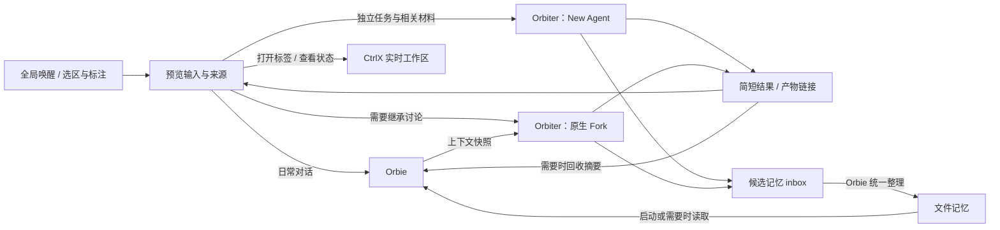

# Orbie 全局助理：工作现场、任务接续与文件记忆

记录及调研修订日期：2026-11-13。状态：已认可的设计方向，尚未实现。本文记录产品边界、现有能力复用和首版验收目标，不代表已完成开发或运行验证。

落地顺序见 [Orbie 实施计划](v3.1.0/orbie/IMPLEMENTATION_PLAN.md)，按绑定与投递、任务接续、全局唤醒、选区派发、文件记忆和验收六个阶段推进。计划中的建议默认值与待确认项单独列明；当前尚未开始开发。

定位是**熟悉用户工作现场、能接续和分派任务的全局助理**。优先服务同时维护多个项目、使用多个 Agent、经常换设备的 CtrlX 用户，减少重新解释背景、寻找旧任务和重建工作现场的成本。

首版围绕两个场景：通过「继续昨天那个音频问题」找到任务、依据和原标签；选中日志、文档或页面内容，带着来源交给独立 Orbiter。Orbie 负责理解和归纳，Orbiter 按需继承相关背景并返回简短结果。**所有用户可独立跟进的 Agent 仍是 tmux 管理的普通 Agent 标签，长期记忆保存在文件中。**

官方资料已表明，全局唤醒、记忆和后台分派都有直接参照，见文末调研依据。本方案的价值假设是这些能力与 CtrlX 真实工作区的结合能够改善任务连续性；这需要实际使用验证，尚不能据此证明独立大众产品的商业价值。

跨设备复制 Codex 原生会话的研究继续搁置，不是本方案的前置条件。本文暂按「一台指定 Mac 承载 Orbie，其他设备作为 Viewer 使用」设计；是否最终采用这一拓扑、选择哪台 Host，仍待确认。

## 1. 角色、命名与上下文

Main Agent 的产品名为 **Orbie**。Expert Agent 统称 **Orbiter**，英文复数为 **Orbiters**，中文界面称「**任务分身**」。下文使用这些产品名称；Dreaming 是一种维护任务。

| 角色 | 负责什么 | 生命周期 |
| --- | --- | --- |
| Orbie | 理解用户偏好、目标与任务概况，管理长期记忆，接收简短结果 | 逻辑身份长期保留，原生对话可以更换 |
| Orbiter | 完成一个有边界的任务，保留调查、执行和试错细节 | 每次任务独立创建，可继续跟进或归档 |
| Dreaming Agent | 整理候选记忆、去重、发现冲突和过期信息 | 一种维护类 Orbiter，不增加第三套运行机制 |

Orbie 的主标签使用固定名称 **Orbie**。每个 Orbiter 的标签直接使用简短、动作明确的任务名，便于识别、检索和继续处理：

| 任务类型 | 标签名称示例 |
| --- | --- |
| 排查任务 | 排查 Browser 音频 |
| 代码评审 | 评审工作区恢复 |
| 词库整理 | 整理项目词库 |
| Dreaming | 整理记忆 |

导航层级可表达为 **Orbie → 任务分身 → 排查 Browser 音频**。标签栏只显示任务名；同一任务列表中同名时追加序号，例如「排查 Browser 音频 2」。任务模板可以反复使用，每次创建的 Orbiter 按本次任务独立命名；继续已有任务保留其名称，并支持现有的标签重命名操作。

展示名用于识别与检索，实例身份仍由持久绑定确定。目录示意继续使用 `main/` 与 `experts/<run_id>/`，不将展示名用作恢复或任务投递的标识。

长期 Orbie 不等于永远使用同一个 Codex／Claude 对话。文件记忆是长期信息的依据，原生会话承载近期讨论；上下文过长或需要重建时，新对话读取角色说明、记忆和未完成任务摘要即可接续。

Orbiter 按任务需要选择上下文来源，不要求全部从 Orbie Fork：

| 任务情况 | 创建方式与输入 |
| --- | --- |
| 需要 Orbie 刚才讨论中的细节 | 原生 Fork，继承创建分支时的上下文快照 |
| 独立调查、固定检查、词库或记忆整理 | New Agent，提供任务说明、来源、相关记忆和目标目录 |
| 希望改用另一种 Agent／Provider | 优先按独立任务新建，交接可读材料；不转换原生对话历史 |

Fork 后双方独立运行，Orbie 后续对话不会自动进入 Orbiter，Orbiter 的过程也不会自动回流。Fork 隔离任务细节，但仍有继承上下文的成本。CtrlX 在新建路径只补充本任务需要的内容，保留 CLI 原有的指令加载行为；面板展示创建方式与来源，首版由用户选择，不增加自动路由策略引擎。

「词库 Orbiter」等名称代表可复用的任务类型或指令模板，不代表一个不断积累历史的常驻子会话。每次运行创建新的任务实例；Dreaming 等只依赖文件的任务可以直接 New Agent，无须复制 Orbie 的全部历史。

## 2. 入口与使用流程

Mac 首先提供一个类似 Raycast 的全局唤醒面板：快捷键打开，自由提问交给 Orbie，同时提供任务查找、当前状态和「打开 Agent 标签」入口。面板承载输入、状态和简短结果；完整交互继续使用现有终端。

显式选择任务、打开标签、读取任务当前状态等操作，直接调用 CtrlX 已有状态和导航能力。需要理解、检索归纳或判断的请求再交给 Orbie。Orbie 忙碌时，这些确定性操作及明确的新建独立任务入口仍可使用，不要求每次操作先经过一次模型调用。

有选中内容时，先显示内容与来源预览，默认交给 Orbiter，也可以选择「询问 Orbie」或「记住」。终端、Files 中可选择的文本复用原有选区；Browser／Simulator 的图像内容复用截图与标注，不假定所有远端画面都有原生文字选区。



一次独立任务按以下顺序执行：

1. 在触发时捕获选区、用户指令及来源，包括 Host、标签、文件路径或 URL。切换焦点后不重新读取来源，以免任务材料串到另一个页面。
2. 用户确定任务范围、创建方式、目标 Agent／Provider 和实际工作目录。首版由用户明确触发分派；Orbie 自主决定何时新建 Orbiter 留到后续。
3. New Agent 路径按现有启动逻辑准备任务材料，无须等待 Orbie 的对话结束。Fork 路径验证 Orbie 的原生对话身份，在可确认的轮次边界创建分支。向任何已有 Agent 投递时都检查忙碌与输入状态，不覆盖草稿、不盲目注入。
4. Orbiter 在普通 Agent 标签中执行。关闭唤醒面板、切换标签或 Viewer 断线，不终止 Host 上的任务；需要用户回答时复用现有提问和通知入口。
5. 核验任务结束后，保存简短结果与产物链接。原生轮次结束与目标达成分开记录：测试通过、修改已提交等结论应关联各自证据。Orbie 只接收必要结论、影响和待办，不自动追加完整子会话；忙碌时暂存结果，等待合适的输入时机。

任务接续先覆盖本功能创建或用户明确关联的任务。任务记录保留来源 Host、项目、实际 Agent 绑定、结果和产物；旧标签可以通过明确关联及补充摘要纳入，不自动导入全部历史。用户说「继续」时，先呈现相关任务及上次验证到哪里，再打开存活标签或使用已有恢复能力；实例已失效时不能仅凭同名标签继续。用户也可用保存的任务材料新建 Orbiter。

后台任务完成只更新状态或通知，不自动切换会话、选中 Browser／Simulator，也不抢占前台窗口。用户点击「打开标签」才导航到对应任务。

全局唤醒与外部 App 选区捕获分开落地。首版可以接受粘贴内容，并复用 macOS Services 的显式选区传递；通用外部 App 取词后续再做。Services 依赖来源 App 支持，不能承诺所有 App 都可读取选区。参见 [Apple 选区传递接口](https://developer.apple.com/documentation/appkit/nsservicesmenurequestor/writeselection(to:types:))。

## 3. 文件记忆与工作目录

先分清三类信息，再决定保存位置：

| 信息 | 依据与用途 |
| --- | --- |
| 实时状态 | Host 在线状态、Agent 忙碌或等待回答、当前标签等，从 CtrlX 当前状态读取；不让记忆中的旧值代替实时查询 |
| 任务记录 | 目标、来源、采取的动作、结果、验证证据和产物，用于查找与接续任务；保留「当时」的事实 |
| 长期记忆 | 用户偏好、项目约定、经过验证的可复用方法；注明来源和适用范围，按相关性提供给新任务 |

初期使用现有运行状态与少量文件即可，不引入向量数据库或通用 RAG 系统。

建议目录如下；这是待实现的存储布局，不是当前已有文件：

```text
~/.ctrlx/agents/
  main/
    AGENTS.md
    MEMORY.md
    projects/
      <project_id>.md
    inbox/
    vocabulary.json
  experts/
    <run_id>/
      TASK.md
      RESULT.md
```

| 文件／目录 | 用途 |
| --- | --- |
| `AGENTS.md` | Orbie 的职责、记忆读取和任务回收约定。这里以 Codex 为例，Claude Code 使用其支持的指令加载方式 |
| `MEMORY.md` / `projects/` | 全局偏好与项目记忆分别存放，项目规则只在对应任务中加载；允许用户直接查看、编辑和删除 |
| `inbox/` | 按任务分别保存的候选记忆及来源，避免多个 Orbiter 同时改写一个记忆文件 |
| `vocabulary.json` | 词库试验启用后产生，供语音模块确定性读取；格式按消费者需要定义 |
| `TASK.md` / `RESULT.md` | 本次任务的目标、来源、工作目录，以及结论、验证证据、产物和待办 |

Orbie 默认在 `main/` 工作。Orbiter 的目录用于保存任务材料，**不强制作为所有任务的进程工作目录**：一般任务可以在该目录运行，代码任务应在用户选择的项目或 worktree 中运行。目录隔离不是权限沙箱。

记忆只收录用户明确表达的偏好、稳定项目约定和经过验证的可复用经验。单次报错、探索过程、大段日志留在任务记录中。可复用方法应带来源、适用项目或条件及验证时间；「某次测试通过」不能自动推广为永久有效的规则。

写入保持单一整理入口：用户明确「记住」的内容可以直接进入记忆；Orbiter 和 Dreaming 先产生候选，由 Orbie 串行合并。候选保留来源和任务关联，冲突或未经验证的信息不能静默覆盖已有事实。整理后的记忆应比原材料短，而不是不断拼接任务摘要。

运行中的模型不会因文件变化自动获得新记忆。Orbie 在新对话启动或需要最新信息时读取文件，Orbiter 接任务时按需补读；原生 Fork 的快照与文件记忆的更新是两件事。

CtrlX 管理自己的跨任务记录与共享知识，原生 CLI 继续管理其会话和内部记忆。接入时尊重现有记忆开关和目录，不静默启用、关闭或覆盖原生记忆。对话上下文独立不能推导为所有记忆都隔离；任务是否读取或贡献原生记忆，应按首发 CLI 的公开控制核对。Orbiter 内部可以继续使用 CLI 自带子 Agent，不要求把每个内部子 Agent 都映射成新 tmux 标签。

Host、持久 window／pane 绑定、原生会话 ID、任务状态等仍由 CtrlX 的运行状态负责。不要从目录名、`TASK.md` 文本或标签标题推导实例身份，也不要将 Markdown 记忆变成调度账本。

## 4. Dreaming 与词库

### 记忆整理

先提供手动整理：由 Orbie 处理少量候选，材料较多时再启动普通维护 Orbiter，读取现有记忆、新候选和必要的任务结果，输出合并建议，由 Orbie 统一应用。它通常不需要 Fork Orbie；只有确实依赖近期对话时才使用 Fork。整理保留可检查的变更和来源，以后续任务是否受益评估质量。

手动闭环证明有用后，再增加按新增材料批量处理的自动 Dreaming；每日是可选频率，不是固定要求。没有新材料则跳过；同类整理不并发启动；Host 休眠或 CtrlX 未运行时，恢复后至多补做一次，不逐日重放。调度需要明确的任务去重、运行上限和失败状态，不能把现有工作流内部的执行调度误当成已经支持日历任务。

### 词库闭环

词库作为独立的小规模试验：**显式收集 → 按需整理 → 语音模块读取**。它不阻塞任务接续和选区派发的首版验收，也不单独证明全局 Orbie 的价值。新增词条、确定性去重直接由程序处理，需要归并别名或判断范围时才调用整理 Orbiter。

- 用户选择人名、项目名、专业词等，执行「加入词库」，保留原词与项目来源。后续有可靠入口时，再接入用户确认过的语音纠错；不扫描任意终端内容、剪贴板或聊天历史。
- 整理流程先由程序去重，再按需调用 Orbiter 归并规范写法、别名和项目范围，更新 `vocabulary.json`。试验先手动触发，有实际收益后再考虑自动调度。
- 语音输入开始时，把相关个人词条与现有内置词、项目词合并成有上限的快照；实时识别、二次识别和纠错使用同一份快照。整理中的更新从下次录音起生效，不在录音路径中同步调用 Orbie。
- 词条只是识别与纠错的依据，不做无条件全局替换。例如不能因为收录「会话」，就把所有「绘画」改成「会话」。

当前语音词库已有内置词与少量标签／目录词，但没有上述个人词库文件和持久纠错收集流程。不同识别器对提示词的支持需要分别验证；Apple 对 `DictationTranscriber` 的建议是短词组且总量不超过 100 条，不能把这一限制或效果承诺推广到所有识别器。参见 [Apple contextualStrings](https://developer.apple.com/documentation/speech/analysiscontext/contextualstrings) 及[现有语音输入约定](terminal-quick-actions.md)。

## 5. 复用现有能力，新增最少的产品状态

| 能力 | 复用方式与边界 |
| --- | --- |
| 启动、shell 集成与模型配置 | 复用 New Agent／Fork；包括现有 Codex `--no-daemon` 行为、Provider 默认模型／effort 和快捷按钮配置 |
| 上下文交接 | 相关讨论复用同 Host、同一种 Agent 的原生 Fork；独立任务通过 New Agent 接收任务材料和相关记忆，目标能力按现有插件声明检查 |
| 原生子 Agent 与记忆 | 保留 CLI 已有行为及用户设置，CtrlX 只管理产品层的任务关联和共享知识 |
| Orbie 与 Orbiter 身份 | 复用持久 Host／window／pane 绑定，以及进程和原生会话校验；恢复或替换进程后重新核验 |
| 输入与结果 | 复用工作流的输入投递、调用关联和原生完成核验；`Idle`、输入发送成功或文件出现都不单独代表任务完成 |
| 标签、控制权和资源 | 普通 Agent 标签及已有 Files／Browser／Simulator 能力，不另造终端或控制权机制 |
| 恢复 | 复用 workspace recovery 恢复实际 Agent；全局入口另需保存逻辑 Orbie 绑定及任务关联，恢复后不能无证据重发任务 |
| 远端查看 | 复用已配对的 Host 连接与通知；新入口能力由 Host 声明，Viewer 不在本地解析 Host 路径 |
| 确定性入口 | 显式打开标签、读取状态直接调用现有能力，Orbie 不成为所有操作的串行入口 |

现有多 Agent 工作流提供可靠执行的基础，但目前是用户定义的单 Host 编排。Orbie 自动创建 Orbiter、每日调度、记忆管理和全局面板都是新功能，不能仅靠加入几份指令文件就认为已完成。

首版新增状态围绕 Orbie 的绑定、可查找的任务关联与结果、文件记忆。任务索引用于查找和导航，运行事实仍来自原有状态；普通任务能用既有投递／完成通道时就复用，不强制要求用户先搭建完整工作流。

资源策略也沿用任务生命周期：Orbie 保留身份不等于持续调用模型；Orbiter 按需启动，对并发和单次运行设置上限，结束后保留结果及原生会话记录，无须无限保活进程。不额外复制全量原生聊天历史到任务目录；保留与清理策略不影响尚未结束的任务，也不删除仍被引用的产物。具体额度、并发和保留期限在实现前确定。

指定 Host 离线时显示不可用或等待连接，不在另一台 Mac 自动创建第二个 Orbie。其他 Host 的选区可以作为明确附带来源的任务材料，但其路径不是 Orbie 所在 Host 的本地路径；跨 Host 执行和记忆同步不在首版范围内。

## 6. 首版范围与后续价值

| 优先顺序 | 交付与验证目标 |
| --- | --- |
| 首版：任务接续 | Mac 全局入口、逻辑 Orbie、任务查找与摘要，能打开正确标签或使用已有恢复入口；明确旧任务纳入范围 |
| 首版：选区派发 | 捕获内容与来源，用户选择 New Agent 或 Fork，完成后保留结果、产物和任务关联 |
| 首版：最小记忆 | 明确「记住」、按项目读取、候选收集与手动整理，验证新任务是否实际受益 |
| 独立小试验 | 手动词库收集与按需整理，接入既有语音快照；不作为首版任务闭环的前置条件 |
| 随后验证 | 汇总需要用户回答、处理失败或评审的事项；把成功经验沉淀成可检查的指令、Skill 或小脚本 |
| 后续扩展 | Orbie 自主分派、自动 Dreaming、持续负责指定事项、更广的外部选区及 Viewer 专用入口 |

第一条验收路径是「昨天完成一个任务 → 今天找到结论和依据 → 在正确现场继续」；第二条是「选中内容 → 派给独立 Agent → 结果回到可查找的任务记录」。先打通这两个路径，再扩大自动化范围。

长期积累包括经过验证的方法。成功任务可以先提炼出供人检查的操作说明，再复用已有 Skills 或脚本机制；可确定执行的步骤逐渐减少重复模型推理。持续职责则围绕明确范围开展，例如检查指定项目的构建或待办变化，只在有变化或需要判断时提示。经验沉淀、主动检查和自动分派均为后续设计，不代表已有能力或默认开启。

## 7. 验收目标与待定项

实现时至少验证以下行为；本次仅写设计文档，以下均不是已通过的测试：

1. 能找到已关联任务的来源、结论与验证证据，并正确打开或恢复目标标签；旧任务不在索引中时明确说明，不能编造进展。
2. Fork 能使用分支时的讨论；CtrlX 为 New Agent 补充的内容仅限显式任务材料和相关共享记忆，保留 CLI 原有的指令及记忆控制。两种路径都保持独立，任务长日志不会自动回流 Orbie。
3. 捕获选区后切换标签或 Host，提交仍使用原内容与来源；结果通知不抢焦点，显式打开可定位正确标签。
4. Orbie 忙碌时导航、状态查看和新建独立任务仍可用；向已有 Agent 投递不串输入、不覆盖草稿，重复点击及断线重试不创建重复任务。
5. App／tmux 重启后恢复逻辑绑定；实例身份失效时明确提示，不误接旧对话，不无证据重投已执行的任务。
6. 新 Orbie 对话可从文件记忆接续；项目记忆按范围加载，候选不相互覆盖，原生 CLI 记忆设置不被静默改变。
7. 词库试验另行验证：更新作用于后续录音，当前快照不变，普通语句不被强制替换。

功能闭环可用后，用真实工作连续试用一周，与原先手动操作比较：每个任务补充背景的次数；找回并继续旧任务所需的时间及定位错误；记忆带来的实际复用与错误引用。记录相关任务和证据，不以调用次数、生成记忆文件数或单次演示代替收益。试用期限是建议，不是已完成验证，也不预设改进百分比。

仍需在实现前确定：单指定 Host 是否作为最终拓扑及首发 Agent 类型；全局快捷键与首批选区入口；原生记忆控制边界；任务并发、运行额度和结果保留策略。自动整理的频率与补跑细节在进入该阶段时再定，不阻塞手动闭环。

## 8. 实现入口与参考

以下是当前已有能力的入口，供落地时核对，不表示这些文件已实现全局 Agent：

| 关注点 | 当前入口 |
| --- | --- |
| Agent 启动与 Fork | [SessionLaunchPreparation](../CtrlxPackage/Sources/CtrlxServerFeature/Services/SessionLaunchPreparation.swift)、[AgentForkService](../CtrlxPackage/Sources/CtrlxServerFeature/Services/AgentForkService.swift)、[Fork 契约](services-reference.md#fork-a-native-agent-conversation-macios) |
| 原生会话校验与恢复 | [AgentSessionIdentityClient](../CtrlxPackage/Sources/CtrlxServerFeature/Services/AgentSessionIdentityClient.swift)、[工作现场恢复](workspace-recovery-design.md) |
| 投递、完成与恢复账本 | [AgentWorkflowService](../CtrlxPackage/Sources/CtrlxServerFeature/Services/Workflows/AgentWorkflowService.swift)、[AgentWorkflowRunner](../CtrlxPackage/Sources/CtrlxServerFeature/Services/Workflows/AgentWorkflowRunner.swift)、[多 Agent 协作设计](multi-agent-design.md) |
| 选区、截图与标注 | [InteractiveTerminalView](../CtrlxPackage/Sources/CtrlxServerFeature/Views/InteractiveTerminalView.swift)、[RemoteBrowserView](../CtrlxPackage/Sources/CtrlxCommon/UI/RemoteBrowserView.swift)、[RemoteSimulatorView](../CtrlxPackage/Sources/CtrlxCommon/UI/RemoteSimulatorView.swift) |
| 语音词库与输入快照 | [VoiceInputVocabulary](../CtrlxPackage/Sources/CtrlxCommon/Models/VoiceInputVocabulary.swift)、[VoiceInputContextSnapshot](../CtrlxPackage/Sources/CtrlxCommon/Models/VoiceInputContextSnapshot.swift)、[Quick actions](terminal-quick-actions.md) |

调研依据截至 2026-11-13，仅核对官方公开能力，未做产品实测横评；以下资料支持方案取舍，不证明 CtrlX 的实现效果：

- [Raycast AI Chat](https://manual.raycast.com/ai/ai-chat) 与 [ChatGPT dots](https://learn.chatgpt.com/docs/dots/tasks-and-memory) 已覆盖上下文入口、记忆或后台任务分派，因此本方案聚焦 CtrlX 工作现场的连续性。
- [OpenClaw 子 Agent](https://docs.openclaw.ai/tools/subagents) 区分独立会话与按需 Fork；[Hermes 分派](https://hermes-agent.nousresearch.com/docs/user-guide/features/delegation) 将子任务过程隔离并返回摘要，为上下文交接提供参照。
- [Claude Code 子 Agent](https://code.claude.com/docs/en/sub-agents) 与 [Codex 本地记忆](https://learn.chatgpt.com/docs/customization/memories) 已有原生能力，接入时应保留其职责和控制边界。
- [Anthropic 记忆研究](https://www.anthropic.com/research/components-of-agent-memory) 讨论动态状态冗余和可复用经验；[Dreams](https://platform.claude.com/docs/en/managed-agents/dreams) 仍属研究预览，为按需整理、保留来源与检查结果提供参照。
- [Wispr Flow 词库](https://docs.wisprflow.ai/articles/4052411709-teach-flow-your-words-with-the-dictionary) 已支持个人词条及部分纠错学习，故词库适合作为小试验，其价值需通过实际识别结果单独验证。
