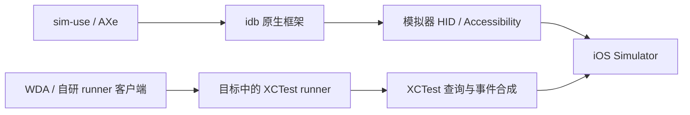

# iOS Simulator Research

调研日期：2026-10-08；整理及上游文档复核：2026-10-10；Google ARTEMIS / phone-harness 补充调研：2026-10-11。

目标：为 CtrlX 集成 iOS Simulator 寻找可复用的控制实现或可选引擎，让 Codex 等 agent 能观察界面、操作应用，同时优先考虑交互流畅度和多开容量。

本文记录 README、许可证、构建脚本和关键源码的调研结果，以及据此提出的接入建议。尚未完成这些候选引擎的本机安装、iOS 27 操作对照或性能测试；上游支持声明和性能宣传不作为 CtrlX 验收结果。当前产品落地与 P0 / P1 状态见 [Agent Simulator 设计](agent-simulator-design.md)。

## 主要结论

- sim-use 和 AXe 的模拟器控制路径同源，主要使用 idb 原生框架、Apple Accessibility 接口和模拟器 HID 通道。sim-use 从 AXe 分叉发展而来，适合优先评估 agent 接口和实现复用。[sim-use 架构及项目来源](https://github.com/lycorp-jp/sim-use#architecture)
- WebDriverAgent（WDA）通过 XCTest / XCUITest runner 执行控制，与直接 HID / AX 路线有更强的技术互补性，适合针对现有失败场景做独立机制对照。[WDA 实现说明](https://github.com/appium/WebDriverAgent#webdriveragent)
- 补充候选中，zhongerxin/iPhone-use 封装 WDA，leeguooooo/iphone-use 使用自研 XCTest runner。后者的精简 AX snapshot、直接事件合成及按需采集值得参考，但两者现行安装和连接都以真机为目标，模拟器接入需要适配。sintaxi/phonegap 是混合 App 开发框架，排除出控制引擎候选。具体证据见下文补充调研。
- Google ARTEMIS 当前提供 Android 自动化，iOS 仍在路线图。它的主要价值是控制驱动之上的任务编排、执行校验、历史压缩与设备调度，暂不列入可直接接入的 iOS 控制引擎。具体证据见 ARTEMIS 补充调研。
- ShawnPana/phone-harness 的本地 iOS 路线通过 macOS iPhone Mirroring 控制真机，另有 Android ADB 和云端手机客户端；没有 iOS Simulator 后端。它适合参考轻量操作接口、能力声明、OCR 来源与断连处理，暂不作为模拟器引擎或本机容量优化方案。具体证据见 phone-harness 补充调研。
- 控制引擎、实时显示和模拟器资源精简分别评估。引入外部控制引擎可能减少维护工作，但当前没有证据证明它能解决显示延迟、提高帧率或增加稳定多开数量。
- 保留 CtrlX 的原生显示、设备生命周期、资源配额和会话权限；先验证一个有明确用途的候选，再决定是否内置和扩大支持范围。
- 综合建议：继续以当前原生控制和显示为基线，选择性复用 sim-use / AXe / idb；以 WDA 建立 XCTest 对照，leeguooooo 的精简 runner 作为后续优化候选；simslim 独立负责容量优化。实际产品先保留原生默认路径，第二种控制实现通过效果与资源验证后按需启用。

## 三个重点候选的底层技术

下表比较的是模拟器常用控制路径；sim-use 的真机路径另有实现，不能据此推导真机能力相同。

| 对比项 | sim-use | AXe | WebDriverAgent |
|---|---|---|---|
| 主要底层 | idb / FBSimulatorControl、Apple 私有模拟器接口 | idb / FBSimulatorControl、Apple 私有模拟器接口 | XCTest / XCUITest 及相关扩展 |
| 点击、滑动、按键 | 模拟器 HID 注入；包括 Indigo / DTUHID 通路 | 模拟器 HID 注入；包括 Indigo / DTUHID 通路 | XCTest 元素操作与事件合成 |
| UI 查询 | 原生 Accessibility 树，附加面向 agent 的 outline / 引用 | 原生 Accessibility 树和元素定位 | XCTest 元素查询与 snapshot |
| 运行形态 | Mac CLI、每设备 daemon | Mac CLI、HID broker | 目标模拟器或设备中的测试 runner、HTTP 服务 |
| 常用操作是否需要启动 XCUITest runner | 不需要 | 不需要 | 需要 |
| 适合的复用方向 | agent 命令、观察格式、缓存、批处理、恢复 | 原生输入、坐标处理、元素定位 | 不同技术路径的控制兜底、真机与测试自动化 |

输入路径依据：[sim-use HID 实现](https://github.com/lycorp-jp/sim-use/blob/3cd50704c292ab7502f73962d060960482e43f98/Sources/iOSSimBackend/HID/HIDInteractor.swift)、[AXe HID 实现](https://github.com/cameroncooke/AXe/blob/30f4bfa9bc81817906a60fadedbc913d7314b7e1/Sources/AXe/Utilities/HIDInteractor.swift)。UI 查询可参照 [AXe AccessibilityFetcher](https://github.com/cameroncooke/AXe/blob/30f4bfa9bc81817906a60fadedbc913d7314b7e1/Sources/AXe/Utilities/AccessibilityFetcher.swift)；WDA 路径依据其 [README](https://github.com/appium/WebDriverAgent/blob/master/README.md)。

图示为主要调用链，省略底层系统通信。两条路线最终仍依赖 Apple 的输入和无障碍基础设施，不能理解为完全独立的系统实现。

链接 `XCTestBootstrap` 等框架不等于常用操作依赖运行中的 XCUITest runner；判断依据应是具体命令的执行路径。sim-use / AXe 的常用模拟器输入走 HID，WDA 的服务本身运行于测试 runner。

## 候选项目与定位

| 项目 | 能力与目标 | 许可证 / 依赖要点 | CtrlX 建议 |
|---|---|---|---|
| [sim-use](https://github.com/lycorp-jp/sim-use) | 模拟器 UI 树、元素引用、触摸、键盘、粘贴、截图；另有受限的实验性真机路径 | Apache-2.0；沿用 AXe / idb 的 MIT 归属；静态 idb 框架 | 优先验证 agent 操作接口和实现复用 |
| [AXe](https://github.com/cameroncooke/AXe) | 原生模拟器触摸、拖动、按键、元素查询、截图 | MIT；idb 框架；发布可执行文件需配套框架 | 第二个对照候选，或直接参考输入实现 |
| [WebDriverAgent](https://github.com/appium/WebDriverAgent) | 模拟器与真机的元素、应用和输入控制 | BSD；XCTest runner | 验证不同技术路径能否补现有能力缺口 |
| [Facebook idb](https://github.com/facebook/idb) | 模拟器与真机自动化，提供原生框架及 companion / client | MIT；框架可独立使用 | 优先参考底层实现，按需求决定是否引入完整服务 |
| [Maestro](https://github.com/mobile-dev-inc/Maestro) | UI / E2E 流程、断言和 agent MCP | Apache-2.0；需要 Java；上游当前不支持物理 iOS 设备 | 适合回归测试，实时交互引擎优先级较低 |
| [MobileBuildMCP](https://github.com/getsentry/MobileBuildMCP) | 原 XcodeBuildMCP，提供构建、部署、调试和 UI 开发工作流 | MIT；构建脚本打包 AXe | 参考工具组织和工作流，不能算独立 HID 技术路线 |
| [Mobile MCP](https://github.com/mobile-next/mobile-mcp) | agent 的移动设备工具接口 | 上层 Apache-2.0；当前模拟器底层依赖 mobilecli | 参考 API，内置前需核对底层许可 |
| [Mobilewright](https://github.com/mobile-next/mobilewright) | 类 Playwright 的元素定位、等待、断言和移动测试 API | 上层 Apache-2.0；本地驱动依赖 mobilecli | 参考语义操作和等待设计，不能只看上层许可 |
| [zhongerxin/iPhone-use](https://github.com/zhongerxin/iPhone-use) | 真机 Codex 插件、MCP、批量操作、WDA 屏幕 widget | MIT；WDA、Python、Node.js / appium-ios-device | 参考 agent 接口、连接复用及失败处理 |
| [leeguooooo/iphone-use](https://github.com/leeguooooo/iphone-use) | 真机 Rust daemon、CLI / HTTP / MCP、自研 XCTest runner | MIT；派生实现保留 agent-device 归属 | 优先研究 runner 优化；模拟器支持待适配和验证 |
| [Google ARTEMIS](https://github.com/google/artemis) | Android 自主任务执行、MCP / SDK、规划、验证和任务回放 | Apache-2.0；包含 Minitap mobile-use 派生代码；完整 host 需要 Python、模型及 Android 工具链 | 参考任务编排与设备调度；当前没有 iOS 执行后端 |
| [phone-harness](https://github.com/ShawnPana/phone-harness) | iPhone Mirroring 真机操作、Android ADB、云端手机；Python CLI / Hermes 工具 | MIT；Python 3.10+，本地 iPhone 路线使用 PyObjC、Vision / Quartz / SkyLight | 参考操作接口及观察 / 断连语义；当前没有模拟器后端 |
| [sintaxi/phonegap](https://github.com/sintaxi/phonegap) | App 内 JavaScript 到原生设备功能的桥接框架 | README 内 MIT；旧 UIWebView 实现 | 用途不匹配，排除控制引擎候选 |

idb 的框架独立使用方式见其 [架构与安装说明](https://github.com/facebook/idb#readme)。Maestro 的 Java 要求和设备范围见其 [README](https://github.com/mobile-dev-inc/Maestro#readme)。MobileBuildMCP 内置 AXe 的事实见 [bundle-axe.sh](https://github.com/getsentry/MobileBuildMCP/blob/main/scripts/bundle-axe.sh)。Mobilewright 的本地驱动见其 [包与启动说明](https://github.com/mobile-next/mobilewright#packages)。

Peekaboo 面向 macOS 界面控制，不列为此次 iOS Simulator 控制引擎。simslim 的用途是精简模拟器服务、评估资源与容量收益，其定位不同于输入和 UI 查询引擎；相关落地继续在现有设计文档追踪。DeviceSlims 已按用户决定排除，不重新扩展调研。

## 接入与能力限制

### sim-use

原调研版本使用每设备 daemon 复用初始化和连接，提供 JSON 结果与紧凑 UI 描述。daemon 的存在仍需计入每设备常驻内存，命令耗时也要区分冷启动与暖调用。[daemon 实现](https://github.com/lycorp-jp/sim-use/blob/3cd50704c292ab7502f73962d060960482e43f98/Sources/SimUseCore/Daemon/DaemonServer.swift)

原版本的包使用本地构建的静态 XCFramework、私有模块映射及 `unsafeFlags`，不能直接视为普通远程 SwiftPM 依赖。首次对照建议使用固定版本的私有可执行文件；决定内置后，再评估签名、许可证归属及构建产物布局。[Package.swift](https://github.com/lycorp-jp/sim-use/blob/3cd50704c292ab7502f73962d060960482e43f98/Package.swift)

Unicode 粘贴默认仍走 `simctl pbcopy + Cmd-V`，另有长按后点击菜单 Paste 的路径。因此它与当前 CtrlX 的部分输入机制重合，不能仅因命令名为 `paste` 就认定现有普通粘贴问题已解决。应核对字段最终内容、光标和实际应用回调。[粘贴实现](https://github.com/lycorp-jp/sim-use/blob/3cd50704c292ab7502f73962d060960482e43f98/Sources/iOSSimBackend/Verbs/IOSSimPasteCommand.swift)

### AXe

上游文档明确声明 Xcode 26 / 27 支持，并要求发布可执行文件保留配套框架；声明支持不替代本机 iOS 27 效果验证。[兼容与发布说明](https://github.com/cameroncooke/AXe#xcode-compatibility)

原调研版本的 `type` 使用美式键盘 HID 字符表，不能据此覆盖中文、emoji 和任意 Unicode。CLI 的 stdin / 文件输入只改变文本来源，不改变字符注入能力。[Type.swift](https://github.com/cameroncooke/AXe/blob/30f4bfa9bc81817906a60fadedbc913d7314b7e1/Sources/AXe/Commands/Type.swift)

### WDA / Appium

WDA 可以直接作为控制服务评估；Appium 是使用 WDA 的上层驱动体系。接入时需计入 runner 的安装、启动、常驻资源、端口和会话管理，并验证与用户自行运行 XCTest 的共存。资源开销及速度排序属于待测项，本文没有 WDA 与原生 HID 的性能胜负结论。[WDA 与 Appium 的关系](https://github.com/appium/WebDriverAgent#webdriveragent)

### Mobile Next 系列

原调研核对到，Mobile MCP 的现行模拟器路径通过 `MobileDevice / mobilecli` 执行；仓库残留的 WDA 模拟器文件不能用来判断当前主路径。Mobilewright 的本地驱动同样基于 mobilecli。[Mobile MCP 路由](https://github.com/mobile-next/mobile-mcp/blob/main/src/server.ts)、[Mobilewright 驱动说明](https://github.com/mobile-next/mobilewright#packages)

截至本次许可证复核，mobilecli 与 DeviceKit iOS 均使用 FSL 1.1，含商业竞争用途限制及未来转为 Apache-2.0 的条款；上层项目的 Apache 许可证不会替换这些底层条款。因此暂不把这一整套列为可直接内置的宽松开源候选。[mobilecli LICENSE](https://github.com/mobile-next/mobilecli/blob/main/LICENSE)、[DeviceKit iOS LICENSE](https://github.com/mobile-next/devicekit-ios/blob/main/LICENSE)

DeviceKit iOS 本身运行于 XCUITest 并提供 JSON-RPC 服务，也不能因接口不同就将其归入不依赖测试 runner 的原生 HID 路线。[DeviceKit 运行方式](https://github.com/mobile-next/devicekit-ios#starting-the-server)

## 补充调研：两个 iphone-use 与 PhoneGap

本节调研日期为 2026-10-10。核对固定提交的 README、许可证、安装路由及输入 / 查询 / 屏幕源码；未安装、构建或运行这些项目。两个名称相近的 iphone-use 是不同仓库，下面分别讨论。

### zhongerxin/iPhone-use：WDA 的 agent 工作流封装

主要链路是 Codex → Python MCP → 本机 HTTP / USB 转发 → iPhone 上的 WDA → XCTest。Node.js 的 appium-ios-device 提供 USB 通道，屏幕单独连接 WDA 的 MJPEG 服务。安装代码将 WDA 固定为 16.14.0，提交 `d17782422d55ff1e5e0ceb74eb1fd509cc0c35b6`。[安装与固定版本](https://github.com/zhongerxin/iPhone-use/blob/4bdc4288aad0fb0bd5b3d6e2a0252f3fc3d61f3b/server/wda_setup.py)、[USB 屏幕连接](https://github.com/zhongerxin/iPhone-use/blob/4bdc4288aad0fb0bd5b3d6e2a0252f3fc3d61f3b/tooling/screen-stream.mjs)

值得复用的是工作流和调用成本控制：HTTP / session 复用、紧凑观察、批处理、异步 setup job、跨进程操作锁、长文本分段及续传。源码还将 `waitForIdleTimeout` 与动画等待设为零，减少 WDA 默认等待；这些设置也可在直接接入 WDA 时评估。[连接与 session 设置](https://github.com/zhongerxin/iPhone-use/blob/4bdc4288aad0fb0bd5b3d6e2a0252f3fc3d61f3b/server/wda_client.py)、[操作锁与 batch schema](https://github.com/zhongerxin/iPhone-use/blob/4bdc4288aad0fb0bd5b3d6e2a0252f3fc3d61f3b/server/iphone_use.py)

输入最终使用 WDA 的元素 `/value` 或 `/wda/keys`，改变了相对当前 HID / 剪贴板路线的执行机制。输入回读校验是可选项，默认 `verify=false`；动作完成和内容实际正确仍应分别判断。屏幕预览由观看 lease 驱动，无人观看时停止 USB 采集，图像保留在内存中。[文本执行与回读](https://github.com/zhongerxin/iPhone-use/blob/4bdc4288aad0fb0bd5b3d6e2a0252f3fc3d61f3b/server/wda_controller.py)、[按需屏幕采集](https://github.com/zhongerxin/iPhone-use/blob/4bdc4288aad0fb0bd5b3d6e2a0252f3fc3d61f3b/server/wda_screen.py)

现行设备发现排除 simulator，安装、签名和 USB 路由围绕真机组织。WDA 本身能控制模拟器，但这个插件的完整真机 setup 不能直接当作 CtrlX 模拟器引擎。建议参考其工作流，或复用纯 WDA 客户端部分，并由 CtrlX 管理模拟器 runner 和端口。项目为 MIT，WDA 等第三方归属见 notices；内置时还需处理默认启用的匿名统计。[项目 LICENSE](https://github.com/zhongerxin/iPhone-use/blob/4bdc4288aad0fb0bd5b3d6e2a0252f3fc3d61f3b/LICENSE)、[第三方说明](https://github.com/zhongerxin/iPhone-use/blob/4bdc4288aad0fb0bd5b3d6e2a0252f3fc3d61f3b/THIRD_PARTY_NOTICES.md)、[统计配置](https://github.com/zhongerxin/iPhone-use/blob/4bdc4288aad0fb0bd5b3d6e2a0252f3fc3d61f3b/ANALYTICS.md)

### leeguooooo/iphone-use：自研 XCTest runner，优化参考价值较高

自 v0.14.0 起，其真机执行端从 WDA 改为自研 runner，Mac 端使用 Rust daemon，提供 CLI、HTTP、MCP 和人工控制页面。现行控制不依赖 iPhone Mirroring；沿用 WDA 路由名称也不意味着执行端仍是原版 WDA。[项目架构](https://github.com/leeguooooo/iphone-use/blob/36c1a1cee848b4ee964d0cb75664776350f0a7b6/README.md)

关键源码使用私有 XCTest 接口：

- UI 查询通过 `XCAXClient_iOS.requestSnapshotForElement:attributes:parameters:error:` 批量读取固定属性，省去逐节点的昂贵查询；深度受限时有界补读子树。
- 点击、手势和文本通过 `XCSynthesizedEventRecord` / `XCPointerEventPath` 合成，包含 `typeText:atOffset:typingSpeed:shouldRedact:` 文本路径。
- runner 将空闲等待改为 no-op，动作后由上层检查界面稳定状态。减少动作前等待的收益与动作后验收的成本需要一起统计。

这些机制均可在 [IPURBridge.m](https://github.com/leeguooooo/iphone-use/blob/36c1a1cee848b4ee964d0cb75664776350f0a7b6/runner/IPhoneUseRunner/IPhoneUseRunnerUITests/IPURBridge.m) 核对。它属于 XCTest 执行路径的优化实现，与 WDA 同一技术家族；与 sim-use / AXe 的宿主机直接 HID 路线有机制差异。

优化同时改变了语义。低成本 snapshot 不计算完整的 visible / hittable 等属性；部分 locator 判定按矩形与屏幕相交近似，XPath 不支持，session 路由也不提供完整 WDA 会话隔离。CtrlX 应明确能力和 partial 状态，保留自己的来源权限、旧引用检查及人工接管。[查询与几何判定](https://github.com/leeguooooo/iphone-use/blob/36c1a1cee848b4ee964d0cb75664776350f0a7b6/runner/IPhoneUseRunner/IPhoneUseRunnerUITests/RunnerElements.swift)、[兼容路由与限制](https://github.com/leeguooooo/iphone-use/blob/36c1a1cee848b4ee964d0cb75664776350f0a7b6/runner/README.md)

屏幕实现还有可复用的资源策略：有人观看才采集、单个编码器服务多个观看者、采集与编码重叠、只保留最新帧、慢观看者丢帧、静态画面跳过编码。设备端 H.264 使用 VideoToolbox，减少 Mac 解码 MJPEG 后再编码的工作。[RunnerH264.swift](https://github.com/leeguooooo/iphone-use/blob/36c1a1cee848b4ee964d0cb75664776350f0a7b6/runner/IPhoneUseRunner/IPhoneUseRunnerUITests/RunnerH264.swift)

上游报告的指标来自真机：iPhone 13 USB 上 UI 树约 80–135 ms；屏幕约 27–28 FPS；另有 iPhone 17 Pro Max 的全尺寸 quality 模式约 48–50 FPS。设备、分辨率、编码模式及等待口径不同，这些数据没有证明模拟器达到当前源帧到呈现 p95 ≤20 ms 的目标，也没有证明模拟器多开容量改善。[上游操作耗时](https://github.com/leeguooooo/iphone-use/blob/36c1a1cee848b4ee964d0cb75664776350f0a7b6/README.md)、[屏幕性能数据及条件](https://github.com/leeguooooo/iphone-use/blob/36c1a1cee848b4ee964d0cb75664776350f0a7b6/runner/README.md)

当前安装代码使用真机 `platform=iOS,id=…`、CoreDevice / USB 和每设备 runner 状态。模拟器对照应先适配 runner 构建、`iOS Simulator` destination、启动和本机端口连接，并验证私有接口；现有 native display 可继续由 CtrlX 提供。当前每设备 daemon / runner 的常驻成本仍须计入资源准入。[runner 启动](https://github.com/leeguooooo/iphone-use/blob/36c1a1cee848b4ee964d0cb75664776350f0a7b6/crates/server/src/setup/runner.rs)、[USB 设备检查](https://github.com/leeguooooo/iphone-use/blob/36c1a1cee848b4ee964d0cb75664776350f0a7b6/crates/server/src/setup/checks.rs)

项目为 MIT；部分 AX snapshot、事件合成与 runner 结构派生自 Callstack 的 agent-device，原文件有归属头，复用时保留相应许可证和声明。上游的私有 API 和进程级等待修改也需要随 Xcode / runtime 版本做效果回归。[LICENSE](https://github.com/leeguooooo/iphone-use/blob/36c1a1cee848b4ee964d0cb75664776350f0a7b6/LICENSE)、[runner 归属与私有 API 说明](https://github.com/leeguooooo/iphone-use/blob/36c1a1cee848b4ee964d0cb75664776350f0a7b6/runner/README.md)

### sintaxi/phonegap：App 开发框架，排除

给定仓库是早期 PhoneGap：在自身 App 中加载 HTML / CSS / JavaScript，通过 JS 到原生桥访问相机、位置、联系人等设备功能。iPhone 实现创建 UIWebView 并加载自身 `index.html`，没有提供用于操控任意其他 App 的 agent 自动化执行端。[README 与 MIT 许可](https://github.com/sintaxi/phonegap/blob/64ab481366438a08907969c7568fdc707ff0a4cb/README.md)、[PhoneGapDelegate.m](https://github.com/sintaxi/phonegap/blob/64ab481366438a08907969c7568fdc707ff0a4cb/iphone/PhoneGapLib/Classes/PhoneGapDelegate.m)

主分支 HEAD 对应提交日期为 2009-12-03，仓库的后续 push 时间不能替代代码提交日期。它既不提供当前所需的跨 App 控制能力，也没有给出 iOS 27 模拟器支持，因此不安排引擎接入或性能实测。[固定提交](https://github.com/sintaxi/phonegap/commit/64ab481366438a08907969c7568fdc707ff0a4cb)

## 补充调研：Google ARTEMIS

本节调研日期为 2026-10-11，固定提交为 `351ca8422f7b5b54e80a9c1ce03a222e02415b6b`。核对官方 README、MCP / SDK 文档、驱动工厂、Android 控制、设备锁与依赖声明；没有安装依赖、运行启动脚本或执行性能测试。

### 定位与底层：Android 的自主执行框架

ARTEMIS 接收自然语言目标，自行观察、决策和执行，并提供任务状态、诊断与回放。典型链路是 Codex 等调用方 → MCP / HTTP 任务入口 → Flash 或 Pro 执行循环 → 控制器 / 设备驱动 → Android。它与 AXe / WDA 的职责层次不同：前者主要承接整项任务，后两者提供供调用方组合的控制操作。[MCP 工具及异步任务接口](https://github.com/google/artemis/blob/351ca8422f7b5b54e80a9c1ce03a222e02415b6b/mcp_server/README.md)

当前驱动工厂的实际设备实现是 `AndroidAdbDriver`，另有云端连接分支和 mock；没有 iOS driver 分支。README 将 iOS 真机与模拟器扩展列为未完成路线图。抽象接口中出现 simulator / WebDriver 字样不代表已经实现 iOS。[驱动工厂](https://github.com/google/artemis/blob/351ca8422f7b5b54e80a9c1ce03a222e02415b6b/artemis/drivers/factory.py)、[设备驱动接口](https://github.com/google/artemis/blob/351ca8422f7b5b54e80a9c1ce03a222e02415b6b/artemis/drivers/base.py)、[官方路线图](https://github.com/google/artemis/blob/351ca8422f7b5b54e80a9c1ce03a222e02415b6b/README.md#roadmap)

Android 执行端使用 ADB 进行点击、滑动、按键及应用控制；层级观察默认优先使用设备内 Accessibility Helper，失败时按需回退到 UIAutomator2，并报告实际后端。它还结合截图、OCR 和视觉定位处理层级树覆盖不足的界面，录像使用 scrcpy 等工具。[Android 驱动](https://github.com/google/artemis/blob/351ca8422f7b5b54e80a9c1ce03a222e02415b6b/artemis/drivers/android/adb_driver.py)、[层级后端选择与回退](https://github.com/google/artemis/blob/351ca8422f7b5b54e80a9c1ce03a222e02415b6b/artemis/clients/screen_client_factory.py)、[观察工具](https://github.com/google/artemis/blob/351ca8422f7b5b54e80a9c1ce03a222e02415b6b/mcp_server/README.md)

因此，支持 iOS 需要新增执行与观察后端，并处理设备发现、输入、应用控制、诊断和录像中的 Android 依赖。仅将连接地址改为 WDA 不能完成适配。其所用 mobile-use 派生代码的 METADATA 还明确记录移除了未使用的 iOS 代码，不能将上游能力当作 ARTEMIS 当前能力。[设备池](https://github.com/google/artemis/blob/351ca8422f7b5b54e80a9c1ce03a222e02415b6b/artemis/runtime/device_pool.py)、[第三方来源与修改记录](https://github.com/google/artemis/blob/351ca8422f7b5b54e80a9c1ce03a222e02415b6b/third_party/mobile_use/METADATA)

### 性能：任务步耗时、显示与容量分别判断

| 模式 | 上游报告的典型每步耗时 | 行为与取舍 |
|---|---|---|
| Flash | 约 3–5 秒 | 单模型观察与执行循环，异步压缩历史；没有 Pro 的动作前 Safety Net、checkpoint 验证及最终报告 |
| Pro | 约 15–40 秒 | Planner / Operator / Explorer / Checker 工作流；单动作执行前优先检查 UI 树，必要时检查像素，并提供可配置的任务验证 |

以上是上游的任务执行口径，包含模型、观察与编排耗时，本文未实测。两种模式都使用历史压缩；连续动作可以合并为 burst，以减少模型往返并处理短暂出现的控件。burst 与逐个单动作的验证语义需要分别核对。Flash 默认不限制总步数，历史压缩也不等于执行时间有界。[执行模式与限制](https://github.com/google/artemis/blob/351ca8422f7b5b54e80a9c1ce03a222e02415b6b/README.md#execution-profiles-flash-vs-pro)

上游还报告 AndroidWorld 任务完成率超过 99%。该宣传指标不证明输入延迟、显示帧率、源帧到呈现时延或稳定多开容量，更不能推导 iOS 27 效果；本次未独立复跑 benchmark 或审计完整原始结果。[上游 benchmark 声明](https://github.com/google/artemis/blob/351ca8422f7b5b54e80a9c1ce03a222e02415b6b/README.md#benchmarks-androidworld-sota-99)

多设备方面，源码实现跨进程 FIFO 排队、每设备执行锁和全局并发上限。同设备一次只运行一个任务，不同 Android 设备可以并行；锁所有者结合 PID 与进程创建时间处理残留和 PID 复用。设备池负责发现与选择可用设备。这能改善资源调度与操作互斥，但没有减少 iOS guest 服务或单台模拟器的内存需求。[设备锁与并发控制](https://github.com/google/artemis/blob/351ca8422f7b5b54e80a9c1ce03a222e02415b6b/artemis/runtime/device_lock.py)、[Android 设备池](https://github.com/google/artemis/blob/351ca8422f7b5b54e80a9c1ce03a222e02415b6b/artemis/runtime/device_pool.py)

完整 host 需要 Python 3.12+、LangGraph / LangChain、模型 SDK、Android 工具链及图像处理等组件。并发评估还应计入 worker、推理请求配额、观察与录像的工作，以及 trace 的磁盘增长。远程 `artemis-client` 的零运行时依赖仅指客户端，执行端仍承担这些成本。依据当前架构，没有证据将它列为改善 CtrlX 本机容量的方案。[执行端依赖](https://github.com/google/artemis/blob/351ca8422f7b5b54e80a9c1ce03a222e02415b6b/pyproject.toml)、[轻量远程客户端](https://github.com/google/artemis/blob/351ca8422f7b5b54e80a9c1ce03a222e02415b6b/packages/artemis-client/README.md)

### 对 CtrlX 的可复用部分与采用建议

| 参考点 | CtrlX 可吸收的设计 | 需要保留的边界 |
|---|---|---|
| 单动作检查与任务验证 | 使用当前 UI 语义确认目标，观察执行效果；低成本查询不足时再调用视觉定位 | 命令执行、应用实际效果和整项任务完成分别报告；当前设备 / 生命周期 / 来源检查继续由 CtrlX 执行 |
| 动作 burst | 将已确定的短动作序列交给本地执行，减少 agent 往返 | 序列有界、支持取消，报告实际完成位置；结果不确定时先观察，不自动重放 |
| 每设备互斥与全局准入 | 区分同设备串行和跨设备并发；回收退出进程的任务所有权 | 接入现有 CtrlX 权限、人工接管及资源预算，避免增加一套竞争的设备所有权 |
| 异步任务与 trace | 返回任务 ID，支持状态、取消和执行证据查询；任务提交使用稳定 ID | SDK 的幂等提交避免重复创建任务，不保证每个设备动作恰好执行一次；截图、录像及历史应有明确保留限额 |
| 历史压缩与诊断 | 保留关键观察、失败步骤和可检索证据；明确实际观察后端与 degraded 状态 | 压缩不能绕过旧引用校验；后台任务须有执行期限与退出清理，不能照搬默认无限循环 |

上述建议是针对 CtrlX 的设计取舍，不代表已实现接入。任务、取消与 trace 接口可核对 [MCP 文档](https://github.com/google/artemis/blob/351ca8422f7b5b54e80a9c1ce03a222e02415b6b/mcp_server/README.md)，幂等提交的具体范围见 [客户端说明](https://github.com/google/artemis/blob/351ca8422f7b5b54e80a9c1ce03a222e02415b6b/packages/artemis-client/README.md)。该客户端文档也说明现行 daemon 管理 API 没有内置远程认证；若以后接入，继续使用 CtrlX 的授权边界，不能直接把管理端口作为远程控制接口。

项目及所包含的 Minitap mobile-use 代码采用 Apache-2.0；复用时保留相关许可证、版权与第三方 NOTICE。它不是全部由 Google 原创的一套独立移动控制底层。[LICENSE](https://github.com/google/artemis/blob/351ca8422f7b5b54e80a9c1ce03a222e02415b6b/LICENSE)、[第三方 NOTICE](https://github.com/google/artemis/blob/351ca8422f7b5b54e80a9c1ce03a222e02415b6b/third_party/mobile_use/NOTICE)

当前建议是将 ARTEMIS 放入任务编排参考项，保持原生 HID / AX 与 XCTest 两条 iOS 控制路线。完整引入还会让 Codex 将任务委派给 ARTEMIS 内部的模型循环，增加调用与状态管理；是否需要这种任务委派能力，应独立于底层控制选择评估。本轮不安排 ARTEMIS 的 iOS 移植或完整安装实测，先完成已有 iOS 输入缺口对照和容量验证；未来若增加 Android 自主测试，再考虑作为可选任务执行服务。

## 补充调研：ShawnPana/phone-harness

本节调研日期为 2026-10-11，固定提交为 `873a36e25e84c3299fbafb88b5aabea3c88e9c3d`，包版本为 `0.3.1rc1`。核对 README、许可证、依赖、CLI、平台路由和输入 / 观察源码；仅通过网络读取源码，没有安装或执行该项目。包元数据将开发状态标为 Alpha。[版本与依赖声明](https://github.com/ShawnPana/phone-harness/blob/873a36e25e84c3299fbafb88b5aabea3c88e9c3d/pyproject.toml)

### 三种控制路径与模拟器支持

| 路径 | 实际底层与观察方式 | 对本轮任务的意义 |
|---|---|---|
| 本地 iPhone | macOS iPhone Mirroring；向镜像 App 投递鼠标 / 键盘事件，截图后用 Apple Vision OCR 识别文本 | 控制真实 iPhone，不是模拟器驱动 |
| Android | ADB `input` / `screencap` / `uiautomator dump`；支持时可回退到像素 OCR | 可参考跨平台接口，不能提供 iOS 执行能力 |
| 云端手机 | Android 仍走 ADB；云端 iPhone 使用带授权的 HTTPS 操作接口，查询远端能力、请求 PNG 截图 | 仓库提供客户端；云服务多设备不等于本机模拟器多开 |

路由依据：[transport.py](https://github.com/ShawnPana/phone-harness/blob/873a36e25e84c3299fbafb88b5aabea3c88e9c3d/src/phone_harness/transport.py)、[Android 实现](https://github.com/ShawnPana/phone-harness/blob/873a36e25e84c3299fbafb88b5aabea3c88e9c3d/src/phone_harness/android.py)、[云端操作客户端](https://github.com/ShawnPana/phone-harness/blob/873a36e25e84c3299fbafb88b5aabea3c88e9c3d/src/phone_harness/remote.py)。当前本地 `ios` 路由明确构造 `IPhone` 镜像后端，没有 CoreSimulator / simctl / 模拟器 HID 或 XCTest runner 后端。本次仓库树核对没有找到可独立部署的云端 iOS 控制服务实现，不能把客户端的 MIT 许可或远程接口当作完整开源模拟器引擎。

本地 iPhone 的主要调用链是 agent → 预导入 helpers 的 Python CLI → Quartz / SkyLight → Mac 镜像窗口 → Apple 的镜像连接 → 真机。这里的 HID 事件首先作用于 Mac App，与 sim-use / AXe 的模拟器 HID 通道不同，也不走 WDA / XCTest。相比 Peekaboo，它专门封装了手机操作；相比 ARTEMIS，任务推理主要仍由外部 agent 完成，CLI 自身执行调用方提供的 Python，没有同类内置规划模型循环。[CLI 执行入口](https://github.com/ShawnPana/phone-harness/blob/873a36e25e84c3299fbafb88b5aabea3c88e9c3d/src/phone_harness/run.py)、[iOS 后端](https://github.com/ShawnPana/phone-harness/blob/873a36e25e84c3299fbafb88b5aabea3c88e9c3d/src/phone_harness/ios.py)

### 后台操作、UI 查询与输入边界

固定版本默认尝试 `background` 后端，私有符号无法加载时退回 `mirror`。后台点击 / 拖动通过 SkyLight `SLPSPostEventRecordTo` 按进程和窗口投递；现行键盘实现通过 make-key 事件和 `CGEventPostToPid` 投递。文件头仍有“键盘尚未实现”的旧说明，本节按当前函数体判断。但滚轮路径仍会激活 / 抬高窗口、移动真实鼠标并在结束后恢复，因此不能把 background 理解为所有操作都不干扰桌面；普通 mirror 路径还依赖前台焦点。[后端选择](https://github.com/ShawnPana/phone-harness/blob/873a36e25e84c3299fbafb88b5aabea3c88e9c3d/src/phone_harness/ios.py)、[后台事件与滚轮实现](https://github.com/ShawnPana/phone-harness/blob/873a36e25e84c3299fbafb88b5aabea3c88e9c3d/src/phone_harness/background.py)、[前台镜像实现](https://github.com/ShawnPana/phone-harness/blob/873a36e25e84c3299fbafb88b5aabea3c88e9c3d/src/phone_harness/mirror.py)

镜像内容是视频图像，Mac Accessibility 无法读取其中的 iOS 元素树；本地 iPhone 的 `tree`、应用清单和当前应用查询均未实现，按能力缺失报告 `Unsupported`。文本定位使用 Vision OCR，再将图像坐标换算为桌面点坐标；OCR 的文字和 confidence 不等价于系统报告的元素属性。无文字图标需要截图与调用方的视觉判断，无法取得 AX 语义、hittable 或稳定元素标识。[能力与操作定义](https://github.com/ShawnPana/phone-harness/blob/873a36e25e84c3299fbafb88b5aabea3c88e9c3d/src/phone_harness/transport.py)、[OCR 坐标换算](https://github.com/ShawnPana/phone-harness/blob/873a36e25e84c3299fbafb88b5aabea3c88e9c3d/src/phone_harness/ocr.py)

文本默认走 Mac 剪贴板与 Cmd-V，按键模式受键码映射和 iOS 自动纠正影响。代码验证了 Mac 剪贴板写入，但没有因此证明目标字段最终正确；默认不恢复旧剪贴板，避免镜像异步读取时粘贴旧内容。该路径不能证明当前模拟器的中文 / emoji / secure 输入缺口已解决。[粘贴与键码实现](https://github.com/ShawnPana/phone-harness/blob/873a36e25e84c3299fbafb88b5aabea3c88e9c3d/src/phone_harness/mirror.py)、[输入 helper](https://github.com/ShawnPana/phone-harness/blob/873a36e25e84c3299fbafb88b5aabea3c88e9c3d/src/phone_harness/helpers.py)

### 交互性能与多开容量判断

观察主要是按需截图、PNG 编码 / 文件输出和 OCR，不能作为当前 IOSurface / Metal 实时显示链路的等价替代。源码还包含点击的 50 ms 按压、手势时长、滚动后等待和多次文字稳定性查询，需要分别统计操作执行与实际效果。`ios.py` 注释中的 Python guard 小于 0.01 ms 来自没有 Accessibility server 的环境，不是本机手机输入或显示时延。当前没有同条件 iOS 27 模拟器 FPS、输入 p95、常驻内存或活动容量证据。[截图、手势与等待](https://github.com/ShawnPana/phone-harness/blob/873a36e25e84c3299fbafb88b5aabea3c88e9c3d/src/phone_harness/background.py)、[滚动观察](https://github.com/ShawnPana/phone-harness/blob/873a36e25e84c3299fbafb88b5aabea3c88e9c3d/src/phone_harness/helpers.py)、[存活检查与注释口径](https://github.com/ShawnPana/phone-harness/blob/873a36e25e84c3299fbafb88b5aabea3c88e9c3d/src/phone_harness/ios.py)

Apple 明确规定镜像一次只能连接一台 Mac 和一台 iPhone；手机需处于锁定、邻近并登录同一 Apple Account 的状态，解锁会停止镜像。因此本地 iPhone 后端不能承担 CtrlX 的双台 / 多台模拟器任务。将 App 计算移到真实手机可能减少 Mac 的 guest 负载，但这是更换设备形态，不能归因于模拟器引擎更省资源。云端多设备的服务能力也不能当成本机容量收益。[Apple 镜像要求与连接限制](https://support.apple.com/en-us/120421)

### 可复用设计与接入建议

| 参考点 | CtrlX 可吸收的部分 | 需要保持的语义 |
|---|---|---|
| 小型操作集合与能力查询 | `screen`、`input`、`session` 等操作；`supports` / `Unsupported` 明确区分缺能力与执行失败 | 继续通过 CtrlX 的有界命令及选定设备执行，不开放原样 Python `exec` 或原生 API 透传 |
| 观察来源 | 为 OCR 和系统 UI 树明确返回 `source=pixels/tree`，保留坐标及置信度 | OCR 不能冒充完整 AX 观察；元素引用继续绑定设备、生命周期和观察版本 |
| 低成本断连检查 | 动作前后结构性检查镜像状态，结合 AX 通知及时发现暂停 / 断连 | Mac AX 在这里读取连接界面，不是手机元素树；实际效果验收仍需独立观察 |
| 断连与设备身份 | 云端会话失效时明确失败，避免自动切到桌面上的另一台手机 | 保留 CtrlX 来源权限、人工接管、设备准入与同设备写操作串行化 |
| 可组合 helper | 文本定位、坐标变换、有限滚动和诊断，便于外部 agent 编排 | 等待与重试有界，结果不确定时先观察；固定截图路径和共享剪贴板不能作为多会话隔离机制 |

对应实现见 [transport.py](https://github.com/ShawnPana/phone-harness/blob/873a36e25e84c3299fbafb88b5aabea3c88e9c3d/src/phone_harness/transport.py)、[helpers.py](https://github.com/ShawnPana/phone-harness/blob/873a36e25e84c3299fbafb88b5aabea3c88e9c3d/src/phone_harness/helpers.py) 和 [ios.py](https://github.com/ShawnPana/phone-harness/blob/873a36e25e84c3299fbafb88b5aabea3c88e9c3d/src/phone_harness/ios.py)。这些是设计参考，尚未实现 CtrlX 接入。

项目为 MIT，Python 3.10+；本地 Mac 路线依赖 PyObjC 的 Quartz、Vision、Cocoa、ApplicationServices。没有目标内 XCTest runner，并不意味着整个路径无需权限或完全使用公开 API。若复用完整 CLI，还需处理默认启用的 PostHog telemetry：payload 可以包含任务脚本、步骤、输出与错误；应关闭上游采集或接入 CtrlX 明确授权的记录机制。[LICENSE](https://github.com/ShawnPana/phone-harness/blob/873a36e25e84c3299fbafb88b5aabea3c88e9c3d/LICENSE)、[依赖声明](https://github.com/ShawnPana/phone-harness/blob/873a36e25e84c3299fbafb88b5aabea3c88e9c3d/pyproject.toml)、[默认配置](https://github.com/ShawnPana/phone-harness/blob/873a36e25e84c3299fbafb88b5aabea3c88e9c3d/src/phone_harness/config.py)、[telemetry payload](https://github.com/ShawnPana/phone-harness/blob/873a36e25e84c3299fbafb88b5aabea3c88e9c3d/src/phone_harness/telemetry.py)

当前结论：列为操作接口与真机镜像控制参考，不占用本轮 iOS Simulator 第二引擎的位置。现有原生 HID / AX、按需 XCTest 和 simslim 的验证顺序保持；本轮不为它增加完整安装或镜像性能矩阵。未来明确需要无 runner 的真机控制时，再单独评估其连接条件、私有接口兼容性、人工接管和输入正确性。

## 全部候选的综合评估

### 评估依据与决策标准

按用户的优先级，交互流畅度和可持续多开容量并列为核心指标，功能覆盖作为采用前提，接入和长期维护成本决定同等效果下的选择。源码架构能够说明潜在价值和成本来源；速度、内存及稳定台数的排序仍需同条件实测，不给未经验证的候选编造综合分数。

功能前提包括 iOS 27、中文 / emoji / 光标输入、长按拖动、UIKit / SwiftUI / WebView / 系统弹窗、设备重启与旋转、人工接管和来源隔离。支持某个命令不代表全部这些场景都有正确效果。许可证按实际打包的完整依赖链核对。

| 维度 | 需要比较的结果 | 判断边界 |
|---|---|---|
| 操作响应 | 动作接收至实际应用效果的 p50 / p95 / p99；观察与截图请求耗时 | 入队、HTTP 返回或跳过 idle 等待不能代替效果验收；动作前后等待一起计入 |
| 显示流畅度 | 相同源帧的实际呈现 FPS、总时延及相对原生增量 | 使用一致时间端点；截图 / 视频 FPS 与本机原生显示分别报告 |
| 多开容量 | 满足功能和交互预算的最大实测活动设备数、任务吞吐、资源峰值 | 同时操作与显示；计入 guest、helper、daemon、runner、帧缓冲和共享服务；共享内存去重，压缩 / 交换另报 |
| 功能正确性 | 输入最终内容与应用回调、手势效果、查询完整性、引用和接管语义 | 精简属性带来的功能缺失单列，不以少做工作当作等价速度提升 |
| 接入与维护 | 模拟器适配量、构建签名、依赖大小、版本兼容与退出清理 | 利用已有 CtrlX 生命周期和权限边界；私有 API 随 Xcode / runtime 回归 |

当前 CtrlX 已有原生 DTUHID 输入、AX 查询及 IOSurface / Metal 显示，值得作为对照和继续落地的基线；完整 P0 / P1 资格仍以设计文档为准。[输入与查询实现](../CtrlxPackage/Sources/CtrlxSimulatorBridge/Device.m)、[帧桥接实现](../CtrlxPackage/Sources/CtrlxSimulatorBridge/Host.m)、[当前实现与验收](agent-simulator-design.md)

### 综合矩阵

下表的资源影响是架构判断，不是已测出的性能排名。这里把底层框架、控制服务、agent 工作流、容量工具放在一张表中，按各自能承担的职责选择。

| 候选 | 对交互的潜在价值 | 多开时需要考虑的成本或收益 | 主要接入 / 能力限制 | 建议用途 |
|---|---|---|---|---|
| 当前 CtrlX 原生方案 | 保留直接输入和原生显示，支持现有接管 / 来源语义 | 继续控制 helper、Inspector、帧缓冲与 guest 的增量 | 当前性能、稳定性及完整操作验收仍有缺口 | 默认路径及所有外部候选的基线 |
| [sim-use](https://github.com/lycorp-jp/sim-use) | 复用紧凑观察、引用、批处理和恢复，减少 agent 往返 | 无需目标内 UITest runner；每设备 daemon 仍有常驻成本 | 原生通路与当前方案重合；Unicode 粘贴及框架打包待验 | 原生路线的首选复用候选 |
| [AXe](https://github.com/cameroncooke/AXe) | 原生 HID / AX、坐标与定位实现 | 无需目标内 UITest runner；broker 和依赖仍需核算 | `type` 字符范围有限；与 sim-use 同源 | 对照和局部实现参考 |
| [idb](https://github.com/facebook/idb) | 提供原生底层及设备自动化基础 | 可选用所需框架；完整 companion / client 的成本另计 | 引入整套服务会增加构建与管理工作 | 按需使用底层框架 / 实现 |
| [WDA](https://github.com/appium/WebDriverAgent) | 提供不同于直接 HID 的元素、手势与文本执行路径 | 每个活动目标的 runner 与测试连接计入预算 | runner 启动、等待语义、XCTest 共存需验 | XCTest 路线的最小对照基线 |
| [leeguooooo/iphone-use](https://github.com/leeguooooo/iphone-use) | 精简 AX snapshot、直接事件合成和等待策略 | 每设备 daemon / runner；按需采集可减少无人观看时的工作 | 真机安装需适配模拟器；部分可见性 / locator 语义简化 | 最值得研究的 XCTest 优化实现 |
| [zhongerxin/iPhone-use](https://github.com/zhongerxin/iPhone-use) | WDA session 复用、batch、长文本续传与失败反馈 | Python、Node.js / USB 服务及 WDA 的完整成本 | 当前发现与 setup 面向真机；没有新的底层控制路线 | agent 工作流与客户端参考 |
| [Google ARTEMIS](https://github.com/google/artemis) | 任务规划、动作检查、历史压缩、burst 和执行证据 | 每设备任务互斥与全局限额改善调度；完整 host / worker、模型与录像成本仍需计入 | 当前 Android 后端，iOS 未实现；秒级任务步耗时不能替代控制 / 显示测量 | 上层任务编排参考，暂缓作为 iOS 引擎 |
| [phone-harness](https://github.com/ShawnPana/phone-harness) | 小型操作集合、OCR 来源、能力查询、断连与会话处理 | 真机承担 App 计算；镜像一次一台 iPhone，不提供模拟器容量收益 | 本地依赖镜像窗口及桌面状态；缺 iOS 元素树与模拟器后端；完整 CLI 有默认 telemetry | 接口与真机镜像参考，暂缓作为模拟器引擎 |
| [Maestro](https://github.com/mobile-dev-inc/Maestro) | 流程、等待、断言和重复回归 | Java 与测试 driver 成本应计入测试负载 | 实时人工操作并非此轮主要适配目标 | 功能回归工具候选 |
| [MobileBuildMCP](https://github.com/getsentry/MobileBuildMCP) | 构建、部署、调试与工具组织 | MCP 包装及其 AXe 依赖计入实际组件 | UI 控制沿用 AXe；不提供独立机制 | 开发工作流参考 |
| [Mobile MCP](https://github.com/mobile-next/mobile-mcp) / [Mobilewright](https://github.com/mobile-next/mobilewright) | agent API、语义定位、等待及断言 | mobilecli / DeviceKit 真实后端成本需核算 | 底层 FSL 竞争用途限制仍需解决 | 参考接口，暂缓内置决策 |
| [simslim](https://github.com/MobAI-App/simslim) | 通过降低后台争用间接影响交互 | 直接针对 guest 后台服务和内存，是容量优化的重点 | 裁剪可能影响功能；iOS 27 收益需独立因果对照 | 独立资源 profile 组件 |
| [sintaxi/phonegap](https://github.com/sintaxi/phonegap) | 自身混合 App 的 JS / 原生桥 | 不提供需要的设备自动化执行端 | 用途不匹配 | 排除 |
| [Peekaboo](https://github.com/openclaw/Peekaboo) | macOS 应用 UI 控制 | 操控宿主窗口不能代替每设备隔离的 iOS 控制 | 平台不匹配 | 排除此次 iOS 引擎候选 |

同源与依赖关系依据前文固定源码。WDA 的官方设备 / 模拟器支持和 XCTest 路线见其 [README](https://github.com/appium/WebDriverAgent#readme)；资源精简的边界见 [simslim 的功能损失说明](https://github.com/MobAI-App/simslim#what-you-lose)；Mobile Next 的打包限制见 [mobilecli LICENSE](https://github.com/mobile-next/mobilecli/blob/main/LICENSE)。DeviceKit 是该组后端依赖，其许可和执行路径见前文。DeviceSlims 继续按用户决定排除。

### 推荐组合

**默认控制：当前 CtrlX 原生实现，选择性复用 sim-use / AXe / idb。** 这一组面向模拟器，能沿用现有直接输入、显示和生命周期。sim-use 的优先价值是减少 agent 接口及控制实现的维护工作；如果实测只增加 daemon 或重复包装而没有改善，就保留所需源码思路。采用范围由具体收益决定。

**第二种控制：按需启用一个 XCTest 实现。** 先用直接支持模拟器的 WDA 验证中文输入、UI 查询和当前明确失败场景，再评估 leeguooooo 的 runner 是否在同场景下保持功能并减少耗时或资源。WDA 与精简 runner 竞争同一个位置；最终选择一个有证据支持的实现。后者的真机数据和私有接口设计支持“值得对照”的判断，尚不足以直接决定内置。

**显示：继续使用 CtrlX 原生 IOSurface / Metal 链路。** 控制引擎选择与显示策略独立。可参考 iphone-use 的按需采集、最新帧和静态画面节流；设备端 H.264 作为后续远程观看参考。显示修改继续按原生基线、同步默认模式及原有预算验收。

**容量：继续独立评估 simslim profile 与资源准入。** 保留需要的通知、StoreKit、universal links 及相关系统服务，明确精简档的功能边界。上游的服务裁剪、内存宣传和真机多设备吞吐均不能替代本机 iOS 27 的活动容量曲线。[simslim 的 profile 与功能边界](https://github.com/MobAI-App/simslim#what-you-lose)

**工作流：吸收 zhongerxin、MobileBuildMCP、Mobilewright 的接口设计，ARTEMIS 的任务校验和设备调度，以及 phone-harness 的能力 / 观察来源 / 断连语义；回归工具另行选择 Maestro。** 这些工具的价值可以通过局部复用体现，无需为了获取几个命令同时引入各自完整运行体系。ARTEMIS 当前不提供 iOS 执行端，phone-harness 当前不提供模拟器后端，两者不改变本轮控制引擎验证顺序。

这套组合保留两个控制技术家族：宿主机原生 HID / AX，与目标中的 XCTest runner；simslim 处理容量。每个设备由选中的 agent 控制实现处理请求，原生显示及人工输入继续由 CtrlX 管理；第二种实现按需启动、空闲回收，避免默认让全部候选常驻。

### 接入边界与验证顺序

CtrlX 继续管理设备创建 / 回收、启动 / 关闭、资源准入、原生显示、来源权限、人工接管及观察引用的设备 / 生命周期校验。外部引擎通过有界适配器接收已授权的设备和操作，agent 使用统一 CtrlX 命令，同设备写操作串行化。引擎切换使旧观察引用失效；已发出的动作如果结果不确定，先观察真实状态，再由调用者决定下一步，不能跨引擎自动重放。

| 顺序 | 工作 | 进入下一步的依据 |
|---|---|---|
| 1 | 固定当前候选、iOS 27 和 fixture，复用同版本有效证据，列出最明确的输入 / 查询缺口 | 失败可定位，基线口径明确；保存已有正常效果 |
| 2 | WDA 单台最小对照，只覆盖这些缺口并采集冷 / 暖耗时及常驻资源 | 不同机制确实补能力，或明确该路线没有收益 |
| 3 | 有 XCTest 收益时，适配 leeguooooo runner，沿用同一操作契约对照 WDA | 同等功能下有耗时 / 资源改善；保留属性简化带来的差异 |
| 4 | 选取 sim-use 能减少现有维护工作或改善行为的部分，对照当前原生实现 | 有具体功能或维护收益，且附加资源可接受；AXe / idb 按需参考 |
| 5 | 对准备采用的组合完成单台 / 双台混合负载，分别统计控制、显示及资源 | 全部计入实际组件，满足相关功能和性能预算 |
| 6 | 在已选组合上继续 standard / balanced 容量与长测，再扩大并发档位 | 有效 simslim 对照、实际活动容量和联合稳定性证据 |

原生显示和容量的现有工作可独立继续；控制引擎探索先限定为小规模效果对照。出现失败或无收益就记录结论，避免将所有包装层逐个跑完整验收矩阵。此处更新评估顺序，没有安装新引擎或启动新的性能测试，也没有将当前 P0 / P1 标记为完成。

## 性能判断与最小验证范围

控制操作耗时、源帧到显示延迟、稳定多开容量分别统计。命令返回成功必须与界面或应用实际效果对上；控制引擎能生成截图或视频，也不意味着它适合替换当前原生显示链路。

原调研中的原生输入、查询和粘贴路径与当前方案存在重合。由此推断，更换包装层可能保留相同的系统限制；WDA 则值得作为机制对照。以上是架构推断，没有引擎 A/B 实测支持。

第一阶段复用同一 iOS 27 runtime、设备和 fixture，保持相同渲染条件与资源 profile：

| 范围 | 验证内容 |
|---|---|
| UI 观察 | 冷 / 暖耗时；UIKit、SwiftUI、WebView、系统弹窗；节点、坐标及 partial 状态 |
| 输入效果 | 点击、拖动、边缘手势、Home；中文、英文、emoji、换行、光标、secure 字段和修饰键释放 |
| 生命周期 | 设备重启、方向变化后的连接恢复；关闭、超时和来源退出时无残留输入 |
| 权限与共存 | 来源隔离、旧引用拒绝、人工接管；与 XCTest 的共存或明确互斥 |
| 单台 / 双台资源 | 冷启动及稳态 CPU、去重内存、峰值、常驻进程；操作期间原生显示表现 |

先验证当前最明确的失败场景和单台 / 双台资源，出现实际收益后再扩大到四 / 八台和长测。没有新机制证据时不重复完整矩阵。显示延迟按 2026-10-10 用户调整采用 p95 ≤20 ms，内存预算及其余 P0 / P1 验收要求继续按设计文档执行。

## 调研版本与证据范围

原调研关键实现保留 2026-10-08 的固定提交，iphone-use / PhoneGap 补充调研保留 2026-10-10 读取的 HEAD，ARTEMIS / phone-harness 保留 2026-10-11 读取的 HEAD，避免把后续上游变化混入结论：

| 项目 | 固定提交 |
|---|---|
| sim-use | [`3cd50704c292ab7502f73962d060960482e43f98`](https://github.com/lycorp-jp/sim-use/tree/3cd50704c292ab7502f73962d060960482e43f98) |
| AXe | [`30f4bfa9bc81817906a60fadedbc913d7314b7e1`](https://github.com/cameroncooke/AXe/tree/30f4bfa9bc81817906a60fadedbc913d7314b7e1) |
| idb | [`29b1ab75a6941e368017f216ee8abe4f7cc9448e`](https://github.com/facebook/idb/tree/29b1ab75a6941e368017f216ee8abe4f7cc9448e) |
| zhongerxin/iPhone-use | [`4bdc4288aad0fb0bd5b3d6e2a0252f3fc3d61f3b`](https://github.com/zhongerxin/iPhone-use/tree/4bdc4288aad0fb0bd5b3d6e2a0252f3fc3d61f3b)，该提交日期 2026-10-09 |
| leeguooooo/iphone-use | [`36c1a1cee848b4ee964d0cb75664776350f0a7b6`](https://github.com/leeguooooo/iphone-use/tree/36c1a1cee848b4ee964d0cb75664776350f0a7b6)，该提交日期 2026-10-10 |
| sintaxi/phonegap | [`64ab481366438a08907969c7568fdc707ff0a4cb`](https://github.com/sintaxi/phonegap/tree/64ab481366438a08907969c7568fdc707ff0a4cb)，该提交日期 2009-12-03 |
| Google ARTEMIS | [`351ca8422f7b5b54e80a9c1ce03a222e02415b6b`](https://github.com/google/artemis/tree/351ca8422f7b5b54e80a9c1ce03a222e02415b6b)，2026-10-11 读取 |
| phone-harness | [`873a36e25e84c3299fbafb88b5aabea3c88e9c3d`](https://github.com/ShawnPana/phone-harness/tree/873a36e25e84c3299fbafb88b5aabea3c88e9c3d)，`0.3.1rc1`，2026-10-11 读取 |

其余链接指向上游 README、许可证或源码；本文记录的是调研时的行为。决定打包前需固定各候选的实际版本并重新核对依赖与许可证。

原本机源码缓存、SHA 及调研记录位于忽略的 `.build-local/agent-simulator-acceptance/20261004-capacity/engine-research579/`，供本机追溯；文档中的结论与上游链接不依赖该临时目录长期保留。本次文档整理没有安装引擎、修改产品代码或补做性能资格。
