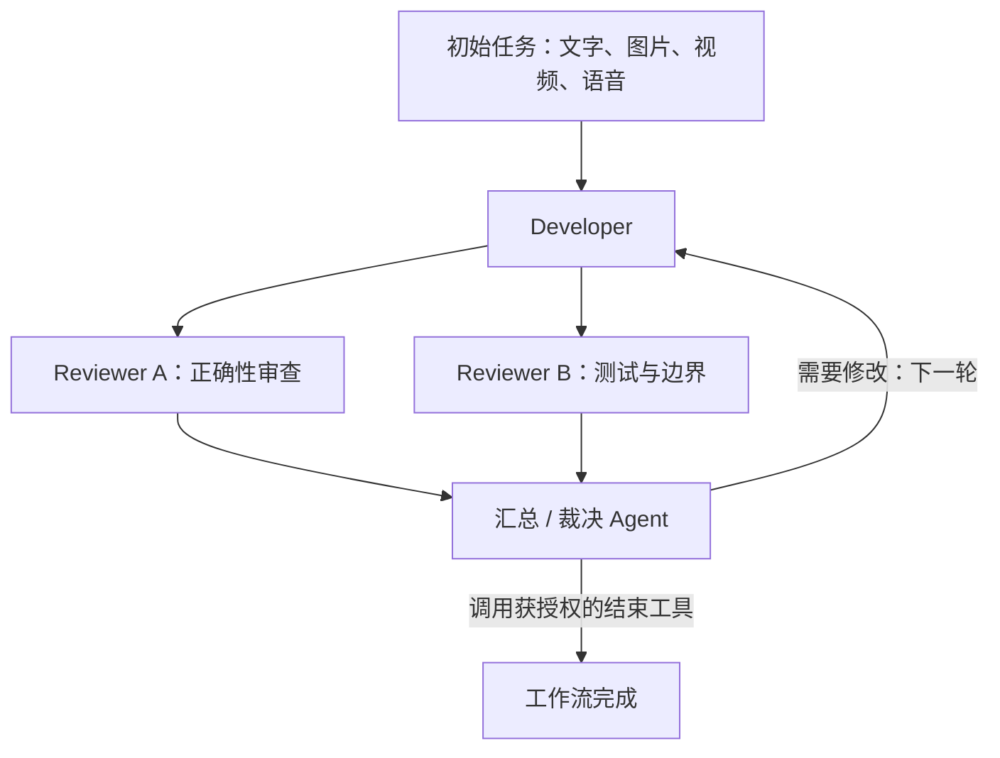
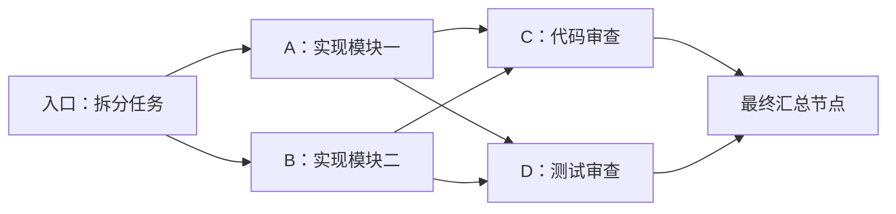
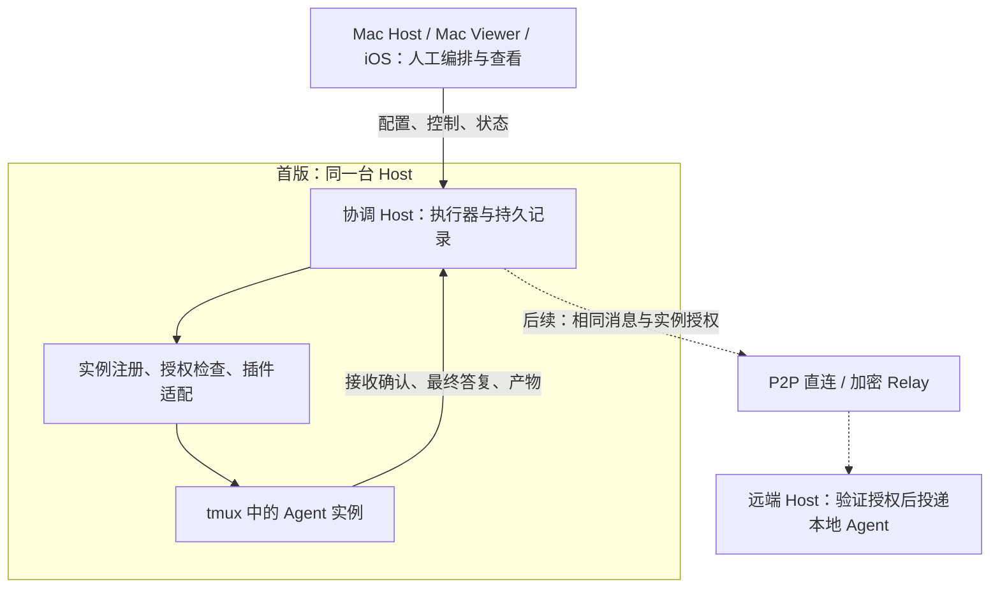

# CtrlX 多 Agent 协作设计

首次记录：2026-10-23；方案整理：2026-10-24。代码核对基线：`d742be9`。

第一版让用户在 Mac 或 iOS 上选择同一 Host 的多个 Agent，配置任务交接关系，启动后由 Host 自动执行分发、汇合与循环。一个节点可以同时有多个上游和多个下游，分别支持一对多、多对一和多对多协作。后续沿用相同的实例身份、消息和授权模型，扩展跨 Host 通信及 Agent 动态编排。

方案主线是：**人选择实例、配置交接；Host 保存并执行；Agent 接收文本和附件、返回结果。** Mac/iOS 是编排和查看入口，Agent 保留原有终端体验；工作流的进度和权限由 Host 管理。第一版不要求 Agent 彼此建立连接，也不要求用户理解消息协议。

最小使用方式是选择 Developer 和 Reviewer，填写初始任务及各自预设，然后启动。需要多个审查者时，将 Developer 同时连接到多个 Reviewer，再由一个汇总节点接收它们的结果。每个节点都可以同时有多个来源和目标；用连接表达材料流向，用节点预设表达它要完成的工作。

状态：单 Host 人工编排第一版已实现，Mac Host、Mac Viewer 和 iOS 的核心界面流程及真实 Agent 交接已验收，已提交为 `51ae178`，尚未发布。内容节点是此后的增量实现，验收范围另列于第 10 节。2026-10-24 用户明确决定跳过本轮 iOS 自动语音转写真机验证，由用户后续验收；该项不标为通过。第 1–9 节定义行为，第 10 节记录当前验收结论、范围限制和历史证据。跨 Host Relay／P2P 与 Agent 动态编排仍属后续阶段。

阅读路径：

- 产品方案：[范围](#1-产品范围)、[Developer / Reviewer 示例](#2-典型流程)、[Mac／iOS 编排](#3-页面与配置)、[多对多交接和循环](#4-分发汇合与循环)。
- 技术方案：[实例身份](#5-全局实例身份)、[消息与附件](#6-消息与-agent-适配)、[可靠执行和结束工具](#7-可靠执行与结束工具)、[通信与授权](#8-通信凭证与授权)。
- 实施边界：[实现顺序与验收](#9-实现落点与验收)、[当前实现进度](#10-实现进度)。

本文中，「Agent 实例」是一个真实运行的 Agent；「Agent 节点」是工作流中绑定该实例的角色；「内容节点」保存预设材料并自动合并、转发上游输出，不绑定 Agent；「标签／pane」只是操作它的位置。用户选择标签完成编排，Host 始终按实例身份交接，不能因标签重建而自动换成另一个 Agent。

### 需求对照

| 需求 | 方案落点 |
| --- | --- |
| 人工编排，后续支持 Agent 动态编排和跨 Host 协作 | [产品范围](#1-产品范围)、[通信与授权](#8-通信凭证与授权)；首版单 Host 执行，Mac Host／Viewer 和 iOS 都能管理 |
| 选择已有 Agent，也能新建 | [页面与配置](#3-页面与配置)；绑定真实运行实例，保留原有终端入口 |
| 实例身份全球唯一，授权细到实例 | [全局实例身份](#5-全局实例身份)；UUID 与可信 Host、进程及原生对话关联，标签名称不作为身份 |
| 文本和 skill 的简单交接 | [消息与适配](#6-消息与-agent-适配)；结构化信封负责路由，终端收到可读文本，完成证据来自原生事件或记录 |
| 初始输入及节点预设支持文本、图片、视频、语音 | [典型流程](#2-典型流程)、[附件](#附件)；显式检查原生读取或转换能力，不能只传路径就算支持 |
| 非 Agent 内容节点 | [内容节点](#内容节点)；保存预设，汇合上游后自动转发，不调用模型 |
| 一对多、多对一，可同时存在 | [分发与汇合](#4-分发汇合与循环)；节点保存连接集合，分别记录投递，同轮汇合后执行一次 |
| 给指定 Agent 配置结束工具 | [可靠执行与结束工具](#7-可靠执行与结束工具)；每次调用验证身份与授权，文本中的“完成”不触发结束 |
| P2P、Relay、通信凭证和 Host 粒度授权交互 | [通信与授权](#8-通信凭证与授权)；统一消息和实例权限，后续增加线路；Host 批量授权展开为具体实例 |

为控制第一版复杂度，建议采用以下规则。这些是方案中的产品选择，与上面的已确认需求分开记录：

| 关键选择 | 首版建议 |
| --- | --- |
| 多上游触发条件 | 同一轮全部成功后，合并成一次输入；每个节点每轮执行一次 |
| 一对多交接 | 同一份不可变结果分别交给各下游，分别记录是否接收 |
| 预设内容归属 | 配置在目标节点；汇合多个上游时，该节点的文本、skill 和附件预设只加入一次 |
| 图与循环 | 每轮单入口且无环；默认运行一轮，显式开启循环后，所有分支汇总才回到入口 |
| 循环上限 | 开启循环时默认最多 5 轮，可配置；达到上限暂停，不算任务成功 |
| 人工介入 | 查看不暂停；输入、Questions 或权限请求暂停自动交接 |
| 扩展顺序 | 单 Host → 跨 Host Relay → P2P；Agent 动态编排后续开放 |

这些默认值不改变多对多能力：任一节点都可连接多个来源和多个目标；首版收敛的是触发规则和循环方式。后续增加“任一上游完成即触发”等策略时，继续使用相同的实例身份、连接集合和授权模型。

## 1. 产品范围

人工编排是由人定义参与者和规则，不是每次交接都由人确认。已有 Agent 标签可以直接加入，也允许新建 Agent；保留原来的终端交互和各 Agent 的原生上下文。

| 第一版包含 | 后续扩展 |
| --- | --- |
| 单 Host，参与者可来自不同会话、窗口或 pane | 跨 Host 执行 |
| Mac Host、Mac Viewer、iOS 都能配置、启动和查看 | Agent 在授权范围内动态编排 |
| 优先适配 Codex、Claude Code，插件声明协作能力 | 更多 Agent 插件 |
| 多下游分发、多上游等待全部结果后汇合 | 任一上游触发、逐条触发、数量阈值等策略 |
| 不同实例并行，单个实例串行 | 复杂条件分支、任意循环和调度优化 |
| 节点列表配置，每轮有向无环图，可整轮循环 | 自由拖拽画布 |
| 文本、skill、附件交接和输入能力检查 | 更多原生媒体输入适配 |
| 实例级授权、指定节点结束工作流、暂停恢复 | Host 间 P2P、Relay 切换及授权委托 |

单 Host 限制指参与 Agent 位于同一台 Mac。Viewer 可以在别的 Mac 或 iPhone，通过现有连接管理该 Host 的工作流；Viewer 退出或断网不停止 Host 上的执行。

## 2. 典型流程

最小例子是 Developer → Reviewer；开启循环后，Reviewer 未请求结束时，将答复交回 Developer 开始下一轮。多个审查者可以这样配置：



图中的回流由工作流执行器在轮次边界处理，不是本轮图内的普通依赖边。

每个 Agent 节点每次收到一次完整输入，按以下顺序组合：

1. 该节点的预设指令、skill 调用及预设附件。
2. 初始任务目标，保持多轮执行方向。
3. 所有直接上游本轮的最终答复，按配置顺序排列并标注来源。
4. 本轮明确交接的文件或产物引用。

入口节点首次运行使用初始任务和初始附件，不等待上一轮。下一轮入口接收上一轮最终汇总节点的答复，并继续保留初始目标。默认不逐轮转发整段历史；保留结果原文，超出输入能力时明确停止投递，不静默截断或改写结论。

例如 A 预设 `$review-changes` 加审查要求，B 预设测试指令，两者接收相同的 Developer 答复但承担不同任务。上游文本属于任务材料，不能通过其中的命令或“审查通过”等字样修改图结构、授权或工作流状态。

### Developer / Reviewer 配置示例

| 配置项 | Developer | Reviewer |
| --- | --- | --- |
| 参与者 | 已有开发标签，或新建 Agent | 已有审查标签，或新建 Agent |
| 每次预设 | 按任务要求实现；后续轮次结合审查意见修复，并说明改动与验证结果 | `$review-changes` 加审查要求；存在问题时给出可执行反馈，通过时请求结束 |
| 接收的答复 | 首轮无上游；后续接收上一轮 Reviewer 的最终答复 | 接收本轮 Developer 的完整最终答复 |
| 附件 | 初始任务附件及自身预设附件 | 自身预设附件及本次明确交接的产物 |
| 结束权限 | 默认关闭 | 人工开启 |

工作流配置入口为 Developer、最终汇总节点为 Reviewer，并开启整轮循环。Developer → Reviewer 是本轮连接；Reviewer → Developer 是下一轮回流，不需要用户把普通依赖边连成环。新增多个 Reviewer 时，增加并行节点及最终汇总节点，沿用同一套输入与授权规则。

上述预设是可编辑示例，不内置“开发者必须用哪个 Agent”或“审查者必须用哪个 skill”的限制。初始附件默认交给入口，其他节点只接收自身预设和明确交接的附件；初始任务文字则随每次调用保留。开始前的输入预览应能看清这些差别。

例如，Reviewer 收到的纯文本可以是以下结构；尖括号部分在发送时替换为实际内容，附件由适配器单独准备：

```text
$review-changes
请审查本轮修改，列出需要修复的问题；通过时使用本次授权的结束命令。

初始任务：
<用户输入的任务目标>

来自 Developer · 第 1 轮：
<Developer 本轮完整的最终答复>
```

skill 是目标 Agent 支持的调用文本，不由 CtrlX 解释为新的调度协议。目标未安装所需 skill 时应在配置预检中提示；无法确认时明确显示“未验证”，不能宣称预设可执行。

### 内容节点

内容节点与 Agent 节点使用同一套连接、分发、汇合和轮次规则。它可以作为入口、中间节点或最终节点，也允许构建纯内容工作流；不创建终端、不调用模型，不消耗 Agent 实例名额。

典型用法是 `Reviewer A + Reviewer B → 内容节点（$fix + 修复要求与参考图片）→ Developer A + Developer B`。内容节点等齐两个审查结果，按配置中的节点顺序组合一次，再让两个 Developer 分别收到同一份保存的输出。它不解释 skill、不执行工具，也不替用户改写或总结上游答复。

输出顺序为本节点预设，然后是入口节点专有的初始任务，最后是带来源名称和轮次的全部直接上游输出。附件同样按此顺序合并、按快照 ID 去重；视频和语音继续复用现有的采样／转写导入。非入口内容节点不会自动附加初始任务或其他分支材料。Agent 节点仍保留初始任务目标，并在最终投递时添加自己本次调用的附件、产物分享和获授权的结束命令。

Host 在同一次持久化中记录内容节点的调用、完整输出和成功状态；保存后才调度下游。暂停、结束或授权到期后不再生成输出；重启后保留已保存结果，按现有规则暂停，人工继续时不重复执行已完成节点。内容节点没有 Agent 实例 ID、原生轮次或结束工具权限，不能冒充真实 Agent 发回执、分享产物或请求结束。

内容输出最多 2 MiB UTF-8 文本、32 个附件；超限时暂停并说明原因，不截断。下游 Agent 仍受自身输入和媒体能力限制，因此能保存的内容不代表任意 Agent 都能接收。循环可经过内容节点，但仍要求所有分支汇合到唯一最终节点并受轮数上限约束。

## 3. 页面与配置

Host 菜单增加「协作」入口。Mac 和 iOS 使用相同的信息结构与数据模型，分别适配桌面和手机。

首次使用按以下路径完成，无需先理解通信协议：

1. 选择一个 Host，新建工作流，填写初始任务并添加附件。
2. 添加 Agent 角色（已有或新建标签），或添加内容节点；填写各自的预设内容。
3. 为各节点多选上游，界面自动显示对应下游；指定入口，需要循环时选择最终汇总节点和轮数上限。
4. 选择哪些角色可以结束运行，查看实例、附件和实际输入预览，然后启动。
5. 在运行页查看进度和等待原因；需要人工处理时进入对应终端，处理后继续。

两端都围绕三个页面组织，不把完整协议或调度参数铺在首页：

| 页面 | 主要内容与操作 |
| --- | --- |
| 协作列表 | 按 Host 查看配置与运行，显示运行中／等待人工／已结束，提供新建和进入入口 |
| 配置编辑 | 初始任务、角色节点、连接和循环；节点展开后编辑预设内容、附件与结束权限 |
| 运行详情 | 当前轮次、各节点状态及等待原因、交接记录；提供暂停／继续／结束和跳回终端 |

Mac 可同时展示节点列表和所选节点详情；iOS 逐页进入详情，配置含义与执行规则保持一致。首版不增加拖拽画布，也不复制终端聊天界面。

创建时采用纵向节点列表，Agent 节点显示角色、绑定标签及 Host；内容节点显示文档图标和类型说明，隐藏 Agent 选择、状态与结束权限：

| 配置 | 含义 |
| --- | --- |
| 参与 Agent | 选择已有实例，或通过现有新建 Agent 流程创建 |
| 角色名称 | Developer、Reviewer 等展示名，不作为身份 |
| 预设内容 | 每次执行时注入的文本、skill 和附件 |
| 上游节点 | 多选；首版等待全部上游成功完成 |
| 下游节点 | 从连接自动推导，只读显示；成功完成后分别分发 |
| 允许结束工作流 | 授予该节点绑定实例结束当前运行的能力，默认关闭 |

首版只提供上游多选这一处连接编辑入口，下游由同一份连接集合推导，避免两处配置不一致。例如，给 Reviewer A 和 Reviewer B 都选择 Developer 为上游，即形成一对多；给汇总节点同时选择两个 Reviewer，即形成多对一。节点列表顺序用于阅读，执行先后由连接决定。

工作流另外配置初始任务、附件、入口、是否循环、循环时的最终汇总节点及最大轮数。默认关闭循环，完成一轮后结束；开启后默认最多 5 轮，达到上限暂停等待人工处理。

同一个节点可以同时有多个上游和多个下游。例如 A、B 汇入 C，C 再分发给 D、E；C 等待 A、B 后执行一次，D、E 分别接收 C 的同一份最终结果。界面用多选列表表达连接，用“等待 A、B”或“完成后交给 D、E”说明规则，无需首版引入画布编辑器。

开始前检查实例、插件能力、连接关系、工作区和附件，允许预览实际投递内容。已有 Agent 应处于可接收新任务的状态；不能覆盖草稿、绕过权限问题或向已退回 shell 的 pane 写入任务。首版一个活动运行内不重复绑定同一个实例，同一实例也不能被两个活动工作流同时占用。

配置可保存复用，但每次启动都重新核验实例与授权。运行使用固定的配置版本，编辑模板不改变已投递任务。多 Viewer 编辑通过版本校验避免覆盖彼此的修改。

配置详情和运行页的 Agent 节点整行可点击，显示角色名称、会话／标签名称和状态，跳回现有终端。Mac 按标签实际归属定位主窗口或独立窗口、左右分屏及 pane；iOS 恢复对应会话、标签和 pane。每次打开都重新核验 Agent 实例，替换进程或复用 pane 不继承旧跳转。

Agent 标签的更多／右键菜单提供 `View Workflow`。客户端向 Host 查询该实例当前参与的活动运行，直接恢复对应运行页；没有活动运行时，可以返回本客户端此前从该实例打开的配置或已结束运行。没有关联时明确提示。客户端保留协作导航路径，关闭并重新打开协作页面不必重选 Host；这份界面状态不控制 Host 的执行。

内容节点在配置页点击查看输出格式预览；在运行页执行完成后点击查看本轮保存的输出，未执行时显示等待原因。运行页继续提供轮次、状态、交接记录及暂停、继续、结束操作。

工作流配置可以记住新 Agent 的默认创建会话。第一次创建时选择已有会话或新建会话；新建会话的建议名称取自工作流名称。确认创建且发现真实 Agent 实例后，保存该实例的稳定 session／tmux server 身份，之后的新 Agent 默认进入同一会话。会话不可用时要求重新选择，不按同名会话自动替换。此字段是可选的创建偏好，旧配置无需迁移，执行时不据此授予任何权限。

启动运行只创建调度记录，复用配置绑定的 Agent 和原有上下文；新建 Agent 才会实际创建标签或会话。一个工作流可引用同一 Host 多个会话中的实例，内容节点不占终端标签。启动成功响应到达时，仅在客户端仍处于发起请求的原配置路径时自动进入运行页；后退或切换 Host 后，迟到响应不能改变后续导航。Host 已确认的运行仍可从运行列表进入。

查看、切换或滚动终端不暂停协作。人工开始输入或编辑时先暂停自动交接，保留草稿与现场；Questions 和权限请求使用现有 UI，处理后再继续。暂停时正在执行的 Agent 可以完成并保存结果，但不触发下一次投递。结束工作流不自动关闭标签或杀掉 Agent。

Continue 在恢复交接前重新检查参与实例；仍有草稿或待回答的问题时明确拒绝。其他分支正常执行中的忙碌状态不阻止恢复。若已经有获授权的结束请求，Continue 只恢复等待或结算最终结果，不再投递新任务，不要求清除其他实例的无关草稿。

暂停停止的是后续交接，当前已接收调用的授权仍有效：它可继续读取已授权附件、保存产物和提交获授权的结束请求。权限确认后无需先恢复整个工作流才能完成当前任务。结束请求和最终答复先保存，保持暂停，人工继续后才结算或调度。尚未接收的任务不能利用暂停状态读取附件；结束运行、授权到期、调用完成或身份变化后拒绝后续访问。

## 4. 分发、汇合与循环

关系保存为节点和有向连接，不为节点保存单一的“目标 Agent”。例如 `A → C`、`B → C`、`C → D`、`C → E` 同时存在时，C 先汇合 A、B，再把自己的结果分发给 D、E。节点预设随该节点的一次执行注入一次，不因上游数量而重复。

### 一对多分发

上游成功完成后形成不可变结果快照。每个下游有独立的交接记录和投递状态，可引用同一份结果和附件存储，接收权限分别检查。单个目标失败，不能重新发送给已接收成功的其他目标。

下游没有其他依赖时即可执行；还有其他上游时，先保存结果，等待汇合。

### 多对一汇合

首版固定为「全部上游成功完成后，合并成一次输入，执行一次」。不把多份答复逐条写入正在工作的同一个终端。

汇合按 `runId + round + nodeId` 区分，核对每个上游的有效调用及结果 ID。重复通知不增加完成数；到达顺序不影响输入排列；上一轮结果不能补齐下一轮依赖。

例如 Developer 同时交给 Reviewer A、Reviewer B，二者再交给汇总 Agent：A 先完成时只保存结果；B 完成后，汇总 Agent 收到一条包含自身预设、初始目标、A 答复和 B 答复的任务。下一轮重新等待 A、B 各自的新结果，不复用上一轮的完成状态。

| 情况 | 行为 |
| --- | --- |
| A 已完成，B 执行中 | 保存 A，显示等待 B |
| A、B 都成功完成 | 合并后创建一个下游调用 |
| A 重复发送完成事件 | 去重，不重新触发 |
| B 等待问题或权限 | 展示阻塞原因，等待人工处理 |
| B 失败、取消或身份失效 | 阻止下游执行，暂停工作流 |

首版不支持跳过失败上游继续汇合。暂停不丢弃其他分支已完成的结果，也不强制中断正在执行的分支。

### 多对多示例

多对多直接组合上述两条规则，不另设一种执行模式。以下是完整的单入口示例：入口把任务分给 A、B，它们的答复都交给 C、D，最后汇总审查结果：



| 目标 | 等待的本轮结果 | 实际收到的一次任务 |
| --- | --- | --- |
| C | A、B | C 的预设文本／skill／附件 + 初始任务目标 + A、B 的完整最终答复及明确交接的产物 |
| D | A、B | D 的预设文本／skill／附件 + 初始任务目标 + 同一份 A、B 结果及明确交接的产物 |

A 的答复只生成一份结果快照，分别登记交给 C 和 D；B 同理。C、D 各自汇合依赖并执行一次，预设指令不会因收到两份上游结果而重复。它们使用相同的上游材料，可以配置不同的审查任务和预设附件。

最终汇总节点等待 C、D。单轮运行在它成功完成后结束；循环运行则由它的获授权结束请求决定是否完成，否则把它的最终答复交回入口开启下一轮，并受轮数上限约束。

等待范围按目标自己的连接决定。若 D 只连接 A，D 在 A 完成后即可执行，不必等待 B；C 仍等待 A、B。人工配置连接也就明确了材料的接收范围，未连接的节点不会自动收到其他分支的答复。

### 轮次边界

每轮图必须无环，所有节点从入口可达。一个节点每轮最多产生一份被接受的成功结果。单次运行在所有出口成功完成后结束。

循环运行必须指定最终汇总节点，所有分支汇入该节点，不允许仍有分支执行就开始下一轮。该节点未请求结束时，以它的最终答复开启下一轮入口。两节点 Developer ↔ Reviewer 是这一规则的最小情况。

成功结果被下游使用后不能覆盖。人工要求重做时创建新的执行记录；首版不支持在下游已经执行后，替换其历史输入并自动重算部分图。

并行节点的工作区必须明确：多个 Reviewer 可以审查同一份固定代码状态；多个 Developer 并行修改时建议使用独立 worktree，并明确合并步骤。消息分发不自动同步或合并代码。人工改动共享工作区后，原记录不能继续作为未变化的审查对象，需要重新确认或重跑。

## 5. 全局实例身份

身份、位置、对话和权限分别建模：

| 标识 | 含义与生命周期 |
| --- | --- |
| `hostID` | Host 的持久身份；首次迁移保留已有工作区 Host UUID，此后独立保存，并与可信 Host 连接绑定 |
| `agentInstanceID` | Host 为一个经过验证的 Agent 运行实例分配的全局唯一 UUID |
| 原生 conversation ID | Codex／Claude 的对话身份，用于关联原生记录，不代替实例 ID |
| pane 身份 | 当前运行位置及写入校验；使用稳定 pane 身份和 tmux 实例信息 |
| `nodeId` | 编排中的角色节点，可在人工重新绑定后指向另一个实例 |
| `runId`、`invocationId` | 一次工作流运行，以及一次节点执行 |

实例 ID 与 Host、插件、主 Agent 进程的 PID 和启动时间、pane 身份绑定。UUID 唯一性不等于认证，接收者还要确认它属于可信 Host 和已授权实例。

`hostID` 标识 Agent 所属的机器，`pairId` 标识一条 Host–Viewer 配对关系；同一 Host 被多个 Viewer 查看时，不为同一个 Agent 重新分配实例 ID。跨 Host 路由使用目标 Host 与实例 ID，实际写入仍由目标 Host 解析并核对当前 pane。这样，标签名称、窗口位置及 Viewer 的连接变化都不会改变协作对象。

Host 身份的持久化独立于“是否恢复工作现场”的偏好；关闭恢复功能不能让 Host 身份消失或重新生成。Host 将 UUID 保存到状态目录的 `host-identity.json`，首次迁移读取旧恢复快照的 UUID；损坏或不支持的身份记录必须报错，不能静默生成另一个身份。恢复快照与持久 Host 身份不一致时，保留旧快照并拒绝恢复。

移动、改名、分屏不改变实例 ID。CtrlX 重启后，只有确认原 Agent 进程仍存活且身份匹配，才能恢复原 ID。Agent 退出后重开、Fork 或恢复出新进程均分配新 ID；原生对话重置或切换也不能继续承接旧调用。

实例变化时暂停并要求重新绑定，不向同名标签、复用的 tmux ID 或自动恢复出的新进程静默转发。

## 6. 消息与 Agent 适配

### 现有能力与缺口

当前已有三条职责不同的通路，协作功能在这些边界上补充身份与调用关联：

| 通路 | 当前机制 | 协作中的用途 |
| --- | --- | --- |
| 向 Agent 输入 | Host 经 tmux `send-keys` 发送按键，或以独立命名的 `load-buffer`／`paste-buffer` 粘贴文本 | 组装一份完整任务，保留 skill、换行和附件引用，复核实例后提交 |
| 显示终端 | 同一 tmux control 连接的输出和有序快照，经 SwiftTerm 显示在 Mac／iOS | 继续供人查看和操作，不从画面静止或摘要推断任务完成 |
| 接收 Agent 事件 | hook／扩展桥通过 Unix socket 进入 PluginCore，再发出插件事件 | 关联本次输入、原生轮次和最终答复，决定能否交接 |

这些机制分别见 [tmux 输入实现](../CtrlxPackage/Sources/CtrlxServerFeature/Services/TmuxService.swift) 和 [终端及插件事件架构](architecture.md#terminal-data-and-input)。Agent 仍使用原来的 CLI 和终端；Host 负责投递与调度，不需要让两个终端直接互相写入。

基线版本的 `AgentState.doneWorking` 同时覆盖正常停止和失败，查看后还会转为 `idle`；其 `PluginEvent` 没有工作流调用标识。因此不能直接监听界面状态来驱动交接，也不能用屏幕静止或通知摘要推断成功。本工作区新增的原生事件、调用关联、Host 接线和客户端页面见第 10 节；运行证据和明确延期的验收分开记录。

为 Codex 和 Claude Code 增加可选协作能力：任务投递、接收确认、原生轮次关联、完整最终答复和失败原因提取、附件支持声明。继续接入现有插件事件链路，不另建终端输出流。

原生事件有轮次 ID 时保留它；没有时必须通过提交事件和原生会话记录建立可验证的关联，不能仅凭时间先后或相同文本归并。关联不明确、子 Agent 结束或后台任务暂时停止，都不能触发成功交接。接收确认与轮次关联必须在自动执行上线前验证。

### 最小封装

正文仍是 UTF-8 文本。skill 调用原样保留，由目标 Agent 理解；CtrlX 不把正文当 shell 命令执行。下面是汇合后投递的 JSON 示意，ID 为占位值，不是现有接口：

```json
{
  "version": 1,
  "messageId": "delivery-uuid",
  "runId": "run-uuid",
  "round": 1,
  "invocationId": "invocation-uuid",
  "toAgentId": "target-agent-uuid",
  "sources": [
    {"nodeId": "review-a", "agentId": "agent-a", "resultId": "result-a"},
    {"nodeId": "review-b", "agentId": "agent-b", "resultId": "result-b"}
  ],
  "text": "预设指令、初始目标和按来源排列的上游答复",
  "attachments": [
    {"id": "attachment-uuid", "name": "需求.png", "mediaType": "image/png"}
  ]
}
```

一对多分别创建目标投递；多对一通过 `sources` 标识来源，不把某一个上游伪装成整份汇总的发送者。实例来源和协调 Host 由认证上下文确认，不相信请求自报身份。

这里有两层通信：Host 之间、Viewer 与 Host 之间使用带身份和调用信息的结构化消息；真正交给终端 Agent 的仍是可读文本和该 Agent 支持的附件输入。Agent 无需理解整套网络协议，也无需持有对端 Host 的连接凭证。

Agent 交接必须区分三个阶段，不能用一个“发送成功”混在一起；内容节点的成功只表示合并输出已保存，不表示下游 Agent 已接收：

| 阶段 | 能证明什么 | 能否触发下游 |
| --- | --- | --- |
| Host 已接收并保存 | 请求进入账本，可以去重和恢复 | 否 |
| Agent 已接收 | 原生提交事件与本次输入、实例和调用对应 | 否；后续 hook 仍可能拒绝执行 |
| Agent 成功完成 | 原生最终结果与本次调用对应，且没有失败或继续执行信号 | 可以，仍需满足下游的全部依赖 |

一次投递按顺序准备附件、组装内容、复核实例和输入状态、写入并提交。复用现有粘贴与身份保护，同时补齐输入排他和确认，不能用多次没有关联的文本发送假装一次可靠任务提交。

### 附件

初始内容和节点预设都可携带图片、视频、语音。附件导入工作流存储，保存固定内容、大小、媒体类型和校验值；不依赖可能被清理的普通临时路径。同 Host 复用已存文件，跨 Host 阶段再分块传输和校验。目标只获得被授权的附件引用，不获得任意 Host 路径读取权限。

| 输入 | 首版处理边界 |
| --- | --- |
| 文本、skill | 原样组合，保留顺序和换行 |
| 图片 | 通过适配器使用 Agent 的原生图片输入或图片读取工具，明确支持格式并验证实际读取 |
| 语音 | 支持转写为文本，保留原始音频；原生音频读取由适配器声明 |
| 视频 | 保存和传递原文件；目标必须有读取能力或明确的转换方式 |

显式转换在导入附件的 Mac／iOS 客户端进行，用户确认后上传：

- 语音：使用系统语音识别生成可编辑的转写，也允许手工填写；无转写不能作为音频任务输入。
- 视频：默认均匀采样 8 帧，可选择 1–16 帧；生成 JPEG 和一份记录实际时间点、原件校验值及采样局限的 Markdown 说明。存在音轨时可转写，或明确排除声音并记录在说明中。
- 原件、转写和采样都来自同一份固定快照；上传后重新核对原件 SHA-256，再一次性登记关联。Agent 获得确认后的文字和图片，原件保留但不自动授权读取。
- 导入界面展示采样图和可编辑转写。停止操作后等待当前处理退出再允许重试，取消导入清理本次未引用的文件；删去最后一个转换结果才允许清理原件。

采样不是逐帧分析，不能声称覆盖视频中所有事件。每份视频说明也计入 32 个输入附件的上限。系统语音识别可能需要语言资源下载、授权或联网；失败时显示原因，不能用空转写替代声音内容。

文件转写先查询识别模块支持的 PCM 格式；采样率、声道或样本格式不匹配时，分块转换到临时录音，识别结束或取消后清理，不改写附件原件。[Apple 的格式契约](https://developer.apple.com/documentation/speech/speechanalyzer/bestavailableaudioformat%28compatiblewith%3A%29)说明分析器不会自动转换输入，能解码 WAV／M4A 不代表能直接交给识别模块。

附件送达不等于模型理解。启动前检查每个目标的能力，不支持时要求转换或调整，不静默丢弃，不把传入文件路径宣称为原生多模态支持。转写和媒体转换需单独验收，不能只验证文件传输。

现有 Relay 单帧上限为 1 MiB，不能在一条 JSON 中内嵌大视频。复用分块上传时补齐附件归属、授权和保留策略。首版保留运行记录及附件，用户删除运行时一起清理；仍被其他模板或运行引用的附件不能误删。

上游需要交接产物时，先保存文件，再执行 `ctrlx workflow share --invocation <本次调用 UUID> --file <文件路径> --json`。CLI 读取文件并上传固定快照，Host 将快照与该调用一起登记；收到经过验证的最终答复后，结果携带这些快照 ID 分发给各下游。提到文件路径不等于交接，上传成功也不等于下游已经执行。每次调用最多显式分享 32 个产物；汇合后的完整输入超过 32 个附件时暂停投递，不静默遗漏。

分享过程中修改文件、上传失败或授权失效，不生成成功交接。最终回执丢失时可能已经保存，CLI 提示先查看记录，不自动重复上传。原文件之后变化不改变已保存快照；调用未完成时，已登记的快照也由运行记录保留。附件或产物超出下游的读取能力时，仍需先显式转换。

## 7. 可靠执行与结束工具

Host 持久化配置版本、实例绑定、调用、消息状态、已接受结果和授权。先记录投递意图，再写入终端；状态更新和下游调度由同一个执行器串行判定，实际 Agent 可以并行工作。

终端提交在实际启动 tmux 命令时，同步校验人工输入代次、Agent 进程身份、授权有效期与可撤销的单次写入凭证。账本的暂停、结束、完成请求及实例失效都会撤销未启动的写入；暂停后立即继续也不会重新放行旧凭证。已经启动的提交属于在途操作，暂停／结束不承诺撤回 Agent 已收到的输入。

提交事件只确认输入归属，不保证其他原生 hook 已允许执行。Host 从经过身份校验的提交事件开始观察原生失败记录；即使没有 Stop，也能将拒绝的调用标为失败并暂停交接。该观察不能产生成功结果，成功仍须 Stop 候选及完整最终记录同时通过验证。重复提交回执不会覆盖正在进行的最终答复验证。

进程扫描暂时无法返回快照时，保留已核实调用者、实例、原生轮次和记录路径的 Stop 候选；提交回执也在当前 Host 进程中保留为待核验候选，暂停交接并在 60 秒内重试。回执核验前到达的同轮 Stop／失败事件暂存，重新确认实例并保存回执后才处理；等待期间不把调用标为已接收，也不重发任务。重新确认原实例前不解析或接受答复；恢复后仅保存结果，仍需人工继续。候选验证时限为 60 秒，耗尽后保持未确认状态，不重发任务；进程、pane 或原生对话确实变化时直接拒绝，不按临时扫描故障处理。

```text
等待依赖 → 待投递 → 已写入、等待接收确认 → 执行中 → 成功完成
                                  └→ 不确定 / 等待人工 / 失败
```

| 场景 | 处理原则 |
| --- | --- |
| 重复请求、重复完成事件 | 复用原记录，不重复投递、汇合 |
| 已写入终端，Host 在确认前崩溃 | 标记不确定；不能证明未执行就不自动重发 |
| Agent 正忙、存在草稿或编辑器 | 不覆盖输入；等待或暂停，明确原因 |
| 问题、权限请求、失败、超时 | 不当作成功答复转发；暂停或等待人工 |
| Viewer 断开 | Host 继续，重连获取权威快照 |
| Host 重启 | 先核对进程、调用和授权；未确认的运行保持暂停 |
| 多 Viewer 同时操作 | 校验配置版本和状态，幂等处理开始、暂停、结束 |

Host 重启后，若原调用的接收回执已经持久化，来自同一存活实例、原生轮次和记录文件的最终事件仍可进入验证。通过后只归档原调用结果，运行保持暂停，人工继续才调度下游。原生接收回执晚到时，也须匹配原输入与实例，不能新建一个调用代替。

没有接收回执的写入不能仅凭 Stop 认定成功；停机期间完全错过最终事件时保持待核验，不用终端空闲状态补造成功。操作者可查看终端，结束该运行后再显式创建新执行；结束不会取消 Agent 已接收的任务，应先确认其实际结果，不能靠自动重发补救。

原生 JSONL 中的图片 Base64 采用流式读取并略去载荷，保留消息身份、父子链、轮次及所有完成证据；单条记录保留的非图片内容仍限制为 2 MiB，原始读取上限计入最多 32 张 20 MiB 图片的 Base64 和 JSON 转义开销。历史图片与当前图片使用相同处理，不能因旧轮次的一条大图片记录永久阻塞后续结果核验。

终端写入与应用持久化不能组成原子事务，因此不宣称端到端严格“恰好执行一次”。保留不确定状态，避免自动重发有副作用的任务。

多路审查默认只给最终汇总／裁决节点开启「允许结束工作流」。首版提供以下 CLI 能力，由 Agent 已有的命令执行工具调用：

```text
ctrlx workflow finish --invocation <本次调用 UUID> --reason "审查通过"
```

说明随当前任务上下文只注入获授权节点。已有会话无需依赖 CLI 是否支持运行中动态新增 MCP 工具；后续可适配独立的原生工具，Host 校验保持一致。

调用 UUID 随本次任务提供，用于拒绝上一轮晚到的结束命令，不是权限凭证。Host 同时验证 socket 的真实调用者进程链、仍存活的主 Agent、原生对话及当前调用授权；不能通过传入 pane、进程 ID 或 Agent ID 代替。人工暂停或授权到期后，结束命令也不能恢复自动执行。

Host 从真实调用者解析实例、运行和调用，验证权限并持久化结束请求，再返回成功。其他实例即使知道命令也会被拒绝。接受请求后立即停止新投递；收到该调用的最终成功答复后完成工作流。若随后失败或失联，保留结束请求并进入待处理状态，不伪造成功结论。

人工可授予多个节点结束权限，这表示任一获授权节点都能请求结束整个运行，不代表所有审查者一致通过。已执行的其他节点不强制终止，晚到结果可归档但不再调度。

## 8. 通信、凭证与授权



每次运行只有一个协调 Host。Viewer 不持有调度循环，Relay 不执行工作流、不解析明文任务；目标 Host 校验本地 Agent 的权限和身份后才写入终端。

当前有 Host–Viewer 的加密 Relay 通道，尚无通用 Agent 协作 P2P 通道。顺序为单 Host → 跨 Host Relay → P2P 直连及回退。首版统一业务消息和授权边界，不提前实现打洞、发现服务或多协调者共识。

| 通信双方 | 首版 | 后续扩展 |
| --- | --- | --- |
| Mac Host 界面 → 本机执行器 | 直接调用同一 Host 服务 | 保持相同控制语义 |
| Mac／iOS Viewer → Host | 复用配对后的加密 Relay 连接，管理所选 Host 的运行 | 可继续使用该连接，不要求 Viewer 承担调度 |
| Host → 本机 Agent | 经身份校验的 tmux 投递与插件回执 | 每个目标 Host 继续负责本地投递 |
| 协调 Host → 其他 Host | 首版不执行跨 Host 节点 | 先增加 Host 间认证与 Relay 路由，再加入 P2P；两种线路使用同一业务消息 |

两种线路使用相同端点身份和授权，换线路不扩大权限，消息 ID 不变。跨 Host 仍需协作能力协商及路由，不能把复用加密基础设施当成已有跨 Host 协作，也不预先承诺无需 Relay 修改。

### 版本与客户端边界

Host 显式声明工作流协议版本及可用插件能力，Viewer 据此开放配置与控制入口。旧 Host 不具备能力时显示升级提示，不能降级为不受保护的普通终端输入。新 Host 继续兼容旧 Viewer 的普通终端操作，旧 Viewer 的人工输入也必须触发 Host 侧的交接暂停。

Host 还须检查参与实例使用的 CLI。当前实现复用进程检查，按该进程的可执行文件路径读取版本，而不是检查 `PATH` 中另一个同名命令。自动交接暂只开放已有原生输入及最终结果证据的 `codex-cli 0.163.0` 和 `2.1.308 (Claude Code)`；旧版、未知版本和未验证新版保留在目录中，显示具体原因，不宣称兼容。复核能力恢复后保留实例身份，但运行仍需人工继续。

CLI 版本与 hook 能力分别验证。实际执行的主会话 hook 在 ingress context 中声明 `CTRLX_WORKFLOW_VERSION=1`，同时支持接收回执；Host 验证内核提供的进程链，再将确认绑定到插件、原生对话、pane 及主进程启动身份。子 Agent、请求正文中的自报版本和没有内核 peer 的事件不能建立确认。旧版或未知协议会暂停对应运行；确认恢复也不自动继续。

能力记录先持久化，才允许用于目录和投递检查。Host 在启动 ingress 前初始化账本，SessionStart 可先于目录刷新保存确认；Host 重启后仍须复核实例当前身份，进程或对话更换不能继承旧确认。若 Agent 早于 Host 启动、尚未发出可验证 hook，界面提示更新插件并重启 Agent，或先提交一次普通输入，不能仅凭“插件已安装”放行。

运行控制使用带请求 ID 的命令，状态以 Host 快照和版本为准；重连后重新读取，不能把 Viewer 缓存当成可继续调度的依据。列表只传运行摘要，完整答复和附件按需读取，避免长结果或媒体堵塞键盘通道。当前控制协议、页面及附件分块传输的接入范围见第 10 节；iOS 图片／文本、手工确认转写与视频采样导入、Mac 自动中文转写已有界面证据。同批转换产物已另由真实模型读取验证，不能把它与确定性模型下的完整工作流测试合称为一次外部模型端到端验收。iOS 自动转写真机验证由用户后续完成。

### 凭证与授权

身份、通信凭证和操作授权分别解决三个问题，不能互相替代：

| 层次 | 回答的问题 | 首版约定 |
| --- | --- | --- |
| 实例身份 | 这是哪个 Agent？ | 全局 UUID 绑定真实 Host、主进程及对话；公开 ID 不作为秘密凭证 |
| 通信认证 | 请求确实来自谁？ | Viewer 使用已有配对加密连接；本地 Agent 命令核对 Unix socket 调用者及主进程链 |
| 操作授权 | 它可以对谁做什么？ | Host 保存运行内具体实例、目标、动作与有效期；每次投递、读附件和结束请求均校验 |

Host 持有设备级密钥；Agent 不获得 Host 私钥、配对密钥或其他 Agent 的模型账号凭证。协作授权绑定来源实例、目标实例、运行、动作和有效期，可撤销，实例退出或运行终止后失效。

本地命令复用内核 socket 调用者和主 Agent 进程链验证思路，不仅相信 `agentId`、PID 参数或 `TMUX_PANE`。现有 API 只在部分功能上具备此校验，工作流入口须显式接入。需要令牌的适配器使用受运行与实例约束的短期凭证，不放进提示词、终端输出或常规日志。

跨 Host 时先认证 Host，再由目标 Host 检查实例级授权。共享 Viewer 或知道对方地址不自动获得协作权限，Host 配对也不自动授权全部 Agent 互发任务。

界面可按 Host 批量授权，但执行时展开为具体实例和动作：A 的结果可交给 B、B 可读这些附件、B 可请求结束运行。新实例不继承旧实例权限。第一版由人工启动配置好的运行创建授权，每次交接不重复确认。

这层授权保护 CtrlX 协作接口，不构成共享同一 macOS 用户、可任意执行 shell 的进程之间的操作系统安全隔离；后者需要系统级隔离。

### 后续动态编排与代码交接

Agent 动态编排使用同一套节点、连接和执行接口，选择范围受预先授权约束，不能通过创建节点扩大自身权限。首版不开放运行时动态改图。

跨 Host 审查需要 commit、patch 或明确产物快照；不能只发送“修改完成”，也不能把上游绝对路径或 `repo:` 引用解释成下游同名文件。同步、应用和合并步骤在跨 Host 阶段设计，不属于首版隐含能力。

## 9. 实现落点与验收

共享值类型放在 `CtrlxNetworking`，Host 执行与持久化放在 `CtrlxServerFeature`，Mac/iOS 共用页面和客户端状态放在 `CtrlxCommon`。扩展现有插件协议边界，同步 CLI 和对应 skill。首版不引入独立云端工作流服务。

### 最小数据模型

配置、运行和真实 Agent 实例分开保存。这样，改角色名或编辑模板不会改变正在执行的任务；标签被复用也不会继承旧实例的权限。

| 对象 | 保存什么 | 关键约束 |
| --- | --- | --- |
| 实例 `AgentWorkflowInstance` | 全局 ID、Host、插件、进程与 pane 身份、原生对话和能力 | 每次写入重新核验；位置与展示名不是身份 |
| 配置 `AgentWorkflowDefinition` | 版本、节点、连接、初始输入、入口和循环规则 | 启动时复制到运行中；后续编辑不改变已启动运行 |
| 节点与连接 `Node / Edge` | 类型、名称、可选绑定实例、每次预设、结束权限，以及来源／目标节点 ID | 一份连接集合同时表达上下游；支持多个来源和多个目标 |
| 运行 `AgentWorkflowRun` | 固定配置、实例绑定、轮次、状态、授权期限和结束请求 | 一个协调 Host 保存权威状态，Viewer 只发控制请求 |
| 调用 `AgentWorkflowInvocation` | 某节点某轮的输入、原生轮次、执行状态和结果 | 全部上游齐备后创建；不向正在执行的调用追加另一份上游输入 |
| 投递 `AgentWorkflowDelivery` | 目标实例、本次调用、来源结果集合和组合后的输入 | 同一来源结果可用于多个目标；每个目标独立记录投递 |
| 结果与附件 `Result / Attachment` | 完整答复、来源调用、不可变文件快照及校验值 | 成功结果不覆盖；附件按明确连接和调用授权交接 |

这些对象对应当前工作区的共享模型；跨 Host 阶段复用其身份与关联语义，另补认证传输和目标 Host 授权检查。通信线路不参与决定哪个节点该执行。

### 实现顺序与验收边界

| 现有入口 | 复用及需补齐部分 |
| --- | --- |
| [实例关联](../CtrlxPackage/Sources/CtrlxServerFeature/Services/AgentSessionIdentityClient.swift)、[工作区身份](../CtrlxPackage/Sources/CtrlxNetworking/Models/WorkspaceIdentity.swift) | 复用进程与 pane 校验，补全局实例注册和生命周期 |
| [插件协议](../CtrlxPackage/Sources/CtrlxPluginProtocol/PluginCore.swift)、[插件事件](../CtrlxPackage/Sources/CtrlxNetworking/Models/Plugin/PluginEvent.swift) | 复用事件链路，补接收确认、可靠轮次关联及结果能力 |
| [tmux 输入](../CtrlxPackage/Sources/CtrlxServerFeature/Services/TmuxService.swift)、[响应上下文](../CtrlxPackage/Sources/CtrlxServerFeature/Plugins/PluginResponseContext.swift) | 复用投递与身份校验，补输入排他和不确定状态处理 |
| [文件上传](../CtrlxPackage/Sources/CtrlxServerFeature/Services/HostFileUploads.swift) | 复用分块和校验，补附件归属、授权和生命周期 |
| [本地 API](../CtrlxPackage/Sources/CtrlxServerFeature/Services/APISocketServer.swift)、[Viewer 连接](../CtrlxPackage/Sources/CtrlxCommon/Services/ViewerConnectionManager.swift) | 增加经认证的工作流控制和状态接口 |

实现顺序如下；前三步共同构成第一版，不能将文本链路通过当成整个需求完成：

| 阶段 | 交付与验证重点 |
| --- | --- |
| 1. 执行基础 | 身份、连接校验、持久化、分发／汇合、循环、授权；用确定性的测试验证调度规则 |
| 2. 真实 Agent 交接 | Codex／Claude 文本和 skill 投递、原生接收与完成关联、结束命令、媒体输入或显式转换；隔离验证实际 TUI |
| 3. 双端产品入口 | Mac Host／Viewer 与 iOS 编排、预览、运行控制、已有／新建 Agent、终端跳转及多 Viewer 一致性 |
| 后续 | 跨 Host Relay，再加入 P2P 与线路回退，最后在明确授权内开放 Agent 动态编排 |

模拟 Agent 的测试不能替代真实 TUI 接收和完成关联验收；现有终端能显示媒体路径，也不能替代媒体输入验收。

首版验收至少覆盖：

- 双节点往返、多分支并行、多来源汇合；不同到达顺序只触发一次下游。
- A、B 同时连接 C、D：C、D 各执行一次、各注入一次预设，共享相同的上游结果；其中一个目标接收失败不重投给已接收的目标。D 仅连接 A 时不等待 B。
- 重复及旧轮次事件、子 Agent 停止、失败、后台暂停不触发错误交接。
- pane ID 复用、Agent 重启、同一对话多进程和 Host 重启的身份校验。
- 终端写入前后崩溃、重连、重复请求，不自动重发不确定任务。
- 草稿保护、人工接管、Questions/权限处理、恢复和并行分支结果保留。
- Codex 与 Claude Code 混合协作，skill、完整答复及支持的媒体输入真实可用。
- 有权和无权实例调用结束工具，撤销、过期、伪造身份及晚到结果处理。
- Mac/iOS 配置、启动、暂停、查看、跳转，多 Viewer 操作一致。
- 轮数上限、非法图拒绝、配置冻结、附件校验与清理、旧 Host 能力提示。

本轮验收结果及用户明确延期的项目见下一节。

## 10. 实现进度

### 协作与终端联动增量（2026-10-26）

基于 `452c5ed6` 实现节点整行跳转、终端 `View Workflow` 入口、客户端导航路径保留，以及工作流的新 Agent 默认创建会话。Mac 复用既有来源终端请求，按实际所有者打开主／独立窗口并处理左右分屏和 pane 焦点；首次窗口初始化完成后再消费请求，避免恢复旧布局覆盖目标。内容节点点击查看预览或本轮输出。

当前 217 项工作流专项测试通过，包含活动／暂停／收尾运行定位、已结束运行与配置返回、导航层级保留、替换进程／pane 拒绝、迟到查询取消及可选会话偏好的编码兼容。延迟启动回归覆盖停留原页、后退、切换 Host、进入其他配置、请求发出前已离开及任务取消六种情况；离开原配置路径后不自动跳转，但仍保留 Host 已确认的运行。Mac Common／Host 模块参与包编译；原生 `NSHostingView` 验证配置与运行页面重建后重新加载同一目标，场景明确设置为前台。离屏窗口不提供可用的可访问性按钮树，因此该测试不声称实际点击或焦点验收。日志及页面快照在本工作树 `.build-local/workflow-navigation/`。

iOS Simulator 的 arm64／x86_64 应用构建通过，使用 `Ctrlx.xcworkspace`／`Ctrlx`、Debug、禁用签名；这不等于 UIKit 运行验收。本增量尚未运行真实终端的分屏／独立窗口点击、iPhone 触控跳转和新建 Agent 的完整交互验收；未操作生产会话、替换已安装 App、推送或发布。

### 内容节点增量（2026-10-24）

Mac／iOS 共用编辑页新增 `Add content node`，复用文本、skill 和附件编辑；预览明确显示将转发的输出，运行详情标注节点类型，交接历史可查看保存的输出。Host 执行器在账本内直接完成内容合并，复用已有依赖调度、结果来源、轮次、控制和附件访问规则。

管理协议升至 `AgentWorkflowWire.version = 2`，Host 与 Viewer 必须匹配才能操作工作流；旧端提示更新，不向旧端发送它无法理解的内容节点。真实 Agent 的 hook／CLI 协议仍为版本 1，无需改插件。旧配置缺少节点类型时按 Agent 解码；含内容节点的账本写入 schema 2，当前 Host 支持 schema 1／2，旧 Host 不应读取新账本。其他终端与文件等功能不受这项工作流版本门控影响。

本增量已有 207 项工作流相关测试通过，覆盖旧配置与版本门控、多上游汇合／多下游分发、完整文本与附件转发、权限拒绝、暂停／结束／到期、重启恢复、纯内容执行及轮数上限。另复跑共用配置页的 Agent／内容两类原生挂载用例，并核对 Mac 编辑页和已保存配置的渲染截图。日志和截图保存在本工作树 `.build-local/workflow-native-e2e/content-nodes-*`。iOS Simulator 的 arm64／x86_64 构建通过；本增量尚未做 iPhone 真机或真实 Agent TUI 的完整内容节点工作流验收。以下原有验收属于此前 Agent 节点实现，不自动作为内容节点的验收证据。

以下是 2026-10-24 已提交首版 `51ae178` 的验收记录（工作分支 `multi-agent`，原基线 `d742be9`）。

本节先列当前结论，随后保留分阶段记录。历史记录中的“待验收”描述当时状态，不覆盖下面的当前结论；旧证据只有在相关源码未变或新增回归覆盖后才复用。

### 已提交首版的验收结论

以下结论覆盖原有 Agent 节点首版；内容节点见上方增量记录。iOS 自动转写真机验证按用户明确决定延期。未替换用户安装的 Mac App，未推送或发布。

| 首版要求 | 源码及已核对的证据 | 结论／边界 |
| --- | --- | --- |
| 全局实例身份、Host 身份持久化和实例级授权 | `AgentWorkflowInstance`、`HostIdentityClient`、`AgentWorkflowStore`；身份／存储回归、`native-resumed-identity.json`、`native-fresh-identity.json` | 通过；进程、pane、对话或 Host 更换不继承旧调用权限，移动与改名保留身份 |
| 多来源、多目标、汇合顺序和整轮循环 | `AgentWorkflowExecution`；多对多定向回归、`native-many-to-many-six-agents.json`、`ios-ui-loop-limit.json` | 通过；六个真实 Codex／Claude 实例执行多对多，独立目标失败及子集依赖由定向回归覆盖 |
| 文本、skill、完整答复和原生轮次关联 | 生产输入组装器、两种 PluginCore、原生日志解析与事件回归；完整 App 调用记录、`native-skill-receipt-evidence.json` | 通过；skill 文本原样投递，Claude 原生提交保留完整调用文本；不承诺任意未安装 skill 可执行 |
| 不确定写入、崩溃重启、重复和失效事件 | `AgentWorkflowRunner`、事件路由及完成验证器；`native-write-crash-evidence.json`、`inflight-restart-evidence.json`、`native-crash-stop-offline.json` | 通过；只验证实际命令队列边界，不声称覆盖 PTY 系统调用内部每个中断点；无法证明完成时保留不确定且不重发 |
| 草稿、人工接管、Questions 和权限暂停 | 输入门控与恢复回归；`native-human-input-protection.json`、`mac-host-question-evidence.json`、`full-app-media-clean-run.json` | 通过；Questions 已经实际终端回答；完整 App 媒体权限由真实加密响应协议确认，未把该项算作权限弹窗 UI 验收 |
| 获授权实例的结束工具、过期／伪造拒绝、晚到结果 | `workflow finish`、内核 peer 校验及结束权限回归；`ios-ui-authorized-finish.json`、`ios-ui-denied-finish.json`、`mac-host-end-evidence.json` | 通过；结束不杀 Agent，晚到原调用结果归档但不继续投递 |
| Mac Host／Viewer 与 iOS 编排、已有／新建 Agent、预览、控制、终端跳转 | 共用 Workflows 页面及两端入口；三端 UI 记录、`ios-ui-new-session-agents.json`、`mac-host-new-agent-evidence.json`、`mac-viewer-basic-evidence.json` | 通过；恢复的 Mac 窗口可用状态修正已签名重建并复验，无需手动刷新 |
| 多 Viewer 一致性、配置冻结、旧 Host 能力门控 | 服务／wire／endpoint 回归、`two-app-viewers-evidence.json`、`ios-edit-conflict-evidence.json` | 通过；实际 Mac 与 iOS 操作同一运行，冲突保留草稿；旧 Host 拒绝工作流控制 |
| 图片、视频、语音、预设附件与产物交接 | 附件哈希／授权／保留回归、`ios-ui-converted-media-run.json`、`mac-host-ui-video-evidence.json`、`mac-host-ui-speech-evidence.json`、`external-media-evidence.json` | 通过已支持的转换与读取路径；iOS 自动语音转写真机验收延期，其手工确认转写路径已通过 |
| CLI、skill、构建和当前源码回归 | `WorkflowCommands`、CLI／hook／skill 文档；`final-workflow-test-evidence.json`、`workflow-host-readiness-build-evidence.json`、`current-ios-source-impact.json` | 通过本轮范围；跨 Host 执行、P2P 和 Agent 动态编排按原方案留到后续，不是首版隐藏能力 |

最新正式包专项命令为：

```bash
./scripts/unit-tests.sh --save-space -- --jobs 2 --skip-update --force-resolved-versions --filter 'Workflow|PluginEventDispatcher|PluginIngressPeer|IngressSocketServer|HostIdentityClient|AgentSessionIdentityTests|ClaudeCodePluginCoreTests|CodexPluginCoreTests|SpeechAudioFileConverterTests|VoiceInputReliabilityTests' --skip StopFinalityEvaluationSuite
python3 -m unittest scripts.tests.test_agent_skills
```

此前的专项运行成功，报告 593 项、68 个套件；可选的系统语音验收当次跳过，已另用真实 Mac 中文识别执行 8 项语音／媒体回归。23 项 CLI／hook／skill 脚本测试通过。此结果不是未过滤全套测试，未运行 Apple Intelligence 实机评估。当次核对了 1,566 个测试输入、1,078 个 Mac 构建输入的哈希，并按源码影响范围复用 iOS 构建和 UI 证据；后续审查修正的验证单独记录如下，不将旧 App 运行记录算作新修正的完整验收。

最新 Mac Release 通过仓库打包脚本、签名验证及隔离启动；启动恢复的 Workflows 窗口显示 Available，无需 Refresh。品牌、技术边界及差异检查通过。130 个改动 Swift 文件的整文件格式检查有 87 处诊断，全部对应三份文件的基线相同行与相同规则，新增改动没有新增诊断；没有顺手重排无关代码。

**明确保留的限制：**真实 TUI 协作测试采用本地确定性模型，外部模型读取相同媒体产物另行验证；两者不合称为完整外部模型工作流测试。当前自动交接只开放已验证的 Codex 0.163.0 和 Claude Code 2.1.308。iOS 模拟器未提供可用识别格式，2026-10-24 用户明确回复“这个验证跳过就行，后面我真机验”，因此 iOS 自动转写仍记为待真机验证，不记作失败已修复或运行通过。

2026-10-24 四项审查修正：

- 在实际 tmux 子进程启动处同步检查并消费一次性授权；暂停、结束及身份失效撤销待启动授权，暂停再继续也不能复活旧提交。已启动的命令属于在途操作，不能撤回。
- 流式去掉原生日志中图片的 Base64 字符串，保留消息身份、Claude 祖先关联及完成证据；2 MiB 限制应用于保留内容。合法大图及旧轮次图片不再阻塞后续结果验证。
- 当前 Host 进程保留待验证的提交回执及提前到达的 Stop／失败事件，临时扫描失败时暂停并限时重验身份；恢复后保存关联和结果，不自动重发任务或继续工作流。
- 保存配置页面加载初始任务和各角色预设的附件元数据，传入 Mac／iOS 共用预览；预览不再接受默认空元数据。
- 专项命令使用 `--filter 'AgentWorkflow|WorkflowTranscript|ProcessRunner' --skip StopFinalityEvaluationSuite`，186 项、32 个套件通过，包含真实 `Process.run` 的撤销检查、两种原生日志的大 PNG 回放、延迟回执与停止事件竞态，以及挂载配置页后的附件加载。iOS Simulator 的 arm64／x86_64 完整构建通过，19 个改动 Swift 文件的格式、品牌／技术边界及差异检查通过。记录为 `review-fixes-evidence.json`；未重新执行完整签名 Mac App 工作流或双端视觉验收，未安装、提交或发布。

以下保留详细接线与阶段证据；所有记录都在本工作区的忽略目录 `.build-local/workflow-native-e2e/`，不包含于发布包，也不要求把临时日志提交进 Git。

本次整理还核对了以下已有运行记录，未重新执行应用测试。记录位于本工作区忽略目录 `.build-local/workflow-native-e2e/`，使用完整隔离 Host App、真实 Codex／Claude TUI 与本地确定性模型，不证明外部模型质量或真实媒体理解：

| 记录 | 已观察到的结果 |
| --- | --- |
| `ios-ui-new-session-agents.json` | iOS 新建会话和 Claude，选择此前从 iOS 创建的 Codex；保存并启动后两个调用成功，完成一次交接 |
| `ios-ui-loop-limit.json` | 两轮四次调用后暂停；从 iOS 提高上限至三轮并继续，只新增两次调用，已有结果保留；随后从界面结束运行 |
| `ios-ui-authorized-finish.json` | iOS 授权后，Claude 原生命令工具调用生产 CLI；Host 保存结束请求并验证最终答复，只有一个成功调用，下游未启动 |
| `ios-ui-denied-finish.json` | 下一次运行撤去结束授权，同一实例在两轮中调用结束命令均被拒绝；没有保存结束请求，下游正常执行，到两轮上限暂停 |

后续新增运行验证仍使用同一隔离环境及本地确定性模型：

| 记录 | 已观察到的结果 |
| --- | --- |
| `ios-ui-converted-media-run.json` | iOS 启动、继续并显示四节点完成；Codex／Claude 原生工具读取视频帧、用户确认的音频文本和采样说明，显式分享快照后分发、汇合。权限通过独立加密协议客户端确认；不证明外部模型理解媒体 |
| `ios-host-restart-evidence.json` | 两轮到限暂停后正常退出并重启隔离 Host；Host／Agent 身份及四次调用内容保留，没有自动投递。从 iOS 提高上限至三轮并继续，只新增两次成功调用，随后在界面结束运行。该场景没有在途写入，不证明崩溃时的恢复行为 |
| `editor-guidance-ui-evidence.json` | iOS 配置页显示下游及 skill 未验证提示；取消 Reviewer A 的上游 Developer 后，Developer 的只读下游列表立即从 A、B 变为 B。取消草稿后，保存的配置保留原连接 |

本轮补充了多对多调度回归：两个目标都依赖 A、B，以及一个目标仅依赖 A；验证各自的等待范围、独立投递、预设只注入一次、重复结果去重，以及目标失败不重投已完成的另一目标。正式包 `AgentWorkflowExecutionTests` 17 项测试通过。共享语音格式转换及新增配置页提示已通过 Mac Release 构建、签名检查和 iOS Simulator 构建；配置页的 iOS 界面验证如上。Mac 桌面仍锁定，用户暂时无法解锁，Mac Host／Viewer 界面验收保留待办。

转换产物验证的首次尝试因测试夹具未处理 Claude `Read` 输出的行号而停止，已在 iOS 结束并保留失败记录；修正夹具后重新执行通过，没有把首次结果计为通过。

2026-10-24 实例替换与在途恢复补充：

- 同一稳定 pane 中替换 Claude 后，新进程尝试使用旧调用的结束命令，完整 Host 明确拒绝；旧运行继续也因实例变化被拒绝，没有下游投递。首次记录需要一次额外普通输入才完成新实例登记，保留为 `native-identity-replacement.json`，不将其记作首次启动注册通过。
- 原生身份缓存现在同时核对运行进程身份；相同对话恢复到新进程不能被当成重复通知跳过。等待前次写入的 hook 在写入失败后重新检查并重试，避免丢失注册。新／复用 PID 的回归在修复前产生五处失败，修复后 27 项身份、存储及桥接测试通过，Mac Release 构建及签名通过。
- 重建后的完整隔离 App 分别验证了强制退出私有 Claude 后恢复同一原生对话、以及在原 pane 启动新对话：两者都自动登记新的实例 UUID，无需额外输入，工作流历史未被修改。记录为 `native-resumed-identity.json`、`native-fresh-identity.json`；模型仍来自本地确定性服务。
- 在真实 Codex 已接收任务并保存回执后正常退出、重启隔离 Host，复现了最终答复被忽略：恢复后的调用为不确定状态，旧的事件路由只接收执行中调用，人工继续因此被拒绝。失败记录为 `native-inflight-restart.json`，已通过正常控制协议结束该测试运行，没有修改执行账本或重放任务。
- 修正允许已保存回执的不确定调用接收匹配的最终事件并核验原生记录；不放宽实例、原生轮次或记录路径校验，结果保存后仍暂停。64 项相关测试通过，包括错误轮次、没有回执、重复事件、成功和失败结果。Mac Release 构建与签名检查通过，1,075 个源码文件与构建前哈希一致。
- 新建独立运行复验通过：原生 Codex 接收任务后重启完整 Host App，恢复时保持暂停和不确定；原 Agent 随后的最终事件经过验证，保存到原调用。人工 Continue 后只新增一个下游调用，运行完成，没有重发入口或改动其他运行历史。证据为 `native-inflight-restart-fixed.json`、`inflight-restart-evidence.json`。
- 这次复验使用正常退出、重启，最终事件在 Host 恢复后到达；不证明终端写入瞬间崩溃、停机期间完全错过最终事件、Mac 界面或外部模型质量。Mac 桌面仍待用户解锁，未提交或发布。

2026-10-24 异常退出、人工输入与六节点多对多验收：

- `native-crash-receipt-delayed.json`：只在私有 Codex hook 中暂缓发送原生接收回执，确认终端已接收且 Host 记录为等待回执后，对精确隔离 App PID 发送 SIGKILL。重启后只有原来的一个不确定调用、运行暂停；释放原生回执后，原调用及答复核验成功，人工继续只新增一次下游调用。没有重发入口，其他运行历史不变。
- `native-crash-stop-offline.json`：原生 Codex 已接收任务后强制退出隔离 Host，保持离线直到 Stop 的真实 socket 投递明确失败。重启后连续三个观察点、跨两个后台检查周期都保持暂停和不确定，没有凭终端空闲认定成功、没有重发或执行下游。Continue 明确拒绝，随后通过操作协议结束运行。此场景验证安全保留不确定状态，不表示已恢复丢失的最终事件。
- 临时 hook 仅修改私有测试配置的副本，完成后按 SHA-256 核对并逐字节恢复；生产 hook 未修改。两个故障场景未改写账本或人工伪造原生完成事件。
- `native-human-input-protection.json`：通过真实加密 Viewer 按键命令，在 Codex 输入区留下未提交草稿；启动被拒绝，草稿保留且没有创建调用。执行中的人工输入先暂停交接，当前答复仍保存，草稿未丢失；清除草稿并 Continue 后沿用原结果，只执行下游。带草稿的第一次 Continue 因目录刷新后的版本冲突被拒绝，因此该记录不能证明直接的草稿恢复检查。
- `native-many-to-many-six-agents.json`：六个已有 Codex／Claude 实例执行入口 → A、B → C、D → 汇总。C、D 都等待 A、B，各执行一次并引用相同的两份上游结果，预设各加入一次；最终节点等待 C、D，六次调用全部成功。验证覆盖完整隔离 Host、真实 Relay 和协议操作端，未代替 Mac／iOS 的六节点界面验收。
- 本批沿用上一批已签名完整 App，1,075 个构建输入哈希仍一致；使用本地确定性模型，未证明外部模型质量。运行记录和限制汇总于 `native-crash-and-input-evidence.json`。

2026-10-24 Continue 与人工处理状态一致性：

- 代码核对发现后台检查会因草稿或待回答问题暂停，Continue 却只检查身份。定向回归在修复前产生六处失败，覆盖草稿和 Questions 两种状态。
- 恢复交接现在拒绝这两种未处理状态，保持原调用及结果不变；其他分支仍忙碌时可恢复，已有结束请求则可继续等待或结算而不启动新交接。43 项执行、结束权限、服务和调度测试通过，格式、品牌与技术边界检查通过。记录为 `human-resume-before.log`、`human-resume-after.log`、`human-resume-evidence.json`。
- Mac Release 构建、签名及 1,075 个构建输入哈希核对通过。`native-question-resume-guard.json` 记录完整 App 复验：真实 Claude Questions 未回答时，Continue 明确返回待人工处理错误，没有执行下游；通过加密协议回答原问题后，结果仍在暂停时保存，再次 Continue 只新增一个下游调用并完成运行。原调用／结果及其他运行历史均保留；该记录验证了直接状态拒绝，不依赖版本冲突。
- 原生 Questions 由协议操作端回答，模型仍为本地确定性服务；Mac 界面验收待解锁，未安装到生产位置、提交或发布。

2026-10-24 iOS 多端编辑冲突与删除验收：

- 在原有隔离 iOS 设备打开测试配置并修改名称；另一个加密协议客户端先保存新版本。iOS 点击 Save 后保留草稿，并显示“Another Viewer changed this workflow. Reload before saving.”；Host 保存的名称及版本仍属于另一端，没有被旧草稿覆盖。
- 取消编辑后，配置详情重新读取并显示另一端的新名称。随后从 iOS 删除该测试配置并确认，协议查询确认配置已不存在，其他配置及全部运行历史逐项保持不变，全程未启动 Agent 任务。该配置本身没有运行，不能把此检查算作删除已有运行所用配置的界面验收。
- 证据为 `ios-edit-conflict-evidence.json`，包含实际截图观察、协议回读和比较结果。复用的 iOS 构建相关源码未变化；其后四处源码变化均仅影响 Host，当前 Host 的 1,075 个构建输入哈希全部匹配。此次只增加运行证据与文档，没有修改产品代码或重跑编译。
- 第二个操作端为协议客户端，仍未替代 Mac Viewer 界面验收。写入前／写入中故障已有存储与执行器专项回归，完整 App 的这两个故障注入点仍未验证；已验证的强制退出场景发生在终端写入后。Mac 锁屏及系统语音识别模块不可用的限制不变。

2026-10-24 终端投递边界强制退出验收：

- 使用 tmux 的 `after-load-buffer` 和 `after-paste-buffer` 钩子，只暂停私有测试 socket 的原命令队列；先在独立测试 server 确认暂停位置，没有修改产品代码、执行账本或 Agent hook。
- `native-write-crash-before-paste.json`：已保存写入意图、尚未向终端粘贴时强制退出隔离 Host。重启后保留同一实例和唯一的不确定调用，没有模型任务请求或下游投递。释放原队列后，原生接收回执和最终答复归档到原调用，运行仍暂停；Continue 只执行一次下游。
- `native-write-crash-after-paste.json`：终端已显示原任务、尚未发送 Enter 时强制退出。重启后同样保留暂停和不确定；释放的是原队列中尚未执行的 Enter，没有重新粘贴。任务仅执行一次，人工继续后完成一个下游调用，其他运行历史未变。
- 汇总证据为 `native-write-crash-evidence.json`；两个钩子已恢复，当前没有活动测试运行，1,075 个构建输入哈希仍匹配。首次测试修正了夹具读取尚不存在的 tmux 标记、以及把 Codex 生成标题的辅助模型请求计作重复任务的问题；始终沿用原调用，没有重启或伪造任务。
- 此验证覆盖真实命令队列的两个提交边界，不声称覆盖单次 PTY 系统调用内部的中断。模型为本地确定性服务；Mac 桌面仍锁定，Mac Host／Viewer 界面、系统语音识别与外部模型媒体理解仍未验收，不能标记首版交付完成。

2026-10-24 真实模型媒体读取补充：

- 从已完成的 iOS 四节点运行中取两张视频采样帧和人工确认的音频转写，复制前后均核对已登记的 SHA-256；使用独立只读目录，不提供用户文件、工作流凭证或其他运行内容。
- `codex-cli 0.163.0` 的临时 exec 会话直接接收两张图片和转写文字；`Claude Code 2.1.308` 的 bare／print 会话仅开放 Read，读取三份测试文件。两者使用现有认证的真实模型服务，均正确返回 `00:00:00.000`／`00:00:05.300`、计数 `0`／`53`、六条背景色带，并概括“蓝天和绿地”的转写内容。两者都明确没有收听原音频或推断未提供的视频帧。
- 证据为 `external-media-evidence.json`，保留版本、输入哈希、结果和用量；两个 CLI 进程均已退出，未执行写入工具，素材未变化。此检查只证明相同转换产物可被真实模型读取；完整 Host 调度与 TUI 交接仍由前述本地确定性服务验证，两类证据分开保留。
- 本批没有修改产品代码。Mac 锁屏仍阻挡 Host／Viewer 的实际界面流程；系统自动语音识别仍需可用的识别模块和实际运行验收。这些未通过项保留为首版交付门槛，不以编译或协议测试替代。

2026-10-24 Mac Host 界面部分验收：

- 解锁后，使用已有签名隔离 App，从 Workflows 创建两个角色、选择已有 Codex／Claude 实例、配置上游连接，核对实际输入预览并保存；第一次运行完成两次原生调用。
- 第二次运行从界面暂停。上游完成后仅保存原调用结果，没有创建下游；点击 Continue 后仅新增一个下游调用并完成。界面跳转打开了绑定的 Developer pane，原有配置和运行历史保持不变。证据为 `mac-host-ui-partial-evidence.json`。
- 首次暂停尝试发生在运行已完成之后，界面正确拒绝过期版本；不计为暂停成功。完成状态曾通过手动 Refresh 读取，不据此宣称后台自动刷新已验收。结束操作、新建 Agent、Questions、媒体导入、Mac Viewer 和系统语音识别仍待验证。
- 此轮复用已有 App，没有重新编译或修改产品代码。按磁盘空间反馈清理本工作区约 9.8 GiB 可重建编译缓存，保留编译产物、私有测试会话及全部验收证据。媒体文件选择器出现非测试路径变化后停止界面输入，等待确认桌面可独占操作。

2026-10-24 Mac 系统语音服务回归：

- 使用已有语音授权及已安装的中文识别资源，以合成的 22,050 Hz 中文音频调用生产 `SpeechAnalyzerVoiceSession.transcribeRecording`。修复前正式包回归复现 `NSOSStatusErrorDomain -39 (eofErr)`；相同文件使用默认 Float32 处理格式读取后成功。
- 转换后的 CAF 保留原存储格式，读取改为 `AVAudioFile(forReading:)`。修复后语音识别、音频转换和工作流媒体相关的 8 项测试、4 个套件通过；识别结果包含“工作流”“蓝色”“绿色”，原件逐字节不变。证据为 `speech-recording-before.log`、`speech-recording-after.log` 和 `speech-recording-service-evidence.json`。
- 实际系统识别测试通过 `CTRLX_SPEECH_ACCEPTANCE_AUDIO` 显式启用，默认跳过；要求已有授权和已安装的中文模型，不请求麦克风或录音。此结果验证 Mac 生产服务，不代替媒体导入界面、iOS 系统识别或修复后的完整双端 App 构建。
- 单测成功后已清理编译缓存；另删除约 1.19 GiB 无进程占用的早期隔离测试编译产物及模块缓存，保留测试源码、日志、正式包测试产物和运行中的隔离 App。Mac 桌面输入仍等待协调。

2026-10-24 双端编译与 Mac 视频导入补充：

- 共享语音修复已通过 iOS Simulator 和 Mac Debug 完整 workspace 构建，1,077 个记录的构建输入哈希均保持一致；两者未签名或安装，不把编译计为界面验收。证据为 `speech-reader-platform-evidence.json`。签名 Mac Release 的重建另行记录。
- 重新观察文件选择器后，直接赋值只更新了可见路径，原生文本输入才正确提交路径并选中测试素材；未再使用共享剪贴板，没有观察到人为接管。按照原有隔离验收授权继续测试，不再把之前的路径变化列为等待用户的阻塞项。
- 通过现有签名 Mac App 实际导入 6 秒测试视频：采样数改为 4，关闭音轨，预览显示 0、1.5、3、4.5 秒四帧；导入并保存后，配置只引用四张 JPEG 与采样说明，原视频作为转换来源保留。逐文件核对六份内容的大小与 SHA-256，说明文件明确排除音频，其他配置和全部运行历史不变。证据为 `mac-host-ui-video-evidence.json`。
- 此项证明 Mac 视频转换与保存界面，不证明该配置已经执行、模型读取或系统语音按钮成功。正常退出此隔离 App 后开始签名 Release 构建，保留私有会话，正式安装的 CtrlX 仍在运行。

2026-10-24 Mac 自动语音导入与实际 Viewer 验收：

- 最新签名 Release 成功构建并核对 1,077 个输入哈希；启动已有私有 Host，未替换正式安装的 CtrlX。另以 APFS 克隆运行独立 Mac Viewer，使用已有隔离配对身份；配对界面本身不在此次验证范围。
- Mac 媒体确认页选择普通话后，系统将 22,050 Hz WAV 自动识别为包含“工作流测试”“蓝色的天空和绿色的草地”的中文。通过界面修正文本并增加复核说明，导入保存后配置升为第三版；仅确认后的 Markdown 加入任务，WAV 作为来源保留。两份附件的字节数、哈希、来源引用均匹配，其他配置和全部 31 条原有运行记录不变。证据为 `mac-host-ui-speech-evidence.json`；不宣称 iOS 模拟器自动识别已通过。
- Mac Viewer 从远端 Host 创建 `workflow-mac-viewer` 会话和 Claude，自动识别新实例并加入角色；再选择已有 Codex，设置 Developer → Reviewer，核对输入预览并保存。从 Viewer 启动后两次原生调用成功，Reviewer 收到上游完整答复，预设只出现一次；无需手动 Refresh 即显示完成并可查看最终答复。证据为 `mac-viewer-basic-evidence.json` 和 `mac-viewer-first-run.json`。
- 模型响应仍来自本地确定性服务；此批验证真实 App、原生 CLI 与 Viewer 界面，不证明外部模型质量。暂停、继续、结束和多个实际 Viewer 的并行操作继续单独验证，不能把两节点完成等同于所有界面验收通过。

2026-10-24 完成候选遇到临时进程扫描失败：

- Mac Viewer 实际点击 Pause 后，Codex 原生记录已成功结束，但 Host 日志出现 `detectAgentPanes failed: timeout`，随后丢弃完成候选；扫描恢复后同一实例仍可用，原调用却没有结果。保留原生记录、错误日志和运行快照，再通过 Viewer 的 End 正常结束测试，未重放 hook 或修改账本。证据为 `mac-viewer-third-native-turn.json`、`mac-viewer-third-inspection-timeout.log` 和 `mac-viewer-third-ended.json`。
- 临时快照缺失现与身份不匹配分开处理。事件路由先保留来源及调用绑定已核实的 Stop 候选，独立验证器暂停交接并限时重试；只有再次确认原实例才解析和保存结果。真实身份变化立即拒绝，超时不重发，恢复也不自动继续下游。
- 正式包 57 项测试、5 个套件通过，覆盖恢复后只保存原调用、暂停不解除、错误调用者／插件／轮次拒绝、永久不可用的有界退出和实例替换。对应源码哈希、修复前失败与修复后日志见 `inspection-unavailable-evidence.json`；签名 Mac 重建、签名检查及 1,078 个输入哈希核对通过。下述完整 App 正常流程使用该构建；未再次注入实际扫描超时，恢复故障仍以专项测试为证。
- 在重建前的签名 Host 中，通过实际 New Agent 页面创建 `workflow-mac-host` 会话与 Codex，身份自动加入工作流角色并保存配置；原有配置及 34 条运行历史不变。证据为 `mac-host-new-agent-evidence.json`；该次只验证创建、绑定和保存，没有启动该配置。


2026-10-24 实际双 Viewer 与 Mac 运行控制补充：

- `two-app-viewers-evidence.json`：实际 Mac Viewer 启动，iOS 无需刷新即看到新运行并暂停；两端自动显示暂停状态。Developer 的原生答复保存后，Reviewer 仍未启动；从 Mac Viewer Continue 后只新增一个下游调用，两端自动显示 Completed。上游调用及结果保持不变，原有 34 条运行与 18 份配置未改动。
- Mac Viewer 从完成页跳回 `workflow-fixture` 的 Developer，实际终端标识为 `%0`，显示同一调用的最终答复。证据为 `mac-viewer-terminal-jump.txt`／`.png`。
- `mac-host-end-evidence.json`：Host 从界面启动此前新建的 Codex 配置，在原生任务已接收后 End 并确认。运行立即结束，原进程和 `%28` 标签保持存活；晚到结果保存到唯一的原调用，运行仍为 Ended，其他历史与配置不变。
- `mac-host-question-evidence.json`：Host 启动 Developer → Reviewer，真实 Claude Questions 使运行暂停；未回答前点击 Continue 不能恢复。由运行页跳到 `%27` 的原问题并在终端选择答复，结果保存后仍暂停；再次 Continue 完成运行，两个原调用及答复逐项不变，没有重发。该配置没有 Reviewer 的后继节点，下游阻止另由四节点完整 App 及专项回归覆盖。
- 模型仍为私有确定性服务；本次补齐实际客户端控制与原生 TUI 交互，不声称外部模型工作流或 iOS 自动语音识别通过。
- 重启后恢复的 Workflows 窗口误显示“Update Host to use workflows”，实际服务已正常处理请求。根因是服务就绪属性被排除在 SwiftUI Observation 之外；已使该属性可观察，保持同一服务及入口，不增加轮询。SwiftFormat、品牌、技术边界及差异检查通过；签名重建、1,078 个输入哈希核对与启动界面复验通过。重新启动后从工具栏唤起恢复窗口即显示 Available，没有点击 Refresh；未将此观察扩大为已捕获瞬时就绪状态变化。证据为 `workflow-host-readiness-build-evidence.json`。

<details>
<summary>源码接线、待办与阶段验证记录</summary>

已加入：

- 共享模型：配置、实例身份、附件描述、投递、调用、结果和运行快照。
- 图校验：单入口、所有节点可达、每轮无环、不同实例、汇总节点覆盖所有分支。
- 纯执行状态：独立分发、全部上游汇合、固定来源顺序、轮次隔离和轮数上限。
- 输入意图与接收确认分离，完整输入超限时拒绝；重复事件不覆盖成功结果。
- 暂停保留分支结果；结束授权只在绑定调用有效时接受，等待其最终成功答复后完成。
- Host 持久化：原子写入后才更新内存，多 Viewer 乐观版本校验、启动请求去重和实例占用。
- Host 调度与文本投递：并行准备分支，持久化写入意图后调用 tmux 适配器；准备期间暂停会阻止写入，无法确认是否写入时保留不确定状态。已证明尚未写入的拒绝可在人工恢复后重新尝试，准备文件在成功、拒绝和取消后清理。
- 实例注册：移动保留 UUID；进程替换、pane 重用或对话变化暂停旧运行。Host 重启后先保持不可用，核对后才允许继续；已写入但未确认的调用不自动重发。
- 原生事件：Codex 保留 `turn_id`，Claude 保留 `prompt_id`，在同一 `PluginEvent` 链路中传递提交、候选答复及失败。Stop 仍只是候选，不能直接触发交接。
- 调用者证据：Unix socket 从内核读取 peer PID，核对同用户进程链及启动时间；证据与 JSON 分开传递。内置 hook 等待接收回执以保留进程现场，旧 Host 关闭连接也能兼容退出。
- 事件归属：核对实例、插件、对话、pane 和完整投递文本，持久化原生轮次及日志路径；其他人工输入暂停运行。失败和旧轮次不能形成成功结果。
- 完成验证：按增量读取原生日志。Codex 要求对应轮次的成功完成记录；Claude 要求对应 prompt 的主会话消息链、最终候选答复及未阻止完成的 hook 汇总。验证在独立任务中执行，后来的候选替换旧任务；验证失败暂停交接。
- 结束入口：CLI `workflow finish` 和本地 `workflow.finish` API；调用者证据与 JSON 分开传入，验证调用 ID、原生实例、结束权限及有效期后持久化结束请求。AppCoordinator 初始化共享工作流账本，并连接投递、原生事件路由、完成验证和结束入口。
- Host 身份：独立持久化 UUID，迁移已有恢复快照身份；关闭恢复功能或清理恢复记录不会重新分配 Host UUID。恢复、Dashboard 和 Viewer 工作区消息读取同一身份；损坏记录或恢复身份冲突不覆盖原文件。
- 实例目录：Host 扫描插件主进程、稳定 pane 和原生对话，再检查实际输入区。重复刷新合并；扫描失败保留原目录。仍存活但暂缺原生证据的已知实例保留 UUID、标为不可用并暂停相关运行；验证恢复后可人工继续。
- 运行管理服务：保存／删除配置，启动、暂停、继续、结束和删除运行。启动与继续前刷新实例，沿用账本的版本校验和实例占用限制；重复启动请求返回原运行，模板随后被编辑或 Agent 已忙也不另开一次运行。创建和恢复运行后唤醒 Host 调度器，不依赖 Viewer 持续在线。
- 输入保护：tmux 控制连接与命令行输入共用每个 pane 的队列；人工输入使准备中的自动投递失效，滚动及焦点报告不暂停。最终写入前再次校验进程、输入区、授权与人工输入代次；tmux 在同一命令队列中检查稳定 pane 身份、前台命令、尺寸和粘贴模式后执行粘贴与回车。Questions／权限状态暂停交接。
- 输入区检查：插件声明空输入框样式，Host 使用 SwiftTerm 读取 ANSI 单元格。Codex 的淡色占位提示与用户输入的同名文字分开判断；Claude 检查输入框两侧横线，避免将多行草稿的空首行当成空输入框。不认识的布局拒绝自动投递。
- Viewer 控制：增加版本化 `ManageAgentWorkflows` 命令和 Host 能力声明，覆盖实例、配置、运行控制及交接记录读取。写操作核对持久 Host 身份；列表和完整文本分页，文本按 UTF-8 字节切分，请求走独立文件请求队列。旧 Host 未声明能力时，客户端拒绝发送。
- 共用页面：Host 选择、配置编辑、已有实例选择、上下游连接、循环和结束授权、运行控制及完整交接记录。Mac 菜单栏／工具栏和 iOS 会话列表已接入 `Workflows`；跳回终端前刷新实例并核对当前 pane，拒绝跳到替换后的进程。新建 Agent、输入预览和附件导入已接线；iOS 部分流程已有界面证据，完整双端验收仍待完成。

- 新建 Agent：复用现有会话／标签创建能力，Host 按插件声明可创建的协作 Agent；返回 pane、Host 和 tmux server 身份，等待实际实例被识别后再加入角色，创建请求不自动重发。
- 输入预览：复用生产输入组装器，显示节点预设、初始目标和按配置排序的上游内容；未生成答复与调用标记明确使用占位，循环入口可切换首轮／后续轮次。 保存配置的查看入口先读取全部初始／预设附件元数据，再传给共享预览，Mac 与 iOS 都显示真实附件名称、大小与转换来源。
- 后台检查：存在运行时由 Host 每 10 秒核对实例；草稿、待人工处理及身份变化暂停交接。已接收调用回到空输入区但 60 秒仍无最终证据时暂停，不据此判断成功或自动重发；晚到的已验证答复可留存。
- 启动重试固定原请求与授权参数；已结束运行可在运行页删除。
- 附件传输与保留：复用文件快照读取器和 Host 分块上传服务，增加工作流专属目录、导入记录、SHA-256 核对和 Host 身份门控。64 KiB 分块计入 JSON 转义开销；单文件上限 1 GiB、一个配置最多引用 32 个附件。未完成上传到期／取消清理，重启清理未登记的残留目录；删除模板或运行只清理不再被引用的附件。导入确认后取消仍会清理未引用的文件；断网造成清理失败时记录错误，不能宣称文件已删除。
- 附件页面：初始任务和每个角色分别选择文件，展示名称、大小、上传进度和移除操作；预览使用同一份引用。取消编辑清理本次未保存的导入，保存后保留已引用文件。选择音视频时进入转换确认页，原件与确认后的文本／图片一并保存；原件不自动作为已支持输入启动。
- 附件授权读取：任务文本只携带当前调用的领取命令，避免 TUI 将图片路径改写成另一份提交文本。Host 验证 socket 调用者、当前实例、调用状态和有效期，再校验文件，返回前复核授权。PNG/JPEG 读取上限 20 MiB，UTF-8 文本/Markdown 上限 2 MiB；文件变化、符号链接、错误格式及未转换音视频会被拒绝。真实模型理解、系统语音识别及 Mac 转换界面仍待验收。
- 产物分享：`workflow share` 通过独立本地 API 上传快照，上传归属绑定运行、调用和实例。Host 在 I/O 前后复核身份与授权，原子保存文件描述及调用引用；最终成功答复固定携带已分享的 ID，一对多复用同一快照，多对一按配置顺序合并。CLI 检查文件变化、处理 socket 短写，失败时尝试清理但不重发；共享运行页展示输入及最终产物的名称、大小。CLI／skill 文档已同步，真实模型产物交接仍待完整验收。

主要源码位于 `CtrlxNetworking/Models/AgentWorkflow*.swift` 和
`CtrlxServerFeature/Services/Workflows/`；控制协议见
[AgentWorkflowCommands.swift](../CtrlxPackage/Sources/CtrlxNetworking/Models/AgentWorkflowCommands.swift)，
双端共用页面见 [Workflows](../CtrlxPackage/Sources/CtrlxCommon/UI/Workflows/)。
文本工作流已通过完整 Host App、真实 Relay 与两个加密协议客户端的隔离运行，iOS 部分页面已验收，Mac 页面仍待验收。`ctrlx workflow attachments --invocation <UUID> --json` 让目标 Agent 用当前调用领取被授权的文件，再通过自身工具读取；`workflow share` 将显式提交的快照交给下游。相关入口见 [AgentWorkflowAgentService.swift](../CtrlxPackage/Sources/CtrlxServerFeature/Services/Workflows/AgentWorkflowAgentService.swift)。授权与文件检查已通过隔离测试，不能据此宣称模型已理解图片；媒体转换已接线，系统语音识别、Mac 页面及完整协作运行验收仍需完成。

仍需完成，不能以模型测试代替：

- [x] 实例目录刷新、Host 运行管理服务、独立持久 Host 身份；客户端入口另列下方。
- [x] 运行实例 CLI 版本门控及双端不可用原因展示；只开放已有原生验证证据的版本。
- [x] 运行时 hook 能力确认、内核来源验证与持久化；完整隔离 App 接收真实 Codex／Claude 会话的确认。
- [x] 生产 Host 组件的四节点原生分发／汇合、两轮循环与人工暂停／继续；模型由本地夹具响应，不替代完整应用与 Viewer 验收。
- [x] 提交 hook 拒绝处理：真实 Codex／Claude 不发送 Stop 时，原生失败记录暂停运行，不重发、不触发下游；通过生产组件隔离运行验证，完整 App／UI 另行验收。
- [x] 完整隔离 Host 的调度与输入保护：真实 Agent 进程变化、人工接管、Questions／权限、暂停恢复及混合 Agent 往返；命令边界强制退出与原调用恢复证据见本节最新记录。Mac 界面另行验收。
- [ ] 附件导入、归属授权、校验、保留与清理；支持媒体的输入或转换真实验收。
- [x] 结束命令的完整 Host／iOS／原生 Agent 正反向验收：获授权调用完成运行，未授权调用被拒绝；撤销、过期、身份伪造等其余场景仍按第 9 节验证。
- [x] Host/Viewer 控制命令、版本能力门控、分页及传输大小约束；协议连接证据见下一项，实际 Viewer App 另行验收。
- [x] 完整 Host App 经真实 Relay 与两个独立加密协议客户端的文本分发／汇合、配置版本冲突、重复启动去重及最终状态一致；未替代实际 Viewer App 验收。
- [x] 完整 Host App 四节点图片交接及原生权限暂停／继续；8 次权限通过加密协议回复，四次模型请求均包含原始图片字节。模型使用本地夹具，未替代实际模型理解或客户端 UI 验收。
- [x] Mac Host、Mac Viewer、iOS 的配置与运行基础页面、已有 Agent 选择及终端跳转接线；编译不等于界面验收。
- [x] 新建 Agent 与实际输入组装器共用的预览接线；iOS 已验证已有会话创建 Codex、新会话创建 Claude，并由这两个新实例完成交接；Mac 创建界面仍待验收。
- [x] 双端共用附件选择、上传进度、移除、名称与大小预览接线；编译和上传回归不代替 UI 验收。
- [x] Agent 显式产物快照上传、调用归属、最终结果绑定及分发／汇合接线；真实模型交接另行验收。
- [x] 音视频显式转换、原件关联和用户确认导入接线；真实视频解码和音轨提取、iOS 手工音频转写及视频采样导入已验证，系统语音识别与 Mac 界面另行验收。
- [ ] 完整媒体交接、语音识别、双端页面和多 Viewer 操作验收。
- [x] 显式产物快照交接阶段完成 Mac Release 构建与签名校验、完整 iOS Simulator 应用构建；不覆盖后续媒体关联改动，未安装或发布。
- [x] 正式包专项测试与 Codex／Claude 原生 TUI 混合协作；每批源码对应的过滤范围、构建及运行证据分别保留，不表示未过滤的全部测试通过。
- [ ] Mac Host／Viewer 的完整界面及多个实际 Viewer App 的并行操作；Mac Host 已验证配置、输入预览、启动／暂停／继续和终端跳转，其余场景见本节最新记录。

<details>
<summary>既有验证记录（历史证据，本次文档整理未重新运行）</summary>


- 第一轮核心验证：33 项隔离测试通过，覆盖分发/汇合、循环、重复与旧事件、身份变化、结束权限、输入上限、持久化失败、重启恢复、版本冲突、暂停与异步准备竞争、写入确认超时。
- 原生事件接入验证：扩展后的隔离 SwiftPM harness 共 68 项测试通过。通过符号链接编译本工作区完整 Networking/PluginProtocol 源码、生产 ingress/dispatcher、工作流服务及原生日志解析器，未替换生产实现；未修改的第三方模块和 Encryption 依赖从既有缓存只读加载。新增覆盖真实 Unix socket peer 与回执、旧事件及来源拒绝、异步日志写入、Stop 被阻止和原生记录回放。
- 内置 hook/skill 的 23 项 Python 测试通过，包括旧 Host 不发送回执时的兼容性。
- 当前完整 Networking、PluginProtocol、ClaudeCodePluginCore 和 CodexPluginCore 源码完成独立模块编译；生产 ingress 完成类型检查。依赖模块复用既有缓存，这不等于完整应用构建或正式包测试通过。
- 独立新建的 CLI 会话验证：Codex 0.163.0 的最终 `task_complete`；Claude Code 2.1.308 的正常 Stop，以及被 hook 阻止一次、继续生成最终答复。脱敏后的记录结构保存在对应 NativeReplay 测试中。此验证为 print/exec 模式，不能替代真实终端投递、媒体输入和双端界面验收。

2026-10-23 结束入口接入验证：

- 隔离 harness 扩展至 83 项 Swift 测试通过，新增结束授权、过期和人工暂停、旧轮次命令、重复请求、UTF-8 参数边界、CLI 解析，以及真实 Unix socket 的 peer 身份与伪造 JSON 分离验证。生产 CLI 完整源码参与编译；CLI 加入 30 秒超时和 64 KiB 响应上限后，另行复跑 4 项命令测试通过。
- 使用编译后的 CLI 和独立测试 socket 检查成功／拒绝时的 JSON、退出码及非法调用 ID 在连接前被拒绝。该检查验证 CLI 传输，不代表真实 Agent 协作成功。
- 23 项 hook/skill Python 测试再次通过；品牌、技术边界及差异空白检查通过。
- 该阶段 Host 模块的 267 个 Swift 源文件通过类型检查，包括新 AppCoordinator 接线及本地 API；使用本工作区的 Networking/PluginProtocol、已编译原生插件模块和现有第三方缓存。未链接、签名、安装或启动应用，不能替代后续源码检查、正式 Mac 构建和运行验收。

上述结束入口阶段尚未完成正式包测试、Mac/iOS 构建、Host 调度接入和界面验收；后续接入进展见下文。这些记录不代表功能已安装或发布。

2026-10-23 文本投递与输入保护验证：

- 隔离 harness 共 101 项 Swift 测试通过，新增输入队列竞争、取消清理、空输入区和多行草稿、授权暂停、未写入与不确定写入的区分。测试使用生产代码，完整应用构建和 UI 验收仍待完成。
- 私有 tmux socket 和独立接收程序验证：生产命令完整发送一次 bracketed paste 与回车，多行、中文、skill 文本和 shell 特殊字符保持原样；前台命令改变时拒绝提交。未使用用户 tmux 配置或现有会话。
- 隔离 Claude Code 2.1.308 TUI 验证：生产粘贴命令触发 `UserPromptSubmit`，收到完整原文及 `prompt_id`。测试 hook 随后主动阻止请求，使用私有配置和无效测试凭证，没有发起模型调用；此结果只证明 TUI 接收，不代表成功完成任务。
- Codex 0.163.0 空输入区及 Claude Code 2.1.308 空输入区／光标移到开头后的草稿均已通过隔离原生终端采样；回放结构进入回归测试。Codex 真实 TUI 投递与完整协作仍需验收。
- 完整内置 Claude/Codex 插件模块重新编译通过；当前 Host 的 272 个 Swift 源文件通过类型检查，前后源码哈希一致。品牌、技术边界和差异空白检查通过。未进行正式包测试、应用链接、签名、安装或 Mac/iOS 界面验收。

2026-10-23 Host 身份、实例目录与运行管理验证：

- 隔离 harness 共 142 项 Swift 测试通过，其中 30 项覆盖工作现场恢复。新增覆盖无恢复快照的身份创建、旧 UUID 迁移、损坏记录不覆盖、禁用后重新启用恢复、身份冲突、重复启动、扫描失败、草稿阻止启动、实例替换、暂停继续、删除记录及多 Viewer 刷新合并。
- 本工作区的 Host 身份、恢复控制器、持久化和运行管理源码参与编译；未修改的 Common UI、GitWorkbench 等依赖复用既有编译缓存。未启动用户会话、安装或替换应用。此结果不替代正式包测试和双端 UI 验收。
- Host 类型检查覆盖 277 个 Swift 源文件，检查前后及最终复核的源码哈希一致。品牌、技术边界和差异空白检查通过。
- 原生实例扫描的 AppCoordinator 接线通过类型检查；使用真实运行中的 Codex／Claude 实例完成目录选择、创建工作流及多端控制的验收仍待客户端接入后进行。

2026-10-23 Viewer 控制与双端基础页面验证（本次整理复核既有记录及源码哈希，未重新运行）：

- 隔离 harness 共 159 项 Swift 测试通过，包含完整当前 Common 模块及共用 SwiftUI 页面编译。新增覆盖协议门控、Host 身份变化、重复启动、版本冲突、分页、Unicode 边界、JSON／加密消息体大小，以及终端跳转时的实例重新核验。Host 与客户端分别测试，不能替代真实 Viewer 连接验收。
- Host 模块的 279 个 Swift 源文件类型检查通过。iOS Simulator 目标的 Networking、Common、Feature 三个模块独立编译通过，分别覆盖 52、177、85 个源文件；所有记录的源码哈希与整理时文件一致。
- 上述检查使用本工作区源码及只读依赖缓存，未完成完整 Xcode 应用构建、链接、签名或安装。Mac 应用入口的新窗口接线、两端导航交互和完整工作流仍需实际验收；未启动用户会话。

本工作区的 [hook 适配](../CtrlxPackage/Sources/CtrlxPluginProtocol/PluginWorkflowHook.swift)
已保留插件提供的原生轮次 ID，并将 Stop 标为候选结果；缺少原生 ID 时不生成工作流事件。
这解决了字段传递，不等于运行时能力检查和完整接线已完成。生产接入仍须验证实际 CLI
版本及最终完成证据，不能把一个 Stop、摘要或屏幕空闲直接升级为成功交接。

2026-10-24 新建 Agent、预览与后台检查验证：

- 隔离 harness 共 167 项 Swift 测试通过，新增覆盖创建回执的 Host／tmux server／插件隔离、预览与投递文本一致性、汇合与循环预览、附件引用范围、后台实例退出、待人工处理、授权过期及缺失完成证据的暂停。
- 当前 Host 模块 280 个 Swift 源文件类型检查通过；iOS Simulator 的 Networking、Common、Feature 三个模块独立编译通过，分别覆盖 53、180、85 个源文件。检查前后源码哈希一致。
- 品牌、技术边界和差异空白检查通过。完整 Release Mac 应用编译、链接、签名及打包脚本校验通过，已生成本工作区的构建记录；未安装或替换用户的 CtrlX。真实 UI、附件交接及混合 Agent 协作仍待验收。

2026-10-24 附件存储和控制链路验证：

- 隔离 harness 共 178 项 Swift 测试通过。新增覆盖真实分块文件写入、校验失败、错误偏移、取消／过期、重启清理、提交回执重试、保存失败不发布、文件名边界、模板／运行共享引用保留，以及 Host 身份校验和客户端错误回执清理。JSON 最坏斜杠转义分块在协议上限内。
- 当前 Host 模块 281 个 Swift 源文件类型检查通过；iOS Simulator 的 Networking、Common、Feature 模块独立编译通过，分别覆盖 54、181、85 个源文件，源码哈希复核一致。完整 Release Mac 应用再次编译、链接、签名及脚本校验通过，未安装。iOS 完整应用构建、媒体输入和双端 UI 验收仍未完成。
- 私有配置和独立 tmux 的 Claude Code 2.1.308 图片粘贴试验发现：图片路径被改写为图片附件，原同批回车未触发提交；在隔离试验中另行按回车后，`UserPromptSubmit` 的文本包含 `[Image #1]`，原路径被移除，回执不含图片数据。这不满足当时的严格原文关联，该次验证版本因此拒绝实际图片投递，不能将文件上传成功宣称为媒体交接通过。六行纯文本对照使用同一生产 tmux 命令，已取得与原文完全一致的 `prompt_id` 提交回执；这只验证文本接收，不证明媒体或任务完成。测试 hook 阻止模型调用，未发送真实模型请求。

</details>

2026-10-24 附件授权读取与编排页面验证：

- 隔离 harness 共 187 项 Swift 测试通过，包含生产共用表单编译。新增覆盖未接收、过期、暂停、结束、旧轮次、其他进程和对话替换的读取拒绝；读取过程中撤销授权会在返回前拦截。错误校验值、符号链接、无效 UTF-8、超限文本和未转换音频阻止启动；有效 PNG 与文本通过读取检查。终端测试验证投递原文中只有领取命令，不包含会被 TUI 改写的图片路径。
- 真实 Unix socket 回归分别检查 `workflow.finish` 和 `workflow.attachments` 的内核调用者身份；CLI 参数测试拒绝替换 pane、session 或 window。上传回归覆盖收到完成回执后取消仍关闭快照并清理导入。23 项 hook/skill Python 测试通过。
- 当前 Host 的 282 个 Swift 源文件类型检查通过；iOS Simulator 的 Networking、Common、Feature 模块独立编译通过，分别覆盖 54、182、85 个源文件，编译前后源码哈希一致。SwiftFormat、品牌、技术边界及差异空白检查通过。随后完整 Mac Release 应用编译、链接、签名和打包脚本校验通过；完整 iOS Simulator Debug 应用通过 workspace 构建（关闭签名与索引，未运行或安装）。两端构建源码与测试证据的哈希一致。
- 在私有 tmux socket、私有 Claude 配置及阻止模型请求的 hook 下，用生产输入组装器生成含附件领取说明的任务，再经生产 tmux 命令发送。Claude Code 原生 `UserPromptSubmit` 返回了完全一致的文本和 `prompt_id`，不需要第二次回车。该证据只证明提交关联，不证明 Agent 调用了领取命令、读取了图片或完成了工作流。
- 未安装或替换用户的 CtrlX，未向现有 Agent 任务发送输入。模型实际媒体读取、音视频转换、产物交接、正式包测试和完整双端 UI／混合 Agent 协作仍未完成。

2026-10-24 显式产物快照交接验证：

- 隔离 harness 共 197 项 Swift 测试通过。新增覆盖分块文件保存、调用完成前的保留、同一快照分发给两个下游、汇合顺序、其他调用者拒绝、重复完成回执、授权撤销、磁盘保存失败、错误参数及分块编码边界。CLI 回归覆盖文件替换／修改、错误偏移、断开和完成回执丢失后的清理，以及 socket 短写只补发未写入部分。
- Unix socket 身份回归已包含 `workflow.artifact`。编译后的真实 CLI 通过隔离 socket 接收端发送了 420,000 字节 UTF-8 文件，分成 7 个数据块，原文与 SHA-256 一致，标准输出只有最终 JSON 回执。这验证 CLI 传输与格式，不代表真实 Agent 已执行分享命令或下游模型已读取文件。
- 完整测试初次遇到原有断开连接测试偶发失败；独立复跑通过，隔离实验确认继承的 socket 仍被子进程持有时关闭父进程句柄不等于断开。夹具增加 close-on-exec，并等待真实 EOF 后断言 EPIPE，完整测试随后通过。生产 socket 错误保护未因此改变。
- 23 项 skill/hook Python 测试通过；18 个本轮 Swift 文件的格式检查、品牌与技术边界检查通过。Host 的 284 个 Swift 源文件通过类型检查，iOS 的 Networking、Common、Feature 模块独立编译通过，分别覆盖 54、182、85 个源文件。测试与编译后的源码哈希复核一致。
- 该阶段源码完成 Mac Release 应用编译、链接、签名及脚本校验，以及 iOS Simulator Debug 完整应用构建。未安装、发布或操作现有 Agent 任务；正式包测试、真实媒体读取、音视频转换、运行时能力检查、双端 UI 和混合 Agent 完整协作仍未完成。

2026-10-24 文档整理时的增量状态：

- 文档整理时工作区另有媒体来源关联的未提交改动；当时没有重新编译或执行应用测试。上述 197 项测试及应用构建记录不覆盖后续媒体改动，后续验证单独记录。
- 当时音视频转换、用户确认界面及完整媒体交接尚未完成；后续接线和验收见下。设计中的支持范围是交付目标，不是全部已验证的能力。


2026-10-24 媒体转换导入与监听生命周期验证：

- 共用导入界面已接入原件快照、视频采样预览、系统语音转写／手工校对、排除音轨确认及上传进度。转换来源由 Host 原子登记，保持模板／运行及其他未保存转换对原件的引用；Agent 领取文件时能看到转换来源与说明。
- 隔离 harness 共 207 项 Swift 测试通过。真实 MP4 夹具验证固定快照、实际时间点的四帧采样、JPEG 解码、音轨提取及说明文件；另外覆盖权限／录音占用、取消清理、无效媒体、原件校验失败、关联回执异常与丢失、保存失败和原件共享保留。23 项 skill 测试通过。未调用真实语音识别，测试不证明模型已经理解音视频。
- 全量并发复跑发现 API socket 旧监听任务可在停止后使用被新服务复用的描述符，响应来自未配置处理器的旧服务。监听循环现在为排队中的 accept 保留独立句柄，停止后拒绝继续处理；新增 24 次停止／新建服务回归，完整测试通过。
- Host 的 285 个 Swift 源文件通过类型检查；iOS 的 Networking、Common、Feature 模块独立编译通过，分别覆盖 54、186、85 个源文件；源码哈希复核一致，品牌、技术边界与差异空白检查通过。
- 本批完整 Mac 应用编译、链接、签名与脚本校验通过，iOS Simulator Debug 完整应用构建通过。实际语音转写、双端媒体导入交互、真实 Agent 媒体读取、正式包测试及完整协作验收仍待完成。未提交、安装或发布。

2026-10-24 原生混合 Agent 交接验证：

- 使用独立 tmux、私有 Codex／Claude 配置和本地模型响应服务，启动真实 Codex 0.163.0 与 Claude Code 2.1.308 TUI。模型回答由夹具生成；测试执行实际终端粘贴、原生 hook 进程、内核 socket 身份检查、Host 调度与持久化会话解析，不代表外部模型理解能力验证。
- 第一轮发现 Claude 空输入框使用反色空白绘制光标、`cursor_flag=0`；旧检查错误拒绝该输入框。插件现显式声明反色光标形式，Host 仅在真实光标位置存在反色空白且原有空输入／边框检查均通过时接受。无绘制光标、普通草稿、多行草稿仍拒绝；新增真实 ANSI 样式回归。
- 两次混合流程通过。Codex 的完整最终回答及结果 ID 被交给 Claude，两个角色各执行一次，收到独立原生轮次回执并验证各自最终会话记录。第二次配置可循环两轮，由 Reviewer 在真实 Claude Bash 工具中调用 `ctrlx workflow finish`；Host 保存对应 invocation 的结束请求，等待最终答复后完成，未进入第二轮。
- 上述执行使用生产 Host 组件组成的隔离验收程序；hook 到公共工作流事件的薄适配由测试夹具负责，未覆盖完整 AppCoordinator 的 UI 启动路径。完整应用已启动作隔离准备，但界面工具持续返回 `cgWindowNotFound`，尚未完成 Mac 界面操作验收。不能把这次组件级原生运行记为双端 UI 或多 Viewer 通过。
- 208 项隔离 Swift harness 测试通过（含新增光标回归），Host 285 个 Swift 源文件再次类型检查通过。光标修正后的完整 Mac Release 应用构建与打包脚本校验已通过，文档整理时复核了成功日志及构建记录；运行时 CLI／插件能力检查、真实媒体读取、语音识别、分支汇合及双端界面验收继续待办。

2026-10-24 运行实例 CLI 版本门控验证：

- 目录刷新及投递前检查复用 `WorkspaceAgentProcessClient`，从当前进程读取可执行文件与版本。插件各自声明已验证版本；不支持或无法检查时清除协作能力、标记不可用并显示原因，不使其他实例的目录刷新失败。已有运行暂停并保留 UUID，能力恢复不自动继续。
- 212 项隔离 Swift 测试通过，新增覆盖两种 CLI 的未知／旧版／未验证新版拒绝、能力失效与恢复、其他实例不受影响，以及新增原因字段的旧记录兼容。隔离 harness 对插件入口使用最小 actor 壳和生产工作流扩展，完整插件模块另行编译；不能把该 harness 当作完整插件运行验收。
- iOS Simulator 的 Networking、Common、Feature 模块独立编译通过，分别覆盖 54、186、85 个源文件。完整 Claude／Codex 插件模块分别 15、17 个源文件编译通过；Host 模块更新依赖后再次完成 285 个源文件的类型检查，各阶段源码哈希复核一致。完整 Mac 应用重新构建中；SwiftFormat、品牌、技术边界和差异空白检查通过。
- 当前版本检查仍不能证明会话实际加载的 hook 已支持工作流回执，相关握手与真实启动前验收仍未完成。Mac 锁屏期间未进行 UI 验收；测试夹具旧 App 已正常退出，私有 tmux 和模型服务仍保留供后续验证。


2026-10-24 hook 能力门控与原生多分支验收：

- 内置 Python bridge 声明工作流协议，插件只为主会话事件附加能力信息，dispatcher 仅向工作流入口传递带内核 peer 的事件。Host 将确认绑定到实际进程启动身份和原生对话，先保存后使用；旧／未知协议暂停相关运行。启动顺序调整为先初始化工作流账本，再接收 ingress，避免早到的 SessionStart 丢失确认。
- 217 项隔离 Swift 测试、23 项 hook／skill 测试通过。新增覆盖旧／未知 bridge、伪造进程与对话、Host 重启保留、重复确认不写盘及保存失败不放行。完整 Claude／Codex 模块分别 15、17 个源文件编译通过，Host 286 个源文件类型检查通过；iOS Networking、Common、Feature 模块分别 54、186、85 个源文件独立编译通过。完整 Mac Release 应用编译、链接、签名与脚本校验通过。
- 新构建的完整隔离 App 使用私有状态目录和 tmux socket，生产插件、ingress 与 AppCoordinator 已接收四个真实 Codex／Claude 会话的能力确认；保存的版本、主进程启动身份与原生对话均匹配。准备时在 Host 尚未就绪前启动的会话没有初始确认，正常提交测试输入后建立确认，未靠伪造 SessionStart 补写。
- 四节点原生测试通过：Codex Developer 同时交给两个 Claude Reviewer，再汇合到 Codex Coordinator。每个回答由本地模型夹具返回唯一调用标记；Reviewer B 延迟三秒。两个 Reviewer 并行执行、引用相同上游结果；Coordinator 只在双方结果完成后创建一次调用，包含两份完整答复并保留配置顺序。
- 两轮循环测试通过，共八次节点调用；第二轮入口引用第一轮 Coordinator 的结果，没有复用前一轮的审查完成状态。达到两轮上限后暂停，没有误记为成功或继续第三轮。
- 中途暂停／继续测试通过：Reviewer A 已完成、B 仍执行时，通过生产运行管理服务暂停；B 的晚到结果仍保存，但不创建 Coordinator 调用。人工继续后只执行 Coordinator，已完成的三个节点及结果 ID 均未重做或替换。
- 原生执行程序复用生产调度、持久化、输入保护、socket peer、hook 信封和最终记录解析；其 NativeCore 薄适配及界面入口由夹具替代。上述执行不等于完整 App 启动工作流、双端 UI、多 Viewer 或外部模型理解媒体的验收。Mac 仍锁屏，界面工具返回 `cgWindowNotFound`。正式包专项测试已通过仓库脚本启动，结果另行记录；未提交、安装或发布。


2026-10-24 原生提交拒绝补充：

- 仓库正式测试入口 `./scripts/unit-tests.sh --save-space -- --jobs 2 --skip-update --force-resolved-versions --filter 'Workflow|PluginEventDispatcher|PluginIngressPeer|IngressSocketServer|HostIdentityClient|ClaudeCodePluginCoreTests|CodexPluginCoreTests' --skip StopFinalityEvaluationSuite` 通过 555 项。此证据覆盖上一批 hook 能力门控修改；并非未过滤全套测试，Apple Intelligence 实机评估未运行。
- 隔离真实 CLI 复现：Codex 和 Claude 的 UserPromptSubmit hook 拒绝后均不发送 Stop，模型没有收到该输入。Codex 写入当前 turn 的空最终记录；Claude 写入结构化拒绝记录并保留输入草稿。原先只从 Stop 开始的监视会遗漏此路径。
- 现在从已核验的首次提交开始监视失败；Codex 仍按 conversation／turn 核验，Claude 同时要求原生拒绝元数据及包含唯一 invocation 标记的完整原输入。该监视不能接受成功，重复提交回执不替换最终答复监视。运行结束后停止观察，正常执行不受最终答复的 60 秒验证期限限制。
- 新建的真实 Claude 会话还复现了提交 hook 到达时记录文件尚未创建。提交阶段仅对文件不存在进行有界等待，其他读取错误仍明确失败；不因首次记录稍晚创建而误判任务失败。
- 19 项定向测试通过，覆盖提交拒绝、重复回执、提交监视不能接受成功，以及首次会话记录延迟创建。真实 Codex 拒绝入口任务时只有一个失败调用；真实 Claude 拒绝一条审查分支时暂停，另一分支仍成功留存；均不重发、不创建汇总调用。随后四节点正常分发／汇合回归通过。模型由本地夹具响应，NativeCore 薄适配及启动入口由夹具替代，仍不等于完整 App 或双端 UI 验收。
- 本次修改后的正式包专项通过，共 560 项，使用上文相同过滤器；不包含后续暂停权限调整。Mac 仍锁屏，完整应用、双端 UI、多 Viewer、Questions／权限及实际媒体理解和语音识别尚未验收。未提交、安装或发布。

2026-10-24 原生图片读取与交接补充：

- 四节点原生执行通过：Codex Developer 使用领取命令和原生图片工具读取测试 PNG，再显式分享快照；两个 Claude Reviewer 分别领取并读取同一份快照，其中一个再分享给 Codex Coordinator。四个节点均完成，四次模型请求里的图片 SHA-256 与原件一致。
- 本次使用生产调用者身份校验、附件授权、快照上传和交接组件；模型响应仍由本地夹具提供。测试证明图片进入原生模型请求，不能证明外部模型理解了图片内容。
- 原生工具的单次权限确认仅在私有测试会话中完成。验收程序的 NativeCore 薄适配没有覆盖完整 App 中“权限请求暂停工作流，再继续”的流程；该流程与附件读取／分享授权的联动仍须验证，不计为已通过。

2026-10-24 暂停期间的调用权限修正：

- 复现了暂停规则冲突：工作流本应只暂停后续交接，却同时拒绝当前已接收调用的附件读取、产物分享和结束请求。新增三项回归在修复前产生四处预期失败，覆盖暂停前后请求及真实文件上传。
- 暂停现在保留当前调用的既有权限，身份、当前轮次、接收状态和有效期校验仍执行；尚未接收、已完成、已结束、过期或被替换的调用继续拒绝。结束请求和最终结果在暂停期间只保存，人工继续后才结算，不要求为已经请求结束的运行增加循环上限。
- 70 项相关 Swift 测试及 23 项 hook／skill 测试通过，包含暂停前后读取、跨暂停完成上传、结束／到期／身份变化的拒绝、I/O 期间结束运行，以及最终结果不能越过暂停。品牌、技术边界和差异空白检查通过。
- 真实 Codex／Claude 四节点图片交接通过：在 Developer 的原生领取命令执行前注入一次人工暂停，图片读取、分享和最终答复仍完成；暂停期间仅有该一个调用，人工继续后才创建两个 Reviewer，最后汇合到 Coordinator。四次模型请求的图片字节与原件一致，四个调用均成功。
- 该原生测试使用生产 Host 组件和本地模型响应，人工暂停由验收程序触发；真实 CLI 权限提示在私有会话中单次确认。它不覆盖完整 App 对权限事件的处理，也不证明外部模型理解了图片。
- 修正后的正式包专项通过，共 563 项，使用上文相同过滤器，未运行 Apple Intelligence 实机评估。通过结果与当前修正源码哈希一致。测试用的旧 Mac 应用已按精确 PID 和 bundle 路径正常退出，私有 tmux 会话保留。最新 Mac Release 应用通过 `package-local-macos.sh --app-only` 构建及脚本签名校验，构建前记录的 932 个 Swift 源文件哈希与当前文件一致；未安装或启动此新构建，双端 UI、多 Viewer、Questions／权限联动和系统语音识别仍待完成。

2026-10-24 完整 Host App 与两个协议客户端的补充证据：

- 上述新构建随后以私有状态目录和 tmux socket 启动，连接本地真实 Relay。两个独立配对的协议客户端使用生产端到端加密格式；Host 使用完整 AppCoordinator、插件和原生 hook，不再由 NativeCore 夹具替代事件适配。真实 Codex／Claude TUI 的模型回答仍由本地服务提供。
- 文本流程通过：两个客户端同时启动同一请求只产生一次运行；旧配置版本保存被拒绝；Developer 分发给两个 Reviewer，汇总节点等到双方成功后执行一次。四次调用均成功，汇总输入含两份完整答复，两个客户端最终状态一致。证据保存在工作区忽略目录 `.build-local/workflow-native-e2e/full-app-workflow-run.json`。
- 此阶段的媒体与权限流程未通过完整验收。已观察到原生权限事件使工作流暂停，暂停期间保留结果，人工继续后才创建下游；部分权限由协议回复，另有两次经核对命令后在私有终端单次确认。最终四个调用均保存成功结果，但运行继续被实例可用性检查拒绝，夹具以失败结束，不能将它记作整条流程通过。失败记录另存为同目录 `full-app-media-fifth-attempt.json`；后续恢复和独立运行结果见下方补充。
- 上述是完整 Host 应用与真实传输的运行证据，不是实际 Mac／iOS Viewer 界面验收，也不证明外部模型理解媒体内容。文档整理仅复核既有记录，未重跑这些测试，未提交、安装或发布。

2026-10-24 后续媒体验收记录核对：

- 前一阶段失败记录保留；清理私有夹具中的残留输入后，原运行恢复完成，随后重新启动的独立图片运行也通过。后者证据为 `.build-local/workflow-native-e2e/full-app-media-clean-run.json`，状态为 `passed`，四个调用成功，8 次权限均通过加密协议的 `agentResponseSubmission` 回复。
- 本次独立运行覆盖完整 Host App、真实 Relay、两个加密协议客户端及真实 Codex／Claude TUI。权限出现时暂停交接，已接收调用继续领取和分享附件；保存结果后由操作方继续，才创建下游。四次模型请求中的图片校验值与导入原件一致。
- 模型回答仍由本地夹具提供；该证据不覆盖真实模型理解、Questions、系统语音识别或双端完整 UI。隔离 iOS App 已进入工作流列表和创建页，但创建、启动和控制全流程仍未验收。
- 本次仅核对既有证据并整理文档，未重新运行应用测试。忽略目录中的记录是本工作区的辅助证据，不是可移植的发布验收报告。

2026-10-24 iOS 界面阶段证据核对：

- 隔离 iOS App 通过真实页面选择已有 Codex Developer 和 Claude Reviewer，编辑初始任务及各自预设，预览输入，配置 Developer → Reviewer，保存并启动。运行记录显示两个调用均成功；Reviewer 的实际输入包含自身预设、初始目标和 Developer 的完整最终答复。输入与回答页面均已有截图，记录为 `.build-local/workflow-native-e2e/ios-ui-evidence.json`。
- 另一运行在 Developer 执行时由界面暂停。`ios-ui-paused-run.json` 保存暂停时的执行状态，`ios-ui-paused-result.json` 保存随后收到的成功结果：两份记录均为暂停，只有同一个 Developer 调用，未创建 Reviewer 调用。该证据验证暂停保留当前结果且不继续交接，不代表界面上的继续与结束已验收。
- 模型响应由本地确定性服务提供，参与者为真实 Codex／Claude TUI，Host 为完整隔离 App。本次文档更新只核对已有记录，未重新运行 UI 或应用测试；新建 Agent、多分支编辑、媒体导入、Questions 和双端完整流程仍待验收。

2026-10-24 iOS 运行控制与结束后答复归档：

- 从暂停状态点击 Continue 后，Host 沿用已保存的 Developer 答复，只新增一次 Reviewer 调用，随后完成运行。证据为 `ios-ui-resumed-result.json`；没有重发入口任务。
- 新一轮在 Developer 执行期间从 iOS 确认 End workflow，状态变为 Ended，未创建 Reviewer 调用，原生 Agent 随后仍正常产生最终答复。实测同时发现归档遗漏：执行模型支持保存晚到结果，但最终记录监听器因运行已结束而提前退出，导致历史调用一直显示 Working。
- 补充生产事件路由／监听器回归，修复前产生三处预期断言失败；修复仅允许已接收调用的 Stop 候选继续验证和归档，提交阶段观察仍在运行结束后退出，不恢复调度。48 项完成事件、执行状态、调度、结束权限及服务层测试通过，SwiftFormat 和品牌／技术边界检查通过；证据为 `late-answer-before.log`、`late-answer-after.log`、`late-answer-evidence.json`。完整隔离 App 复验待重建后完成。
- iOS 已打开新建 Agent 表单并选择既有会话。Host 的 Auto-run 关闭时明确拒绝启动并给出设置指引；成功创建路径仍待验证，不能把打开表单算作新建功能验收通过。

2026-10-24 后续构建与新建 Agent 证据核对：

- 晚到答复修正后的 Mac Release 重建已经成功，日志为 `late-answer-mac-build.log`。`late-answer-evidence.json` 中的 48 项测试是该修正的专项证据；完整 App 的结束后归档复验仍未完成，不能把编译成功当成运行验证。
- 私有测试 Host 开启 Auto-run 后，iOS 从「New Agent tab」选择已有会话并启动 Codex，Host 登记了独立实例，状态为可接收任务，新角色自动选中。证据为 `ios-ui-new-agent.json` 和 `ios-workflow-new-agent-created.png`。该记录不覆盖新建会话、创建 Claude 或新 Agent 参与完整工作流。
- 本次文档整理仅核对已有记录，未重新运行应用或测试；模型响应仍来自私有本地夹具。实现与完整验收继续按上面的未完成项跟进。

2026-10-24 结束后归档与 iOS 文件导入证据核对：

- `late-answer-evidence.json` 已记录完整 App 复验通过，相关生产代码及回归测试的哈希与当前文件一致。`ios-ui-late-answer-fixed-run.json` 显示：iOS 在 Developer 执行中结束运行后，晚到最终答复仍归档；运行保持 Ended，只有原来的一个成功调用，未投递 Reviewer。
- `ios-ui-attachment-import.json` 记录从真实系统 Files 选择器多选 PNG 和文本，经生产上传并由界面保存配置；Host 保存了两个附件的类型、字节数和校验值。这证明导入与配置保存，不代表这次界面流程已验证模型读取附件或音视频转换。
- 结束后未执行节点改为显示 Not run。`ios-status-ui-shared-build.log` 记录 iOS 完整构建成功，`ios-ended-status-evidence.json` 的完整界面快照显示已执行节点 Completed、未执行节点 Not run。共享视图的这项文案改动尚缺 Mac 编译验证。
- 本次文档更新只核对既有记录，未重新运行应用测试。多分支界面编辑尚未形成完整保存及执行证据，继续列为待验收；本地确定性模型的限制不变。

2026-10-24 四节点界面与 Questions 后续证据核对：

- `ios-ui-fanout-run.json` 记录通过实际 iOS 页面编辑、保存和启动 Developer → 两个 Reviewer → Coordinator，四个调用均成功。两个 Reviewer 引用同一份 Developer 结果；Coordinator 在两份结果均完成后才创建，输入按配置顺序包含完整上游答复，各节点预设只注入一次。交接详情中的输入和回答页面也已查看。
- `status-ui-mac-evidence.json` 记录状态文案改动后的 Mac Release 构建及签名检查通过，验证时 931 个源文件与构建前哈希一致；这补齐该项 Mac 编译证据，不代表 Mac 界面验收通过。
- Questions 测试先发现私有夹具缺少 `PermissionRequest` hook，补齐后再次运行。`ios-ui-questions-configured-run.json` 显示运行暂停且报告实例身份不可用；Claude 原生问题仍在，iOS 运行页的终端跳转被禁用。尚未确认根因，不将此记录算作 Questions 通过，也不推断为已确认的身份失效。
- 本次只核对上述既有证据并更新设计文档，未重新运行应用测试。本地模型夹具、隔离应用和实际产品验收的边界保持不变。

2026-10-24 Questions 目录刷新与后续证据核对：

- 复核 `ios-ui-questions-completed.json`：人工刷新实例目录后，iOS 可进入原生 Questions 页面，选择并确认答复；暂停期间保存已有结果，点击 Continue 后仅新增汇总节点调用，四个节点最终成功。此记录依赖一次额外目录刷新，不能算作自动恢复入口的验收。
- 暂停期间的后台检查提前返回，导致已恢复的实例仍显示旧的不可用状态。现有修正让未结束运行继续按原有 10 秒间隔核验目录；仅更新可用性，既不恢复交接，也不延长授权。该问题不证明首次暂时不可用一定由身份变化引起。
- `paused-catalog-evidence.json` 记录修复前两项回归产生五处预期失败，修复后 32 项测试通过；对应生产文件及测试文件的哈希与当前工作区一致。Mac Release 构建日志确认成功，签名与 932 个源文件哈希核对记录已保存；完整 Questions 自动恢复的界面复验仍待完成。
- 本次文档整理只核对已有记录，未重新运行应用测试；本地模型夹具与隔离应用的验证边界保持不变。

2026-10-24 Questions 复验与音频转换后续证据核对：

- `ios-question-fixed-completed.json` 已记录修正后的实际 iOS 操作：无需额外刷新目录即可跳入原生 Questions，选择并确认答复；暂停时保留三个成功调用，点击 Continue 后只新增 Coordinator 调用并完成运行。参与者仍为真实 Codex／Claude，模型答复来自本地确定性夹具；该记录不覆盖 Mac 界面。
- 音频导入界面使用 22,050 Hz WAV 复现了系统识别的 `Audio format is not supported`。修正先查询识别模块支持的格式，再分块转换且保留末尾样本和原件；`speech-format-tests-fixed.log` 记录 10 项测试、3 个套件通过，其中转换用例覆盖三种源采样率。相关源码与证据哈希一致。
- `speech-format-ios-build.log` 确认修正后的 iOS Simulator 构建成功，构建前记录的 932 个源文件与当前文件一致。本次文档整理只核对这些证据，未安装新构建或重新执行界面验收；实际系统转写、视频导入流程和共享修改的 Mac App 构建仍待完成。

2026-10-24 音视频导入后续证据核对：

- `speech-format-evidence.json` 记录新构建在隔离 iOS 模拟器中的实际转写结果：系统模块返回 `Transcriber.availableCompatibleAudioFormats found []`，界面提示没有兼容的识别音频格式。转换测试通过不代表系统识别成功，自动转写继续列为未验收；共享修改的 Mac App 构建仍待完成。
- `ios-ui-audio-manual-import.json` 记录从 Files 选择 WAV、手工填写并确认转写、上传和保存配置。Host 保存的 Markdown 包含原件名称、校验值、时长和确认后的文字；原音频保留，但不加入任务输入。
- `ios-ui-video-conversion.json` 记录视频先采样 8 帧，改为 9 帧后禁用导入，重采样后恢复；明确排除音轨后确认导入并保存。Host 记录包含 9 张 320×180 JPEG 和采样说明，文件大小、SHA-256、采样时间及原件关联均已核对，原视频不加入任务输入。
- 本次文档整理只核对以上既有证据，未重新运行应用或测试。上述导入流程不证明转换产物已完成工作流交接，也不证明真实模型理解媒体内容。

</details>
