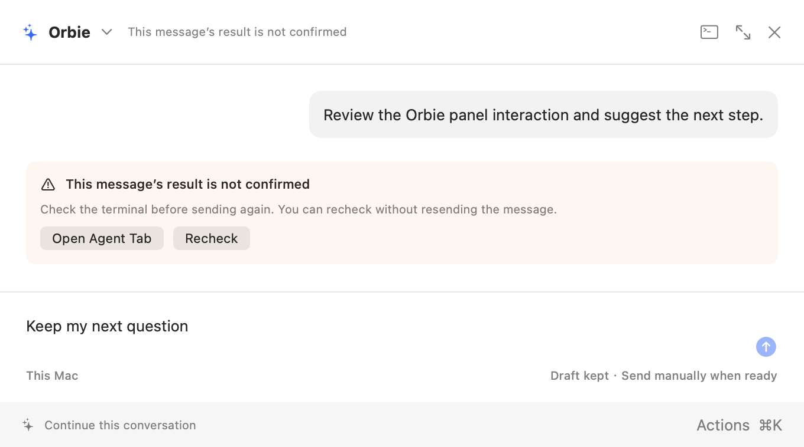
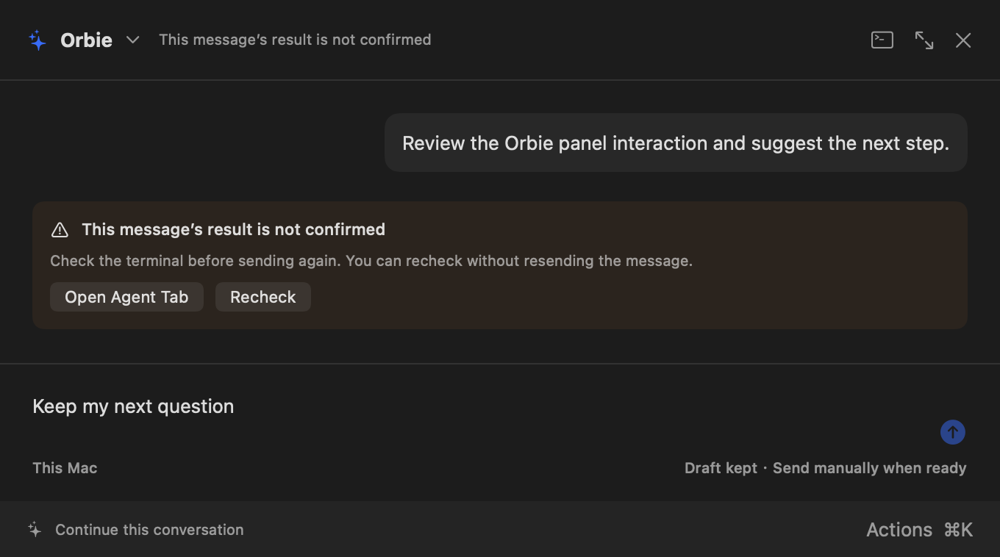

# Orbie 全局浮窗交互重设计

日期：2026-11-17。状态：已实现 Mac 原生浮窗；编译与测试记录见文末。

## 设计结论

把浮窗聚焦为一个可以直接输入、阅读回复、继续追问的对话入口。Orbie 是长期存在的 Agent；Orbiter 是可切换的独立 Agent。两者继续复用现有 tmux、消息投递和恢复机制，不为普通对话创建 Workflow。

[交互原型](design/panel-prototype.html)是自包含 HTML，可在浏览器打开，无外部依赖。页面顶部的状态切换和演示说明属于原型工具，不进入正式产品。所有消息、Agent 和终端操作均为演示数据。

## 当前界面的问题

- 把“最后一条回复、可用性说明、输入、完整会话入口、Orbiter 搜索和列表”全部竖排，即使没有内容仍占用大面积空间。
- `hasPendingMessage` 优先生成笼统提示，无法看出是在处理、等待人类输入，还是结果尚未确认。提示要求打开终端，附近却没有直接入口。
- 只有最新回复，没有它对应的用户消息；重新唤醒后难以知道正在接续什么。
- 常驻的第二个输入框与主输入争夺注意力；无 Orbiter 时仍显示空列表说明。
- 禁用 Send 只表达“不能发送”，缺少“现在可以做什么”。

## 借鉴 Raycast 的部分

[Quick AI](https://manual.raycast.com/ai/quick-ai)把输入、回复与追问保留在同一个轻量窗口，并通过操作菜单承载低频动作；[AI Chat](https://manual.raycast.com/ai/ai-chat)提供完整历史，可从 Quick AI 用 ⌘J 接续。

Orbie 借鉴这种渐进展开方式：浮窗做快速对话，完整窗口承载历史与管理。Orbie 保持同一长期对话，不因浮窗关闭或一段时间未使用而新建会话。当前回复由原生会话证据核验，不展示虚构的 token 流、工具执行轨迹或进度百分比。

## 布局与主路径

| 区域 | 内容与行为 |
|---|---|
| 标题栏 | `✦ Orbie ⌄`、简短状态、打开 Agent 标签、完整对话、收起。图标有 tooltip 和无障碍标签。 |
| 最近对话 | 对应的用户消息与已确认回复；正常时不插入状态横幅。初期只渲染最近几轮，长回复内部滚动，历史在完整窗口分页查看。 |
| 输入区 | 唯一主输入，自动聚焦，按内容从约 2 行增长到最多约 6 行；固定在底部。Return 发送，Shift+Return 换行，输入法候选确认不发送。 |
| 底栏 | 简短的当前对话归属与“操作 ⌘K”。仅显示已验证的 Provider／模型信息；未知时省略，不猜测。 |

建议宽度约 680 pt，允许用户调整。空态约 240–280 pt，有对话时按内容增长，整体不超过可用屏幕高度；回复区滚动，输入始终可见。避免每次轮询或 token 变化都调整窗口大小。

正常唤醒直接定位输入；已有对话展示最近几轮。未完成发送时可以编辑下一条草稿，状态恢复后由用户手动发送，不建立自动消息队列。

点击标题打开可搜索的 Orbie／Orbiter 切换器：固定 Orbie，再列最近使用的已关联 Orbiters，支持名称／项目搜索。选择后在同一浮窗查看该 Agent 的对话，草稿按角色记录隔离；稳定身份重新绑定时沿用现有草稿迁移规则。不存在把一个 Agent 的草稿发送给另一个 Agent 的隐式动作。

“新建 Orbiter”“从当前对话 Fork…”复用已有表单和验证。独立任务仍由用户明确创建 Agent，按需创建 Workflow；没有新的 Task 概念。

## 状态必须指向动作

以下是展示映射，不新增持久化生命周期，也不靠解析英文错误字符串推断状态。

| 已有事实 | 界面表达 | 主动作 |
|---|---|---|
| 无记录／未启用／未创建 | 加载中／在这台 Mac 启用／创建 Orbie | 启用或现有创建表单 |
| `.pending`、`.writing`、`.awaitingAcceptance` | 正在发送／正在确认是否送达 | 查看终端；保留草稿，不重复发送 |
| `.running` 且没有更具体证据 | 正在处理你的消息 | 打开 Agent 标签 |
| 已有 Stop 候选，回复仍待核验 | 正在确认回复 | 查看终端；自动核验继续 |
| `readiness.awaitingHuman` | 需要你处理一下 | 打开 Agent 标签；仅有结构化证据时显示问题／审批摘要 |
| `.uncertain` 或提交未确认 | 这条消息的结果尚未确认，附原消息 | 查看终端；次要操作“重新检查” |
| `readiness.draft` | 终端里还有未发送的输入 | 打开 Agent 标签；浮窗草稿保留 |
| 真实失败 | 简短失败原因与可展开详情 | 查看终端；不自动重发 |
| 已退出且有已验证恢复描述 | 原对话已暂停 | Resume／Restore Original Conversation |
| `isRestoring` | 正在恢复原对话，完成后自动连接 | 查看恢复标签；沿用后台核验，禁止重复创建 |
| 无已验证原生会话 | 无法恢复原对话，保留旧消息 | 查看详情；明确创建新 Agent |

展示优先级：加载／缺少配置、角色恢复与目标缺失先处理；存在可定位 Agent 时，明确的人类输入请求优先于泛化的“未完成消息”；未知结果与原消息关联显示。最终发送许可仍由现有 Service 检查，不能因为文案变为“可以继续”而绕过消息占用、输入状态或身份验证。

截图里的 `hasPendingMessage` 本身不足以证明正在等待审批。因此不能简单把原提示全部改成“请批准”；缺少进一步证据时显示真实的消息状态，并始终提供打开终端的入口。

“结束等待…”收进操作菜单，确认说明：只结束结果观察，不停止 Agent、不撤回输入。结束后重新检查可用性，Agent 仍忙碌时仍不可发送。“重新检查”只刷新和恢复核验，不重发消息。

## 交互细节

- ⌘K 打开操作菜单：打开 Agent 标签、完整对话、新建 Orbiter、Fork、重新检查；有对应未完成消息时提供结束等待。
- ⌘J 打开当前 Agent 的完整对话，复用同一消息来源、分页及附件；不另建会话。
- Esc 先关闭菜单，再收起浮窗。收起保留草稿并恢复原应用焦点；不会退出 Agent。后台回复完成不唤醒浮窗、不切换工作区。
- 回复可选择、复制；路径及附件复用既有打开逻辑。初期使用已有安全文本呈现，富 Markdown 可后续扩展，不为外观引入 WebView。
- 正常处理用低干扰状态；需要介入用局部浅色卡片；真正错误才使用错误样式。不能只靠颜色传达状态。
- 轻量入口直接定位终端；没有可定位 pane 时禁用终端图标并明确说明，提供相应恢复动作。
- 没有 Orbiter 时仅切换器展示空态和新建入口，主对话不受影响。一个 Orbiter 恢复失败不阻塞切换或其他 Agent。
- 原型展示浅色主题；正式实现使用系统语义颜色、SF Symbols、Dynamic Type、VoiceOver 和原生焦点行为，并核验深色主题与低分辨率屏幕。

## 最小实施范围

1. 调整 `MacOrbiePanelView`：标题栏、最近对话、底部输入、按需展开的 Agent 切换器和操作菜单。复用 `MacOrbieView`／`MacOrbitersView` 的导航与动作。
2. 从 `OrbieService`／`OrbiterService` 的已有记录、消息状态和 readiness 派生纯展示状态。不增加数据库或第二套状态机，不通过 `availability` 字符串分类错误。
3. 复用消息投递、结果核验、恢复、历史分页及草稿存储。收起停止 UI 刷新，后台必要回复核验仍由原服务负责；不为每个菜单项建立扫描或轮询。
4. `OrbiePanelController` 只调整窗口尺寸与已有焦点行为。附件、选区、流式 token、浮窗内审批和模型切换不纳入这次最小改动。

## 验收重点

- 截图中的未完成消息能在浮窗中看见对应输入，并一击定位终端；不是只剩禁用的 Send。
- 中文输入法确认、换行、发送快捷键互不冲突；连续点击不能重复投递。
- 在 Orbie 与 Orbiter 间切换、打开完整对话、Esc 收起及重新唤醒都保留各自草稿。回复完成不抢焦点，也不关闭正在使用的切换器。
- 仅改变展示不改变发送门控。未知结果不被当成已完成，临时忙碌不被当成永久故障。
- 恢复自动完成，无重复标签；恢复失败仍能使用其他 Agent。
- 浮窗限制渲染最近消息；完整历史继续可分页读取，无永久扫描所有记录。

## 本次交付与验证边界

独立 HTML 原型中的终端、Fork、创建、恢复与历史入口均为演示，不接真实 Agent。正式实现采用 SwiftUI／NSTextView，不嵌入该 HTML。原型的按钮文案和演示快捷键不能作为实际运行证据。

CtrlX Browser 新建原型页后持续处于 `loading: true`，URL 为空；`read` 返回仅支持 HTTP(S) 页面，`wait` 超时。本地 HTTP 服务正常返回 200，显式导航同一 URL 后仍未完成加载。因此尚未完成浏览器渲染和真实点击验收，不能将此原型当成已通过 UI 验证的实现。

### 原生实现记录

- SwiftUI 标题切换器、最近三轮消息、动作菜单与完整对话入口；窗口随有界内容调整。输入使用 NSTextView，保留原生选择、复制和输入法行为，撤销记录按 Agent 隔离。
- 原有 Service 继续控制发送、占用、核验和恢复。未完成消息不再统一当成审批；工作、投递确认、回复核验、用户介入及未知结果分别展示。
- 主浮窗、完整 Orbie 窗口共用终端定位；选中 Orbiter 后可打开已有详情，或从其已验证原生对话 Fork。新建／Fork 复用原表单和耐久创建意图，初始消息仍需明确 Send。
- `.build-local/orbie-panel-redesign/tests-final.log`：22 项测试、5 个套件通过。覆盖窄窗口、浅深色离屏布局、原生切换器实际点击、独立草稿／撤销、中文预编辑 Return、Shift+Return、未知结果与审批区分、Fork 旧身份拒绝及已有恢复／全局快捷键／Orbiter 回归。
- 12 个 Swift 文件格式检查、品牌边界、技术边界及 `git diff --check` 通过。按顺序准备三个 native helper 后，Mac Debug workspace 编译通过（未签名构建检查），记录位于同目录 `mac-build.log`。
- 以下为真实 SwiftUI／AppKit 离屏测试渲染，使用隔离数据；没有操作用户运行中的 Agent。未安装新 App，未执行安装后全局唤醒、真实输入法切换、多显示器或真实 CLI Fork 的人工验收。

### 复查修复：撤销与轮询布局

- 发送成功清空草稿或外部替换文本时，同时丢弃 NSTextView 的旧撤销记录，避免旧文本范围触发 `NSRangeException`。内容不变的刷新保留原生 Undo/Redo；预编辑期间仍不替换文本。
- Orbiter 刷新用局部变量收集消息和占用结果，全部加载并保存成功后再发布。异步等待或扫描失败不会先清空上次消息，避免空态引起窗口收缩。
- `.build-local/orbie-panel-redesign/review-fixes-tests-final.log`：24 项定向测试、5 个套件通过。新增真实控件发送后 Undo、后续输入 Undo/Redo、非空外部替换，以及延迟扫描期间窗口高度不变、扫描失败保留回复、再次成功刷新显示新回复的回归测试。
- 格式、品牌／技术边界和差异检查通过；Mac Debug workspace 编译通过，记录为同目录 `review-fixes-mac-build.log`。本轮仍为隔离原生控件验证，未安装或替换运行中的 App。

### 复查修复：最新内容跟随与启动错误

- 打开、重新唤醒或切换会话时定位最新内容；回复、状态卡或视口大小变化时，只有变化前位于底部才跟随。用户上翻阅读旧消息时保留阅读位置，使用原生 ScrollPosition 和滚动几何信息，不增加消息队列或持久化滚动状态。
- 角色服务尚未建立且存在启动错误时，显示具体原因与 `Retry Startup`。手动重试复用初始化／激活入口；若 Workflow 服务已经启动，只重试对话激活，避免重新创建该服务。定时刷新不重复启动服务。
- `.build-local/orbie-panel-redesign/followup-tests-final.log`：32 项定向测试、6 个套件通过。新增原生滚动位置检查（初次打开、消息／回复增长、上翻阅读、Orbie／Orbiter 切换），以及 Host 身份读取、桥接文件和消息文件加载失败的显示与实际重试；同时检查已启动的 Workflow 服务实例保持不变。
- 格式、品牌／技术边界和差异检查通过；三个 native helper 按顺序准备后，Mac Debug workspace 编译通过，记录为同目录 `followup-mac-build.log`。仍未安装新 App，原生交互测试使用隔离服务与离屏窗口。
