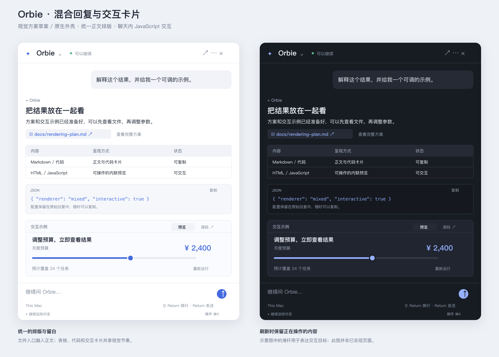
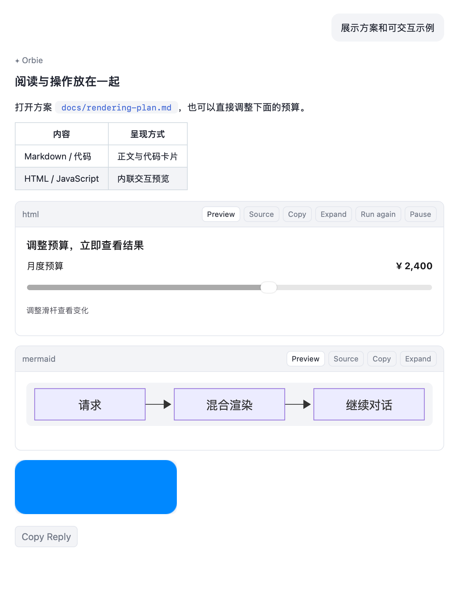
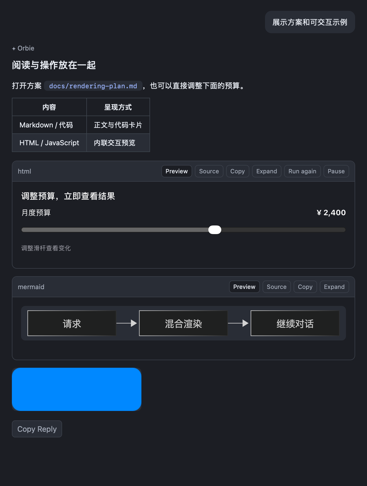

# Orbie 混合回复渲染：方案与实现

日期：2026-11-26。状态：已实现；初次实施验证见第 9 节，审查修复记录见第 10–13 节。
调研基线：`e9c0e335`，`orbie` 分支；调研开始时工作区干净。

Mac Orbie 浮窗、完整对话和 Orbiter 已共用混合消息渲染器。原生窗口、工具栏与输入框保持原有职责；持续存活的 WKWebView 排版 Markdown、代码、图片与图表，repo 引用通过现有 Host 文件链路打开，HTML/CSS/JavaScript 通过 Generative Frame 的本地隔离 iframe 运行。

用户已明确：**需要聊天内 JavaScript 交互；本次沿用现有完整回复到达时机，不扩展逐字流式正文链路。** 下文保留确认的设计；实际验证记录以文末为准。

## 1. 本次最终体验

一条回复可以依次出现说明、文件引用、表格、代码、可操作的 HTML 卡片，再接后续说明。格式按各自语义识别，顺序保持原样，不需要把整条回复声明为某一种类型。

| 内容 | 默认呈现与操作 |
| --- | --- |
| 普通文字、Markdown | 段落、标题、强调、引用、列表、只读任务列表、表格和链接；可选择、复制 |
| repo 引用 | 正文中的轻量文件链接，保留可见的相对路径；悬停展示完整路径；点击解析并打开文件或现有产物预览 |
| 代码、JSON、diff 等 | 等宽代码卡片，语言标签、复制、长代码折叠；仅代码区横向滚动 |
| HTML/CSS/JavaScript | 默认显示可交互预览，提供“预览 / 源码”、复制、重新运行及放大；滑杆、按钮、表单本地计算、Canvas/SVG 均可工作 |
| 工作区图片 | 按来源 Agent 的工作区加载，预留尺寸，点击放大；失败显示可读原因 |
| Mermaid | 复用已随 App 打包的库，显示图形并可查看源码；出错保留源码 |
| PDF、音视频及其他文件 | repo 文件入口，复用 Files 的现有能力，不在聊天中自动播放 |

默认支持自包含的 HTML/CSS/JS。远程 CDN、任意网络请求、账号登录、摄像头/麦克风、文件系统与终端命令不属于本次 HTML 运行能力。外部依赖不可用时在卡片中说明。需要联网的完整网站继续使用现有 Browser。

本次覆盖 Mac 的 Orbie 全局浮窗、完整 Orbie 对话、Orbiter 对话；三个入口使用同一套消息渲染与行为。iOS、Mac Viewer 新增聊天页、逐字流式正文、公式排版及任意网页应用兼容不纳入本次。

## 2. 实施前现状与可复用部分

调研确认了以下事实，来自基线源码，而非历史计划：

- `MacOrbiePanelView` 用 `Text` 展示回复，只显示最近三轮；先截到 8,000 UTF-8 字节再处理内部候选标记，没有“查看剩余内容”的正文入口。完整 Orbie 与 Orbiter 对话也使用 `Text`，历史已有每页 100 条的读取机制。
- `AgentMessage.answer` 是可选字符串，完成核验后才写入。`activity` 是最多 18 条、每条最多 360 个 Unicode 标量的过程摘要，不能拿来拼接完整回复。本次保留回复核验、发送门控及现有刷新时机。
- `RepositoryFileLink` 已实现 marker 解析、百分号解码与路径合法性检查；`TerminalFileDestination` 和 Host 文件请求负责工作区根目录、存在性及符号链接边界校验。不能把 repo 当系统 URL 打开。
- Files 的原生 Markdown 已使用固定版本 Textual 0.5.0。其自定义代码块样式能取得语言和复制动作，但 `CodeBlockProxy` 不公开源码字符串；要把任意 HTML 块替换为交互视图，仍需额外的分块与映射。
- 产物预览已打包 Marked 18.1.1、DOMPurify 3.4.17、Mermaid 12.2.0，使用非持久化 WKWebView。现有渲染器主要面向完整文件预览，Markdown 中的原始 HTML 会转成文本，且重新 `load` 会重置页面，不能原样接到交互聊天中。
- 目前文件打开回调依赖工作台窗口环境。Orbie 是独立浮窗，需要补一个显式导航入口；只设置 `openURL` 并不能保证文件在正确 Agent 的工作台打开。

入口源码：
[浮窗](../../../CtrlxPackage/Sources/CtrlxServerFeature/Views/MacOrbiePanelView.swift)、
[完整对话](../../../CtrlxPackage/Sources/CtrlxServerFeature/Views/MacOrbieView.swift)、
[Orbiter](../../../CtrlxPackage/Sources/CtrlxServerFeature/Views/MacOrbitersView.swift)、
[消息服务](../../../CtrlxPackage/Sources/CtrlxServerFeature/Services/AgentInteraction/AgentMessageService.swift)、
[repo 契约](../../../CtrlxPackage/Sources/CtrlxNetworking/Models/RepositoryFileLink.swift)、
[产物渲染器](../../../CtrlxPackage/Sources/CtrlxCommon/UI/ArtifactWebPreview.swift)。

## 3. 为什么选择统一消息容器

| 路线 | 优点 | 对本需求的代价 | 判断 |
| --- | --- | --- | --- |
| SwiftUI Text / AttributedString | 最轻，系统文字行为 | 不能单靠一个 Text 完成块级布局及 HTML/JS；需自行构建大部分排版 | 不选 |
| Textual 正文 + 各 HTML 块一个 WKWebView | 复用原生 Markdown，HTML 故障可独立处理 | 需额外分块；多个 WebView 的高度、焦点和滚动协调更复杂；跨原生块选择困难 | 保留为隔离实验失败时的备选 |
| 原生外壳 + 单个 WebKit 消息容器 + HTML iframe | 一套消息排版与滚动；可复用已有 JS 库；相邻正文可连续选择；更新时保留 HTML 状态 | 需要明确 iframe 权限及桥接；HTML 与父页面之间仍有选择边界 | **推荐** |

输入法、发送、快捷键、菜单、历史分页、消息状态、生命周期继续由 SwiftUI/AppKit 与现有 Service 管理。也不引入 React、Electron、独立服务器或第二套聊天存储。

Textual 的原生能力本身没有问题；这里的选择依据是用户已确认的聊天内 JavaScript 需求。旧的浮窗设计曾将富 Markdown 延后，本提案仅替代该处展示范围，不改变其会话与权限边界。

### 开源组件选型补充

用户提出优先使用合适的开源组件以节省开发时间。补充调研后，最终采用 **`generative-frame` 承担 HTML 卡片运行，并复用现有 Markdown/图形库**，配合 highlight.js 与 github-markdown-css；无需 React。

| 组件 | 可直接节省的工作 | 本仓库状态与建议 |
| --- | --- | --- |
| [Marked](https://github.com/markedjs/marked) / MIT | Markdown 分词、块结构、表格与列表 | 已随包打包 18.1.1，继续复用 |
| [DOMPurify](https://github.com/cure53/DOMPurify) / Apache-2.0 OR MPL-2.0 | 正文 HTML 清理 | 已随包打包 3.4.17，继续复用；不用于抹掉交互卡片的脚本 |
| [Mermaid](https://github.com/mermaid-js/mermaid) / MIT | 图形布局与生成 | 已随包打包 12.2.0，继续复用 |
| [generative-frame](https://www.assistant-ui.com/generative-frame/docs/quickstart) / MIT | HTML/SVG 卡片运行、尺寸事件、主题传递、错误回调、脚本在内容完整后运行及资源销毁 | **已采用**；核心入口无 React 依赖，Mac WKWebView 定向验证通过 |
| [highlight.js](https://github.com/highlightjs/highlight.js) / BSD-3-Clause | 代码语法高亮与浅深色主题 | 已按 Swift、JS/TS、Python、JSON、Shell、diff、HTML/XML、CSS、YAML 随包提供 |
| [github-markdown-css](https://github.com/sindresorhus/github-markdown-css) / MIT | 标题、列表、引用、表格的基础排版与浅深色样式 | 已作为排版基底，覆盖 Orbie 字号、颜色与间距 |

`generative-frame` 的默认模式依赖外部 Safe Content Frame shim；本任务优先验证其 `opaqueOrigin: true` 本地模式，该模式不加载外部 shim，也不提供 localStorage 等存储能力。需显式收紧默认 CDN 策略，例如 `csp: { cdnOrigins: [] }`；不接入其发消息、调用工具和剪贴板等宿主回调，外部链接也由宿主明确处理。

它不是已经验证可直接替换的成熟平台层：选型时从 npm 官方 registry 核对了发布版 0.0.12 及其本地模式；确认开发后完成了第 9 节所列验证。尤其需要先验证 **srcdoc 继承父 CSP 的约束**：官方说明本地模式要求允许内联 runtime 与 widget 脚本，会与仅允许随包脚本的严格父策略冲突。必须先确定可接受的父页清理/CSP组合，或评估本地资源加载适配；不承诺无改动接入，也不把 iframe 说成 WebKit 的独立进程。

另比较了 [Streamdown](https://github.com/vercel/streamdown)（Apache-2.0）与 [assistant-ui](https://github.com/assistant-ui/assistant-ui)（MIT）。前者提供面向 AI 的 Markdown、代码、公式和图表组件，后者提供更完整的 React 聊天界面与状态适配。它们可以用于 WebKit 内的本地网页，但本次没有逐字流式正文需求，且已有原生输入与消息 Service；整套接入未必比复用现有库加独立 HTML 卡片更省。两者都不自动完成 CtrlX repo 路由，也不能将“支持原始 HTML”理解为可以在正文中直接运行任意脚本。

开源组件可以省去排版、解析、高亮、图形及卡片运行时的大量代码；仍需实现的部分集中在 repo/Host 来源校验、Swift 与 WebKit 的有限桥接、三个入口接线、滚动与焦点协调，以及隔离验收。具体工期收益待候选验证后估算。

## 4. 内容识别与文件打开

1. 从已有消息取得用户输入、已核验回复及活动摘要。用户输入始终按文字显示；保留原始回复用于“复制整条回复”。内部 Agent/Workflow 候选标记仍按现有规则提取，导航按钮继续由原生层校验。
2. 在 WebContent 进程中用独立 Marked 实例解析 token。优先遵循代码围栏、转义和嵌套结构，避免用一个正则切整条回复。
3. HTML 围栏识别为交互卡片；未闭合围栏保留源码。Markdown 的完整 HTML block token 也可成为卡片；行内 `strong`、`br` 等仅作为经过清理的排版，不执行行内事件。HTML 代码卡片始终能切回源码。
4. 正文在 token 层识别 repo marker。普通文字及单个行内代码中的完整 marker 可点击；代码围栏、转义示例、外部 URL 内部和未闭合 marker 保留原文。兼容现有显式 repo 链接目标；Swift 再调用 `RepositoryFileLink` 校验一次，不由 JS 另定路径规则。
5. JS 只发送 `messageID` 与该消息中已登记引用的 ID。Swift 从消息及当前角色取得 Host、pane、插件、原生会话及目录，校验后调用现有解析和预览能力；不接受 JS 提供绝对路径、任意 pane 或 shell 命令。
6. 若角色恢复后 pane 已改变，只在当前角色仍与消息的原生会话、插件和目录一致时映射到新 pane。上下文不足、会话被替换或标签已关闭时给出具体提示，允许用户显式恢复或打开原标签；不自动启动 Agent 或猜一个目录。

repo 的根目录仍由 Host 按现有契约解析，不在消息中引入历史路径注册表。HTML 卡片内部的任意链接不获得 repo 文件桥接权限；本地图片和文档相对路径也必须经 Swift/Host 的有限资源加载入口处理。

HTML fence 可直接内嵌脚本运行；独立 JavaScript 代码围栏仍显示代码，不猜测它与上一段 HTML 的拼装关系。整段 HTML 文档、多个 HTML 卡片及嵌套在列表中的围栏需要分别验收。

## 5. 聊天内 JavaScript 的运行边界

Markdown 正文与 HTML 卡片使用两条不同的渲染路径：正文经过 DOMPurify，只允许排版；HTML 卡片保留脚本，但只在自己的 iframe 内执行。不能为了执行 JS 而放开父页面的 sanitizer。

- iframe 使用 `sandbox="allow-scripts"`，不开放 `allow-same-origin`、顶层导航、弹窗、下载或表单提交。本地表单控件及 JS 计算可以使用；实际提交不能发出。
- 父页面只运行 App 随包提供的脚本。父文档通过 `loadHTMLString` 加固定来源在内存加载；本地 srcdoc 继承父 CSP，允许内联脚本以满足组件运行，但 Agent HTML 只进入独立 iframe，正文始终经过清理。不使用宽泛的 `file://` 目录授权，也不依赖 `meta` 中不受支持的 CSP sandbox 指令。
- HTML 默认允许内联 JS/CSS、受控图片及本地计算；CSP 限制网络、动态外部脚本、对象、嵌套 frame 和表单出口。`fetch`、XHR、WebSocket、CSS URL、图片、字体、导航均需覆盖，不能只拦截页面跳转。
- 原生消息处理器放在专用 WKContentWorld，并校验主 frame、当前渲染代次、消息 ID 与动作白名单。HTML iframe 不直接拥有该处理器。WKContentWorld 共享 DOM，不能用它代替 iframe 权限边界。
- iframe 到父页面只接收可验证来源窗口的有限消息，例如尺寸与错误；不转发复制、文件打开或命令执行请求。尺寸更新限频、限高，拒绝 NaN、无穷值和旧 frame 消息。

iframe 是权限边界，**不保证独立 WebContent 进程**。死循环可能影响整个消息容器。因此正式接入前先验证失控脚本下原生输入仍可用、原文可读、容器可销毁重建；如果这些条件不能满足，改用原生 Markdown + 独立 HTML WKWebView 的备选，再同步具体代价。

## 6. 美观与流畅性

**排版。** 延续现有轻量 Orbie 外观：用户消息右侧浅底，Agent 正文左对齐，正文不再套一层大气泡。使用系统字体和语义颜色，建议正文 14–15 pt、行高约 1.55、段间距 10–12 pt；标题只做克制的字号与字重变化。文件引用用紧凑圆角底纹与清晰链接色，长路径可换行，悬停可查看全文。表格、代码与 HTML 卡片共享细边框、8–10 pt 圆角和一致留白。

**窗口。** 浮窗保留现有的 560 pt 最低宽度和 680 pt 建议宽度与有界会话高度。输入框固定在消息区外。长回复完整保留，浮窗按内容区滚动；超长代码按完整块折叠，不先截字符串，避免 Markdown/HTML 在 8 KB 边界被切坏。完整窗口继续现有历史分页。

**滚动。** 主会话只有一个纵向滚动容器。代码和表格只做横向溢出；HTML 卡片自动量高并设上限，超高卡片提供放大阅读，专门测试卡片内外的滚轮交接。新回复或图片导致布局变化时，仅在变化前靠近底部才跟随；正在上翻阅读时保持锚点，并显示“回到最新”。

**稳定更新。** 每个打开的会话视图保留一个 renderer；用消息 ID 与内容版本比较更新。三秒轮询、状态变化、主题变化不调用全页 `loadHTMLString`，不替换未变的消息节点或 iframe。活动区域单独更新。HTML 的输入值、图表状态和焦点在同一可见会话的普通刷新中保持不变。

**资源。** 图片先占位后解码；复用现有 8 MiB 文件预览、512 KiB Markdown/SVG、64 KiB Mermaid/500 边及 16 图/24 图片边界。建议单条回复自动排版与单条 HTML 源码均以 512 KiB 为初始预算，每个会话视图同时运行最多 4 个 HTML 卡片；超限提供原文入口、复制与明确提示，不静默丢掉尾部。这些是待实测调整的产品预算，不是性能实测结论。完整历史延迟解析可见附近的消息，只激活其附近的卡片；将被回收的交互卡片明确显示“重新运行”，不假装能无损序列化任意 JS 堆。

**生命周期与可访问性。** 收起浮窗、关闭窗口或切换会话时释放对应运行内容，重新打开允许 HTML 从初始状态运行；不承诺跨会话保存任意 JS 状态。销毁后的回调必须失效。支持浅深色、VoiceOver 标题/链接/表格语义、键盘导航、字号缩放和减少动态效果。HTML 自有样式不被强行反色；提供主题提示供配合的卡片使用。切换焦点后仍能回到原生输入框。

正文可以连续选择，iframe 内部可以独立选择；跨 iframe 与外部正文拖选不能保证连续。全消息复制始终提供原始回复，HTML 卡片另外提供源码复制。动态内容仅做轻微出现效果，不对每次高度变化或轮询做动画。

## 7. 确认后如何实施和验收

以下为工程顺序，不是需要多次审批的流程；本方案确认后可以连续推进。

1. **先验证开源候选与 WebKit 边界。** 优先测试 `generative-frame` 本地模式与现有宿主 CSP 是否兼容，检查无需外网、主题更新、iframe JS、原生桥接不可达、自动量高、焦点及失控脚本恢复。通过则采用现成运行时；不通过再评估最小资源加载适配或原手写方案，不因选型引入整套聊天框架。此时不改用户会话或安装 App。
2. **实现一个消息渲染组件。** 在 `CtrlxCommon` 放随包资源与可复用渲染器，`CtrlxServerFeature` 负责 Orbie 数据适配和文件导航。共用现有库文件与许可证，新增聊天专用入口，不直接修改 Files 的现有渲染策略。采用开源高亮和排版基底时固定版本、保留许可证与校验值，资源随 App 提供，不在运行时请求 CDN。
3. **接入三个聊天入口。** 消除先按字节截断回复的显示逻辑，保留分页、最近三轮、草稿、发送、候选导航、附件及恢复行为。消息存储格式与 Relay 协议保持现状。
4. **验证并交付。** 增加匹配风险的解析、桥接、repo 来源及交互回归；完成 Mac 构建和隔离原生 UI 验收，更新已有 Orbie 文档。编译、签名、运行与人工视觉验收分别记录。

| 验收场景 | 必须看到的结果 |
| --- | --- |
| 单条混排文字 + repo + 表格 + 代码 + 两个 HTML 卡片 + 图片 | 顺序正确，样式一致，卡片各自可操作，后续正文继续正常显示 |
| HTML 滑杆、计数器、Canvas；期间连续多次刷新 | 交互生效，值、焦点与 iframe 不被普通刷新重置 |
| 8 KB 以上回复、100 条历史、窄窗口、浅深色 | 内容不丢失，不撑破窗口，滚动与选择可用 |
| 阅读旧消息时新回复/图片出现 | 不把阅读位置拉到底部；点击回到底部后恢复跟随 |
| 中文/空格/百分号路径、嵌套 worktree、非 Git 目录、恢复后换 pane | 正确解析到对应 Agent 工作区；越界、缺失或旧身份明确失败 |
| 代码中的 marker、半个 marker、HTML/Markdown 特殊字符 | 不误点、不误执行、不破坏围栏 |
| 网络、弹窗、顶层导航、iframe 冒充桥接、跨卡片 DOM 访问 | 被拒绝，原生动作不被触发；HTML 本地交互仍可运行 |
| 高度风暴、JS 异常、死循环、WebContent 退出、旧回调 | 输入和草稿可用，能回到原文并重新运行，不影响消息核验 |
| 收起/重开、切换 Orbiter、历史卡片回收 | 运行资源释放，重开行为清楚，不携带另一会话的回调或文件权限 |

性能会在同一台 Mac、同一构建与固定样例上记录冷/热首屏、更新耗时、滚动卡顿和内存。建议把“常规更新不出现可感知停顿，长任务不持续占用原生主线程”作为体验门槛；毫秒与内存阈值在第一步建立基线后确定，不在调研阶段虚报性能数字。

## 8. 调研依据与本次验证边界

外部资料查阅于 2026-11-26；方案选择属于结合本仓库和用户范围的工程判断：

- [Textual 官方源码与能力](https://github.com/gonzalezreal/textual/tree/0.5.0)：结构化 Markdown、样式、选择与自定义 parser；另核对本机 checkout 与锁定 revision 一致。
- [MarkdownUI 官方说明](https://github.com/gonzalezreal/swift-markdown-ui)：当前处于维护模式，不为本需求新增这条替代依赖。
- [Apple WKWebView](https://developer.apple.com/documentation/webkit/wkwebview)、[自定义资源 scheme](https://developer.apple.com/documentation/webkit/wkurlschemehandler)：支持嵌入 HTML/JS 与提供 App 内资源，不需要提高最低系统版本。
- [WHATWG iframe sandbox](https://html.spec.whatwg.org/multipage/iframe-embed-object.html#attr-iframe-sandbox)、[CSP 标准](https://www.w3.org/TR/CSP/)：脚本、来源、导航与资源加载的限制分别处理。
- [Marked 官方说明](https://github.com/markedjs/marked#usage)、[DOMPurify 官方说明](https://github.com/cure53/DOMPurify)：Markdown 编译与 HTML 清理各司其职；Marked 本身不承担 sanitization。

方案确认前完成了源码、依赖、文档调研与静态视觉草案。确认后的实施和运行验证如下；文首视觉草案与下方实际截图分别标注。

## 9. 实施记录

2026-11-26 用户确认实施后，采用 Generative Frame 0.0.12 的本地 opaque-origin 模式；原生 WKWebView 隔离实验已确认 HTML 脚本执行、父文档访问被拒绝及网络请求被 CSP 阻止。file 页面来源无法完成组件握手，改为 `loadHTMLString` 加固定的 `https://orbie.ctrlx.invalid/` 页面来源，脚本与样式全部来自 App 内存资源；不会请求该域名，也不需要 HTTP 服务。

三处聊天入口共用 `OrbieConversationView` / `RichChatConversation`，保留原生输入和现有消息服务。新增库的固定版本、完整许可证和 archive/bundle 校验信息随包保存；资源更新入口为 `bash scripts/build-orbie-chat-assets.sh`。

具体行为与边界：

- Markdown 和代码只在消息变化时转换，纯展示准备移到后台任务；历史按可见区域延迟解析。普通轮询保留文本、iframe 与表单状态；主题变化更新 HTML 的主题，并重绘可见 Mermaid。
- 首屏跟随、回复增长、用户上翻与切换会话通过原生宿主中的 WKWebView 回归。自动滚动记录自己的位置，防止延迟的滚动事件被误认作用户上翻。
- 适配 WebKit 对透明子 frame 的渲染节流：本地模式提前显示带主题的 slot，并使用组件的公开 `end` 尺寸结果设置初始高度。后续可见尺寸变化仍由组件处理。放大、Esc、连续重新运行与未闭合围栏有对应回归。
- repo 打开要求消息与当前角色的 Host、插件、原生会话和目录一致；恢复后的新 pane 还需匹配当前工作区身份。目录及普通文件进入会话内的 Files 面板，支持的产物使用现有预览。预览中的 Open in Files 在原预览关闭后打开 Files。
- 外部 HTML 依赖默认不可用；iframe 没有终端、工具、文件及发消息权限。交互状态在普通刷新中保留，收起、切换会话或离屏回收后允许重新运行；不保存任意 JS 堆。

验证基于 `e9c0e335` 加本工作树当前未提交变更，日志与诊断位于 `.build-local/orbie-rendering-proof/`：

| 检查 | 本轮结果 |
| --- | --- |
| 相关回归 | `regression-final.log`：64 项 / 10 套件通过；包括 Orbie/Orbiter、历史、文件解析与产物预览。不是无过滤全量测试 |
| 资源可重复构建 | 固定 npm 版本重建后 vendor SHA-256 完全一致；`resources-final.log` 额外复跑 4 项渲染测试通过，与上项有重叠，不累加计数 |
| Mac 构建 | 三个 native helper 已按顺序准备；`Ctrlx.xcworkspace` / `CtrlxServer` / Debug 编译通过，`CODE_SIGNING_ALLOWED=NO`，最终增量记录为 `mac-build-final.log` |
| 脚本失控诊断 | 独立、ad-hoc 签名的原生诊断进程执行真实无限循环后，原生主线程仍响应，能切到原文并建立可用的新渲染器；`hang-probe-result.log` 记录 PASS |
| 格式与静态检查 | SwiftFormat、JS/shell 语法、品牌边界、技术边界、文档引用与差异空白检查通过 |

失控诊断使用生产渲染器源码的隔离副本，仅替换 Bundle 资源定位和未使用的图片 helper；该诊断不代替 App 整体 E2E。没有安装或替换已安装 App，没有操作用户 Agent、提交 Git、发布或部署。没有运行 iOS Simulator 构建；本次目标为 Mac。没有长期内存/CPU 采样、真实多显示器或物理设备验收。

以下是实际 WKWebView 渲染器的浅深色截图，来自隔离测试数据；滑杆、图表和工作区图片均由实际渲染链路显示。蓝色块为测试图片，并非产品中的占位图：

## 10. 首轮审查修复（2026-11-26）

本轮保留分诊编号，修复 9 项已确认的 P2：

1. repo 引用使用 Marked inline token 扩展、代码片段及链接 renderer，在清理前保存已验证的引用 ID；移除清理后的文本扫描。正文尖括号、Markdown 目标、行内代码和兼容括号引用可点击，转义与代码围栏保持示例。
2. `displayAnswer` 移除内部候选标记时保留原始 Markdown 空白，四空格缩进 HTML 不再变成交互卡片。显式 HTML 围栏继续运行。
3. 浮窗注入角色选择回调，推荐 Orbiter 在当前浮窗内切换历史和草稿；其他入口继续使用原生导航。
4. 提取并复用文档预览已有的 workspace-relative 路径规范化；聊天图片从工作区根目录解析。支持 `./`、中文与百分号混用、仅一次解码，继续拒绝外部和越界路径。
5. 图片桥接不再使用原文子串匹配解析后的 URL。主 frame、消息身份、长度、格式与 Host 来源仍有检查；加载错误回传页面，替换占位状态。
6. HTML 卡片保存手动暂停状态，普通刷新、主题及可见性变化不重新运行；仅 Run again 清除该状态。离屏自动回收仍可在回到可见区域时恢复。
7. 产物回调保留 `opensNewTab`，明确的新标签请求交给来源工作区既有 Files 路由。拥有来源终端的主／独立窗口消费请求，并在实际读取入口复核捕获的会话与持久 pane 身份；普通 Open in Files 继续使用会话内面板。
8. 活动区进行中默认展示最近三条，早期记录单独折叠；更新保留用户的展开选择，进入完成状态时默认折叠完整记录。
9. 全页 JSON 编码和字符串构造移到 detached task，取消向下传播，回到主线程发布前复核取消和 renderer 代次。未新增增量传输协议。

新增回归覆盖上述触发条件及原有正常场景，包括 100 条约 64 KiB 历史中的连续进度更新、未变化 iframe 保留及销毁后重新建立会话。Files 验证覆盖来源归属与完整请求交接，并复用服务中新建／复用标签的回归；本轮没有进行安装后完整 App E2E。

隔离 WK 探针记录在 `.build-local/orbie-repair-round1/render-probe.json`：两种正文引用各产生一次事件；同路径转义示例不产生事件，行内代码引用仍产生事件；手动暂停经过受控可见性循环保持停止，Run again 恢复；活动区更新及完成后保持折叠。该探针复用已有原生诊断二进制并加载本轮实际 JS。

最终验证记录在 `.build-local/orbie-repair-round1/`：

- `regression-final.log`：151 项定向测试／14 个套件通过（Server 130 项／12 套件，Common 21 项／2 套件）。覆盖 Orbie／Orbiter、文件上下文、产物预览、工作区归属、独立资源及 Files 新建／复用；不是无过滤全量测试。此前 `regression.log` 同样通过，不重复累加计数。
- `mac-build-final.log`：三个 native helper 按顺序准备后，`Ctrlx.xcworkspace`／`CtrlxServer`／Mac Debug 编译通过，`CODE_SIGNING_ALLOWED=NO`。最终消费端来源校验已包含在这次构建与上述最终回归中。
- 12 个 Swift 文件的 SwiftFormat、JS 语法、品牌／技术边界、资源 SHA-256、文档引用及差异空白检查通过。早期夹具访问、旧 DOM 选择器与探针返回类型问题已修正，以最终日志为准。

大历史测试验证连续更新与生命周期正确性；本轮没有复测审查给出的 18／37 ms 数字，也没有执行长期 CPU／内存采样、安装后完整 App E2E 或 iOS 构建。未提交、未安装、未发布，未操作用户运行中的 Agent。

## 11. 第二轮审查修复（2026-11-26）

修复原 #1、#2、#4、#7 及新 #10；上轮已关闭项保持原有行为：

- **原 #1：引用目标与 Markdown 上下文分离。** 原生层按边界收集 URI 候选，调用 `RepositoryFileLink` 校验并只解码一次；未闭合或无效候选不吞掉后续目标。页面按经过校验的 `target` 登记 ID，Marked 决定普通引用、带标题／引用式／尖括号目标的 Markdown 链接、代码和转义语义。新增双反斜线与独立转义示例对照，不在 Swift 增加另一套 Markdown parser。
- **原 #2：核验规范化，输出保留原文。** `ClaudeWorkflowTranscript` 的即时、迟到候选和持久完成恢复三条出口返回原始文本，仅在判断空白与匹配候选时规范化；保留现有结果类型和完成门控。新增真实解析器到消息服务落盘、重载及 SwiftUI/WK 聊天渲染的检查，首行四空格的 HTML 仍为代码块。
- **原 #4：统一图片类型判断。** 读取与选择 SVG／位图解码器共用已有工作区路径规范化。`图.svg` 与 `图%2Esvg` 使用相同 SVG 路径，不根据原始 URL 再猜扩展名；PNG 与一次解码限制保持不变。
- **原 #7：按来源工作区归属选择左侧内容。** 来源目标位于右侧时，复用当前合法左侧终端或选择本工作区内的左侧候选；不临时选中另一工作区的首个终端，也不把右侧目标回填到左侧。没有可用左侧终端时保留合法空选区及会话身份。保留读前／读后的来源检查及真实用户导航取消规则。
- **新 #10：超限图片先显示错误。** 发送前同时检查图片地址与完整 JSON 事件的 UTF-8 字节数，失败时显示可读原因，不登记待加载图片。原生 4 KiB 地址／16 KiB 事件限制及工作区图片策略不变，未开放 Markdown 的 `data:` 图片或扩大权限。

验证记录位于 `.build-local/orbie-repair-round2/`：

- `regression.log`：212 项／18 个套件通过，包括本轮故障、原有 Orbie／Orbiter、文件、历史和第一轮交互回归。
- `workflow-regression.log`：另有 163 项／2 个套件通过，覆盖共享的 Workflow 原生事件与结果恢复。两次选择的套件不重叠，合计 **375 项／20 个套件**，不是无过滤全量测试。
- `large-image-probe.json`：复用隔离 WK 诊断二进制加载当前 JS，真实 PNG 的 `data:` 回复为 246,973 字节；产生明确的超限错误，图片事件数和残留占位均为 0。
- 分栏检查覆盖实际归属／选区模型及异步快照一致性，并验证真实导航仍令快照失效；没有执行完整 Mac 窗口 E2E。Claude 检查使用生产解析器及隔离转录，不连接真实 CLI 或用户 Agent。

三个 native helper 顺序准备后，`mac-build.log` 记录 Mac Debug workspace 编译通过（`CODE_SIGNING_ALLOWED=NO`）；App 包内的 `chat.js` 与当前源码一致。9 个 Swift 文件格式、JS 语法、品牌／技术边界、开源资源校验及差异检查通过。早期图片预算夹具中的控制字符未被 Marked 识别为图片，已改为实际可达的 inline HTML 图片输入，并在最终回归中通过。

本轮未安装、未提交、未发布，未运行 iOS 构建或长期 CPU／内存采样。此前截图保留为初次实施的视觉记录，本轮修复未重拍截图。

## 12. 第三轮审查修复（2026-11-26）

- **#11：共用 SVG 清理规则。** 将 Files 原有的 `sanitizeSVG`／`svgImageURL` 原样提取到 `ArtifactPreview/svg.js`，由 Files 入口与聊天加载。聊天的工作区 SVG 和 Mermaid 静态图片均使用该 helper，保留 `<use>` 的内部引用，仍移除外部 href、脚本及其他既有禁用内容；SVG 继续作为隔离图片显示。
- **#12：按消息与目标分组读取。** 每次解析回复时按图片目标建立组，同组只登记一个原生请求，结果分发到所有位置。组不跨消息共享；整个会话视图保留 24 个唯一组的总预算，重复位置不再耗尽配额。先登记全部位置并挂载 DOM，再发出请求；消息移除或内容变化时释放对应组。
- **#13：等待解码并局部报告错误。** 每个位置等待 `image.decode()` 成功后才移除占位；清理或解码失败会清除失败地址并显示原因。原生读取错误也分发到全部位置，不影响其余正文或图片。解码完成时复核组是否仍有效，防止旧回复的异步结果改动新内容。

验证位于 `.build-local/orbie-repair-round3/`：

- `targeted.log`：首轮 42 项／3 个套件通过；补充重复错误分发检查后，`regression.log` 的 **230 项／19 个套件**通过，前后有重叠，不累加。覆盖聊天、Files SVG／Markdown 预览、Orbie／Orbiter、文件来源及前两轮正常场景；不是无过滤全量测试。
- 新增 SVG 用例保留 57 个内部引用，并通过 canvas 像素检查确认实际绘制，验证外部引用与脚本被清除。重复图片用例验证 25 处显示仅需两个请求，不跨消息共用读取；另测 24 个唯一目标上限、重复位置、消息移除后释放配额。
- 空 SVG、纯文本 SVG、重复失败位置均显示局部错误，正常 PNG 和后续正文仍可见；延迟解码期间保留占位，替换回复后旧解码结果不能修改新回复。
- `comparison-probe.json`：隔离 WK 对照中，聊天与 Files 均保留 57 个 SVG 引用，两个图片目标的 25 处均显示，空文件／纯文本均提示无法解码且聊天无破图、无残留占位。
- 三个 native helper 顺序准备后，`mac-build.log` 记录 Mac Debug workspace 编译通过（`CODE_SIGNING_ALLOWED=NO`）。App 包内的脚本与当前源码一致；SwiftFormat、JS 语法、品牌／技术边界、文档引用与差异检查通过。

本轮未重跑已不受影响的 Workflow 扩展回归，未进行完整 Mac 窗口 E2E、iOS 构建或长期内存／CPU 采样。未安装、未提交、未发布。

## 13. 第四轮审查修复（2026-11-26）

- **#14：名额释放后重试保留的图片。** 因 24 组上限等待的目标保留图片位置与提示节点，按消息／目标继续去重。移除消息或替换回复会清理其活动／等待组；整次同步更新完成后，通过 microtask 按可用名额接纳等待组，避免先读取本次更新即将删除的旧目标。接纳时先占用名额、恢复对应图片节点，再请求原生读取，不重新解析其余正文或 HTML 卡片。读取、地址超限及解码错误不进入等待队列。
- **#15：PNG 夹具使用设备 RGB 蓝色。** `smallPNG()` 写入显式 `NSColor(deviceRed:green:blue:alpha:)`，替代不适用于该设备位图的命名颜色。新增 PNG 往返解码断言，检查 16×16 尺寸及原始 RGBA `[0, 0, 255, 255]`；直接检查像素，避免显示器色彩转换干扰测试。

新增回归覆盖浮窗最近三条消息的实际滚动更新、保留回复中重复图片只读取一次、HTML iframe 与输入值保持、逐个释放名额时不超额读取，以及已删除／已替换的等待目标不再请求。普通活动／主题刷新不重读已完成图片，也不重试永久读取错误。

验证记录位于 `.build-local/orbie-repair-round4/`：

- `regression.log`：**234 项／19 个套件**通过（Server 171 项／14 套件、Common 46 项／3 套件、Claude 17 项／2 套件），包含本轮新增回归与前三轮引用、缩进、图片／SVG、暂停、活动、历史、Files 来源和消息核验对照；不是无过滤全量测试。日志中的原有三类色彩空间警告合计为 0。
- `render-probe.json`：隔离 WK 探针按 `[旧消息] → [旧消息, 中间消息, 等待消息] → [中间消息, 等待消息, 新消息]` 更新，旧消息读取 24 次、等待期间读取 0 次；释放后自动读取 1 次，超限提示消失。重新打开会话仍可正常解码。
- 首次定向运行中的 PNG 断言经过显示器色彩转换，颜色值因此变化；已改为检查解码后的原始 RGBA，并在最终回归通过。该次 46 项与最终回归重叠，不重复计数。
- 三个 native helper 顺序准备后，`mac-build.log` 记录 Mac Debug workspace 编译通过（`CODE_SIGNING_ALLOWED=NO`）；`resources.json` 确认包内聊天与 Files 渲染资源和源码一致。固定 vendor SHA-256、SwiftFormat、JS 语法、品牌／技术边界及差异空白检查通过。

本轮未执行完整 Mac 窗口 E2E、iOS 构建或长期内存／CPU 采样；未安装、未提交、未发布。
